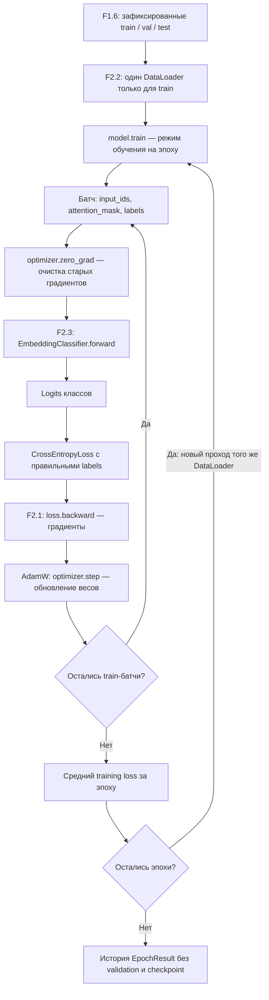

# F2.4 - Training Loop: реализация цикла обучения нейросети

## 1. Цель этапа:

К концу F2.3 в проекте уже была небольшая нейросеть для классификации технических вопросов. Она принимала `input_ids` и `attention_mask`, преобразовывала токены в векторы и выдавала четыре оценки классов - `logits`. Однако веса ещё не адаптированы к обучающим данным: **работающий `forward()` не означает обученную модель**.

В F2.2 реализован `DataLoader`, который выдаёт размеченные вопросы батчами. В F2.3 - `EmbeddingClassifier`. В F2.1 рассмотрено, как `autograd` вычисляет производные. В F2.4 компоненты объединены в **цикл обучения**.

Для каждого батча необходимо выполнить пять последовательных операций:
1. **Какой класс предсказала модель?** Формируются `logits` для каждого вопроса.
2. **Насколько предсказание ошибочно?** Оценки сравниваются с настоящими метками `labels` через `CrossEntropyLoss`.
3. **Какие параметры повлияли на ошибку?** Вызов `loss.backward()` формирует градиенты.
4. **Как изменить параметры?** Оптимизатор AdamW использует рассчитанные градиенты и обновляет веса при `optimizer.step()`.
5. **Есть ли результат?** Проверяется, что градиенты ненулевые, веса действительно изменились, а loss является конечным числом.

Например, если модель присвоила вопросу о Linux высокую оценку класса `databases`, функция потерь должна отразить эту ошибку. После обратного прохода оптимизатор корректирует веса, чтобы на похожих обучающих примерах ошибка могла стать меньше. Одно обновление **не гарантирует** правильного ответа: обучение - это множество последовательных шагов.

**Что должно получиться в конце:** воспроизводимый на CPU модуль, который проходит весь `train` по эпохам, обновляет веса, рассчитывает средний training loss и возвращает агрегированные признаки корректного выполнения. При этом тестовые вопросы и их тексты в отчёт не попадают.

## 2. Реализация: файлы этапа

В поставке F2.4 добавлены **шесть файлов**. Файлы F1–F2.3 не заменялись.

| Файл | Что реализовано и для чего |
|---|---|
| `src/pytorch_f2/training_loop.py` | **Основной алгоритм:** проверка батча и гиперпараметров, один проход по train, несколько эпох, CrossEntropyLoss, Autograd, AdamW и агрегирование потерь. |
| `scripts/pytorch_training.py` | **Наглядный запуск:** связывает подготовленные данные F2.2 с моделью F2.3 и функциями обучения; поддерживает синтетический и локальный режимы; выводит только агрегаты. |
| `tests/test_training_loop.py` | Проверяет обновление весов, ненулевые и конечные градиенты, работу с неполным последним батчем, повторяемость, запрет доступа к val/test и ошибочные входы. |
| `docs/steps/F2_04_training_loop.md` | Объясняет задачу, математические операции, последовательность реализации и способ проверки этапа. Это текущий учебный документ. |
| `requirements-pytorch-training.txt` | Минимальный отдельный профиль окружения для этапа; не является частью алгоритма. |
| `.github/workflows/f2-training-loop.yml` | Выполняет лёгкие CPU-проверки в GitHub Actions; не запускает обязательное длительное обучение на реальном корпусе. |

Существующий код, с которым работает этап: `src/pytorch_f2/data_pipeline.py` (F2.2) и `src/pytorch_f2/embedding_classifier.py` (F2.3). **Новый Training Loop вызывает эти компоненты, а не переписывает их.**

## 3. Последовательность действий

### Шаг 1. Зафиксировать вход и границы обучения
Цикл получает объект `EmbeddingClassifier` и `DataLoader`, созданный **только из `prepared.datasets["train"]`**. Батч имеет тот же контракт, что был утверждён в F2.2:

| Поле | Форма | Тип | Смысл |
|---|---|---|---|
| `input_ids` | `[B, L]` | `torch.int64` | ID токенов каждого вопроса |
| `attention_mask` | `[B, L]` | `torch.bool` | `True` для настоящих токенов, `False` для padding |
| `labels` | `[B]` | `torch.int64` | Правильный класс каждого вопроса |

Здесь `B` - число примеров в конкретном батче, `L` - длина последовательностей после выравнивания внутри батча. Обычный размер train-батча в локальном проекте - **32**, максимальная длина текста - **128**, классов - **4**.

Сохранено фиксированное разбиение F1: **1824 train / 608 validation / 608 test**. При обучении разрешён только `train`. Наличие val/test в подготовленной структуре нужно для контроля исходного split, а не для расчёта градиентов.

**Зачем этот шаг:** невозможно объективно оценивать модель, если по ошибке подмешать validation или test в обновление весов.

### Шаг 2. Добавить проверки батчей до вычисления функции потерь
В `training_loop.py` реализована функция `_validate_batch(...)`. Она проверяет, что существуют необходимые поля, `input_ids` - двумерный `torch.long`, маска имеет такую же форму и тип `torch.bool`, а `labels` - одномерный `torch.long` с числом элементов `B`.

Кроме того, проверяются CPU-устройство, непустой батч и диапазон меток: **каждая метка должна удовлетворять `0 ≤ label < C`**, где `C` - число классов модели.

При несовместимом входе код выбрасывает `TrainingError`, вместо того чтобы передать неправильные тензоры в глубину PyTorch.

**Зачем этот шаг:** если, например, в метке указан класс `4` при допустимых `0, 1, 2, 3`, нужно получить понятную ошибку данных, а не труднообъяснимый сбой во время обучения.

### Шаг 3. Создать один оптимизатор на все эпохи
Функция `train_epochs(...)` принимает модель, train-`DataLoader`, число эпох, `learning_rate` и `weight_decay`. Перед запуском она отвергает неправильные значения: нулевое или дробное число эпох, не положительный `learning_rate`, отрицательный `weight_decay`, `NaN` и бесконечности.

После этого **один раз** создаётся `torch.optim.AdamW(model.parameters(), ...)`. Тот же объект используется при обучении всех эпох.

Это важно, потому что AdamW хранит накопленную информацию о прошлых градиентах - оценки их первого и второго моментов. Создавать новый оптимизатор перед каждой эпохой означало бы терять это состояние.

В отличие от F2.1, где вычислялись только градиенты, здесь оптимизатор **реально меняет параметры модели**.

### Шаг 4. Реализовать обучение одного батча
Основная последовательность внутри `train_one_epoch(...)` выглядит так:
```python
optimizer.zero_grad(set_to_none=True)
logits = model(ids, mask)
loss = criterion(logits, labels)
loss.backward()
optimizer.step()
```

Это **учебная выдержка из алгоритма**, а не весь код функции: реальная реализация дополнительно проверяет входы, конечность loss/градиентов, число обработанных примеров и изменение весов.

Что происходит по порядку:
1. `zero_grad(...)` удаляет градиенты прошлого шага, чтобы новый батч не суммировал их случайно.
2. `model(...)` выполняет прямой проход: Embedding → Masked Mean Pooling → Linear → ReLU → Linear.
3. `criterion(...)` вычисляет ошибку по истинным `labels`.
4. `backward()` применяет правило цепочки и находит производные loss по параметрам.
5. `step()` использует градиенты для обновления весов.

**Особенно важно:** `loss.backward()` **не обновляет** веса. Изменение происходит на `optimizer.step()`.

### Шаг 5. Перевести модель в режим обучения и обработать все train-батчи
В начале `train_one_epoch(...)` вызывается `model.train()`. Этот вызов переключает режим модели, но сам по себе не обучает её и не меняет веса.

Далее код проходит по `DataLoader` до конца. Одна **итерация (step)** - обработка одного батча; одна **эпоха (epoch)** - последовательная обработка всех train-примеров. При 1824 train-записях и `batch_size=32` получается:
```math
1824 / 32 = 57 \text{ батчей на эпоху}.
```

При двух эпохах модель выполнит **114 обновлений оптимизатора**, если все батчи непустые и один `step()` вызывается для каждого батча. При неполном последнем батче его размер учитывается отдельно.

**Зачем этот шаг:** обучение происходит не по одной большой таблице целиком, а небольшими порциями, что удобно для управления памятью и вычислениями.

### Шаг 6. Рассчитать среднюю ошибку за эпоху с учётом размеров батчей
`nn.CrossEntropyLoss(reduction="mean")` возвращает **среднюю потерю внутри текущего батча**. Простой подсчёт среднего из батчевых потерь может дать неверный результат, если батчи разного размера.

Поэтому в коде для каждого батча выполняется эквивалент:
```python
batch_size = int(labels.shape[0])
total_loss += float(loss.detach()) * batch_size
samples += batch_size
```

А в конце:
```python
mean_loss = total_loss / samples
```
Это **средняя потеря по фактически обработанным обучающим примерам**, рассчитанная в момент обработки каждого батча. Это не повторная оценка всего train на одних и тех же итоговых весах в конце эпохи: веса в течение эпохи меняются.

### Шаг 7. Добавить контроль того, что модель действительно обучается
Одного факта, что код прошёл без исключения, мало. Он мог, например, по ошибке не вызвать `optimizer.step()`.

В `train_one_epoch(...)` сохраняются копии параметров перед началом эпохи и после неё сравниваются с текущими весами. Во время обратного прохода дополнительно проверяется конечность градиентов и наличие хотя бы одного ненулевого градиента.

Результат каждой эпохи представлен объектом `EpochResult` с полями:

| Поле | Что означает |
|---|---|
| `epoch` | Порядковый номер эпохи |
| `mean_loss` | Средняя training loss с учётом числа примеров |
| `samples` | Сколько train-примеров обработано |
| `batches` | Сколько батчей обработано |
| `nonzero_gradients` | Появился хотя бы один ненулевой градиент |
| `parameters_updated` | Изменился хотя бы один параметр модели |

`train_epochs(...)` считает отсутствие ненулевых градиентов либо отсутствующее обновление параметров ошибкой. Скрипт дополнительно сверяет `samples` с полным размером `train` на каждой эпохе.

Это подтверждает работоспособность цепочки оптимизации, **но ещё не доказывает высокую Accuracy или хорошее обобщение**.

### Шаг 8. Обеспечили воспроизводимость и подготовить наглядный запуск
В `scripts/pytorch_training.py` создана функция `run(...)`. В синтетическом режиме используются четыре вымышленных train-примера и два класса. В локальном режиме читаются прежний split и настройки проекта.

Для воспроизводимости задаётся `seed`. Создание модели проходит внутри `torch.random.fork_rng(devices=[])`, чтобы после выхода не оставлять изменённым глобальное состояние генератора вызывающего кода. Перемешивание train использует отдельный генератор DataLoader с тем же seed. Генератор порядка батчей **не создаётся заново перед каждой эпохой**.

Скрипт возвращает JSON только с агрегатами: `split_counts`, `loss_by_epoch`, `epoch_samples`, `epoch_batches`, признаками ненулевых градиентов и обновления параметров. Тексты реальных вопросов и их ID он не выводит.

В `tests/test_training_loop.py` реализованы проверки воспроизводимости, правильности среднего loss, неизменности PAD-строки embedding, некорректных гиперпараметров, ошибочных батчей, запрета доступа к val/test и запуска демонстрации.

**Результат реализации:** появился самостоятельный и проверяемый **training pipeline**, который использует созданные ранее DataLoader и классификатор, а не скрытый готовый механизм обучения.

## 4. Алгоритм Training Loop: что происходит в одной итерации

### 4.1. Прямой проход даёт оценки классов
F2.3 возвращает тензор `logits` формы `[B, C]`, где каждая строка содержит по одному числу для каждого класса. Например, для одного учебного примера с двумя классами можно получить:
```text
logits = [2.0, 0.0]
label = 0
```
Число `2.0` - **не вероятность 200%**. Это исходная оценка первого класса; чтобы получить вероятности, её можно нормализовать вместе с другими logits через Softmax. Однако **перед `CrossEntropyLoss` отдельно вызывать Softmax не требуется**.

### 4.2. CrossEntropyLoss измеряет ошибку
Для истинного класса `y` и logits `z` функция потерь одного примера имеет вид:
```math
\mathcal L(z,y)=-\log\!\left(\frac{e^{z_y}}{\sum_{j=1}^{C} e^{z_j}}\right)
= -z_y+\log\!\left(\sum_{j=1}^{C} e^{z_j}\right).
```

Для примера `[2.0, 0.0]`, правильный класс `0`, вероятность класса `0` после Softmax равна приблизительно `0.8808`, а потеря:
```math
\mathcal L\approx-\ln(0.8808)\approx 0.1269.
```
Если при том же правильном классе получить `[0.0, 2.0]`, потеря будет больше: приблизительно `2.1269`. Так функция потерь наказывает модель, когда она отдаёт больший вес неправильному классу.

В `nn.CrossEntropyLoss()` объединены `log_softmax` и отрицательное логарифмическое правдоподобие. Это численно устойчивее, чем вручную сначала применять Softmax, а потом логарифм.

### 4.3. Autograd вычисляет градиенты, но не меняет веса
При `loss.backward()` PyTorch проходит по графу, построенному во время `forward()`, и вычисляет для параметра `w`:
```math
\frac{\partial\mathcal L}{\partial w}.
```

Если градиент положительный, увеличение `w` при прочих равных локально увеличивает loss; если отрицательный - локально уменьшает. При этом разные параметры модели влияют на ошибку по-разному.

Градиенты получают обучаемые параметры Embedding и линейных слоёв. В проверенной модели строка `<PAD>` не обучается; её значение остаётся нулевым.

PyTorch **накапливает** градиенты. Поэтому до нового обычного шага оптимизации вызывается `optimizer.zero_grad(set_to_none=True)`. Эта команда очищает **градиенты**, а не веса нейросети.

### 4.4. AdamW использует градиенты для изменения параметров
На концептуальном уровне простейший градиентный спуск можно представить формулой:
```math
w_{t+1}=w_t-\eta\frac{\partial\mathcal L}{\partial w_t},
```


где `η` - скорость обучения (`learning_rate`). **Это иллюстрация идеи обновления, а не точная формула AdamW.**

В F2.4 используется `AdamW`: он вычисляет сглаженные оценки первого и второго моментов градиентов, адаптирует шаг по каждому параметру и отдельно применяет weight decay. Важно, что **его состояние сохраняется между батчами и эпохами**.

Именно `optimizer.step()` обновляет веса. После этого следующий батч попадает уже в несколько изменённую модель.

### 4.5. Почему средний loss по батчам нужно взвешивать
Предположим, в игрушечном примере первый батч содержал **три** вопроса и имел средний loss `0.2`, а второй - **один** вопрос со средним loss `0.8`.

Наивное среднее по батчам:
```math
(0.2+0.8)/2=0.5.
```

Но средняя потеря по **четырём вопросам**:
```math
\frac{3\cdot0.2+1\cdot0.8}{3+1}=0.35.
```

Поэтому реализация умножает `batch_loss` на размер текущего батча, суммирует эти величины и делит на число обработанных примеров.

Это особенно важно, если количество вопросов не делится на размер батча без остатка.

### 4.6. Что показывает настоящая учебная демонстрация F2.4
В синтетическом эксперименте с **четырьмя обучающими записями и двумя классами** за две эпохи в изолированной Linux/CPU-среде были получены:

| Эпоха | Средний Training Loss | Обработано примеров |
|---|---:|---:|
| 1 | 0.73230588 | 4 |
| 2 | 0.47209847 | 4 |

На таком контролируемом примере потеря уменьшилась. Тестами также подтверждено, что градиенты были ненулевыми и параметры модели изменились.

**Как правильно интерпретировать:** это подтверждает корректность механизма обучения на маленьком примере. Эти значения **не являются** Accuracy, Macro F1 или оценкой качества на настоящем test-наборе F1. На реальном корпусе числа loss зависят от конкретного запуска и не должны заранее подставляться в отчёт.

## 5. Схема: как F2.1–F2.3 соединяются в F2.4



**Важное уточнение:** в начале каждой эпохи вызывается `model.train()`, в начале каждого батча - `optimizer.zero_grad(set_to_none=True)`. Для следующих эпох используется **тот же объект DataLoader и тот же оптимизатор**, а не новые экземпляры.

Главное в этой схеме - цепочка **вход → предсказание → ошибка → градиенты → обновлённые веса**. Сам цикл обучения работает на `train` и **не** выбирает лучшую эпоху по validation. Выбор лучшей эпохи выполняется в F2.5.

## 6. Локальная проверка в PowerShell: что запускать и как читать результат

Ниже команды для **уже существующего проекта** на Windows. Они не устанавливают пакеты и не изменяют Git-историю. Вызовы демонстраций выполняют только учебное обучение в памяти; F2.4 не сохраняет checkpoint.

### 6.1. Перейти в корень проекта
```powershell
cd F:\DEVELOPMENT\ML\ml-engineering-lab
```

Все последующие команды выполняются из этой папки.

### 6.2. Проверить только F2.4
```powershell
.\.venv\Scripts\python.exe -m pytest tests/test_training_loop.py -q
```

**Что проверяется:** формы тензоров, метки, градиенты, обновление весов, неполные батчи, повторяемость, работу оптимизатора и отказ на некорректных данных.

**Подтверждённый результат Windows на момент завершения F2.4:** `48 passed`. Если тесты позднее изменятся, актуальным является фактический вывод.

### 6.3. Запустить синтетический цикл обучения
```powershell
.\.venv\Scripts\python.exe -m scripts.pytorch_training --synthetic --check
```

Скрипт создаёт модель, использует четыре искусственных train-примера и выполняет две эпохи. В JSON следует обратить внимание на поля:
```json
{
  "source": "synthetic",
  "split_counts": {"train": 4, "val": 1, "test": 1},
  "trained_split": "train",
  "epochs": 2,
  "epoch_samples": [4, 4],
  "epoch_batches": [1, 1],
  "nonzero_gradients": true,
  "parameters_updated": true,
  "train_invariants_pass": true,
  "validation_performed": false,
  "checkpoint_saved": false
}
```

Это **выборка ключевых полей**, не весь JSON. Программа также выводит `loss_by_epoch`, `batch_size`, `learning_rate`, размер словаря/число классов и число параметров. Ключевой признак успешного запуска:
```text
F2.4 Training Loop CHECK: PASS
```

**Как читать результат:** `epoch_samples=[4,4]` означает, что на каждой эпохе были обработаны все четыре train-примера. `nonzero_gradients=true` подтверждает появление ненулевых производных, а `parameters_updated=true` - изменение хотя бы одного веса. `validation_performed=false` и `checkpoint_saved=false` показывают границу именно F2.4.

### 6.4. Проверить обучение на локальном split F1
```powershell
.\.venv\Scripts\python.exe -m scripts.pytorch_training --epochs 2 --expect-train 1824 --expect-val 608 --expect-test 608 --check
```

В этом режиме скрипт читает подготовленные F1-файлы, создаёт словарь и модель, но **обучается только на 1824 train-записях**. Для стандартного размера батча 32 в агрегатах ожидаются:
```text
source: local_f1_train
split_counts: train=1824, val=608, test=608
trained_split: train
epoch_samples: [1824, 1824]
epoch_batches: [57, 57]
train_invariants_pass: true
validation_performed: false
checkpoint_saved: false
F2.4 Training Loop CHECK: PASS
```

Выше приведены ожидаемые **смысловые поля вывода**, а не дословный JSON: реальный CLI печатает их в JSON-формате. Конкретные `loss_by_epoch` нужно смотреть в результате своего запуска, а не заменять синтетическими значениями.

**Почему здесь указываются val/test:** параметры `--expect-val` и `--expect-test` проверяют лишь, что исходный split не изменился. Для оптимизации эти выборки не используются.

### 6.5. Запустить полную регрессию репозитория
```powershell
.\.venv\Scripts\python.exe -m pytest -q
```

**Что проверяется:** что F2.4 не нарушил предыдущие этапы. На момент завершения F2.4 на Windows было **`357 passed`** (309 предыдущих тестов + 48 новых). В более позднем состоянии проекта тестов больше - основной критерий - итог без `failed` и `errors`.

Один успешный запуск CLI не заменяет тесты: он показывает типичный путь обучения, тогда как тесты покрывают также неправильные входы и граничные случаи.

## 7. Что подтверждено и какие ограничения

**Подтверждено реализацией и тестами:**
- Батчи F2.2 совместимы с моделью F2.3 и функцией потерь.
- `backward()` даёт конечные и хотя бы частично ненулевые градиенты, `optimizer.step()` изменяет обучаемые параметры.
- Один объект AdamW используется на всех эпохах и сохраняет своё состояние.
- Средний training loss учитывает число примеров, в том числе неполный последний батч.
- Веса padding-токена в проверенной архитектуре остаются нулевыми.
- Повторные запуски с одинаковым seed и в одинаковых условиях воспроизводят историю и веса.
- Training Loop не обращается к val/test для обновления параметров.
- На контролируемом синтетическом примере training loss уменьшился между первой и второй эпохами.

**Не подтверждается:**
- что уменьшение training loss означает хорошее качество на новых вопросах;
- что F2.4 получил validation Accuracy/Macro F1 или лучший checkpoint;
- что в F2.4 оценивался test-набор;
- что одинаковый seed гарантирует побитно одинаковые результаты на разных устройствах и версиях PyTorch;
- что две учебные эпохи - оптимальное количество для реального датасета.

**Ограничения:** на этом этапе реализован CPU-only training loop; нет validation, early stopping, сохранения лучшей модели, мониторинга переобучения и полноценного сравнения с baseline. Эти задачи сознательно вынесены в F2.5–F2.7.

## 8. Основная мысль раздела

**В F2.4 создан собственный цикл обучения нейросети на PyTorch.** Для каждого train-батча выполняются очистка градиентов, `forward`, вычисление `CrossEntropyLoss`, обратный проход и `AdamW.step()`. Оптимизатор сохраняет состояние между батчами и эпохами; средняя потеря учитывает фактическое количество примеров, включая неполный последний батч. Корректность подтверждена конечностью потерь и градиентов, изменением обучаемых весов, проверкой сохранности PAD-строки и синтетическим примером уменьшения loss. **Validation, выбор checkpoint и независимая test-оценка не входят в F2.4.**

## 9. Файлы этапа

Рекомендуется изучать исходники **в следующем порядке**: сначала увидеть работающий эксперимент, затем пройти его внутренние функции.

| Порядок | Файл | На что смотреть в коде |
|---|---|---|
| 1 | `scripts/pytorch_training.py` | `run()`: выбор синтетического или локального режима, `prepare_data()`, создание модели, вызов `make_loader()` и `train_epochs()`, агрегированный JSON. |
| 2 | `src/pytorch_f2/training_loop.py` | `train_one_epoch()`: `model.train()`, очистка градиентов, `forward`, `CrossEntropyLoss`, `backward`, `optimizer.step`, сбор статистики. **Главная функция F2.4.** |
| 3 | `src/pytorch_f2/training_loop.py` | `train_epochs()`: проверка гиперпараметров, создание одного AdamW, вызовы обучения по эпохам и проверка результатов. |
| 4 | `src/pytorch_f2/training_loop.py` | `_validate_batch()` и `_validate_hyperparameters()`: формы, типы, метки и запрет некорректных параметров. |
| 5 | `src/pytorch_f2/training_loop.py` | `EpochResult`: какие значения сохраняются после эпохи и почему они отделены от исходных данных. |
| 6 | `tests/test_training_loop.py` | Проверки изменения весов, ненулевых градиентов, PAD, взвешенного loss, воспроизводимости, val/test isolation и неправильных данных. |
| 7 | `src/pytorch_f2/embedding_classifier.py` | `EmbeddingClassifier.forward()`: откуда берутся `logits`, которые поступают в CrossEntropyLoss. Код из F2.3. |
| 8 | `src/pytorch_f2/data_pipeline.py` | `prepare_data()` и `make_loader()`: формирование train-only Dataset, батчей и воспроизводимого порядка. Код из F2.2. |

**Итог F2.4:** реализован собственный цикл обучения: определены функции ошибок, вычисление градиентов, обновление весов, расчёт статистики эпохи и границы train-only обучения.
