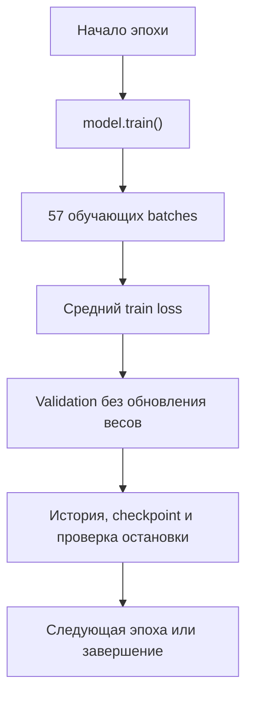

# F2.4 - Training Loop: обучение Embedding Classifier в PyTorch

F2.4 - это цикл, в котором нейросеть постепенно меняет свои веса, чтобы уменьшать ошибку. Основные действия: предсказать, измерить ошибку, вычислить градиенты и обновить параметры.

## Зачем нужен цикл обучения
В F2.2 подготовлен поток размеченных вопросов: последовательности `input_ids`, маски `attention_mask` и метки `labels`. В F2.3 создан `EmbeddingClassifier`, преобразующий последовательность в четыре *logits* (для реального корпуса F1). До F2.4 веса этой сети случайны: наличие `forward()` ещё не означает способности различать тематики вопросов.

F2.4 вводит **обновление параметров по ошибке предсказаний**. Пока используем исключительно `train` из уже зафиксированного split F1. Validation, выбор лучшей эпохи, checkpointing и независимая test-оценка не входят в этот алгоритм.

## Вычислительная схема
```text
Train JSONL (F1.6)  ─> F2.2 Dataset/DataLoader (shuffle с локальным seed)
                                      |
                         train batch (input_ids, attention_mask, labels)
                                      |
                                      v
                               model.train()
                                      |
                         optimizer.zero_grad(set_to_none=True)
                                      |
                                      v
                         EmbeddingClassifier.forward()
                                      |
                                logits [B, C]
                                      |
                 CrossEntropyLoss(logits, labels [B])
                                      |
                      loss.backward() = d(loss)/d(weights)
                                      |
                             optimizer.step()
                                      |
                          обновлённые веса модели
                                      |
                              следующий батч

                         После всех батчей эпохи:
                    mean_loss = sum(loss_b * B_b) / sum(B_b)
                                      |
                               следующая эпоха
```

Здесь `B` - число примеров в одном батче, `C` - число классов. Одинаковый `optimizer` используется во всех эпохах, чтобы сохранять внутренние моменты AdamW.

**Batch - группа примеров, которую модель обрабатывает вместе.** В проекте обычный batch содержит 32 вопроса.

## Логиты и CrossEntropyLoss
### Вход и выход
- `input_ids: torch.int64 [B, L]` - индексы токенов;
- `attention_mask: torch.bool [B, L]` - действительные токены;
- `labels: torch.int64 [B]` - номера классов от `0` до `C-1`;
- `logits: torch.float32 [B, C]` - оценки классов до нормализации;
- `loss: torch.float32 []` - одно число, используемое при обратном проходе.

В коде применяется `nn.CrossEntropyLoss()`. Она объединяет `log_softmax` и отрицательное логарифмическое правдоподобие. **Не надо отдельно вызывать `softmax` перед функцией потерь.** Это лишняя операция, способная снизить численную устойчивость и изменить смысл аргумента.

**Функция потерь, или loss function, измеряет ошибку модели.**

`model.train()` - включение режима обучения. В начале каждой эпохи режим обучения включается снова, потому что предыдущая validation переключает модель в режим оценки.

## Как обновляются веса: autograd и AdamW
### zero_grad() - очистка старых градиентов
PyTorch по умолчанию накапливает градиенты. Если не очищать их перед следующим батчем, градиент будет суммой нескольких обратных проходов; это нарушит задуманную схему одной оптимизации на батч. Поэтому в начале итерации вызывается:
```python
optimizer.zero_grad(set_to_none=True)
```
При `set_to_none=True` старые `.grad` освобождаются и создаются заново при `backward()`.

### Прямой и обратный проходы
```python
logits = model(input_ids, attention_mask)
loss = criterion(logits, labels)
loss.backward()
```
`backward()` строит градиенты не только для двух линейных слоёв, но и для обучаемых строк таблицы embedding. Градиент `padding_idx=0` остаётся нулевым; строка PAD изначально нулевая и не изменяется в проверенной схеме.

Для параметра `w` величина `w.grad` содержит локальную производную \(\partial\mathcal L / \partial w\). Она показывает направление роста функции потерь, поэтому оптимизатор использует шаг в противоположном направлении.

### `optimizer.step()`
```python
optimizer.step()
```
В F2.4 используется `torch.optim.AdamW`, который адаптирует масштаб шага по оценкам моментов градиента и отдельно применяет weight decay. В упрощённом виде при \(t\)-м шаге.

Важно: оптимизатор создаётся один раз перед всеми эпохами. Если создавать его заново на каждой эпохе, оценки моментов AdamW будут сбрасываться.

## Средний loss за эпоху: проблема последнего батча
`CrossEntropyLoss(reduction="mean")` уже возвращает среднее внутри батча. Если последний батч содержит меньше вопросов, обычное среднее из значений `loss` по батчам даст ему слишком большой вес.

В реализации `total_loss += loss.item() * batch_size` и `mean_loss = total_loss / samples`. Это среднее значение loss, измеренное на последовательных обучающих батчах в момент их обработки, а не повторная оценка на всём train по весам в конце эпохи.

## Воспроизводимость на CPU
В CLI модель создаётся в `torch.random.fork_rng(devices=[])`, а внутри контекста устанавливается `torch.manual_seed(seed)`. Такой подход фиксирует инициализацию, но восстанавливает внешнее состояние генератора после завершения эксперимента. Генератор не пересоздаётся между эпохами, поэтому каждая эпоха получает новый, но предсказуемый порядок.

Выполнение целевого эксперимента - на CPU; проверка одинаковых losses и весов относится к одинаковому окружению/версии PyTorch. Обещать побитовое совпадение между разными версиями библиотек, устройствами или аппаратными платформами нельзя.

## Границы данных: train, validation, test
1. `prepare_data()` проверяет зафиксированные группы/ID split и формирует отображения классов и словарь **только по train**.
2. Цикл обучения получает **только** `prepared.datasets["train"]`.
3. Validation/test не участвуют ни в `loss.backward()`, ни в `optimizer.step()`, ни в выборе `learning_rate`, ни в оценке текущего качества.
4. Размеры validation/test могут проверяться на соответствие ожиданию, но их метки не участвуют в вычислении потерь.
5. F2.4 не создаёт новых файлов с текстами, не сохраняет веса, не пересоздаёт F1 split.

## Обработка ошибок и проверяемые инварианты
После эпохи один раз сравниваются параметры модели до и после обучения: изменение весов плюс ненулевые градиенты подтверждают, что training loop не сводится к пустой имитации.

`train_epochs()` принимает положительное целое число эпох, положительный конечный learning rate и конечный неотрицательный weight decay. Он создаёт один `AdamW` и сохраняет его состояние во всех эпохах.

`run()` дополнительно проверяет, что каждый проход обработал **ровно столько примеров, сколько содержит train**. CLI возвращает только агрегаты: количество примеров, размер словаря/классов, средний loss по эпохам, ненулевые градиенты и факт изменения параметров.

Отдельные тесты подтверждают:
- форму и тип меток, масок и токенов;
- конечность потерь/градиентов, реальное изменение весов и неизменность строки PAD;
- повторяемость losses и итоговых весов при одном seed;
- корректное взвешивание `loss` для неполного последнего батча;
- отсутствие обращений к val/test в training loop;
- работу на синтетических JSONL с конфигурацией в формате реального F1;
- отказ при пустых батчах, неподходящих гиперпараметрах и некорректных метках.

## Результат контролируемой синтетической демонстрации
На четырёх синтетических train-записях (два класса, один батч на эпоху) два прохода дали следующие наблюдения в изолированном Linux/CPU тестовом окружении:
| Эпоха | Средний train loss | Обработано примеров |
|---|---:|---:|
| 1 | 0.73230588 | 4 |
| 2 | 0.47209847 | 4 |

Подтверждены ненулевые градиенты и изменение параметров. Уменьшение loss в этом контролируемом примере демонстрирует корректность цепочки `forward → loss → backward → step`, но не измеряет качество модели на реальных вопросах.

В режиме локального корпуса программа использует прежние параметры `seed=42`, `batch_size=32`, `embedding_dim=48`, `hidden_dim=48`, `learning_rate=0.003` и запускает две эпохи по умолчанию как smoke-проверку, не меняя значение `epochs=12` в исходном конфиге.

## Схема всей эпохи


## Файлы
1. **`src/pytorch_f2/data_pipeline.py`** - `prepare_data`, `QuestionDataset`, `make_loader`: где формируется train-only словарь, `labels` и перемешивание батчей.
2. **`src/pytorch_f2/embedding_classifier.py`** - `forward`, `masked_mean_pool`, `EmbeddingClassifier`: путь от ID до logits без softmax.
3. **`src/pytorch_f2/training_loop.py`** - `_validate_batch`, `train_one_epoch`, `train_epochs`: вычисление CrossEntropyLoss, очистка/расчёт градиентов, AdamW, взвешенный loss.
4. **`scripts/pytorch_training.py`** - связь подготовленного F1 split с моделью, локализация seed и агрегированный отчёт без исходных текстов.
5. **`tests/test_training_loop.py`** - числовые инварианты и отрицательные сценарии, особенно вес батча, восстановление RNG и исключение val/test из обучения.

## Ограничения результата
- Это training smoke, а не оценка качества классификации.
- В примере отсутствуют validation loss, Macro F1, accuracy, early stopping и выбор лучшего checkpoint, они будут в F2.5.

## Основная мысль F2.4
Обучение - это повторение понятных действий: предсказать, измерить ошибку, вычислить градиенты и обновить веса. Dataset подаёт примеры, модель вычисляет ответ, autograd считает производные, optimizer меняет параметры.
- Optimizer создаётся до цикла, а его состояние сохраняется между шагами.
- `model.train()` включает режим, но не обновляет веса.
- `zero_grad()` очищает градиенты, а не веса.
- Forward выдаёт logits и создаёт вычислительный граф.
- Loss измеряет ошибку иначе, чем accuracy.
- Backward считает производные, step изменяет параметры.
- Средний train loss собирается с учётом размера batch.
- Step и epoch — разные единицы обучения.
- Динамика train loss не заменяет validation.
