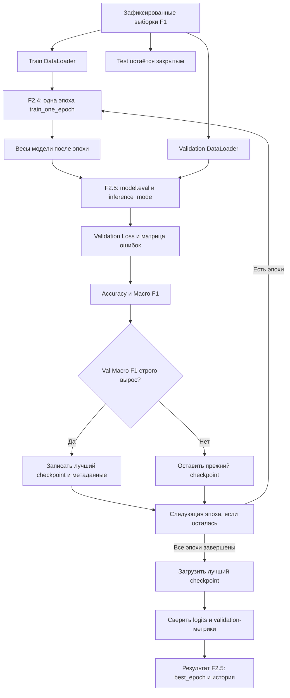

# F2.5 - Validation & Checkpointing: проверка и выбор лучшей модели

## 1. Цель этапа:

В F2.4 реализовано изменение весов нейросети: модель получает батч технических вопросов, вычисляет ошибку, находит градиенты и обновляет параметры через AdamW. Корректность вычислительной цепочки подтверждена изменением весов и уменьшением training loss на небольшом синтетическом примере.

Но возникла новая проблема: **уменьшение ошибки на обучающих данных ещё не означает, что модель лучше распознаёт новые вопросы**. Более того, последняя эпоха не обязательно окажется лучшей. Например, после третьей эпохи модель могла показать лучший результат на новых данных, а после четвёртой - ухудшиться.

Нужен механизм, который выполняет три отдельные задачи:
1. **Оценивает модель после каждой эпохи** на вопросах, не участвовавших в обновлении весов.
2. **Выбирает лучшую эпоху по заранее заданной метрике**, а не на глаз и не по test-набору.
3. **Сохраняет веса именно выбранной эпохи** и доказывает, что модель после загрузки выдаёт те же результаты.


В F2.5 реализованы validation-проход и checkpointing. Критерий выбора - **максимальный `val_macro_f1`**. Если значение не улучшилось, ранее сохранённый checkpoint остаётся без изменений.

Зафиксированный split Фазы 1 сохраняется: **1824 train / 608 validation / 608 test**. Разбиение повторно не создаётся; словарь не расширяется по validation; test не используется для выбора модели.

**Что должно получиться:** история обучения и validation по эпохам, номер лучшей эпохи, файл `*.pt` с её весами и метаданными, а также проверка совпадения предсказаний и validation-метрик после восстановления.

## 2. Реализация: файлы этапа

В F2.5 добавлены **шесть файлов**. Они не заменяют исходники F1–F2.4.

| Файл | Что реализовано и для чего |
|---|---|
| `src/pytorch_f2/validation_checkpoint.py` | **Основная реализация F2.5:** проверка val-загрузчика, вычисление loss/Accuracy/Macro F1, выбор лучшей эпохи, сохранение checkpoint, контроль метаданных и восстановление весов. |
| `scripts/pytorch_validation.py` | **Наглядный запуск:** собирает F2.2 DataLoader и F2.3 модель, запускает F2.4 обучение вместе с validation, печатает историю эпох, номер лучшей эпохи и результат восстановления. Поддерживает синтетические и локальные данные F1. |
| `tests/test_validation_checkpoint.py` | Автоматические проверки метрик, границ train/val/test, правила выбора эпохи, неизменности весов при validation, корректности checkpoint и обработки повреждённых данных. |
| `docs/steps/F2_05_validation_checkpointing.md` | Этот учебный материал: что и зачем реализовано, как работает алгоритм и как проверить результат. |
| `requirements-pytorch-validation.txt` | Отдельный профиль зависимостей F2.5. Сам алгоритм описан в Python-модулях выше. |
| `.github/workflows/f2-validation-checkpoint.yml` | Лёгкая CPU-проверка автоматических тестов F2.5 в GitHub Actions. |

**Связь с предыдущими этапами:** F2.2 даёт три готовые выборки и словарь; F2.3 - `EmbeddingClassifier`; F2.4 - функцию `train_one_epoch()`, которая действительно обновляет параметры. F2.5 добавляет к этому процессу **оценку, выбор и восстановление**, но не меняет сами алгоритмы предыдущих этапов.

## 3. Последовательность действий

### Шаг 1. Разделить обучение и оценку по назначению
Для обновления весов используются батчи **только из train**. После окончания каждой эпохи модель оценивается на **validation**, но никаких вызовов `backward()` или `optimizer.step()` на этой выборке нет.

Входные данные уже подготовлены F2.2. Один батч имеет следующий вид:

| Поле | Форма | Тип | Что содержит |
|---|---|---|---|
| `input_ids` | `[B, L]` | `torch.int64` | Индексы токенов одного или нескольких вопросов |
| `attention_mask` | `[B, L]` | `torch.bool` | Настоящие токены (`True`) и padding (`False`) |
| `labels` | `[B]` | `torch.int64` | Правильные номера классов |

`B` - количество вопросов в текущем батче; `L` - фактическая выровненная длина в этом батче (не более 128 в локальной конфигурации). Для четырёх классов `EmbeddingClassifier` возвращает `logits` формы `[B, 4]`.

**Назначение:** модель должна получать независимую обратную связь о качестве, не превращая validation в дополнительную обучающую выборку.
### Шаг 2. Проверить, что validation-загрузчик действительно читает validation
Вспомогательная функция `_require_split(loader, "val")` проверяет не только название переменной. Она убеждается, что передан `DataLoader` с `QuestionDataset` и что все его записи принадлежат части `val`.

Для validation дополнительно требуется последовательный обход (`SequentialSampler`) и `drop_last=False`: ни один вопрос не должен исчезнуть при оценке, даже если последний батч неполный.

Такая проверка защищает от ошибки, когда под видом `val_loader` в функцию случайно передают train- или test-данные.

**Назначение проверки:** Accuracy и F1 не характеризуют требуемую выборку, если рассчитаны по другим данным.

### Шаг 3. Реализовать оценку без расчёта градиентов
Основная функция - `evaluate_validation(model, loader)`. Перед обходом батчей она вызывает `model.eval()` и выполняет прямые проходы внутри `torch.inference_mode()`.

Это **разные операции**:
- `model.eval()` включает режим оценки для слоёв, поведение которых зависит от режима (например, Dropout и BatchNorm). В `EmbeddingClassifier` таких слоёв нет, но вызов делает процедуру корректной и расширяемой.
- `torch.inference_mode()` отключает отслеживание операций для автодифференцирования и связанные накладные расходы. В validation производные по весам не нужны.

Функция запоминает прежнее значение `model.training` и восстанавливает его даже при ошибке. Таким образом, оценка не должна неожиданно изменить режим для следующей обучающей эпохи.

**Важно:** validation считает результат текущих весов, но не изменяет эти веса.

### Шаг 4. Рассчитать Accuracy и Macro F1 по всем примерам
Для каждого validation-батча вычисляются `logits`, затем определяется номер предсказанного класса:
```python
predictions = logits.argmax(dim=1)
```

По истинным `labels` и предсказаниям строится **матрица ошибок** `C × C`, где строки - истинные классы, а столбцы - предсказанные. В реализации пары `(истинный класс, предсказанный класс)` сначала кодируются как `label * C + prediction`, после чего `torch.bincount()` подсчитывает все сочетания и возвращает матрицу нужной формы.

Из матрицы ошибок вычисляются две метрики:
- **Accuracy:** какая доля вопросов отнесена к правильным классам.
- **Macro F1:** насколько хорошо модель работает по каждому классу в среднем, считая каждый класс одинаково важным.

Важная деталь: Macro F1 усредняется **по всем известным классам**, даже если некоторый класс не встретился в текущей validation-выборке. При нулевом знаменателе для F1 используется значение `0`.

### Шаг 5. Агрегировать validation loss с учётом числа примеров
Функция потерь `CrossEntropyLoss` по умолчанию часто выдаёт среднее значение внутри батча. Если затем усреднить такие значения без учёта числа вопросов, неполный последний батч получит незаслуженно большой вес.

Поэтому в F2.5 используется суммарная потеря внутри каждого батча:
```python
batch_loss = nn.functional.cross_entropy(logits, labels, reduction="sum")
```

Потери суммируются по всем validation-батчам и делятся на **общее число вопросов**, а не на число батчей. Это делает результат корректным и при неполном последнем батче.

В отличие от train loss из F2.4, validation loss вычисляется на **одной фиксированной версии весов после эпохи**.

### Шаг 6. Задать единое правило выбора лучшей эпохи
В `fit_with_validation(...)` сначала вызывается обучение одной эпохи из F2.4, затем `evaluate_validation(...)`. Полученные показатели записываются в историю эксперимента.

Правило выбора **заранее определено и не меняется по ходу запуска**:
```python
if validation.macro_f1 > best_score:
    best_score = validation.macro_f1
    best_epoch = epoch
    # Сохранение весов лучшей эпохи.
```

Сравнение строгое (`>`), а не `>=`. Значит, при равенстве Macro F1 **остаётся более ранняя эпоха**. Ни validation loss, ни Accuracy не используются как дополнительные критерии выбора.

В этом этапе нет `early stopping`: все запланированные эпохи выполняются до конца. **Сохраняется лучшая версия**, но обучение не прерывается при отсутствии улучшений.

### Шаг 7. Сохранить веса и метаданные их происхождения
Когда появляется новая лучшая эпоха, функция `_save_checkpoint(...)` сохраняет `model.state_dict()` и метаданные. Перед записью тензоры весов отсоединяются от вычислительного графа, копируются на CPU и клонируются.

Одного набора весов недостаточно. Для правильного восстановления важно знать, **какой размер словаря, какие номера классов и какая архитектура использовались**.

Особенно важен `vocab_fingerprint`: SHA-256 от канонического представления отображения `token → id`. Если при восстановлении номера токенов переставились, веса Embedding уже нельзя правильно интерпретировать, даже когда размер словаря остался тем же.

Файл сначала записывается во временное место в **том же каталоге**, затем атомарно заменяет checkpoint через `os.replace()`. Это снижает риск оставить частично записанный файл при сбое записи.

Состояние AdamW **не сохраняется**: checkpoint предназначен для восстановления весов и оценки, а не для точного продолжения обучения с прежним состоянием оптимизатора.

### Шаг 8. Проверить загрузку и совпадение результатов
Сразу после сохранения checkpoint F2.5 загружает его в новый экземпляр `EmbeddingClassifier` через `restore_best_checkpoint(...)`. При загрузке используются `map_location="cpu"`, `weights_only=True` и строгая сверка ключей весов `load_state_dict(..., strict=True)`.

До сохранения и после загрузки прогоняется **один и тот же validation-батч**. Сравниваются сами `logits`, а не только предсказанные классы: совпадение классов при разных числах могло бы скрыть ошибку восстановления.

Демонстрационный скрипт дополнительно повторно загружает выбранный checkpoint, оценивает его на validation и сверяет метрики с сохранёнными метаданными. Это важно, потому что **лучшая эпоха может оказаться не последней**.

**Результат реализации:** появились отдельные, воспроизводимые процедуры оценки, выбора, сохранения и восстановления модели. Test-набор остался вне этой цепочки.

## 4. Алгоритм Validation & Checkpointing: что происходит после эпохи

### 4.1. Отличие training и validation
Во время обучения вычисляются градиенты и обновляются веса:
```python
model.train()
# Для каждого train-батча:
optimizer.zero_grad(set_to_none=True)
logits = model(input_ids, attention_mask)
loss = criterion(logits, labels)
loss.backward()
optimizer.step()
```

При validation задача другая:
```python
was_training = model.training
model.eval()
try:
    with torch.inference_mode():
        logits = model(input_ids, attention_mask)
        predictions = logits.argmax(dim=1)
        # Накапливаем loss и матрицу ошибок.
finally:
    model.train(was_training)
```

Это **учебные выдержки**, не полные тела функций. Главное отличие: во втором фрагменте нет ни `backward()`, ни `optimizer.step()`.

### 4.2. Матрица ошибок - основа проверяемых метрик

Пусть всего `C` классов, а `M[i,j]` - количество примеров, у которых истинный класс `i`, а предсказанный - `j`.

Тогда:
```math
\mathrm{Accuracy} = \frac{\sum_{c=1}^{C} M_{cc}}{\sum_{i=1}^{C}\sum_{j=1}^{C} M_{ij}}.
```

Для каждого класса отдельно вычисляем:
```math
TP_c=M_{cc},\qquad
FN_c=\sum_j M_{cj}-TP_c,\qquad
FP_c=\sum_i M_{ic}-TP_c.
```

```math
F1_c = \frac{2TP_c}{2TP_c+FP_c+FN_c},\qquad
\mathrm{Macro\ F1}=\frac{1}{C}\sum_{c=1}^{C}F1_c.
```

Если знаменатель отдельного `F1_c` равен нулю, его значение в реализации принимается равным `0`.

**Небольшой числовой пример - условные 10 вопросов и 2 класса:**

| Истинный класс / Предсказанный | Класс 0 | Класс 1 |
|---|---:|---:|
| Класс 0 | 5 | 0 |
| Класс 1 | 5 | 0 |

Модель предсказала **всем** вопросам класс 0. Из десяти ответов пять оказались правильными, поэтому `Accuracy = 5/10 = 0.5`.

Для класса 0: `TP=5`, `FP=5`, `FN=0` и `F1₀ = 10/(10+5+0) = 2/3`.

Для класса 1: `TP=0`, `FP=0`, `FN=5` и `F1₁ = 0`.

Итоговый `Macro F1 = (2/3 + 0)/2 = 1/3 ≈ 0.3333`.

**Вывод:** Accuracy выглядит терпимо (50%), но Macro F1 показывает, что один класс модель вообще не умеет предсказывать. Поэтому для выбора checkpoint используется Macro F1. Эти числа **учебные**, не метрики реального корпуса.

### 4.3. Расчёт validation loss по всем примерам
Пусть у двух validation-батчей средние потери `0.2` и `0.8`, но в первом **три** вопроса, а во втором **один**.

Неправильно: `(0.2 + 0.8)/2 = 0.5`.

Правильно:
```math
\mathrm{Val\ Loss}=\frac{3\cdot0.2+1\cdot0.8}{3+1}=0.35.
```

В коде эту формулу обеспечивает `reduction="sum"` с делением суммарной потери на `total_samples`. Она работает при любом количестве батчей и не зависит от того, полон ли последний.

### 4.4. Как выбирается checkpoint
Представим следующую **условную** историю трёх эпох:

| Эпоха | Train Loss | Val Loss | Val Macro F1 | Решение |
|---|---:|---:|---:|---|
| 1 | 0.80 | 0.74 | 0.60 | Сохранить как лучшую |
| 2 | 0.55 | 0.69 | 0.70 | Обновить checkpoint |
| 3 | 0.38 | 0.75 | 0.70 | Не обновлять: F1 равен |

В этом примере ошибка обучения уменьшается все три эпохи, но лучшим checkpoint остаётся **эпоха 2**. Эпоха 3 не выигрывает, хотя её train loss ниже.

Это пример правила сравнения, **а не реальные показатели модели**.

В настоящем F2.5 итог определяется выражением:
```math
\mathrm{best\_epoch}=\text{первая эпоха, на которой достигается максимум}\ \mathrm{val\_macro\_f1}.
```

`ValidationResult` хранит метрики одной проверки, `EpochValidation` связывает одну train-эпоху с её validation, а `FitResult` содержит всю историю, лучшую эпоху и путь к checkpoint.

### 4.5. Из чего состоит сохранённый checkpoint
Формат `*.pt` версии 1:
```text
checkpoint
├── format_version = 1
├── model_state
│ └── CPU-копии тензоров model.state_dict()
└── metadata
    ├── model: vocab_size / num_classes / embedding_dim / hidden_dim
    ├── vocab_fingerprint: SHA-256 словаря token_to_id
    ├── label_to_id и max_length
    ├── seed / learning_rate / weight_decay / planned_epochs
    ├── split_counts
    ├── selection_metric = val_macro_f1
    ├── tie_break = earliest_epoch
    ├── best_epoch / val_macro_f1 / val_accuracy / val_mean_loss
    └── torch_version
```

Метаданные необходимы не для красоты отчёта: они не позволяют случайно загрузить веса с другим словарём, другой нумерацией классов или несовместимой архитектурой.

**Почему недостаточно `vocab_size`:** два словаря могут содержать одинаковое число токенов, но назначать им разные ID. Тогда одна и та же строка таблицы Embedding будет соответствовать разным словам. `vocab_fingerprint` позволяет это выявить.

Загрузка выполняется с `weights_only=True`, однако это **не делает произвольный недоверенный файл безопасным**. Сохранять и открывать следует контролируемые локальные checkpoint-файлы.

### 4.6. Проверка восстановления и границы checkpoint
После сохранения модель загружается из **фактического файла**, а не просто копируется в памяти. Сравнение одинаковых logits проверяет, что параметры восстановлены без изменения вычисленного ответа.

Отдельная сверка validation loss, Accuracy и Macro F1 с метаданными подтверждает, что загружен именно выбранный checkpoint, а не веса последней эпохи.

Но этот механизм **не является полноценным resume training**: в checkpoint нет состояния оптимизатора AdamW, необходимого для точного продолжения той же последовательности шагов обучения.

## 5. Схема: как F2.4 превращается в выбор лучшей модели



**Главное на схеме:** обучение изменяет веса **только по train**; validation используется для сравнения эпох и сохранения лучшей версии; test здесь не участвует ни в выборе, ни в оценке. В F2.5 нет перехода «остановить обучение после N неудачных эпох» — такая логика не была реализована.

## 6. Локальная проверка в PowerShell: что запускать и как читать результат

Команды ниже предназначены для **уже существующего проекта** на Windows. Они не устанавливают пакеты и не изменяют историю Git. Реальный запуск обучения может записать checkpoint: для безопасного повторения следует использовать **отдельное имя файла**, чтобы не затронуть `f2_5_best.pt` из последующих экспериментов.

### 6.1. Перейти в проект
```powershell
cd F:\DEVELOPMENT\ML\ml-engineering-lab
```

### 6.2. Запустить только тесты F2.5
```powershell
.\.venv\Scripts\python.exe -m pytest tests/test_validation_checkpoint.py -q
```

**Что проверяется:** расчёт validation-метрик, правильность выбора лучшей эпохи и tie-break, разделение train/val/test, отсутствие обновления весов на validation, совместимость словаря и меток при загрузке, повреждённые checkpoint, CLI и воспроизводимость.

**Результат, подтверждённый на Windows при завершении F2.5:** `57 passed`. Это число относится к тестам **только F2.5**. Если текущий репозиторий содержит обновлённые тесты, ориентируемся на фактический вывод.

### 6.3. Запустить синтетическую демонстрацию
```powershell
.\.venv\Scripts\python.exe -m scripts.pytorch_validation --synthetic --check
```

В этом режиме используются **4 train, 1 validation и 1 test-запись**, созданные искусственно. По умолчанию выполняются **три эпохи**; checkpoint сохраняется во временном каталоге и удаляется после завершения. Test-запись не оценивается.

В JSON важно увидеть следующие поля (показана **структура**, а не обещание точных значений метрик для любой версии окружения):
```json
{
  "source": "synthetic",
  "split_counts": {"train": 4, "val": 1, "test": 1},
  "trained_split": "train",
  "selection_split": "val",
  "test_evaluated": false,
  "selection_metric": "val_macro_f1",
  "epochs": 3,
  "checkpoint_saved": true,
  "checkpoint_reload_match": true,
  "validation_invariants_pass": true
}
```

В полном выводе дополнительно будут `history`, `best_epoch`, `best_val_macro_f1` и `checkpoint_location`. При корректном выполнении в конце появится:
```text
F2.5 Validation/Checkpoint CHECK: PASS
```

**Интерпретация:** `trained_split=train` доказывает границу обучения на уровне настроек демонстрации; `selection_split=val` — границу выбора модели; `test_evaluated=false` — отсутствие test-оценки в этом запуске; `checkpoint_reload_match=true` — совпадение logits и validation-метрик после восстановления. Автоматические тесты дополнительно проверяют эти инварианты независимо от одного демонстрационного запуска.

### 6.4. Проверить работу на локальном split F1, не перезаписывая прежний checkpoint
```powershell
.\.venv\Scripts\python.exe -m scripts.pytorch_validation --epochs 3 --checkpoint checkpoints/f2_5_study.pt --expect-train 1824 --expect-val 608 --expect-test 608 --check
```

Эта команда использует **реальные локальные записи F1**, строит словарь только по train и выполняет три эпохи обучения на 1824 вопросах. На 608 validation-вопросах рассчитываются метрики после каждой эпохи. Размер test проверяется, **но сам test не оценивается**.

Файл для учебного повтора записывается в `checkpoints/f2_5_study.pt`, поэтому основной `checkpoints/f2_5_best.pt` не перезаписывается. Эти файлы локальные и не должны публиковаться в Git.

После запуска смотреть:
- `history`: какие `train_loss`, `val_loss`, `val_accuracy`, `val_macro_f1` получены на каждой эпохе;
- `best_epoch`: какой checkpoint был выбран;
- `best_val_macro_f1`: какой именно критерий определил выбор;
- `checkpoint_reload_match`: совпала ли восстановленная модель с сохранённым результатом;
- `validation_invariants_pass`: обработаны ли ожидаемые train/validation-примеры.

**Не подставлять заранее численные метрики:** они должны быть взяты из фактического вывода конкретного эксперимента.

### 6.5. Запустить полную регрессию проекта
```powershell
.\.venv\Scripts\python.exe -m pytest -q
```

**Что проверяется:** не сломались ли алгоритмы и тесты F1, F2.1–F2.4 и других уже установленных этапов.

**Исторически подтверждённый результат на Windows после завершения F2.5:** `414 passed` (357 предыдущих + 57 новых). Сейчас проект содержит следующие этапы и тестов может быть больше; ориентируемся на отсутствие `failed` и `errors`.

## 7. Что подтверждено и какие ограничения

**Подтверждено реализацией и тестами:** validation не обновляет параметры модели, использует только `val`, обходит все примеры, корректно считает Accuracy/Macro F1 и среднюю потерю, выбирает первую эпоху с максимальным Macro F1, записывает совместимый checkpoint и воспроизводимо восстанавливает результаты.

**Не подтверждается:** что минимальный train loss означает лучший checkpoint; что Validation Macro F1 равен качеству на test; что в F2.5 уже проведено итоговое сравнение с Logistic Regression; что здесь реализованы early stopping, подбор гиперпараметров по test или точное возобновление работы AdamW с прежним состоянием оптимизатора.

**Ограничения:**
- Для этой реализации оценка выполняется на CPU и ожидает F2.2 `QuestionDataset` с правильной меткой `split`.
- Числа синтетической демонстрации слишком малы, чтобы судить о качестве классификатора на реальных вопросах.
- Validation участвует в **выборе** модели; поэтому это не независимая финальная оценка качества - test будет использован отдельно в F2.7.
- Сохранённые веса пригодны для восстановления модели и инференса, но не содержат состояния оптимизатора для точного `resume training`.
- Сверка `vocab_fingerprint` защищает от несоответствия нумерации токенов, но не заменяет другие проверки происхождения данных и сохранности файлов.

## 8. Основная мысль раздела

**В F2.5 реализована независимая validation-оценка и сохранение лучшей версии `EmbeddingClassifier`.** После каждой train-эпохи в режиме `eval()` и `inference_mode()` рассчитываются validation loss, Accuracy, Macro F1 и матрица ошибок без обновления весов. Критерий выбора - **максимальный validation Macro F1**; при равенстве сохраняется первая достигшая максимума эпоха. Лучшие веса и метаданные записываются в checkpoint с проверкой отпечатка train-словаря, после чего выполняется восстановление и сверка предсказаний. **Test-выборка не участвует в выборе модели; early stopping и точное возобновление обучения не реализованы.**

## 9. Файлы этапа

Изучай исходники в следующем порядке: сначала наглядный запуск, затем сам алгоритм и только после этого дополнительные проверки.

| Порядок | Файл | На что обратить внимание |
|---|---|---|
| 1 | `scripts/pytorch_validation.py` | `run()` и `main()`: как собираются F2.2 DataLoader и F2.3 модель, разделяются train/val, выбирается путь checkpoint и формируется история эпох. |
| 2 | `src/pytorch_f2/validation_checkpoint.py` | `evaluate_validation()`: режим `eval`, `inference_mode`, суммирование потерь, построение confusion matrix и восстановление прежнего режима модели. |
| 3 | `src/pytorch_f2/validation_checkpoint.py` | `_scores_from_confusion()`: откуда берутся Accuracy и Macro F1, что происходит при нулевом знаменателе. |
| 4 | `src/pytorch_f2/validation_checkpoint.py` | `fit_with_validation()`: повторение «train → val», строгий критерий улучшения `macro_f1 > best_score`, история и номер лучшей эпохи. |
| 5 | `src/pytorch_f2/validation_checkpoint.py` | `vocabulary_fingerprint()` и `_save_checkpoint()`: хеширование `token_to_id`, копирование тензоров на CPU, временный файл и `os.replace()`. |
| 6 | `src/pytorch_f2/validation_checkpoint.py` | `restore_best_checkpoint()`: проверки версии формата, словаря, классов, архитектуры и строгая загрузка `state_dict`. |
| 7 | `tests/test_validation_checkpoint.py` | Тесты матрицы ошибок, невозможности оценивать train/test вместо val, выбора первой лучшей эпохи, повторяемости и испорченных checkpoint. |
| 8 | `src/pytorch_f2/training_loop.py` | `train_one_epoch()`: как F2.5 использует уже реализованное обучение F2.4, не меняя его алгоритм. |
| 9 | `src/pytorch_f2/data_pipeline.py` и `src/pytorch_f2/embedding_classifier.py` | Как формируются выборки, `input_ids`/маски и `logits`, которые передаются в validation. |

**Итог F2.5:** создан проверяемый механизм выбора и восстановления лучшего состояния модели по validation Macro F1 без использования test для настройки.
