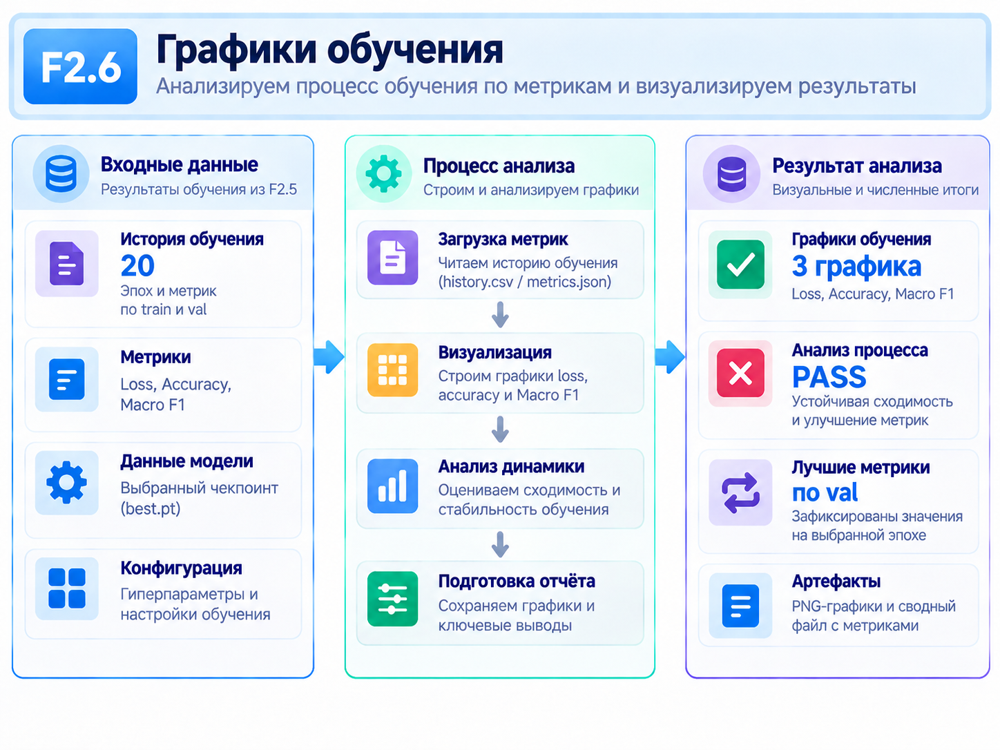
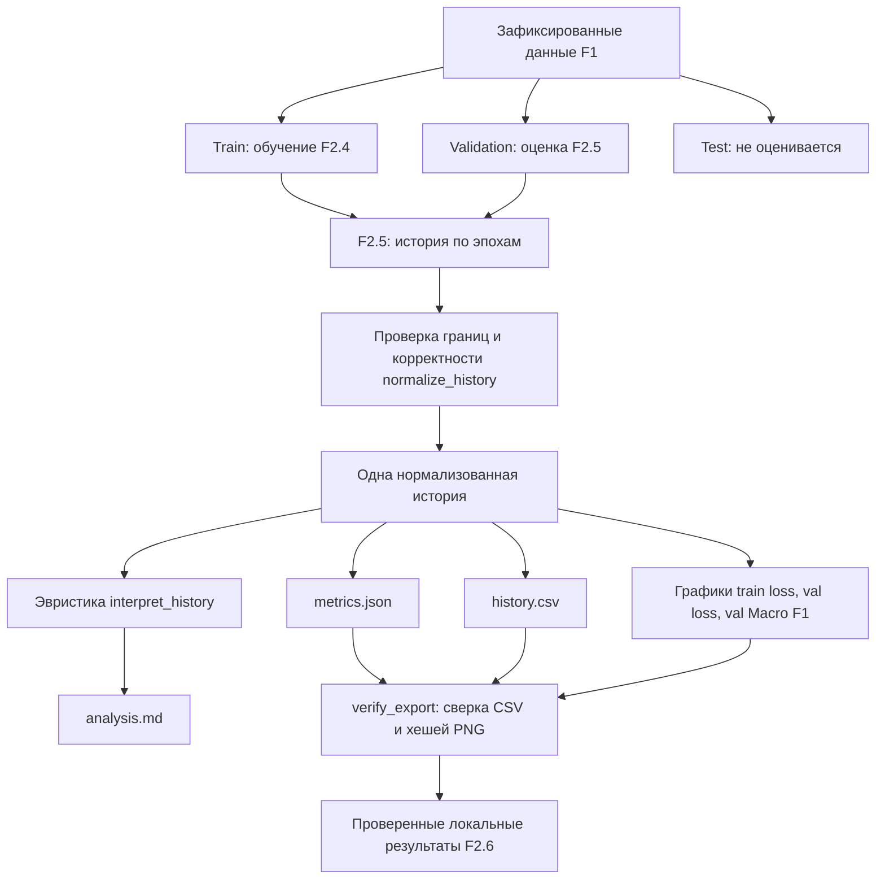

# F2.6 - Training Diagnostics & Visualization: анализ динамики обучения

## 1. Цель этапа:

В F2.4 реализовано обучение собственной нейросети: на каждом батче она делала предсказания, считала ошибку, вычисляла градиенты и меняла веса. В F2.5 добавлены независимую проверку на validation, расчёт Accuracy и Macro F1, а также сохранение лучшего checkpoint.

После этих этапов были известны итоговые метрики и номер лучшей эпохи. Но одних итоговых чисел недостаточно, чтобы понять **как именно шло обучение**.

Например, рассматриваются два эксперимента, в которых лучшая validation Macro F1 одинаковая. В первом она постепенно увеличивалась, а validation loss уменьшался. Во втором качество сначала улучшилось, затем стало ухудшаться, хотя train loss продолжал падать. Итоговая цифра не покажет этой разницы.



Задача F2.6 - **сделать динамику обучения наблюдаемой и проверяемой**:
1. Взять историю эпох, которую действительно сформировал F2.5.
2. Проверить, что в ней нет пропущенных эпох, некорректных метрик и нарушений границ train/validation/test.
3. Представить значения в таблице и на трёх графиках.
4. Отметить на графиках эпоху, **выбранную по validation Macro F1**.
5. Сформулировать осторожный диагностический сигнал: есть ли признаки возможного переобучения или недостаточного прогресса.
6. Сохранить файлы так, чтобы можно было проверить их соответствие исходным агрегированным данным.

**Что должно получиться:** одна папка с историей обучения в CSV, метриками в JSON, тремя PNG-графиками и кратким техническим отчётом. Все эти материалы должны описывать **один и тот же эксперимент**, а не результаты разных запусков.

## 2. Реализация: файлы этапа

В поставке F2.6 добавлено **шесть файлов**. Существующие алгоритмы F1–F2.5 не заменяются.

| Файл | Что реализовано и для чего |
|---|---|
| `src/pytorch_f2/training_diagnostics.py` | **Основной код F2.6.** Проверяет историю F2.5, выделяет числовые метрики, вычисляет диагностический сигнал, строит PNG, сохраняет CSV/JSON/Markdown и проверяет соответствие файлов. |
| `scripts/pytorch_diagnostics.py` | **Запускаемый пример.** Вызывает уже готовый F2.5, получает историю эпох, передаёт её в визуализатор и выводит агрегированный результат. Поддерживает синтетические и локальные данные. |
| `tests/test_training_diagnostics.py` | Автоматические тесты контракта истории, допустимых метрик, определения лучшей эпохи, интерпретации трендов, экспорта, SHA-256, защиты от повреждённых файлов и CLI. |
| `docs/steps/F2_06_training_diagnostics.md` | Учебное описание задачи, последовательности действий, алгоритма диагностики и локальной проверки. Это текущий документ. |
| `requirements-pytorch-diagnostics.txt` | Отдельный профиль зависимостей для воспроизведения этапа; сам алгоритм находится в Python-модулях. |
| `.github/workflows/f2-training-diagnostics.yml` | CPU-проверка этапов F2.1–F2.6 и синтетического демонстрационного запуска в GitHub Actions. |

**Связь с предыдущими этапами:** F2.4 поставляет train loss; F2.5 после каждой эпохи вычисляет validation loss, Accuracy и Macro F1, сохраняет лучший checkpoint и возвращает историю. F2.6 **читает эту готовую историю**, а не повторяет вычисление метрик вручную и не обращается к test.

## 3. Последовательность действий

### Шаг 1. Определить, какие данные уже есть после F2.5
Функция `fit_with_validation()` из F2.5 возвращает `FitResult.history`. Для каждой эпохи доступны результаты обучения (`EpochResult`) и проверки на validation (`ValidationResult`).

Чтобы построить графики, нужны пять значений:

| Поле | Откуда берётся | Что означает |
|---|---|---|
| `epoch` | Номер эпохи F2.5 | Порядковый номер прохода по train |
| `train_loss` | Результат F2.4 | Средний loss на train-батчах во время обновления весов |
| `val_loss` | Результат F2.5 | Средний loss на validation после эпохи, с фиксированными на тот момент весами |
| `val_accuracy` | Результат F2.5 | Доля правильных классификаций на validation |
| `val_macro_f1` | Результат F2.5 | Средняя F1 по всем классам validation |

При анализе важно учитывать различие: **train loss собирался по батчам по мере изменения весов**, а **validation loss измерялся после эпохи на одной версии модели**. Сравнивать их тенденции полезно, но нельзя считать их измерениями, полученными в совершенно одинаковых условиях.

Зафиксированное разбиение F1 - **1824 train / 608 validation / 608 test** - остаётся прежним. F2.6 получает только агрегированные результаты train и validation; **test используется лишь как часть контрольных сведений о размерах split, но не оценивается**.

**Зачем этот шаг:** графики строятся по фактически измеренным величинам, а не по придуманным значениям или заново посчитанным метрикам другой версии модели.

### Шаг 2. Написать проверку входной истории
Сначала реализована `normalize_history(report)` в `training_diagnostics.py`.

Функция не доверяет исходному отчёту автоматически. Она проверяет, что:
- веса обучались **только на `train`** (`trained_split == "train"`);
- лучшая модель выбиралась **по `val`** (`selection_split == "val"`);
- test **не оценивался** (`test_evaluated is False`);
- критерий выбора - именно `val_macro_f1`;
- F2.5 подтвердил восстановление checkpoint и соблюдение validation-инвариантов;
- номера эпох идут последовательно, начиная с `1`;
- для каждой эпохи существуют все необходимые числовые поля;
- loss конечен и неотрицателен, Accuracy и Macro F1 принадлежат диапазону `[0, 1]`;
- сохранённая `best_epoch` действительно соответствует максимальному validation Macro F1 с учётом допустимого округления.

Некорректные значения `NaN`, `inf`, текст вместо числа, отсутствие эпохи или ошибочный split вызывают `DiagnosticsError`.

Здесь же удаляются не относящиеся к графикам поля: тексты вопросов, ID примеров, произвольные пути и другие данные не должны случайно попасть в экспорт.

**Зачем этот шаг:** убедиться в правильности исходных измерений **до** построения красивых графиков. Визуализация неверной истории только делает ошибку убедительнее на вид.

### Шаг 3. Создать один список точек для всех результатов

После нормализации каждый элемент истории выглядит следующим образом:
```python
{
    "epoch": 2,
    "train_loss": 0.70,
    "val_loss": 0.60,
    "val_accuracy": 0.75,
    "val_macro_f1": 0.55,
}
```

Это **учебный пример структуры**, а не измерение, полученное на исходном датасете.

Этот список используется сразу в нескольких местах:
- `_csv_bytes(...)` - записывает `history.csv`;
- `_plot(...)` - строит три PNG-графика;
- `_report_markdown(...)` - составляет таблицу эпох для `analysis.md`;
- `metrics.json` - хранит ту же историю в машиночитаемом виде.

**Зачем этот шаг:** избежать ситуации, когда в таблице одно значение Macro F1, на графике другое, а в текстовом отчёте указана третья цифра.

### Шаг 4. Построить три графика и отметить лучшую эпоху
В `_plot(...)` используется Matplotlib в режиме `Agg`. Этот режим создаёт изображения **без открытия графического окна**, поэтому подходит для Windows, терминального запуска и CI.

Рисуем три самостоятельные кривые:
1. `training_loss.png` - средняя ошибка на train по эпохам.
2. `validation_loss.png` - ошибка на validation по эпохам.
3. `validation_macro_f1.png` - качество классификации на validation по эпохам.

На горизонтальной оси везде номер эпохи. На вертикальной - соответствующее значение метрики. Отдельной пунктирной линией показывается `best_epoch`.

**Принципиально:** `best_epoch` определён в F2.5 по **максимальному validation Macro F1**. Даже если минимум validation loss пришёлся на другую эпоху, линия показывает **выбранную F2.5 эпоху**, а не минимум loss.

Для F1-графика задаётся вертикальный диапазон `[0, 1]`; loss рисуется в соответствии с фактическими значениями.

**Зачем этот шаг:** увидеть поведение обучения во времени и не путать оптимизацию train loss с правилом выбора checkpoint.

### Шаг 5. Добавить осторожную автоматическую интерпретацию
Реализована `interpret_history(history, best_epoch)`. Она сравнивает **первую и последнюю** эпохи и возвращает одно из четырёх значений:

| Сигнал                        | Когда он появляется                                      | Как его понимать                                   |
| ----------------------------- | -------------------------------------------------------- | -------------------------------------------------- |
| `insufficient_epochs`         | В истории меньше трёх эпох                               | Данных для содержательного вывода слишком мало     |
| `possible_overfitting`        | Train loss уменьшился, а validation loss вырос           | Есть **возможный признак** переобучения            |
| `no_clear_learning_progress`  | Нет заметного уменьшения train loss и улучшения Macro F1 | Явного прогресса по выбранным признакам не видно   |
| `no_clear_overfitting_signal` | Остальные случаи                                         | По этой простой проверке явного сигнала не найдено |

Это **эвристика, а не статистический тест**. Она не проверяет устойчивость промежуточных колебаний. Например, validation loss мог вырасти на третьей эпохе, а на пятой снова уменьшиться: сравнение только первой и последней точек не даст полного объяснения.

**Зачем этот шаг:** получить короткое пояснение к графикам, не выдавая предварительное наблюдение за доказанную причину поведения модели.

### Шаг 6. Сохранить воспроизводимые результаты
Функция `export_diagnostics(...)` создаёт локальную папку с шестью файлами:
```text
outputs/f2_6_diagnostics/
├── history.csv
├── metrics.json
├── training_loss.png
├── validation_loss.png
├── validation_macro_f1.png
└── analysis.md
```

Назначение файлов различается:
- `history.csv` - исходные числовые точки, одна строка на эпоху.
- `metrics.json` - те же точки, границы train/val/test, номер лучшей эпохи, диагностический сигнал, разрешённые гиперпараметры и SHA-256 файлов.
- `*.png` - графики тех же значений, пригодные для просмотра.
- `analysis.md` - короткая автоматическая интерпретация конкретного запуска, **не путать с учебным документом `docs/steps/F2_06_training_diagnostics.md`**.

Экспорт не содержит тексты технических вопросов, их ID или test-предсказания.

**Зачем этот шаг:** отчёт можно не только посмотреть, но и повторно исследовать численно без нового обучения.

### Шаг 7. Реализовать проверять целостность файлов
После сохранения вызывается `verify_export(output_dir)`.

Эта функция:
1. Загружает `metrics.json` и проверяет версию формата.
2. Читает `history.csv` и пересчитывает его SHA-256.
3. Сверяет **точные байты CSV** с повторной сериализацией истории из JSON.
4. Проверяет PNG-сигнатуру каждого графика.
5. Сверяет SHA-256 фактических PNG-файлов с хешами из JSON.

Если, например, после экспорта вручную изменить `val_macro_f1` в CSV, не обновляя остальные файлы, проверка обнаружит несоответствие. Если заменить PNG другим изображением, его хеш тоже перестанет совпадать.

**Важно понимать границу:** SHA-256 здесь проверяет **внутреннюю согласованность экспортированных материалов**. Он сам по себе не доказывает, что исходный эксперимент научно корректен или что злоумышленник не мог заменить одновременно все файлы и их хеши.

**Зачем этот шаг:** снизить риск случайно анализировать результаты, которые были повреждены или частично заменены после сохранения.

### Шаг 8. Связать диагностику с F2.5 и написать тесты
В `scripts/pytorch_diagnostics.py` реализован запуск двух вариантов эксперимента:
- **Синтетический:** создаются небольшие искусственные train/validation/test-наборы; можно проверить всю цепочку без реального датасета F1.
- **Локальный:** используются уже существующие данные F1 и настройки `configs/local_cpu/lab.yaml`.

Скрипт вызывает F2.5 через `validation_run(...)`. Для временного checkpoint используется `tempfile.TemporaryDirectory`: он необходим, чтобы F2.5 выполнил реальное сохранение и восстановление, но при этом **не перезаписал прежний `checkpoints/f2_5_best.pt`**. После окончания проверки временный checkpoint удаляется.

Тесты из `tests/test_training_diagnostics.py` дополнительно проверяют неверные данные и split, пропущенные эпохи, несогласованную лучшую эпоху, экспорт, повреждённые CSV/PNG, SHA-256, повторяемость, запуск из CLI и сохранность checkpoint предыдущего этапа.

**Результат реализации:** диагностика стала отдельным проверяемым компонентом. Она использует F2.5 как источник фактов и не подменяет его собственным обучением или другой процедурой выбора модели.

## 4. Как работает алгоритм диагностики на конкретных числах

### 4.1. Что означают три линии
Представим, что четыре эпохи дали такие результаты:

| Эпоха | Train loss | Validation loss | Validation Macro F1 |
|---:|---:|---:|---:|
| 1 | 0.90 | 0.80 | 0.40 |
| 2 | 0.70 | 0.60 | 0.55 |
| 3 | 0.50 | 0.68 | 0.54 |
| 4 | 0.35 | 0.79 | 0.50 |

**Это специально придуманный учебный пример, не реальные метрики ML Engineering Lab.**

На **Training loss** видим последовательное уменьшение: `0.90 → 0.70 → 0.50 → 0.35`. Это означает, что в ходе обучения ошибка на обработанных train-батчах снижалась. Но такой график **не доказывает** качество на незнакомых вопросах.

На **Validation loss** лучший результат - `0.60` во второй эпохе. Дальше ошибка выросла до `0.68`, затем до `0.79`.

На **Validation Macro F1** лучшее значение - `0.55`, тоже во второй эпохе. Затем показатель немного ухудшился.

Такое расхождение может служить **сигналом возможного переобучения**: модель сильнее подстраивается под train, но хуже обобщает на validation. Одного такого примера недостаточно, чтобы достоверно доказать причину.

В этом конкретном примере F2.5 выбрал бы checkpoint **второй эпохи**, потому что именно там максимален `val_macro_f1`.

### 4.2. Почему лучшая эпоха не равна последней
Пусть модель обучается ещё несколько эпох. Оптимизатор продолжает уменьшать train loss, но это не гарантирует роста Macro F1.

Правило проекта можно записать так:
```math
\mathrm{best\_epoch}=\text{первая эпоха, для которой }\mathrm{val\_macro\_f1}\text{ максимален}.
```

Если две эпохи имеют одинаковую наилучшую Macro F1, в F2.5 остаётся **более ранняя**. На графиках F2.6 отмечается ранее выбранная эпоха.

Минимум validation loss - полезная дополнительная характеристика, но **не правило выбора checkpoint в реализованном алгоритме**.

### 4.3. Как вычисляется диагностический сигнал
Для описания динамики `interpret_history()` использует изменения от первой к последней эпохе:
```math
\Delta L_{train}=L_{train}^{last}-L_{train}^{first},
```

```math
\Delta L_{val}=L_{val}^{last}-L_{val}^{first},
```

```math
\Delta F1=F1_{val}^{last}-F1_{val}^{first}.
```

Для таблицы выше:
- `Δ train loss = 0.35 − 0.90 = −0.55` - обучение уменьшило наблюдаемую train-ошибку.
- `Δ val loss = 0.79 − 0.80 = −0.01` - последняя validation loss **чуть ниже первой**, хотя после второй эпохи был рост.
- `Δ Macro F1 = 0.50 − 0.40 = +0.10` - последняя F1 выше первой, но ниже максимума второй эпохи.

Из-за сравнения **первой и последней** точек эвристика здесь вернёт `no_clear_overfitting_signal`, хотя графики показывают ухудшение после эпохи 2.

Это намеренно важное различие: **эвристика не заменяет просмотр кривой целиком**.

Если в другом примере последняя validation loss выросла бы **выше первой**, а train loss уменьшился, результатом стало бы `possible_overfitting`.

### 4.4. Что именно подтверждают контрольные суммы

Для файла `history.csv` код вычисляет:
```math
H_{csv}=\operatorname{SHA256}(\text{байты history.csv}).
```

Полученное значение сохраняется в `metrics.json`. При повторной проверке хеш вычисляется заново и сравнивается с сохранённым. Аналогично проверяются байты каждого PNG.

Кроме этого, экспорт заново создаёт CSV из чисел в JSON и требует **полного побайтового совпадения**. Поэтому недостаточно иметь два файла с похожими заголовками: их числовые точки должны быть одинаковыми.

Здесь нет проверки по test-выборке, матрицы ошибок test и сравнения с классической Logistic Regression. Для этого предусмотрены другие этапы.

## 5. Схема: как F2.5 передаёт историю в F2.6



**Что важно на схеме:** F2.6 получает результаты **готовой процедуры F2.5**. Он не меняет критерий выбора лучшего checkpoint, не обращается к test для вычисления метрик и не пересчитывает обучение по другим данным.

## 6. Локальная проверка в PowerShell: что запускать и как читать результат

Команды ниже выполняются в существующем проекте на Windows. Они не устанавливают пакеты и не изменяют Git-историю. Демонстрационные запуски **создают файлы в указанном `--output-dir`** и могут перезаписать содержимое одноимённых файлов при повторе. Поэтому для учебных проверок используем отдельные папки `outputs/f2_6_study_*`.

### 6.1. Перейти в корень проекта
```powershell
cd F:\DEVELOPMENT\ML\ml-engineering-lab
```
Все последующие команды запускаются из корня репозитория.

### 6.2. Запустить только тесты F2.6
```powershell
.\.venv\Scripts\python.exe -m pytest tests/test_training_diagnostics.py -q
```

**Что проверяется:** целостность истории, контроль split, допустимость числовых метрик, совпадение выбранной эпохи с лучшей Macro F1, диагностические сигналы, файлы экспорта, SHA-256, работу CLI и отсутствие перезаписи старого checkpoint.

**Исторически подтверждённый результат F2.6:** `40 passed` (все тесты этого файла, включая параметризацию). Если тесты текущего репозитория изменены, ориентируйся на актуальный вывод pytest.

### 6.3. Запустить полностью синтетический пример
```powershell
.\.venv\Scripts\python.exe -m scripts.pytorch_diagnostics --synthetic --epochs 3 --output-dir outputs/f2_6_study_synthetic --check
```

В синтетическом режиме F2.5 работает на **четырёх train, одной validation и одной test-записи**, созданных искусственно. Выполняются три эпохи; test не оценивается. После выполнения создаются CSV, JSON, три PNG и Markdown-отчёт.

В JSON-консоли должны присутствовать поля следующего вида (это **структура ожидаемого вывода**, а не заранее заданные результаты качества):
```json
{
  "source": "synthetic",
  "split_counts": {"train": 4, "val": 1, "test": 1},
  "epochs": 3,
  "test_evaluated": false,
  "export_invariants_pass": true
}
```

Это **фрагмент ожидаемого JSON**: остальные поля намеренно не показаны, а не отсутствуют в реальном выводе. В частности, программа также возвращает `best_epoch`, `best_val_macro_f1`, `diagnostic_signal` и `output_dir`. Их фактические значения нужно взять из конкретного запуска, не подставляя предполагаемые метрики. В конце при успехе должна появиться строка:
```text
F2.6 Training Diagnostics CHECK: PASS
```

Анализ результатов:
- `source=synthetic` - использованы искусственные вопросы.
- `epochs=3` - три завершённых цикла train + validation.
- `best_epoch` - эпоха, выбранная F2.5 по validation Macro F1.
- `diagnostic_signal` - упрощённая интерпретация истории.
- `test_evaluated=false` - test не участвовал в оценке.
- `export_invariants_pass=true` - функция экспорта успешно выполнила встроенную проверку.

### 6.4. Посмотреть созданные файлы и историю эпох
```powershell
Get-ChildItem outputs/f2_6_study_synthetic
```

Ожидаемые **имена**:
```text
history.csv
metrics.json
training_loss.png
validation_loss.png
validation_macro_f1.png
analysis.md
```

Посмотреть таблицу метрик:
```powershell
Import-Csv outputs/f2_6_study_synthetic/history.csv | Format-Table
```

Прочитать техническую интерпретацию:
```powershell
Get-Content outputs/f2_6_study_synthetic/analysis.md -Encoding UTF8
```

Открыть PNG-графики стандартными средствами Windows:
```powershell
Invoke-Item outputs/f2_6_study_synthetic/training_loss.png
Invoke-Item outputs/f2_6_study_synthetic/validation_loss.png
Invoke-Item outputs/f2_6_study_synthetic/validation_macro_f1.png
```

**На что смотреть:** значения точек соответствуют строкам CSV; вертикальная пунктирная линия отмечает `best_epoch` из `metrics.json`. Это **лучшая validation Macro F1**, а не обязательно минимальная validation loss.

### 6.5. Отдельно проверить сохранённый экспорт
```powershell
.\.venv\Scripts\python.exe -c "from pathlib import Path; from src.pytorch_f2.training_diagnostics import verify_export; verify_export(Path('outputs/f2_6_study_synthetic')); print('EXPORT VERIFIED')"
```

Если данные согласованы, увидишь `EXPORT VERIFIED`. При изменённом CSV или повреждённом PNG программа должна завершиться с ошибкой `DiagnosticsError`.

Не нужно специально портить файлы собственного запуска: такие отрицательные сценарии уже проверяют автоматические тесты.

### 6.6. Проверить диагностику на локальном наборе F1
```powershell
.\.venv\Scripts\python.exe -m scripts.pytorch_diagnostics --epochs 3 --expect-train 1824 --expect-val 608 --expect-test 608 --output-dir outputs/f2_6_study_local --check
```

Этот запуск **действительно повторно обучает модель на train и оценивает её на validation**, поскольку скрипт F2.6 вызывает F2.5. Он не просто открывает ранее сохранённый JSON. Поэтому результаты могут отличаться от другой серии экспериментов с иными настройками или числом эпох.

При этом прежний `checkpoints/f2_5_best.pt` не перезаписывается: для проверки используется временный checkpoint.

**Что смотреть после запуска:** `metrics.json`, три кривые и номер выбранной эпохи; отдельно проверь, что `test_evaluated=false`. Не сравнивай значения этого трёхэпохового запуска с результатами иного эксперимента как будто это один и тот же запуск.

### 6.7. Проверить весь проект
```powershell
.\.venv\Scripts\python.exe -m pytest -q
```

**Что проверяется:** отсутствие регрессий в F1 и уже установленных этапах F2. На момент завершения F2.6 было подтверждено **454 passed** (414 предыдущих + 40 новых). В текущем `main` могут находиться и дальнейшие этапы, поэтому число тестов может быть больше. Главное - отсутствие `failed` и `errors`.

## 7. Что подтверждено и какие ограничения

**Подтверждено реализацией и тестами:**
- история для графиков берётся из F2.5 и проверяется до экспорта;
- `train` используется для обновления весов, `validation` — для оценки и выбора checkpoint, `test` не оценивается;
- все три изображения получают точки из единой нормализованной истории;
- `history.csv` и `metrics.json` согласованы;
- целостность экспортированных CSV и PNG контролируется по содержимому и SHA-256;
- неправильные значения, повреждённые данные и несогласованная лучшая эпоха отклоняются;
- временный checkpoint F2.6 не перезаписывает основной checkpoint F2.5;
- демонстрация может работать на синтетических данных без публикации реальных вопросов.

**Ограничения подхода:** диагностический сигнал основан на первой и последней эпохах и может пропустить промежуточное ухудшение; небольшой validation-набор даёт колеблющиеся метрики; без повторов с разными seed нельзя судить об устойчивости результатов. В F2.6 организованы наблюдение и проверка чисел, но не полноценное статистическое исследование обучения.

## 8. Основная мысль раздела

**В F2.6 создан проверяемый контур диагностики обучения.** История эпох F2.5 проходит валидацию, преобразуется в общую таблицу числовых точек и используется для построения трёх графиков: training loss, validation loss и validation Macro F1. Проверяется соответствие CSV, JSON и PNG через SHA-256; формируется агрегированная техническая интерпретация динамики. Лучшая эпоха на всех графиках отмечается **по максимальному validation Macro F1**, а не по минимуму loss. **Сигнал `possible_overfitting` является эвристикой, не статистическим доказательством; test-метрики на этапе не вычисляются.**

## 9. Файлы этапа

Изучать код удобнее в порядке от видимого результата к его внутренней реализации:

| Порядок | Файл | Что конкретно изучить |
|---|---|---|
| 1 | `scripts/pytorch_diagnostics.py` | `main()` и `run()`: какие есть CLI-параметры, как запускается F2.5, зачем используется временный checkpoint и куда передаётся готовая история. |
| 2 | `src/pytorch_f2/validation_checkpoint.py` | `fit_with_validation()` и структура истории: какие train/validation-метрики появляются после эпохи, почему `best_epoch` определяется по `val_macro_f1`. Этот файл создан в F2.5. |
| 3 | `src/pytorch_f2/training_diagnostics.py` | `normalize_history()`: контроль границ выборок, допустимых чисел, последовательности эпох и согласованности checkpoint. |
| 4 | `src/pytorch_f2/training_diagnostics.py` | `interpret_history()`: четыре возможных диагностических сигнала, сравнение первой/последней эпох и ограничения такой эвристики. |
| 5 | `src/pytorch_f2/training_diagnostics.py` | `_csv_bytes()` и `_plot()`: один список точек, колонки CSV, построение Matplotlib-графиков и вертикальная отметка лучшей эпохи. |
| 6 | `src/pytorch_f2/training_diagnostics.py` | `export_diagnostics()`, `_report_markdown()` и `verify_export()`: состав файлов, запись агрегатов, вычисление SHA-256, сверка PNG и CSV с JSON. |
| 7 | `tests/test_training_diagnostics.py` | Проверки повреждённых данных и графиков, пропущенных эпох, некорректного best checkpoint, синтетического CLI и сохранности старого файла весов. |
| 8 | `src/pytorch_f2/training_loop.py` | Откуда берётся train loss и почему он агрегируется с учётом фактического числа примеров в батче. Файл создан в F2.4. |

**Итог F2.6:** обеспечен анализ хода обучения по проверяемым числам, согласованным таблицам и графикам с разграничением сигналов и доказанных фактов.
