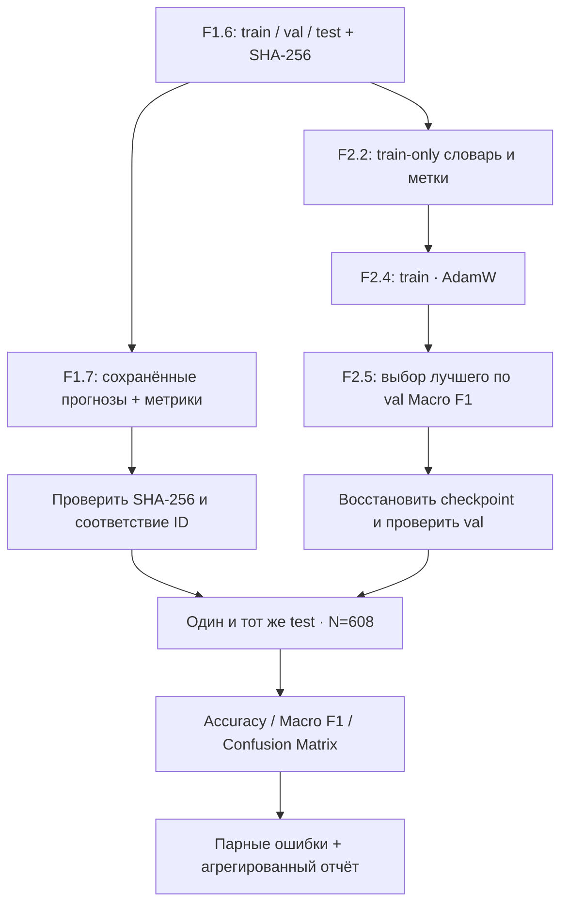

# F2.7 — Classical ML vs Neural Network

## 1. Инженерная задача

В F1.7 мы получили классификатор технических вопросов на **TF-IDF + Logistic Regression**. В F2.2–F2.5 разработали более сложную модель **Embedding → Masked Mean Pooling → Linear → ReLU → Linear**, научились обучать её и выбирать checkpoint по `val_macro_f1`. В F2.6 сохранили кривые обучения.

Цель F2.7 — **оценить две заранее зафиксированные модели на одном test-разбиении**, показать не только средние метрики, но и пересечения их ошибок. Мы не пытаемся доказать, что нейросеть лучше: отрицательный результат тоже является результатом эксперимента.

Ограничение: обе модели предсказывают **форумную категорию** вопроса, а не правильный технический ответ.

## 2. Независимые пути обучения и единая точка сравнения

История F1 и версия F2 выбираются **до** анализа test. Сохранённый F1 report должен сообщать `fit_split=train`, а F2 checkpoint — `selection_metric=val_macro_f1`. **Test не является источником признаков, словаря, весов, гиперпараметров или выбора эпохи.**

### Почему используем сохранённые F1-предсказания

Повторное обучение F1 создало бы другой эксперимент: могли измениться версия scikit-learn, параметры оптимизатора или локальная среда. Вместо этого читаем уже сохранённые F1 `classical.json` и `classical_predictions.json`. Все три файла `train.jsonl`, `val.jsonl`, `test.jsonl` проверяются по SHA-256, сохранённым при F1.7. Признаки и обучающие данные F1 не пересчитываются.

Сохраняемые индивидуальные F1-предсказания содержат `id`, `true`, `predicted`, но **не публикуются**. Они используются в оперативной памяти для строгого сопоставления с тестовыми объектами.

## 3. Что считается корректным сопоставлением

Для каждой из 608 тестовых строк должна существовать ровно одна запись F1 и одна запись F2, соответствующая тому же идентификатору:

\[
\forall i:\quad ID_{F1,i}=ID_{F2,i}=ID_{test,i},\qquad y_{F1,i}=y_{F2,i}=y_{test,i}.
\]

Порядок записей в JSON с F1-предсказаниями не должен влиять на метрики: связываем их через `id`, а не через положение строки. Запрещаем отсутствующие или дублированные ID, чужие метки, другую выборку и чужой SHA. Порядок F2 DataLoader должен быть последовательным и полным — `shuffle=False`, `drop_last=False`.

Проверяем также число и множество классов. Классы упорядочены одинаково, например `databases`, `linux`, `programming`, `systems`.

## 4. Общие определения метрик

Обозначим `N` — размер test, `C` — число классов. `TP_c`, `FP_c`, `FN_c` — элементы матрицы ошибок для класса `c`.

**Accuracy:**

\[
Accuracy=\frac{\text{число правильных предсказаний}}{N}.
\]

**F1 для класса:**

\[
F1_c=\frac{2TP_c}{2TP_c+FP_c+FN_c};\qquad F1_c=0\text{ при нулевом знаменателе}.
\]

**Macro F1:**

\[
MacroF1=\frac{1}{C}\sum_{c=1}^{C}F1_c.
\]

**Разница:**

\[
\Delta MacroF1=MacroF1_{Neural}-MacroF1_{Classical}.
\]

Отрицательное число показывает уступание нейросети именно по этой метрике на данном наборе. Обе модели измеряются одной функцией `classification_metrics()` из F1, с одинаковым `labels` и `zero_division=0`. Это исключает различие в определениях метрик между sklearn и PyTorch.

### Числовой пример

Предположим, на пяти записях классическая модель правильно классифицировала четыре, а нейросеть — три:

- Classical Accuracy = 4/5 = 0,80.
- Neural Accuracy = 3/5 = 0,60.
- ΔAccuracy = −0,20.

**Из этих трёх чисел нельзя вывести разницу Macro F1:** требуется распределение ошибок по классам. Именно поэтому в отчёте сохраняются полные confusion matrices.

## 5. Парный анализ ошибок

Рассматриваем правильность предсказаний для **каждого общего объекта**:

| Категория | Classical | Neural |
|---|---|---|
| `both_correct` | верно | верно |
| `both_wrong` | ошибка | ошибка |
| `only_classical_wrong` | ошибка | верно |
| `only_neural_wrong` | верно | ошибка |

Сумма этих четырёх категорий равна `N`. Кроме того, считаем `prediction_disagreements` — число объектов с различающимися метками, независимо от правильности. **Disagreement не равен числу ошибок:** две модели могут ошибаться разными способами на одном объекте.

Направленные ошибки `systems → linux` и аналогичные переходы определяются строками confusion matrix. Возможные причины: перекрытие терминологии, малая обучающая выборка, ограничение словаря, усреднение embeddings, усечение длинных последовательностей. Их можно перечислить как **гипотезы**, но агрегированные метрики сами по себе не устанавливают причинность.

## 6. Проверка нейросетевого checkpoint

`restore_best_checkpoint()` из F2.5 валидирует структуру весов, отображение классов, размер последовательности и SHA-256 train-словаря. Дополнительно F2.7 проверяет:

- `selection_metric = val_macro_f1`, `tie_break = earliest_epoch`;
- правильные `split_counts` и число validation-объектов;
- совпадение сохранённых `val_macro_f1` и `val_accuracy` с повторной оценкой восстановленной модели на **validation**;
- test-предсказания получены в `torch.inference_mode()`; параметры и градиенты не меняются.

Это не повторный выбор эпохи и не retraining. Вся работа с test начинается только после проверок выше.

## 7. Реализация: основные интерфейсы

`verify_classical_artifacts(splits, report, predictions, source_hashes)` проверяет SHA-256, метки и размеры F1, пересчитывает F1-метрики из сохранённых предсказаний.

`predict_pytorch_test(model, loader, label_to_id=...)` обходит строго test DataLoader последовательно, проверяет ID/target и переводит logits в названия классов через `argmax`.

`compare_on_test(test_rows, classical_predictions=..., neural_predictions=..., labels=...)` принимает два одинаково выровненных набора, рассчитывает метрики и разбиение парных ошибок. Никаких операций `.fit()` или `optimizer.step()` здесь нет.

`save_aggregate_report()` сохраняет только показатели, confusion matrices, численность ошибок и технические метаданные. Тексты вопросов, ID, отдельные предсказания и веса не экспортируются.

### Файлы, с которыми стоит познакомиться

| Файл | Что изучить в коде |
|---|---|
| `src/classical_ml/train.py` | TF-IDF/LogisticRegression, `classification_metrics()` и источник F1-метрик |
| `src/pytorch_f2/data_pipeline.py` | неизменное разбиение, train-only словарь, последовательный DataLoader |
| `src/pytorch_f2/validation_checkpoint.py` | отбор по validation Macro F1 и проверка train-словаря при восстановлении |
| `src/pytorch_f2/model_comparison.py` | контроль происхождения, выравнивание ID, inference, парные ошибки |
| `scripts/pytorch_comparison.py` | как объединяются независимые F1/F2 артефакты без повторного fit |
| `tests/test_model_comparison.py` | инварианты test, порча SHA и метрик, матрицы ошибок, воспроизводимость |

## 8. Результаты и интерпретация

### Публичный синтетический эксперимент

На вымышленных примерах подтверждается возможность корректно выровнять F1 и F2 и сформировать идентичные определения метрик. При малом наборе результаты не оценивают качество реальных моделей. В частности, если test состоит из одного примера класса `systems`, Macro F1 при двух классах может равняться 0,5 даже при Accuracy=1,0: второй класс отсутствует в тесте и имеет F1=0 по принятому соглашению.

### Настоящий F1 test

Метрики на 608 локальных примерах получаются **только после** запуска на фиксированных артефактах. Историческое F1 Test Macro F1 = 0,8838 отражает один опубликованный эксперимент; нельзя механически переносить в сравнительную таблицу число для F2 из другой версии данных/эпохи. F2.7 вычислит новую итоговую таблицу из проверенных, соответствующих друг другу артефактов.

В техническом отчёте будут две строки `Accuracy`, `Macro F1` и ошибок, две confusion matrices, парное пересечение ошибок, SHA источников, epoch F2, размер сети и ограничения измерений.

### Ограничения выводов

1. Сравнение на одном split и одном seed не доказывает устойчивого превосходства.
2. Macro F1 оценивает метки форумной категории, не правильность технического решения.
3. Модель F2.3 не содержит позиционных embeddings и сводит контекст к среднему по токенам; порядок слов учитывается ограниченно.
4. Формат train F1 и F2 идентичен, но **пространства признаков различны** — это осмысленная часть сравнения архитектур.
5. Размер `model_bytes` F1 и число параметров F2 — разные характеристики. CPU-время и RAM не сопоставляем, пока их не измерим единым протоколом.
6. Если F2 уступает F1, не меняем гиперпараметры после просмотра test. Любые следующие улучшения потребуют новой заранее определённой validation-процедуры и отдельной честной оценки.
