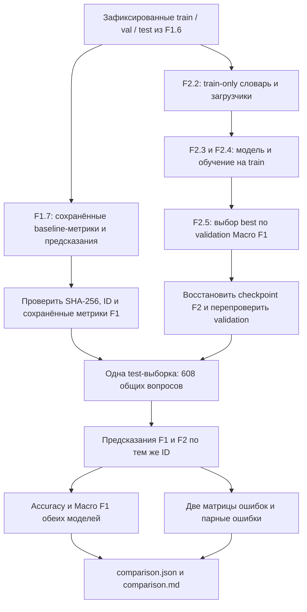

# F2.7 - Classical ML vs Neural Network: сопоставимое сравнение моделей

## 1. Цель этапа:

В Фазе 1 обучен классификатор технических вопросов с помощью **TF-IDF + Logistic Regression**. Это классический подход: TF-IDF преобразует текст в признаки, а Logistic Regression определяет одну из четырёх категорий вопроса.

В Фазе 2 применён нейросетевой подход. Сначала подготовлены данные для PyTorch (F2.2), затем создан собственный `EmbeddingClassifier` (F2.3), реализовано обновление весов (F2.4), выбор лучшей эпохи по validation Macro F1 (F2.5) и анализ истории обучения (F2.6).

Теперь появились **две разные модели, решающие одну задачу**. Но само наличие нейросети ещё не означает, что качество классификации улучшилось. На сравнительно небольшом текстовом датасете простая классическая модель может оказаться точнее более сложной нейросети.

Инженерная задача F2.7: **честно проверить обе заранее зафиксированные модели на одних и тех же вопросах**.

Для этого нужно:
1. Убедиться, что у обеих моделей одна и та же версия `train`, `val` и `test`.
2. Взять ранее сохранённые предсказания классической модели, **не обучая её повторно**.
3. Восстановить checkpoint нейросети, выбранный **до test** по максимальному validation Macro F1.
4. Проверить, что восстановленная нейросеть воспроизводит сохранённые validation-метрики.
5. Получить предсказания нейросети на том же `test`, где оценивалась классическая модель.
6. Вычислить **Accuracy, Macro F1, матрицы ошибок и пересечение ошибок по одним и тем же вопросам**.
7. Сохранить только общие показатели, не раскрывая тексты вопросов и индивидуальные предсказания.

В зафиксированном разбиении Фазы 1: **1824 train / 608 validation / 608 test**, всего **3040 записей**. Модели различают категории `databases`, `linux`, `programming`, `systems` - они **не отвечают на технические вопросы**, а определяют их тематическую категорию.

**Что должно получиться:** два локальных файла - `comparison.json` и `comparison.md`, в которых результаты двух моделей рассчитаны по **одному набору из 608 вопросов** и по одинаковым определениям метрик.

## 2. Реализация: файлы этапа

В поставку F2.7 вошли **шесть файлов**. Новая логика реализована отдельно: исходники предыдущих этапов не требуется заменять.

| Файл | Что реализовано и для чего |
|---|---|
| `src/pytorch_f2/model_comparison.py` | **Основной код F2.7.** Проверяет SHA-256 и метаданные F1, сопоставляет предсказания по `id`, выполняет test-инференс нейросети, рассчитывает общие метрики и парные ошибки, сохраняет только агрегированные результаты. |
| `scripts/pytorch_comparison.py` | **Запускаемый сценарий.** Собирает обе ветки эксперимента: читает F1-артефакты, восстанавливает F2-checkpoint, перепроверяет validation, проводит test-сравнение и создаёт отчёт. Есть синтетический режим для безопасной демонстрации. |
| `tests/test_model_comparison.py` | Автоматические проверки правильности сравнения: несовпадения SHA, чужие и дублированные ID, изменённые метрики F1, неверный split, ошибки test-загрузчика, парные ошибки, отсутствие утечки приватных данных и запуск сценария. |
| `docs/steps/F2_07_classical_vs_neural.md` | Учебное описание цели, последовательности реализации, математики сравнения и команд локальной проверки. Это текущий документ. |
| `requirements-pytorch-comparison.txt` | Профиль зависимостей для воспроизведения этапа; алгоритмы размещены в Python-файлах. |
| `.github/workflows/f2-model-comparison.yml` | Автоматическая CPU-проверка тестов сравнения, связанных этапов и синтетического запуска в GitHub Actions. |

**Что используется из уже реализованного:** F1.7 даёт сохранённый отчёт и предсказания; F2.2 - единый split и токенизацию; F2.3 - модель; F2.5 - checkpoint и его восстановление. F2.7 объединяет эти результаты в процедуру сравнения, **не подменяя их новым экспериментом обучения**.

## 3. Последовательность действий
### Шаг 1. Зафиксировать одну задачу и одну test-выборку
Обе модели должны решать **одну и ту же задачу**: по тексту технического вопроса предсказывать одну из четырёх тематических категорий.

В F1.6 создано разбиение данных на train, validation и test. На F2.7 разбиение повторно не создаётся:

| Выборка | Записей | Для чего используется                                                                                   |
| ------- | ------: | ------------------------------------------------------------------------------------------------------- |
| `train` |    1824 | Ранее использовалась при обучении F1 и F2. Не используется для нового обучения в реальном запуске F2.7. |
| `val`   |     608 | Ранее использовалась для выбора checkpoint F2. Проверяется соответствие сохранённых метрик.             |
| `test`  |     608 | Окончательная точка сравнения двух уже выбранных моделей.                                               |

Значение `domain` - правильный класс вопроса. `id` позволяет сопоставить ответы моделей с конкретной записью **внутри локальной процедуры**, а не публиковать её содержимое.

**Зачем этот шаг:** если проверить модели на разных вопросах, отличия в Accuracy и Macro F1 могут возникнуть из-за состава данных, а не из-за самих моделей.

### Шаг 2. Проверить, что классический baseline действительно тот самый
Вместо повторного вызова `fit()` для F1 читаются **ранее полученные** локальные файлы:
- `reports/classical.json` - протокол обучения и метрики F1.7;
- `reports/classical_predictions.json` - сохранённые предсказания F1 для `val` и `test`.

Функция `verify_classical_artifacts(...)` в `model_comparison.py` проверяет:
1. Что отчёт относится к этапу `F1.7`.
2. Что классическая модель обучалась на `train` (`fit_split == "train"`).
3. Что для оценки указаны `val` и `test`, а не обучение на test.
4. Что SHA-256 исходных `train.jsonl`, `val.jsonl`, `test.jsonl` совпадают с контрольными суммами, сохранёнными в отчёте F1.
5. Что количество записей и набор классов совпадают.
6. Что предсказания можно однозначно сопоставить с исходными вопросами.
7. Что пересчитанные Accuracy, Macro F1, Weighted F1 и матрицы ошибок согласуются с сохранёнными метриками.

**SHA-256:** алгоритм вычисления цифрового отпечатка файла. Даже небольшое изменение байтов обычно меняет отпечаток. В данном случае SHA-256 используется для проверки проверить, что файлы разбиения совпадают с файлами, использованными в F1.

**Зачем этот шаг:** требуется сравнивать с фактически сохранённым baseline, а не с новой, потенциально отличающейся версией модели.

### Шаг 3. Реализовать сопоставлять предсказания по ID, а не по порядку строк
Предположим, один файл содержит ответы на вопросы в порядке `A, B, C`, а другой — `C, A, B`. Если просто сравнить первые строки, получится ложное сопоставление: ответ на `A` сопоставляется с ответом на `C`.

Для сопоставления реализована функция `_aligned_predictions(...)`. Функция создаёт соответствие **`id → predicted`** и затем возвращает ответы в порядке зафиксированного test-набора.

При этом отклоняются:
- отсутствующие записи или дубликаты `id`;
- предсказания для чужого вопроса;
- несовпадение истинной метки (`true`) с исходной записью;
- предсказание неизвестного класса;
- лишние поля и неверный формат записи.

Например, сохранённые предсказания `[C, A, B]` после проверки идентификаторов приводятся к порядку исходных вопросов `[A, B, C]`. Сами тексты и ID при этом **не экспортируются в публичный отчёт**.

**Зачем этот шаг:** убедиться, что сравнение действительно парное - **ответ двух моделей на один и тот же вопрос**, а не произвольное совпадение строк.

### Шаг 4. Восстановили лучшую нейросеть, выбранную до test
Для нейросети используется `checkpoints/f2_5_best.pt`, созданный на F2.5. При реальном запуске F2.7 **не выполняет нового обучения нейросети**.

Функция `restore_best_checkpoint(...)` проверяет архитектуру, отображение классов, максимальную длину последовательности, отпечаток train-словаря и содержимое весов. Этого недостаточно просто «по названию файла»: нужно убедиться, что веса относятся к текущим данным и кодированию токенов.

Дополнительно проверяются метаданные процедуры выбора:
```text
selection_metric = val_macro_f1
tie_break = earliest_epoch
```

Это означает: лучшая эпоха выбиралась **по максимальному validation Macro F1**, при равенстве сохранялась более ранняя эпоха. **Не по минимуму validation loss.**

Затем на `val` повторно запускается `evaluate_validation(...)`; полученные `macro_f1` и `accuracy` сверяются с метаданными checkpoint. Допуск при сравнении - `1e-10`.

**Зачем этот шаг:** test можно открывать для финального сравнения лишь после того, как выбранная модель и её validation-результат проверены без использования test.

### Шаг 5. Получить test-предсказания нейросети без изменения весов
Функция `predict_pytorch_test(...)` получает `EmbeddingClassifier`, готовый test-`DataLoader` и отображение `label_to_id`.

Требования к загрузчику:
- внутри должен быть `QuestionDataset` только с `split == "test"`;
- обход - последовательный (`SequentialSampler`, то есть `shuffle=False`);
- `drop_last=False`, чтобы не потерять последний неполный батч;
- типы `input_ids`, `attention_mask` и `labels` должны соответствовать контракту F2.2;
- модель и входные тензоры обрабатываются на CPU в предусмотренном протоколе F2.7.

Прямой проход выполняется после `model.eval()` и внутри `torch.inference_mode()`. Из оценок классов (logits) определяется предсказанный номер:
```python
predicted_ids = logits.argmax(dim=1)
```

Затем номер класса преобразуется обратно в его имя, например `linux`. Все 608 test-записей должны быть обработаны **ровно по одному разу**. Исходный режим `model.training` восстанавливается после процедуры.

**Зачем этот шаг:** получить результаты уже обученной нейросети на новых данных, не меняя её параметры и не скрывая потерю части вопросов.

### Шаг 6. Рассчитать метрики двух моделей по единым определениям
Теперь есть две последовательности ответов и одна последовательность правильных классов. Функция `compare_on_test(...)` вычисляет показатели одинаковым способом для каждой модели:
- **Accuracy** - долю правильных предсказаний;
- **Macro F1** - усреднённую F1 по всем классам;
- **Confusion Matrix** - матрицу, показывающую, какие классы путаются;
- **ΔAccuracy и ΔMacro F1** - разницу **«нейросеть минус классический baseline»**;
- **winning_model_by_macro_f1** - модель с большей Macro F1 или `tie` при равенстве.

Если ΔMacro F1 отрицательна, нейросеть уступила baseline **по этой метрике в данном эксперименте**. Если положительна - превзошла. Это не универсальный рейтинг моделей: сравниваются конкретные архитектуры, данные и один выбранный checkpoint.

Важно: Accuracy и Macro F1 нельзя считать взаимозаменяемыми. Одна модель может правильно классифицировать больше вопросов в целом, но хуже работать на отдельном классе.

**Зачем этот шаг:** заранее определить единые правила оценки и не выбирать удобную метрику после просмотра test-результатов.

### Шаг 7. Добавить парный анализ ошибок
Одних средних показателей недостаточно. Даже если обе модели правильно ответили на одинаковое количество вопросов, они могли ошибиться **на разных объектах**.

Поэтому для каждого вопроса определяем одну из четырёх категорий:

| Категория | Classical ML | Neural Network | Как интерпретировать |
|---|---|---|---|
| `both_correct` | верно | верно | Обе модели справились с вопросом |
| `both_wrong` | неверно | неверно | Обе модели ошиблись |
| `only_classical_wrong` | неверно | верно | Нейросеть решила вопрос, который не решила классическая модель |
| `only_neural_wrong` | верно | неверно | Baseline решил вопрос, который не решила нейросеть |

Эти четыре группы **взаимоисключающие** и вместе покрывают весь test. Их сумма обязана равняться `N`.

Отдельно вычисляем `prediction_disagreements` - сколько раз модели выдали **разные метки**. Это не то же самое, что число ошибок: обе модели могут неправильно отнести один вопрос к разным категориям.

**Зачем этот шаг:** увидеть не только «кто лучше в среднем», но и **на каких одних и тех же примерах модели ведут себя по-разному**.

### Шаг 8. Подготовить агрегированный отчёт и тесты корректности
В `save_aggregate_report(...)` сохраняем только два файла:
```text
outputs/f2_7_comparison/
├── comparison.json
└── comparison.md
```

`comparison.json` содержит полные агрегированные метрики, матрицы ошибок, разности, парные ошибки, контрольные суммы и описание протокола. `comparison.md` представляет результат в короткой таблице и объясняет его ограничения.

**Что не экспортируем:** сами технические вопросы, `id`, индивидуальные предсказания и веса модели. Эти данные могут использоваться локально для проверки, но не нужны в публичном агрегированном отчёте.

В `tests/test_model_comparison.py` добавлены проверки как успешных случаев, так и попыток испортить SHA, метки, ID, конфигурацию, сохранённые метрики или test-загрузчик. Также тестируется, что реальный путь сравнения **не вызывает повторное обучение**.

**Результат реализации:** получена процедура, способная отклонить некорректное сравнение **до** расчёта итоговых test-метрик и сформировать единый проверяемый результат.

## 4. Алгоритм сравнения: что происходит внутри одного эксперимента

### 4.1. Две модели и один набор правильных ответов
У классической модели вход - TF-IDF-признаки текста; у нейросети - идентификаторы токенов и маска. **Признаки разные**, но задача и правильные метки одинаковые.

Для каждого вопроса `i` известны:
- `y_i` - правильный класс;
- `c_i` - предсказание классической модели;
- `n_i` - предсказание нейросети.

Проверяется, что все тройки относятся к одному `id`. Затем рассчитываются показатели обеих моделей на последовательности длиной `N`.

Для реального фиксированного test: `N = 608`, число классов `C = 4`.

### 4.2. Accuracy и Macro F1
**Accuracy** - доля вопросов с правильной меткой:
```math
\operatorname{Accuracy}=\frac{1}{N}\sum_{i=1}^{N}\mathbf{1}(\hat y_i=y_i).
```

Например, 4 правильных ответа из 5 дают `Accuracy = 0.8`.

Для каждого класса `k` определяем:
```math
P_k=\frac{TP_k}{TP_k+FP_k}, \qquad R_k=\frac{TP_k}{TP_k+FN_k}.
```

Здесь `TP` - правильно найденные объекты класса, `FP` - ошибочно отнесённые к нему объекты, `FN` - пропущенные объекты класса.

Оценка отдельного класса:
```math
F1_k=\frac{2P_kR_k}{P_k+R_k} = \frac{2TP_k}{2TP_k+FP_k+FN_k}.
```

Если знаменатель равен нулю, в используемом протоколе F1 класса принимается равной `0`.

**Macro F1** - среднее по всем классам с равными весами:
```math
\operatorname{MacroF1}=\frac{1}{C}\sum_{k=1}^{C}F1_k.
```

Её нельзя получить только из общей Accuracy. Нужны ошибки **по каждому классу**.

### 4.3. Сопоставление числовых метрик
В коде разность всегда имеет одно и то же направление:
```math
\Delta\operatorname{Accuracy} = \operatorname{Accuracy}_{neural} - \operatorname{Accuracy}_{classical},
```

```math
\Delta\operatorname{MacroF1} = \operatorname{MacroF1}_{neural} - \operatorname{MacroF1}_{classical}.
```

Например, если **в учебном примере** baseline имеет Accuracy `0.80`, а нейросеть `0.60`, то:
```math
\Delta\operatorname{Accuracy}=0.60-0.80=-0.20.
```

Это **минус 20 процентных пунктов** Accuracy, а не «нейросеть ошибается на 20% чаще». Для относительного изменения потребовался бы другой расчёт.

В поле `winning_model_by_macro_f1` результат задаётся **только по Macro F1**. Поэтому нельзя заменять название победителя в отчёте на основании Accuracy, времени инференса или размера файла.

### 4.4. Разберём парные ошибки на пяти искусственных вопросах
Используется **учебный пример**, аналогичный одному из автоматических тестов F2.7. Здесь всего два условных класса `a` и `b`:

| ID | Истинный класс | Classical | Neural | Категория |
|---|---|---|---|---|
| 1 | `a` | `a` | `a` | `both_correct` |
| 2 | `a` | `b` | `a` | `only_classical_wrong` |
| 3 | `b` | `a` | `a` | `both_wrong` |
| 4 | `b` | `b` | `a` | `only_neural_wrong` |
| 5 | `a` | `a` | `b` | `only_neural_wrong` |

Результаты:
```text
both_correct = 1
both_wrong = 1
only_classical_wrong = 1
only_neural_wrong = 2
prediction_disagreements = 3
```

Проверка полноты: `1 + 1 + 1 + 2 = 5` вопросов.

По Accuracy: классическая модель права в `3/5 = 0.60` случаев, нейросеть - в `2/5 = 0.40`.

Поэтому:
```math
\Delta\operatorname{Accuracy}=0.40-0.60=-0.20.
```

В этом примере `prediction_disagreements = 3`, хотя общая численность ошибок по обеим моделям равна пяти (`2` ошибки Classical + `3` ошибки Neural): это **разные способы подсчёта**.

**Важно:** это вымышленные метки для проверки алгоритма, **не фактическое качество двух моделей на 608 вопросах**.

### 4.5. Что показывают матрицы ошибок
Матрица ошибок `C × C` показывает, какой истинный класс был отнесён к какому предсказанному. В строках располагаются истинные классы, в столбцах - предсказанные.

Например, ячейка `systems → linux` означает количество вопросов категории `systems`, для которых модель выдала `linux`.

Если обе модели часто допускают такой переход, можно выдвинуть гипотезу о схожей терминологии. Если только нейросеть путает классы, возможные причины — усреднение embeddings, ограниченный объём обучающих данных, отсутствие позиционного представления или особенности токенизации.

Но **матрица ошибок не доказывает причины**. Для вывода нужны отдельные исследования вопросов, дополнительных признаков и экспериментов на validation, а не подгонка по test.

## 5. Схема: два пути приводят к одной test-оценке



**Главное на схеме:** обе модели прошли свои процедуры обучения и выбора **до сравнения**. F2.7 проверяет их происхождение, а затем сопоставляет ответы на одном test. Он **не обновляет веса и не выбирает заново лучшую эпоху** по test-результатам.

## 6. Локальная проверка в PowerShell: что запускать и как читать результат

Команды ниже предназначены для уже существующего проекта на Windows. Они **не устанавливают пакеты, не изменяют Git-историю и не выполняют повторное обучение реальных моделей**. Сценарий создаёт файлы `comparison.json` и `comparison.md` и при повторном запуске в тот же `--output-dir` может перезаписать их. Для учебной проверки используются отдельные папки `outputs/f2_7_study_*`.

### 6.1. Перейти в корень проекта
```powershell
cd F:\DEVELOPMENT\ML\ml-engineering-lab
```
Далее команды выполняются из корня проекта.

### 6.2. Проверить только тесты F2.7
```powershell
.\.venv\Scripts\python.exe -m pytest tests/test_model_comparison.py -q
```

**Что проверяется:** корректность проверки исходных артефактов, выравнивание по `id`, распознавание испорченного SHA-256, запрет чужих меток и дубликатов, общие метрики, парные ошибки, контроль границ test и работу CLI.

**Исторически подтверждённый результат на момент завершения F2.7:** `34 passed`. Тогда полная регрессия F1–F2.7 содержала `488 passed`. В текущем репозитории число тестов может быть больше: ориентируемся на фактический вывод pytest и отсутствие ошибок.

### 6.3. Выполнить безопасный синтетический пример
```powershell
.\.venv\Scripts\python.exe -m scripts.pytorch_comparison --synthetic --output-dir outputs/f2_7_study_synthetic --check
```

В этом режиме программа создаёт **искусственные** данные (4 train, 1 validation, 1 test), обучает на них миниатюрный baseline и нейросеть, выбирает checkpoint по validation и выполняет проверку сравнения. Это **не переобучение реальных моделей** и не демонстрация их качества на рабочем датасете.

При успешном запуске в консоли появится JSON с полями такого вида:
```json
{
  "source": "synthetic",
  "split_counts": {"train": 4, "val": 1, "test": 1},
  "test_used_for_selection": false,
  "comparison_invariants_pass": true
}
```

Это **фрагмент структуры** ответа, а не полный дословный вывод. Реальные значения `test_accuracy_classical`, `test_macro_f1_classical`, `test_accuracy_neural`, `test_macro_f1_neural`, `winner` и `neural_best_epoch` будут напечатаны самим скриптом; их не следует придумывать заранее.

Последняя строка при запуске с `--check`:
```text
F2.7 Classical vs Neural CHECK: PASS
```

**Как читать результат:**
- `source=synthetic` - результаты относятся к искусственным текстам;
- `winner` - победитель **только по Macro F1** этого синтетического сравнения или `tie`;
- `test_used_for_selection=false` - test не определял модель или эпоху;
- `comparison_invariants_pass=true` - встроенные проверки протокола завершились успешно;
- `output_files` - пути к двум созданным отчётам.

### 6.4. Посмотреть отчёты синтетического запуска
```powershell
Get-ChildItem outputs/f2_7_study_synthetic
```

Ожидаемые имена файлов:
```text
comparison.json
comparison.md
```

Прочитать короткую таблицу:
```powershell
Get-Content outputs/f2_7_study_synthetic/comparison.md -Encoding UTF8
```

Посмотреть проверяемые значения отчёта:
```powershell
$r = Get-Content outputs/f2_7_study_synthetic/comparison.json -Raw -Encoding UTF8 | ConvertFrom-Json
$r.comparison.classical
$r.comparison.neural
$r.comparison.paired_errors
$r.comparison.delta_neural_minus_classical
$r.complexity
```

**На что смотреть:**
1. У обеих моделей одинаковое `samples` и одинаковые `labels`.
2. В `paired_errors` сумма четырёх категорий без `prediction_disagreements` равна числу test-вопросов.
3. В `delta_neural_minus_classical` разность рассчитана как «Neural - Classical».
4. В `complexity.measured_runtime_comparison` указано `false`: **время работы моделей здесь не сравнивалось**.

### 6.5. Выполнить реальное сравнение на зафиксированных локальных данных
Эта команда нужна **только при наличии исходных локальных артефактов F1.6/F1.7 и checkpoint F2.5**:
```text
data/processed/train.jsonl
data/processed/val.jsonl
data/processed/test.jsonl
reports/classical.json
reports/classical_predictions.json
checkpoints/f2_5_best.pt
configs/local_cpu/lab.yaml
```

Если эти файлы не существуют или их контрольные суммы не совпадают, программа **должна завершиться ошибкой**, а не создавать фиктивные результаты.

Запуск:
```powershell
.\.venv\Scripts\python.exe -m scripts.pytorch_comparison --expect-train 1824 --expect-val 608 --expect-test 608 --output-dir outputs/f2_7_study_real --check
```

**Что происходит:**
1. Считываются зафиксированные F1.6 split-файлы и сохранённые F1.7 предсказания.
2. Проверяются контрольные суммы, ID, размеры и сохранённые метрики F1.
3. Восстанавливается `f2_5_best.pt` и ещё раз проверяются validation-метрики.
4. Один раз вычисляются F2-предсказания на test.
5. Формируются агрегированные метрики и отчёты в **отдельной учебной папке**.

В `comparison.json` ожидаются поля:
```text
source = local_f1_split
comparison.samples = 608
protocol.neural_selection_metric = macro_f1
protocol.test_used_for_selection = false
comparison.winning_model_by_macro_f1 = classical / neural / tie
complexity.measured_runtime_comparison = false
comparison_invariants_pass = true
```

Значения Accuracy/Macro F1 и победителя нужно **прочитать из реального отчёта**, а не копировать из старого документа. Историческая F1-метрика `Test Macro F1 = 0.8838` относится к ранее сохранённому эксперименту; в F2.7 код сверяет именно текущие подтверждённые артефакты.

Посмотреть фактическое сравнение:
```powershell
Get-Content outputs/f2_7_study_real/comparison.md -Encoding UTF8
```

### 6.6. Проверить, что предыдущие этапы не сломались
```powershell
.\.venv\Scripts\python.exe -m pytest -q
```

**Что проверяется:** все установленные в локальном репозитории тесты, включая предыдущие этапы F1 и F2. Нельзя ориентироваться только на успешный демонстрационный запуск. Если текущий `main` уже содержит F2.8 или Фазу 3, число тестов будет больше исторических `488`.

## 7. Что подтверждено и какие ограничения

**Подтверждено алгоритмами и тестами:**
- Сохранённые F1-предсказания проверяются на соответствие исходным файлам и метрикам.
- Сравнение использует **одни и те же ID и истинные метки** для обеих моделей.
- Неправильные, чужие, дублированные или пропущенные ID вызывают контролируемую ошибку.
- Checkpoint нейросети должен подтверждать выбор по validation, а не по test.
- F2-инференс не обновляет параметры и охватывает полный test-набор.
- Обе модели оцениваются по единым определениям Accuracy и Macro F1.
- Парные ошибки корректно делят test на четыре непересекающиеся группы.
- Отчёт не сохраняет тексты вопросов, ID, индивидуальные предсказания или веса.

**Архитектурное ограничение F2-модели:** `EmbeddingClassifier` объединяет токены через `masked mean pooling`. В этой операции не учитывается их порядок; модель не обладает механизмом Self-Attention и не извлекает контекстные представления каждого токена. Это одна из причин, по которым в Фазе 3 предусмотрено изучение Transformers, но **не доказательство конкретной причины ошибок на test**.

## 8. Основная мысль раздела

**В F2.7 реализовано сопоставимое сравнение классического baseline F1 и нейросети F2 на одном зафиксированном test-наборе.** Сначала проверяются SHA-256 и сохранённые предсказания baseline, затем восстанавливается checkpoint, выбранный по validation Macro F1. Предсказания связываются по идентификаторам, а не по позиции в файле. Для двух моделей по единой методике вычисляются Accuracy, Macro F1, матрицы ошибок и четыре категории парных исходов. **Отсутствие преимущества нейросети допустимо как результат эксперимента; сравнение скорости и памяти F2.7 не выполняет.**

## 9. Файлы этапа

Рекомендуется изучать код **в порядке движения данных**: от запуска и проверки источников до метрик и тестов.

| Порядок | Файл | На что смотреть в коде |
|---:|---|---|
| 1 | `scripts/pytorch_comparison.py` | `run()` — последовательность «проверить F1 → восстановить F2 → проверить validation → получить test-предсказания → сохранить отчёт»; различия `synthetic` и реального режима. |
| 2 | `src/pytorch_f2/model_comparison.py` | `verify_classical_artifacts()` и `sha256_file()` — как удостоверяемся, что F1-предсказания получены на том же наборе данных. |
| 3 | `src/pytorch_f2/model_comparison.py` | `_aligned_predictions()` — зачем нужен `id`, почему нельзя полагаться на порядок сохранённых строк и как обнаруживаются дубликаты или чужие метки. |
| 4 | `src/pytorch_f2/validation_checkpoint.py` | `restore_best_checkpoint()` и `evaluate_validation()` — проверка лучшей модели и повторное подтверждение validation Macro F1. |
| 5 | `src/pytorch_f2/model_comparison.py` | `predict_pytorch_test()` — `SequentialSampler`, `drop_last=False`, `torch.inference_mode()`, `argmax` и восстановление режима модели. |
| 6 | `src/classical_ml/train.py` | `classification_metrics()` — общие определения Accuracy, Macro F1, Weighted F1 и матрицы ошибок для обеих моделей. |
| 7 | `src/pytorch_f2/model_comparison.py` | `compare_on_test()` — две одинаково рассчитанные метрики, разницы Neural − Classical, четыре категории парных ошибок и выбор победителя по Macro F1. |
| 8 | `src/pytorch_f2/model_comparison.py` | `save_aggregate_report()` — что попадает в `comparison.json`/`comparison.md` и почему исходные тексты/ID исключены. |
| 9 | `src/pytorch_f2/data_pipeline.py` | `prepare_data()` и `make_loader()` — как используется фиксированный split, train-only словарь и последовательный test-загрузчик. |
| 10 | `tests/test_model_comparison.py` | Тесты целостности SHA, испорченных метрик, ID, парного разбиения ошибок, воспроизводимости и запрета повторного обучения в реальном режиме. |

**Итог F2.7:** реализована воспроизводимая методика сравнения двух моделей на одинаковом test-наборе с выравниванием по ID и анализом пересечений ошибок.
