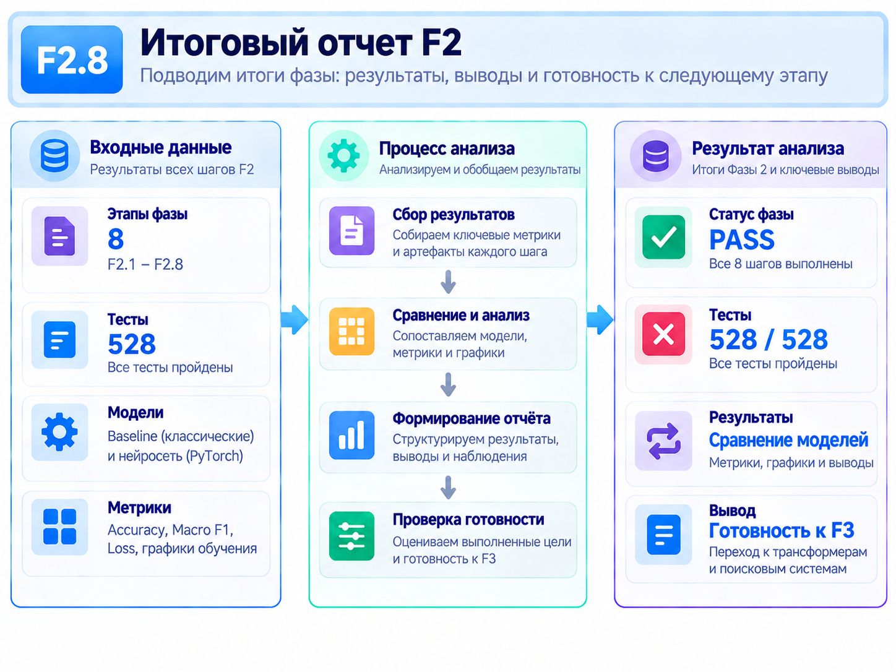
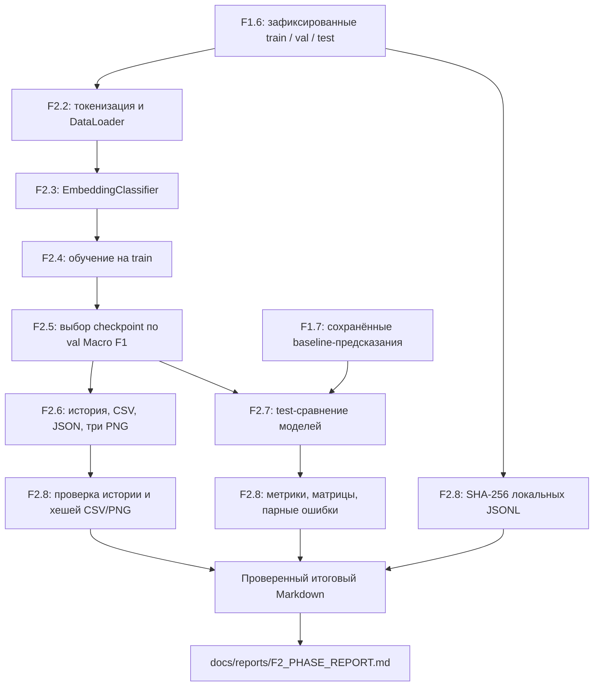

# F2.8 - Final Phase Report: аудит результатов и итоговый отчёт

## 1. Цель этапа:

К моменту завершения F2.7 завершена основная последовательность создания нейросетевого классификатора:
1. В **F2.1** изучены тензоры, вычислительный граф и градиенты PyTorch.
2. В **F2.2** реализовано преобразование текстов вопросов в числовые последовательности и батчи.
3. В **F2.3** реализован `EmbeddingClassifier`, выдающий оценки четырёх категорий.
4. В **F2.4** реализовано обновление весов через `CrossEntropyLoss`, `backward()` и AdamW.
5. В **F2.5** добавлены validation, выбор лучшей эпохи и сохранение checkpoint.
6. В **F2.6** реализованы сохранение и интерпретация графиков обучения.
7. В **F2.7** выполнено сравнение классической модели F1 с нейросетью F2 на общей test-выборке.

Код и результаты этих этапов существуют отдельно. Например, **F2.6** сохраняет историю обучения и три графика, а **F2.7** - результаты парного сравнения двух моделей. Если просто скопировать несколько чисел из разных файлов в итоговый отчёт, можно случайно объединить **разные эксперименты**, взять ошибочную метрику или сослаться на неподходящую версию датасета.



**Задача F2.8:** построить механизм, который сначала **проверяет происхождение и согласованность результатов**, а уже затем создаёт читабельный итоговый документ.

Требовалось ответить на четыре вопроса:
- **Что действительно реализовано?** Как связан весь путь от тензоров до test-сравнения моделей.
- **Какое качество действительно измерено?** Совпадают ли Accuracy и Macro F1 с матрицами ошибок, а результаты двух моделей - с одной test-выборкой.
- **Можно ли доверять сохранённым файлам?** Не изменились ли данные, история обучения, CSV или PNG после эксперимента.
- **Можно ли безопасно опубликовать итог?** Не попадут ли туда исходные вопросы, идентификаторы отдельных записей, локальные пути или веса.

**Что должно получиться:** проверенный файл `docs/reports/F2_PHASE_REPORT.md`, формируемый из локальных агрегатов F2.6 и F2.7. При отсутствующих или повреждённых входных данных генератор должен **завершиться с ошибкой, а не придумывать результаты**.

## 2. Реализация: файлы этапа

В архив поставки F2.8 входят **шесть файлов**. Они решают разные задачи:

| Файл | Что реализовано и для чего |
|---|---|
| `src/pytorch_f2/final_report.py` | **Основной алгоритм F2.8.** Проверяет структуру и происхождение агрегатов, пересчитывает Accuracy и Macro F1 по матрицам ошибок, сверяет парные ошибки, проверяет историю F2.6 и строит итоговый Markdown. Содержит функции контроля SHA-256 исходных split и итогового текста. |
| `scripts/build_f2_report.py` | **Точка запуска.** Находит локальные артефакты F2.6/F2.7, запускает проверки, сверяет исходные JSONL по SHA-256 и записывает итоговый отчёт. Отдельно поддерживает безопасный синтетический `--self-check`. |
| `tests/test_final_report.py` | Проверки правильности арифметики, отказа при подмене метрик и файлов, изоляции реального и синтетического режимов, защиты приватных данных и повторяемости отчёта. Используются вымышленные данные. |
| `docs/steps/F2_08_final_phase_report.md` | Учебная документация: зачем нужен итоговый аудит, из каких проверок он состоит, как его воспроизвести и какие ограничения сохраняются. Это текущий раздел. |
| `docs/reports/F2_PHASE_REPORT.md` | **Публичный итог Фазы 2.** В поставке находится предварительный вариант; после проверки настоящих локальных агрегатов генератор заменяет его отчётом с фактическими цифрами. |
| `.github/workflows/f2-final-report.yml` | GitHub Actions: CPU-only запуск тестов F2.8 и синтетического self-check. CI не обязан иметь локальные F1-данные и не выдаёт синтетические результаты за реальные. |

Важное разделение: **`final_report.py` проверяет и формирует текст**, а **`build_f2_report.py` управляет чтением файлов и записью результата**. Это позволяет тестировать математические проверки независимо от настоящего датасета.

В коде также существует необязательный флаг `--update-readme`. **В стандартном сценарии флаг не используется:** файл `README.md` редактируется отдельно, и обычная команда F2.8 его не изменяет.

## 3. Последовательность действий

### Шаг 1. Определить, какие результаты можно объединять
В F2.8 нет нового обучения. На вход уже поступают **два готовых набора результатов**:

**Первый - диагностика F2.6**, расположенная в `outputs/f2_6_diagnostics/`:

| Файл | Содержание |
|---|---|
| `history.csv` | Числовые точки по эпохам: train loss, validation loss и метрики. |
| `metrics.json` | Та же проверяемая история, метаданные эксперимента, лучшая эпоха и контрольные суммы. |
| `training_loss.png` | График изменения ошибки на обучающих данных. |
| `validation_loss.png` | График ошибки на validation. |
| `validation_macro_f1.png` | График качества классификации на validation. |

**Второй - сравнение F2.7**:
`outputs/f2_7_comparison/comparison.json`

В нём находятся общие метрики классической модели и нейросети, их матрицы ошибок, пересечение ошибок, протокол выбора модели и SHA-256 исходных разбиений.

При полном локальном запуске дополнительно используются существующие файлы:

`data/processed/train.jsonl`, `data/processed/val.jsonl`, `data/processed/test.jsonl`.

Их **не обучают заново и не копируют в отчёт**. Генератор сверяет только байтовые отпечатки SHA-256 с сохранёнными в F2.7 значениями.

**Зачем этот шаг:** у каждого числового результата должен быть понятный источник. Взятые из памяти или из старого README показатели не заменяют проверяемые артефакты.

### Шаг 2. Отделили настоящий эксперимент от синтетического

Тестам нужен небольшой искусственный набор, который можно безопасно запускать в GitHub Actions. Но его результаты нельзя выдавать за качество модели на реальных вопросах.

Поэтому в `final_report.py` предусмотрены два уровня проверки:
- `validate_comparison(..., require_real=False)` и `validate_diagnostics(..., require_real=False)` допускают корректные синтетические структуры для unit-тестов.
- При формировании реального итогового документа требуется **`source = local_f1_split`** и выполняются дополнительные проверки.

Для настоящего отчёта должны выполняться ограничения:
```text
train = 1824
val = 608
test = 608
классы = databases, linux, programming, systems
```

Если в `comparison.json` нет признака успешно завершённых проверок F2.7 или данные помечены как синтетические, реальная генерация завершается ошибкой.

**Зачем этот шаг:** случайно успешно прошедший self-check не должен превращаться в утверждение, что на 608 вопросах получена такая же точность.

### Шаг 3. Проверить, что test остался независимым
В F1 зафиксировано разделение данных:
- `train` - обучение параметров модели;
- `val` - выбор лучшей версии нейросети;
- `test` - независимая оценка после выбора.

F2.8 проверяет метаданные протокола F2.7:
```text
classical_fit_split = train
neural_selection_split = val
neural_selection_metric = macro_f1
test_used_for_selection = false
```

Дополнительно проверяются наличие и формат SHA-256 для трёх файлов split. При запуске `scripts/build_f2_report.py` функция `verify_source_fingerprints(...)` **заново вычисляет хеши локальных JSONL** и сравнивает их со значениями `comparison.json`.

Например, если `train.jsonl` был изменён после F2.7, генерация отчёта не продолжится: нельзя утверждать, что результат относится к текущей копии данных.

**Важная граница:** эти проверки подтверждают согласованность заявленного протокола и файлов. Они не заменяют анализ исходного алгоритма обучения, который проводился в F2.4–F2.7.

### Шаг 4. Реализовать проверять метрики по матрицам ошибок
В итоговом JSON могут быть записаны значения `accuracy = ...` и `macro_f1 = ...`. Но такие числа легко испортить ручным редактированием, ошибкой сериализации или несогласованным пересчётом.

Вместо безусловного доверия им функция `_metric_row(...)`:
1. Проверяет список классов и форму `confusion_matrix`.
2. Проверяет, что все ячейки матрицы — неотрицательные целые числа.
3. Проверяет, что сумма ячеек равна количеству test-примеров.
4. Самостоятельно вычисляет долю правильных классификаций.
5. Для каждого класса находит `TP`, `FP` и `FN`.
6. Самостоятельно вычисляет Macro F1.
7. Сравнивает вычисленные результаты с числами из исходного JSON с допуском `1e-8`.

Если хоть одна проверка нарушена, итоговый документ не создаётся.

**Назначение шага:** проверить не только наличие метрики, но и её математическое соответствие наблюдаемым результатам классификации.

### Шаг 5. Проверить пересечение ошибок двух моделей
В F2.7 сопоставлены предсказания **для одних и тех же test-вопросов**. F2.8 проверяет итоговые агрегаты этого сопоставления.

Каждый вопрос должен относиться ровно к одной из четырёх групп:

| Группа | Классическая модель | Нейросеть |
|---|---|---|
| `both_correct` | Правильно | Правильно |
| `both_wrong` | Ошиблась | Ошиблась |
| `only_classical_wrong` | Ошиблась | Правильно |
| `only_neural_wrong` | Правильно | Ошиблась |

Сумма этих четырёх чисел должна равняться размеру test, то есть **608** для реального эксперимента.

Дополнительные проверки связывают парные ошибки с матрицами ошибок каждой модели. Если матрица говорит об одном количестве ошибок, а парная таблица - о другом, отчёт отклоняется.

**Зачем этот шаг:** важно знать не только, сколько ошибок у каждой модели, но и корректность их сопоставления на одних и тех же объектах.

### Шаг 6. Проверить историю F2.6 и целостность файлов
История обучения должна содержать для каждой эпохи:
- `train_loss`;
- `val_loss`;
- `val_accuracy`;
- `val_macro_f1`.

Функция `validate_diagnostics(...)` проверяет последовательную нумерацию эпох, конечность и допустимые диапазоны значений, а также соответствие заявленной лучшей эпохи сохранённой истории.

Отдельно используется функция F2.6 `verify_export(...)`. Она проверяет комплект сохранённых файлов, в том числе согласованность `history.csv`, `metrics.json` и контрольных сумм PNG-графиков.

Таким образом, проверяется **не только текстовая таблица**, но и то, что опубликованные точки графиков соответствуют исходным агрегатам.

Особенно важно: **F2.6 и F2.7 могут относиться к разным запускам обучения**. Поэтому лучшая эпоха диагностического эксперимента F2.6 не обязана совпадать с эпохой checkpoint, который участвовал в сравнении F2.7. Генератор показывает их раздельно.

### Шаг 7. Сформировать отчёт без раскрытия исходных данных
Функция `render_final_report(...)` получает проверенные агрегаты, а не сами тексты вопросов. На их основе формирует Markdown с разделами:
- задача и архитектура Фазы 2;
- все восемь этапов;
- состав и отпечаток test-разбиения;
- сравнение Accuracy и Macro F1;
- парные ошибки;
- отдельная диагностическая история F2.6;
- выводы и ограничения;
- файлы для дальнейшего изучения.

Программа не переносит в отчёт произвольные поля входных JSON: **тексты, `id` отдельных вопросов, необязательные приватные данные и локальные абсолютные пути не должны публиковаться**.

При одинаковых входных агрегатах формируется одинаковый текст. Его SHA-256 вычисляется функцией `sha256_report(...)`. Это позволяет убедиться, что повторная сборка не изменила содержание отчёта.

### Шаг 8. Соединили проверки с запуском и автоматическими тестами
В `scripts/build_f2_report.py` реализована следующая последовательность:
1. Прочитать F2.6 из `outputs/f2_6_diagnostics/` и F2.7 из `outputs/f2_7_comparison/comparison.json`.
2. Проверить экспорт F2.6, математическую согласованность F2.7 и соответствие split.
3. Пересчитать SHA-256 локальных `train.jsonl`, `val.jsonl`, `test.jsonl`.
4. Получить проверенный текст итогового отчёта.
5. Записать его в `docs/reports/F2_PHASE_REPORT.md`.
6. Считать записанный файл обратно и проверить, что его текст совпадает с сформированным.
7. Вывести сведения об отчёте и SHA-256 в консоль.

В `tests/test_final_report.py` проверяются нормальные и ошибочные ситуации: испорченные метрики, матрицы, CSV/PNG, подмену хешей, отсутствие файлов, несогласованные split и воспроизводимость.

В GitHub Actions запускаются только тесты и **синтетическая** проверка. Настоящие Q&A и локальные результаты обучения для этого не нужны.

**Результат реализации:** F2.8 не просто оформляет красивый Markdown. Он превращает ранее полученные результаты в **проверяемый технический отчёт**.

## 4. Алгоритм аудита: как проверяются числа и выводы

Далее приводятся главные математические проверки, на которых основан `final_report.py`.

### 4.1. Accuracy из матрицы ошибок
Пусть в матрице `M` строки - истинные классы, а столбцы - предсказанные. Тогда на главной диагонали находятся правильные ответы.

Формула:
```math
\mathrm{Accuracy} = \frac{\sum_i M_{ii}}{N}
```

где `N` - сумма всех элементов матрицы.

**Учебный пример**, не относящийся к настоящему test:

| Истинный класс / прогноз | Класс A | Класс B |
|---|---:|---:|
| Класс A | 2 | 1 |
| Класс B | 0 | 3 |

Всего `N = 2 + 1 + 0 + 3 = 6` примеров. Правильно классифицировано `2 + 3 = 5`.

```math
\mathrm{Accuracy} = \frac{5}{6} \approx 0.8333
```

Если входной JSON для такой матрицы содержал бы `accuracy = 0.95`, F2.8 обнаружил бы расхождение.

### 4.2. Macro F1: зачем проверять отдельно каждый класс
Для каждого класса `c`:
```math
F_{1,c} = \frac{2TP_c}{2TP_c + FP_c + FN_c}
```

Здесь:
- `TP` - сколько объектов этого класса распознаны правильно;
- `FP` - сколько объектов других классов ошибочно отнесены к нему;
- `FN` - сколько объектов класса ошибочно отнесены к другим.

Затем выполняется усреднение по всем `C` классам:
```math
\mathrm{MacroF1} = \frac{1}{C}\sum_{c=1}^{C} F_{1,c}
```

Для учебной матрицы выше:
- Класс A: `TP = 2`, `FP = 0`, `FN = 1`; `F1_A = 4/5 = 0.8`.
- Класс B: `TP = 3`, `FP = 1`, `FN = 0`; `F1_B = 6/7 ≈ 0.8571`.
- `Macro F1 = (0.8 + 0.8571)/2 ≈ 0.8286`.

Если знаменатель для отдельного класса равен нулю, алгоритм использует `F1_c = 0`.

**Почему это важно:** Accuracy может выглядеть приемлемо, даже если модель плохо различает отдельные категории. Macro F1 даёт каждому классу одинаковый вес.

### 4.3. Согласованность парных ошибок

Обозначим:
```text
BC = both_correct
BW = both_wrong
CW = only_classical_wrong
NW = only_neural_wrong
```

Тогда должны выполняться три равенства:
```math
BC + BW + CW + NW = N
```

```math
\mathrm{Errors}_{\mathrm{Classical}} = BW + CW
```

```math
\mathrm{Errors}_{\mathrm{Neural}} = BW + NW
```

Для **10 учебных вопросов** получены следующие значения:
```text
both_correct = 6
both_wrong = 1
only_classical_wrong = 1
only_neural_wrong = 2
```

Проверка полноты: `6 + 1 + 1 + 2 = 10`.

Ошибок у классической модели `1 + 1 = 2`, у нейросети `1 + 2 = 3`. Эти числа обязаны совпадать с суммами внедиагональных элементов их матриц ошибок.

Отдельное значение `prediction_disagreements` означает число случаев, когда **предсказанные классы различаются**. Его нельзя механически считать числом всех ошибок: обе модели могут ошибиться одним и тем же способом или предсказать разные неправильные классы.

### 4.4. Почему нельзя смешивать лучший checkpoint и диагностический запуск
Предполагается, что в F2.5 ранее сохранён checkpoint эпохи 4. В F2.6 отдельно проведён диагностический эксперимент на 6 эпох с максимальным Macro F1 на эпохе 3.

Из этих двух наблюдений **не следует**, что checkpoint для итогового сравнения относится к эпохе 3.

У них разные истории обучения. Поэтому F2.8 сохраняет **два разных факта**:
- `neural_best_epoch` из `comparison.json` - эпоха checkpoint, использованного в сравнении F2.7;
- `best_epoch` из диагностического `metrics.json` - лучшая эпоха самостоятельного запуска F2.6.

Числа `4` и `3` здесь - **условный пример**, а не результаты реального эксперимента.

### 4.5. Как понимать итоговое сравнение моделей
По исходному F2.8 Markdown приведена следующая историческая таблица:

| Показатель из исходного MD | Classical F1 | Neural F2 |
|---|---:|---:|
| Test Accuracy | 87,83% | 77,96% |
| Test Macro F1 | 0,8822 | 0,7813 |
| Правильных ответов | 534 из 608 | 474 из 608 |
| Ошибок | 74 | 134 |

**Но эта таблица не равнозначна подтверждённому результату текущей генерации.** В предварительном отчёте из исходного архива F2.8 отдельно приведён исторический baseline F1: `Accuracy = 0.8799`, `Macro F1 = 0.8838`, **73 ошибки**. Это отличается от `87,83% / 0,8822 / 74 ошибки`, указанных в присланном F2.8 MD.

Поэтому в новой учебной документации **ни один набор чисел не назначается «окончательным» без `comparison.json` и сформированного `F2_PHASE_REPORT.md`**. Оба набора относятся к предоставленным материалам, но их происхождение нужно сверить. Нельзя также автоматически переносить в F2.8 утверждения о времени обучения или размере моделей: `final_report.py` не выполняет сопоставимого замера скорости.

**Что действительно нужно сделать:** запустить реальный аудит на текущих локальных файлах и прочитать итоговую таблицу, сформированную из проверенного `comparison.json`.

## 5. Схема: как отдельные результаты превращаются в единый отчёт



**Главное на схеме:** F2.8 получает **готовые результаты**, убеждается, что они согласованы, и только после этого публикует итог. Он не запускает `optimizer.step()` и не превращает test в новую обучающую выборку.

## 6. Локальная проверка в PowerShell: что запускать и как читать результат

Ниже команды для Windows и уже существующего репозитория. Они не устанавливают зависимости и не выполняют Git-операции. **`README.md` не изменяем.**

### 6.1. Перейти в корень проекта
```powershell
cd F:\DEVELOPMENT\ML\ml-engineering-lab
```
Все дальнейшие команды выполняются из этой папки.

### 6.2. Проверить только тесты F2.8
```powershell
.\.venv\Scripts\python.exe -m pytest tests/test_final_report.py -q
```
**Что проверяется:** математику Accuracy и Macro F1, согласованность парных ошибок, защиту от подмены метрик, корректность истории, повреждённые CSV/PNG, SHA-256 разбиений, безопасность экспорта и повторяемость результата.

**Исторический результат при завершении Фазы 2:** тесты F2.8 добавили **40 проверок**, а полная регрессия F1–F2.8 достигла **528 passed**. Это ориентир по тогдашнему состоянию проекта. Текущее количество может быть выше, если уже добавлены этапы F3; проверять нужно фактический вывод pytest.

### 6.3. Запустить безопасную проверку самого генератора
```powershell
.\.venv\Scripts\python.exe -m scripts.build_f2_report --self-check --check
```

Этот запуск:
- создаёт небольшие **синтетические** агрегаты в памяти;
- проверяет обработку метрик и схемы отчёта;
- проверяет повторяемость функции обновления навигации **на тестовой строке**, не на настоящем `README.md`;
- **не** читает настоящие Q&A;
- **не** обучает нейросеть;
- **не** перезаписывает итоговый отчёт.

В успешном выводе будут поля:
```json
{
  "source": "synthetic",
  "self_check": true,
  "no_training": true
}
```

И контрольная строка:
```text
F2.8 Final Phase Report CHECK: PASS
```

**Интерпретация:** механизмы проверки на синтетических примерах работают. Это ещё **не подтверждение** итоговых метрик на реальном корпусе.

### 6.4. Проверить, что локальные агрегаты на месте
```powershell
Test-Path outputs/f2_6_diagnostics/metrics.json
Test-Path outputs/f2_6_diagnostics/history.csv
Test-Path outputs/f2_6_diagnostics/training_loss.png
Test-Path outputs/f2_6_diagnostics/validation_loss.png
Test-Path outputs/f2_6_diagnostics/validation_macro_f1.png
Test-Path outputs/f2_7_comparison/comparison.json
```

Для всех шести файлов ожидается `True`.

Также должны существовать локальные split-файлы:
```powershell
Test-Path data/processed/train.jsonl
Test-Path data/processed/val.jsonl
Test-Path data/processed/test.jsonl
```

Здесь тоже ожидается `True`. Отсутствующий файл нельзя заменить синтетическим, для формирования **реального** итогового отчёта.

### 6.5. Собрать итоговый отчёт из реальных результатов
**Эта команда перезаписывает `docs/reports/F2_PHASE_REPORT.md`**, если входные проверки проходят. При наличии ручных правок отчёта предварительно требуется сохранить резервную копию. На `README.md` команда не влияет.
```powershell
.\.venv\Scripts\python.exe -m scripts.build_f2_report --check
```

Важно: **здесь нет `--self-check`**, поскольку требуется проверка реальных результатов, а не только учебного примера. И **нет `--update-readme`**, для сохранения пользовательских правок `README.md`.

При успехе программа выводит JSON с полями:
```json
{
  "report": ".../docs/reports/F2_PHASE_REPORT.md",
  "report_sha256": "...",
  "readme_updated": false,
  "data_source": "local_F2_6_and_F2_7_aggregates",
  "no_training": true
}
```

Пути и SHA-256 в примере заменены многоточием: реальные значения печатает программа. После JSON ожидается строка:
```text
F2.8 Final Phase Report CHECK: PASS
```

**Интерпретация:**
- `report` - куда сохранён проверенный итоговый Markdown;
- `report_sha256` - отпечаток его текста для контроля повторяемости;
- `readme_updated: false` - настоящий README не обновлялся;
- `data_source` - результат сформирован из уже существующих агрегатов F2.6/F2.7;
- `no_training: true` - новых шагов обучения не было.

Если какого-то агрегата не хватает или нарушена проверка, появится `CHECK: FAIL (...)`. В этом случае нужно исправлять **причину несоответствия**, а не подставлять ожидаемые метрики вручную.

### 6.6. Открыть итоговый документ и проверить его хеш
```powershell
Get-Content docs/reports/F2_PHASE_REPORT.md -Encoding UTF8
```

Проверь наличие разделов: архитектура, этапы F2.1–F2.8, размеры данных, сравнение двух моделей, парные ошибки, диагностика и ограничения.

Для независимой проверки файла:
```powershell
Get-FileHash docs/reports/F2_PHASE_REPORT.md -Algorithm SHA256
```

Полученный хеш должен соответствовать `report_sha256` из успешного запуска при неизменённом файле (сравнение выполняется без учёта регистра шестнадцатеричных символов).

### 6.7. Проверить, что предыдущие этапы продолжают работать
```powershell
.\.venv\Scripts\python.exe -m pytest -q
```

Это полная регрессия установленных тестов репозитория. В момент завершения F2.8 было **528 passed**; после добавления F3 общее число может отличаться. Главное — отсутствие `failed` и `errors`.

**Отдельно для этого этапа не нужно:** заново обучать F2.4/F2.5, менять F1 split, использовать test для подбора модели или запускать `--update-readme`.

## 7. Что подтверждено и какие ограничения

**Подтверждено реализацией и тестами:**
- Генератор проверяет, что comparison относится к допустимому протоколу и реальному split.
- Accuracy и Macro F1 согласованы с confusion matrices, а число ошибок - с парным разбиением.
- История F2.6 имеет допустимую структуру и согласуется с сохранёнными CSV/JSON/PNG.
- Полный локальный запуск сверяет SHA-256 исходных файлов F1 с данными F2.7.
- Результаты F2.6 и checkpoint F2.7 не выдаются за один и тот же запуск.
- При одинаковых проверенных входах итоговый Markdown воспроизводим.
- В итоговый документ не копируются индивидуальные вопросы, ID и локальные приватные сведения.
- Синтетические результаты не допускаются в качестве настоящего итогового сравнения.

**Ограничения:** итоговый аудит работает с агрегатами и их контрактами. Он помогает обнаруживать несогласованность данных и метрик, но не заменяет независимое повторение всего ML-эксперимента. Корректный синтетический self-check также не доказывает качество модели на реальных текстах.

## 8. Основная мысль раздела

**В F2.8 реализован сквозной аудит Фазы 2 и генератор итогового технического отчёта.** Из локальных агрегатов F2.6 и F2.7 проверяются история эпох, CSV/JSON/PNG, SHA-256 исходных разбиений, метрики из матриц ошибок и согласованность парных исходов. Результаты диагностического запуска и checkpoint сравнительного эксперимента сохраняют раздельное происхождение; синтетические данные не подменяют реальные измерения. Итоговый Markdown не включает тексты вопросов, индивидуальные ID и веса модели. **Нового обучения, выбора параметров по test и измерений скорости F2.8 не выполняет.** Файл `README.md` не обновляется при штатном запуске без `--update-readme`.

## 9. Файлы этапа

Для изучения необходимо изучать в следующем порядке - от запускаемой команды к алгоритмам, которые она вызывает:

| Порядок | Файл | На что смотреть в коде |
|---:|---|---|
| 1 | `scripts/build_f2_report.py` | `main()` и `run()`: разница между `--self-check` и реальным режимом, пути агрегатов, вызовы проверок и запись `F2_PHASE_REPORT.md`. Флаг `--update-readme` не применяется в штатном сценарии. |
| 2 | `src/pytorch_f2/final_report.py` | `validate_comparison()`: проверка источника, split, протокола F1/F2, списка классов, парных ошибок и победителя по Macro F1. |
| 3 | `src/pytorch_f2/final_report.py` | `_metric_row()`: независимый пересчёт Accuracy и Macro F1 из confusion matrix; почему одно сохранённое число недостаточно. |
| 4 | `src/pytorch_f2/final_report.py` | `validate_diagnostics()`: проверка истории эпох и отличия эксперимента F2.6 от checkpoint F2.7. |
| 5 | `src/pytorch_f2/final_report.py` | `build_from_artifacts()`, `verify_source_fingerprints()`, `render_final_report()`: как проверяются файлы, SHA-256 и создаётся итоговый текст. |
| 6 | `src/pytorch_f2/training_diagnostics.py` | `verify_export()`: проверка согласованности `history.csv`, `metrics.json` и PNG по контрольным суммам. Этот код создан ранее, в F2.6. |
| 7 | `src/pytorch_f2/model_comparison.py` | Как F2.7 получает общие метрики и парные ошибки по одним и тем же test-ID до передачи агрегатов в F2.8. |
| 8 | `tests/test_final_report.py` | Тесты испорченных метрик, хешей, split, PNG/CSV, запрет переноса приватного текста, повторяемость генерации и CLI self-check. |
| 9 | `.github/workflows/f2-final-report.yml` | Как CI запускает тесты F2.8 и синтетическую проверку без необходимости хранить приватные обучающие данные в репозитории. |
| 10 | `docs/reports/F2_PHASE_REPORT.md` | Как выглядит сформированный публичный итог: архитектура, этапы, метрики, парные ошибки и ограничения. Убедись, что открыт **перегенерированный реальный отчёт**, а не предварительный вариант из поставки. |

**Итог F2.8:** сформирован воспроизводимый контур итоговой отчётности: источник каждого результата прослеживается до проверенных агрегатов и контрольных сумм.
