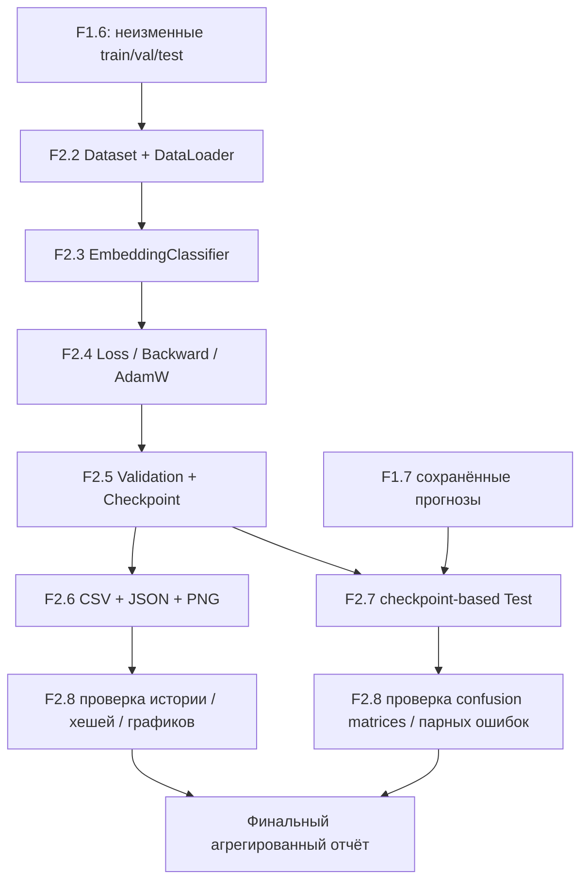

# F2.8 - Final Phase Report: Сведение проверяемых результатов

F2.8 - это подведение итогов всей фазы PyTorch. Собираем в одном отчёте, как устроена нейросеть, как она обучалась, какое качество получила и оправдалась ли её сложность.

## Инженерная задача
В F2.1–F2.7 создан полный, но небольшой цикл нейросетевой классификации. Проблема заключительного этапа не в новом обучении, а в согласованности доказательств: единый источник данных, правильный порядок train/validation/test, совпадение количественных показателей и отсутствие неявного переноса результатов между экспериментами.

F2.8 превращает два независимых агрегированных набора (кривые F2.6 и парную оценку F2.7) в проверяемое описание. Генератор не читает исходные вопросы и не загружает модель.

## Архитектура

## Проверка разбиений и отсутствия утечки
Для F2.6 и F2.7 проверяются числа объектов в `train`, `val`, `test`. Реальный эксперимент должен использовать размеры **1824 / 608 / 608**, а F2.7 - SHA-256 исходных split. Повторное обучение, загрузка датасета, перекодирование ID или выбор параметров после просмотра test не выполняются.

Выбор F2 checkpoint производится по максимальному Macro F1 на validation. Если два значения совпали, F2.5 сохраняет более раннюю эпоху. Test используется только после фиксации этой модели.

## Проверка матриц и метрик
Для класса \(c\) через \(TP_c\), \(FP_c\) и \(FN_c\) обозначим число верных положительных предсказаний, ложных положительных и ложных отрицательных.

Если знаменатель для класса равен нулю, принимается \(F1_c=0\). Таким образом, отчёт F2.8 не доверяет одному числу `macro_f1`: он пересчитывает его из матрицы ошибок и проверяет согласованность с точностью до 1e-8.

**Пример.** Для двух классов матрица \(\begin{pmatrix}2&1\\0&3\end{pmatrix}\) содержит шесть объектов, пять из них распознаны правильно. Accuracy = 5/6 ≈ 0,8333. Для первого класса \(F1_1=4/(4+0+1)=0,8\), для второго \(F1_2=6/(6+1+0)=6/7\approx0,8571\); Macro F1 ≈ 0,8286.

## Парные ошибки
На одном и том же test каждая строка относится ровно к одной группе: `both_correct`, `both_wrong`, `only_classical_wrong`, `only_neural_wrong`. Сумма этих четырёх чисел равна \(N\).

Ошибки F1 = `both_wrong + only_classical_wrong`; ошибки F2 = `both_wrong + only_neural_wrong`. Они должны совпадать с суммой внедиагональных элементов соответствующих confusion matrices. Иначе возможна ошибка связывания тестовых примеров или повреждение агрегатов.

Число `prediction_disagreements` не равно сумме ошибок: обе модели могут ошибаться разными классами. Оно не меньше числа односторонних ошибок и не больше количества примеров, на которых хотя бы одна модель ошибается.

## Диагностика F2.6
История включает по эпохам `train_loss`, `val_loss`, `val_accuracy`, `val_macro_f1`. Проверяются последовательность эпох, значения и лучшая эпоха. `history.csv` сверяется с `metrics.json` и SHA-256. Три PNG проверяются по файлам и хешам.

**Важно:** диагностический запуск F2.6 может иметь другую длительность и другую лучшую эпоху, чем сохранённый checkpoint F2.5, использованный в F2.7. Их значения отчёт показывает раздельно, без ложного объединения.

Рост validation loss при снижении training loss рассматривается лишь как возможный сигнал переобучения; изменение Macro F1 может быть немонотонным.

## Воспроизводимость и безопасный экспорт
Сведение детерминировано относительно проверенных входных агрегатов: повторный запуск над теми же входными файлами создаёт тот же Markdown. В отчёт экспортируются только числовые суммы, хеш test JSONL, число классов, параметры модели и кривые. Не копируются тексты, ID, индивидуальные предсказания, токены или абсолютные локальные пути.

Если `comparison.json` отсутствует, используется синтетический режим, не совпадают разбиения или нарушены инварианты, отчёт для реальных данных **не создаётся**. Значения из старого README не подставляются как актуальная итоговая оценка.

## Результат
Сформирован метод сквозного аудита F2.6/F2.7 и итоговый русскоязычный отчёт. Главный смысл этапа — связать измеренные показатели с тем экспериментом, который их породил, и открыто сохранить ограничения. Это надёжнее, чем механически объединять числа разных запусков.

| Показатель | Baseline F1 | Нейросеть F2 |
|---|---:|---:|
| Test macro F1 | **0,8822** | 0,7813 |
| Test accuracy | **87,83%** | 77,96% |
| Правильных предсказаний | **534 из 608** | 474 из 608 |
| Ошибок | **74** | 134 |
| Сохранённое время обучения | Около 1,29 с | Около 3,50 с |
| Размер файла модели | Около 1,28 МБ | Около 2,56 МБ |

## Файлы
| Файл | На что обратить внимание |
|---|---|
| `src/pytorch_f2/validation_checkpoint.py` | Правило отбора и восстановление выбранной модели |
| `src/pytorch_f2/training_diagnostics.py` | Проверка CSV/PNG/JSON, хешей и истории эпох |
| `src/pytorch_f2/model_comparison.py` | Источник парных ошибок и confusion matrices |
| **`src/pytorch_f2/final_report.py`** | Сквозной аудит train/val/test, агрегатов и точности метрик |
| **`scripts/build_f2_report.py`** | Последовательность чтения артефактов и записи итогового отчёта |
| **`tests/test_final_report.py`** | Испытания на повреждённых метриках, несогласованных матрицах и повторяемости |

## Почему проигрыш нейросети - полезный результат
Эксперимент нужен для проверки идеи, а не для обязательного получения улучшения.
Проверка идеи:
Поможет ли маленькая нейросеть лучше определять раздел технического вопроса?
Ответ по текущему test: **нет, этот вариант не улучшил качество**.

При этом получили работающую реализацию и поняли механизм обучения. Теперь есть основания для следующего эксперимента, а не просто желание использовать более сложную технологию.

## Основная мысль
Хороший отчёт показывает, что действительно выполнено, какой результат измерен и какие выводы он поддерживает. В нашем случае PyTorch pipeline работает, но преимущество по качеству осталось у baseline.
- Отчёт объясняет путь от данных до результата.
- Архитектура, словарь, training loop и критерий checkpoint — части эксперимента.
- Test оценивает выбранные веса, а не обязательно последние.
- Сравнение требует одинаковой задачи и согласованного split.
- Качество, скорость, размер файла и память — разные стороны результата.
- Условия измерений нужно сохранять рядом с числами.
- Гипотезы причин не следует выдавать за доказанные выводы.
- Отсутствие улучшения — допустимый и полезный итог эксперимента.
