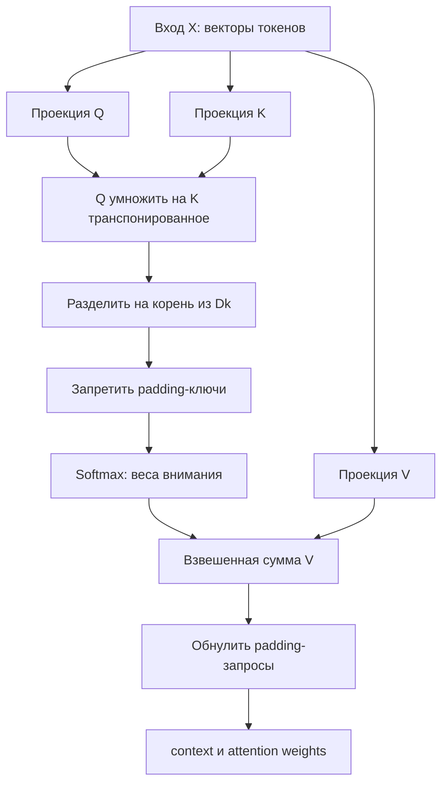

# F3.1 - Self-Attention: пошаговая реализация

## 1. Цель этапа

До F3.1 в Фазе 2 построена нейросеть для классификации технических текстов. Она умела получать текст и определять одну из четырёх категорий: `databases`, `linux`, `systems` или `programming`.

Внутри этой нейросети текст обрабатывался следующим образом:
1. Текст разбивался на токены - отдельные элементы последовательности.
2. Каждому токену сопоставлялся числовой идентификатор.
3. Слой `nn.Embedding` превращал идентификаторы в векторы чисел.
4. `masked mean pooling` усреднял векторы настоящих токенов, не учитывая padding.
5. Классификатор получал **один вектор текста** и предсказывал его категорию.

Такой подход позволяет классифицировать текст, но само усреднение не определяет, **какие токены важнее для конкретного другого токена**. В частности, при перестановке исходных векторов простое усреднение даст тот же самый результат.

**Задача F3.1:** реализовать операцию, в которой **каждый токен получает собственное новое представление**, зависящее от других токенов этой же последовательности. Эта операция называется **Self-Attention** (самовнимание).

Для токенов `postgresql`, `slow`, `query` требуется получать не одно общее среднее, а отдельный контекстный вектор каждой позиции с учётом других позиций. **Это не означает**, что необученная модель понимает смысл терминов: F3.1 проверяет математический механизм, а не языковое качество.

## 2. Реализация: файлы этапа

В F3.1 добавлены **пять файлов**, разделяющих математическую реализацию, внешний интерфейс, демонстрацию и проверку:

| Файл | Что реализовано и зачем |
|---|---|
| `src/transformers_f3/attention.py` | Реализован алгоритм: проверки входных тензоров, расчёт Q/K/V, сходства, Softmax, маски и итоговых векторов. Это **основной рабочий код**. |
| `src/transformers_f3/__init__.py` | Определён внешний интерфейс пакета: другие части проекта могут импортировать `SelfAttention` и `scaled_dot_product_attention` из `transformers_f3`. |
| `scripts/attention_demo.py` | Добавлена наглядная демонстрация: сначала расчёт на простых числах, затем пример с четырьмя позициями и padding. Скрипт показывает значения и формы результатов. |
| `tests/test_f3_attention.py` | Реализованы автоматические проверки математической правильности, масок, форм, градиентов, недопустимых входов и воспроизводимости. |
| `docs/steps/F3_01_transformer_attention.md` | Описаны задача, реализация, логика работы и проверка этапа. Это текущий учебный материал. |

**Важно:** алгоритмы Фаз 1 и 2 не заменяются. Используются ранее изученные принципы `nn.Embedding`, масок и `autograd`.

## 3. Последовательность действий

### Шаг 1. Определить входные тензоры и маску
Функции внимания нельзя передать непосредственно строку `"postgresql slow query"`. Сначала нужен числовой тензор, то есть многомерный массив.

Для класса `SelfAttention` зафиксирован вход `embeddings` формы `embeddings` формы **`[B, L, Dmodel]`**:
- `B` - сколько текстов обрабатываем одновременно (размер batch);
- `L` - сколько позиций в каждой последовательности после выравнивания;
- `Dmodel` - сколько чисел в векторе одного токена.

Например, `embeddings` формы `[1, 4, 4]` означает: **один текст, четыре позиции, четыре числа на каждую позицию**.

Вторая часть входа - `padding_mask` формы `[B, L]`. В нашем модуле **`True` - настоящий токен, `False` - padding**. Если текст содержит три токена и одну добавленную позицию, маска будет `[True, True, True, False]`.

**Зачем этот шаг:** прежде чем писать матричные операции, нужно договориться о формах и о том, какие позиции имеют смысл. Иначе легко получить неправильное умножение матриц или включить padding в результат.

### Шаг 2. Реализовать математический расчёт внимания отдельно от проекций
В `attention.py` расчёт разделён на функцию `scaled_dot_product_attention(...)` и обучаемый класс `SelfAttention`.

Первая функция **уже принимает готовые** `Q`, `K`, `V`. Разделение позволяет подставить заранее известные числа и независимо вычислить правильный ответ без влияния случайно инициализированных весов.

Функция последовательно:
1. Проверяет формы и типы входных тензоров.
2. Сравнивает запросы `Q` с ключами `K`.
3. Масштабирует полученные оценки.
4. Исключает запрещённые ключи по маске.
5. Превращает оценки в веса через Softmax.
6. Считает взвешенную сумму `V`.
7. Обнуляет выход фиктивных запросов, если передана соответствующая маска.

На выходе возвращается **пара `(context, weights)`**, а не один результат:
- `context` - новые векторы токенов;
- `weights` - таблица, показывающая, с каким весом каждый запрос учитывал каждый ключ.

### Шаг 3. Проверить формы, типы и допустимость масок
Вспомогательная функция `_validate_attention_inputs(...)` не вычисляет внимание: она предотвращает неверные расчёты.

Например, она проверяет, что `Q`, `K` и `V` - вещественные тензоры; у них согласованы размер batch, размеры проекций и число ключей/значений; маски имеют тип `torch.bool`, корректную форму и находятся на том же устройстве.

Отдельно проверяется, что **в каждом тексте есть хотя бы один разрешённый ключ**. Если замаскировать все ключи, Softmax над одними `−∞` математически некорректен и может дать `NaN`. Вместо скрытой ошибки модуль заранее сообщает о неправильном входе.

**Зачем этот шаг:** получать понятные ошибки, а не случайные неправильные числа, которые потом попадут в модель.

### Шаг 4. Создать обучаемые проекции Q, K и V
После проверки математического ядра требуется модуль, принимающий исходные embeddings вместо готовых Q/K/V.

Для этого реализован класс **`SelfAttention(nn.Module)`**. В его `__init__` объявлены три независимых слоя `nn.Linear`:
- `query_projection` превращает вход в **Q (Query)** - представление того, какую информацию ищет позиция;
- `key_projection` превращает вход в **K (Key)** - представление, с которым сравнивают запрос;
- `value_projection` превращает вход в **V (Value)** - информацию, которая попадёт в итоговый вектор.

В методе `forward` все три проекции применяются к **одному и тому же** `embeddings`. Поэтому операция называется **Self-Attention**: токены сравниваются с токенами собственной последовательности. После проекций вызывается уже проверенная функция `scaled_dot_product_attention(...)`.

Проекции созданы **без bias**, чтобы формулы было проще сопоставлять с кодом. Их веса потенциально обучаемые, но в демонстрации **обучение не выполняется**.

### Шаг 5. Правильно обработали padding
В Фазе 2 тексты уже выравнивались до общей длины. Например, короткий текст мог выглядеть как `postgresql, query, <PAD>, <PAD>`. Если не использовать маску, модель могла бы учитывать добавленные позиции, хотя они не содержат информации.

Реализованы **две независимые защиты**:
1. **Маска ключей.** Для фиктивного ключа оценка заменяется на `−∞`; после Softmax вес этого ключа становится нулевым. Значит, настоящий токен не получает информацию от padding.
2. **Маска запросов.** Даже фиктивная позиция могла бы обратиться к настоящим ключам и получить ненулевой выход. Поэтому её собственный контекстный вектор и строка весов обнуляются отдельно.

Это принципиальный момент: **маска ключей и маска запросов решают разные задачи**. В F3.1 проверены обе.

### Шаг 6. Подготовить демонстрацию на известных числах
В `scripts/attention_demo.py` предусмотрены две части.

**Первая часть - ручной числовой пример.** Q, K и V задаются напрямую, после чего вычисляются веса и контекстный вектор. Так можно проверить арифметику без нейросетевого обучения.

**Вторая часть - объект `SelfAttention(d_model=4)`.** Для воспроизводимости задаём seed, создаём четыре позиции, из которых последняя - фиктивная, и передаём маску `[True, True, True, False]`. Скрипт выводит размеры результата, веса внимания первого токена и два булевых признака корректности masking.

В фиктивную позицию намеренно записаны большие числа (`999`). Это помогает наглядно показать: **их величина не должна влиять на настоящие токены, если padding замаскирован правильно**.

### Шаг 7. Проверить математический эталон, формы и градиенты
В `tests/test_f3_attention.py` предусмотрены проверки нескольких видов:
- **Математический эталон:** результат сопоставляется с расчётом вручную и со штатной операцией PyTorch.
- **Формы:** проверяется, что выходные тензоры имеют ожидаемые размерности.
- **Маски:** фиктивный ключ получает нулевой вес, а фиктивный запрос - нулевые контекст и строку весов.
- **Градиенты:** проверяется прохождение `backward()` через реализованные операции и соответствие градиентов эталону.
- **Обучаемость:** один тестовый шаг AdamW изменяет веса проекций, то есть модуль сможет участвовать в обучении в будущем.
- **Ошибочные данные:** неверные типы, формы, пустые последовательности и несогласованные маски должны вызывать понятные исключения.
- **Воспроизводимость и CLI:** одинаковый seed даёт одинаковые результаты, а демонстрация запускается отдельным процессом.

**Итог разработки:** получен отдельный Python-компонент с математическим эталоном и воспроизводимой проверкой.

## 4. Алгоритм Self-Attention: что происходит внутри одного вызова

Теперь пройдём именно **путь данных во время `forward()`**, от входных векторов до результата.

### 4.1. Получение Q, K и V
Пусть вход - `X` формы `[B, L, Dmodel]`. Линейные слои вычисляют:
```math
Q = XW_Q,\qquad K = XW_K,\qquad V = XW_V.
```
Для примера `B=1`, `L=4`, `Dmodel=4`, `Dk=4`, `Dv=4` все три результата имеют форму `[1, 4, 4]`.

Это не три копии исходного вектора: **у проекций разные матрицы весов**, поэтому они могут научиться отражать разные свойства токенов.

### 4.2. Сравнение каждого запроса со всеми ключами
```math
S = \frac{QK^T}{\sqrt{Dk}}.
```
Произведение `QKᵀ` показывает соответствие каждой позиции другим позициям. При четырёх токенах получается таблица **4 × 4**: четыре запроса по строкам и четыре ключа по столбцам. Поэтому размерность `S` - `[B, L, L]`.

Деление на `√Dk` ограничивает рост значений при увеличении размерности и помогает избежать чрезмерного насыщения Softmax.

### 4.3. Применение маски и Softmax
Для padding-ключей оценки заменяются на `−∞`. Функция `torch.softmax(scores, dim=-1)` переводит оставшиеся оценки в **неотрицательные веса, сумма которых для настоящего запроса равна 1**.

Важно: эти веса - **коэффициенты внимания**, а не вероятность правильного класса, не вероятность релевантности документа и не доказательство понимания смысла.

### 4.4. Формирование контекстных векторов
```math
H = AV,
```
где `A` - вычисленная матрица attention weights. Каждый новый вектор - **взвешенная сумма векторов V**. Поэтому у разных токенов могут получиться разные контекстные представления.

В конце обнуляем выходы фиктивных запросов. Результат:
- `context`: `[B, L, Dv]` - новый вектор для каждого токена;
- `weights`: `[B, L, L]` - веса внимания между позициями.

### 4.5. Проверка на конкретных числах
Рассмотрим один запрос и два ключа (здесь для простоты `Dk=2`):
```math
q=[1,0],\quad k_1=[1,0],\quad k_2=[0,1],
```
```math
v_1=[2,0],\quad v_2=[0,4].
```
**Действие 1.** Вычислить скалярные произведения: `q · k₁ = 1`, `q · k₂ = 0`.

**Действие 2.** Разделить на `√2`. Оценки составляют примерно `[0.7071, 0]`.

**Действие 3.** Применить Softmax. Получаются веса около `[0.6698, 0.3302]`. Первый ключ влияет на ответ сильнее второго.

**Действие 4.** Умножить values на веса и сложить:
```math
h=0.6698\cdot[2,0]+0.3302\cdot[0,4]
 \approx [1.3395,1.3209].
```
**Именно этот расчёт воспроизводит первая часть `attention_demo.py`.** Числовой эталон задан до выполнения программы и пригоден для независимой проверки.

## 5. Схема вычислений

**Как F3.1 связан с уже существующим кодом Фазы 2:**
```text
Текст: "postgresql slow query"
          |
          v
F2.2: токенизация, token_ids, padding_mask
          |
          v
F2.3: nn.Embedding -> X [B, L, Dmodel]
          |
          v
F3.1: SelfAttention(X, padding_mask)
          |
          +--> context [B, L, Dv]  — новые векторы токенов
          |
          +--> weights [B, L, L]  — таблица весов внимания
```

Это **логическая связь интерфейсов**, а не изменение классификатора F2 или подключение F3.1 к его обучению.

**Как устроена операция внутри:**


Главное, на что стоит смотреть на схеме: **сначала вычисляются отношения между токенами, затем с их помощью пересчитываются векторы токенов**.

## 6. Локальная проверка в PowerShell: что запускать и как читать результат

Ниже приведены команды **для уже существующего проекта** на Windows. Они не устанавливают пакеты, не скачивают модели и не изменяют Git-историю.

### 6.1. Перейти в проект
```powershell
cd F:\DEVELOPMENT\ML\ml-engineering-lab
```
Все следующие команды выполняются из корня репозитория.

### 6.2. Запустить только тесты F3.1
```powershell
.\.venv\Scripts\python.exe -m pytest tests/test_f3_attention.py -q
```

**Что проверяется:** правильность математических операций, формы входов/выходов, обе маски, обработку ошибок, градиенты, воспроизводимость и запуск демо.

**Подтверждённый на Windows результат при завершении F3.1:** `62 passed`. Это число относится **именно к тестам F3.1**, а не ко всей Фазе 3. Если состав тестов позднее изменился, итоговое количество нужно считать по фактическому выводу.

### 6.3. Посмотреть механизм в действии
```powershell
.\.venv\Scripts\python.exe scripts/attention_demo.py
```

Скрипт не обучает модель. Он сначала печатает результат заданного ручного примера, а затем показывает работу маски.

**Ключевые строки вывода, подтверждённые на Windows:**
```text
weights: [0.6697615493266569, 0.33023845067334306]
context: [1.3395230986533138, 1.3209538026933723]
sum(weights): 1.000000
output shape: (1, 4, 4)
attention shape: (1, 4, 4)
padding key has zero weight: True
padding query has zero output: True
```

**Как это объяснять:**
- `weights` - для данного запроса первый ключ получил около 67% веса, второй - около 33%.
- `context` - новая пара чисел, полученная как взвешенная сумма значений `V`.
- `sum(weights): 1.000000` - распределение весов для настоящего запроса нормировано.
- `output shape: (1, 4, 4)` - один текст, четыре позиции, четыре числа в выходном векторе каждой позиции.
- `attention shape: (1, 4, 4)` - четыре строки запросов и четыре столбца ключей.
- Оба значения `True` в конце - padding не участвует как ключ и не даёт выход как запрос.

Весовые коэффициенты из второго опыта получены **необученной моделью** с фиксированным seed. По ним нельзя заключать, какие слова семантически важнее.

### 6.4. Проверить, что предыдущие этапы не сломались
```powershell
.\.venv\Scripts\python.exe -m pytest -q
```

**Что проверяется:** полную регрессию установленных в репозитории тестов. При первоначальной Windows-проверке F3.1 было `590 passed` (528 предыдущих + 62 новых). **Теперь проект содержит и более поздние этапы F3**, поэтому сегодняшнее число тестов может быть больше; ориентируйся на отсутствие `failed`/`errors`, а не на старое число 590.

Если что-то падает, нужно смотреть конкретный тест и traceback. Один успешно запустившийся демо-скрипт не заменяет полную проверку.

## 7. Что подтверждено и какие ограничения

**Подтверждено тестами:** собственная реализация считает внимание как математический эталон, сохраняет ожидаемые формы, корректно исключает padding, поддерживает обратное распространение градиентов и воспроизводимо запускается на CPU.

**Ограничения реализации:**
- Здесь только **single-head attention**, нет multi-head attention, positional encoding и полного encoder stack.
- Без positional encoding в операции нет собственной информации о порядке токенов.
- Матрица весов имеет размер `[B, L, L]`: её память растёт примерно как `L²`. При удвоении длины последовательности она становится примерно в четыре раза больше.
- Для полностью пустого набора ключей возникает контролируемая ошибка, потому что корректное распределение внимания определить невозможно.

## 8. Основная мысль раздела

**В Фазе 2 векторы токенов усреднялись до одного представления текста. В F3.1 реализован Self-Attention: Q и K определяют веса взаимодействия позиций через Softmax; новый вектор каждого токена получается как взвешенная сумма V. На PyTorch проверены числовой эталон, формы тензоров, обе разновидности маскирования и градиенты. Обучение модели здесь не проводилось.**

## 9. Файлы этапа

Для изучения реализации использовать следующую последовательность файлов, сопоставляя код с описанными операциями.

| Порядок | Файл | На что смотреть в коде |
|---|---|---|
| 1 | `scripts/attention_demo.py` | `run_demo()`: простые входные Q/K/V, печать `weights` и `context`, затем вход с padding и проверка результата. Это самый наглядный старт. |
| 2 | `src/transformers_f3/attention.py` | `scaled_dot_product_attention()`: `matmul`, транспонирование K, деление на `sqrt(Dk)`, `masked_fill`, `softmax`, получение `context`. |
| 3 | `src/transformers_f3/attention.py` | `_validate_attention_inputs()`: какие формы, типы и маски допустимы; почему запрещены все замаскированные ключи. |
| 4 | `src/transformers_f3/attention.py` | `SelfAttention.__init__()` и `forward()`: три `nn.Linear` и вызов математической функции. |
| 5 | `tests/test_f3_attention.py` | Ручной числовой эталон, сравнение с PyTorch SDPA, проверки masking, градиентов, неверных входов и CLI. |
| 6 | `src/transformers_f3/__init__.py` | Какие функции и классы экспортируются из пакета для внешнего использования. |
| 7 | `src/pytorch_f2/data_pipeline.py` и `src/pytorch_f2/embedding_classifier.py` | Как F2 получает токены, padding mask и embeddings; чем `masked mean pooling` отличается от контекстных векторов F3.1. Эти файлы уже существовали и в F3.1 не менялись. |

**Итог F3.1:** показано происхождение Q/K/V, расчёт весов внимания, формирование новых векторов и роль масок; корректность подтверждена независимыми эталонами и тестами. Это основа для понимания предобученных Transformer-моделей в последующих этапах.
