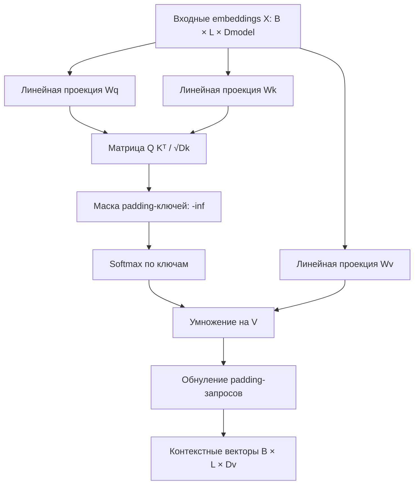

# F3.1 — Transformer & Self-Attention Fundamentals

## 1. Назначение этапа

В Фазе 2 мы построили классификатор технических текстов: токены превращались в целочисленные идентификаторы, затем в векторы через `nn.Embedding`; **masked mean pooling** объединял векторы настоящих токенов в одно представление предложения. Далее линейные слои предсказывали класс (`databases`, `linux`, `systems`, `programming`).

Новый вопрос Фазы 3: **как сделать представление каждого токена зависимым от других токенов того же текста?** Для этого изучаем и реализуем одноголовый **Self-Attention** — центральную математическую операцию Transformer.

Цель F3.1 — собственная проверяемая реализация внимания на PyTorch, а не обучение полного Transformer, классификатора или retrieval-модели. Результат этапа — вычисления, формы, маски и градиенты, которые можно сопоставить с математическим эталоном.

## 2. Инженерная задача

Пусть вход содержит последовательность из трёх технических токенов:

`["postgresql", "slow", "query"]`

В F2 каждый токен имел свой embedding, а после masked mean pooling получался единственный вектор текста. Усреднение использовало равные веса для всех непустых токенов:

\[
\bar{x}=\frac{\sum_{i=1}^{L}m_i x_i}{\sum_{i=1}^{L}m_i}, \qquad m_i\in\{0,1\}.
\]

В Self-Attention для каждой позиции `i` строится отдельная взвешенная сумма значений остальных позиций:

\[
h_i=\sum_{j=1}^{L}\alpha_{ij}v_j,
\qquad \sum_{j\in\mathrm{valid}}\alpha_{ij}=1.
\]

Вес `αᵢⱼ` зависит от соответствия запросов `qᵢ` ключам `kⱼ`. Поэтому каждая позиция имеет **собственный набор весов**, а контекстные векторы для разных позиций обычно отличаются.

Это не означает, что необученное внимание «понимает PostgreSQL». В F3.1 мы показываем **механику операции**; предметная семантика возникает только после подходящего обучения или применения предобученной модели в следующих этапах.

## 3. Определения и размерности

| Обозначение | Значение | Размерность |
|---|---|---|
| `B` | Число текстов в batch | — |
| `L` | Длина последовательности после padding/truncation | — |
| `Dmodel` | Размерность входного embedding токена | — |
| `Dk` | Размерность запросов и ключей | — |
| `Dv` | Размерность векторов значений и выхода | — |
| `X` | Входные embeddings | `[B, L, Dmodel]` |
| `Q` | Query — что ищет текущий токен | `[B, L, Dk]` |
| `K` | Key — как другим токенам сравнивать эту позицию | `[B, L, Dk]` |
| `V` | Value — информация, которую позиция передаёт в результат | `[B, L, Dv]` |
| `S` | Масштабированные оценки сходства | `[B, L, L]` |
| `A` | Нормированные веса внимания | `[B, L, L]` |
| `H` | Контекстные векторы токенов | `[B, L, Dv]` |

`nn.Linear` хранит веса проекции как `[out_features, in_features]`, поэтому в формулах ниже удобнее использовать транспонированное соглашение `[in_features, out_features]`.

**Три обучаемые проекции:**

\[
Q=XW_Q,\quad K=XW_K,\quad V=XW_V,
\]

\[
W_Q,W_K\in\mathbb R^{Dmodel\times Dk},\qquad
W_V\in\mathbb R^{Dmodel\times Dv}.
\]

В F3.1 проекции реализованы без bias, чтобы сохранить прямое соответствие формуле. Число обучаемых параметров:

\[
N_\mathrm{params}=Dmodel\cdot(2Dk+Dv).
\]

Например, при `Dmodel=4, Dk=3, Dv=5` получаем `4 × (3+3+5) = 44` параметра.

## 4. Scaled Dot-Product Attention: алгоритм

### Шаг 1. Вычислить оценки QKᵀ

\[
S_\mathrm{raw}=QK^T.
\]

Операция сопоставляет **каждый запрос** каждому ключу, поэтому результат имеет форму `[B, Lq, Lk]`. В случае Self-Attention `Lq=Lk=L`.

### Шаг 2. Масштабировать скалярное произведение

\[
S=\frac{QK^T}{\sqrt{Dk}}.
\]

При росте `Dk` дисперсия скалярных произведений может расти, делая Softmax излишне насыщенным. Деление на `√Dk` ослабляет этот эффект. В коде это операция `scores = ... / math.sqrt(query.shape[-1])`.

### Шаг 3. Исключить padding-ключи

Из F2.2 мы уже знаем, что последовательности внутри batch выравниваются padding-токенами. Здесь булева маска имеет форму `[B, L]` и семантику:

- `True` — настоящий токен;
- `False` — padding (фиктивная позиция).

Для каждого `False` в маске ключей устанавливаем соответствующую оценку во **всех строках запросов** равной `−∞`. После Softmax вес такого ключа станет нулевым.

Пример для последовательности `[postgresql, query, <PAD>]`:

```text
Ключи:          postgresql      query       <PAD>
Маска ключей:      True           True       False
Scores i:          0.5            1.0         -inf
Softmax i:        0.378          0.622        0.000
```

Критический граничный случай: полностью замаскированные ключи образуют строку `[-inf, -inf, ...]`. Softmax на ней математически не определён и может выдать `NaN`. Поэтому реализация явно запрещает batch-элемент без хотя бы одного настоящего ключа.

### Шаг 4. Нормировать Softmax

\[
\alpha_{ij}=\frac{\exp(S_{ij})}{\sum_{t\in\mathrm{valid}}\exp(S_{it})}.
\]

`torch.softmax(scores, dim=-1)` нормирует **по ключам** отдельно для каждого запроса. У действительного запроса сумма его весов по всем ключам равна 1 (с точностью до арифметики с плавающей точкой).

### Шаг 5. Вычислить контекст

\[
H=AV.
\]

Каждая строка `H` — взвешенная сумма векторов `V`. Она имеет размерность `Dv`, а не обязательно `Dmodel`.

### Шаг 6. Обнулить padding-запросы

Маска **ключей** предотвращает чтение фиктивных позиций, но сама по себе не мешает фиктивному **запросу** прочитать настоящие ключи и получить ненулевой вектор. Поэтому F3.1 отдельно обнуляет строки выходов и attention weights, соответствующие `False` в маске запросов.

Для настоящих запросов: `sum(weights[i, :]) ≈ 1`. Для padding-запросов: `sum(weights[i, :]) = 0`. Это намеренное исключение из обычной нормировки.

## 5. Подробный числовой пример

Пусть мы рассматриваем **один** запрос, **два** ключа и значения, каждый в двумерном пространстве:

\[
q=[1,0],\quad k_1=[1,0],\quad k_2=[0,1],
\]
\[
v_1=[2,0],\quad v_2=[0,4].
\]

1. Скалярные произведения: `q·k₁=1`, `q·k₂=0`.
2. `Dk=2`, значит масштабированные scores: `[1/√2, 0] ≈ [0.7071, 0]`.
3. После Softmax:

\[
\alpha_1=\frac{e^{0.7071}}{e^{0.7071}+e^0}\approx0.6698,
\quad \alpha_2\approx0.3302.
\]

4. Контекстный вектор:

\[
h=\alpha_1[2,0]+\alpha_2[0,4]
\approx[1.3395,1.3209].
\]

Этот результат не является вероятностью правильного класса или релевантности документа. Это **взвешенное сочетание двух векторов V**. Тест сравнивает вычисленное значение с ручными формулами, а отдельный тест — со штатным `torch.nn.functional.scaled_dot_product_attention` PyTorch.

## 6. Архитектура F3.1



Архитектура содержит два уровня:

- **`scaled_dot_product_attention`** — чистая тензорная операция для готовых Q/K/V. Она отдельно принимает маски ключей и запросов. Это позволяет проверять математику без случайной инициализации линейных проекций.
- **`SelfAttention(nn.Module)`** — обучаемые проекции `query_projection`, `key_projection`, `value_projection`, после которых вызывается тензорная операция. В Self-Attention все проекции строятся из одного `X`.

В F3.1 **нет** multi-head attention, positional encoding, residual connection, LayerNorm, feed-forward блока, encoder stack или pretrained weights. Это не полный Transformer: мы изучаем его базовую операцию. Запуск не использует интернет и не читает исходные train/validation/test данные.

## 7. Как читать реализацию

1. `_validate_attention_inputs` фиксирует интерфейс и инварианты: `[B, L, D]`, вещественные тензоры, одинаковый dtype/device, согласованные длины и булевы маски. Запрещает полностью замаскированные ключи.
2. `scaled_dot_product_attention` вычисляет `QKᵀ / √Dk`, применяет `-inf` к запрещённым ключам, нормирует веса и умножает их на `V`. В конце отдельно обнуляет padding-запросы.
3. `SelfAttention.__init__` создаёт три проекции `nn.Linear` без bias. `SelfAttention.forward` превращает входные embeddings в Q/K/V, передаёт маски и возвращает **два** тензора — контекст и веса внимания.
4. `run_demo` сначала воспроизводит числовой пример, затем показывает формы выхода и нулевые веса padding на синтетических токенах. Фиксированный seed применяется только к случайной инициализации проекций и **не означает обучения модели**.

### Связь с F2.2 и F2.3

F2.2 уже вычисляет токены и padding mask, а F2.3 применяет `nn.Embedding` и masked mean pooling. Потенциальная интеграция выглядит так:

```text
F2.2: token_ids [B,L], padding_mask [B,L]
         |
F2.3: nn.Embedding(token_ids) -> X [B,L,Dmodel]
         |
F3.1: SelfAttention(X, padding_mask)
         |
context [B,L,Dv] + weights [B,L,L]
```

Важно: `SelfAttention` принимает **вещественные embeddings**, а не целочисленные token IDs; в F3.1 мы **не** подменяем классификатор F2 новой моделью и не изменяем его архитектуру. Учитывай семантику существующей маски: здесь `True` означает настоящий токен.

## 8. Проверяемые эксперименты

| Эксперимент | Математический инвариант | Ожидаемый результат |
|---|---|---|
| Два ключа, один запрос | Ручной Softmax и сумма значений | `weights ≈ [0.6698, 0.3302]`; `context ≈ [1.3395, 1.3209]` |
| Проверка размерностей | Q/K/V имеют согласованные `B`, `Dk` и `Lk` | `[B,Lq,Dv]`, `[B,Lq,Lk]` |
| Независимость от padding | Изменение скрытого ключа/значения не влияет на выход настоящих запросов | Выход не меняется |
| Маска запросов | Выход и строка весов фиктивного запроса | Точные нули |
| Сумма весов | Softmax по разрешённым ключам | ≈ 1 для каждого настоящего запроса |
| Градиенты | Autograd собственной реализации против эталона PyTorch | Совпадение в заданной числовой точности |
| Обучаемость | Шаг AdamW через стандартный `backward()` | Параметры проекций изменяются |
| Воспроизводимость | Одинаковые seed, входы и конфигурация | Совпадающие параметры и выходы |
| CLI smoke | Изолированный запуск без датасета и сети | Печатает формы и инварианты |

Это **числовые и инженерные тесты**. Accuracy, Macro F1, Recall@K и MRR здесь не рассчитываются, потому что в F3.1 нет ни задачи классификации, ни retrieval-разметки, ни обученной семантической модели. Метрики F1/F2 не переизмеряются.

## 9. Ограничения и вычислительная сложность

**Цена внимания.** Умножение QKᵀ требует порядка `O(B × L² × Dk)` операций, умножение AV — `O(B × L² × Dv)`. Хранение матрицы внимания `[B,L,L]` занимает `O(B × L²)` памяти. При удвоении длины последовательности размер матрицы весов вырастает в четыре раза. Для коротких CPU-тестов эта цена невелика, но для длинных документов — существенна.

**Отсутствие позиций.** Без positional encoding перестановка токенов меняет порядок выходных векторов, но Self-Attention не содержит самостоятельного знания абсолютного или относительного порядка. В следующих шагах полная архитектура Transformer должна учитывать позиции.

**Неинтерпретируемость необученных весов.** Рандомно инициализированные проекции не подтверждают, что модель нашла смысловую связь. Attention weights — внутренние коэффициенты, **не** калиброванная вероятность релевантности документа и не полноценное объяснение решения.

**Маска — правило интерфейса.** Здесь булево `True = действительный токен`. В других API может использоваться обратная семантика или аддитивная маска. Перед интеграцией необходимо явно сравнить соглашения.

**Пустые последовательности.** Если все ключи в одном batch-элементе — padding, операция не определена: реализация выбрасывает `ValueError`. Ведущий DataLoader должен предотвращать или фильтровать подобные случаи.

**Точность.** В тестах числовой пример и эталон проверяются преимущественно в `float64`, обычный модуль по умолчанию использует `float32`. Разные платформы могут давать малые отличия из-за порядка операций с плавающей точкой.

## 10. Выводы

F3.1 демонстрирует, как отдельные векторы токенов взаимодействуют через три проекции, матрицу сходства и взвешенную сумму. Это фундамент для multi-head attention и Transformer Encoder, но ещё не система семантического поиска.

Практический результат: доступная для проверки математика Q/K/V, контроль shapes, обратного распространения и двух видов padding mask, без изменения проверенных F1/F2 моделей.

## 11. Файлы, с которыми стоит познакомиться

| Файл | Что в нём изучить |
|---|---|
| `src/transformers_f3/attention.py` | Класс `SelfAttention`, размерности `nn.Linear`, вычисление Q/K/V, масштабирование `√Dk`, `scores.masked_fill`, `softmax`, `matmul`, раздельное обнуление padding-ключей и запросов. |
| `src/transformers_f3/__init__.py` | Публичный интерфейс модуля (`SelfAttention`, `scaled_dot_product_attention`) и принцип изоляции F3 от кода F2. |
| `scripts/attention_demo.py` | Числовой сценарий Q/K/V; проверка нормировки Softmax; воспроизводимое создание модели; интерпретация формы выхода без завышения смысла необученных весов. |
| `tests/test_f3_attention.py` | Математические эталоны, тесты shapes/dtype/masking, запрет утечки от padding, сравнение градиентов со штатным SDPA, граничные случаи и CLI smoke. |
| `src/pytorch_f2/data_pipeline.py` *(уже существует в F2)* | Как строятся padded batches и булевы маски; сопоставить семантику с аргументом `padding_mask` в F3.1. |
| `src/pytorch_f2/embedding_classifier.py` *(уже существует в F2)* | Как `nn.Embedding` создаёт входные представления и чем masked mean pooling отличается от вычисления отдельного контекста для каждого токена. |
| `src/pytorch_f2/autograd_demo.py` *(уже существует в F2)* | Вспомнить вычислительный граф и `backward()` перед анализом градиентов по `Wq`, `Wk`, `Wv`. |
