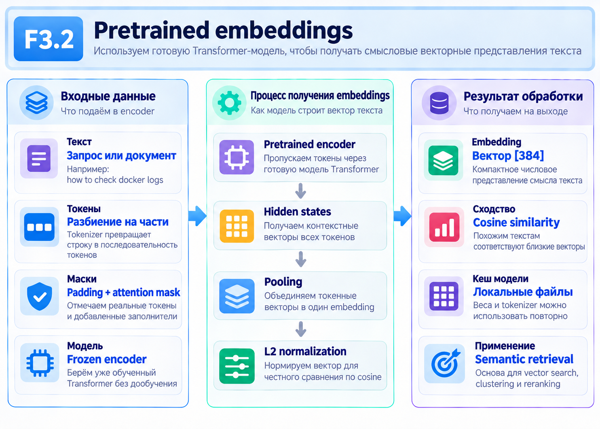
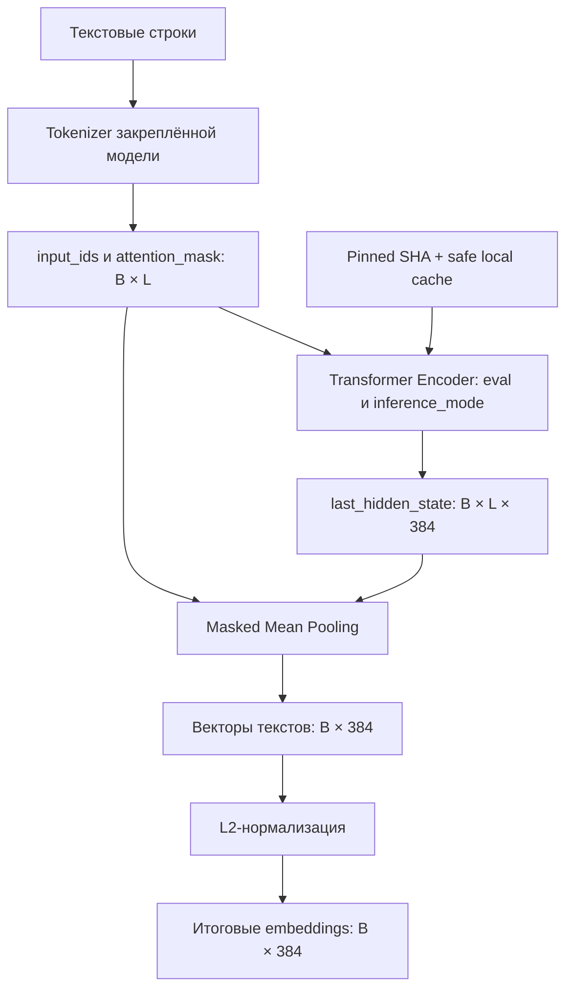

# F3.2 - Предобученные Transformer Embeddings: пошаговая реализация

## 1. Цель этапа

В F2.3 текст классифицировался через таблицу `nn.Embedding` и `masked mean pooling`: одному идентификатору токена соответствовала одна строка обучаемой таблицы независимо от соседних слов. В F3.1 реализован механизм Self-Attention, но его учебные проекции не содержали предобученного языкового знания.



**Задача F3.2:** построить воспроизводимый CPU-компонент `text → dense embedding` на основе готового Transformer Encoder. Сохранить строгую связь между моделью, её токенизатором, конкретной ревизией весов и проверенным локальным кешем. Отделить правильность числового преобразования от качества будущего поиска.

В качестве предобученной модели выбрана `sentence-transformers/paraphrase-MiniLM-L3-v2`: выходная размерность `384`, ограничение этапа - `128` токенов, pooling - masked mean, нормализация - L2. Вектор текста пока не используется для ранжирования и не является предсказанием класса.

**Граница этапа:** BM25, Vector Search, Recall@K, MRR, обучение encoder и RAG здесь не выполняются.

## 2. Реализация: файлы этапа

| Файл | Назначение и реализованный механизм |
|---|---|
| `configs/f3_02_model.json` | Зафиксированы `model_id`, полный commit SHA, лицензия, размерность embedding, максимальная длина и параметры pooling/нормализации. |
| `src/transformers_f3/embeddings.py` | Реализованы `ModelSpec`, `masked_mean_pooling()`, `l2_normalize()` и `PretrainedTextEncoder.encode()` с проверками форм, чисел и режима inference. |
| `src/transformers_f3/model_cache.py` | Реализованы проверка remote metadata, разрешённая загрузка snapshot, SHA-256 manifest, offline-проверка кеша и безопасная загрузка локальной модели. |
| `scripts/embedding_demo.py` | Предусмотрены синтетическая демонстрация интерфейса и режим с уже доступным предобученным encoder. |
| `tests/test_f3_embeddings.py` | Проверены формулы pooling/нормировки, инвариант padding, размеры батчей, граничные значения и режим без градиентов. |
| `tests/test_f3_model_cache.py` | Проверены pinning модели, отказ при повреждении кеша, проверки лицензии/SHA, отсутствие неразрешённой загрузки и работа с подставными HTTP-интерфейсами в тестах. |
| `docs/steps/F3_02_pretrained_embeddings.md` | Зафиксированы задача, вычислительный процесс, математические эталоны, границы проверок и команды локального запуска. |

Файлы F2.3 и F3.1 не заменяются: F3.2 использует готовую предобученную архитектуру, а не подставляет в неё собственные необученные веса Self-Attention.

## 3. Последовательность действий

### Шаг 1. Выбрать фиксированный предобученный encoder
Указать полное имя `sentence-transformers/paraphrase-MiniLM-L3-v2` и commit `4ca70771034acceecb2e72475f72050fcdde4ddc`. Для выбранной ревизии заданы `D=384`, `max_length=128`, лицензия `Apache-2.0` согласно model card.

**Зачем:** ссылка на `main` не закрепляет состояние модели. Обновление весов или tokenizer у поставщика способно изменить полученные векторы даже при неизменном локальном коде.

### Шаг 2. Сохранить контракт входа и выхода
`PretrainedTextEncoder.encode(texts)` принимает список строк. После токенизации формируются `input_ids [B,L]` и `attention_mask [B,L]`, где `B` - количество текстов, `L≤128` - длина текущего батча с padding.

После работы encoder ожидается `last_hidden_state [B,L,384]`. Pooling удаляет только токеновую ось, возвращая `[B,384]`. Итог - `torch.float32` на CPU, исходный порядок строк сохраняется.

**Зачем:** индексация документов F3.4 должна получать одинаковое число координат и стабильное соответствие строк их идентификаторам.

### Шаг 3. Использовать именно tokenizer предобученной модели
Применить `padding=True`, `truncation=True`, `max_length=128`. При этом идентификаторы токенов должны соответствовать словарю и embedding-слою закреплённой модели. Словарь из F2.2 для этой задачи не подходит.

**Зачем:** совпадение числового ID между разными словарями не означает совпадение его смысла. Замена tokenizer нарушает контракт pretrained weights.

### Шаг 4. Получить контекстные векторы в режиме inference
Установить `model.to("cpu").eval()`, выполнять `encode()` под `torch.inference_mode()` и извлекать `last_hidden_state`.

`eval()` переключает поведение слоёв, таких как dropout; `inference_mode()` отключает построение графа и дополнительные накладные расходы autograd. Обновление весов и optimizer в F3.2 отсутствуют.

### Шаг 5. Реализовать masked mean pooling
Привести маску `[B,L]` к форме `[B,L,1]`, исключить padding из суммы, разделить на число разрешённых токенов. Полностью пустую маску отклонять как некорректный вход.

**Зачем:** ненулевые значения в padding-позициях не должны менять представление реального текста.

### Шаг 6. Нормировать векторы по L2
Каждый непустой pooled embedding разделить на собственную евклидову норму. Отклонять `NaN`, `Inf` и нулевые векторы.

**Зачем:** для нормированных embeddings скалярное произведение эквивалентно cosine similarity. Это потребуется в точном векторном поиске F3.4.

### Шаг 7. Закрепить локальный кеш и его происхождение
Первичную загрузку выполнять только при явном разрешении. Перед загрузкой проверить точную ревизию, ожидаемую лицензию и открытость модели. Разрешить безопасные файлы (`model.safetensors`, `config.json`, файлы токенизатора); использовать `trust_remote_code=False`, `use_safetensors=True`, `local_files_only=True` при последующей локальной загрузке.

Для каждого используемого файла сформировать SHA-256, указать версии PyTorch, Transformers и huggingface_hub в manifest. Кеш хранить вне репозитория: `<HOME>/.cache/ml-engineering-lab/f3_02/`.

**Зачем:** SHA commit фиксирует исходную версию, SHA-256 проверяет реальное содержимое кеша. Ни одна проверка не доказывает семантическую точность модели.

### Шаг 8. Проверить вычисления и отсутствие скрытых загрузок
Для pooling и L2 подготовить ручные числовые эталоны. Тестами проверить формы, порядок результатов, независимость от padding и размера батча, ошибки некорректных входов, отказ от сетевого доступа в offline-режиме и реакцию на изменение файлов кеша.

По исходной документации в доступной Linux CPU-среде прошли **88 unit/smoke-тестов F3.2 без скачивания весов**. Реальный pretrained forward в той среде не был подтверждён. Локальные Windows-результаты необходимо брать из фактического вывода тестов.

## 4. Алгоритм: от токенов к sentence embedding

### 4.1. Форма скрытых состояний
После токенизатора и Transformer Encoder формируется массив:
```math
H \in \mathbb{R}^{B\times L\times D},\qquad D=384.
```

Позиция `[b,i,:]` содержит контекстный вектор i-го токена b-го текста. В отличие от статического `nn.Embedding` из F2.3, он зависит от соседних токенов, поскольку внутри предобученного encoder уже выполнены attention-операции.

### 4.2. Masked mean pooling
```math
e_b=\frac{\sum_{i=1}^{L}m_{b,i}h_{b,i}}{\sum_{i=1}^{L}m_{b,i}},\qquad m_{b,i}\in\{0,1\}.
```

**Числовой эталон, не вывод pretrained-модели:** векторы `[2,4]`, `[6,8]`, `[900,900]`, маска `[1,1,0]`.

```math
e=\frac{[2,4]+[6,8]+0\cdot[900,900]}{2}=[4,6].
```

Обычное среднее по всем трём позициям дало бы приблизительно `[302.67,304]`. Таким образом, отсутствие маски создаёт заметную и заранее вычислимую ошибку.

### 4.3. L2-нормализация
```math
\lVert e\rVert_2=\sqrt{\sum_{j=1}^{D}e_j^2},\qquad \widehat e=\frac{e}{\lVert e\rVert_2}.
```

Для `e=[3,4]` норма равна `5`, результат `[0.6,0.8]`.

```math
\operatorname{cosine}(u,v)=\frac{u\cdot v}{\lVert u\rVert_2\lVert v\rVert_2}=\widehat u\cdot\widehat v.
```

Cosine score может принимать значения от `−1` до `1`, но **не является вероятностью релевантности**. Вывод о полезности документов потребует независимой разметки на F3.6.

### 4.4. Версии и контроль данных
Версия модели определяется парой `model_id + полный revision SHA`; локальные файлы проверяются отдельно по SHA-256. В manifest должны совпадать зафиксированная спецификация, версии библиотек и реальные отпечатки файлов. Кеш embeddings пользовательских запросов не создаётся: хранение модели и хранение производных пользовательских данных - разные задачи.

## 5. Схема вычислений


Главное разделение: Transformer создаёт **контекстные векторы токенов**, pooling объединяет их в **вектор текста**, L2-нормализация подготавливает вектор к геометрическому сравнению.

## 6. Локальная проверка в PowerShell: что запускать и как читать результат

### 6.1. Перейти в корень репозитория
```powershell
cd F:\DEVELOPMENT\ML\ml-engineering-lab
```

### 6.2. Проверить вычислительный модуль F3.2
```powershell
.\.venv\Scripts\python.exe -m pytest -q tests/test_f3_embeddings.py
```

Проверить числовые эталоны masked pooling, форму `[B,D]`, обработку маски, ошибки при нулевой норме, режим inference и стабильность результатов.

### 6.3. Проверить безопасность и целостность кеша
```powershell
.\.venv\Scripts\python.exe -m pytest -q tests/test_f3_model_cache.py
```

Проверить, что offline-режим не скачивает веса, SHA/лицензия сверяются с эталоном, а повреждённые файлы отклоняются. Тесты могут использовать имитацию внешнего сервиса: реальное скачивание не требуется.

### 6.4. Посмотреть доступные режимы демонстрации
```powershell
.\.venv\Scripts\python.exe scripts/embedding_demo.py --help
```

Параметры pretrained-режима выбирать по фактическому `--help`, **не разрешать загрузку модели без отдельного решения**. Наличие проходящих unit-тестов не подтверждает, что на компьютере выполнен реальный inference с закешированными весами.

### 6.5. Проверить весь репозиторий
```powershell
.\.venv\Scripts\python.exe -m pytest -q
```

Число тестов зависит от текущей ветки. Контроль - отсутствие `failed` и `errors`; исторические значения для поставки не следует выдавать за новый Windows-результат.

## 7. Что подтверждено и какие ограничения

**Подтверждено на уровне исходных тестов:** численно корректны masked pooling и L2, формы согласованы, padding не искажает результат, модельный кеш проверяется по pinned revision/manifest, offline-вызовы не требуют интернета.

**Ограничения:** MiniLM выбран для коротких преимущественно английских текстов; русскоязычное качество не доказано. Ограничение 128 токенов может скрывать важные фрагменты длинного документа. Числа векторов чувствительны к версии encoder, tokenizer и среде выполнения. Проверка лицензии модели не лицензирует автоматически пользовательские документы.

## 8. Основная мысль раздела

**F3.2 превращает текст в фиксированный dense embedding через предобученный Transformer Encoder. Реализованы токенизация, получение контекстных векторов, masked mean pooling, L2-нормировка и проверяемый локальный кеш. Математика проверена отдельно на простых числах, а происхождение весов - по закреплённой ревизии и SHA-256. Полученные векторы станут входом в F3.4; качество поиска на данном этапе не измеряется.**

## 9. Файлы этапа

| Порядок | Файл | На что смотреть в коде |
|---|---|---|
| 1 | `scripts/embedding_demo.py` | Синтетический и pretrained-режимы; вывод размеров, норм и cosine без подмены реальной оценки. |
| 2 | `src/transformers_f3/embeddings.py` | `masked_mean_pooling()` и `l2_normalize()`: операции над тензорами и обработка граничных случаев. |
| 3 | `src/transformers_f3/embeddings.py` | `PretrainedTextEncoder.encode()`: tokenizer, `eval`, `inference_mode`, порядок батчей, тип результата. |
| 4 | `configs/f3_02_model.json` | Pinned модель, ревизия, параметры max_length/pooling/normalize и лицензия. |
| 5 | `src/transformers_f3/model_cache.py` | Manifest, SHA-256, локальная загрузка safetensors и защита от сетевых обращений. |
| 6 | `tests/test_f3_embeddings.py` | Эталон `[4,6]`, границы размерностей, padding и L2. |
| 7 | `tests/test_f3_model_cache.py` | Невалидные revision, license, hash и проверка отсутствия HTTP в offline-тестах. |
| 8 | `src/transformers_f3/attention.py` | Связь контекстного encoder с математикой Self-Attention из F3.1; исходник предыдущего этапа. |

**Итог F3.2:** подготовлен воспроизводимый компонент получения векторов текста для дальнейшего точного и гибридного поиска; независимое качество retrieval пока не установлено.
