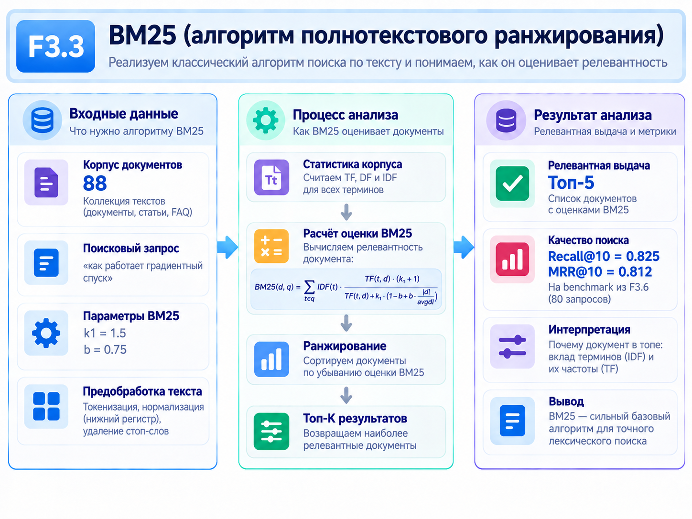
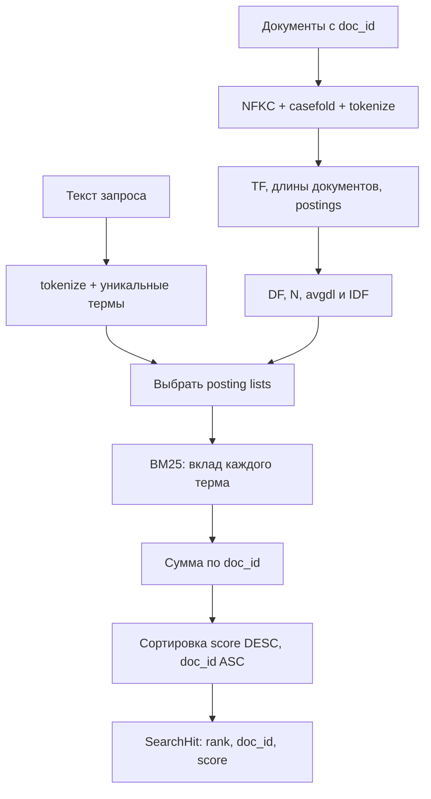

# F3.3 - BM25 и инвертированный индекс: пошаговая реализация

## 1. Цель этапа

В F3.2 подготовлен интерфейс получения dense embeddings, однако наличие вектора текста само по себе не даёт поисковую систему. Для проверки пользы более сложных методов требуется понятный **лексический baseline**, который находит документы по совпадению терминов запроса.



**Задача F3.3:** реализовать индекс документов и ранжирование Okapi BM25 без внешнего поискового сервера. Для каждого запроса возвращать детерминированный `top-k` с `doc_id`, числовым score и возможностью восстановить исходный текст.

Важное различие: F1 классифицирует вопрос по теме; F3.3 ищет **документы**, потенциально полезные для конкретного запроса. `BM25 score` - статистическая оценка совпадений, не вероятность релевантности.

## 2. Реализация: файлы этапа

| Файл | Что реализовано и зачем |
|---|---|
| `src/transformers_f3/bm25.py` | `Document`, `SearchHit`, `BM25Index`, tokenizer, inverted postings, TF/DF/IDF, формула scoring и сортировка выдачи. Основная реализация. |
| `scripts/bm25_demo.py` | Синтетические технические документы, запуск запроса, вывод статистики корпуса, postings и ранжированных `doc_id`. |
| `tests/test_f3_bm25.py` | Ручной числовой эталон, сравнение с независимым полным перебором, Unicode, OOV, перестановка документов и обработка ошибочных входов. |
| `docs/steps/F3_03_bm25_indexing.md` | Описание проектирования, расчёта score, воспроизводимой проверки и ограничений алгоритма. |

Предыдущие этапы F2 и F3.1–F3.2 не изменяются. Веса Transformer и интернет для BM25 не требуются.

## 3. Последовательность действий

### Шаг 1. Разделить понятия документа, запроса и релевантности
Документ задать парой `Document(doc_id, text)`. `doc_id` должен быть стабильным, уникальным и не зависеть от позиции в Python-списке. Запрос представляет отдельную строку; его добавление не меняет индекс.

Релевантность не выводить из score. Для оценки Recall@K потребуется отдельная разметка в F3.6.

### Шаг 2. Реализовать единый tokenizer
Применить нормализацию Unicode NFKC, `casefold()` и извлечение токенов через `\w+`. Повторения сохранить: в фразе `PostgreSQL: Slow query! Query...` токен `query` встречается дважды.

**Зачем:** повторения нужны для `term frequency`. Стемминг, лемматизация и обработка синонимов не выполняются; tokenizer отличается от WordPiece F3.2 и от F2.2.

### Шаг 3. Подсчитать частоты внутри документов
Для каждого документа сформировать счётчик `tf(t,d)`. Зафиксировать длину `|d|` как число токенов, включая повторы.

Пример: `d1 = "postgres postgres index"` содержит три токена и `tf(postgres,d1)=2`.

### Шаг 4. Построить инвертированный индекс
Для каждого терма сохранить список пар `(doc_id, tf)`. Документ `d2 = "postgres backup"` добавляет второй posting для `postgres`. Документ `d3 = "linux kernel"` не попадает в список этого слова.

**Зачем:** при поиске по `postgres` обрабатывать только документы из postings терма, а не сканировать полный корпус.

### Шаг 5. Вычислить статистику корпуса
Подсчитать `N`, `df(t)` - число документов с термом, `avgdl` - среднюю длину. Для трёх документов длины `3,2,2` дают `avgdl=7/3`.

Не путать `tf` и `df`: первый показывает повторы внутри **одного** документа, второй — распространённость терма **по корпусу**.

### Шаг 6. Реализовать Okapi BM25
Для каждого уникального терма запроса найти IDF и длиновую поправку. Суммировать положительные вклады для документов из postings. Отсутствующий в индексе термин не создаёт кандидатов и получает IDF `0` по принятому контракту.

Использовать `k1=1.5`, `b=0.75`. Повторы слов запроса учитываются один раз, повторы слов документа - через TF.

### Шаг 7. Вернуть top-k со стабильным порядком
Сортировать сначала по `score` по убыванию, затем по `doc_id` по возрастанию. Не возвращать документы без совпавших терминов с нулевым score. Для пустого корпуса и OOV-запроса выдавать `[]`.

Это отличает BM25 от F3.4, где cosine-поиск без порога может возвращать документы с нулевой или отрицательной близостью.

### Шаг 8. Сверить расчёты независимыми тестами
Сравнить score с вычислениями вручную и независимым полным перебором документов. Проверить неизменность результата при перестановке входных записей, Unicode, повторениях, ties, ошибочных ID, пустых запросах и CLI smoke.

## 4. Алгоритм BM25: разбор на конкретных числах

### 4.1. TF, DF и длина документа

| `doc_id` | Текст | `length` | `tf(postgres,d)` |
|---|---|---:|---:|
| `d1` | `postgres postgres index` | 3 | 2 |
| `d2` | `postgres backup` | 2 | 1 |
| `d3` | `linux kernel` | 2 | 0 |
```math
N=3,\qquad df(\mathrm{postgres})=2,\qquad avgdl=\frac{3+2+2}{3}=\frac{7}{3}.
```

### 4.2. Инверсная документная частота
Используется положительный сглаженный вариант IDF:
```math
\operatorname{IDF}(t)=\ln\left(1+\frac{N-df(t)+0.5}{df(t)+0.5}\right).
```

Для `postgres`:
```math
\operatorname{IDF}(\mathrm{postgres})=\ln\left(1+\frac{3-2+0.5}{2+0.5}\right)
=\ln(1.6)\approx0.470004.
```

Другие варианты определения IDF могут давать иные значения; сравнение численных scores между разными формулами BM25 без учёта варианта некорректно.

### 4.3. Формула Okapi BM25
```math
\operatorname{BM25}(q,d)=\sum_{t\in\operatorname{unique}(q)}
\operatorname{IDF}(t)\,
\frac{tf(t,d)(k_1+1)}{tf(t,d)+k_1\left(1-b+b\frac{|d|}{avgdl}\right)}.
```
`k1` задаёт насыщение от повторов, `b` регулирует нормализацию длины документа. Результат зависит от состава корпуса: при добавлении новых документов меняются `df` и `avgdl`.

### 4.4. Ручной расчёт для двух кандидатов
Для `d1` с `tf=2`, `|d|=3`:
```math
\mathrm{norm}_{d1}=1.5\left(0.25+0.75\frac{3}{7/3}\right)\approx1.821429.
```

```math
\operatorname{BM25}(\mathrm{postgres},d1)=0.470004\frac{2\cdot2.5}{2+1.821429}
\approx0.614958.
```

Для `d2` с `tf=1`, `|d|=2`:
```math
\mathrm{norm}_{d2}=1.5\left(0.25+0.75\frac{2}{7/3}\right)\approx1.339286.
```

```math
\operatorname{BM25}(\mathrm{postgres},d2)=0.470004\frac{1\cdot2.5}{1+1.339286}
\approx0.502294.
```
Итог: `d1 → d2`; `d3` не возвращается. При добавлении в запрос слова `index` появляется дополнительный положительный вклад у `d1`.

### 4.5. Сложность операции
Для `T` токенов корпуса построение требует порядка `O(T+V)` операций при хеш-таблицах (`V` - число термов). Поиск обрабатывает сумму длин posting lists `P(q)`; удержание top-k через heap требует порядка `O(C(q) log k)`, где `C(q)` - число кандидатов.

Уточнение: построение индекса проходит по всем документам, однако **каждый** последующий запрос обходит только postings совпавших терминов.

## 5. Схема вычислений



На схеме нет градиентов и encoder: BM25 - статистическая формула над токенами и документной частотой.

## 6. Локальная проверка в PowerShell: что запускать и как читать результат

### 6.1. Перейти в проект
```powershell
cd F:\DEVELOPMENT\ML\ml-engineering-lab
```

### 6.2. Выполнить тесты F3.3
```powershell
.\.venv\Scripts\python.exe -m pytest -q tests/test_f3_bm25.py
```

**Проверить:** независимый числовой эталон, postings, TF/DF/IDF, OOV, сортировку при равных scores и неизменность результата при перестановке корпуса.

### 6.3. Посмотреть поисковую выдачу
```powershell
.\.venv\Scripts\python.exe scripts/bm25_demo.py
```

В синтетическом примере ожидаются статистика корпуса, промежуточные значения и ранжированные `doc_id`; конкретные scores брать из фактического вывода скрипта. Демонстрационные пять документов не являются независимым retrieval benchmark.

### 6.4. Проверить регрессию
```powershell
.\.venv\Scripts\python.exe -m pytest -q
```

Главный критерий - отсутствие `failed/errors` в текущей ветке. Число тестов прошлого этапа не выдавать за новое измерение.

## 7. Что подтверждено и какие ограничения

**Подтверждено:** корректность построения inverted index, формулы выбранного варианта BM25, стабильного top-k и обработки пустых/OOV-запросов. Тесты используют независимый математический эталон.

**Ограничения:** tokenizer не выполняет лемматизацию и может неидеально разделять технические конструкции `C++` и `docker-compose`. Score BM25 не является вероятностью релевантности. Индекс остаётся в памяти и не поддерживает инкрементальные изменения.

## 8. Основная мысль раздела

**F3.3 реализует лексический retrieval baseline: токены документов преобразованы в инвертированный индекс, а совпадения с запросом ранжируются по TF, IDF и нормализации длины. Формула подтверждена ручным примером и тестами, выдача стабильна по `doc_id`. Поисковая система уже возвращает документы, но качество поиска ещё не измерено по независимой разметке.**

## 9. Файлы этапа

| Порядок | Файл | На что смотреть в коде |
|---|---|---|
| 1 | `scripts/bm25_demo.py` | Небольшой корпус, postings и числовые scores для запроса. |
| 2 | `src/transformers_f3/bm25.py` | `tokenize()`: NFKC, casefold, сохранение повторов. |
| 3 | `src/transformers_f3/bm25.py` | `BM25Index.__init__()`: DF, TF, длины, `avgdl` и inverted index. |
| 4 | `src/transformers_f3/bm25.py` | `_term_contribution()`, `score()` и `search()`: формула и детерминированная выдача. |
| 5 | `tests/test_f3_bm25.py` | Ручной расчёт, независимый brute-force, Unicode, ties и ошибки. |
| 6 | `src/transformers_f3/embeddings.py` | Для сравнения: dense embeddings F3.2 создаются по другой математической схеме и не участвуют в F3.3. |

**Итог F3.3:** реализован воспроизводимый лексический поисковый компонент, пригодный в качестве baseline при сравнении с dense и гибридными методами.
