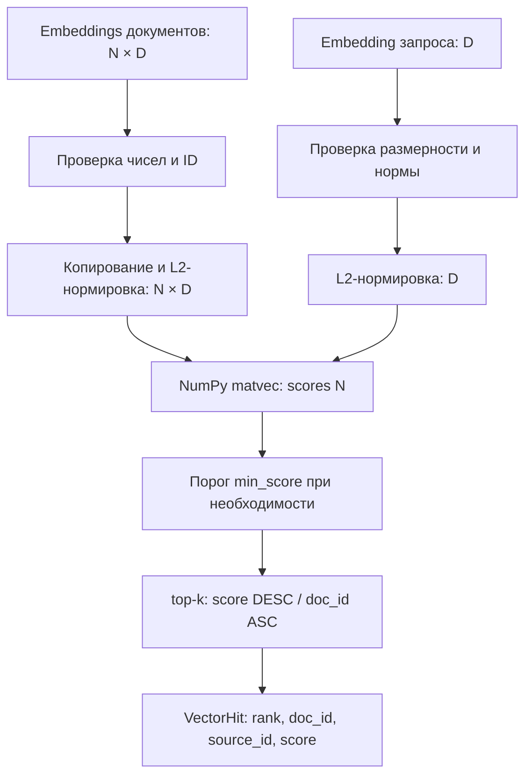

# F3.4 - Vector Search на NumPy: пошаговая реализация

## 1. Цель этапа

В F3.2 получен интерфейс создания dense embeddings из текстов; F3.3 реализовал поиск по совпадениям терминов. Следующая задача - ранжировать документы не по словам, а по **геометрической близости векторных представлений**.

**Задача F3.4:** создать точный `VectorIndex` на NumPy, который принимает матрицу embeddings документов, вектор запроса и возвращает детерминированный `top-k` с `doc_id`, `source_id` и cosine score.

Важная граница: векторный индекс **не создаёт embeddings** - готовые координаты подаются извне. В F3.4 нет обучения, ANN/FAISS, hybrid ranking, qrels или RAG. Корректность математики проверяется синтетическими векторами с заранее известной близостью.

## 2. Реализация: файлы этапа

| Файл | Что реализовано и зачем |
|---|---|
| `src/transformers_f3/vector_search.py` | `VectorIndex`, `VectorHit`, проверка ID и матрицы, устойчивое L2-нормирование, точное cosine, `score()`, `search()` и сохранение provenance. |
| `scripts/vector_search_demo.py` | Два режима: ручной числовой эталон и пример с уже закешированным encoder F3.2 без скачивания модели. |
| `tests/test_f3_vector_search.py` | Проверки cosine, форм, нулевых/нечисловых векторов, порогов, ties, изменения исходного массива и source ID. |
| `docs/steps/F3_04_vector_search_numpy.md` | Контракты векторов и источников, пошаговая математика, схема и локальные проверки. |

Модули F3.2 и F3.3 не заменяются: dense encoding, lexical indexing и поиск по векторной матрице остаются отдельными ответственностями.

## 3. Последовательность действий

### Шаг 1. Определить сущности индекса
Каждой строке матрицы embeddings назначить уникальный `doc_id`. Дополнительно сохранить `source_id` - идентификатор исходного документа, который может быть одинаковым у нескольких фрагментов. Не смешивать `doc_id` с позицией строки.

**Зачем:** поиск возвращает не только числовую близость, но и проверяемую ссылку на исходный текст.

### Шаг 2. Зафиксировать формы числовых данных
Матрица документов имеет форму `[N,D]`, где `N` - число записей, `D>0` - размерность. Запрос - один вектор `[D]`. Если используется MiniLM из F3.2, `D=384`.

Требовать `numpy.ndarray` с `float32` либо `float64`, согласованные количества ID и конечные ненулевые векторы. Пустой индекс `[0,D]` допустим, если размерность известна.

### Шаг 3. Исключить ошибочные данные до вычислений
Отклонять `NaN`, `Inf`, нулевые векторы, неверную размерность запроса и повторяющиеся `doc_id`. Исходную матрицу скопировать: внешняя модификация массива не должна менять уже построенный индекс.

### Шаг 4. Нормировать документы заранее
Для каждой строки вычислить евклидову норму и сохранить нормированную `float64`-матрицу. Использовать устойчивый при больших и малых конечных значениях расчёт нормы через масштабирование максимальной координатой.

**Зачем:** величина embedding не должна влиять на оценку направления, а нормирование не должно переполнять `float64` при возведении больших чисел в квадрат.

### Шаг 5. Подготовить и нормировать запрос
Запрос проверить на конечность, ненулевую норму и размерность `[D]`. После нормализации рассчитать все оценки одним умножением NumPy.

### Шаг 6. Реализовать top-k и порог
Сортировка: `score DESC`, при точном равенстве - `doc_id ASC`. Опциональный `min_score` находится в диапазоне `[-1,1]`; остаются кандидаты с `score >= min_score`. Без порога допускаются даже нулевые и отрицательные cosine scores.

### Шаг 7. Сохранить обратную связь с источником
`VectorHit` возвращает `rank`, `doc_id`, `source_id`, `score`. Индивидуальный `score(query,doc_id)` должен совпадать с соответствующей оценкой массового `search()`.

### Шаг 8. Проверить геометрию и свойства индекса
Создать четыре синтетических вектора: параллельный, близкий, ортогональный и противоположный запросу. Сверить ответы вручную, проверить копирование входов, независимость от порядка корпуса, ties, пустые индексы и некорректные формы.

## 4. Алгоритм cosine similarity: подробный пример

### 4.1. Норма и нормированный вектор
Для ненулевого вектора `d`:
```math
\lVert d\rVert_2=\sqrt{\sum_{j=1}^{D}d_j^2},\qquad \widehat d=\frac{d}{\lVert d\rVert_2}.
```

Затем cosine вычисляется как скалярное произведение нормированных векторов:
```math
\operatorname{cosine}(q,d)=\frac{q^\top d}{\lVert q\rVert_2\lVert d\rVert_2}
=\sum_{j=1}^{D}\widehat q_j\widehat d_j.
```

**Различие с обычным dot product:** для `[1,0]` и `[100,0]` скалярное произведение равно `100`, а cosine - `1`. Вектора направлены одинаково несмотря на разные длины.

### 4.2. Матричная реализация
```math
X\in\mathbb{R}^{N\times D},\qquad q\in\mathbb{R}^{D},\qquad
s=\widehat X\widehat q\in\mathbb{R}^{N}.
```

`normalized_documents @ normalized_query` вычисляет `N` значений без Python-цикла по документам. Нормировать матрицу при создании индекса, запрос - при каждом поиске.

### 4.3. Четыре эталонных документа
Пусть `q=[1,0]`.

| `doc_id` | `source_id` | Вектор `d` | Норма | Cosine |
|---|---|---|---:|---:|
| `same` | `src-a` | `[1,0]` | 1 | 1.0 |
| `near` | `src-a` | `[3,4]` | 5 | 0.6 |
| `orthogonal` | `src-b` | `[0,1]` | 1 | 0.0 |
| `opposite` | `src-c` | `[-1,0]` | 1 | −1.0 |

Для `near`:
```math
q^\top d=1\cdot3+0\cdot4=3,\qquad
\operatorname{cosine}(q,d)=\frac{3}{1\cdot5}=0.6.
```

При `top_k=3` последовательность: `same → near → orthogonal`. При `min_score=0.7` остаётся `same`. Эти числа заданы вручную и **не подтверждают семантическое качество encoder**.

### 4.4. Вычислительная сложность
Нормирование индекса - `O(ND)`, один точный запрос - `O(ND)` для матричного умножения. Матрица float64 требует примерно `8ND` байт; хранение массива scores дополнительно `O(N)`.

Поддержание top-k через heap даёт `O(N log k)` и память `O(k)` для кандидатов. При большом `N` точный поиск становится дорогим: ANN/FAISS здесь намеренно не применяется.

## 5. Схема вычислений



В схеме нет токенизации или обучения: они не относятся к `VectorIndex`. Для реального текста encoder вызывается отдельно и должен быть совместим для запросов и документов.

## 6. Локальная проверка в PowerShell: что запускать и как читать результат

### 6.1. Перейти в репозиторий
```powershell
cd F:\DEVELOPMENT\ML\ml-engineering-lab
```

### 6.2. Выполнить тесты F3.4
```powershell
.\.venv\Scripts\python.exe -m pytest -q tests/test_f3_vector_search.py
```

Проверяются cosine `1 / 0.6 / 0 / −1`, стабильность сортировки, исключение нулевых и нечисловых векторов, совпадение `score()` и `search()`, обработка `source_id`.

### 6.3. Запустить синтетическую геометрию
```powershell
.\.venv\Scripts\python.exe scripts/vector_search_demo.py
```

Сверить порядок `same → near → orthogonal → opposite` и соответствующие scores. Не интерпретировать эти векторы как качество предобученного Transformer.

### 6.4. Посмотреть другие режимы без загрузки весов
```powershell
.\.venv\Scripts\python.exe scripts/vector_search_demo.py --help
```

Режим pretrained применять только при уже существующем проверенном кеше F3.2. Не запускать скачивание модели ради проверки NumPy-поиска.

### 6.5. Полная регрессия
```powershell
.\.venv\Scripts\python.exe -m pytest -q
```

Критерий успешности - все тесты текущей версии прошли без `failed` и `errors`.

## 7. Что подтверждено и какие ограничения

**Подтверждено:** точность cosine на числовых эталонах, корректные размерности, детерминированный `top-k`, сохранение source ID и устойчивое вычисление нормы; входной массив копируется и не влияет на готовый индекс при последующих изменениях.

**Ограничения:** хранение только в памяти, отсутствие ANN, сохранения индекса на диск, score calibration и reranking. Векторная близость в диапазоне `[-1,1]` не является вероятностью полезности документа.

## 8. Основная мысль раздела

**F3.4 реализует точный векторный поиск на NumPy: готовые embeddings документов нормируются, embedding запроса сравнивается с каждой строкой через cosine, затем формируется стабильный `top-k` с `doc_id` и `source_id`. Ручной пример показывает математическую правильность; качество поиска по независимой разметке ещё не измеряется.**

## 9. Файлы этапа

| Порядок | Файл | На что смотреть в коде |
|---|---|---|
| 1 | `scripts/vector_search_demo.py` | Ручная геометрия и сохранение связи с `source_id`. |
| 2 | `src/transformers_f3/vector_search.py` | `_unit_rows`: устойчивая нормировка и проверка входных чисел. |
| 3 | `src/transformers_f3/vector_search.py` | `VectorIndex.__init__()`: копирование массива, проверка IDs, создание внутренней матрицы. |
| 4 | `src/transformers_f3/vector_search.py` | `search()` и `score()`: NumPy matvec, порог, топ-k и детерминированность. |
| 5 | `tests/test_f3_vector_search.py` | Границы норм, запросы другого D, ties и сохранность исходного массива. |
| 6 | `src/transformers_f3/embeddings.py` | Выход `[N,384]` от encoder F3.2; файл предыдущего этапа. |
| 7 | `src/transformers_f3/bm25.py` | Сопоставление лексического scoring и cosine без смешения шкал. |

**Итог F3.4:** получен независимый математически проверяемый dense ranker; объединение с BM25 выполняется на F3.5.
