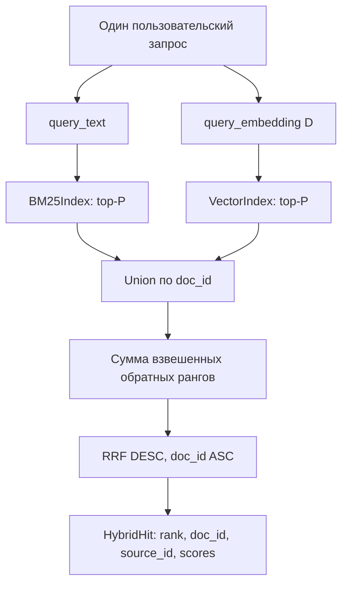

# F3.5 - Hybrid Search и Reciprocal Rank Fusion: пошаговая реализация

## 1. Цель этапа

В F3.3 реализован поиск документов по совпадениям терминов (BM25). В F3.4 реализован точный поиск по cosine similarity dense embeddings. Оба алгоритма возвращают ранжированные списки, но их числовые оценки принадлежат **разным шкалам**.

**Задача F3.5:** объединить лексическую и векторную выдачи в один `top-k`, сохранив идентификаторы документов и источников. Применить **Reciprocal Rank Fusion (RRF)**: использовать позиции кандидатов вместо непосредственного сложения BM25 score и cosine score.

Граница этапа: проверяется корректность fusion, а не качество retrieval по независимой разметке. Модель Transformer не обучается; ответ на вопрос и RAG не формируются.

## 2. Реализация: файлы этапа

| Файл | Что реализовано и зачем |
|---|---|
| `src/transformers_f3/hybrid_search.py` | `HybridSearcher`, `HybridHit`, проверка состава индексов, создание union кандидатов, взвешенная формула RRF, стабильный top-k. |
| `scripts/hybrid_search_demo.py` | Синтетическая выдача BM25/Vector, итоговые ранги и диагностические scores; отдельный pretrained-режим при наличии кеша. |
| `tests/test_f3_hybrid_search.py` | Числовой эталон RRF, несовпадение ID корпусов, влияние параметров, ties, empty/OOV и CLI smoke. |
| `docs/steps/F3_05_hybrid_rrf.md` | Пошаговое объяснение объединения рангов, схемы вычислений и границ тестов. |

Готовые `BM25Index` и `VectorIndex` используются без пересчёта их внутренних формул и без переобучения embeddings.

## 3. Последовательность действий

### Шаг 1. Зафиксировать общий корпус
Проверить, что лексический и векторный индексы имеют **одно и то же множество `doc_id`**. Одинаковое число записей недостаточно: в одном индексе могут присутствовать другие ID. `source_id` служит для прослеживаемости и может повторяться.

**Зачем:** документ из BM25 и вектор из VectorIndex должны относиться к одной индексированной записи. Совпадение ID не доказывает содержательное соответствие текста и embedding - оно обеспечивается подготовкой данных.

### Шаг 2. Определить два представления одного запроса
`query_text` передаётся BM25; `query_embedding [D]` - VectorIndex. Они должны описывать **один и тот же вопрос**, иначе объединение окажется методологически некорректным.

### Шаг 3. Получить два независимых списка кандидатов
Для обоих ранжировщиков запросить до `P = candidate_pool_size` элементов. По умолчанию `P=20`. Наличие кандидата только в одном списке допускается; при отсутствии lexical match BM25 может вернуть пустой список.

### Шаг 4. Отказаться от сложения исходных scores
BM25 score зависит от TF/IDF, длины текста и состава корпуса. Cosine score ограничен диапазоном `[-1,1]`. Сумма этих значений без калибровки меняет смысл и может отдать преимущество алгоритму с большей шкалой.

**Решение:** использовать только **ранги**, начиная с единицы. Сырые scores оставить в результате для диагностики.

### Шаг 5. Реализовать формулу взвешенного RRF
Для каждого `doc_id` из union прибавить вклад BM25 и/или Vector по `w/(rrf_k + rank)`. Отсутствующий в списке кандидат даёт нулевой вклад соответствующего алгоритма. По умолчанию `rrf_k=60`, `w_b=w_v=1.0`.

Использовать `math.fsum` для устойчивого сложения небольших вещественных вкладов.

### Шаг 6. Сформировать единую выдачу
Объединять по **`doc_id`**, а не по `source_id`: два фрагмента одной статьи должны сохраняться как разные результаты. Отсортировать по `rrf_score DESC`, затем `doc_id ASC`. Для `top_k≤P` выдавать стабильный префикс рассчитанного union.

### Шаг 7. Зафиксировать параметры эксперимента
Различать `rrf_k=60` (параметр формулы), `candidate_pool_size=20` (глубина **каждой** исходной выдачи) и `top_k=5` (итоговая выдача). Проверять положительность `rrf_k`, `P` и весов; `top_k` должен быть положительным и не превышать `P`.

**Зачем:** изменение `P`, весов или `rrf_k` способно изменить порядок результатов. Параметры нельзя подбирать по итоговой test-разметке F3.6 после просмотра F3.7.

### Шаг 8. Проверить математику и стабильность
Сверить RRF с ручным эталоном, проверить отсутствие дублированных `doc_id`, сохранение `source_id`, сценарий без лексических совпадений, значения по порогу cosine, равенства score, перестановки корпуса и недопустимые аргументы.

## 4. Математический принцип и числовой пример

### 4.1. Формула RRF
Пусть `R_b(d)` и `R_v(d)` - позиции документа в двух исходных списках. Вклад отсутствующей позиции принимается равным `0`:
```math
\operatorname{RRF}(d)=
\mathbf{1}_{d\in L_b}\frac{w_b}{k+R_b(d)}+
\mathbf{1}_{d\in L_v}\frac{w_v}{k+R_v(d)}.
```

Здесь `L_b`, `L_v` - не более `P` кандидатов, `k=60`, положительные веса `w_b`, `w_v`. Это score для ранжирования, **не вероятность релевантности**.

Первая позиция даёт `1/(60+1)`, вторая - `1/(60+2)`.

### 4.2. Ручной эталон для двух списков

| `doc_id`    | BM25 rank | Vector rank | RRF score                  | Итоговый ранг |
| ----------- | --------: | ----------: | -------------------------- | ------------: |
| `lexical`   |         1 |           3 | `1/61 + 1/63 ≈ 0.03226646` |             1 |
| `shared`    |         2 |           2 | `1/62 + 1/62 ≈ 0.03225806` |             2 |
| `semantic`  |         - |           1 | `1/61 ≈ 0.01639344`        |             3 |
| `unrelated` |         - |           4 | `1/64 = 0.015625`          |             4 |

Документ `shared` получает **два** вклада и возвращается только один раз. `semantic` пришёл только из VectorIndex и не требует совпадения слов запроса.

### 4.3. Влияние весов
Если увеличить `vector_weight` до `2.0`:
```math
\operatorname{RRF}(\mathrm{shared})=\frac{1}{62}+\frac{2}{62}
=\frac{3}{62}\approx0.04838710.
```

```math
\operatorname{RRF}(\mathrm{lexical})=\frac{1}{61}+\frac{2}{63}
\approx0.04813947.
```

Теперь `shared` оказывается выше `lexical`. Этот пример иллюстрирует чувствительность ранжирования к конфигурации, а не рекомендацию устанавливать вес `2.0` в оценочном эксперименте.

### 4.4. Размеры и сложность
Векторный индекс хранит `[N,D]`, query embedding имеет `[D]`. Обе поисковые системы выдают списки до `P` объектов; размер объединения не больше `2P` уникальных ID.

Fusion вычисляет до двух вкладов на документ и сортирует до `2P` элементов: время `O(P log P)`, дополнительная память `O(P)`. Однако суммарное время запроса включает исходный поиск: у точного VectorIndex сохраняется стоимость `O(ND)`.

## 5. Схема вычислений



На этом этапе **не** рассчитываются Recall@K/MRR: они требуют независимых qrels и отдельного evaluation pipeline.

## 6. Локальная проверка в PowerShell: что запускать и как читать результат

### 6.1. Корень проекта
```powershell
cd F:\DEVELOPMENT\ML\ml-engineering-lab
```

### 6.2. Тесты F3.5
```powershell
.\.venv\Scripts\python.exe -m pytest -q tests/test_f3_hybrid_search.py
```

**Проверить:** соответствие RRF дробям `1/61`, `1/62`, уникальность ID, отказы при разных корпусах и некорректных параметрах, стабильность ties.

### 6.3. Демонстрация двух ранжировщиков
```powershell
.\.venv\Scripts\python.exe scripts/hybrid_search_demo.py
```

Проверить раздельные BM25/Vector ранги и итоговую сортировку. Синтетическая выдача демонстрирует арифметику RRF, не измеряет полезность найденных документов.

### 6.4. Посмотреть доступные режимы
```powershell
.\.venv\Scripts\python.exe scripts/hybrid_search_demo.py --help
```

Дополнительный pretrained-вариант использовать только с существующим кешем модели F3.2. Для unit-тестирования RRF загрузка сетевых весов не требуется.

### 6.5. Регрессия
```powershell
.\.venv\Scripts\python.exe -m pytest -q
```

Текущее число тестов определяется фактическим запуском; отсутствующие `failed/errors` важнее исторического значения.

## 7. Что подтверждено и какие ограничения

**Подтверждено:** объединение по документам, корректное суммирование рангов, согласованность ID, стабильная сортировка и сохранение provenance. Наличие двух положительных вкладов корректно учитывается в одном `HybridHit`.

**Ограничения:** RRF игнорирует абсолютные расстояния между scores; маленький candidate pool может потерять полезный документ ещё до объединения. Содержательное соответствие embeddings и текстов не доказывается одной проверкой ID. Группировка по исходным источникам не выполняется.

## 8. Основная мысль раздела

**F3.5 реализует детерминированный гибридный поиск. Два независимых ранжировщика формируют top-P списки, после чего результаты объединяются по `doc_id` и получают общий score из обратных рангов. BM25 и cosine не складываются напрямую. Корректность fusion подтверждается синтетическими эталонами; сравнение качества относится к F3.7.**

## 9. Файлы этапа

| Порядок | Файл | На что смотреть в коде |
|---|---|---|
| 1 | `scripts/hybrid_search_demo.py` | Входные ранги двух методов и итоговая выдача. |
| 2 | `src/transformers_f3/hybrid_search.py` | `HybridSearcher.__init__()`: проверка ID, параметров и соответствия индексов. |
| 3 | `src/transformers_f3/hybrid_search.py` | `search()`: объединение кандидатов, `math.fsum`, сортировка по score и ID. |
| 4 | `tests/test_f3_hybrid_search.py` | Ручные дроби RRF, пустые выдачи, веса, изменение пула и неверные ID. |
| 5 | `src/transformers_f3/bm25.py` | Происхождение BM25 ranks — модуль F3.3. |
| 6 | `src/transformers_f3/vector_search.py` | Cosine ranks и `source_id` — модуль F3.4. |
| 7 | `src/transformers_f3/embeddings.py` | Формирование query embedding до вызова HybridSearcher — модуль F3.2. |

**Итог F3.5:** получена единая гибридная выдача без смешивания несопоставимых scores и без заявлений о качестве на реальных данных.
