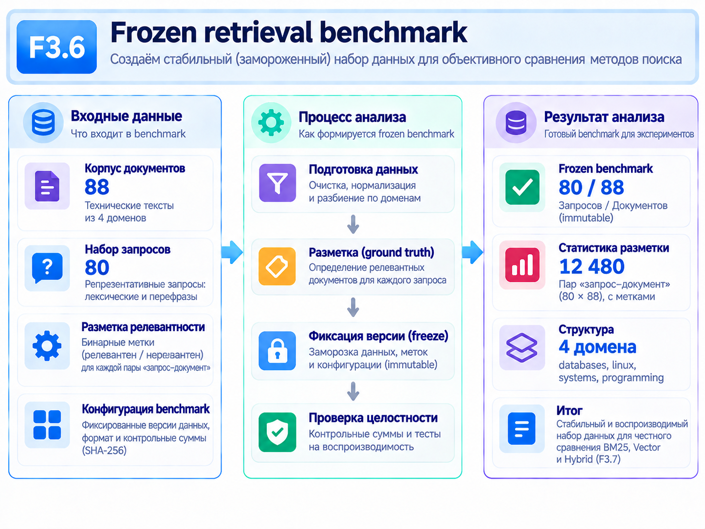
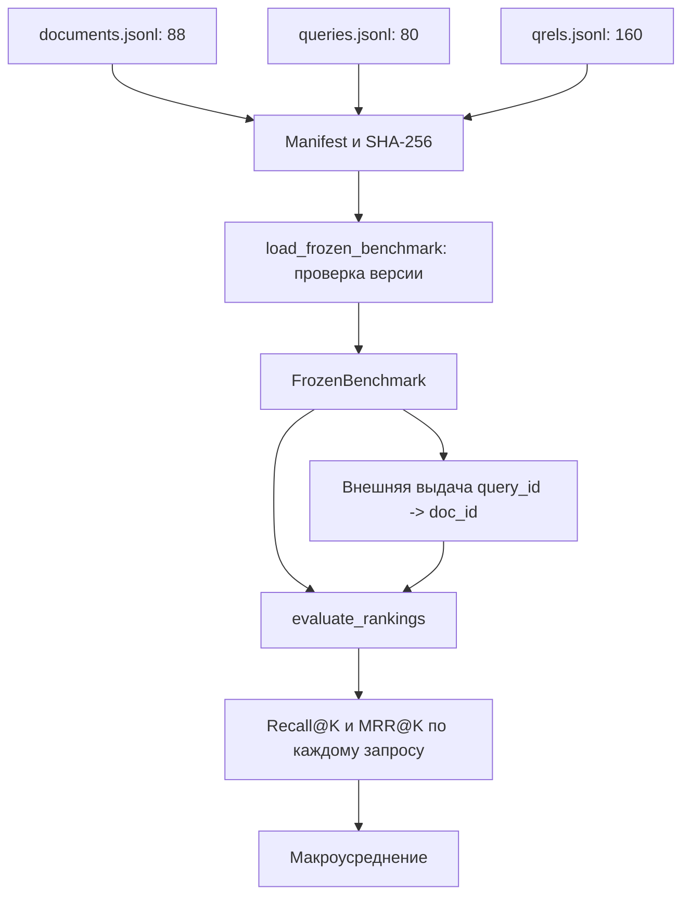

# F3.6 - Frozen Retrieval Benchmark: пошаговая реализация

## 1. Цель этапа

В F3.3–F3.5 сформированы BM25, точный Vector Search и Hybrid RRF. Все три метода способны выдать ранжированный список `doc_id`, однако высокий BM25/cosine/RRF score сам по себе не означает, что найден полезный документ.



**Задача F3.6:** подготовить фиксированный корпус с явной разметкой `query_id → релевантные doc_id`, формально определить **Recall@K** и **MRR@K** и защитить данные от незаметных изменений. Отделить поисковые алгоритмы от независимого механизма оценки.

На этом этапе поиск ещё не сравнивается: индексы и encoder не вызываются ради итоговой таблицы, обучение отсутствует. Сравнительный эксперимент выполняется в F3.7.

## 2. Реализация: файлы этапа

| Файл | Что реализовано и зачем |
|---|---|
| `tests/fixtures/f3_06_benchmark_v1/documents.jsonl` | **88** синтетических технических фрагментов с `doc_id`, `source_id`, `domain`, `text`. |
| `tests/fixtures/f3_06_benchmark_v1/queries.jsonl` | **80** запросов с `query_id`, `domain`, `kind`, `text`; две формулировки для каждой из 40 тем. |
| `tests/fixtures/f3_06_benchmark_v1/qrels.jsonl` | **160** положительных бинарных отношений `query_id` — `doc_id` (по два релевантных фрагмента на запрос). |
| `tests/fixtures/f3_06_benchmark_v1/manifest.json` | Версия набора, агрегаты, SHA-256 JSONL и сведения о происхождении синтетики. |
| `src/transformers_f3/retrieval_benchmark.py` | `load_frozen_benchmark()`, валидация ID/qrels/хешей, `evaluate_rankings()`, dataclass результата. |
| `scripts/retrieval_benchmark_demo.py` | Демонстрация чтения frozen-набора и ручной арифметики метрик без поисковых моделей. |
| `tests/test_f3_retrieval_benchmark.py` | Проверки математики Recall/MRR, полноты запросов, нетронутости корпуса, CRLF/LF и ошибок структуры. |
| `docs/steps/F3_06_frozen_retrieval_benchmark.md` | Описание данных, формул, проверки и ограничений synthetic benchmark. |

**Состав версии v1:** 88 фрагментов, 40 источников с двумя связанными фрагментами, 8 отвлекающих документов, 80 запросов и 160 qrels. Четыре домена: `databases`, `linux`, `systems`, `programming`; в каждом 20 запросов (10 прямых, 10 перефразированных).

## 3. Последовательность действий

### Шаг 1. Определить единицу релевантности
Оценивать конкретные фрагменты **`doc_id`**, а не исходные статьи `source_id`. Два фрагмента одного источника могут быть двумя самостоятельными правильными ответами на запрос.

Релевантность хранить явно как бинарную запись `query_id`, `doc_id`, `relevance=1`. Отсутствие пары означает нерелевантность **по принятой синтетической разметке**, а не доказательство фактической бесполезности документа.

### Шаг 2. Сформировать синтетические технические сценарии
Подготовить 40 пар связанных фрагментов по четырём доменам и 8 дополнительных отвлекающих документов. Для каждой темы задать два вопроса: прямой lexical и paraphrase, не обязательно повторяющий точные слова документа.

**Зачем:** протестировать различия лексического и семантического ранжирования, не раскрывая частные данные исходного F1-корпуса.

### Шаг 3. Назначить непрозрачные идентификаторы
Использовать `doc-<hash>` и `qry-<hash>` вместо названий вида `db-01`. Не встраивать в ID правильную тематику, место релевантного документа или подсказку поисковому алгоритму.

### Шаг 4. Зафиксировать формат JSONL
Три файла содержат по одной UTF-8 JSON-записи в строке. Валидировать обязательные поля, непустые строки, допустимые домены, стили вопроса, уникальность `doc_id`/`query_id` и существование всех связанных документов.

### Шаг 5. Защитить версию контрольными суммами
Хешировать JSONL после приведения **только CRLF к LF**, чтобы checkout на Windows не менял смысл SHA. `BOM` и одиночный `CR` отклонять. В manifest закрепить SHA каждого JSONL, а SHA самого manifest зафиксировать в коде.

**Frozen manifest SHA-256 версии v1:**

```text
a584868b8818552815151a85dfde714a762f14d959813e607bb4319cec70756c
```

**Зачем:** изменение текстов, порядка строк или qrels должно обнаруживаться, а новая содержательная версия должна иметь новый ID (например, v2), а не подменять v1.

### Шаг 6. Реализовать Recall@K
Для каждого запроса вычислить долю релевантных документов, попавших в первые `K` результатов. Не исключать из среднего вопросы с пустой выдачей: их вклад равен нулю.

### Шаг 7. Реализовать MRR@K
Определить позицию **первого** релевантного документа в первых `K` результатах. Использовать обратный ранг или 0 при отсутствии попаданий. В отличие от Recall, второе попадание не улучшает MRR, если первое осталось на той же позиции.

### Шаг 8. Проверить математический контракт и защиту от data leakage
Тестировать игрушечные qrels и ranked lists отдельно от настоящих индексов. Запретить пропуск query ID, чужие doc ID и дубли в списке. Для F3.7 зафиксировать параметры **до просмотра итоговых метрик**, поскольку публичная разметка не должна использоваться для скрытого тюнинга.

## 4. Математика Recall@K и MRR@K

### 4.1. Recall@K одного запроса
Для множества релевантных документов `Rel(q)` и первых `K` выдачи `TopK(q)`:
```math
\operatorname{Recall@K}(q)=\frac{|\operatorname{TopK}(q)\cap\operatorname{Rel}(q)|}{|\operatorname{Rel}(q)|}.
```

**Пример:** релевантны `{a,c}`, выдача `[b,a,c]`. Тогда `Recall@1=0`, `Recall@2=1/2=0.5`, `Recall@3=2/2=1`.

### 4.2. Reciprocal Rank@K
```math
\operatorname{RR@K}(q)=
\begin{cases}
1/r_{\mathrm{first}}(q),&\text{если первое релевантное попадание находится в top-K};\\
0,&\text{если релевантных попаданий в top-K нет}.
\end{cases}
```

В том же примере первое попадание имеет ранг 2, поэтому `RR@1=0`, `RR@2=0.5`, `RR@3=0.5`.

### 4.3. Макроусреднение
```math
\operatorname{MacroRecall@K}=\frac{1}{Q}\sum_{q=1}^{Q}\operatorname{Recall@K}(q),\qquad
\operatorname{MRR@K}=\frac{1}{Q}\sum_{q=1}^{Q}\operatorname{RR@K}(q).
```

В замороженном наборе `Q=80`, однако оценочная функция поддерживает тестовые примеры другого размера.

**Дополнительный числовой эталон:** для `q1` релевантны `a,c`, `top-2=[b,a]`: Recall@2=0.5, RR@2=0.5. Для `q2` релевантен `d`, `top-2=[d,b]`: обе величины равны 1.
```math
\operatorname{MacroRecall@2}=\operatorname{MRR@2}=\frac{0.5+1}{2}=0.75.
```

Здесь оба запроса получают одинаковый вес независимо от числа релевантных документов. Микроусреднение по суммарному количеству qrels было бы другой метрикой.

### 4.4. Строгие инварианты оценки
В каждом запросе версии v1 ровно два положительных qrels. `evaluate_rankings()` должен получить результаты для всех 80 `query_id`, в том числе пустые списки, и отвергать неизвестные документы, дубликаты и неверное `K`. Выдача сохраняет **исходный порядок**: пересортировка по `doc_id` или score внутри метрики запрещена.

## 5. Схема вычислений



Блок внешней выдачи подключается в F3.7. Сам F3.6 создаёт **оценочный контракт**, а не ранжирует документы.

## 6. Локальная проверка в PowerShell: что запускать и как читать результат

### 6.1. Перейти в корень
```powershell
cd F:\DEVELOPMENT\ML\ml-engineering-lab
```

### 6.2. Проверить тесты F3.6
```powershell
.\.venv\Scripts\python.exe -m pytest -q tests/test_f3_retrieval_benchmark.py
```
Проверить ручные эталоны метрик, полноту 80 запросов, реакцию на чужие/дублирующиеся ID, SHA и CRLF/LF.

### 6.3. Запустить демонстрацию формул
```powershell
.\.venv\Scripts\python.exe scripts/retrieval_benchmark_demo.py
```
В выводе проверить размеры `88 / 80 / 160` и учебные значения Recall/MRR. Это **не** метрики поиска модели.

### 6.4. Просмотреть manifest
```powershell
Get-Content tests\fixtures\f3_06_benchmark_v1\manifest.json -Encoding UTF8
```
Сверить benchmark ID, содержимое SHA-256 полей и число записей. Не редактировать JSONL или manifest версии v1.

### 6.5. Выполнить регрессию

```powershell
.\.venv\Scripts\python.exe -m pytest -q
```
Успех означает отсутствие `failed/errors` в текущем наборе тестов, а не заранее заданное число проверок.

## 7. Что подтверждено и какие ограничения

**Подтверждено:** математическое определение Recall@K/MRR@K, согласованная разметка, версия frozen-набора и контроль изменения данных. Запросы с нулевым результатом остаются в среднем.

**Ограничения:** 80 вопросов относятся к 40 связанным темам и не являются независимыми пользовательскими наблюдениями. Разметка составлена вместе с документами; экспертная независимая проверка отсутствует. В наборе нет неотвечаемых запросов с нулём положительных qrels. Язык - английский; перенос выводов на русский или производственный трафик недопустим.

## 8. Основная мысль раздела

**F3.6 формирует фиксированный оценочный полигон: 88 синтетических фрагментов, 80 запросов и 160 бинарных пар релевантности. Реализованы независимые от поисковика формулы Recall@K и MRR@K; контрольные суммы защищают версию v1 от тихих изменений. Измерение качества BM25, Vector и Hybrid выполняется только в F3.7.**

## 9. Файлы этапа

| Порядок | Файл | На что смотреть в коде |
|---|---|---|
| 1 | `scripts/retrieval_benchmark_demo.py` | Различие загрузки frozen-данных и ручной проверки метрик. |
| 2 | `tests/fixtures/f3_06_benchmark_v1/documents.jsonl` | `doc_id` и `source_id`; пара фрагментов одной темы. |
| 3 | `tests/fixtures/f3_06_benchmark_v1/queries.jsonl` | Lexical и paraphrase вопросы по доменам. |
| 4 | `tests/fixtures/f3_06_benchmark_v1/qrels.jsonl` | Пары query–doc с `relevance=1`, отсутствие «зашитых» ответов в ранжировщике. |
| 5 | `tests/fixtures/f3_06_benchmark_v1/manifest.json` | Версия, размеры и SHA-256 источников. |
| 6 | `src/transformers_f3/retrieval_benchmark.py` | `load_frozen_benchmark()` и проверка source/ID/версий. |
| 7 | `src/transformers_f3/retrieval_benchmark.py` | `evaluate_rankings()`: Recall/MRR, `K`, нулевые результаты, полный набор запросов. |
| 8 | `tests/test_f3_retrieval_benchmark.py` | Ручные эталоны, проверки хешей, недопустимых qrels и Unicode/CRLF. |

**Итог F3.6:** получена стандартизированная процедура проверки выдач с известными ограничениями синтетической разметки.
