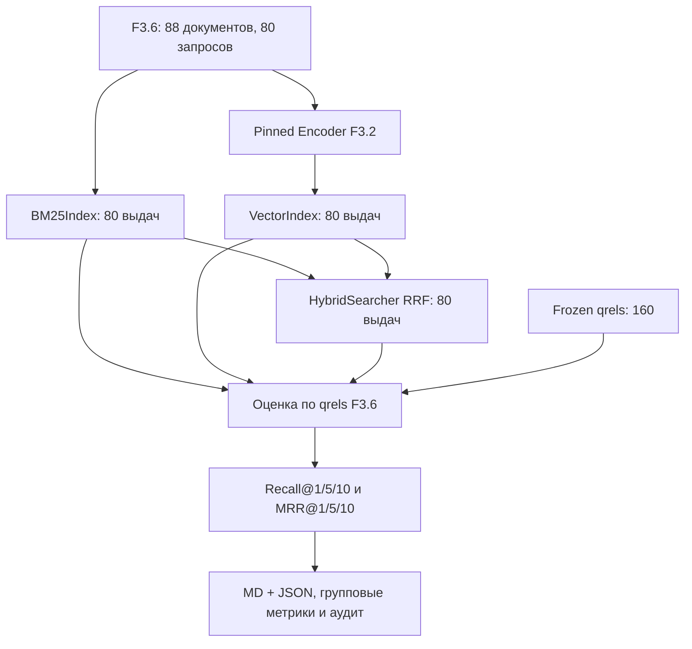

# F3.7 - Сравнение BM25, Vector и Hybrid: пошаговая реализация

## 1. Цель этапа

Этапы F3.3–F3.5 создали три независимых способа ранжирования документов: лексический BM25, dense cosine и их гибридное объединение RRF. F3.6 зафиксировал корпус с qrels и определил метрики Recall@K/MRR@K. До F3.7 проверялась математическая правильность отдельных компонентов, но **качество поиска трёх систем на одном корпусе не сравнивалось**.

**Задача F3.7:** получить ранжированные списки для каждого из 80 запросов, оценить три метода одинаковыми формулами и сохранить проверяемые артефакты эксперимента. Не предполагать заранее, что Hybrid превосходит BM25 или Vector.

Результат измерения зависит от фактически установленной pinned pretrained-модели F3.2. Синтетический smoke проверяет инженерный pipeline, но **не заменяет** запуск реального encoder.

## 2. Реализация: файлы этапа

| Файл | Что реализовано и зачем |
|---|---|
| `configs/f3_07_comparison.json` | До оценки закреплены список `K`, BM25, RRF, размер candidate pool и batch size; конфигурация защищена SHA в коде. |
| `src/transformers_f3/retrieval_comparison.py` | `ComparisonConfig`, независимое построение рангов, применение qrels только на этапе оценки, групповые метрики и формирование отчёта. |
| `scripts/retrieval_comparison.py` | Режимы синтетической проверки и реального CPU inference на проверенном кеше F3.2, сохранение отчётных файлов. |
| `tests/test_f3_retrieval_comparison.py` | Инварианты метрик, полнота query IDs, недопущение утечки qrels в ранжирование, формат результатов и Windows-кодировка. |
| `docs/steps/F3_07_bm25_vector_hybrid_comparison.md` | Правила сравнения, формулы, интерпретация и ограничения эксперимента. |

Используются `BM25Index`, `VectorIndex`, `HybridSearcher`, `PretrainedTextEncoder` и `evaluate_rankings()`. Изменение алгоритмов предшествующих этапов не требуется.

## 3. Последовательность действий

### Шаг 1. Загрузить и проверить frozen benchmark
Вызвать `load_frozen_benchmark()`; получить **88 документов**, **80 запросов** и **160 положительных qrels**. Проверить manifest/SHA и согласованность `doc_id`, `query_id`, `source_id`.

Каждый запрос имеет два релевантных фрагмента; нахождение одного из них означает Recall@K `0.5`, независимо от позиции первого попадания.

### Шаг 2. Зафиксировать конфигурацию до расчёта
Использовать `top_ks=[1,5,10]`, `bm25_k1=1.5`, `bm25_b=0.75`, `rrf_k=60`, веса `1.0/1.0`, `candidate_pool_size=20`, `batch_size=16`.

**Зачем:** пересмотр коэффициентов после просмотра test-qrels превращает независимую оценку в подгонку. Для настройки нужна отдельная dev-разметка с другими исходными сценариями.

### Шаг 3. Построить лексический индекс
Передать в `BM25Index` тексты 88 документов с исходными `doc_id`. Для каждого запроса получить BM25 top-k без использования `qrels`. При отсутствии пересечения токенов BM25 возвращает пустую выдачу.

### Шаг 4. Подготовить dense embeddings
В режиме реального измерения загрузить **проверенную**, заранее закешированную модель F3.2. Кодировать документы и запросы **одним** encoder с одинаковыми `revision`, `max_length=128`, `masked mean pooling`, `L2-normalize`.

Размерности для модели F3.2: документы `[88,384]`, запросы `[80,384]`. Индексировать документы через F3.4 и возвращать dense top-k по каждому запросу.

### Шаг 5. Выполнить гибридное объединение
Создать `HybridSearcher` с тем же набором `doc_id`. Для каждого запроса объединить первые 20 кандидатов BM25 и Vector по формуле RRF; взять итоговые top-1/5/10.

### Шаг 6. Отделить ранжирование от оценки
Сначала сформировать три словаря `query_id -> ranked doc IDs` без обращения к меткам qrels. Затем передать каждый словарь в `evaluate_rankings()` F3.6.

**Зачем:** rel-labels используются исключительно для расчёта показателей, но не для изменения порядка выдачи.

### Шаг 7. Рассчитать общие и групповые метрики
Получить Macro Recall@K и MRR@K для `K=1,5,10`. Дополнительно посчитать разрез по четырём доменам и типам `lexical`/`paraphrase`. Сохранить запросы с улучшением и ухудшением Hybrid относительно BM25, не переписывая разметку.

### Шаг 8. Экспортировать аудит и проверить условия публикации
Для фактического pretrained-запуска сформировать `F3_07_comparison.md` и `F3_07_comparison.json`. JSON должен содержать параметры, полные ranked lists всех 80 запросов для трёх методов, индивидуальные и сводные метрики, сопоставление `doc_id/source_id`.

**Запрещено** публиковать числовой результат synthetic/hash-vector smoke как метрики pretrained Transformer. Исторические проценты из плана не использовать как полученный результат.

## 4. Алгоритмы и правила сравнения

### 4.1. BM25
Лексический ранжировщик использует терминальные частоты и длины:
```math
\operatorname{BM25}(q,d)=\sum_{t\in\operatorname{unique}(q)}
\operatorname{IDF}(t)\frac{tf(t,d)(k_1+1)}{tf(t,d)+k_1(1-b+b|d|/avgdl)}.
```
Значения `k1=1.5`, `b=0.75` закреплены заранее. Отсутствие совпадений даёт пустой top-k, а не искусственные нулевые документы.

### 4.2. Dense cosine
```math
\operatorname{cosine}(q,d)=\frac{e_q^\top e_d}{\lVert e_q\rVert_2\lVert e_d\rVert_2}.
```
Для L2-нормированных векторов достаточно `e_q · e_d`. Для каждого запроса выполняется точный поиск по всем 88 векторам без ANN. Cosine score не является вероятностью полезности.

### 4.3. RRF
Для документа `d` сложить вклады исходных рангов, причём отсутствие документа даёт ноль:
```math
\operatorname{RRF}(d)=\mathbf{1}_{d\in L_B}\frac{1}{60+r_B(d)}+
\mathbf{1}_{d\in L_V}\frac{1}{60+r_V(d)}.
```
**Числовой пример:** документ A имеет BM25 rank 1 и Vector rank 3; B имеет BM25 rank 2 и Vector rank 1:
```math
\operatorname{RRF}(A)=\frac{1}{61}+\frac{1}{63}\approx0.032266,
\qquad\operatorname{RRF}(B)=\frac{1}{62}+\frac{1}{61}\approx0.032522.
```
По данному примеру B должен оказаться выше A, даже если его BM25 rank хуже.

### 4.4. Метрики на фиксированной разметке
```math
\operatorname{Recall@K}(q)=\frac{|Rel(q)\cap TopK(q)|}{|Rel(q)|}.
```

```math
\operatorname{RR@K}(q)=\begin{cases}
1/r_q,&\text{если первый релевантный документ находится в первых K позициях};\\
0,&\text{если попаданий нет}.
\end{cases}
```

```math
\operatorname{MacroRecall@K}=\frac{1}{80}\sum_{q=1}^{80}\operatorname{Recall@K}(q),\qquad
\operatorname{MRR@K}=\frac{1}{80}\sum_{q=1}^{80}\operatorname{RR@K}(q).
```

**Эталон:** релевантны `{a,c}`, выдача `[b,a,c]` - Recall@1=0, Recall@2=0.5, Recall@3=1; MRR@1=0, MRR@2=0.5, MRR@3=0.5. Второе найденное попадание повышает Recall, но не MRR.

### 4.5. Память и статус эксперимента
Матрица `[88,384]` из float32 содержит `88×384×4 = 135168` байт; внутренний float64 VectorIndex - примерно вдвое больше без Python-overhead. Сама небольшая матрица не является существенной частью расходов на загрузку предобученного encoder.

Результаты **synthetic smoke** и **pretrained evaluation** имеют разные основания и должны маркироваться раздельно. Публикационный Markdown разрешён только для фактически выполненного pretrained-режима.

## 5. Схема вычислений



Qrels не соединяются с ветками формирования рангов; они используются только после окончания retrieval.

## 6. Локальная проверка в PowerShell: что запускать и как читать результат

### 6.1. Рабочая директория
```powershell
cd F:\DEVELOPMENT\ML\ml-engineering-lab
```

### 6.2. Выполнить тесты F3.7
```powershell
.\.venv\Scripts\python.exe -m pytest -q tests/test_f3_retrieval_comparison.py
```
Проверяются строгое соответствие frozen-данным, независимость ранжирования от qrels, формулы метрик, сохранение полного набора запросов и запрет публикации synthetic scores как pretrained.

### 6.3. Проверить конфигурацию
```powershell
Get-Content configs\f3_07_comparison.json -Encoding UTF8
```
Сверить `K=1/5/10`, `BM25(1.5,0.75)`, `RRF(60,1.0/1.0)`, `candidate_pool_size=20` и `batch_size=16`.

### 6.4. Посмотреть режимы запуска без скачивания весов
```powershell
.\.venv\Scripts\python.exe scripts/retrieval_comparison.py --help
```
Выбрать документированный synthetic smoke для проверки сборки; для реальной метрики использовать только режим, требующий уже подтверждённого локального кеша F3.2. **Точные флаги реального запуска необходимо брать из вывода установленной версии CLI**, поскольку исходный MD их не фиксирует.

### 6.5. Проверить результаты, если реальный запуск уже выполнен
```powershell
Test-Path reports\public\f3_07\F3_07_comparison.json
Get-Content reports\public\f3_07\F3_07_comparison.json -Encoding UTF8 | Select-Object -First 30
```
Наличие файла само по себе не доказывает корректность; дальнейшая независимая проверка этого JSON выполняется на F3.9.

### 6.6. Полная регрессия
```powershell
.\.venv\Scripts\python.exe -m pytest -q
```
Фиксировать фактический вывод, а не предварительно запланированные числа тестов.

## 7. Что подтверждено и какие ограничения

**Подтверждено на уровне алгоритмов:** построение трёх рейтингов, применение одной frozen-разметки, метрики Recall/MRR и сохранение аудируемой структуры результата. Synthetic smoke проверяет схему вычислений, но не семантику векторов.

**Ограничения:** 80 связанных синтетических вопросов - не производственный benchmark, независимой экспертной разметки нет; статистических гарантий для реального трафика нет. Не измеряются скорость, стоимость GPU/CPU и качество генерации ответов.

## 8. Основная мысль раздела

**F3.7 соединяет готовые алгоритмы BM25, Vector и Hybrid с независимой системой оценки F3.6. Ранжирование выполняется до доступа к qrels, затем Recall@K/MRR@K рассчитываются по одним и тем же 80 запросам. Протокол параметров зафиксирован заранее. Реальные цифры разрешено брать только из проверяемого pretrained-запуска, а не из синтетического smoke.**

## 9. Файлы этапа

| Порядок | Файл | На что смотреть в коде |
|---|---|---|
| 1 | `configs/f3_07_comparison.json` | Зафиксированные K, BM25, RRF, candidate pool и batch size. |
| 2 | `src/transformers_f3/retrieval_comparison.py` | `ComparisonConfig`, SHA конфигурации и проверки входных данных. |
| 3 | `src/transformers_f3/retrieval_comparison.py` | `generate_rankings()`: создание списков без qrels. |
| 4 | `src/transformers_f3/retrieval_comparison.py` | `compare_benchmark()` и `build_markdown_report()`: независимые метрики и интерпретация. |
| 5 | `scripts/retrieval_comparison.py` | Разница synthetic и pretrained режимов, формирование MD/JSON. |
| 6 | `tests/test_f3_retrieval_comparison.py` | Полнота 80 queries, неиспользование qrels при поиске, проверка outputs. |
| 7 | `src/transformers_f3/retrieval_benchmark.py` | `evaluate_rankings()`: единые определения Recall/MRR из F3.6. |
| 8 | `src/transformers_f3/embeddings.py` | Pinned pretrained embeddings и размерность 384. |
| 9 | `src/transformers_f3/hybrid_search.py` | RRF по позициям кандидатов, а не по величинам BM25/cosine. |

**Итог F3.7:** подготовлен воспроизводимый протокол сопоставления поисковых методов; конкретные результаты необходимо подтверждать артефактом реального эксперимента.
