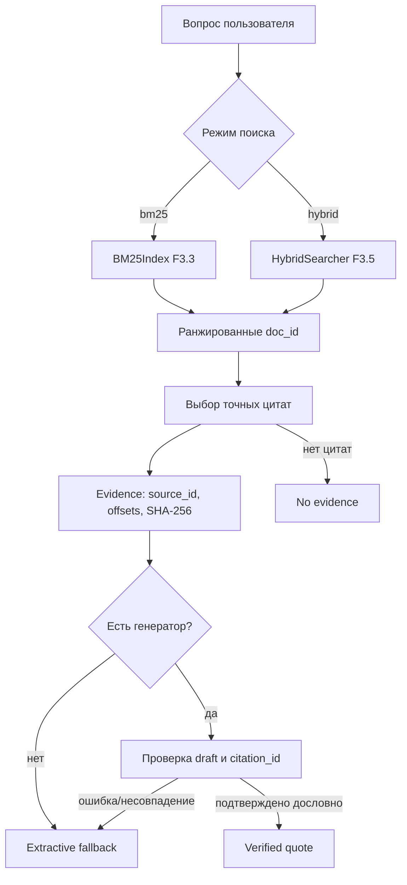

# F3.8 - RAG, Provenance и Extractive Fallback: пошаговая реализация

## 1. Цель этапа

К F3.7 реализованы извлечение embeddings, лексический и dense поиск, гибридный RRF и проверяемая оценка retrieval. Однако список найденных `doc_id` ещё не является ответом на технический вопрос. Следующий этап должен преобразовать ранжированные документы в ограниченный **контекст** и вернуть результат с проверяемым происхождением.

**Задача F3.8:** реализовать минимальный retrieval-to-answer pipeline, в котором каждый цитируемый фрагмент сопоставлен с точной подстрокой документа, символьными границами, `doc_id`, `source_id` и SHA-256. Предусмотреть интерфейс внешнего генератора и безопасное поведение, если генератор отсутствует или возвращает неподтверждённый текст.

В отличие от полноценного генеративного RAG, **LLM необязательна**. По умолчанию выдаётся дословная цитата - `extractive_fallback`, а не свободно сформулированное утверждение.

## 2. Реализация: файлы этапа

| Файл | Что реализовано и зачем |
|---|---|
| `src/transformers_f3/rag_provenance.py` | `RAGPipeline`, `Evidence`, `GenerationRequest`, `GenerationDraft`, поиск и выбор цитат, `verify_evidence()`, проверка генераторного текста, fallback и `no_evidence`. |
| `configs/f3_08_rag.json` | Ограничения числа документов, цитат, контекстного бюджета и пула кандидатов. |
| `scripts/rag_provenance_demo.py` | Синтетический offline-проход BM25/Hybrid, демонстрация provenance, недоказанного draft и fallback. |
| `tests/test_f3_rag_provenance.py` | Точность символьных диапазонов и SHA, валидность source IDs, бюджеты, режимы ответа, ошибка генератора и Windows CLI smoke. |
| `docs/steps/F3_08_rag_provenance.md` | Техническое описание маршрута retrieval → evidence → generation interface → verified quote/fallback. |

Модули F3.3–F3.5 вызываются как готовые компоненты. Веса encoder F3.2 F3.8 не скачивает; для hybrid требуется передать готовый `VectorIndex` и query embedding.

## 3. Последовательность действий

### Шаг 1. Зафиксировать контракт документа и источника
Хранить уникальный `doc_id` для индексированного фрагмента и `source_id` исходной статьи или заметки. При hybrid-поиске дополнительно сверять `source_id` из VectorIndex с оригинальными документами.

**Зачем:** совпадение `doc_id` в двух индексах ещё не доказывает, что привязка к исходной статье выполнена корректно.

### Шаг 2. Получить ранжированные документы
Для lexical-режима использовать BM25 F3.3. Для hybrid-режима - `HybridSearcher` F3.5 с готовым embedding запроса. Не использовать qrels F3.6 при выборе документов, иначе доказательная база ответа будет подогнана под benchmark.

### Шаг 3. Выбрать предложение из документа
Для найденного текста выполнить выделение предложений. Выбирать предложение с максимальным количеством общих **уникальных лексических токенов** с запросом, при равенстве - самое раннее. Если пересечений нет - первое непустое предложение.

Этот механизм детерминирован, но **не является семантическим reranker**. При отсутствии пересечений выбранная цитата может не отвечать на вопрос.

### Шаг 4. Ограничить размер контекста
Использовать конфигурацию F3.8: не больше `3` документов, `220` символов на цитату, суммарный бюджет `600` символов, при Hybrid кандидатовый пул до `10`.

Сохранять только точные непрерывные подстроки исходного документа. Усечение по бюджету допускается, но текст нельзя перефразировать без потери буквальной проверяемости.

### Шаг 5. Записать provenance для каждой цитаты
Сформировать `Evidence` с локальным `citation_id`, `doc_id`, `source_id`, ранжированием, строковым диапазоном `[start,end)`, цитатой и SHA-256 всего исходного документа.

**Зачем:** ссылка `[1]` должна разрешаться в конкретный fragment, а не просто указывать на абстрактную статью.

### Шаг 6. Проверить текстовую целостность Evidence
Убедиться, что `quote == document.text[start:end]`, SHA-256 полного исходного текста совпадает с отпечатком Evidence, а `source_id` соответствует документу.

Хеш доказывает **совпадение байтов**, но не истинность содержания, авторство статьи или право доступа к источнику.

### Шаг 7. Подключить консервативный генераторный интерфейс
`Generator` получает `GenerationRequest(question,evidence)` и возвращает `GenerationDraft(text,citation_id)`. Текст draft принимается, только если citation ID существует, а содержимое после `strip()` - непустая **дословная подстрока** соответствующей цитаты.

Если draft не соответствует условиям или генератор вызвал исключение, вернуть `extractive_fallback` - первую разрешённую цитату. Если цитируемого текста вообще нет, вернуть `no_evidence`.

### Шаг 8. Проверить доверительные границы
Исходный документ считать недоверенными данными. `build_generation_prompt` сериализует вопрос и Evidence в JSON и добавляет инструкцию не исполнять команды из контекста. При этом prompt не является полной защитой от prompt injection; основное ограничение - **валидация исходящего текста** на буквальное соответствие разрешённым цитатам.

Для тестов использовать только искусственные фрагменты. У модели нет внешних инструментов, сетевых вызовов, автоматического доступа к секретам или обучения.

## 4. Алгоритм: цитата, хеш и решение о fallback

### 4.1. Поиск исходных фрагментов
F3.8 не меняет формулы уже созданных индексов. BM25 возвращает лексические scores, Hybrid - RRF scores, вычисленные по рангам:
```math
\operatorname{RRF}(d)=
\mathbf{1}_{d\in L_b}\frac{w_b}{k+r_b(d)}+
\mathbf{1}_{d\in L_v}\frac{w_v}{k+r_v(d)}.
```
Наличие большего score определяет порядок кандидатов, но не является вероятностью корректного ответа.

### 4.2. Символьный диапазон цитаты
Для учебной строки `"abc def ghi"` цитата `"def"` находится в полуинтервале `[4,7)`:
```python
text = "abc def ghi"
assert text[4:7] == "def"
```
Сохранять именно символьные позиции Python, а не байтовые смещения UTF-8.

### 4.3. Формальный контракт Evidence
```math
\operatorname{quote}=\operatorname{document.text}[\operatorname{start}:\operatorname{end}].
```

```math
\operatorname{SHA256}(\operatorname{UTF8}(\operatorname{document.text}))
=\operatorname{document\_sha256}.
```
Два равенства дополняются проверкой `doc_id`/`source_id`; одно совпадение короткой цитаты не подтверждает происхождение.

### 4.4. Проверка генераторного черновика

| Условие | Режим | Возвращаемый результат |
|---|---|---|
| Действующий `citation_id` и дословная непустая подстрока цитаты | `verified_quote` | Проверяемый текст + ссылка |
| Генератор отсутствует, ошибся или вернул неподтверждённый текст | `extractive_fallback` | Первая разрешённая цитата + ссылка |
| Цитируемого текста нет | `no_evidence` | Отказ от недоказанного ответа |

**Синтетический пример:** источник содержит `"Check index usage for slow queries."`; генератор возвращает `"This always makes queries 100 times faster."`. Такого утверждения в разрешённой цитате нет, поэтому draft отвергается и применяется fallback.

Даже корректный свободный пересказ будет отвергнут: проверяется буквальное происхождение, не смысловая эквивалентность.

### 4.5. Текстовый бюджет
Не более трёх документов по 220 символов не означает, что общий контекст может составлять 660 символов: `context_char_budget=600` ограничивает **сумму** цитат. При усечении сохранить соответствие текста реальным диапазонам.

## 5. Схема вычислений



Главный контроль находится **после** генераторного интерфейса: неподтверждённое утверждение не проходит проверку.

## 6. Локальная проверка в PowerShell: что запускать и как читать результат

### 6.1. Перейти в проект
```powershell
cd F:\DEVELOPMENT\ML\ml-engineering-lab
```

### 6.2. Тесты F3.8
```powershell
.\.venv\Scripts\python.exe -m pytest -q tests/test_f3_rag_provenance.py
```
Проверить точные диапазоны текста, совпадение SHA, ограничения бюджета, три режима ответа и отклонение неподтверждённого draft.

### 6.3. Синтетическая демонстрация
```powershell
.\.venv\Scripts\python.exe scripts/rag_provenance_demo.py
```
Ожидаемый смысл: поиск технических фрагментов, цитата `Check index usage for slow queries. [1]`, `source_id` и проверяемые offsets. Попытка генератора заявить ускорение «в 100 раз» должна вызывать fallback, а не принятие утверждения.

### 6.4. Посмотреть дополнительные режимы без скачивания модели
```powershell
.\.venv\Scripts\python.exe scripts/rag_provenance_demo.py --help
Get-Content configs\f3_08_rag.json -Encoding UTF8
```
Режим `--real` в исходном описании предполагает **готовый кеш F3.2**. Использовать только после проверки наличия весов; F3.8 не должен скачивать модель.

### 6.5. Проверить весь проект
```powershell
.\.venv\Scripts\python.exe -m pytest -q
```
Успех определяется фактическим прохождением тестов, а не прежним историческим количеством.

## 7. Что подтверждено и какие ограничения

**Подтверждено:** связь результатов поиска с точной цитатой и источником; проверка буквального совпадения offsets и SHA; fallback при ошибке или неподтверждённом тексте; отказ при отсутствии Evidence.

**Ограничения:** выбор предложения лексический; нет калиброванного порога релевантности. Цитата может быть нерелевантна вопросу, а усечение может потерять существенное условие. `source_id` не является доверенным URL или подтверждением права доступа. Latency и стоимость генерации не измерены.

## 8. Основная мысль раздела

**F3.8 превращает retrieval-выдачу в ограниченный доказательный контекст. Каждая цитата связана с `doc_id`, `source_id`, символьным диапазоном и SHA-256 исходного текста. Генераторный draft допускается только при буквальной проверке; иначе возвращается extractive fallback либо `no_evidence`. Это проверка происхождения текста, а не доказательство истинности технического ответа.**

## 9. Файлы этапа

| Порядок | Файл | На что смотреть в коде |
|---|---|---|
| 1 | `scripts/rag_provenance_demo.py` | Доступные режимы, исходный вопрос, цитата и fallback. |
| 2 | `configs/f3_08_rag.json` | Число документов, 220-символьное ограничение, суммарный бюджет 600, размер пула. |
| 3 | `src/transformers_f3/rag_provenance.py` | `RAGPipeline`: BM25/Hybrid, извлечение цитат, сбор Evidence. |
| 4 | `src/transformers_f3/rag_provenance.py` | `verify_evidence()`: `text[start:end]`, SHA и source ID. |
| 5 | `src/transformers_f3/rag_provenance.py` | `GenerationRequest`, `GenerationDraft`, `verified_quote`/`extractive_fallback`/`no_evidence`. |
| 6 | `tests/test_f3_rag_provenance.py` | Неизвестный citation ID, неподтверждённый текст, fallback, Unicode и бюджеты. |
| 7 | `src/transformers_f3/hybrid_search.py` | RRF и возвращаемые source IDs — код предыдущего этапа. |
| 8 | `src/transformers_f3/retrieval_comparison.py` | Граница выбора документов и последующей оценки по qrels. |

**Итог F3.8:** построен ограниченный офлайн-конвейер поиска и подтверждения буквального происхождения цитат без обучения LLM.
