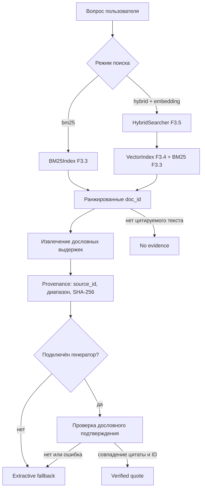

# F3.8 — RAG, provenance и extractive fallback

## 1. Назначение и инженерная задача

F3.1–F3.5 последовательно реализовали attention, текстовые embeddings, BM25,
точный cosine vector search и объединение поисковых списков методом RRF.
F3.6–F3.7 добавили независимую оценку retrieval на замороженной синтетической
выборке. Теперь нужно собрать эти компоненты в **минимальный конвейер ответа
на вопрос**, в котором видно, *откуда взят каждый фрагмент информации*.

**Retrieval-Augmented Generation (RAG)** — подход, при котором генератор
получает в дополнение к вопросу отобранный контекст из документов. В F3.8
генератор намеренно **не является обязательным**: мы реализуем интерфейс
подключения генератора, проверку цитат и резервный ответ, извлечённый
непосредственно из найденного документа (**extractive fallback**).

Это не чат-бот с развернутой LLM, не fine-tuning и не система с доказанной
фактической корректностью. Цель F3.8 — прозрачная, тестируемая архитектура
retrieval → context → generation interface → provenance → fallback.

## 2. Определения

- **Запрос (query)** — строка технического вопроса, по которой ищутся документы.
- **Документ/фрагмент (document/chunk)** — неизменяемый текст с уникальным `doc_id`.
- **Источник (source)** — оригинальная запись, объединяющая один или несколько
  фрагментов. Имеет `source_id`, который может повторяться у разных `doc_id`.
- **Retrieval** — получение ранжированного списка документов. BM25 и RRF
  возвращают *оценки ранжирования*, а не вероятности достоверности ответа.
- **Контекст** — ограниченный набор выдержек, передаваемых генератору.
- **Provenance** — возможность сопоставить ответ с конкретным фрагментом,
  идентификатором источника, точным текстом и отпечатком документа.
- **Citation** — ссылка вида `[1]`, связанная с определённой выдержкой.
- **Extractive fallback** — выдача дословного отрывка, когда генератора
  нет, он завершился ошибкой или предложил неподтверждённый текст.
- **Abstention (`no_evidence`)** — отказ выдумывать ответ, если нет цитируемого
  текста даже после поиска.

## 3. Архитектура и связь с предыдущими этапами



Реальный encoder из F3.2 может сформировать embeddings для F3.4, но сам
F3.8 их не создаёт и не скачивает: готовые векторы и `VectorIndex`
передаются извне. Для офлайн-тестов используются только вручную заданные
векторы. Qrels из F3.6 *не участвуют* в выборе документов и построении ответа.

### Инвариант сопоставления источников

Оба индекса обязаны работать над одним и тем же корпусом, с одинаковыми
`doc_id` и `source_id`. F3.5 уже проверяет множество `doc_id`. В F3.8
дополнительно сверяются `source_id` из `VectorIndex` с исходными документами.

## 4. Поиск и построение контекста

Лексический путь использует готовый BM25 из F3.3:

\[
\operatorname{BM25}(q,d)=\sum_{t \in q}\operatorname{IDF}(t)
\frac{f(t,d)(k_1+1)}{f(t,d)+k_1(1-b+b|d|/\mathrm{avgdl})}
\]

Гибридный путь использует готовое объединение рангов из F3.5:

\[
\operatorname{RRF}(d)=\frac{w_\text{lex}}{k+r_\text{lex}(d)}+
\frac{w_\text{vec}}{k+r_\text{vec}(d)}
\]

Для отсутствующего в списке документа вклад соответствующего ранжировщика
равен нулю. `RRF score` не является оценкой вероятность релевантности.

**Не меняем** ни формулу BM25, ни cosine similarity, ни RRF. F3.8 является
оркестратором поверх уже реализованных интерфейсов.

Из каждого результата выбирается одно предложение по максимальному количеству
общих **уникальных лексических токенов** с запросом; при равенстве — первое
по исходной позиции. Это простой, детерминированный способ получить цитату,
**не семантический reranker**. При отсутствии совпадающих токенов берётся
первое непустое предложение: такая цитата может оказаться нерелевантной,
поэтому её достоверность нельзя считать установленной.

Ограничения бюджета задаются в `configs/f3_08_rag.json`:

- `top_k` — не более трёх исходных документов;
- `max_quote_chars` — не более 220 символов одной цитаты;
- `context_char_budget` — не более 600 символов всех цитат;
- `candidate_pool_size` — до 10 кандидатов на поисковый пул Hybrid RRF.

Строки не переписываются для «красоты»: каждая цитата является точной
непрерывной подстрокой исходного документа. Частичное предложение возможно,
когда действует ограничение длины.

## 5. Проверяемое происхождение ответа

Для каждого фрагмента `Evidence` сохраняются:

| Поле | Смысл |
|---|---|
| `citation_id` | Локальный номер ссылки `[1]`, `[2]` ... |
| `doc_id` | ID индексированного фрагмента |
| `source_id` | ID исходного документа/источника |
| `rank`, `score` | Поисковая позиция и оценка, без вероятностного смысла |
| `start`, `end` | Символьные границы **[start, end)** в Python-строке |
| `quote` | Дословный текст в этих границах |
| `document_sha256` | Отпечаток всего исходного текста, а не только цитаты |

Проверка выполняется по двум независимым условиям:

\[
\text{quote}=\text{document.text}[\text{start}:\text{end}]
\]

\[
\operatorname{SHA256}(\text{document.text.encode(UTF-8)})
=\text{document\_sha256}
\]

Идентификатор источника также обязан совпасть с исходной записью.

### Числовой пример диапазона

Для строки `"abc def ghi"` (11 символов) цитата `"def"` начинается с
позиции 4 и оканчивается до позиции 7: `text[4:7] == "def"`.

В нашем эксперименте возвращается, например, выдержка `"Check index usage
for slow queries."` с `doc_id=db-plan`, `source_id=synthetic:postgres` и
диапазоном `[53:88]`. Её можно восстановить без языковой модели. Это
**синтетический демонстрационный пример**, а не измерение ответа на реальных
данных.

SHA-256 обнаруживает изменение *текста относительно сохранённого в конвейере
экземпляра*. Он не подтверждает качество первоисточника, не проверяет
подпись автора и не заменяет проверку прав доступа к документам.

## 6. Интерфейс генератора и extractive fallback

`Generator` — это функция, получающая `GenerationRequest(question, evidence)`.
В демонстрации нет LLM и вызовов к сетевым API. При интеграции внешнего
генератора конвейер принимает `GenerationDraft(text, citation_id)`.

Для учебного режима применяется **консервативный фильтр**:

1. `citation_id` должен ссылаться на реально отобранную выдержку.
2. После удаления внешних пробелов `draft.text` должен быть **дословной
   непустой подстрокой** этой выдержки.
3. Если оба условия выполнены — `mode = verified_quote`.
4. Если генератор отсутствует, ошибся или процитировал несуществующее
   утверждение — `mode = extractive_fallback`, ответом становится
   первая дословная выдержка плюс `[1]`.
5. Если выдержек нет — `mode = no_evidence`, ответом становится отказ.

Пример: первоисточник содержит `"Check index usage for slow queries."`.
Генератор вернул `"This always makes queries 100 times faster."`.
Такое утверждение нельзя найти в разрешённой цитате, и оно будет отклонено.
Ответ fallback остаётся точной выдержкой из исходного документа.

**Важно:** совпадение строки не доказывает истинность утверждения в источнике.
Система не поддерживает свободный пересказ фактов: даже корректный парафраз
будет отклонён. Это сознательное ограничение учебного proof-of-concept.

## 7. Защита границ доверия

Документы рассматриваются как **недоверенные данные**. Функция
`build_generation_prompt` сериализует вопрос и цитаты в JSON с явной
инструкцией не выполнять команды из контекста. Однако форматирование и
промпт сами по себе не защищают надёжно от prompt injection. Основной
контракт этого этапа — после работы генератора не принимать утверждение,
которое нельзя восстановить дословно из разрешённой выдержки.

Нет внешних сетевых вызовов, автоматической загрузки весов, доступа к
секретам, файловым операциям над пользовательскими документами или
самостоятельного обучения. В наборе тестов только синтетические тексты.

## 8. Состояния результата и ограничения

| `mode` | Условие | Что возвращается |
|---|---|---|
| `verified_quote` | Генератор вернул дословную строку с существующей ссылкой | Цитата + ID |
| `extractive_fallback` | Генератора нет или проверка не пройдена | Первый найденный отрывок + ID |
| `no_evidence` | В выдаче нет непустой цитаты | Сообщение об отсутствии подтверждения |

Причина перехода фиксируется в поле `reason`; ранжированные исходные
`doc_id` — в `retrieved_doc_ids`. Можно анализировать ответы без
вмешательства в поисковые алгоритмы.

**Известные ограничения:**

- Возвращаемая цитата может не отвечать на вопрос или содержать ошибку;
  автоматической fact-checking модели нет.
- `source_id` — идентификатор, а не URL или подтверждённая внешняя ссылка;
  разрешение на доступ и надёжность источника должны обеспечиваться отдельно.
- Отрывок может быть усечён, и это влияет на полноту смысла.
- Гибридная выдача может содержать слабо релевантные результаты; отдельной
  калибровки порога «достаточно релевантно» здесь нет.
- Нет тестирования реальной генеративной LLM, измерений faithfulness,
  answer accuracy, latency или себестоимости генерации.
- Использование конечной выборки F3.6 не означает, что у нас есть независимая
  разметка качества **ответов**; Recall@K и MRR@K измеряют только retrieval.

## 9. Результаты воспроизводимого эксперимента

В офлайн-демонстрации три синтетических технических фрагмента; запрос:
`PostgreSQL slow queries index`.

BM25 возвращает `db-plan`, `db-index` и цитату:

```text
Check index usage for slow queries. [1]
```

В варианте Hybrid с вручную заданными двумерными векторами можно проследить
дополнительного кандидата `linux-log`, но это **не доказательство семантики**.

Дополнительный демонстрационный режим `--real` использует уже закешированный
pretrained encoder F3.2 и строит embeddings этих же синтетических фрагментов;
скачивание моделей в F3.8 **запрещено**. Даже при этом режиме не измеряются
ни качество реальных ответов, ни faithfulness: это только проверка сквозного
интерфейса encoder → Hybrid → provenance.
Подключаемый фиктивный генератор предлагает недоказанное утверждение про
ускорение «в 100 раз»; система корректно активирует `extractive_fallback`.

Никаких реальных метрик качества RAG на 80 запросах эти примеры не дают.
Они проверяют поведение кода и provenance на маленьком синтетическом наборе.

## 10. Выводы

Реализован путь от retrieval к **проверяемому извлечённому ответу**:
информацию можно привязать к точному источнику и проверить на уровне
символьных диапазонов и хешей. При недостоверной по тексту генерации конвейер
сохраняет источник, а не маскирует неудачу убедительным пересказом.

F3.8 не доказывает превосходства RAG над retrieval, не объявляет цитату
истинным ответом и не начинает fine-tuning. Дальнейшие шаги потребуют
отдельной оценки фактических ответов и источников.

## 11. Файлы, с которыми стоит познакомиться

| Файл | Что необходимо изучить |
|---|---|
| `src/transformers_f3/rag_provenance.py` | `RAGPipeline`: последовательность поиска, выбора цитат, генератора, проверок и fallback; `Evidence` и `verify_evidence` |
| `src/transformers_f3/bm25.py` | `BM25Index.search`: источник лексического ранжирования; почему score не является уверенностью |
| `src/transformers_f3/vector_search.py` | `VectorIndex`: соответствие массива embeddings и `doc_id/source_id`, проверки формы Query |
| `src/transformers_f3/hybrid_search.py` | `HybridSearcher.search`: RRF, объединение независимых списков, единый идентификатор документа |
| `src/transformers_f3/retrieval_comparison.py` | `generate_rankings`: отделение ранжирования от последующей оценки по qrels |
| `configs/f3_08_rag.json` | Границы контекстного окна, количество кандидатов и веса поисковых методов |
| `scripts/rag_provenance_demo.py` | Сквозной офлайн-сценарий, переход в fallback и отображение provenance |
| `tests/test_f3_rag_provenance.py` | Числовые/структурные инварианты, отказ от галлюцинации, точность цитат, Windows CLI smoke |
