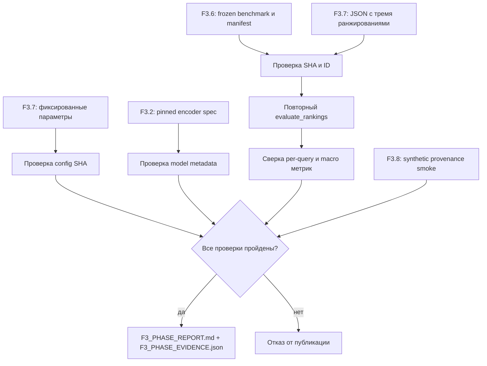

# F3.9 - Итоговый отчёт Фазы 3: пошаговая реализация

## 1. Цель этапа

Фаза 3 последовательно реализовала Self-Attention, предобученные embeddings, BM25, точный Vector Search, гибридный RRF, замороженный benchmark, сравнение retrieval и ограниченный RAG с provenance. До F3.9 результаты распределены между конфигурациями, кодом, тестами и артефактами эксперимента.

**Задача F3.9:** создать итоговый технический отчёт, который не переписывает готовые метрики на доверии, а **независимо пересчитывает Recall@K/MRR@K** из сохранённых ranked lists F3.7 и frozen qrels F3.6. Дополнительно проверить параметры encoder, поискового протокола, происхождение документов и поведение extractive fallback из F3.8.

На F3.9 не выполняются повторное обучение, скачивание модели, подбор гиперпараметров по test-qrels и подключение генеративной LLM. Предмет этапа - аудит, а не новое измерение embeddings.

## 2. Реализация: файлы этапа

| Файл | Что реализовано и зачем |
|---|---|
| `src/transformers_f3/phase_report.py` | `validate_comparison()` с проверками benchmark, config, рангов и метрик; формирование финального Markdown и структурированного evidence. |
| `scripts/f3_phase_report.py` | Разделение synthetic smoke и аудита настоящего F3.7 JSON; блокировка публикации при недостаточном evidence. |
| `tests/test_f3_phase_report.py` | Тесты подмены метрик, source ID, SHA, версии encoder, ранжирования и идемпотентного экспорта. |
| `docs/reports/F3_PHASE_REPORT.md` | Выходной Markdown-отчёт после успешного аудита реального эксперимента. |
| `reports/public/f3_09/F3_PHASE_EVIDENCE.json` | Компактная машиночитаемая фиксация проверенных метрик, настроек и SHA. |
| `docs/steps/F3_09_final_phase_report.md` | Технический материал по аудиту, алгоритмам сверки и ограничениям интерпретации. |

Входами служат **готовые**, ранее полученные файлы: frozen corpus F3.6, `configs/f3_07_comparison.json`, `configs/f3_02_model.json`, `reports/public/f3_07/F3_07_comparison.json` и код контрактов F3.8.

## 3. Последовательность действий

### Шаг 1. Определить допустимые исходные артефакты
Для финального отчёта разрешить только `backend=pretrained_transformer`. JSON из синтетического smoke с игрушечными векторами не считать показателем качества предобученного encoder.

**Зачем:** инженерная проверка взаимодействия модулей и реальное измерение retrieval - разные виды доказательств.

### Шаг 2. Повторно проверить frozen benchmark
Загрузить корпус через `load_frozen_benchmark()`. Сверить `benchmark_id`, SHA manifest, **88 документов**, **80 запросов**, **160 положительных qrels** и полный набор query ID.

Списки ranked docs должны ссылаться только на документы данного корпуса; в каждом списке запрещены дубли и чужие ID.

### Шаг 3. Проверить зафиксированный протокол F3.7
Сопоставить конфигурацию с утверждённой: BM25 `k1=1.5`, `b=0.75`, RRF `rrf_k=60`, веса `1.0/1.0`, candidate pool `20`, глубины `K=1/5/10`, batch `16`. Сверить SHA файла и ожидаемые схемы полей.

Контроль config SHA подтверждает идентичность **декларации параметров**, но не доказывает, что исходный эксперимент действительно использовал именно её.

### Шаг 4. Проверить сведения о предобученной модели
Из JSON F3.7 сопоставить `model_id`, полный pinned revision SHA, лицензию, `embedding_dim=384`, pooling и L2 с F3.2 `ModelSpec`. Проверить наличие model manifest hash и фактических записанных версий PyTorch, Transformers, huggingface_hub и NumPy.

**Ограничение:** F3.9 не читает веса из кеша, не вычисляет embeddings и не может доказать, что исходный JSON сформирован одобренным процессом.

### Шаг 5. Восстановить ранжированные списки
Для каждого метода - BM25, Vector, Hybrid - прочитать **все** ранги по всем 80 query ID. Не сортировать их по `doc_id` и не заменять отсутствующие документы догадками. При нарушении полноты или структуры блокировать отчёт.

### Шаг 6. Независимо пересчитать Recall@K и MRR@K
Использовать `evaluate_rankings()` из F3.6 для каждого метода и `K=1,5,10`. Сверить индивидуальные метрики каждого вопроса, макроагрегаты и групповые срезы с JSON F3.7.

Сравнивать числа **до округления для вывода** с допуском `1e-12`: этот допуск компенсирует численные погрешности, но не скрывает иные эксперименты.

### Шаг 7. Проверить RAG-контракт отдельно
На двух учебных технических документах проверить три сценария F3.8: корректная цитата с источником, отклонение неподтверждённого генераторного утверждения и `no_evidence` при отсутствии пригодной цитаты.

Результат этого smoke **не** объединять с Recall/MRR: тестируется корректность provenance, не полезность генеративного ответа.

### Шаг 8. Сформировать два итоговых артефакта
После успешных проверок создать `docs/reports/F3_PHASE_REPORT.md` и `reports/public/f3_09/F3_PHASE_EVIDENCE.json`. Сохранять только агрегаты, контрольные суммы, параметры и ограничения; исключить веса модели, исходный приватный датасет, тексты пользовательских запросов и абсолютные локальные пути.

При любом несоответствии **не** создавать публикационный результат. Для одинаковых входов сформировать побайтово одинаковые UTF-8 с LF без нестабильных timestamp.

## 4. Алгоритм независимого аудита метрик

### 4.1. Повторный расчёт Recall@K
Пусть `R(q)` - множество положительных qrels, а `TopK(q)` - первые `K` сохранённых ranked `doc_id`:
```math
\operatorname{Recall@K}(q)=\frac{|R(q)\cap TopK(q)|}{|R(q)|}.
```
Результат вычисляется по **сохранённому порядку** документов. Сам score BM25, cosine и RRF в формулу не входит.

### 4.2. Повторный расчёт Reciprocal Rank
```math
\operatorname{RR@K}(q)=
\begin{cases}
1/r_1(q),&\text{если первое релевантное попадание имеет позицию }r_1(q)\le K;\\
0,&\text{если в top-K попаданий нет}.
\end{cases}
```

### 4.3. Макроусреднение по всем запросам
```math
\operatorname{MacroRecall@K}=\frac{1}{N}\sum_{q=1}^{N}\operatorname{Recall@K}(q),\qquad
\operatorname{MRR@K}=\frac{1}{N}\sum_{q=1}^{N}\operatorname{RR@K}(q),\quad N=80.
```

**Числовой эталон:** релевантны `{d1,d2}`, выдача `[d3,d4,d1,d5,d2]`.

| Глубина K | Recall@K | RR@K |
|---:|---:|---:|
| 1 | 0 | 0 |
| 3 | 1/2 = 0.5 | 1/3 ≈ 0.3333 |
| 5 | 2/2 = 1.0 | 1/3 ≈ 0.3333 |

Разница между Recall и RR объясняется тем, что второй найденный релевантный документ увеличивает полноту, но не меняет позицию **первого** попадания.

### 4.4. Сопоставление методов
Для каждого K сформировать таблицу трёх методов. Дополнительно пересчитать результаты по доменам (`databases`, `linux`, `programming`, `systems`) и типам (`lexical`, `paraphrase`).

Разницу Recall@5 между Hybrid и BM25 выражать в **процентных пунктах**:
```math
\Delta_{pp}=100\left(\operatorname{Recall@5}_{Hybrid}-\operatorname{Recall@5}_{BM25}\right).
```
Например, `0.70 − 0.60 = 0.10` соответствует **10 процентным пунктам**, а не 10% относительного прироста. Это лишь математический пример, не объявленная метрика реального запуска.

Отдельно подсчитать количество запросов, на которых Hybrid имеет больше, меньше или столько же Recall@5, сколько BM25. Равная Recall не означает идентичности ранжированных списков и не делает MRR лишней.

### 4.5. Контроль целостности
Проверять последовательно: benchmark manifest, ID/источники, search config SHA, encoder metadata, полные списки выдачи, индивидуальные метрики, макросредние и ограничения публикации. Любое несовпадение блокирует создание итогового файла.

Это проверка **внутренней согласованности** эксперимента, а не доказательство качества предобученной модели в произвольной предметной области.

## 5. Схема вычислений



Схема специально не содержит новых вызовов pretrained encoder: F3.9 аудирует **сохранённые** результаты F3.7.

## 6. Локальная проверка в PowerShell: что запускать и как читать результат

### 6.1. Перейти в проект
```powershell
cd F:\DEVELOPMENT\ML\ml-engineering-lab
```

### 6.2. Проверить F3.9
```powershell
.\.venv\Scripts\python.exe -m pytest -q tests/test_f3_phase_report.py
```
Проверить отклонение повреждённых агрегатов, чужих SHA/ID, неправильных модельных метаданных и воспроизводимость отчёта.

### 6.3. Проверить наличие источника настоящего эксперимента
```powershell
Test-Path reports\public\f3_07\F3_07_comparison.json
```
`True` означает, что входной JSON физически имеется, **не** подтверждает корректность его содержимого.

### 6.4. Посмотреть допустимые режимы генератора отчёта
```powershell
.\.venv\Scripts\python.exe scripts/f3_phase_report.py --help
```
Синтетический smoke предназначен только для проверки контрактов. Реальный отчёт создавать после проверки наличия pretrained JSON и выбора задокументированного режима из `--help`; точные дополнительные флаги не указаны в исходном MD и здесь не выдумываются.

### 6.5. Просмотреть результаты после успешного аудита
```powershell
Get-Content docs\reports\F3_PHASE_REPORT.md -Encoding UTF8 | Select-Object -First 40
Get-Content reports\public\f3_09\F3_PHASE_EVIDENCE.json -Encoding UTF8 | Select-Object -First 40
```
Сверить benchmark ID, K=1/5/10, методы, данные encoder, ограничения и статус provenance smoke.

### 6.6. Полная регрессия
```powershell
.\.venv\Scripts\python.exe -m pytest -q
```

Основной критерий - отсутствие `failed/errors` для текущей рабочей копии.

## 7. Что подтверждено и какие ограничения

**Подтверждено при успешном аудите:** согласованность frozen benchmark с ранжированными списками, повторный расчёт Recall/MRR, проверка config/model metadata и идемпотентное создание артефактов. Отдельно проверяется буквальный provenance-контракт F3.8.

**Ограничения:** 80 связанных синтетических запросов не являются репрезентативной продакшен-выборкой. Проверка цитат не измеряет factuality; Recall и MRR не сравнимы с Accuracy/Macro F1 классификаторов F1/F2. Не измерялись продакшен latency, безопасность реальных документов, нагрузка и стоимость.

## 8. Основная мысль раздела

**F3.9 завершает Фазу 3 не повторным обучением, а техническим аудитом: из ranked lists F3.7 и неизменной разметки F3.6 заново рассчитываются Recall@K/MRR@K, проверяются версии модели, параметры поиска и контрольные суммы. Итоговые Markdown/JSON создаются только при согласованности доказательств. Это защищает отчёт от случайного объединения результатов разных экспериментов, но не подменяет реальный повторный inference.**

## 9. Файлы этапа

| Порядок | Файл | На что смотреть в коде |
|---|---|---|
| 1 | `scripts/f3_phase_report.py` | Граница synthetic smoke и реального финального отчёта. |
| 2 | `src/transformers_f3/phase_report.py` | `validate_comparison()`: SHA/ID, проверка полноты ранжирований и пересчёт метрик. |
| 3 | `src/transformers_f3/phase_report.py` | `build_phase_markdown()`: представление прошедших аудит данных. |
| 4 | `tests/test_f3_phase_report.py` | Подмена benchmark, model metadata, ranked lists, метрик, UTF-8 и повторяемость. |
| 5 | `src/transformers_f3/retrieval_benchmark.py` | F3.6 `load_frozen_benchmark()` и `evaluate_rankings()`: независимый эталон. |
| 6 | `src/transformers_f3/retrieval_comparison.py` | F3.7 `result_as_dict`: структура сохранённых поисковых результатов. |
| 7 | `src/transformers_f3/embeddings.py` | F3.2 `ModelSpec`: ожидаемые параметры модели. |
| 8 | `src/transformers_f3/rag_provenance.py` | F3.8 `Evidence`, `verify_evidence`, fallback/no_evidence. |
| 9 | `docs/reports/F3_PHASE_REPORT.md` | После успешного реального аудита: проверенные таблицы и ограничения. |
| 10 | `reports/public/f3_09/F3_PHASE_EVIDENCE.json` | После успешного реального аудита: структурированное evidence и SHA. |

**Итог F3.9:** подготовлен проверяемый итог Фазы 3 с жёстким разделением алгоритмических проверок, измерений pretrained retrieval и синтетической проверки provenance.
