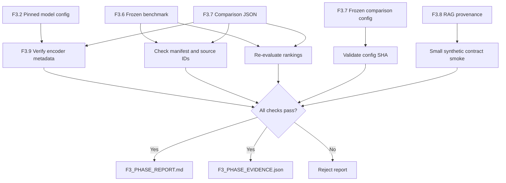

# F3.9 — Final Phase Report & Limitations

## 1. Назначение

Фаза 3 последовательно реализовала Self-Attention, предобученные dense
embeddings, BM25, точный векторный поиск, гибридное ранжирование RRF,
замороженную оценку retrieval и минимальный RAG с прослеживаемыми цитатами.

**Инженерная задача F3.9** — объединить эти результаты в итоговый технический
отчёт, но **не доверять готовой таблице метрик без независимой проверки**.
Каждое публичное числовое значение должно происходить из сохранённого
эксперимента F3.7, выполненного с pinned pretrained encoder F3.2, и проходить
повторный расчёт по неизменённой разметке F3.6.

F3.9 не повторяет обучение F1/F2, не скачивает модель, не подбирает
гиперпараметры по frozen qrels и не подключает генеративную LLM.

## 2. Архитектура и связь с предыдущими этапами

Схема разделяет **расчёт первичных выдач** (F3.7) и **аудит готовых
выдач** (F3.9). Повторный расчёт результатов семантического encoder в F3.9
не выполняется: измеренные в F3.7 вектора не сохраняются в отчётных файлах.

### Входные источники

1. `tests/fixtures/f3_06_benchmark_v1/` — документы, запросы, qrels и manifest.
2. `configs/f3_07_comparison.json` — утверждённые параметры BM25, cosine,
   candidate pool, RRF и списка оцениваемых K.
3. `configs/f3_02_model.json` — ID, точная revision, лицензия, размерность
   и pooling предобученного encoder.
4. `reports/public/f3_07/F3_07_comparison.json` — результат настоящего
   pretrained-прогона, содержащий все ranked `doc_id` и метрики.
5. `src/transformers_f3/rag_provenance.py` — функциональный контракт
   дословных цитат и extractive fallback.

Три метода **должны оцениваться над одинаковыми 80 запросами**, а не
над разными случайными подмножествами. Идентификаторы документов не заменяются
названиями, не сортируются по `source_id` и не восстанавливаются эвристически.

## 3. Независимая проверка метрик

Пусть `R(q)` — множество релевантных документов для вопроса `q`, а
`topK(q)` — первые `K` ID в фактическом ранжированном списке.

**Recall@K** для одного вопроса:

\[
\operatorname{Recall@K}(q)=\frac{|\operatorname{topK}(q)\cap R(q)|}{|R(q)|}
\]

**Reciprocal Rank@K**:

\[
\operatorname{RR@K}(q)=
\begin{cases}
  1/r_1, & r_1\leq K,\\
  0, & \text{если релевантного документа в top-K нет},
\end{cases}
\]

где `r₁` — позиция первого найденного релевантного документа, начиная с 1.

Средние вычисляются **по всем запросам**, включая нулевые результаты:

\[
\operatorname{MacroRecall@K}=\frac{1}{N}\sum_{q=1}^N \operatorname{Recall@K}(q)
\]

\[
\operatorname{MRR@K}=\frac{1}{N}\sum_{q=1}^N \operatorname{RR@K}(q)
\]

В текущей версии F3.6 `N = 80`.

### Числовой эталон

Для одного синтетического запроса релевантны два документа: `{d1, d2}`.
Поисковая выдача в порядке убывания ранга: `[d3, d4, d1, d5, d2]`.

- При `K=1`: Recall@1 = 0/2 = 0, RR@1 = 0.
- При `K=3`: Recall@3 = 1/2 = 0.5, RR@3 = 1/3 ≈ 0.3333.
- При `K=5`: Recall@5 = 2/2 = 1, RR@5 = 1/3 ≈ 0.3333.

Для группы запросов макро-значение — среднее индивидуальных результатов,
**не** число уникальных найденных документов, делённое на размер корпуса.

F3.9 вызывает `evaluate_rankings()` из F3.6 **для каждого** метода и
`K` из зафиксированной конфигурации. Затем сравнивает пересчитанное
значение со значениями JSON на уровне каждой строки и общих агрегатов.
Проверка проводится до отображения округлённых четырёх знаков.
Допуск `1e-12` компенсирует только машинное округление вещественных чисел;
он не предназначен для заметной разницы между экспериментами.

## 4. Инварианты происхождения и целостности

### 4.1. Версия benchmark

F3.6 уже защищает сам набор через SHA-256 manifest и отдельных JSONL.
F3.9 повторно вызывает загрузчик F3.6 и сопоставляет с отчётом:

- `benchmark_id` и SHA manifest;
- ровно 88 документов, 80 запросов и 160 qrels;
- полный список query ID в фиксированном порядке;
- `doc_id`, домен и тип (`lexical`/`paraphrase`) каждого запроса;
- соответствие `doc_id → source_id`;
- уникальность ID в каждом ранжировании и отсутствие чужих документов.

### 4.2. Фиксированный поиск

Проверяются SHA-256 и содержимое конфигурации F3.7, определяющей
`BM25(k1=1.5, b=0.75)`, exact cosine и RRF. Контроль конфигурации —
проверка **сопоставимости** результата, а не доказательство, что файл
на самом деле использовался во время исходного эксперимента.

Отпечатки исходных конфигураций F3.2, F3.7 и F3.8 также сверяются с
опубликованными эталонами. Изменение любого из них требует новой версии
протокола, а не тихой замены параметров в существующем отчёте.

### 4.3. Модель и версии

Декларация `model_metadata` из результата F3.7 сравнивается с
`ModelSpec` F3.2: идентификатор, pinned Git SHA, лицензия, размерность,
pooling и L2-нормировка. Также требуется корректный hash model manifest
и сведения о версиях PyTorch, Transformers, huggingface_hub и NumPy.

**Граница проверки:** F3.9 не открывает файлы кеша модели и не
переизмеряет embeddings. Даже корректные SHA в JSON могут быть
недостоверными, если сам JSON создан неутверждённым процессом. Проверка
целостности отчёта не заменяет воспроизведение эксперимента F3.7.

### 4.4. Модель измерения и synthetic smoke

Для настоящего отчёта разрешён только `backend=pretrained_transformer`.
Офлайн-демонстрации с `synthetic_test_vectors` остаются в unit-тестах.
Тестовые фикстуры, которые имитируют формат pretrained JSON, используются
только **в памяти тестов и во временных папках**. Их числа нельзя считать
результатами работы модели и публиковать в итоговом отчёте.

## 5. Сопоставление методов и диагностическая разбивка

F3.9 показывает значения Recall@1/5/10 и MRR@1/5/10 для BM25, Vector
и Hybrid, а также результаты отдельно по доменам:

- `databases`;
- `linux`;
- `programming`;
- `systems`.

И по типу вопроса: `lexical` и `paraphrase`.

Для сравнения Hybrid с BM25 дополнительно выводится разница Recall@5:

\[
\Delta_{pp}=100\cdot(\operatorname{Recall@5}_{hybrid}-
\operatorname{Recall@5}_{BM25})
\]

Единица `Δ` — **процентные пункты**, а не проценты относительного прироста.

Также по всем 80 запросам подсчитывается, где метод имеет большую,
меньшую или равную Recall@5 относительно BM25. Даже если отдельный
метод проигрывает, его результат сохраняется, без перенастройки RRF.

**Важно:** при равной Recall@5 два результата могут иметь совершенно
разные ранжированные списки. Эта диагностика не доказывает эквивалентность
поисковиков и не подменяет MRR, показывающую раннюю позицию первого hit.

## 6. Финальная проверка RAG-контракта

На двух **игрушечных** технических документах проверяются три сценария:

1. `RAGPipeline` возвращает дословную цитату с корректным `doc_id`,
   `source_id`, символьным диапазоном и хешем текста.
2. Подключаемый генератор возвращает неподтверждённую фразу; она отвергается,
   после чего конвейер выдаёт `extractive_fallback`.
3. Запрос не имеет лексического совпадения ни с одним документом; ответ
   получает режим `no_evidence`.

Тест измеряет **корректность интерфейса и происхождение цитат**, но не
доказательность смысловых утверждений, качество генерации и полезность ответа.
Результаты этого smoke в итоговом отчёте явно отделяются от retrieval-метрик.

## 7. Результирующие артефакты

При успешном аудите формируются два разных файла:

- `docs/reports/F3_PHASE_REPORT.md` — содержательный отчёт с математикой,
  проверенными метриками, архитектурой и перечнем ограничений.
- `reports/public/f3_09/F3_PHASE_EVIDENCE.json` — компактный структурный
  аудит с контрольными суммами, пересчитанными метриками, разбивками и
  результатами синтетического smoke; без весов модели и текстов документов.

Область публикации содержит только синтетические данные F3.6 и метрики
реального pretrained-инференса F3.7. Приватные тексты, исходный датасет
F1, локальный кеш и модельные веса не записываются в F3.9.

При любой ошибке входного JSON, контрольной суммы, полноты query IDs,
согласованности пер-query/общих метрик или несоответствии модели создание
результатов блокируется. Результаты идемпотентны: одинаковые входы создают
побайтово одинаковые UTF-8 файлы с LF, без временных меток и абсолютных путей.

## 8. Ограничения интерпретации

- 80 запросов и бинарные релевантности созданы вручную; это **не** независимая
  эмпирическая оценка производственных вопросов.
- Качество классификации F1/F2 нельзя напрямую сравнивать с Recall/MRR:
  единица измерения и целевая задача отличаются.
- BM25 и cosine similarity дают разные шкалы score. RRF объединяет их
  порядки, не значения вероятностей.
- Повторное вычисление метрик проверяет согласованность чисел с выданными
  ranked lists, но не подтверждает правильность получения этих списков моделью.
- Проверка цитаты F3.8 является буквальной, а не семантической. Она не
  гарантирует factuality, безопасность от prompt injection и адекватность
  текста вопросу.
- Аппаратное ускорение, производственная нагрузка, безопасность реальных
  данных, полнота источников и latency не измерялись в этой фазе.
- Результаты тестов Windows и GitHub Actions относятся к процессу
  завершения этапа и подтверждаются отдельно, а не выводятся из JSON F3.7.

## 9. Выводы

Реализация Фазы 3 формирует проверяемый pipeline от механизмов внимания
до retrieval и ограниченного ответа с provenance. Итоговый отчёт F3.9
показывает **наблюдаемые** значения на замороженном синтетическом benchmark,
разделяет вычисленные метрики и ограничения, а также не допускает
незаметной подмены значений при генерации документации.

Следующая задача инженерного развития — отдельный независимый dataset
настоящих запросов с проверенной разметкой релевантности и, при необходимости,
оценка генеративного компонента. Это направление не реализуется в F3.9.

## 10. Файлы, с которыми стоит познакомиться

| Файл | Что необходимо изучить |
|---|---|
| `src/transformers_f3/phase_report.py` | `validate_comparison`: сверка SHA, query IDs и независимый расчёт Recall/MRR; `build_phase_markdown`: граница между измерением и представлением |
| `scripts/f3_phase_report.py` | Режим синтетического smoke vs реальный отчёт из F3.7; отказ при недостающем evidence |
| `tests/test_f3_phase_report.py` | Подмена метрик, корпуса, версии модели, источников; кодировка Windows и идемпотентность |
| `src/transformers_f3/retrieval_benchmark.py` | `load_frozen_benchmark`, `evaluate_rankings`: доверенная формула и набор данных F3.6 |
| `src/transformers_f3/retrieval_comparison.py` | Схема `result_as_dict`, отделение поиска от применения qrels, зафиксированная конфигурация |
| `src/transformers_f3/embeddings.py` | `ModelSpec`: проверяемые параметры предобученной модели F3.2 |
| `src/transformers_f3/rag_provenance.py` | `RAGPipeline`, `Evidence`, `verify_evidence`, реакция на неподтверждённую генерацию |
| `docs/reports/F3_PHASE_REPORT.md` | После измерения: таблица реальных Recall/MRR, анализ групп и ограничения |
| `reports/public/f3_09/F3_PHASE_EVIDENCE.json` | После измерения: машинно-проверяемый аудит, версия эксперимента и исходные SHA |
