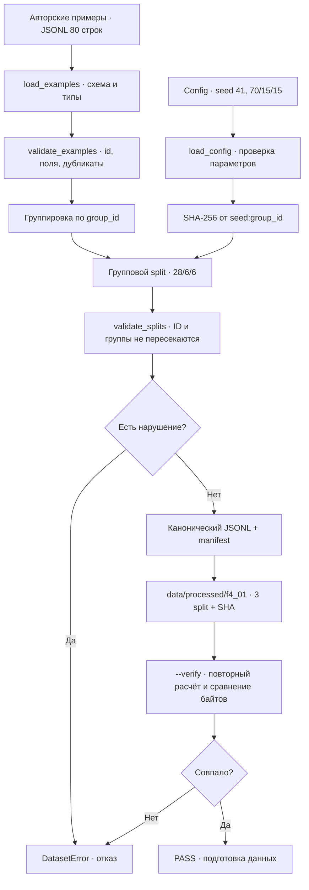

# F4.1 — Instruction Dataset: от технических вопросов до проверяемых train/validation/test

> **Статус документа:** реализация F4.1, локальный прогон на Python 3.13.5: 43 теста PASS, BUILD PASS, VERIFY PASS. Запуск в пользовательской среде Windows и GitHub Actions ещё **не подтверждён**. В этом этапе **не** загружается и **не** обучается языковая модель.

## 1. Цель этапа

На Фазе 3 мы построили поиск: BM25, векторное сравнение, RRF, независимый frozen benchmark и ограниченный RAG с проверкой происхождения фрагментов. Поисковая система отвечает на вопрос «где найти подходящий текст?». Но даже точная выдача документов не учит языковую модель отвечать в нужном формате и стиле. Для будущего SFT нужен отдельный набор пар *запрос → желаемый ответ*.

**Instruction dataset** — набор примеров, в которых задана инструкция пользователя, необязательный входной контекст и эталонный ответ. Во время *supervised fine-tuning* (F4.5) модель будет получать токенизированную инструкцию и учиться воспроизводить целевой ответ; в F4.1 до токенизации и изменения весов ещё не доходим.

Наша конкретная задача — реализовать надёжный слой данных до эксперимента с моделью: **схема → проверка содержимого → дедупликация → групповой split → воспроизводимый экспорт → аудит**. Если на этом шаге перепутать границы train/test, последующая оценка F4.7 может оказаться завышенной даже при идеально написанном training loop.

Предыдущие шаги F1.6 и F3.6 уже показывали важность разделения и фиксированных испытаний. F4.1 переносит эти принципы на текстовые инструкции. В F3.6 релевантность оценивалась по qrels и спискам документов, а здесь мы готовим **текст ответа как обучающую цель**. Метрики Recall@K и MRR@K не становятся метриками качества генерации автоматически.

Для эксперимента написаны **80 собственных учебных примеров**, объединённых в **40 тематических групп**: по 10 групп в Python, Linux, SQL и ML. В каждой группе есть два варианта вопроса об одной сущности. Записи намеренно небольшие и содержат только авторский технический текст: исходный корпус Stack Exchange из предыдущих фаз не копировался, поскольку для его публикации имеются ограничения лицензирования и атрибуции.

**Ожидаемый результат:** три JSONL-файла `train`, `validation`, `test`; SHA-256-манифест со статистикой; API для повторной загрузки и проверки; тесты, которые отклоняют очевидные случаи утечки. Это учебный **data pipeline**, а не претензия на репрезентативный набор для финальной оценки LLM.

## 2. Что реализовано

| Файл | Назначение | Реализованные функции и содержимое |
|---|---|---|
| `src/llm_f4/__init__.py` | Пакет Фазы 4 | Отдельное пространство имён `src.llm_f4`; без скрытой загрузки моделей. |
| `src/llm_f4/instruction_dataset.py` | Логика F4.1 | `InstructionExample`, `SplitConfig`, `DatasetError`, `load_examples()`, `load_config()`, `validate_examples()`, `normalized_prompt()`, `allocate_group_counts()`, `split_examples()`, `validate_splits()`, `create_artifacts()`, `export_artifacts()`, `verify_artifacts()`. |
| `data/synthetic/f4_01_instruction_seed.jsonl` | Входной учебный корпус | 80 отдельных строк JSONL, 40 `group_id`, четыре `domain`; примеры написаны специально для проекта. |
| `configs/f4_01_instruction_dataset.json` | Фиксация параметров | Версия схемы, `seed=41`, доли 70/15/15, относительные пути к входу и локальному результату. |
| `scripts/f4_instruction_dataset.py` | Демонстрация и CLI | Режим BUILD создаёт файлы, `--verify` проверяет их побайтово; печатаются фактические размеры и короткие SHA. Справка `--help` использует ASCII для совместимости с Windows-процессами и `subprocess`. |
| `tests/test_f4_instruction_dataset.py` | Автоматические проверки | 43 тестовых случая: проверки формата JSONL, повторов ID, пересечения групп, воспроизводимости, изменения source/split/manifest, конфигурации и CLI; отдельный Windows encoding smoke (`cp1251`, `cp866`, `cp1252`). |
| `docs/steps/F4_01_instruction_dataset.md` | Учебная документация | Последовательность реализации, формулы, схема, команды PowerShell, интерпретация тестов и ограничения. |

**Производные файлы создаются только локально:** `data/processed/f4_01/{train,validation,test}.jsonl` и `manifest.json`. В текущем `.gitignore` репозитория `data/processed/` уже исключён. Производные данные **не** входят в ZIP и **не** включаются в будущий Git-коммит: они восстанавливаются из авторского seed и зафиксированной конфигурации.

### Схема одной записи

Входной файл использует UTF-8 JSON Lines: **одна строка = один JSON-объект**. Для F4.1 выбран явный формат, независимый от особенностей `chat_template` ещё не выбранной модели:

```json
{
  "id": "f4q034_a",
  "group_id": "f4g034",
  "domain": "ml",
  "instruction": "Как обновить параметр градиентным спуском за один шаг?",
  "input": "w_old=2; gradient=3; learning_rate=0.1",
  "response": "Правило обновления: w_new = w_old - learning_rate * gradient. Для w_old=2, gradient=3 и learning_rate=0.1 получаем w_new=1.7.",
  "origin": "authored_synthetic"
}
```

- `id` — уникальный идентификатор **строки**.
- `group_id` — идентификатор **семейства смыслово связанных вопросов**. Он является **единицей разделения**.
- `domain` — область технических знаний, используется для прозрачности состава выборок; F4.1 **не выполняет стратификацию** по домену.
- `instruction` — формулировка задачи пользователя.
- `input` — дополнительный контекст; пустая строка допустима.
- `response` — подготовленный эталонный ответ, **не генерация LLM**.
- `origin` — обязательная отметка `authored_synthetic`. При попытке добавить чужой корпус без пересмотра правил происхождения запись будет отклонена.

Формат позволяет впоследствии построить последовательность сообщений `user` и `assistant` в F4.2/F4.5. Текущая поставка сознательно **не формирует** `input_ids`, `attention_mask`, `labels` и не маскирует loss: это требует выбора токенизатора, режима SFT и модели.

## 3. Последовательность реализации

### Шаг 1. Определили отличие dataset для SFT от поискового корпуса

**Что сделали.** Остановились на паре `instruction + input → response`, а не на документе для BM25 и не на метках релевантности.

**Зачем.** Поисковый индекс возвращает документ; SFT использует целевую последовательность токенов, по которой позже вычисляется loss.

**Как реализовали.** Создали `InstructionExample` с явными полями и типами, не добавляя зависимость от Transformers или Hugging Face Dataset.

**Что получили.** Общий контракт, который можно валидировать без модели и GPU.

### Шаг 2. Подготовили небольшие авторские технические примеры

**Что сделали.** Написали 40 технических тем, по два вопроса к каждой: 10 Python, 10 Linux, 10 SQL, 10 ML. Добавили объясняющие ответы, а для расчётных задач — фиксированный `input`.

**Зачем.** Проверка формата не должна требовать публикации ограниченного исходного корпуса. Два варианта одной темы позволяют показать реальную проблему утечки через переформулировки.

**Как реализовали.** Сохранили 80 строк в `data/synthetic/f4_01_instruction_seed.jsonl`. Примеры имеют `id=f4qNNN_a/b`, общий внутри пары `group_id=f4gNNN`, явный `origin`.

**Что получили.** Повторно используемый, небольшой и проверяемый исходный материал. Например, вопросы «Как обновить параметр градиентным спуском?» и «Вычисли новый вес...» получают один `group_id`, поэтому никогда не оказываются по разные стороны test/train.

### Шаг 3. Зафиксировали конфигурацию, а не неявные параметры в скрипте

**Что сделали.** Утвердили `schema_version=1`, `seed=41`, `train=70`, `validation=15`, `test=15` процентов.

**Зачем.** Изменение seed или долей способно изменить оценку модели. Параметры должны быть видны отдельно от алгоритма.

**Как реализовали.** `load_config()` проверяет точные ключи, типы, сумму процентов `100`, пределы seed и относительность путей внутри корня репозитория. Булево `true` в качестве `seed` не принимается, хотя в Python `bool` является подклассом `int`.

**Что получили.** Режим работы явно закреплён в `configs/f4_01_instruction_dataset.json`.

### Шаг 4. Реализовали строгую загрузку и валидацию JSONL

**Что сделали.** Обязали каждую строку соответствовать одному JSON-объекту и полной схеме из семи полей.

**Зачем.** Ошибка вроде пустого `response`, лишнего поля, неверного `id` или испорченного JSON должна быть найдена до тренировки, а не после непонятной ошибки collator.

**Как реализовали.** `load_examples()` читает UTF-8 (в том числе с BOM), сообщает номер испорченной строки и передаёт данные в `_validate_record()` и `validate_examples()`. Отклоняются пустой файл, пустые строки, неизвестные поля, неподходящие типы, управляющие символы, неизвестное происхождение, слишком короткий/длинный текст, повторные `id`, разные `domain` внутри одной группы.

**Что получили.** Предсказуемую ошибку `DatasetError` вместо молчаливого исправления входа. Исправление исходного текста — отдельное осознанное действие разработчика.

### Шаг 5. Добавили буквальную дедупликацию запросов

**Что сделали.** Проверяем уникальность не только `id`, но и пары `instruction + input` в нормализованном виде.

**Зачем.** Запросы, различающиеся лишь регистром, пробелами и знаками препинания, не должны считаться новыми учебными задачами.

**Как реализовали.** `normalized_prompt()` использует Unicode NFKC, `casefold()`, извлечение `\w+` и объединение токенов через пробел. Дублированная пара с новым `id` приводит к отказу.

**Что получили.** Дополнительную защиту от простых технических дубликатов. **Важно:** она не обнаруживает семантический парафраз, например «Как работает GIL?» / «Почему Python-потоки не ускоряют CPU-вычисления?» — их требуется объединить одинаковым `group_id` ещё на этапе подготовки.

### Шаг 6. Выбрали группу, а не строку, единицей split

**Что сделали.** Собрали `group_id → список InstructionExample`.

**Зачем.** Если случайно разделять 80 строк, два варианта одного вопроса могут попасть в train и test; метрика перестанет отражать качество на независимых темах.

**Как реализовали.** В `split_examples()` каждая группа целиком направляется только в одну из выборок. Сначала группы упорядочиваются стабильным SHA-256 от строки `seed:group_id`, затем распределяются согласно квотам; записи внутри каждого файла сортируются по `id`.

**Что получили.** При одинаковой исходной совокупности, конфигурации и seed результат не зависит от порядка строк входного JSONL.

### Шаг 7. Рассчитали размеры без деления групп пополам

**Что сделали.** Отделили вычисление целочисленного числа групп от размещения записей.

**Зачем.** Например, 15% от трёх групп даёт дробное значение. Обычное округление может создать пустую выборку или нарушить сумму.

**Как реализовали.** `allocate_group_counts()` резервирует по одной группе на каждую из трёх выборок, затем дораспределяет остальные по максимальному дефициту относительно идеальной доли. Для 40 групп квоты имеют целочисленный вид 28/6/6.

**Что получили.** `train=28 групп=56 строк`, `validation=6 групп=12 строк`, `test=6 групп=12 строк`; ни одна смысловая пара не разрезана.

### Шаг 8. Провели контроль целостности разбиения

**Что сделали.** Проверили, что нет общих `id`, `group_id`, повторных запросов между выборками, пропущенных или изменённых исходных записей.

**Зачем.** Даже корректно вычисленные размеры ничего не говорят об утечке или потере отдельных записей.

**Как реализовали.** `validate_splits()` сопоставляет три выборки и при наличии `source` требует, чтобы объединение выходных `id` точно совпадало с исходными, а сами объекты не менялись.

**Что получили.** Контракт «каждая запись присутствует ровно один раз и принадлежит целиком одной группе».

### Шаг 9. Сформировали воспроизводимые файлы и SHA-256-манифест

**Что сделали.** Подготовили каноническую запись JSON с отсортированными ключами, `ensure_ascii=False`, разделителями без лишних пробелов и переводом строки LF.

**Зачем.** Побайтовая проверка на разных запусках возможна, только если порядок записей и сериализация фиксированы.

**Как реализовали.** `create_artifacts()` собирает три JSONL и `manifest.json` в памяти. Manifest хранит SHA-256 исходного файла, каждого split, параметры, размеры и `algorithm=sha256_group_order_v1`; **не содержит исходных вопросов или ответов**. `export_artifacts()` записывает файлы в `data/processed/f4_01/`.

**Что получили.** Повторный BUILD с теми же входами создаёт побайтово идентичные данные. У manifest нет изменяющихся временных меток.

### Шаг 10. Добавили независимую команду VERIFY и отрицательные тесты

**Что сделали.** Реализовали CLI с режимами BUILD и `--verify`, а также набор `pytest`.

**Зачем.** Наличие файлов на диске не гарантирует, что их не испортили или что они соответствуют нынешнему seed/source.

**Как реализовали.** `verify_artifacts()` повторно вычисляет ожидаемые четыре файла по исходнику и конфигурации, затем сравнивает их **побайтово** с сохранёнными. Тесты намеренно портят данные, конфигурации и результаты; проверяют ошибку, а не ложный PASS.

**Что получили.** Отдельно доказаны загрузка и свойства split; отдельно — целостность локального экспорта. Никакой настоящий fine-tuning при этом не производится.

## 4. Алгоритм и математический пример

### 4.1. Почему недостаточно случайного split строк

Пусть у нас есть группа `f4g034` из двух инструкций:

- `f4q034_a`: «Как обновить параметр градиентным спуском за один шаг?»
- `f4q034_b`: «Вычисли новый вес после шага gradient descent...»

Обе инструкции требуют ответа по формуле:

\[
w_{new} = w_{old} - \eta g.
\]

Здесь `w_old` — вес до шага, `η` — learning rate, `g` — вычисленный градиент, `w_new` — новый вес. Для значений из `input`:

\[
w_{old}=2,\quad \eta=0.1,\quad g=3,\quad
w_{new}=2-0.1\cdot3=1.7.
\]

Этот числовой пример помещён в **эталонный текст**, а не вычисляется языковой моделью. Мы проверяем, что оба варианта находятся вместе, а не то, смогла ли LLM решить задачу.

Проверка на Python после BUILD:

```powershell
.\.venv\Scripts\python.exe -c "from pathlib import Path; from src.llm_f4.instruction_dataset import load_examples; p=Path('data/processed/f4_01'); a=[x for n in ('train','validation','test') for x in load_examples(p / (n+'.jsonl')) if x.group_id=='f4g034']; print(len(a), {x.id for x in a})"
```

Результат по исходному seed: `2 {'f4q034_a', 'f4q034_b'}` (порядок элементов множества в консоли может меняться). Этот код **не проверяет**, в каком именно split оказалась группа; это делает `validate_splits()` и полный тест покрытия.

### 4.2. Групповые квоты

При `G=40` группах и долях `p_train=0.70`, `p_validation=0.15`, `p_test=0.15` идеальные квоты:

\[
q_i = G \cdot p_i, \quad
q_{train}=28, \; q_{validation}=6, \; q_{test}=6.
\]

Для дробных квот `allocate_group_counts()` сначала обеспечивает три непустые выборки, затем добавляет группы туда, где больше `G*p_i - count_i`. Для устойчивой точности в коде сравнивается целое `G*ratio_percent - 100*count_i`, без плавающей запятой.

```python
candidate = max(
    SPLIT_NAMES,
    key=lambda name: (
        total * ratios[name] - 100 * counts[name],
        -SPLIT_NAMES.index(name),
    ),
)
counts[candidate] += 1
```

При равном дефиците приоритет одинаков для каждого запуска: `train`, затем `validation`, затем `test`. Проверка `test_integer_group_allocation()` сравнивает результаты с эталонами `G=3,4,5,40`, в частности `40 → (28,6,6)`.

**Ограничение:** квоты считаются **по группам**, не по количеству записей. В данном учебном датасете все группы имеют по два примера, поэтому доли по строкам тоже получились ровно 70/15/15. Если добавить группы разных размеров, процент по **строкам** может отличаться — это предпочтительнее разделения одной смысловой группы.

### 4.3. SHA-256 как стабильный порядок и проверка целостности

Каждому `group_id` сопоставляется ключ

\[
h(g) = \operatorname{SHA256}(\operatorname{UTF8}(\text{seed} + ":" + g)).
\]

Группы сортируются по `h(g)` и последовательно занимают заранее вычисленные квоты. Это **детерминированное псевдослучайное упорядочивание**, а не криптографическое обещание независимости распределения задач. Оно не зависит от `PYTHONHASHSEED`, расположения строк или ОС. Если изменить seed или состав групп, состав split может измениться; в будущих экспериментах его следует заморозить.

В manifest отдельно сохраняется:

\[
H_{source}=\operatorname{SHA256}(\text{байты исходного JSONL}),
\quad
H_{train}=\operatorname{SHA256}(\text{байты train.jsonl}).
\]

Аналогично вычисляются `H_validation`, `H_test`. Из них нельзя восстановить исходные тексты; однако хеш **не заменяет** лицензионный контроль и не доказывает истинность ответов.

Результаты текущего локального BUILD:

| Объект | Значение |
|---|---|
| Source records / groups | 80 / 40 |
| Train records / groups | 56 / 28 |
| Validation records / groups | 12 / 6 |
| Test records / groups | 12 / 6 |
| Source SHA-256 | `7ce6eb2629b0831feac771a4ee4dcb9e66c7901e074b9e957cbf50eaceda0225` |
| Train SHA-256 (prefix) | `7b78e1b5a7d6` |
| Validation SHA-256 (prefix) | `5f970fb61610` |
| Test SHA-256 (prefix) | `1800ccc3c9fc` |

Полные SHA-256 трёх split находятся в `data/processed/f4_01/manifest.json`. Сверка побайтовая: изменение даже одного перевода строки приведёт к FAIL. Это **технические результаты F4.1**, не метрики обучения.

### 4.4. Зачем нормализовать дубликаты до split

При нормализации `"Чем JOIN отличается?"` и `"ЧЕМ join ОТЛИЧАЕТСЯ!!!"` превращаются в один набор токенов `"чем join отличается"`. Если по ошибке назначить разные `id`, `validate_examples()` обнаружит совпадение ключа `instruction + input` **до** построения разбиения. Если смысл одинаковый, а слова разные, автоматическая нормализация недостаточна — нужно вручную назначить общий `group_id` или расширить аудит качества данных в последующих этапах.

## 5. Схема работы



Здесь **нет** блоков Transformer, tokenizer, optimizer, GPU, gradient или LLM inference. Они появятся в дальнейших шагах Фазы 4. Путь будущих данных: `train.jsonl` → токенизатор и формат диалога F4.2/F4.5; `validation.jsonl` → контроль обучения; `test.jsonl` → отложенная проверка. Отдельная независимая процедура оценки будет зафиксирована в F4.3.

## 6. Локальная проверка PowerShell

Все команды выполняются **из корня репозитория** после распаковки `ML_Engineering_Lab_F4_1.zip`. Используем существующее окружение Python; новых ML-зависимостей в F4.1 нет, но для тестов требуется `pytest`.

### 6.1. Перейти в корень проекта

```powershell
cd F:\DEVELOPMENT\ML\ml-engineering-lab
```

### 6.2. Выполнить unit-тесты этапа

```powershell
.\.venv\Scripts\python.exe -m pytest -q tests/test_f4_instruction_dataset.py
```

**Что происходит.** Загружается авторский JSONL, проверяется 43 тестовых случая: контроль формата, математические эталоны квот, целостность split, изменения исходника/manifest, недопустимые пути и непустота выборок.

**Что ожидать.** В подготовленном окружении разработки этого этапа получено `43 passed`. На Windows результат нужно подтвердить отдельно. Если тесты завершились с `failed` или `error`, этап не принят, даже если демо запускается.

### 6.3. Проверить справку CLI, включая Windows pipe

```powershell
.\.venv\Scripts\python.exe scripts/f4_instruction_dataset.py --help
```

**Что происходит.** `argparse` выводит список параметров и завершает работу с кодом `0`, не читая датасет и не импортируя ML-библиотеки. Команда должна вывести `--config` и `--verify`. Регрессионные тесты также запускают дочерний процесс с `PYTHONIOENCODING=cp1251`, `cp866`, `cp1252`: ранее символ `→` вызывал `UnicodeEncodeError` в перенаправленном потоке вывода Windows. Для переносимости текст самой справки CLI написан ASCII; подробное описание на русском остаётся в этом MD.

### 6.4. Выполнить BUILD

```powershell
.\.venv\Scripts\python.exe scripts/f4_instruction_dataset.py
```

**Что происходит.** Скрипт читает `configs/f4_01_instruction_dataset.json`, проверяет весь исходный набор и формирует **локальные** `train.jsonl`, `validation.jsonl`, `test.jsonl` и `manifest.json`. Модель не скачивается и не обучается.

Ожидаемые ключевые строки для неизменённой поставки:

```text
F4.1 BUILD: PASS
Source: 80 records, 40 groups
train: 56 records, 28 groups; sha256=7b78e1b5a7d6
validation: 12 records, 6 groups; sha256=5f970fb61610
test: 12 records, 6 groups; sha256=1800ccc3c9fc
Model training / inference: NOT RUN
```

Первая строка примера будет взята из train и покажет реальную техническую инструкцию, не выдуманную демонстрацией.

### 6.5. Проверить выгрузку независимо от режима BUILD

```powershell
.\.venv\Scripts\python.exe scripts/f4_instruction_dataset.py --verify
```

**Что происходит.** Алгоритм снова вычисляет ожидаемые байты из seed/source и сравнивает их с локальными файлами. При совпадении должно появиться `F4.1 VERIFY: PASS` и те же размеры и SHA. Если вручную изменить `train.jsonl`, команда возвращает ошибку `F4.1: FAIL` и ненулевой код выхода.

### 6.6. Посмотреть реальные результаты

```powershell
Get-Content data\processed\f4_01\manifest.json -Encoding UTF8
Get-Content data\processed\f4_01\train.jsonl -Encoding UTF8 | Select-Object -First 2
Get-Content data\processed\f4_01\validation.jsonl -Encoding UTF8 | Select-Object -First 2
Get-Content data\processed\f4_01\test.jsonl -Encoding UTF8 | Select-Object -First 2
```

Проверь, что manifest содержит `origin=authored_synthetic`, `seed=41`, три распределения и полные SHA-256. В трёх JSONL должны быть записи с ключами `id`, `group_id`, `domain`, `instruction`, `input`, `response`, `origin`. JSONL — это **по одной JSON-записи в строке**, а не один большой JSON-массив.

### 6.7. Проверить затронутые части проекта и общую регрессию

В F4.1 исходники F1–F3 не менялись. После успеха локальных тестов рекомендуется выполнить доступную регрессию финального этапа F3 и затем общий прогон:

```powershell
.\.venv\Scripts\python.exe -m pytest -q tests/test_f3_phase_report.py
.\.venv\Scripts\python.exe -m pytest -q
```

**Интерпретация:** эти проверки зависят от ранее установленного окружения, локальных данных и опциональных зависимостей предыдущих фаз. Сама поставка F4.1 не включает исходники F1–F3, поэтому их полный прогон здесь **не заявлен как выполненный**. Не сравнивай количество тестов из чужой среды с текущим `43 passed` без учёта состава репозитория.

### 6.8. Что означает PASS и чего он не означает

PASS подтверждает, что подготовка данных и проверки работают в конкретном окружении. PASS **не** означает, что 56 строк достаточно для продуктивного SFT, что ответы абсолютно безошибочны, что нет семантических пересечений между разными `group_id` или что модель научилась отвечать.

## 7. Что доказано тестами и какие ограничения остаются

### Подтверждено в локальном прогоне

- Авторский JSONL успешно читается: 80 записей, 40 групп, четыре `domain`, единое происхождение.
- Схема строго проверяет поля, типы и длины; ошибки JSON и UTF-8, неизвестный `origin`, пустой dataset, дубликаты ID/запросов отклоняются.
- Распределение при `seed=41` даёт 28/6/6 групп и 56/12/12 записей, без пересечений и потерь при сохранении содержания.
- Перестановка строк в исходном корпусе не меняет состав и байты трёх split при прежних записях и seed; при этом SHA самого исходного JSONL и, следовательно, manifest изменится, что корректно отражает изменение байтов источника.
- Повторный BUILD даёт те же четыре файла; VERIFY отклоняет изменённый `train.jsonl`, повреждённый manifest, пропавший split и изменённый источник.
- CLI показывает результаты и не требует GPU или веса LLM. Справка `--help` намеренно использует только ASCII, поскольку при перенаправлении вывода в Windows кодировка может не поддерживать отдельные символы Unicode. Три дополнительных теста принудительно проверяют `cp1251`, `cp866` и `cp1252`.
- При запуске на Python 3.13.5 с pytest 9.0.2 получено **43 passed**, BUILD/VERIFY PASS.

### Не подтверждено и не входит в F4.1

- **Полная семантическая дедупликация.** Разные по словам, но одинаковые по смыслу вопросы из *разных* групп всё ещё могут создать утечку. Для учебного корпуса группировка выполнена вручную; на больших корпусах нужен дополнительный similarity-аудит и оценка разметки.
- **Содержательная корректность всех ответов.** Это вручную подготовленные эталоны; они ещё не прошли независимую экспертную оценку. Не следует трактовать текст как автоматически проверенные факты.
- **Репрезентативность.** 80 примеров и 40 тем не описывают реальный поток задач пользователя; однородный стиль, по два варианта каждой темы и четыре области знаний ограничивают применимость статистических выводов.
- **Стратификация.** Разбивка не гарантирует одинаковые доли `domain` во всех выборках и может меняться при добавлении групп. Любое изменение корпуса или seed требует новой ревизии split и повторной фиксации протокола.
- **Независимость финального benchmark.** Структурный test F4.1 — отложенная часть *этого же учебного корпуса*. Финальную методику и независимые контрольные задачи нужно отдельно зафиксировать в F4.3. Нельзя подбирать гиперпараметры по test.
- **Обучение и метрики LLM.** Не выполнялись `tokenization`, `causal loss`, SFT, LoRA, QLoRA, DPO, Base-vs-Fine-Tuned и генерация. Отсутствуют train loss, eval loss и показатели качества ответов.
- **Windows/CI.** Локальные проверки выполнялись на Python 3.13.5 в среде подготовки; запуск на пользовательской Windows 3.13.2 и проверки GitHub Actions требуют отдельного подтверждения.

## 8. Основная мысль этапа — как рассказать о сделанном

На этом этапе я начал подготовку к обучению языковой модели не с запуска Transformers или выделения GPU, а с контракта данных. В Фазе 3 я умел находить релевантные документы и контролировать происхождение извлечённого текста. Но для SFT этого недостаточно: мне нужны качественные пары «инструкция пользователя — ожидаемый ответ». Я выбрал JSONL с полями `instruction`, `input` и `response`, а также добавил `id`, `group_id`, `domain` и `origin` для проверки качества и независимости экспериментов.

Затем я вручную составил небольшой набор из 80 технических примеров по Python, Linux, SQL и ML. На каждую тему приходится два похожих вопроса. Это принципиально: если разделять отдельные строки случайно, модель может увидеть одну формулировку в train и почти такую же — в test. Поэтому я сделал единицей разделения **смысловую группу**, а не строку. Сначала проверил поля и уникальность запросов, затем объединил записи по `group_id`, отсортировал группы детерминированно через SHA-256 от seed и распределил их целиком по долям 70/15/15.

Я получил 56 обучающих примеров, 12 валидационных и 12 тестовых. Для этого не потребовалось ни одной модели или GPU. Но сами размеры — ещё не гарантия качества. Я добавил проверки, которые специально ломают данные: повторяют ID, помещают записи одной группы в разные выборки, меняют ответ, портят файл и manifest. При обнаружении противоречий программа останавливается с `DatasetError`, а не пытается исправить данные молча.

После этого я реализовал воспроизводимый экспорт: файл исходных примеров, фиксированный seed и одна конфигурация однозначно задают четыре результата. Манифест хранит размеры и SHA-256, а отдельный режим `--verify` позволяет перепроверить сохранённые байты. Так у меня появился инженерный фундамент для следующего шага: выбрать модель и токенизатор, затем провести оценку **до** обучения. Я отдельно понимаю ограничение этапа: unit-тесты готовности данных никак не доказывают, что LLM после SFT будет отвечать лучше.

На собеседовании я могу объяснить не только формат JSONL, но и причину группового split, опасность data leakage, роль фиксированного seed, способ контроля целостности и границу между проверяемой подготовкой данных и будущим экспериментом с весами модели.

## 9. Файлы, с которыми стоит познакомиться

Изучать лучше в том порядке, в котором исполняется и проверяется pipeline: сначала данные и конфигурация, затем загрузка и проверки, после — split и экспорт.

| Порядок | Файл | Что конкретно изучить |
|---:|---|---|
| 1 | `data/synthetic/f4_01_instruction_seed.jsonl` | Посмотреть пары `a/b`, общий `group_id`, пример с `input`, поля `origin` и `response`. |
| 2 | `configs/f4_01_instruction_dataset.json` | Понять связь seed, процентов и путей с результатом BUILD. |
| 3 | `src/llm_f4/instruction_dataset.py` | `InstructionExample` / `SplitConfig`: какой контракт проверяем. |
| 4 | `src/llm_f4/instruction_dataset.py` | `load_examples()` / `validate_examples()` / `normalized_prompt()`: почему плохие данные отклоняются. |
| 5 | `src/llm_f4/instruction_dataset.py` | `allocate_group_counts()` / `split_examples()` / `validate_splits()`: как достигается отсутствие пересечений. |
| 6 | `src/llm_f4/instruction_dataset.py` | `create_artifacts()` / `export_artifacts()` / `verify_artifacts()`: как формируются байты и SHA. |
| 7 | `scripts/f4_instruction_dataset.py` | `main()`: путь от конфигурации до BUILD/VERIFY и чтение одного примера. |
| 8 | `tests/test_f4_instruction_dataset.py` | Тесты `test_group_leak_rejected`, `test_source_content_mutation_rejected`, `test_export_and_verify_are_byte_identical` и параметризацию. |
| 9 | `docs/steps/F4_01_instruction_dataset.md` | Связать исполненный код, числовые примеры, вывод программы и ограничения в одну историю. |

Для связи с уже завершёнными этапами открой **существующие** (они не меняются в F4.1) файлы:

- `src/transformers_f3/retrieval_benchmark.py`: `load_frozen_benchmark()` и `evaluate_rankings()` — пример строгой независимой проверки поисковых результатов F3.6.
- `src/transformers_f3/rag_provenance.py`: `Evidence` и `verify_evidence()` — различие между найденным подтверждающим текстом и целевым ответом в будущей генерации.
- `docs/steps/F3_09_final_phase_report.md`: пример разделения подтверждённых измерений и синтетического smoke, которое сохраняем на Фазе 4.

**Итог F4.1:** я умею воспроизводимо создавать и проверять instruction dataset, но пока не делаю выводов о качестве языковой модели. Следующий этап — F4.2 Model Selection — только после пользовательского подтверждения выполнения и проверки F4.1.
