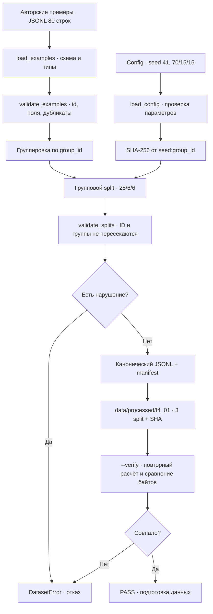

# F4.1 - Instruction Dataset: от технических вопросов до проверяемых train/validation/test

## 1. Цель этапа

На Фазе 3 реализованы BM25, векторный поиск, RRF, frozen retrieval benchmark и ограниченный RAG с контролем происхождения цитат. Эти компоненты предназначены для поиска релевантных фрагментов и формирования ответа с опорой на источники. **Поиск релевантного документа** необходимо отличать от **обучения языковой модели генерировать целевой ответ**. Для Supervised Fine-Tuning (SFT) требуется отдельный набор пар «инструкция → эталонный ответ».

**Instruction dataset** - структурированный набор примеров с пользовательской инструкцией, необязательным входным контекстом и целевым ответом. При последующем SFT исходный текст необходимо преобразовать в токены, сформировать `labels` и вычислять функцию потерь по целевой последовательности. На F4.1 реализуется только подготовка данных: токенизация, forward/backward и изменение весов не выполняются.

**Цель F4.1:** определить схему данных, подготовить авторские технические примеры, реализовать загрузку и валидацию JSONL, удалить буквальные дубликаты, выполнить разделение по смысловым группам, сформировать воспроизводимый экспорт и обеспечить проверку целостности. Особое внимание — исключению очевидных случаев data leakage между `train`, `validation` и `test`.

Сохранить связь с предыдущими этапами: F1.6 и F3.6 используют разделение данных и фиксированные протоколы оценки; F4.1 применяет аналогичный принцип к текстовым инструкциям. В F3.6 используются `qrels`, списки документов и retrieval-метрики; в F4.1 фиксируются **эталонные ответы как цели будущего обучения**. Метрики Recall@K и MRR@K не заменяют оценку качества генерации.

Для учебного эксперимента подготовить **80 авторских технических примеров**, распределённых по **40 смысловым группам**: по десять групп в Python, Linux, SQL и ML; по два варианта вопроса на группу. Не включать исходный корпус Stack Exchange из предыдущих фаз без выполнения требований лицензирования и атрибуции.

**Результат этапа:** три файла `train.jsonl`, `validation.jsonl`, `test.jsonl`; `manifest.json` с размерами и SHA-256; интерфейсы загрузки и проверки данных; автоматические тесты защиты от структурных ошибок и пересечений. Полученный набор предназначен для изучения устройства data pipeline и не является репрезентативным промышленным корпусом для оценки LLM.

## 2. Что реализовано

| Файл | Назначение | Реализованные функции и содержимое |
|---|---|---|
| `src/llm_f4/__init__.py` | Пакет Фазы 4 | Отдельное пространство имён `src.llm_f4`; без скрытой загрузки моделей. |
| `src/llm_f4/instruction_dataset.py` | Логика F4.1 | `InstructionExample`, `SplitConfig`, `DatasetError`, `load_examples()`, `load_config()`, `validate_examples()`, `normalized_prompt()`, `allocate_group_counts()`, `split_examples()`, `validate_splits()`, `create_artifacts()`, `export_artifacts()`, `verify_artifacts()`. |
| `data/synthetic/f4_01_instruction_seed.jsonl` | Входной учебный корпус | 80 отдельных строк JSONL, 40 `group_id`, четыре `domain`; примеры написаны специально для проекта. |
| `configs/f4_01_instruction_dataset.json` | Фиксация параметров | Версия схемы, `seed=41`, доли 70/15/15, относительные пути к входу и локальному результату. |
| `scripts/f4_instruction_dataset.py` | Демонстрация и CLI | Режим BUILD создаёт файлы, `--verify` проверяет их побайтово; печатаются фактические размеры и короткие SHA. Справка `--help` использует ASCII для совместимости с Windows-процессами и `subprocess`. |
| `tests/test_f4_instruction_dataset.py` | Автоматические проверки | 43 тестовых случая: проверки формата JSONL, повторов ID, пересечения групп, воспроизводимости, изменения source/split/manifest, конфигурации и CLI; отдельный Windows encoding smoke (`cp1251`, `cp866`, `cp1252`). |
| `docs/steps/F4_01_instruction_dataset.md` | Учебная документация | Последовательность реализации, формулы, схема, команды PowerShell, интерпретация тестов и ограничения. |

**Производные файлы создаются только локально:** `data/processed/f4_01/{train,validation,test}.jsonl` и `manifest.json`. В текущем `.gitignore` репозитория `data/processed/` уже исключён. Производные данные **не** входят в ZIP и **не** включаются в будущий Git-коммит: они восстанавливаются из авторского seed и зафиксированной конфигурации.

### Схема одной записи

Входной файл использует UTF-8 JSON Lines: **одна строка = один JSON-объект**. Для F4.1 выбран явный формат, независимый от особенностей `chat_template` ещё не выбранной модели:

```json
{
  "id": "f4q034_a",
  "group_id": "f4g034",
  "domain": "ml",
  "instruction": "Как обновить параметр градиентным спуском за один шаг?",
  "input": "w_old=2; gradient=3; learning_rate=0.1",
  "response": "Правило обновления: w_new = w_old - learning_rate * gradient. Для w_old=2, gradient=3 и learning_rate=0.1 получаем w_new=1.7.",
  "origin": "authored_synthetic"
}
```

- `id` — уникальный идентификатор **строки**.
- `group_id` — идентификатор **семейства смыслово связанных вопросов**. Он является **единицей разделения**.
- `domain` — область технических знаний, используется для прозрачности состава выборок; F4.1 **не выполняет стратификацию** по домену.
- `instruction` — формулировка задачи пользователя.
- `input` — дополнительный контекст; пустая строка допустима.
- `response` — подготовленный эталонный ответ, **не генерация LLM**.
- `origin` — обязательная отметка `authored_synthetic`. При попытке добавить чужой корпус без пересмотра правил происхождения запись будет отклонена.

Формат позволяет впоследствии построить последовательность сообщений `user` и `assistant` в F4.2/F4.5. F4.1 **не формирует** `input_ids`, `attention_mask`, `labels` и не маскирует loss: это требует выбора токенизатора, режима SFT и модели.

## 3. Последовательность реализации

### Шаг 1. Определить контракт данных для SFT

**Действие.** Выбрать структуру `instruction + input → response` вместо записи поискового документа или меток релевантности.

**Назначение.** Отделить данные для генеративного обучения от корпуса BM25: поисковый компонент возвращает документы, а SFT использует целевую последовательность токенов для расчёта loss.

**Реализация.** Использовать `InstructionExample` с явно заданными полями и типами. Не вводить зависимость от Transformers или Hugging Face Datasets до выбора модели и токенизатора.

**Результат.** Формализованный контракт, проверяемый без загрузки модели и без GPU.

### Шаг 2. Подготовить авторские технические примеры

**Действие.** Сформировать 40 технических тем, по два варианта вопроса для каждой: десять групп Python, десять Linux, десять SQL, десять ML. Для каждого вопроса задать ожидаемый ответ; при наличии числовой задачи указать фиксированный `input`.

**Назначение.** Получить небольшой открытый для проверок корпус без копирования ограниченных исходных данных. Использовать переформулированные вопросы одной темы как пример возможной утечки между выборками.

**Реализация.** Разместить 80 JSONL-записей в `data/synthetic/f4_01_instruction_seed.jsonl`. Применить идентификаторы `f4qNNN_a/b`, общий `group_id=f4gNNN` в пределах пары и явную отметку `origin`.

**Результат.** Воспроизводимый исходный набор. Например, вопросы «Как обновить параметр градиентным спуском?» и «Вычисли новый вес...» имеют общий `group_id` и должны попадать в одну выборку.

### Шаг 3. Зафиксировать конфигурацию разбиения

**Действие.** Установить `schema_version=1`, `seed=41` и пропорции `train=70%`, `validation=15%`, `test=15%`.

**Назначение.** Исключить неявное изменение состава выборок при запуске и обеспечить возможность повторного построения на одинаковых входных данных.

**Реализация.** В `load_config()` проверять набор ключей, типы, сумму долей `100`, допустимость seed и относительность путей внутри репозитория. Отклонять булево `true` в качестве `seed`: в Python тип `bool` является подклассом `int`, но семантически не подходит для этой настройки.

**Результат.** Единая конфигурация `configs/f4_01_instruction_dataset.json` с явными правилами обработки.

### Шаг 4. Реализовать строгую загрузку и валидацию JSONL

**Действие.** Проверить соответствие каждой строки одному JSON-объекту со всеми семью обязательными полями.

**Назначение.** Обнаружить повреждённый JSON, пустой `response`, ошибки ID, лишние поля и некорректные типы до этапа токенизации и обучения.

**Реализация.** В `load_examples()` читать UTF-8, включая вариант с BOM; сообщать номер ошибочной строки; передавать запись в `_validate_record()` и `validate_examples()`. Отклонять пустой файл, пустые строки, неизвестные поля, неверные типы, управляющие символы, неподдерживаемый `origin`, нарушения ограничений длины, повторяющиеся `id` и разные `domain` внутри одной группы.

**Результат.** Ошибка `DatasetError` с контролируемой причиной вместо молчаливого исправления исходного материала.

### Шаг 5. Проверить буквальные дубликаты инструкций

**Действие.** Контролировать уникальность не только `id`, но и нормализованной пары `instruction + input`.

**Назначение.** Не допускать дублирования запросов, отличающихся только регистром, пробелами или пунктуацией.

**Реализация.** В `normalized_prompt()` последовательно применить Unicode NFKC, `casefold()`, извлечение `\w+` и объединение токенов пробелами. Повторная нормализованная пара с новым идентификатором должна приводить к отказу.

**Результат.** Выявление простых текстовых дубликатов. Семантические парафразы, например «Как работает GIL?» и «Почему Python-потоки не ускоряют CPU-вычисления?», автоматически не объединяются; для них требуется корректно назначить общий `group_id`.

### Шаг 6. Разделить данные по смысловым группам

**Действие.** Построить соответствие `group_id → список InstructionExample` и назначать целые группы в одну из трёх выборок.

**Назначение.** Исключить ситуацию, когда один вариант вопроса используется для обучения, а почти идентичный вариант — для финального тестирования.

**Реализация.** В `split_examples()` упорядочить группы по SHA-256 ключа `seed:group_id`, распределить их согласно рассчитанным квотам, затем отсортировать записи в каждой выборке по `id`.

**Результат.** Состав и порядок выходных выборок определяются исходными примерами и seed, а не порядком строк во входном JSONL.

### Шаг 7. Рассчитать целочисленные квоты групп

**Действие.** Преобразовать доли 70/15/15 в целое количество групп, не разделяя смысловые группы на отдельные строки.

**Назначение.** Исключить пустые выборки и потерю групп при округлении дробных квот; сохранить общий размер выборок.

**Реализация.** В `allocate_group_counts()` зарезервировать по одной группе на каждую выборку, остальные распределить по наибольшему дефициту относительно идеальной доли. При 40 группах получить `28/6/6`.

**Результат.** `train`: 28 групп и 56 записей; `validation`: 6 групп и 12 записей; `test`: 6 групп и 12 записей. Смысловые пары остаются целыми.

### Шаг 8. Проверить корректность разбиения

**Действие.** Убедиться в отсутствии повторяющихся `id`, общих `group_id`, дублированных запросов между выборками, потерянных и изменённых записей.

**Назначение.** Проверить не только итоговое количество строк, но и сохранность исходного набора и отсутствие обнаруживаемой утечки.

**Реализация.** В `validate_splits()` сравнить пересечения трёх выборок; при наличии `source` потребовать точного совпадения объединения выходных `id` с исходными идентификаторами и сохранения исходных объектов.

**Результат.** Инвариант: каждая исходная запись присутствует ровно один раз, а все записи одной группы относятся к одной выборке.

### Шаг 9. Сформировать воспроизводимый экспорт и SHA-256-манифест

**Действие.** Применить каноническую сериализацию JSON: сортировку ключей, `ensure_ascii=False`, компактные разделители и перевод строки LF.

**Назначение.** Обеспечить побайтовое совпадение результатов повторного экспорта при неизменных входных данных.

**Реализация.** В `create_artifacts()` сформировать в памяти три JSONL и `manifest.json` с SHA-256 исходного файла и каждой выборки, квотами и параметром `algorithm=sha256_group_order_v1`. Не включать исходные вопросы и ответы в manifest. В `export_artifacts()` записать файлы в `data/processed/f4_01/`.

**Результат.** Детерминированный набор файлов без временных меток в манифесте.

### Шаг 10. Реализовать независимую проверку и отрицательные тесты

**Действие.** Добавить CLI-режимы BUILD и `--verify`; проверить не только корректные, но и намеренно повреждённые входы и результаты.

**Назначение.** Исключить ложный PASS при повреждении исходника, конфигурации, экспортированных данных или manifest.

**Реализация.** В `verify_artifacts()` повторно сформировать ожидаемые байты из исходного файла и конфигурации; сравнить каждый из четырёх результатов с сохранённой копией. В `pytest` проверить повреждение JSONL, пересечения групп, дубликаты, изменение файлов и недопустимые настройки.

**Результат.** Независимое подтверждение свойств разделения и целостности экспорта. Ни один из этих тестов не выполняет fine-tuning языковой модели.

## 4. Алгоритм и математический пример

### 4.1. Почему недостаточно случайного split строк

Для числового примера использовать группу `f4g034` из двух инструкций:

- `f4q034_a`: «Как обновить параметр градиентным спуском за один шаг?»
- `f4q034_b`: «Вычисли новый вес после шага gradient descent...»

Обе инструкции требуют ответа по формуле:

\[
w_{new} = w_{old} - \eta g.
\]

Здесь `w_old` — вес до шага, `η` — learning rate, `g` — вычисленный градиент, `w_new` — новый вес. Для значений из `input`:

\[
w_{old}=2,\quad \eta=0.1,\quad g=3,\quad
w_{new}=2-0.1\cdot3=1.7.
\]

Этот числовой пример содержится в **эталонном ответе**, а не вычисляется языковой моделью. Требуется проверить совместное размещение двух вариантов вопроса в одной выборке; корректность решения задачи самой LLM на F4.1 не оценивается.

Проверка на Python после BUILD:

```powershell
.\.venv\Scripts\python.exe -c "from pathlib import Path; from src.llm_f4.instruction_dataset import load_examples; p=Path('data/processed/f4_01'); a=[x for n in ('train','validation','test') for x in load_examples(p / (n+'.jsonl')) if x.group_id=='f4g034']; print(len(a), {x.id for x in a})"
```

Результат по исходному seed: `2 {'f4q034_a', 'f4q034_b'}` (порядок элементов множества в консоли может меняться). Этот код **не проверяет**, в каком именно split оказалась группа; это делает `validate_splits()` и полный тест покрытия.

### 4.2. Групповые квоты

При `G=40` группах и долях `p_train=0.70`, `p_validation=0.15`, `p_test=0.15` идеальные квоты:

\[
q_i = G \cdot p_i, \quad
q_{train}=28, \; q_{validation}=6, \; q_{test}=6.
\]

Для дробных квот `allocate_group_counts()` сначала обеспечивает три непустые выборки, затем добавляет группы туда, где больше `G*p_i - count_i`. Для устойчивой точности в коде сравнивается целое `G*ratio_percent - 100*count_i`, без плавающей запятой.

```python
candidate = max(
    SPLIT_NAMES,
    key=lambda name: (
        total * ratios[name] - 100 * counts[name],
        -SPLIT_NAMES.index(name),
    ),
)
counts[candidate] += 1
```

При равном дефиците приоритет одинаков для каждого запуска: `train`, затем `validation`, затем `test`. Проверка `test_integer_group_allocation()` сравнивает результаты с эталонами `G=3,4,5,40`, в частности `40 → (28,6,6)`.

**Ограничение:** квоты считаются **по группам**, не по количеству записей. В данном учебном датасете все группы имеют по два примера, поэтому доли по строкам тоже получились ровно 70/15/15. Если добавить группы разных размеров, процент по **строкам** может отличаться — это предпочтительнее разделения одной смысловой группы.

### 4.3. SHA-256 как стабильный порядок и проверка целостности

Каждому `group_id` сопоставляется ключ

\[
h(g) = \operatorname{SHA256}(\operatorname{UTF8}(\text{seed} + ":" + g)).
\]

Группы сортируются по `h(g)` и последовательно занимают заранее вычисленные квоты. Это **детерминированное псевдослучайное упорядочивание**, а не криптографическое обещание независимости распределения задач. Оно не зависит от `PYTHONHASHSEED`, расположения строк или ОС. Если изменить seed или состав групп, состав split может измениться; в будущих экспериментах его следует заморозить.

В manifest отдельно сохраняется:

\[
H_{source}=\operatorname{SHA256}(\text{байты исходного JSONL}),
\quad
H_{train}=\operatorname{SHA256}(\text{байты train.jsonl}).
\]

Аналогично вычисляются `H_validation`, `H_test`. Из них нельзя восстановить исходные тексты; однако хеш **не заменяет** лицензионный контроль и не доказывает истинность ответов.

Результаты текущего локального BUILD:

| Объект | Значение |
|---|---|
| Source records / groups | 80 / 40 |
| Train records / groups | 56 / 28 |
| Validation records / groups | 12 / 6 |
| Test records / groups | 12 / 6 |
| Source SHA-256 | `7ce6eb2629b0831feac771a4ee4dcb9e66c7901e074b9e957cbf50eaceda0225` |
| Train SHA-256 (prefix) | `7b78e1b5a7d6` |
| Validation SHA-256 (prefix) | `5f970fb61610` |
| Test SHA-256 (prefix) | `1800ccc3c9fc` |

Полные SHA-256 трёх split находятся в `data/processed/f4_01/manifest.json`. Сверка побайтовая: изменение даже одного перевода строки приведёт к FAIL. Это **технические результаты F4.1**, не метрики обучения.

### 4.4. Зачем нормализовать дубликаты до split

При нормализации `"Чем JOIN отличается?"` и `"ЧЕМ join ОТЛИЧАЕТСЯ!!!"` превращаются в один набор токенов `"чем join отличается"`. Если по ошибке назначить разные `id`, `validate_examples()` обнаружит совпадение ключа `instruction + input` **до** построения разбиения. Если смысл одинаковый, а слова разные, автоматическая нормализация недостаточна — нужно вручную назначить общий `group_id` или расширить аудит качества данных в последующих этапах.

## 5. Схема работы



На схеме отсутствуют Transformer, tokenizer, optimizer, GPU, gradient и LLM inference: на F4.1 эти компоненты не запускаются. Предусмотренный путь передачи данных: `train.jsonl` → токенизатор и формат диалога F4.2/F4.5; `validation.jsonl` → контроль обучения; `test.jsonl` → отложенная проверка. Отдельная независимая процедура оценки будет зафиксирована в F4.3.

## 6. Локальная проверка PowerShell

Выполнить команды **из корня репозитория** после размещения файлов F4.1. Использовать существующее виртуальное окружение Python. Дополнительные ML-библиотеки не требуются; для тестирования необходим `pytest`.

### 6.1. Перейти в корень проекта

```powershell
cd F:\DEVELOPMENT\ML\ml-engineering-lab
```

### 6.2. Выполнить unit-тесты этапа

```powershell
.\.venv\Scripts\python.exe -m pytest -q tests/test_f4_instruction_dataset.py
```

**Что происходит.** Загружается авторский JSONL, проверяется 43 тестовых случая: контроль формата, математические эталоны квот, целостность split, изменения исходника/manifest, недопустимые пути и непустота выборок.

**Ожидаемый результат.** `43 passed` для тестов F4.1. Запуск на Windows выполнен в рамках приёмки этапа. При `failed` или `error` требуется анализ причины; успешная работа демонстрации не заменяет прохождение тестов.

### 6.3. Проверить справку CLI, включая Windows pipe

```powershell
.\.venv\Scripts\python.exe scripts/f4_instruction_dataset.py --help
```

**Что происходит.** `argparse` выводит список параметров и завершает работу с кодом `0`, не читая датасет и не импортируя ML-библиотеки. Команда должна вывести `--config` и `--verify`. Регрессионные тесты также запускают дочерний процесс с `PYTHONIOENCODING=cp1251`, `cp866`, `cp1252`: ранее символ `→` вызывал `UnicodeEncodeError` в перенаправленном потоке вывода Windows. Для переносимости текст самой справки CLI написан ASCII; подробное описание на русском остаётся в этом MD.

### 6.4. Выполнить BUILD

```powershell
.\.venv\Scripts\python.exe scripts/f4_instruction_dataset.py
```

**Что происходит.** Скрипт читает `configs/f4_01_instruction_dataset.json`, проверяет весь исходный набор и формирует **локальные** `train.jsonl`, `validation.jsonl`, `test.jsonl` и `manifest.json`. Модель не скачивается и не обучается.

Ожидаемые ключевые строки для неизменённой поставки:

```text
F4.1 BUILD: PASS
Source: 80 records, 40 groups
train: 56 records, 28 groups; sha256=7b78e1b5a7d6
validation: 12 records, 6 groups; sha256=5f970fb61610
test: 12 records, 6 groups; sha256=1800ccc3c9fc
Model training / inference: NOT RUN
```

Первая строка примера будет взята из train и покажет реальную техническую инструкцию, не выдуманную демонстрацией.

### 6.5. Проверить выгрузку независимо от режима BUILD

```powershell
.\.venv\Scripts\python.exe scripts/f4_instruction_dataset.py --verify
```

**Что происходит.** Алгоритм снова вычисляет ожидаемые байты из seed/source и сравнивает их с локальными файлами. При совпадении должно появиться `F4.1 VERIFY: PASS` и те же размеры и SHA. Если вручную изменить `train.jsonl`, команда возвращает ошибку `F4.1: FAIL` и ненулевой код выхода.

### 6.6. Посмотреть реальные результаты

```powershell
Get-Content data\processed\f4_01\manifest.json -Encoding UTF8
Get-Content data\processed\f4_01\train.jsonl -Encoding UTF8 | Select-Object -First 2
Get-Content data\processed\f4_01\validation.jsonl -Encoding UTF8 | Select-Object -First 2
Get-Content data\processed\f4_01\test.jsonl -Encoding UTF8 | Select-Object -First 2
```

Проверить, что manifest содержит `origin=authored_synthetic`, `seed=41`, три распределения и полные SHA-256. В трёх JSONL должны быть записи с ключами `id`, `group_id`, `domain`, `instruction`, `input`, `response`, `origin`. JSONL — это **по одной JSON-записи в строке**, а не один большой JSON-массив.

### 6.7. Проверить затронутые части проекта и общую регрессию

F4.1 не изменяет исходники F1–F3. После прохождения тестов этапа выполнить регрессионную проверку финального этапа F3 и общий прогон:

```powershell
.\.venv\Scripts\python.exe -m pytest -q tests/test_f3_phase_report.py
.\.venv\Scripts\python.exe -m pytest -q
```

**Интерпретация:** общий прогон зависит от установленного окружения, локальных данных и дополнительных зависимостей предыдущих фаз. При приёмке F4.1 на Windows подтверждена регрессия `1390 passed` после согласования заголовка документации F3.8 с проверкой в тесте. Не смешивать число тестов конкретного этапа (`43`) и число тестов всего репозитория на определённый момент разработки (`1390`).

### 6.8. Что означает PASS и чего он не означает

PASS подтверждает, что подготовка данных и проверки работают в конкретном окружении. PASS **не** означает, что 56 строк достаточно для продуктивного SFT, что ответы абсолютно безошибочны, что нет семантических пересечений между разными `group_id` или что модель научилась отвечать.

## 7. Что доказано тестами и какие ограничения остаются

### Подтверждено в локальном прогоне

- Авторский JSONL успешно читается: 80 записей, 40 групп, четыре `domain`, единое происхождение.
- Схема строго проверяет поля, типы и длины; ошибки JSON и UTF-8, неизвестный `origin`, пустой dataset, дубликаты ID/запросов отклоняются.
- Распределение при `seed=41` даёт 28/6/6 групп и 56/12/12 записей, без пересечений и потерь при сохранении содержания.
- Перестановка строк в исходном корпусе не меняет состав и байты трёх split при прежних записях и seed; при этом SHA самого исходного JSONL и, следовательно, manifest изменится, что корректно отражает изменение байтов источника.
- Повторный BUILD даёт те же четыре файла; VERIFY отклоняет изменённый `train.jsonl`, повреждённый manifest, пропавший split и изменённый источник.
- CLI показывает результаты и не требует GPU или веса LLM. Справка `--help` намеренно использует только ASCII, поскольку при перенаправлении вывода в Windows кодировка может не поддерживать отдельные символы Unicode. Три дополнительных теста принудительно проверяют `cp1251`, `cp866` и `cp1252`.
- При запуске на Python 3.13.5 с pytest 9.0.2 получено **43 passed**, BUILD/VERIFY PASS.

### Не подтверждено и не входит в F4.1

- **Полная семантическая дедупликация.** Разные по словам, но одинаковые по смыслу вопросы из *разных* групп всё ещё могут создать утечку. Для учебного корпуса группировка выполнена вручную; на больших корпусах нужен дополнительный similarity-аудит и оценка разметки.
- **Содержательная корректность всех ответов.** Это вручную подготовленные эталоны; они ещё не прошли независимую экспертную оценку. Не следует трактовать текст как автоматически проверенные факты.
- **Репрезентативность.** 80 примеров и 40 тем не описывают реальный поток задач пользователя; однородный стиль, по два варианта каждой темы и четыре области знаний ограничивают применимость статистических выводов.
- **Стратификация.** Разбивка не гарантирует одинаковые доли `domain` во всех выборках и может меняться при добавлении групп. Любое изменение корпуса или seed требует новой ревизии split и повторной фиксации протокола.
- **Независимость финального benchmark.** Структурный test F4.1 — отложенная часть *этого же учебного корпуса*. Финальную методику и независимые контрольные задачи нужно отдельно зафиксировать в F4.3. Нельзя подбирать гиперпараметры по test.
- **Обучение и метрики LLM.** Не выполнялись `tokenization`, `causal loss`, SFT, LoRA, QLoRA, DPO, Base-vs-Fine-Tuned и генерация. Отсутствуют train loss, eval loss и показатели качества ответов.
- **Windows/CI.** В среде подготовки использовался Python 3.13.5. Для пользовательской Windows подтверждены BUILD/VERIFY и общая регрессия `1390 passed` при приёмке F4.1; статус публикации этапа зафиксирован как PASS. Воспроизводимость на иных версиях библиотек и операционных систем не следует считать автоматически доказанной.

## 8. Основная мысль этапа

Подготовку instruction dataset необходимо рассматривать как самостоятельный инженерный этап, предшествующий токенизации и SFT. Корпус документов для retrieval и набор обучающих пар для языковой модели решают разные задачи: поиск возвращает релевантный фрагмент, тогда как supervised fine-tuning использует целевой ответ для расчёта функции потерь. Поэтому исходной точкой F4.1 становится определение контракта записи `instruction`, `input`, `response` с дополнительными полями `id`, `group_id`, `domain` и `origin`.

Для проверки контракта требуется сформировать управляемый набор из 80 технических записей по Python, Linux, SQL и ML. Каждую из 40 тем представить двумя близкими по смыслу вопросами, объединёнными через `group_id`. Такое устройство корпуса позволяет продемонстрировать риск data leakage: при случайном разделении отдельных строк похожие формулировки одной задачи могут попасть одновременно в train и test. Чтобы устранить этот известный источник утечки, выполнять разделение **целыми смысловыми группами**, а не независимыми строками.

Перед разделением необходимо валидировать структуру JSONL, типы и длины полей, идентификаторы, происхождение записей и нормализованные дубликаты запросов. Затем рассчитать целочисленные квоты, упорядочить группы по стабильному SHA-256 от `seed:group_id` и сформировать выборки в пропорции 70/15/15. Для текущего набора результат составляет **56 train, 12 validation и 12 test записей**. Проверить отсутствие пересечений `id` и `group_id`, потерь и изменений исходного содержимого.

После разбиения требуется сформировать канонические JSONL и manifest с контрольными суммами. Режим BUILD выполняет экспорт; независимый режим VERIFY повторно вычисляет ожидаемые байты и проверяет сохранённые файлы. Отрицательные тесты намеренно изменяют исходник, состав выборок и манифест, чтобы подтвердить обнаружение нарушений. Такой подход обеспечивает проверяемую основу для следующих этапов и не требует загрузки весов LLM.

**Инженерный вывод:** F4.1 подтверждает корректность формата, воспроизводимость разделения и целостность экспорта в пределах реализованных проверок. Он **не подтверждает** отсутствие всех семантических дубликатов, полноту технических ответов и улучшение качества языковой модели. Для оценки генерации потребуется отдельный evaluation set; для обучения — токенизатор, SFT-конфигурация и модель.

## 9. Файлы этапа и порядок изучения

Изучить файлы в порядке исполнения pipeline: входные данные и конфигурация → загрузка и валидация → split → экспорт → автоматические проверки.

| Порядок | Файл | Что конкретно изучить |
|---:|---|---|
| 1 | `data/synthetic/f4_01_instruction_seed.jsonl` | Посмотреть пары `a/b`, общий `group_id`, пример с `input`, поля `origin` и `response`. |
| 2 | `configs/f4_01_instruction_dataset.json` | Понять связь seed, процентов и путей с результатом BUILD. |
| 3 | `src/llm_f4/instruction_dataset.py` | `InstructionExample` / `SplitConfig`: определение проверяемого контракта. |
| 4 | `src/llm_f4/instruction_dataset.py` | `load_examples()` / `validate_examples()` / `normalized_prompt()`: правила отклонения некорректных данных. |
| 5 | `src/llm_f4/instruction_dataset.py` | `allocate_group_counts()` / `split_examples()` / `validate_splits()`: проверка непересечения выборок. |
| 6 | `src/llm_f4/instruction_dataset.py` | `create_artifacts()` / `export_artifacts()` / `verify_artifacts()`: каноническая сериализация и расчёт SHA-256. |
| 7 | `scripts/f4_instruction_dataset.py` | `main()`: путь от конфигурации до BUILD/VERIFY и чтение одного примера. |
| 8 | `tests/test_f4_instruction_dataset.py` | Тесты `test_group_leak_rejected`, `test_source_content_mutation_rejected`, `test_export_and_verify_are_byte_identical` и параметризацию. |
| 9 | `docs/steps/F4_01_instruction_dataset.md` | Связать исполненный код, числовые примеры, вывод программы и ограничения в одну историю. |

Для связи с уже завершёнными этапами открой **существующие** (они не меняются в F4.1) файлы:

- `src/transformers_f3/retrieval_benchmark.py`: `load_frozen_benchmark()` и `evaluate_rankings()` — пример строгой независимой проверки поисковых результатов F3.6.
- `src/transformers_f3/rag_provenance.py`: `Evidence` и `verify_evidence()` — различие между найденным подтверждающим текстом и целевым ответом в будущей генерации.
- `docs/steps/F3_09_final_phase_report.md`: пример разграничения подтверждённых измерений и синтетического smoke для Фазы 4.

**Итог F4.1:** реализована воспроизводимая подготовка и проверка instruction dataset. Оценка качества языковой модели не входит в этап. Следующий шаг конвейера — F4.2 Model Selection: выбор предобученной модели, токенизатора и ресурсного профиля.
