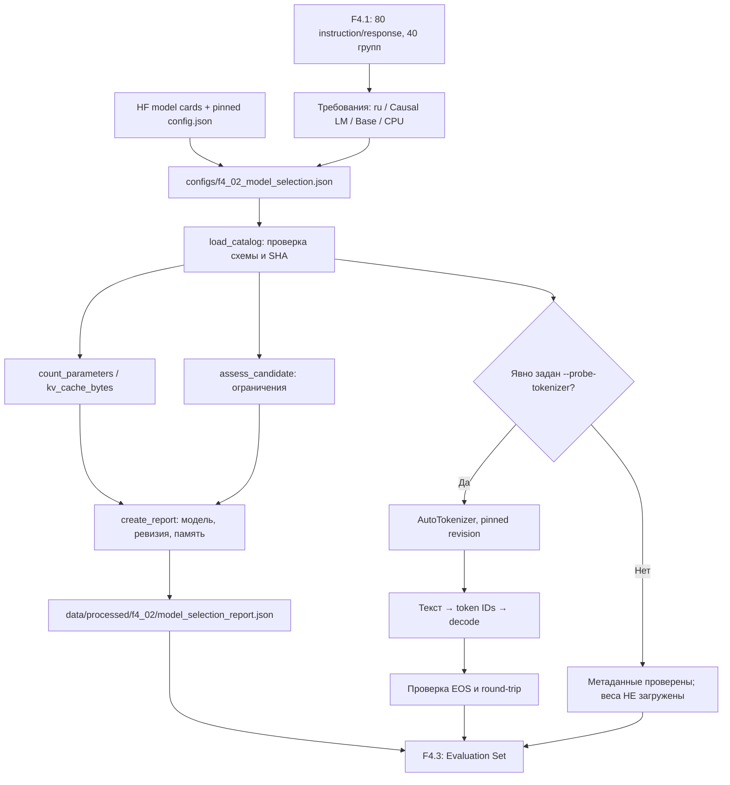

# F4.2 — Model Selection: выбираем воспроизводимую базовую LLM для технических ответов

> **Границы результата.** F4.2 выбирает checkpoint, фиксирует модель и токенизатор по полным SHA коммитов, проверяет допустимость конфигурации и рассчитывает теоретические требования к памяти. Обычный запуск не загружает веса, не генерирует ответов и не обучает модель. Проверка реального токенизатора запускается **только** отдельным флагом. Результаты CPU-тестов в среде подготовки не заменяют проверку в пользовательской Windows-среде.

## 1. Цель этапа

После F4.1 у нас есть **80 собственных русскоязычных технических инструкций** (Python, Linux, SQL, ML), объединённых в 40 тематических групп и разделённых без пересечения `group_id`: `train=56`, `validation=12`, `test=12` строк. Сами по себе строки JSONL не способны ни создавать ответ, ни обновлять веса: нужен предобученный **decoder-only Transformer** с конкретным токенизатором. Фаза F3 уже знакомила нас с self-attention и эмбеддингами для поиска; теперь эти механизмы находятся внутри причинной генеративной модели (**Causal LM**), которая предсказывает следующий токен.

**Задача F4.2 — сделать обоснованный, воспроизводимый выбор базового checkpoint, не выдавая выбор за обучение.** Нужно ответить: какая модель подходит для русскоязычных инструкций; совместима ли архитектура с `AutoModelForCausalLM`; какой конкретно revision обеспечит одинаковые веса и словарь при повторении эксперимента; сколько памяти минимум требуют параметры; можно ли организовать CPU-проверку на Windows/Python 3.13.2.

Почему нельзя просто написать в коде `model="some-model"` и перейти к F4.5? Название без revision может в будущем ссылаться на другие файлы. Модель и токенизатор из разных ревизий могут не совпадать по словарю и special tokens. Выбор слишком большой модели может сделать локальный прогон практически невыполнимым. Наконец, применение уже instruction-tuned варианта может исказить учебное сравнение **Base → SFT**, ведь инструкции на нём уже обучались раньше.

**Результат:** кандидат и альтернатива с источниками фактов, конфигурационный каталог, программная проверка ограничений, расчёты веса/KV cache, воспроизводимый JSON-отчёт, unit-тесты и отдельная диагностика реального токенизатора. **Inference, evaluation и обучение остаются в F4.4–F4.8.**

## 2. Что реализовано

| Файл | Назначение | Что именно реализовано |
|---|---|---|
| `configs/f4_02_model_selection.json` | Зафиксированное решение | Версия схемы, основной и резервный checkpoint, полные `revision` и `tokenizer_revision`, архитектура, лицензия, языки, параметры decoder, `sequence_length=512`, `batch_size=1`, лимит CPU RAM 8 GiB, FP32 и минимальные версии библиотек. |
| `src/llm_f4/model_selection.py` | Алгоритм и валидатор выбора | `ModelCandidate`, `Requirements`, `ModelCatalog`, `load_catalog()`, `count_parameters()`, `kv_cache_bytes()`, `resource_estimate()`, `assess_candidate()`, `runtime_report()`, `create_report()`, `write_report()`, `verify_report()`, `probe_tokenizer()`. |
| `scripts/f4_model_selection.py` | Демонстрация / CLI | Стандартный выбор с выводом причин, `--write-report`, `--verify-report`, явный `--probe-tokenizer`, контролируемый `--allow-download`, ASCII-совместимая справка для Windows. |
| `tests/test_f4_model_selection.py` | Проверки | Точные числовые эталоны параметров и KV cache, сбои при некорректных revision/архитектуре/языках, CPU-бюджет, наличие библиотек, целостность отчёта, заглушка внешнего токенизатора, кодировки Windows. |
| `docs/steps/F4_02_model_selection.md` | Учебное объяснение | Мотивация выбора, реальные параметры моделей, алгоритм расчёта ресурсов, пошаговая реализация, схема, команды PowerShell и честные ограничения. |

Папки, уже появившиеся в F4.1, **не переписываются**. В этой поставке нет ни новых весов, ни исходного корпуса, ни `README.md`, ни необходимости менять завершённые F1–F3.

### Рассмотренные модели

| Критерий | Основная: Qwen2.5-0.5B **Base** | Запасная для лёгких CPU-опытов: SmolLM2-135M **Base** |
|---|---|---|
| Hugging Face ID | `Qwen/Qwen2.5-0.5B` | `HuggingFaceTB/SmolLM2-135M` |
| Архитектура | `Qwen2ForCausalLM`, `qwen2` | `LlamaForCausalLM`, `llama` |
| Параметры | опубликовано ≈0,49B, рассчитано **494 032 768** | опубликовано и рассчитано **134 515 008** |
| Слои / hidden / Q heads / KV heads | 24 / 896 / 14 / 2 | 30 / 576 / 9 / 3 |
| Контекст модели | 32 768 токенов | 8 192 токена |
| Язык | заявлена мультиязычность, включая **русский** | карточка модели обозначает основной язык **английский** |
| Лицензия | Apache-2.0 | Apache-2.0 |
| Теоретический размер весов в FP32 | ≈1884,585 MiB | ≈513,134 MiB |
| Роль | **основной checkpoint** для F4.4–F4.7 | альтернативный эксперимент, не основа сравнения с Qwen |

**Примечание по железу:** `cpu_ram_budget_gib=8` — консервативный *условный бюджет* для выбора модели, а не измерение фактического объёма RAM твоего компьютера. Допуск по нижней границе не гарантирует запуск; проверка ресурсов запланирована в F4.4.

**Вывод:** выбран `Qwen/Qwen2.5-0.5B`, потому что он сочетает небольшой по меркам LLM размер, поддержку русского языка, подходящий decoder-only формат, открытую лицензию и возможность отдельного LoRA-эксперимента. Относительно нового поколения LLM эта модель не самая современная, но в учебной лаборатории важнее контролируемая вычислительная стоимость и сопоставимость base/SFT. SmolLM2 существенно легче, однако английская специализация делает его неподходящим **основным эталоном** для 80 русскоязычных инструкций. Значение `eligible=False` у SmolLM2 относится именно к русскоязычному требованию, а не к невозможности его запуска на CPU.

**Фиксация версий:**

- Qwen model **и tokenizer**: `060db6499f32faf8b98477b0a26969ef7d8b9987`.
- SmolLM2 model **и tokenizer**: `93efa2f097d58c2a74874c7e644dbc9b0cee75a2`.
- Используются только файлы из соответствующих репозиториев, `trust_remote_code=False`.

**Проверенные публичные источники (8 ноября 2026):**

- Карточка Qwen и сведения о лицензии/языках: https://huggingface.co/Qwen/Qwen2.5-0.5B
- Конфигурация Qwen, зафиксированная revision: https://huggingface.co/Qwen/Qwen2.5-0.5B/blob/060db6499f32faf8b98477b0a26969ef7d8b9987/config.json
- Токенизатор Qwen (special tokens): https://huggingface.co/Qwen/Qwen2.5-0.5B/blob/060db6499f32faf8b98477b0a26969ef7d8b9987/tokenizer_config.json
- Карточка SmolLM2: https://huggingface.co/HuggingFaceTB/SmolLM2-135M
- Конфигурация SmolLM2: https://huggingface.co/HuggingFaceTB/SmolLM2-135M/blob/93efa2f097d58c2a74874c7e644dbc9b0cee75a2/config.json
- Совместимость Transformers: https://pypi.org/project/transformers/

Лицензия **модели** Apache-2.0 не отменяет собственную проверку лицензий **исходного кода проекта** и **датасетов**: это три разных объекта.

## 3. Последовательность реализации

### Шаг 1. Отделили выбор модели от обучения

**Что сделали:** сформулировали контракт `base causal_lm + русский + Apache-2.0 + умеренный CPU-профиль`, без подбора качества по нескольким ответам.

**Зачем:** обучение, inference и evaluation — отдельные операции. На этапе выбора нельзя утверждать, что модель уже отвечает корректно, даже если она опубликована для `text-generation`.

**Как реализовали:** в конфигурации `requirements` заданы `task`, `stage`, `required_language`, `allowed_licenses`, `cpu_ram_budget_gib`, `sequence_length`, `batch_size` и минимальные версии. `load_catalog()` строго проверяет схему. **Что получили:** понятные проверяемые входные условия.

### Шаг 2. Сопоставили две модели и причины выбора

**Что сделали:** рассмотрели Qwen2.5-0.5B Base и SmolLM2-135M Base.

**Зачем:** сравнение должно учитывать язык будущих ответов, а не один параметр «чем меньше, тем лучше». Для F4.1 важен русский; SmolLM2 в карточке заявляет английский.

**Как реализовали:** внесли обе модели в `candidates` и проверяемое имя основной модели в `selected_model_id`. В `assess_candidate()` заданы жёсткие фильтры: задача, стадия, лицензия, язык, длина контекста и **нижняя граница** объёма памяти. **Что получили:** Qwen проходит фильтр; SmolLM2 отмечается как исключённый **по языку**.

### Шаг 3. Зафиксировали модель и токенизатор одной ревизией

**Что сделали:** записали полные Git SHA, а не `main` и не короткое непроверенное имя ветки.

**Зачем:** изменение чекпойнта или токенизатора меняет ход эксперимента; метрики Base/SFT должны относиться к одной идентичности модели.

**Как реализовали:** `ModelCandidate.revision`, `tokenizer_revision`, `model_id`, `tokenizer_id` обязаны совпадать попарно (ID/ID, SHA/SHA); валидатор принимает только 40 шестнадцатеричных символов. **Что получили:** стабильный адрес внешних файлов для последующих `from_pretrained(..., revision=...)`.

### Шаг 4. Проверили архитектуру и параметры

**Что сделали:** внесли `vocab_size`, `hidden_size`, `intermediate_size`, число слоёв, Q/KV-heads, максимальный контекст, тип архитектуры, tying embedding, bias и EOS.

**Зачем:** эти параметры определяют совместимость embedding-таблицы и токенизатора, размер весов и KV cache. Неправильное число KV-heads приводит к неверному расчёту памяти.

**Как реализовали:** `_validate_candidate()` проверяет `Qwen2ForCausalLM` ↔ `qwen2` и `LlamaForCausalLM` ↔ `llama`, целочисленность, делимость `hidden_size / num_attention_heads`, согласованность GQA. **Что получили:** отклонение повреждённой спецификации до обращения к Hugging Face.

### Шаг 5. Рассчитали параметры без загрузки весов

**Что сделали:** реализовали `count_parameters()` для двух рассмотренных decoder-only семейств.

**Зачем:** оценить порядок памяти можно прямо из опубликованного `config.json`, без загрузки файла весов размером около 1 ГБ.

**Как реализовали:** сложили размеры embedding, Q/K/V/O, MLP gate/up/down, нормы и QKV bias с учётом tied embedding. Сравнили результат с опубликованным приближённым количеством (допуск 5%, поскольку карточка Qwen округляет до 0,49B). **Что получили:** Qwen = 494 032 768; SmolLM2 = 134 515 008 параметров. Это архитектурный расчёт, а не измерение фактически созданного объекта `torch.nn.Module`.

### Шаг 6. Рассчитали минимальные требования к весам и KV cache

**Что сделали:** создали `resource_estimate()` и `kv_cache_bytes()`.

**Зачем:** модель с полным контекстом 32K может оказаться ресурсоёмкой на CPU, тогда как обучающим примерам F4.1 пока хватает ограниченного учебного профиля. Начинаем с `sequence_length=512`, `batch_size=1`, `float32`, а не загружаем модель на максимально возможном контексте.

**Как реализовали:** весовые байты `P × bytes_per_value`; KV cache учитывает `2 × L × K × head_dim × sequence_length × batch × bytes_per_value`. Измерения RAM, времени и реальной пиковости памяти **не выполнялись**. **Что получили:** минимальные оценки отдельно от неучтённых активаций, весового кеша, временных тензоров, оптимизатора, Python/PyTorch overhead.

### Шаг 7. Проверили совместимость окружения без тяжёлого импорта

**Что сделали:** отделили проверку установленного окружения от импорта `torch` и `transformers`.

**Зачем:** не хочется, чтобы 50 unit-тестов выбора модели скачивали веса или падали потому, что `transformers` ещё не установлен. Но ошибки версий нужно увидеть.

**Как реализовали:** `runtime_report()` читает `importlib.metadata.version()` и `sys.version_info`, сравнивает нормализованные тройки версий. Конфигурация консервативно требует Python ≥3.13, PyTorch ≥2.6 и Transformers ≥4.47. Эти требования — **проектный baseline**, а не гарантия работы любой комбинации. **Что получили:** поле `ready_for_optional_probe` и явный список причин: `torch_missing`, `transformers_missing` и т. п.; обычная проверка метаданных не объявляется FAIL из-за отсутствия необязательных для неё библиотек.

### Шаг 8. Добавили воспроизводимый локальный отчёт

**Что сделали:** сформировали машиночитаемый отчёт с SHA-256 исходного каталога, ревизиями, расчётами и ограничениями.

**Зачем:** перед F4.4 нужно зафиксировать, что именно мы собираемся оценивать. Файл отчёта должен обнаруживать незаметные изменения конфигурации или установленного окружения.

**Как реализовали:** `create_report()` → `report_bytes()` → `write_report()`; `verify_report()` сравнивает точные байты. Отчёт записывается по явному `--write-report` в уже исключённую из Git папку `data/processed/f4_02`. **Что получили:** стабильный артефакт решения, **не чекпойнт и не метрику качества модели**.

### Шаг 9. Добавили необязательный real-tokenizer probe

**Что сделали:** предусмотрели настоящую загрузку только токенизатора Qwen.

**Зачем:** таблица с `vocab_size` и `eos_token_id` не гарантирует, что текущая версия `transformers` способна загрузить реальный tokenizer и закодировать русскую фразу.

**Как реализовали:** `probe_tokenizer()` вызывает `AutoTokenizer.from_pretrained(tokenizer_id, revision=..., local_files_only=True, trust_remote_code=False, use_fast=True)`; затем делает `encode()` и `decode()`, проверяет допустимость token IDs и соответствие EOS. По умолчанию **только локальный кеш**; `--allow-download` разрешает **явно** скачать файлы токенизатора, но код вообще не вызывает `AutoModelForCausalLM.from_pretrained` и не загружает веса. **Что получили:** самостоятельный CPU-способ подтвердить путь от русского текста до token IDs без генерации.

### Шаг 10. Защитили публичный CLI и добавили отрицательные тесты

**Что сделали:** спроектировали `--help` и stdout только с ASCII-строками; написали проверки некорректных revision, отсутствующих полей, несовпадения head dimensions, подменённого отчёта и альтернативного выбора.

**Зачем:** в F4.1 уже была проблема `UnicodeEncodeError` с Windows-1251 при `subprocess` и `--help`; повторять её не нужно. Статический расчёт без теста на неправильный ввод легко выдаст правдоподобное, но неверное число.

**Как реализовали:** `argparse` + `ModelSelectionError` + unit-тесты, включая `cp1251`, `cp866`, `cp1252`; имитация `AutoTokenizer` проверяет передачу полного SHA и запрет сети по умолчанию. **Что получили:** тестируемый компонент, который не скрывает, какие проверки действительно выполнены.

## 4. Алгоритм и математический пример

### 4.1. Какие части Transformer считаются параметрами

Для выбранной модели `Qwen2ForCausalLM` используются:

- `V` — размер словаря модели, 151 936.
- `H` — размер скрытого состояния, 896.
- `I` — размер внутреннего слоя SwiGLU/MLP, 4 864.
- `L` — количество Transformer-блоков, 24.
- `A` — количество Q-heads, 14.
- `K` — количество KV-heads (GQA), 2.
- `d = H / A` — размерность одной головы, `896 / 14 = 64`.
- `Dkv = K × d = 2 × 64 = 128` — суммарная ширина K и V в одном слое.

Упрощённый подсчёт, реализованный **для этих конкретных Qwen2/Llama-профилей**, имеет вид:

\[
P = VH\,t + L\left(2H^2 + 2H D_{kv} + 3HI + 2H + B\right) + H,
\]

где `t=1`, если выходной LM-head использует ту же матрицу, что входной embedding (`tie_word_embeddings=true`), иначе `t=2`; `B=H+2Dkv` при наличии bias у Q/K/V и `0` без bias. Первые две квадратичные части — Q/O и K/V; `3HI` — три матрицы SwiGLU; `2H` — две нормы RMSNorm на блок; последний `+H` — финальная норма.

Для Qwen, где `t=1` и `B=896+2×128=1152`, получаем:

\[
P=151936\times896 + 24\times\left(2\times896^2 + 2\times896\times128 + 3\times896\times4864 + 2\times896 + 1152\right) + 896
= \boxed{494\,032\,768}.
\]

Эта формула **не универсальна для всех LLM**: mixture-of-experts, untied/projection heads, дополнительные слои и иные конфигурации потребуют другого расчёта. В `tests/test_f4_model_selection.py::test_parameter_count_is_exact_for_selected_architecture` число **494 032 768** вычисляется независимым выражением и сравнивается с `count_parameters()`.

### 4.2. От параметров к объёму весов

В FP32 каждый параметр занимает 4 байта (не считая отдельных служебных структур):

\[
M_{weights}=494032768\times4=1\,976\,131\,072\ \text{байта}
\approx1884.585\ \text{MiB}\approx1.840\ \text{GiB}.
\]

Для FP16/BF16 теоретически вдвое меньше; для int8 — около четверти от FP32; для идеального int4 — около одной восьмой. **Четырёхбитные размеры — математические нижние оценки**: реальная QLoRA/quantization содержит scale/zero-point, padding, служебные структуры и ограничения аппаратного backend. Наличие маленькой 4-bit оценки **не означает**, что QLoRA на Windows CPU поддерживается.

### 4.3. KV cache и почему GQA помогает

KV cache сохраняет ключи и значения предыдущих токенов при генерации. Он зависит от числа **KV**, а не Q-heads:

\[
M_{KV}=2\times L\times K\times d\times S\times B\times b,
\]

где `S` — длина последовательности, `B` — batch size, `b` — байт на значение (4 для FP32). Для `S=512`, `B=1`:

\[
M_{KV}=2\times24\times2\times64\times512\times1\times4
=12\,582\,912\ \text{байт}=\boxed{12\ \text{MiB}}.
\]

При `S=256`, `B=2` результат остаётся **12 MiB**: число токенов в совокупности не изменилось. При удвоении `S` и сохранении batch объём удваивается. Тест `test_kv_cache_independent_numerical_reference` проверяет точные значения. Это приближение для полного cache соответствующих архитектур, без учёта fragmentation, transient buffers, определённых реализаций attention и возможных алгоритмических оптимизаций.

`1884.585 MiB + 12 MiB` — только оценка **весов и KV** при FP32. На практике процессу нужно **больше** памяти, и свободные 2 GiB ещё не гарантируют запуск. В F4.4 потребуется реально измерить peak RAM и latency на пользовательской CPU-машине.

### 4.4. Математика не заменяет проверку токенизатора

Из опубликованного Qwen `config.json` мы знаем `vocab_size=151936`, а `eos_token_id=151643`. `tokenizer_config.json` указывает `<|endoftext|>` как EOS и pad token; модель использует специальные маркеры ролей `<|im_start|>` и `<|im_end|>` для chat template. Эти значения **не означают**, что каждая русская буква — один токен. Только реальный `AutoTokenizer.encode()` сообщает фактический набор token IDs.

Дополнительно важна граница: в метаданных токенизатора встречается `model_max_length=131072`, **но** конфигурация самой Qwen2.5-0.5B фиксирует `max_position_embeddings=32768`. Поэтому здесь ограничиваемся более строгим пределом **32 768**, а для учебного CPU-профиля выбираем **512**. Никаких результатов SFT или accuracy на этом этапе нет.

## 5. Схема работы



**Зависимости следующих этапов:** F4.3 создаст независимый evaluation set, F4.4 — реально загрузит базовую Qwen и измерит качество, F4.5 — подготовит SFT+LoRA на тех же base weights, F4.7 — сравнит Base vs Fine-Tuned при одинаковом inference-протоколе. Если перейти на SmolLM2 или изменить revision, это будет **другой эксперимент**, а не честное продолжение тех же метрик.

## 6. Локальная проверка PowerShell

Команды выполняются **из корня репозитория** `F:\DEVELOPMENT\ML\ml-engineering-lab`. Для обязательных действий достаточно Python 3.13.2 и `pytest`; веса LLM не нужны.

### Проверка синтаксиса и тесты F4.2

```powershell
cd F:\DEVELOPMENT\ML\ml-engineering-lab

.\.venv\Scripts\python.exe -m py_compile src/llm_f4/model_selection.py scripts/f4_model_selection.py
.\.venv\Scripts\python.exe -m pytest tests/test_f4_model_selection.py -q
```

**Что проверяется:** правильность 40-символьных revision, языковые ограничения, опубликованные архитектурные размеры, теоретические байты FP32, независимый эталон `12 MiB` KV cache, реакция на изменённый SHA/отчёт, отсутствие скрытой загрузки весов, кодировка вывода CLI. Точный итог `N passed` следует принимать **из твоего прогона**, а не подменять числом из чужой среды.

### Стандартный локальный запуск (метаданные, без сети и без весов)

```powershell
.\.venv\Scripts\python.exe scripts/f4_model_selection.py
```

Проверь в консоли:

- `F4.2 MODEL SELECTION: PASS (metadata only)`;
- `Selected: Qwen/Qwen2.5-0.5B` и полный pinned SHA;
- `Candidate: Qwen/Qwen2.5-0.5B | eligible=True`;
- `Candidate: HuggingFaceTB/SmolLM2-135M | eligible=False | reasons=russian_not_declared`;
- около `494032768` параметров и `12.0` MiB KV для основной модели;
- `Inference / model training: NOT RUN`.

`Runtime ready for optional tokenizer probe: False` означает, что одна из **необязательных** библиотек отсутствует или слишком стара; **это не опровергает метаданные**, но запрещает считать real-tokenizer probe подтверждённым.

### Зафиксировать и проверить воспроизводимый отчёт

```powershell
.\.venv\Scripts\python.exe scripts/f4_model_selection.py --write-report
.\.venv\Scripts\python.exe scripts/f4_model_selection.py --verify-report
Get-Content data\processed\f4_02\model_selection_report.json -Encoding UTF8
```

**Что происходит:** первая команда создаёт UTF-8 JSON с одинаково отсортированными ключами и SHA исходной конфигурации; вторая сверяет байты. Файл находится в `data/processed/` и **не предназначен для Git-коммита**. После намеренного изменения конфига или версий установленных библиотек ожидается FAIL в `--verify-report`: отчёт нужно обновить осознанно.

### Необязательный CPU tokenizer probe

Если в твоём `.venv` уже есть совместимые `torch`, `transformers` и `tokenizers`, можно проверить **только tokenizer**:

```powershell
# Сначала проверка только локального HF cache, без скачивания:
.\.venv\Scripts\python.exe scripts/f4_model_selection.py --probe-tokenizer

# Если cache пустой и ты СОЗНАТЕЛЬНО разрешаешь скачать файлы tokenizer:
.\.venv\Scripts\python.exe scripts/f4_model_selection.py --probe-tokenizer --allow-download
```

**Что вычисляется:** русская фраза `Что такое градиентный спуск в машинном обучении?` проходит `encode(add_special_tokens=False)` → список `token IDs` → `decode(skip_special_tokens=True)`. Программа сверяет восстановленный текст, допустимость ID относительно embedding vocabulary и EOS. Число токенов в этом опыте заранее **не выдумываем**: оно зависит от фактически загруженного tokenizer. Ветвь `--allow-download` не разрешает загрузку весов модели; функция загрузки весов вообще отсутствует. Если тебе нужны конкретные версии библиотек или решение о смене API, это отдельный шаг после просмотра `Runtime issues`.

### Регрессия F4.1 и всего репозитория

```powershell
.\.venv\Scripts\python.exe -m pytest tests/test_f4_instruction_dataset.py -q
.\.venv\Scripts\python.exe -m pytest -q
```

**Ожидание:** F4.1 сохраняет ранее подтверждённый PASS (43 теста), а полный набор не должен сломаться. Число общего `passed` увеличится на количество новых тестов F4.2. Если тесты не прошли, не выполняй Git commit/push до расследования.

## 7. Что доказано тестами и какие ограничения остаются

**Подтверждено unit-тестами в среде подготовки:**

- каталог валидируется и защищён от случайных/злонамеренных несогласованных метаданных;
- основной выбор проходит заданные фильтры; резервный отклоняется **по языковому критерию**, а не по объёму памяти;
- расчёт параметров совпадает с независимым формульным эталоном;
- KV cache вычисляется согласованно для разных batch/sequence length;
- `--help` и стандартный вывод рассчитаны на однобайтовые Windows-кодировки;
- отчёт обнаруживает любое изменение своих байтов или каталога;
- стандартный запуск не импортирует большой checkpoint и не скачивает его;
- функция real-tokenizer probe передаёт pinned revision и `local_files_only=True` по умолчанию (проверено заглушкой).

**НЕ подтверждено данным этапом:**

- реальная загрузка Qwen/Torch на пользовательском CPU, время inference и пиковая RAM;
- корректная работа реального Qwen tokenizer с установленным локально `transformers` до выполнения необязательного probe;
- качество русскоязычных технических ответов, instruction-following и пригодность к реальной задаче;
- повышение качества от SFT/LoRA, работоспособность CUDA/QLoRA/PEFT/DPO;
- оценка долговременной стабильности зависимостей или легального использования иных датасетов.

**Важное ограничение:** даже `eligible=True` означает лишь, что **объявленные метаданные удовлетворяют выбранным требованиям**. Это не подтверждает, что компьютеру хватит памяти, что ответы будут правильными или что fine-tuning улучшит модель. Исходный F4.1 корпус из 80 примеров слишком мал, чтобы автоматически ожидать сильного обобщения.

## 8. Основная мысль этапа — как рассказать о сделанном

На F4.1 я подготовил собственный учебный датасет инструкций, но до обучения нейросети нужно было выбрать конкретную базовую языковую модель. Я не стал брать миллиардную LLM просто потому, что она мощнее: у меня основная машина без GPU, а задача проекта — освоить механику fine-tuning и иметь возможность воспроизвести эксперимент. Поэтому сначала сформулировал критерии: модель должна генерировать текст, быть предобученной, но ещё не специально дообученной на инструкциях, поддерживать русский язык и иметь понятную лицензию.

Я сравнил два небольших checkpoint: Qwen2.5-0.5B Base и SmolLM2-135M Base. В итоге выбрал Qwen: она крупнее, но поддерживает русский язык и остаётся относительно небольшой по меркам генеративных моделей. Указал не только название, но и конкретную 40-символьную ревизию как для модели, так и для токенизатора. Это важно, чтобы через несколько месяцев сравнивать результаты именно одного checkpoint, а не незаметно обновлённой версии.

Дальше я реализовал проверку архитектурных параметров и собственный расчёт количества весов. Для Qwen получилось 494 032 768 параметров, то есть около 1,84 GiB только под FP32-веса. Отдельно оценил KV cache для учебного контекста 512 токенов, batch 1: 12 MiB. Я понимаю, что это только нижняя оценка и реальный процесс PyTorch может использовать значительно больше памяти. Затем сделал CLI, который показывает выбранную модель и причины исключения альтернативы, умеет записать воспроизводимый отчёт и проверять его от изменений.

Особое внимание уделил границе между анализом и реальным экспериментом. Без отдельного флага мой код не скачивает ничего из Hugging Face и не пытается генерировать текст. Есть дополнительный probe, который может реально проверить токенизатор и его обратимость для русской фразы, но даже он не загружает веса модели. Теперь у меня есть зафиксированная исходная точка для независимого evaluation set (F4.3) и будущего базового inference (F4.4); я не заявляю об улучшении модели до выполнения SFT, измерения качества и сравнения на одинаковых задачах.

## 9. Файлы, с которыми стоит познакомиться

**Рекомендуемый порядок чтения:**

| Порядок | Файл | Что именно изучить |
|---|---|---|
| 1 | `configs/f4_02_model_selection.json` | Параметры реальных моделей, pinned ревизии, критерии выбора, отличие русского requirements от альтернативы SmolLM2. |
| 2 | `src/llm_f4/model_selection.py` | `ModelCandidate`, `load_catalog()`, архитектурные проверки, `count_parameters()`, `kv_cache_bytes()`, `assess_candidate()`, `create_report()` и границы `probe_tokenizer()`. |
| 3 | `tests/test_f4_model_selection.py` | Вывод числа 494032768, независимый расчёт 12MiB, изменение revision, несовпадение EOS, Windows subprocess и отказ незадекларированного скачивания. |
| 4 | `scripts/f4_model_selection.py` | Как последовательно создаётся отчёт, выводятся причины выбора и отдельно запускается tokenizer probe. |
| 5 | `docs/steps/F4_02_model_selection.md` | Числовые примеры, связь с F4.1, границы доказательств и повторение работы от первого лица. |

**Из предыдущих этапов:** открой `src/llm_f4/instruction_dataset.py` и `configs/f4_01_instruction_dataset.json`, чтобы вспомнить исходные поля `instruction/input/response`, группы утечки и 70/15/15. Для понимания attention полезен учебный материал F3.1; для независимой оценки — F3.6 (frozen benchmark), но помни, что retrieval metrics и качество генерации LLM — разные задачи. При подготовке F4.5 потребуется вернуться к F2.1 (градиенты), F2.4 (training loop) и F2.5 (validation); **эти файлы сейчас не меняются**.
