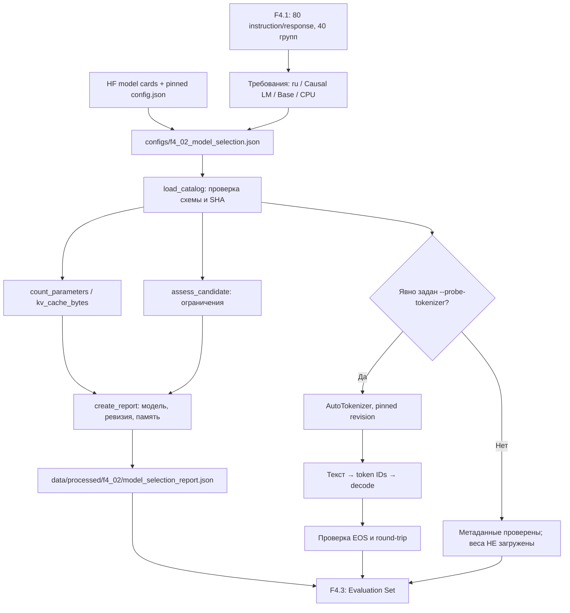

# F4.2 — Model Selection: воспроизводимый выбор базовой LLM для технических ответов

> **Статус этапа: F4.2 — PASS.** Подтверждены выбор и фиксация checkpoint, числовые расчёты ресурсов, локальные проверки и реальная загрузка только токенизатора. В Windows-проверке токенизатора получено `token_count=17`, `roundtrip=True`; полная регрессия на момент приёмки F4.2 — `1447 passed`. Этап **не включает** загрузку весов LLM, генерацию ответов, оценку качества или обучение. Результаты последующих этапов F4.3–F4.9 не следует приписывать F4.2.

## 1. Цель этапа

После F4.1 подготовлен авторский русскоязычный instruction dataset: **80 технических записей** по Python, Linux, SQL и ML, объединённых в 40 тематических групп. По `group_id` получены непересекающиеся выборки `train=56`, `validation=12`, `test=12`. JSONL содержит инструкции, входной контекст и эталонные ответы, но не выполняет генерацию и не обновляет параметры нейросети. Для следующего шага требуется предобученная генеративная модель и согласованный с ней токенизатор.

**Model Selection** — выбор конкретного checkpoint по заданным требованиям с фиксацией архитектуры, версии, токенизатора, лицензии и ресурсного профиля. В Фазе 3 рассмотрены self-attention и эмбеддинги, применяемые при поиске информации. В Фазе 4 необходим decoder-only Transformer для **Causal Language Modeling**: последовательного предсказания следующего токена, а затем адаптации модели через SFT и LoRA.

**Цель F4.2:** выбрать воспроизводимую базовую модель для русскоязычных технических инструкций и проверить пригодность по формальным ограничениям. Для этого необходимо:

1. Зафиксировать требования к языку, задаче, типу checkpoint и лицензии.
2. Сопоставить допустимых кандидатов, не подбирая модель по результатам будущего тестового набора.
3. Закрепить полные ревизии модели и токенизатора.
4. Рассчитать число параметров, объём FP32-весов и KV cache без загрузки checkpoint.
5. Проверить установленное программное окружение и, отдельной командой, работоспособность реального токенизатора.
6. Сформировать проверяемый отчёт с конфигурацией и контрольными суммами.

Один только `model_id` недостаточен для воспроизводимости: без pinned revision внешние файлы могут измениться. Несовпадение ревизий модели и токенизатора способно нарушить согласованность словаря и специальных токенов. Выбор чрезмерно крупной модели может сделать CPU-эксперимент непрактичным. Использование уже instruction-tuned checkpoint вместо **Base** исказит последующее сравнение исходной модели с результатом SFT.

**Результат этапа:** выбран основной checkpoint Qwen2.5-0.5B Base, сохранён альтернативный кандидат, реализованы строгая проверка конфигурации, ресурсные формулы, CLI, unit-тесты, SHA-256-отчёт и отдельный tokenizer probe. Генерацию и оценку ответов выполнять в F4.4, дообучение — в F4.5 и последующих этапах.

## 2. Что реализовано

| Файл | Назначение | Что именно реализовано |
|---|---|---|
| `configs/f4_02_model_selection.json` | Зафиксированное решение | Версия схемы, основной и резервный checkpoint, полные `revision` и `tokenizer_revision`, архитектура, лицензия, языки, параметры decoder, `sequence_length=512`, `batch_size=1`, лимит CPU RAM 8 GiB, FP32 и минимальные версии библиотек. |
| `src/llm_f4/model_selection.py` | Алгоритм и валидатор выбора | `ModelCandidate`, `Requirements`, `ModelCatalog`, `load_catalog()`, `count_parameters()`, `kv_cache_bytes()`, `resource_estimate()`, `assess_candidate()`, `runtime_report()`, `create_report()`, `write_report()`, `verify_report()`, `probe_tokenizer()`. |
| `scripts/f4_model_selection.py` | Демонстрация / CLI | Стандартный выбор с выводом причин, `--write-report`, `--verify-report`, явный `--probe-tokenizer`, контролируемый `--allow-download`, ASCII-совместимая справка для Windows. |
| `tests/test_f4_model_selection.py` | Проверки | Точные числовые эталоны параметров и KV cache, сбои при некорректных revision/архитектуре/языках, CPU-бюджет, наличие библиотек, целостность отчёта, заглушка внешнего токенизатора, кодировки Windows. |
| `docs/steps/F4_02_model_selection.md` | Учебное объяснение | Мотивация выбора, реальные параметры моделей, алгоритм расчёта ресурсов, пошаговая реализация, схема, команды PowerShell и честные ограничения. |

Файлы F4.1 и завершённых Фаз 1–3 остаются без изменений. В поставку F4.2 не включаются веса, новый корпус данных или `README.md`. Результат стандартного CLI является анализом метаданных, а не запуском LLM.

### Рассмотренные модели

| Критерий | Основная: Qwen2.5-0.5B **Base** | Запасная для лёгких CPU-опытов: SmolLM2-135M **Base** |
|---|---|---|
| Hugging Face ID | `Qwen/Qwen2.5-0.5B` | `HuggingFaceTB/SmolLM2-135M` |
| Архитектура | `Qwen2ForCausalLM`, `qwen2` | `LlamaForCausalLM`, `llama` |
| Параметры | опубликовано ≈0,49B, рассчитано **494 032 768** | опубликовано и рассчитано **134 515 008** |
| Слои / hidden / Q heads / KV heads | 24 / 896 / 14 / 2 | 30 / 576 / 9 / 3 |
| Контекст модели | 32 768 токенов | 8 192 токена |
| Язык | заявлена мультиязычность, включая **русский** | карточка модели обозначает основной язык **английский** |
| Лицензия | Apache-2.0 | Apache-2.0 |
| Теоретический размер весов в FP32 | ≈1884,585 MiB | ≈513,134 MiB |
| Роль | **основной checkpoint** для F4.4–F4.7 | альтернативный эксперимент, не основа сравнения с Qwen |

**Ограничение оценки ресурсов:** `cpu_ram_budget_gib=8` — условный проектный бюджет, а не измерение физической RAM. Выполнение критерия по нижней границе не гарантирует успешную загрузку checkpoint; фактический запуск и время inference проверяются отдельно в F4.4.

**Вывод по критериям:** `Qwen/Qwen2.5-0.5B` выбран за сочетание поддержки русского языка, decoder-only архитектуры, лицензии Apache-2.0 и умеренного ресурсоёмкого профиля для учебного запуска. Главные критерии — контролируемая вычислительная стоимость и сопоставимость Base/SFT, а не достижение максимального качества среди современных LLM. SmolLM2-135M требует меньше памяти, но в его карточке заявлена английская языковая специализация. Причина `eligible=False` для SmolLM2 — несоответствие **требованию по русскому языку**, а не техническая невозможность CPU-запуска.

**Фиксация версий:**

- Qwen model **и tokenizer**: `060db6499f32faf8b98477b0a26969ef7d8b9987`.
- SmolLM2 model **и tokenizer**: `93efa2f097d58c2a74874c7e644dbc9b0cee75a2`.
- Используются только файлы из соответствующих репозиториев, `trust_remote_code=False`.

**Проверенные публичные источники (8 ноября 2026):**

- Карточка Qwen и сведения о лицензии/языках: https://huggingface.co/Qwen/Qwen2.5-0.5B
- Конфигурация Qwen, зафиксированная revision: https://huggingface.co/Qwen/Qwen2.5-0.5B/blob/060db6499f32faf8b98477b0a26969ef7d8b9987/config.json
- Токенизатор Qwen (special tokens): https://huggingface.co/Qwen/Qwen2.5-0.5B/blob/060db6499f32faf8b98477b0a26969ef7d8b9987/tokenizer_config.json
- Карточка SmolLM2: https://huggingface.co/HuggingFaceTB/SmolLM2-135M
- Конфигурация SmolLM2: https://huggingface.co/HuggingFaceTB/SmolLM2-135M/blob/93efa2f097d58c2a74874c7e644dbc9b0cee75a2/config.json
- Совместимость Transformers: https://pypi.org/project/transformers/

Лицензия **модели** Apache-2.0 не отменяет собственную проверку лицензий **исходного кода проекта** и **датасетов**: это три разных объекта.

## 3. Последовательность реализации

### Шаг 1. Определить требования к базовой LLM

**Действие.** Установить контракт выбора: `base` checkpoint для `causal_lm`, поддержка русского языка, лицензия из разрешённого списка, совместимость с CPU-профилем и зафиксированная версия.

**Назначение.** Отделить проверку пригодности модели от задач генерации, оценки ответов и изменения параметров. Выбор checkpoint по двум удачным ответам может привести к скрытой подгонке под будущий evaluation set.

**Реализация.** В объекте `requirements` конфигурации указать `task`, `stage`, `required_language`, `allowed_licenses`, `cpu_ram_budget_gib`, `sequence_length`, `batch_size` и минимальные версии библиотек. Для загрузки применить `load_catalog()` с проверкой схемы.

**Результат.** Формализованные условия выбора, которые можно проверять автоматически, не загружая веса модели.

### Шаг 2. Сопоставить двух кандидатов по формальным критериям

**Действие.** Рассмотреть Qwen2.5-0.5B Base и SmolLM2-135M Base; сопоставить их архитектуру, язык, лицензию и ресурсную стоимость.

**Назначение.** Не сводить выбор к числу параметров: более лёгкая модель не обязательно соответствует языку и целевому сценарию.

**Реализация.** Разместить описание каждой модели в `candidates`, основной идентификатор — в `selected_model_id`. В `assess_candidate()` проверить задачу, тип модели, лицензию, язык, контекст и расчётную нижнюю границу RAM.

**Результат.** Qwen получает `eligible=True`; SmolLM2 исключается по условию `russian_not_declared`. Данный результат относится к **заданным требованиям**, а не к сравнительному качеству генерации.

### Шаг 3. Зафиксировать идентичность модели и токенизатора

**Действие.** Закрепить полный 40-символьный Git SHA для checkpoint и токенизатора вместо плавающего имени ветки `main`.

**Назначение.** Обеспечить повторяемость последующих Base/SFT-экспериментов на одних весах и одном словаре.

**Реализация.** Для каждого `ModelCandidate` задать `model_id`, `tokenizer_id`, `revision` и `tokenizer_revision`. Валидировать 40 шестнадцатеричных символов, согласованность идентификаторов и ревизий. Для Qwen использовать `060db6499f32faf8b98477b0a26969ef7d8b9987`.

**Результат.** Однозначная ссылка на внешние артефакты для последующих `from_pretrained(..., revision=...)`.

### Шаг 4. Проверить структуру decoder-only модели

**Действие.** Зафиксировать `vocab_size`, `hidden_size`, `intermediate_size`, число слоёв, Q-heads, KV-heads, контекст, архитектуру, tying embeddings, QKV bias и EOS.

**Назначение.** Предотвратить неверный расчёт размера параметров и KV cache, а также исключить несогласованные метаданные до обращения к Hugging Face.

**Реализация.** В `_validate_candidate()` сопоставить архитектуры `Qwen2ForCausalLM` ↔ `qwen2` и `LlamaForCausalLM` ↔ `llama`; проверить целочисленные ограничения, делимость `hidden_size` на число Q-heads и допустимость GQA.

**Результат.** Ошибочные спецификации отклоняются на уровне конфигурации до загрузки checkpoint.

### Шаг 5. Вычислить количество параметров по архитектуре

**Действие.** Рассчитать число параметров для поддерживаемых вариантов Qwen2 и Llama без создания тензоров весов.

**Назначение.** Получить числовую основу оценки памяти до скачивания крупных файлов.

**Реализация.** В `count_parameters()` суммировать параметры token embeddings, attention-проекций Q/K/V/O, MLP gate/up/down, RMSNorm и QKV bias. Учитывать общую матрицу входных и выходных embeddings при `tie_word_embeddings=True`. Сопоставлять результат с объявленным округлённым количеством с установленным допуском.

**Результат.** Для Qwen вычисляется **494 032 768** параметров; для SmolLM2 — **134 515 008**. Значения получены из архитектурных размеров, а не из загруженной PyTorch-модели.

### Шаг 6. Оценить память для весов и KV cache

**Действие.** Вычислить минимальный объём параметров FP32 и памяти KV cache при заданных `sequence_length` и `batch_size`.

**Назначение.** Сравнить модели по ресурсной стоимости и заранее ограничить учебный CPU-профиль.

**Реализация.** В `resource_estimate()` применять формулу `parameters × bytes_per_value`. В `kv_cache_bytes()` учитывать число слоёв, KV-heads, размерность головы, длину последовательности, batch и две матрицы K/V. Для выбранного профиля установить `sequence_length=512`, `batch_size=1`, `float32`.

**Результат.** Для Qwen FP32-веса занимают расчётно **1884,585 MiB**, а KV cache — **12 MiB**. Активации, временные тензоры, память оптимизатора и накладные расходы Python/PyTorch в эти числа не входят.

### Шаг 7. Проверить программное окружение без обязательной загрузки ML-библиотек

**Действие.** Разделить анализ установленных версий и настоящий импорт `torch`/`transformers`.

**Назначение.** Обеспечить быстрые unit-тесты F4.2 без загрузки весов, сети и необязательных зависимостей; отдельно выявлять несовместимые версии.

**Реализация.** В `runtime_report()` использовать `importlib.metadata.version()` и `sys.version_info`. Сопоставлять версии с проектными минимумами Python ≥3.13, PyTorch ≥2.6 и Transformers ≥4.47. Не трактовать указанные минимумы как гарантию совместимости любой комбинации пакетов.

**Результат.** `ready_for_optional_probe` и явные причины (`torch_missing`, `transformers_missing` и другие); проверка метаданных сохраняет работоспособность независимо от возможности реального tokenizer probe.

### Шаг 8. Сформировать воспроизводимый отчёт о выборе

**Действие.** Сохранить итоговое решение, расчёты ресурсов, ревизии, ограничения и SHA-256 исходного каталога.

**Назначение.** Обнаруживать изменения исходной конфигурации и программного окружения перед сравнительными экспериментами.

**Реализация.** Выполнить `create_report()` → `report_bytes()` → `write_report()`. В `verify_report()` повторно сформировать ожидаемые байты и сравнить с сохранёнными. Экспорт выполнять только по явному флагу `--write-report` в `data/processed/f4_02/`.

**Результат.** Машиночитаемый `model_selection_report.json`. Он фиксирует **выбор модели**, но не является сохранённым checkpoint и не содержит метрик качества генерации.

### Шаг 9. Проверить реальный токенизатор отдельным режимом

**Действие.** Предусмотреть загрузку только токенизатора Qwen с последующей проверкой кодирования и обратного декодирования русской строки.

**Назначение.** Подтвердить работоспособность `AutoTokenizer` в текущем окружении: формальных полей `vocab_size` и EOS недостаточно для проверки реальной обработки текста.

**Реализация.** В `probe_tokenizer()` вызвать `AutoTokenizer.from_pretrained()` с pinned `revision`, `trust_remote_code=False`, `use_fast=True` и `local_files_only=True` по умолчанию. Выполнить `encode()` → `token IDs` → `decode()`, проверить допустимость идентификаторов, EOS и round-trip. Разрешать загрузку файлов токенизатора из сети только по `--allow-download`.

**Результат.** В подтверждённом Windows-прогоне получено `token_count=17`, `roundtrip=True`. Веса модели не загружались; inference и обучение не выполнялись.

### Шаг 10. Проверить CLI и негативные сценарии

**Действие.** Проверить справку `--help`, вывод CLI, обработку ошибок и некорректные конфигурации.

**Назначение.** Предотвратить повторение проблемы `UnicodeEncodeError` в Windows при перенаправлении вывода, а также обнаруживать неверные числа, полученные из повреждённой архитектуры.

**Реализация.** Использовать `argparse`, `ModelSelectionError` и автоматические проверки, включая симуляцию однобайтовых кодировок `cp1251`, `cp866`, `cp1252`. Отдельно проверить неправильные revision, несогласованность head dimensions, подменённый отчёт и передачу `local_files_only=True` через заглушку tokenizer.

**Результат.** Проверяемый компонент с корректными ошибками и разграничением метаданных, токенизатора, inference и обучения.

## 4. Алгоритм и математический пример

### 4.1. Какие части Transformer считаются параметрами

Для выбранной модели `Qwen2ForCausalLM` используются:

- `V` — размер словаря модели, 151 936.
- `H` — размер скрытого состояния, 896.
- `I` — размер внутреннего слоя SwiGLU/MLP, 4 864.
- `L` — количество Transformer-блоков, 24.
- `A` — количество Q-heads, 14.
- `K` — количество KV-heads (GQA), 2.
- `d = H / A` — размерность одной головы, `896 / 14 = 64`.
- `Dkv = K × d = 2 × 64 = 128` — суммарная ширина K и V в одном слое.

Упрощённый подсчёт, реализованный **для этих конкретных Qwen2/Llama-профилей**, имеет вид:

\[
P = VH\,t + L\left(2H^2 + 2H D_{kv} + 3HI + 2H + B\right) + H,
\]

где `t=1`, если выходной LM-head использует ту же матрицу, что входной embedding (`tie_word_embeddings=true`), иначе `t=2`; `B=H+2Dkv` при наличии bias у Q/K/V и `0` без bias. Первые две квадратичные части — Q/O и K/V; `3HI` — три матрицы SwiGLU; `2H` — две нормы RMSNorm на блок; последний `+H` — финальная норма.

Для Qwen, где `t=1` и `B=896+2×128=1152`, получаем:

\[
P=151936\times896 + 24\times\left(2\times896^2 + 2\times896\times128 + 3\times896\times4864 + 2\times896 + 1152\right) + 896
= \boxed{494\,032\,768}.
\]

Эта формула **не универсальна для всех LLM**: mixture-of-experts, untied/projection heads, дополнительные слои и иные конфигурации потребуют другого расчёта. В `tests/test_f4_model_selection.py::test_parameter_count_is_exact_for_selected_architecture` число **494 032 768** вычисляется независимым выражением и сравнивается с `count_parameters()`.

### 4.2. От параметров к объёму весов

В FP32 каждый параметр занимает 4 байта (не считая отдельных служебных структур):

\[
M_{weights}=494032768\times4=1\,976\,131\,072\ \text{байта}
\approx1884.585\ \text{MiB}\approx1.840\ \text{GiB}.
\]

Для FP16/BF16 теоретически вдвое меньше; для int8 — около четверти от FP32; для идеального int4 — около одной восьмой. **Четырёхбитные размеры — математические нижние оценки**: реальная QLoRA/quantization содержит scale/zero-point, padding, служебные структуры и ограничения аппаратного backend. Наличие маленькой 4-bit оценки **не означает**, что QLoRA на Windows CPU поддерживается.

### 4.3. KV cache и почему GQA помогает

KV cache сохраняет ключи и значения предыдущих токенов при генерации. Он зависит от числа **KV**, а не Q-heads:

\[
M_{KV}=2\times L\times K\times d\times S\times B\times b,
\]

где `S` — длина последовательности, `B` — batch size, `b` — байт на значение (4 для FP32). Для `S=512`, `B=1`:

\[
M_{KV}=2\times24\times2\times64\times512\times1\times4
=12\,582\,912\ \text{байт}=\boxed{12\ \text{MiB}}.
\]

При `S=256`, `B=2` результат остаётся **12 MiB**: число токенов в совокупности не изменилось. При удвоении `S` и сохранении batch объём удваивается. Тест `test_kv_cache_independent_numerical_reference` проверяет точные значения. Это приближение для полного cache соответствующих архитектур, без учёта fragmentation, transient buffers, определённых реализаций attention и возможных алгоритмических оптимизаций.

`1884.585 MiB + 12 MiB` — только оценка **весов и KV** при FP32. На практике процессу нужно **больше** памяти, и свободные 2 GiB ещё не гарантируют запуск. В F4.4 потребуется реально измерить peak RAM и latency на пользовательской CPU-машине.

### 4.4. Математика не заменяет проверку токенизатора

В опубликованном `config.json` Qwen указаны `vocab_size=151936` и `eos_token_id=151643`. `tokenizer_config.json` указывает `<|endoftext|>` как EOS и pad token; модель использует специальные маркеры ролей `<|im_start|>` и `<|im_end|>` для chat template. Эти значения **не означают**, что каждая русская буква — один токен. Только реальный `AutoTokenizer.encode()` сообщает фактический набор token IDs.

Дополнительно важна граница: в метаданных токенизатора встречается `model_max_length=131072`, **но** конфигурация самой Qwen2.5-0.5B фиксирует `max_position_embeddings=32768`. Поэтому здесь ограничиваемся более строгим пределом **32 768**, а для учебного CPU-профиля выбираем **512**. Никаких результатов SFT или accuracy на этом этапе нет.

## 5. Схема работы



**Зависимости следующих этапов:** F4.3 создаст независимый evaluation set, F4.4 — реально загрузит базовую Qwen и измерит качество, F4.5 — подготовит SFT+LoRA на тех же base weights, F4.7 — сравнит Base vs Fine-Tuned при одинаковом inference-протоколе. Если перейти на SmolLM2 или изменить revision, это будет **другой эксперимент**, а не честное продолжение тех же метрик.

## 6. Локальная проверка PowerShell

Команды выполнять из корня репозитория `F:\DEVELOPMENT\ML\ml-engineering-lab`. Для обязательных проверок метаданных достаточно локального Python и `pytest`; веса LLM не требуются.

### 6.1. Проверить синтаксис и unit-тесты

```powershell
cd F:\DEVELOPMENT\ML\ml-engineering-lab

.\.venv\Scripts\python.exe -m py_compile src/llm_f4/model_selection.py scripts/f4_model_selection.py
.\.venv\Scripts\python.exe -m pytest tests/test_f4_model_selection.py -q
```

**Что проверяется.** Схема каталога, 40-символьные revision, языковые и лицензионные ограничения, счётчик параметров, теоретические байты FP32, независимый эталон KV cache **12 MiB**, отрицательные сценарии изменения SHA, целостность отчёта, локальность tokenizer probe и Windows-кодировки.

**Интерпретация.** При приёмке F4.2 подтверждено **57 passed**. Успешные unit-тесты доказывают корректность реализованных проверок и расчётов на тестовых входах, но не качество ответов модели.

### 6.2. Выполнить стандартный анализ метаданных

```powershell
.\.venv\Scripts\python.exe scripts/f4_model_selection.py
```

Проверить ключевые строки:

```text
F4.2 MODEL SELECTION: PASS (metadata only)
Selected: Qwen/Qwen2.5-0.5B
Revision: 060db6499f32faf8b98477b0a26969ef7d8b9987
Candidate: Qwen/Qwen2.5-0.5B | eligible=True | reasons=-
Candidate: HuggingFaceTB/SmolLM2-135M | eligible=False | reasons=russian_not_declared
```

Дополнительно проверить `parameters_estimated=494032768`, `KV_MiB=12.0` для Qwen и `Inference / model training: NOT RUN`. Строка `Runtime ready for optional tokenizer probe: False` указывает на неподготовленность необязательных ML-зависимостей; она не отменяет результаты проверки метаданных.

### 6.3. Записать и проверить отчёт

```powershell
.\.venv\Scripts\python.exe scripts/f4_model_selection.py --write-report
.\.venv\Scripts\python.exe scripts/f4_model_selection.py --verify-report
Get-Content data\processed\f4_02\model_selection_report.json -Encoding UTF8
```

**Что происходит.** Создать UTF-8 JSON с отсортированными ключами, расчётами, закреплёнными SHA и состоянием runtime. Затем повторно вычислить ожидаемые байты и сравнить с сохранёнными. При несогласованном изменении конфигурации или версий библиотек верификация должна сообщить о расхождении.

**Ограничение.** `data/processed/f4_02/` содержит производные файлы, не предназначенные для включения в Git-коммит.

### 6.4. Проверить реальный токенизатор на CPU

Первым действием проверить наличие токенизатора в локальном Hugging Face cache:

```powershell
.\.venv\Scripts\python.exe scripts/f4_model_selection.py --probe-tokenizer
```

Если файлы отсутствуют и допускается обращение к Hugging Face Hub, отдельно разрешить скачивание:

```powershell
.\.venv\Scripts\python.exe scripts/f4_model_selection.py --probe-tokenizer --allow-download
```

**Что вычисляется.** Строка `Что такое градиентный спуск в машинном обучении?` проходит `encode(add_special_tokens=False)` → `token IDs` → `decode(skip_special_tokens=True)`. Проверить `token_count`, допустимость IDs и `roundtrip=True`.

**Фактический результат Windows:**

```text
Tokenizer probe: PASS | token_count=17 | roundtrip=True
Weights: NOT LOADED
Inference / model training: NOT RUN
```

Предупреждения Hugging Face о запросах без токена и Windows symlinks не являются ошибками токенизации. Флаг `--allow-download` разрешает только загрузку файлов токенизатора: данный сценарий не вызывает `AutoModelForCausalLM.from_pretrained()` и не загружает веса.

### 6.5. Проверить регрессию предыдущего этапа и всего проекта

```powershell
.\.venv\Scripts\python.exe -m pytest tests/test_f4_instruction_dataset.py -q
.\.venv\Scripts\python.exe -m pytest -q
```

Для F4.1 при приёмке подтверждено **43 passed**. Для всего репозитория на момент завершения F4.2 подтверждено **1447 passed**. В последующих фазах число тестов изменяется; конкретное количество не является частью алгоритма Model Selection.

### 6.6. Интерпретировать PASS и ограничения

PASS означает соответствие выбранных метаданных заданному контракту, корректность числовых расчётов и выполненную проверку токенизатора в указанном окружении. PASS **не** доказывает фактический расход RAM для модели, скорость inference, качество русскоязычных ответов или эффективность fine-tuning.

## 7. Что доказано тестами и какие ограничения остаются

### Подтверждено

- **Валидация метаданных.** Каталог проверяется по схеме; отклоняются неверная архитектура, некорректные размеры и несовпадающие ревизии.
- **Обоснованность выбора по установленным требованиям.** Qwen проходит фильтры языка, лицензии и архитектуры. SmolLM2 не проходит требование подтверждённой поддержки русского языка; это не сравнение качества двух моделей.
- **Числовые расчёты.** Для Qwen независимо проверены **494 032 768** параметров и **12 MiB** KV cache при `S=512`, `B=1`, FP32. Размер весов рассчитан как **1884,585 MiB**.
- **Ограничение внешних действий.** Стандартный запуск не скачивает checkpoint и не выполняет inference. Загрузка файлов токенизатора разрешается только отдельными флагами.
- **Воспроизводимость конфигурации.** Для модели и токенизатора зафиксирована одинаковая полная ревизия. `verify_report()` обнаруживает изменения сохранённого отчёта или данных, влияющих на его формирование.
- **Совместимость CLI.** Проверены однобайтовые Windows-кодировки `cp1251`, `cp866` и `cp1252` для справки и вывода.
- **Локальная приёмка.** Подтверждены `57 passed` для F4.2, `1447 passed` в полной регрессии на момент этапа и реальный tokenizer probe `token_count=17`, `roundtrip=True`.

### Не подтверждено и не входит в F4.2

- **Память и производительность модели.** Расчёты не включают накладные расходы Python/PyTorch, активации и временные тензоры. Не измерены фактические peak RAM и latency загрузки/генерации.
- **Качество генерации.** Поддержка русского языка и правильная токенизация не гарантируют корректных ответов на технические вопросы. Независимая оценка относится к F4.3–F4.4.
- **Результативность дообучения.** Ни SFT, ни LoRA, ни QLoRA, ни DPO на этом этапе не выполняются.
- **Универсальность архитектурного подсчёта.** Формула предназначена для зафиксированных конфигураций Qwen2 и Llama; иные семейства могут содержать дополнительные параметры или другую структуру.
- **Оборудование и версии.** Прохождение тестов в определённом окружении не гарантирует совместимости произвольных сочетаний CUDA, PyTorch, Transformers и PEFT.
- **Репрезентативность корпуса.** 80 авторских записей F4.1 — учебный набор. Его объём недостаточен для вывода об ожидаемом приросте качества после обучения.

**Инженерное ограничение:** `eligible=True` означает выполнение **формальных фильтров по метаданным**, а не гарантированный запуск, достаточную точность или успешное fine-tuning.

## 8. Основная мысль этапа

Выбор базовой языковой модели необходимо выполнять как отдельный воспроизводимый шаг между подготовкой instruction dataset и оценкой генерации. После F4.1 имеются пары «инструкция → эталонный ответ», однако для токенизации и последующего SFT требуется конкретный decoder-only checkpoint. Условия выбора должны учитывать язык, тип модели, лицензию, архитектуру, версии файлов и ресурсные ограничения. Не следует использовать результаты будущего evaluation set для подгонки решения на данном шаге.

Для исходного анализа требуется сопоставить две модели: Qwen2.5-0.5B Base и SmolLM2-135M Base. По формальным критериям основным checkpoint становится Qwen: поддерживается русский язык, модель относится к Causal LM и имеет лицензию Apache-2.0. SmolLM2 меньше по числу параметров, но её заявленная английская специализация не соответствует требованию подтверждённой поддержки русского языка. Для Qwen необходимо записать одинаковые полные ревизии checkpoint и токенизатора, иначе последующие результаты могут относиться к неодинаковым исходным файлам.

Следующий компонент этапа — числовая оценка модели по архитектуре. Для Qwen рассчитано **494 032 768** параметров, что соответствует приблизительно **1,84 GiB** только под FP32-веса. При длине последовательности 512, batch size 1 и FP32 оценка KV cache составляет **12 MiB**. Эти числа следует трактовать как частичный бюджет памяти, а не измерение процесса PyTorch: активации, промежуточные тензоры и инфраструктурные расходы в формулы не включены.

Для воспроизводимости требуется вынести требования и сведения о кандидатах в конфигурацию, проверять размеры и ревизии до загрузки внешних файлов и формировать отчёт с SHA-256. Стандартный CLI должен выполняться без весов LLM и без необходимости доступа к сети. Реальную загрузку токенизатора следует разрешать отдельным режимом с явным флагом для скачивания. В подтверждённом локальном эксперименте русская фраза преобразована в **17 токенов** и восстановлена обратно (`roundtrip=True`); это проверяет токенизатор, но не inference.

**Инженерный вывод:** F4.2 устанавливает воспроизводимую идентичность базовой LLM и проверяемый ресурсный профиль для последующих экспериментов. Этап не измеряет качество ответов и не изменяет веса. Независимый evaluation set подготовить в F4.3, исходные ответы модели зафиксировать в F4.4, обучение SFT/LoRA и сравнение проводить позднее при неизменных model/tokenizer revision.

## 9. Файлы, с которыми стоит познакомиться

Рекомендуемый порядок изучения: конфигурация модели → проверка каталога и ресурсный расчёт → тесты инвариантов → сценарий CLI → учебное обобщение.

| Порядок | Файл | Что именно изучить |
|---|---|---|
| 1 | `configs/f4_02_model_selection.json` | Параметры реальных моделей, pinned ревизии, критерии выбора, отличие русского requirements от альтернативы SmolLM2. |
| 2 | `src/llm_f4/model_selection.py` | `ModelCandidate`, `load_catalog()`, архитектурные проверки, `count_parameters()`, `kv_cache_bytes()`, `assess_candidate()`, `create_report()` и границы `probe_tokenizer()`. |
| 3 | `tests/test_f4_model_selection.py` | Вывод числа 494032768, независимый расчёт 12MiB, изменение revision, несовпадение EOS, Windows subprocess и отказ незадекларированного скачивания. |
| 4 | `scripts/f4_model_selection.py` | Как последовательно создаётся отчёт, выводятся причины выбора и отдельно запускается tokenizer probe. |
| 5 | `docs/steps/F4_02_model_selection.md` | Числовые примеры, связь с F4.1, порядок реализации, ограничения подтверждённых результатов. |

**Зависимости от предыдущих этапов:** изучить `src/llm_f4/instruction_dataset.py` и `configs/f4_01_instruction_dataset.json` для понимания структуры `instruction/input/response`, `group_id` и разбиения 70/15/15. Из Фазы 3 изучить F3.1 (self-attention) и F3.6 (frozen retrieval benchmark), учитывая различие между метриками поиска и качеством генерации LLM. Для будущего F4.5 повторить F2.1 (Autograd), F2.4 (training loop), F2.5 (validation). **Исходники предыдущих фаз не изменяются.**

**Итог F4.2:** выбран и зафиксирован `Qwen/Qwen2.5-0.5B` Base, проверены метаданные, теоретический ресурсный профиль и работа реального токенизатора. Генерация ответов и fine-tuning не выполнялись. Следующий этап — F4.3 Evaluation Set.
