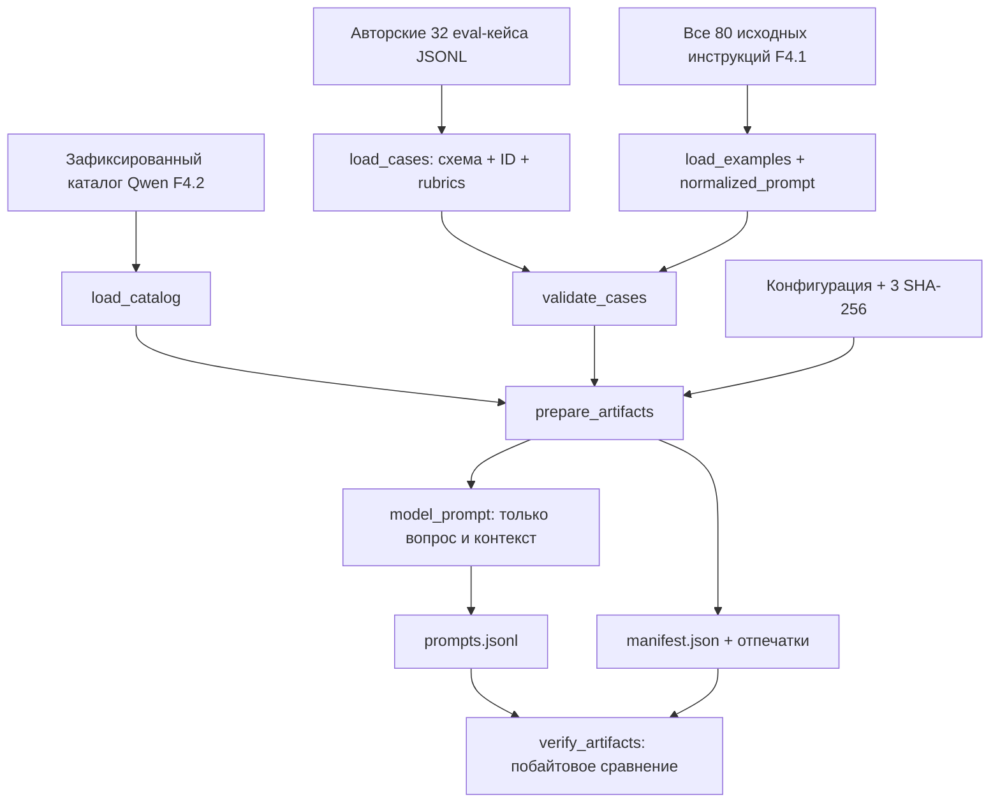
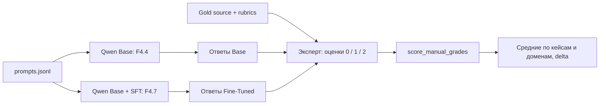

# F4.3 — Evaluation Set: независимые контрольные задания и протокол оценки LLM

> **Статус этапа: F4.3 — PASS.** Подготовлены 32 фиксированных контрольных задания с 64 критериями ручной оценки. Реализованы валидация корпуса, отделение вопросов от эталонных ответов, проверка пересечений с F4.1 и воспроизводимый экспорт. На момент приёмки F4.3 полная регрессия проекта завершилась с результатом `1532 passed`. В рамках F4.3 **не выполняются** загрузка весов Qwen, генерация ответов, обучение SFT/LoRA или экспертная оценка реальных ответов. Числовые примеры оценивания ниже используются для проверки алгоритма, а не для утверждения качества модели.

## 1. Цель этапа

### Контекст предыдущих этапов

После **F4.1** доступен авторский instruction dataset из 80 технических записей по Python, Linux, SQL и ML, организованных в 40 смысловых групп. Выполнено групповое разделение на независимые части `train=56`, `validation=12`, `test=12`. Обучающая выборка предназначена для обновления параметров модели, валидационная — для контроля обучения и настройки гиперпараметров, тестовая — для независимой финальной оценки. Для снижения риска утечек близкие записи помещены в один split.

В **F4.2** выбран checkpoint **Qwen/Qwen2.5-0.5B Base**. Идентичность модели и токенизатора зафиксирована ревизией `060db6499f32faf8b98477b0a26969ef7d8b9987`. В рамках F4.2 подтверждена работа токенизатора на Windows; реальная генерация ответов и загрузка весов не входят в этот этап.

При оценке LLM недостаточно задать несколько произвольных вопросов и субъективно сопоставить ответы. Для воспроизводимого сравнения **Base** и **Fine-Tuned** необходим заранее определённый набор задач с неизменной структурой и едиными критериями оценивания. При изменении заданий или правил после обучения возникает риск подгонки экспериментального результата.

### Постановка задачи

**Цель F4.3:** подготовить дополнительный фиксированный evaluation set из **32 русскоязычных технических задач**, по восемь на каждый из четырёх доменов. Для каждой задачи предусмотреть эталонный ответ и два обязательных смысловых критерия. Этот набор создаётся отдельно от трёх выборок F4.1: он не является повторным разбиением исходных 80 записей и не заменяет test split F4.1.

Необходимо обеспечить четыре свойства:

1. **Независимость.** Не допускать нормализованных буквальных дублей между F4.3 и полным корпусом F4.1, а также внутри нового набора. Проверять близкие формулировки дополнительной текстовой эвристикой. Не считать отсутствие буквальных совпадений доказательством полного отсутствия семантических пересечений.
2. **Изоляция эталона.** Передавать модели только вопрос и доступный входной контекст; исключить `reference_answer`, `rubric` и критерии оценки из файла для генерации.
3. **Единое оценивание.** Применять ко всем модельным ответам одинаковую экспертную шкалу `0 / 1 / 2` по каждому факту. Рассчитывать итоговые баллы по одной формуле без изменения критериев после получения ответов.
4. **Воспроизводимость.** Закрепить исходные файлы и конфигурацию контрольными суммами SHA-256; повторно формировать и побайтово проверять экспортированные артефакты.

**Результат F4.3:** 32 проверенных eval-кейса, 64 обязательных факта, `prompts.jsonl` с входами для модели, `manifest.json` с идентичностью эксперимента и функция агрегации экспертных оценок. **Качество Base/SFT в F4.3 не измеряется.**

## 2. Что реализовано

| Файл | Назначение | Что именно внутри |
|---|---|---|
| `data/evaluation/f4_03_ru_technical_v1.jsonl` | Авторский контрольный корпус | Ровно 32 исходных случая, 4 области × 8 вопросов, 22 `basic` + 10 `intermediate`, вопрос, необязательный вход, эталон и два `required_facts` для каждого случая, `review_checks` и `origin=authored_synthetic`. |
| `configs/f4_03_evaluation_set.json` | Зафиксированный контракт | Версия схемы, идентификатор benchmark, пути, квоты, количество задач, три закреплённых SHA-256: F4.1 source, F4.2 catalog, собственный F4.3 source. |
| `src/llm_f4/evaluation_set.py` | Алгоритм и API оценки | Строгая валидация, загрузка JSONL, сопоставление с F4.1, эвристическая проверка близких формулировок, безопасное формирование prompt-only JSONL, manifest, BUILD/VERIFY, вычисление агрегата ручных оценок. |
| `scripts/f4_evaluation_set.py` | CPU-демонстрация | `BUILD`, `--verify`, `--show-case CASE_ID`; ASCII-совместимая справка и вывод для Windows-кодировок; без загрузки весов. |
| `tests/test_f4_evaluation_set.py` | Автоматические проверки | Квоты, SHA, отсутствие текстовых пересечений с F4.1, изоляция gold, нарушения схемы, подмена артефактов, контроль арифметики оценки и совместимость Windows CLI. |
| `docs/steps/F4_03_evaluation_set.md` | Учебная методичка | Порядок разработки, ограничения, алгоритм и числовой пример, схемы, команды PowerShell, интерпретация, файл-навигация. |

**Производные файлы, формируемые локально:**

```text
data/processed/f4_03/
├── prompts.jsonl      # входные вопросы для будущей модели, БЕЗ эталонов
└── manifest.json      # идентичность набора и входных файлов
```

**Что не входит в поставку:** `README.md`, `.venv/`, кеши, model weights, Python-артефакты, файлы предыдущих этапов. В ZIP ровно шесть новых файлов из таблицы.

### Устройство одной записи

Например, первый кейс `ev_py_01` задаёт вопрос о `range(2, 7, 2)`.

```json
{
  "case_id": "ev_py_01",
  "domain": "python",
  "topic_id": "range_stop",
  "difficulty": "basic",
  "instruction": "Что выведет Python-код range(2, 7, 2) при преобразовании в список и почему?",
  "input": "list(range(2, 7, 2))",
  "reference_answer": "Получится [2, 4, 6]. range включает начальное значение 2, прибавляет шаг 2 и не включает правую границу 7.",
  "rubric": {
    "required_facts": [
      {"fact_id": "items", "description": "Назвать элементы результата", "aliases": ["2, 4, 6"]},
      {"fact_id": "exclusive", "description": "Объяснить исключение правой границы", "aliases": ["не включает правую границу", "правая граница не включается"]}
    ],
    "review_checks": ["Проверь техническую корректность объяснения, а не только совпадение терминов."]
  },
  "origin": "authored_synthetic"
}
```

В `prompts.jsonl` та же задача преобразуется в **только три поля**:

```json
{
  "case_id": "ev_py_01",
  "domain": "python",
  "prompt": "Что выведет Python-код range(2, 7, 2) при преобразовании в список и почему?\n\nДанные:\nlist(range(2, 7, 2))"
}
```

В частности, генеративная модель **не увидит** `reference_answer`, `required_facts`, `review_checks`, `topic_id` или уровень сложности. Полные исходные записи остаются отдельно для экспертной проверки ответа **после** генерации. **Ограничение:** исходный JSONL публикуется в Git-репозитории, поэтому эталонные ответы не являются секретным benchmark. Изоляция эталона реализуется протоколом генерации, а не ограничением доступа к самому корпусу.

## 3. Последовательность реализации

### Шаг 1. Определить назначение контрольного набора

**Действие.** Зафиксировать независимый набор для проверки исходной Qwen Base (F4.4) и Qwen после SFT/LoRA (F4.7) на неизменных вопросах.

**Назначение.** Исключить изменение состава заданий между двумя экспериментами. При использовании разных вопросов оценка изменения качества становится методологически некорректной. Контрольный набор требуется определить **до** обучения и анализа модельных ответов.

**Реализация.** Задать `evaluation_id=f4_03_ru_technical_v1`. В манифесте зафиксировать `purpose=frozen_holdout_for_base_vs_finetuned`. Сохранить `model_id` и `revision` выбранного checkpoint из F4.2.

**Результат.** Единый идентификатор контрольного эксперимента и сопоставимый набор заданий для будущего Base/Fine-Tuned сравнения.

### Шаг 2. Сформировать карту задач отдельно от F4.1

**Действие.** Подготовить по восемь задач для Python (`range`, `enumerate`, `zip`), Linux (`find`, `tar`, `ss`), SQL (`DISTINCT`, `UNION ALL`, `CASE`) и ML/LLM (`softmax`, `temperature`, `top-k`, `dropout`, `padding mask`). Выделить 22 задания уровня `basic` и 10 уровня `intermediate`.

**Назначение.** Обеспечить сбалансированное тематическое покрытие и предотвратить доминирование одной области в итоговой оценке. Исключить буквальное повторение учебных инструкций, в том числе вопроса об изменяемых аргументах по умолчанию из F4.1.

**Реализация.** Назначить каждому случаю `case_id`, `domain`, `topic_id`, `difficulty`. В `load_cases()` отклонять повторные идентификаторы или темы внутри домена. В `validate_cases()` проверять количество задач и предметные квоты.

**Результат.** Фиксированный, структурированный состав контрольного корпуса вместо произвольного списка вопросов.

### Шаг 3. Подготовить эталонные ответы и проверяемые факты

**Действие.** Для каждого вопроса записать технически корректный ответ-ориентир и два критерия `required_facts`, включающие `fact_id`, описание и допустимые текстовые маркеры `aliases`. Добавить вспомогательные указания эксперту в `review_checks`.

**Назначение.** Разделить смысловую корректность и буквальное совпадение текста с эталоном. Правильный ответ может использовать другие формулировки; наличие ключевого слова, напротив, не гарантирует правильность объяснения.

**Реализация.** Использовать структуры `Fact` и `EvaluationCase`. В `_load_case()` проверять допустимость полей и корректность описаний, критериев и эталонных ответов.

**Результат.** Унифицированный контракт экспертной проверки для любого ответа с известным `case_id`.

### Шаг 4. Реализовать строгую валидацию JSONL

**Действие.** Запретить пропущенные и неизвестные поля, повторные идентификаторы и темы, неверные домены и уровни сложности, неправильный `origin`, пустые эталоны и дублирующиеся JSON-ключи.

**Назначение.** Исключить ошибки данных, способные исказить метрики: потерю заданий, повторный учёт одного ответа или отсутствие критериев оценивания.

**Реализация.** Применить `_parse_json()`, `_reject_duplicate_keys()`, `_text()`, `_strings()`, `_load_case()`, `load_cases()`. При нарушении схемы выдавать `EvaluationError` с объяснением причины.

**Результат.** Корпус с проверяемой схемой и отказом от дальнейшей обработки при повреждённых данных.

### Шаг 5. Проверить пересечения с F4.1 и внутри Evaluation Set

**Действие.** Загрузить все 80 исходных инструкций F4.1 через `load_examples()`, а не только экспортированный `train.jsonl`. Сравнить нормализованные строки `instruction + input` для обоих корпусов и внутри F4.3.

**Назначение.** Не допустить буквального попадания исходного задания F4.1, включая его `validation` и `test`, в дополнительный benchmark F4.3.

**Реализация.** Использовать `normalized_prompt()` из F4.1 и `_prompt_key()` из F4.3: нормализация Unicode NFKC, `casefold`, удаление пунктуации. Добавить `_ngram_similarity()` с коэффициентом Жаккара на множествах словесных 3-грамм и порогом **0,85** для части близких формулировок.

**Результат.** Контроль нормализованных буквальных дублей и эвристическое обнаружение некоторых близких вопросов. Метод **не гарантирует** выявление всех смысловых парафразов; необходимо избегать повторного использования F4.3 при настройке модели.

### Шаг 6. Закрепить источники и модель контрольными суммами

**Действие.** Сохранить SHA-256 для трёх исходных файлов: F4.1 instruction corpus, F4.2 model catalog и F4.3 evaluation corpus.

**Назначение.** Обнаруживать случайное изменение данных, модели или спецификации между подготовкой контрольного набора и будущими экспериментами.

**Реализация.** В `load_config()` валидировать 64-символьные HEX SHA-256 и безопасные пути репозитория. В `prepare_artifacts()` вычислять текущие контрольные суммы и сравнивать их с конфигурацией. В `load_catalog()` дополнительно проверять закреплённые model ID и revision.

**Зафиксированные отпечатки:**

- F4.1 instruction source: `7ce6eb2629b0831feac771a4ee4dcb9e66c7901e074b9e957cbf50eaceda0225`.
- F4.2 model catalog: `cc7ce92afdee39f7c82bc552b809457415399e512af3b266787699dc7afc40e7`.
- F4.3 evaluation source: `50537bbdbd4c0a1598e4a2cf504f9385d0c07555f4bb75d08667f975488aaf4d`.

**Результат.** Воспроизводимая идентичность входов. При изменении источника требуется явное обновление версии и фиксация нового набора; незаметная подмена не допускается.

### Шаг 7. Отделить входы модели от эталонных ответов

**Действие.** Преобразовать каждую исходную запись в объект с тремя полями: `case_id`, `domain`, `prompt`. При наличии контекста `input` добавить его в текст промпта под заголовком `Данные:`.

**Назначение.** Исключить прямую передачу ожидаемого ответа или критериев оценки в генеративный промпт. Контрольный набор должен проверять поведение модели, а не её способность повторить предоставленный эталон.

**Реализация.** Использовать `model_prompt()` для сборки model-only объекта. В `prepare_artifacts()` сериализовать только указанные поля. В `export_artifacts()` записывать `prompts.jsonl` и `manifest.json`, не включая `reference_answer` или `rubric` в экспорт для модели.

**Результат.** Изолированные входные данные для F4.4 и F4.7. Полный gold JSONL сохраняется только в контуре экспертной проверки после генерации.

### Шаг 8. Реализовать рубрику ручного оценивания

**Действие.** Ввести по два обязательных смысловых факта на вопрос с оценками `0`, `1`, `2`: отсутствие или ошибка, частичная корректность, полная корректность.

**Назначение.** Оценивать фактическое содержание, а не совпадение слов. Например, наличие слова «граница» в ошибочном утверждении «правая граница включается» не должно давать положительную оценку правильности.

**Реализация.** В `score_manual_grades()` принимать оценки по `case_id` и `fact_id`, проверять их полноту, уникальность, типы и диапазон (отклонять `True`/`False`). Вычислять нормированный балл случая, среднее по всем случаям и средние по предметным областям.

**Пример входных данных для `score_manual_grades()`:**

```json
{
  "case_id": "ev_py_01",
  "fact_scores": {"items": 2, "exclusive": 0},
  "notes": "Правильно названы элементы, но правую границу объяснили неверно"
}
```

**Результат.** Протестированная арифметика экспертной шкалы. Фактическое качество Qwen нельзя выводить без проведения ручной оценки реальных ответов; `lexical_coverage()` используется только для диагностики текстовых маркеров.

### Шаг 9. Реализовать повторяемые BUILD / VERIFY и экспертный просмотр

**Действие.** Добавить режим формирования контрольных промптов, проверки сохранённого экспорта и просмотра отдельной записи с эталоном.

**Назначение.** Обеспечить повторяемость CPU-операций на Windows, а также не допускать попадания эталонов в поток генерации.

**Реализация.** В `scripts/f4_evaluation_set.py` использовать `argparse`, режимы по умолчанию, `--verify` и `--show-case`. Оставить ASCII-совместимыми служебные сообщения CLI; экспертный просмотр пометить `EXPERT-ONLY`.

**Результат.** Сборка и проверка артефактов без `torch`, `transformers`, GPU и доступа к сети. Режим экспертного просмотра нельзя использовать как промпт модели.

### Шаг 10. Проверить отрицательные сценарии и границы эксперимента

**Действие.** Подготовить тесты для некорректных ключей JSON, изменённых SHA-256, выхода путей за пределы репозитория, дубликатов, неправильных баллов, испорченных экспортов и Windows-кодировок.

**Назначение.** Подтвердить программные инварианты контрольного конвейера, не выдавая тесты искусственных оценок за измеренное качество модели.

**Реализация.** Проверить граничные случаи арифметики вручную и сопоставить с `score_manual_grades()`. Протестировать CLI в средах `cp1251`, `cp866`, `cp1252`, отклонение подменённых файлов и невозможность экспорта gold-полей в `prompts.jsonl`.

**Результат.** В локальной приёмке F4.3 подтверждены проверки этапа и полная регрессия `1532 passed`. Веса модели, inference и обучение не входят в F4.3.

## 4. Алгоритм и математический пример

### 4.1. Алгоритм сравнения текстов для контроля пересечения

Вход — строка `instruction` и необязательный `input`. Алгоритм нормализации:

1. Применить Unicode NFKC для приведения совместимых форм символов к единому представлению.
2. Применить `casefold()` для нормализации регистра.
3. Извлечь токены регулярным выражением `\w+`.
4. Соединить токены пробелами и проверить совпадение полученных ключей.

Например:

```text
"Что делает RANGE?"  →  "что делает range"
"что делает range!"  →  "что делает range"
```

Это **буквальное сходство**, но не семантическая эквивалентность. Дополнительная проверка использует Jaccard 3-грамм слов:

\[
J(A,B)=\frac{|G_3(A)\cap G_3(B)|}{|G_3(A)\cup G_3(B)|}.
\]

Здесь `G_3(A)` — множество подряд идущих троек слов из строки A. Если A содержит набор `{a,b,c}`, а B — `{a,b,d}`, то общий элемент один, объединение содержит три, `J=1/3≈0,333`. В коде `_ngram_similarity()` порог сигнализации `0.85`. Для короткого текста с менее чем тремя словами эта эвристика не срабатывает; буквальные дубли проверяются отдельно по `_prompt_key()`.

### 4.2. Шкала экспертной оценки

Для задачи `i` с `m_i` обязательными фактами и выставленными экспертными баллами `g_{ij}∈{0,1,2}`:

\[
S_i=\frac{\sum_{j=1}^{m_i} g_{ij}}{2m_i},\qquad 0\le S_i\le 1.
\]

- `i` — идентификатор оцениваемого случая.
- `m_i` — число обязательных смысловых пунктов (здесь **2**).
- `j` — номер пункта внутри задачи.
- `g_ij` — экспертный балл **0**, **1** или **2**.
- `2m_i` — максимальная сумма баллов в данном случае.
- `S_i` — нормированная оценка одного ответа.

**Ручной числовой пример:** `ev_py_01` — модель назвала результат `[2,4,6]`, но неверно объяснила исключённую правую границу. Эксперт поставил `items=2`, `exclusive=0`. Тогда

\[
S_1=\frac{2+0}{2\cdot2}=\frac24=0{,}5.
\]

Для второй условной задачи задать оценки `g=(1,2)`: первый факт объяснён частично, второй — полностью. Тогда `S_2=(1+2)/4=0,75`. **Использованы искусственные оценки для проверки формулы; результаты Qwen в этом примере отсутствуют.**

Для `N` задач общая средняя (macro over cases) вычисляется как

\[
S_{macro}=\frac1N\sum_{i=1}^{N} S_i.
\]

На двух учебных случаях: `(0,5+0,75)/2=0,625`, то есть **62,5%** от максимума шкалы. Для настоящего набора `N=32`; по каждой области рассчитывается собственное среднее на восьми заданиях.

При равномерной квоте по восемь задач на каждую из четырёх областей общая средняя совпадает со средним четырёх доменных средних. Если в будущем число задач изменится, это равенство может перестать выполняться — его нельзя переносить без проверки квот.

**Что конкретно проверяют тесты арифметики:**

- `g=(2,2)` для всех задач → `S_macro=1,0`.
- `g=(0,0)` для всех задач → `S_macro=0,0`.
- `g=(2,0)` для всех задач → `S_macro=0,5`.
- Одна задача `g=(0,0)` и 31 задача `g=(1,2)` → `S_macro=31×0,75/32=0,7265625`.
- Одна нулевая задача в Python → доменное среднее Python `7×0,75/8=0,65625`; остальные доменные средние — `0,75`.

Эти эталоны проверяются в `tests/test_f4_evaluation_set.py` независимо от Python-реализации итогового вычисления.

### 4.3. Как в дальнейшем сравнивать Base и Fine-Tuned

**Протокол последующего применения; в F4.3 не выполняется:** на одни и те же `prompts.jsonl` запустить `Qwen Base` и затем ту же базовую модель + адаптер SFT; использовать одинаковые правила формирования промптов и настройки генерации, при возможности фиксированный seed и параметры декодирования; сохранить необработанные ответы с ID модели и ревизией; выполнить слепую проверку ответов экспертами; независимо агрегировать баллы. Тогда можно считать

\[
\Delta = S_{FineTuned} - S_{Base}.
\]

Значение `Δ>0` будет означать преимущество **внутри этого контрольного набора и протокола**, но не глобальное превосходство модели. Малый объём, возможный смещённый набор тем и экспертная субъективность ограничивают обобщение результата. Нельзя подбирать LoRA, learning rate или промпт по результатам F4.3: тогда набор станет validation, а не независимым test.

## 5. Схема работы

### 5.1. Создание и фиксация контрольного набора — реализовано в F4.3



### 5.2. Протокол последующей оценки качества — вне F4.3



**Граница:** gold source должен попадать только в контур экспертной проверки, **после** получения ответов. Если он будет автоматически прицеплен к промпту генерации или включён в тренировочный набор, сравнение теряет независимость.

## 6. Локальная проверка PowerShell

Команды выполнять **из корня репозитория** в среде Windows с Python 3.13.2.

### 6.1. Проверка unit-тестов F4.3

```powershell
cd F:\DEVELOPMENT\ML\ml-engineering-lab

.\.venv\Scripts\python.exe -m pytest tests/test_f4_evaluation_set.py -q
```

**Назначение:** модуль тестов F4.3. Проверяется схема данных, количество фактов, квоты, отпечатки трёх файлов, отсутствие буквальной утечки в F4.1 и между кейсами, правильность prompt-only, неприемлемые оценки, подмена артефактов, Windows-кодировки и арифметика ручного scoring.

**Ожидаемый результат:** `... passed` и **0 failed**. Точное количество зависит от включённых parameterized test cases. Никаких весов модели тесты не загружают.

### 6.2. Сформировать контрольные prompts

```powershell
.\.venv\Scripts\python.exe scripts/f4_evaluation_set.py
```

**Ожидаемые содержательные строки:**

```text
F4.3 BUILD: PASS
Evaluation: f4_03_ru_technical_v1 | 32 cases
Domains: linux=8, ml=8, python=8, sql=8
Required human-graded facts: 64
Selected model: Qwen/Qwen2.5-0.5B | revision=060db6499f32faf8b98477b0a26969ef7d8b9987
Prompt-only SHA256: d95c831e685a
Model weights / inference / grading: NOT RUN
```

**Результат:** прочитаны и проверены три исходных файла, выписаны только вопросы в `prompts.jsonl`, создан `manifest.json`. Случаи содержат реальные технические тексты, но не результаты LLM.

### 6.3. Проверить экспорт против актуальных исходников

```powershell
.\.venv\Scripts\python.exe scripts/f4_evaluation_set.py --verify
```

**Ожидаемый результат:** `F4.3 VERIFY: PASS`. Это означает, что оба файла выхода побайтово совпадают с тем, что должно быть получено из зафиксированных файлов F4.1, F4.2 и F4.3. Если после экспорта поменять хотя бы один байт `prompts.jsonl`, команда должна завершиться ошибкой.

### 6.4. Открыть манифест и пару вопросов

```powershell
Get-Content data\processed\f4_03\manifest.json -Encoding UTF8

Get-Content data\processed\f4_03\prompts.jsonl -Encoding UTF8 -TotalCount 2
```

**Проверить:** `total_cases=32`, `required_facts_total=64`, `model_evaluated=false`, `generation_performed=false`, равные квоты по областям, SHA-256 исходников. В двух строках `prompts.jsonl` должны быть только `case_id`, `domain`, `prompt`; там нет `reference_answer` и `rubric`.

### 6.5. Посмотреть эталон и критерии конкретного кейса (для эксперта!)

```powershell
.\.venv\Scripts\python.exe scripts/f4_evaluation_set.py --verify --show-case ev_py_01
```

Вывод начинается с `EXPERT-ONLY CASE PREVIEW`; он содержит **и вопрос, и эталонный ответ, и пункты оценивания**. Для надёжности в Windows нестандартные символы в JSON представлены Unicode escape-последовательностями. **Не передавать этот вывод в промпт Qwen:** содержащий эталоны вывод предназначен исключительно для экспертной проверки, а не генерации.

### 6.6. Регрессия предыдущих этапов

```powershell
.\.venv\Scripts\python.exe -m pytest -q tests/test_f4_instruction_dataset.py tests/test_f4_model_selection.py tests/test_f4_evaluation_set.py

.\.venv\Scripts\python.exe -m pytest -q
```

Первая команда проверяет тесты F4.1–F4.3; вторая выполняет полную регрессию репозитория, включая Фазы 1–3. На момент приёмки F4.2 было подтверждено `1447 passed`; после добавления F4.3 локальная регрессия завершилась с результатом **`1532 passed`**. Проверка GitHub CI относится к отдельному этапу публикации, а не к данному запуску pytest.

### 6.7. Границы выполнения F4.3

В F4.3 **нет** `--download-weights`, `--inference`, `--finetune`, установки PyTorch или запуска GPU. Это установленная граница этапа, а не дефект реализации. Реальная генерация Base предусмотрена в F4.4.

## 7. Что доказано тестами и какие ограничения остаются

### Подтверждено реализованными проверками

- Корпус содержит 32 отдельных случая, 4 × 8 по предметным областям, 64 обязательных пункта.
- Каждая запись удовлетворяет ограниченному JSONL-контракту; неверные поля, типы, повторные `case_id`, `topic_id`, пустые рубрики и дубликаты JSON-ключей отклоняются.
- В новом корпусе нет нормализованных буквальных совпадений инструкций с **полными 80** исходными примерами F4.1 и нет идентичных prompt-ключей внутри самого eval set.
- Некоторые близкие буквальные формулировки выявляются эвристикой 3-грамм слов с порогом `0.85`.
- `prompts.jsonl` не содержит `reference_answer`, `rubric`, `required_facts`, `review_checks`, `topic_id`.
- SHA-256 трёх исходников закреплены в конфигурации; изменение каждого из них нарушает контракт подготовки.
- Повторная сборка даёт тот же байтовый вывод; `--verify` обнаруживает правку результата после экспорта.
- Для всех 32 эталонных ответов простая лексическая проверка находит объявленные автором маркеры. Это подтверждает **внутреннюю согласованность разметки**, не смысловую безошибочность эталонов.
- Числовая функция `score_manual_grades()` корректно агрегирует **искусственные** 0/1/2-оценки; не принимает отсутствующие, повторные или неправильные баллы.
- CLI не ломается на ASCII-несовместимых с Unicode кодировках Windows для стандартного вывода/справки.

### Не подтверждено и не входит в результаты F4.3

- **Нет оценки качества Qwen Base.** Веса не загружались и inference не проводился.
- **Нет оценки LoRA/SFT.** Обучения не было.
- **Нет доказанного отсутствия всех семантических пересечений**: текстовая эвристика не является полноценной semantic deduplication, а между учебными темами есть естественная близость.
- **Нет независимой экспертной верификации всех 32 авторских эталонов** и межэкспертной согласованности аннотаторов.
- **Нет объективного автоматического детектора истины**: lexical coverage лишь проверяет маркеры, пропускает отрицания/галлюцинации, иногда отвергает корректные синонимы.
- **Нет статистической уверенности для всего мира задач**: 32 вопроса, подобранные вручную, — это небольшой учебный benchmark с ограниченной репрезентативностью.
- **Нет гарантии отсутствия pretraining contamination:** публично выложенный eval corpus не является закрытым holdout для всех существующих/будущих моделей.
- **Нет гарантии отсутствия contamination в будущих шагах**, если использовать этот набор для подбора гиперпараметров. Методология должна запрещать такие действия.
- Выводы о выигрыше Fine-Tuned должны также учитывать, что изменение промпта, длины генерации, стратегии декодирования или ревизии checkpoint влияет на результат. Контроль этих параметров — следующая задача.

### Статусы при локальной приёмке

- **PASS:** успешные BUILD, VERIFY и регрессия; публикация и CI подтверждаются отдельно.
- **PARTIAL:** программный набор создан, но одна из проверок или CI не подтверждены.
- **FAIL:** есть воспроизводимая ошибка, нарушение изоляции эталона или пересечение, которое надо устранить.

## 8. Основная мысль этапа

Evaluation Set необходим для независимой проверки качества LLM до и после адаптации. После F4.1 доступен instruction dataset для обучения, а после F4.2 — зафиксированная базовая модель Qwen. Однако без заранее определённого контрольного набора невозможно корректно измерить изменение качества: выбор заданий после обучения или передача эталонов в промпт создают утечку и делают эксперимент несопоставимым.

В F4.3 требуется сформировать **32 технических контрольных задания** по Python, Linux, SQL и ML. Для каждого случая необходимо зафиксировать вопрос, необязательный контекст, эталонный ответ и **два смысловых критерия**. Оценивание по фактам позволяет учитывать корректные ответы с иной формулировкой и не приравнивать совпадение ключевых слов к правильности объяснения.

Подготовка контрольных данных включает проверку JSONL-схемы, уникальности идентификаторов и тем, сопоставление со всеми 80 исходными инструкциями F4.1, проверку близких формулировок и фиксацию SHA-256. Текстовые эвристики уменьшают риск буквальной утечки, но не гарантируют полного отсутствия смысловых парафразов. Контрольный корпус необходимо исключить из последующего обучения и настройки гиперпараметров.

**Ключевое разделение — промпт для генерации и эталон для проверки.** В `prompts.jsonl` следует сохранять только `case_id`, `domain` и `prompt`. Поля `reference_answer`, `required_facts` и другие экспертные сведения не должны попадать в модельный запрос. После получения ответов можно применять отдельную рубрику с оценками `0`, `1` или `2` по каждому факту.

Для случая с двумя фактами максимальная сумма равна четырём баллам. При оценках `(2,0)` нормированный результат составляет `0,5`; при `(1,2)` — `0,75`. Среднее по 32 случаям и по четырём предметным областям рассчитывается одной проверенной функцией `score_manual_grades()`. Эти числовые примеры **проверяют формулу**, но не являются результатом оценки Qwen.

**Инженерный вывод:** F4.3 создаёт фиксированный и воспроизводимый контрольный протокол. Проверяются корректность структуры, изоляция эталонов, отсутствие нормализованных буквальных дублей и арифметика оценивания. Само качество модели этим этапом не измеряется. Реальную генерацию необходимо выполнять в F4.4, а попарное сравнение Base и Fine-Tuned — в F4.7 с неизменными условиями и отдельным экспертным оцениванием.

## 9. Файлы этапа

| Файл | Что именно изучить |
|---|---|
| `data/evaluation/f4_03_ru_technical_v1.jsonl` | Первые 2–3 записи `ev_py_01`, `ev_lx_01`, `ev_ml_01`: форма вопроса, эталон, `required_facts`, `aliases`, `review_checks`; причины запрета передачи эталона в модельный промпт. |
| `configs/f4_03_evaluation_set.json` | Идентификатор frozen benchmark, квоты, расположение F4.1/F4.2, три SHA-256 и назначение `output_dir`. |
| `src/llm_f4/evaluation_set.py` | `load_config()`, `load_cases()`, `validate_cases()`, `_ngram_similarity()`, `model_prompt()`, `prepare_artifacts()`, `export_artifacts()`, `verify_artifacts()`, `score_manual_grades()`. |
| `scripts/f4_evaluation_set.py` | Как `argparse` связывает команду с реальными функциями и почему статус `NOT RUN` обязателен. |
| `tests/test_f4_evaluation_set.py` | Проверки на дубли/утечки, отсутствие gold в экспортированном JSONL, независимые эталоны формулы 0/1/2, Windows encoding, BUILD/VERIFY. |
| `docs/steps/F4_03_evaluation_set.md` | Алгоритм отбора, математический смысл метрики, пределы методов тестирования. |

**Рекомендуемый порядок изучения:**

1. Прочитать 3–4 исходных eval-задания, вручную назвать два обязательных факта ответа.
2. Открыть конфигурацию и понять, зачем закреплены **три** исходных файла, а не только сам evaluation JSONL.
3. Пройти `load_cases() → validate_cases()` и сравнить выводы `_prompt_key()` и `_ngram_similarity()`.
4. Разобрать `model_prompt()`: проверить, что на вход F4.4 сможет уйти только вопрос.
5. Изучить `prepare_artifacts() → export_artifacts() → verify_artifacts()` и проверить SHA из манифеста.
6. Разобрать `score_manual_grades()` и **самостоятельно** посчитать пример `g=(2,0)` и `g=(1,2)`.
7. Посмотреть тесты: почему проверка `lexical_coverage()` специально показывает возможность ложного «совпадения» у неверного ответа.
8. Запустить PowerShell и убедиться, что фиксированный benchmark не вызывает ни модель, ни процесс обучения.

### Какие исходники прежних фаз открыть

- `src/llm_f4/instruction_dataset.py` (F4.1): `load_examples()`, `normalized_prompt()`, `validate_examples()` — как устроены исходные инструкции, групповой split и общая нормализация строк. **Вызывать функции напрямую; не дублировать их реализацию в F4.3.**
- `configs/f4_01_instruction_dataset.json`: источник 80 примеров и предыдущие квоты 70/15/15; понять различие между F4.1 `test` и дополнительным независимым F4.3 benchmark.
- `src/llm_f4/model_selection.py` (F4.2): `load_catalog()` и проверка `selected_model_id`, pinned revision — почему результаты F4.4 и F4.7 должны относиться к той же модели.
- `configs/f4_02_model_selection.json`: зафиксированный `Qwen/Qwen2.5-0.5B` и полный `revision`; отличить выбор модели от оценки её реальных ответов.

**Главная проверка понимания:** объяснить, почему успешные unit-тесты `score_manual_grades()` **не подтверждают качество Qwen**. Тесты проверяют арифметику на искусственно заданных баллах. Оценка модели требует реальной генерации ответов и независимого экспертного оценивания по тем же критериям.
