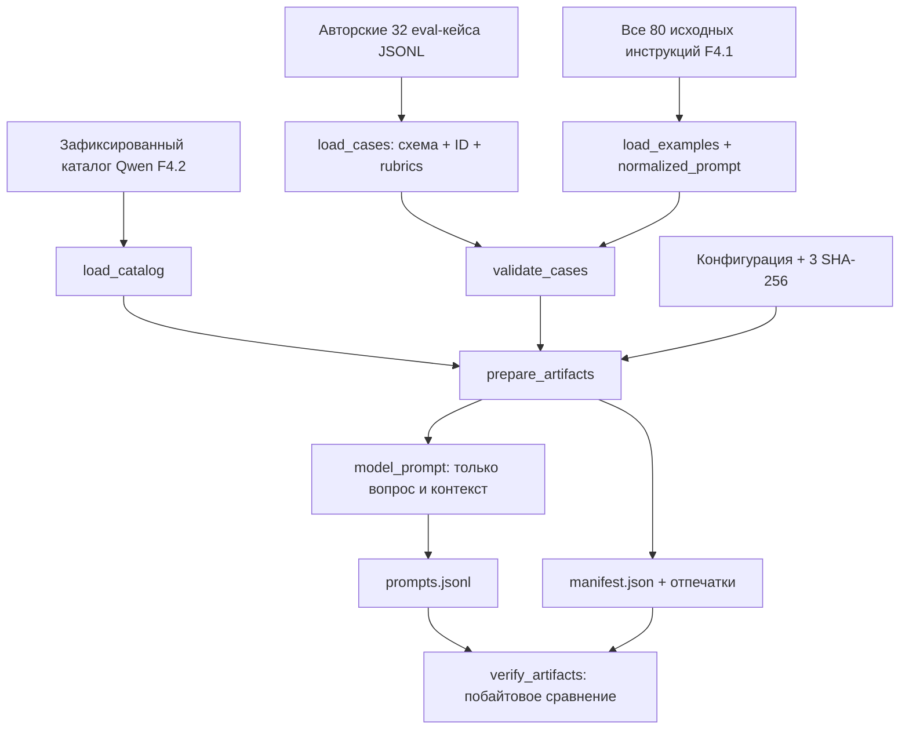
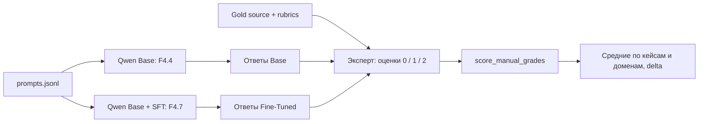

# F4.3 — Evaluation Set: независимые контрольные задания и честный протокол оценки LLM

> **Границы результата.** Здесь мы строим **зафиксированный набор оценочных заданий**, а не запускаем Qwen и не выполняем fine-tuning. В F4.3 реализованы проверяемые входные данные, разделение входа модели и эталона, критерии ручной оценки, детерминированный экспорт и проверки утечки. Ни одна из цифр ниже не является измерением качества LLM. Все команды обязательного CPU-профиля выполняются без интернета, `torch`, `transformers` и скачивания весов.

## 1. Цель этапа

### Откуда мы пришли

В **F4.1** подготовлены 80 авторских инструкций по Python, Linux, SQL и ML, объединённых в 40 смысловых групп. Эти данные распределены по трём непересекающимся частям: **train=56**, **validation=12**, **test=12** строк. Именно на обучающих данных можно будет обновлять параметры, а validation использовать при выборе настроек. Test из F4.1 уже следует сохранять в изоляции от настройки модели.

В **F4.2** выбрана **Qwen/Qwen2.5-0.5B Base** и зафиксированы модель и токенизатор ревизией `060db6499f32faf8b98477b0a26969ef7d8b9987`. Подтверждено, что реальный токенизатор работает на Windows, но веса модели ещё не загружались и ответы не генерировались.

**Проблема:** если просто задать LLM пять произвольных вопросов и сравнить впечатления, мы не сможем воспроизвести оценку, объяснить происхождение числа «качество выросло на 20%» или понять, не выучила ли модель тест заранее. Нужен **контрольный инструмент**, который одинаково работает до и после обучения.

### Что собираемся сделать

**F4.3 — дополнительный самостоятельный фиксированный holdout** из 32 новых русскоязычных задач: по восемь для Python, Linux, SQL и ML. В каждой задаче заранее записаны ответ-ориентир и два обязательных смысловых пункта. Оценочный набор **не получен путём разбиения F4.1** и не заменяет его test split; он служит отдельным контрольным слоем для F4.4 и F4.7. Все примеры написаны специально для лаборатории, а не скопированы из внешнего QA-корпуса.

Мы должны обеспечить четыре свойства:

1. **Независимость:** задания не совпадают с 80 исходными инструкциями F4.1; среди новых задач нет буквальных дублей. Близкие формулировки дополнительно отсеиваются текстовой эвристикой, но отсутствие *всех* смысловых парафраз эта проверка не гарантирует.
2. **Изоляция эталона:** модель получает только вопрос и доступный входной контекст, **не** получает `reference_answer`, `rubric` или критерии оценки.
3. **Единая оценка:** каждый содержательный пункт ответа оценивается экспертом по шкале **0 / 1 / 2**, затем баллы агрегируются одной формулой; одинаковый протокол применяется к Base и Fine-Tuned.
4. **Воспроизводимость:** конфигурация и все три источника привязаны к SHA-256, а экспорт проверяется побайтово.

**Результат этапа:** 32 валидных eval-кейса, 64 проверяемых обязательных факта, 2 выходных файла (`prompts.jsonl`, `manifest.json`) и протестированная функция оценки экспертных аннотаций. **Результатов Base/SFT пока нет.**

## 2. Что реализовано

| Файл | Назначение | Что именно внутри |
|---|---|---|
| `data/evaluation/f4_03_ru_technical_v1.jsonl` | Авторский контрольный корпус | Ровно 32 исходных случая, 4 области × 8 вопросов, 22 `basic` + 10 `intermediate`, вопрос, необязательный вход, эталон и два `required_facts` для каждого случая, `review_checks` и `origin=authored_synthetic`. |
| `configs/f4_03_evaluation_set.json` | Зафиксированный контракт | Версия схемы, идентификатор benchmark, пути, квоты, количество задач, три закреплённых SHA-256: F4.1 source, F4.2 catalog, собственный F4.3 source. |
| `src/llm_f4/evaluation_set.py` | Алгоритм и API оценки | Строгая валидация, загрузка JSONL, сопоставление с F4.1, эвристическая проверка близких формулировок, безопасное формирование prompt-only JSONL, manifest, BUILD/VERIFY, вычисление агрегата ручных оценок. |
| `scripts/f4_evaluation_set.py` | CPU-демонстрация | `BUILD`, `--verify`, `--show-case CASE_ID`; ASCII-совместимая справка и вывод для Windows-кодировок; без загрузки весов. |
| `tests/test_f4_evaluation_set.py` | Автоматические проверки | Квоты, SHA, отсутствие текстовых пересечений с F4.1, изоляция gold, нарушения схемы, подмена артефактов, контроль арифметики оценки и совместимость Windows CLI. |
| `docs/steps/F4_03_evaluation_set.md` | Учебная методичка | Порядок разработки, ограничения, алгоритм и числовой пример, схемы, команды PowerShell, интерпретация, файл-навигация. |

**Что создаётся локально, но не публикуется как результат F4.3:**

```text
data/processed/f4_03/
├── prompts.jsonl      # входные вопросы для будущей модели, БЕЗ эталонов
└── manifest.json      # идентичность набора и входных файлов
```

**Что не входит в поставку:** `README.md`, `.venv/`, кеши, model weights, Python-артефакты, файлы предыдущих этапов. В ZIP ровно шесть новых файлов из таблицы.

### Устройство одной записи

Например, первый кейс `ev_py_01` задаёт вопрос о `range(2, 7, 2)`.

```json
{
  "case_id": "ev_py_01",
  "domain": "python",
  "topic_id": "range_stop",
  "difficulty": "basic",
  "instruction": "Что выведет Python-код range(2, 7, 2) при преобразовании в список и почему?",
  "input": "list(range(2, 7, 2))",
  "reference_answer": "Получится [2, 4, 6]. range включает начальное значение 2, прибавляет шаг 2 и не включает правую границу 7.",
  "rubric": {
    "required_facts": [
      {"fact_id": "items", "description": "Назвать элементы результата", "aliases": ["2, 4, 6"]},
      {"fact_id": "exclusive", "description": "Объяснить исключение правой границы", "aliases": ["не включает правую границу", "правая граница не включается"]}
    ],
    "review_checks": ["Проверь техническую корректность объяснения, а не только совпадение терминов."]
  },
  "origin": "authored_synthetic"
}
```

В `prompts.jsonl` та же задача преобразуется в **только три поля**:

```json
{
  "case_id": "ev_py_01",
  "domain": "python",
  "prompt": "Что выведет Python-код range(2, 7, 2) при преобразовании в список и почему?\n\nДанные:\nlist(range(2, 7, 2))"
}
```

В частности, генеративная модель **не увидит** `reference_answer`, `required_facts`, `review_checks`, `topic_id` или уровень сложности. Полные исходные записи остаются отдельно для экспертной проверки ответа **после** генерации. **Внимание:** поскольку исходный JSONL входит в Git-репозиторий, эталонные ответы нельзя считать секретным или гарантированно не виденным моделью benchmark; изоляция обеспечивается программным протоколом текущего эксперимента.

## 3. Последовательность реализации

### Шаг 1. Определили назначение контрольного набора

**Что сделали.** Зафиксировали отдельную цель: одинаково проверять Qwen Base (F4.4) и Qwen с адаптером SFT/LoRA (F4.7) на **неизменных** вопросах.

**Зачем.** Если до обучения спрашивать одно, а после другое, изменение среднего балла не будет связано только с изменением весов. Контрольный набор должен существовать **до** обучения, иначе возникает соблазн выбирать вопросы «под полученный результат».

**Как реализовали.** `evaluation_id=f4_03_ru_technical_v1`; в манифесте `purpose=frozen_holdout_for_base_vs_finetuned`. Для будущего сравнения сохраняем исходный `model_id` и `revision` из F4.2. **Что получили:** явную идентичность эксперимента.

### Шаг 2. Составили карту задач отдельно от F4.1

**Что сделали.** Подготовили 8 задач по Python (например, `range`, `enumerate`, `zip`), 8 по Linux (`find`, `tar`, `ss`), 8 по SQL (`DISTINCT`, `UNION ALL`, `CASE`) и 8 по ML/LLM (`softmax`, `temperature`, `top-k`, `dropout`, `padding mask`). Из них 22 начального и 10 промежуточного уровня.

**Зачем.** Одна область не должна полностью определять итог. Кроме того, тест не должен буквально повторять обучающие инструкции — например, тема `mutable default arguments` уже присутствует в F4.1, поэтому мы не включаем её в F4.3.

**Как реализовали.** Каждому кейсу назначены `case_id`, `domain`, `topic_id`, `difficulty`. `load_cases()` не допускает повторов ID или темы внутри области. `validate_cases()` проверяет точные квоты. **Что получили:** управляемый состав, вместо произвольного набора понравившихся вопросов.

### Шаг 3. Написали эталон и факты, которые нужно продемонстрировать

**Что сделали.** Для каждого вопроса сначала сформулировали человеческий правильный ответ и два обязательных пункта `required_facts`: идентификатор, описание и возможные текстовые маркеры (`aliases`). Дополнительно записали указание `review_checks` для эксперта.

**Зачем.** Эталон — материал для проверки, но он не обязан быть единственной допустимой формулировкой. Например, модель может объяснить правую границу `range` другими словами и быть правильной. Эксперт оценивает **смысл**, а не точное совпадение предложения.

**Как реализовали.** Структуры `Fact` и `EvaluationCase` в `evaluation_set.py`. `_load_case()` проверяет строгое соответствие полей и качество записей. **Что получили:** единый контракт, к которому будущий оценщик может обратиться по `case_id`.

### Шаг 4. Сделали строгую проверку входного JSONL

**Что сделали.** Запретили пропущенные/лишние поля, повторные ID/темы, неверный `origin`, неизвестные области/сложность, пустые или некорректные эталоны, дублированные JSON-ключи и нечисловые/невалидные обязательные факты.

**Зачем.** В evaluator ошибка данных может незаметно исказить средний балл: один кейс посчитается дважды, другой пропадёт, а третий не будет иметь критерия оценки.

**Как реализовали.** `_parse_json()`, `_reject_duplicate_keys()`, `_text()`, `_strings()`, `_load_case()`, `load_cases()`. При нарушении вызывается `EvaluationError` с конкретной причиной. **Что получили:** проверяемый, а не молча допускающий ошибки корпус.

### Шаг 5. Проверили пересечение с F4.1 и между собственными задачами

**Что сделали.** `prepare_artifacts()` загружает **все 80 исходных** инструкций F4.1 через `load_examples()`, а не только `train.jsonl`. После этого сравнивает нормализованные пары `instruction + input` по `normalized_prompt()` из F4.1.

**Зачем.** Если проверять только train, можно случайно поместить в F4.3 вопрос, который уже есть в F4.1 validation/test. Это нарушит чистоту сравнения контрольных наборов. Даже идентичные фразы с другой пунктуацией нужно распознавать.

**Как реализовали.** `_prompt_key()`, `validate_cases()`. После NFKC, casefold и удаления пунктуации совпадающие ключи запрещены. Дополнительно `_ngram_similarity()` ищет близкие буквальные формулировки по Jaccard множеств 3-грамм слов, порог **0,85**. **Что получили:** автоматический барьер против явной буквальной утечки и некоторых близких дублей.

**Ограничение:** Jaccard словесных n-грамм **не понимает смысл**. Переформулированный вопрос может оставаться семантически близким и не сработать. Перекрытие знаний между темами тоже неизбежно. Здесь требуется человеческий аудит, а не обещание «100% без утечек». Кроме того, F4.3 нельзя в будущем добавлять в train/validation, иначе этот benchmark будет испорчен.

### Шаг 6. Привязали источники и выбранную модель к криптографическим отпечаткам

**Что сделали.** Файл конфигурации F4.3 содержит SHA-256 всех трёх источников:

- 80 исходных инструкций F4.1: `7ce6eb2629b0831feac771a4ee4dcb9e66c7901e074b9e957cbf50eaceda0225`.
- Каталог кандидатов F4.2: `cc7ce92afdee39f7c82bc552b809457415399e512af3b266787699dc7afc40e7`.
- 32 контрольных задания F4.3: `50537bbdbd4c0a1598e4a2cf504f9385d0c07555f4bb75d08667f975488aaf4d`.

**Зачем.** Если файл был случайно перезаписан после эксперимента, новое выполнение должно остановиться, а не молча использовать другой benchmark.

**Как реализовали.** `load_config()` валидирует HEX SHA-256 и пути внутри репозитория. `prepare_artifacts()` вычисляет реальные SHA-256 текущих файлов и сравнивает с конфигурацией; `load_catalog()` из F4.2 проверяет модель и ревизию. **Что получили:** воспроизводимый контракт версии набора и модели. Изменение данных требует сознательного создания новой версии/фиксации, а не тихой подмены.

### Шаг 7. Разделили то, что видит модель, и то, что видит эксперт

**Что сделали.** Функция `model_prompt()` формирует объект с **только** `case_id`, `domain`, `prompt`. Поля `input` при наличии присоединяются под маркером `Данные:`.

**Зачем.** Если в промпт попадёт эталонный ответ, дальнейшая оценка перестанет измерять знания модели: задача будет решена за неё.

**Как реализовали.** `prepare_artifacts()` сериализует только результаты `model_prompt()`. `export_artifacts()` после успешной валидации сохраняет `prompts.jsonl` и `manifest.json`, не копируя исходный gold JSONL в processed-папку. **Что получили:** безопасный контракт будущего F4.4 inference — только вопросы.

### Шаг 8. Реализовали оценочную рубрику и числовую агрегацию

**Что сделали.** У каждого вопроса два обязательных смысловых пункта, каждый эксперт оценивает по шкале `0`, `1`, `2`:

| Балл за факт | Критерий |
|---|---|
| **0** | Факт отсутствует, неверен или прямо противоречит правильному ответу. |
| **1** | Факт частично раскрыт, недостаточно точен или требует существенного уточнения. |
| **2** | Факт корректно изложен и не противоречит содержанию ответа. |

**Зачем.** Нельзя объявлять ответ полностью правильным из-за наличия ключевого слова. Например, фраза «граница 7 включается» содержит слово «граница», но объясняет работу `range` неверно.

**Как реализовали.** `score_manual_grades()` принимает оценки вида:

```json
{
  "case_id": "ev_py_01",
  "fact_scores": {"items": 2, "exclusive": 0},
  "notes": "Правильно названы элементы, но правую границу объяснили неверно"
}
```

Функция валидирует все ID и факты, отсутствие пропусков, баллы именно `0/1/2` (не `True`/`False`) и рассчитывает оценку каждого случая, среднюю по случаям и среднюю по каждой области. **Что получили:** воспроизводимую арифметику ручной проверки; _экспертную оценку модельных ответов в F4.3 не проводили_.

**Важное отличие двух методов:** `lexical_coverage()` нужен исключительно как диагностический сигнал о наличии буквальных терминов. Даже если он увидел оба `aliases`, ответ может быть ложным из-за отрицания или искажения смысла. Его результат **не является итоговой метрикой качества**. Число `score_manual_grades()` становится оценкой модели только если баллы поставлены реальным проверяющим на реальных модельных ответах.

### Шаг 9. Создали повторяемые BUILD / VERIFY / демонстрацию

**Что сделали.** Отдельная CLI-команда подготавливает выходные файлы, вторая проверяет их побайтово, третья позволяет эксперту просмотреть конкретную эталонную запись.

**Зачем.** На Windows важно одинаково запускать эксперимент из корня репозитория и получать понятную ошибку при изменении исходных данных или повреждении файла. Для F4.1 ранее выявлена проблема не-ASCII-символов в `--help` при кодировках Windows.

**Как реализовали.** `scripts/f4_evaluation_set.py` использует ASCII-совместимые служебные сообщения, `argparse`, `--verify`, `--show-case`. Экспертный просмотр **явно** помечен `EXPERT-ONLY` и не должен поступать в модель. **Что получили:** воспроизводимые CPU-операции без `torch`, `transformers`, GPU или интернета.

### Шаг 10. Написали тесты и зафиксировали честные границы

**Что сделали.** Добавили проверки на неправильные ключи, SHA, пути с `../`, изменения вывода, дубли, числовую арифметику шкалы и Windows-кодировки `cp1251`, `cp866`, `cp1252`.

**Зачем.** Тесты должны доказывать свойства конвейера, а не выдавать синтетическую проверку подсчёта за измерение качества Qwen.

**Что получили.** Локальный набор unit-тестов F4.3, не требующий загружать модель. Фактический итог тестирования указан в разделе 7 и подтверждается повторным запуском пользователя.

## 4. Алгоритм и математический пример

### 4.1. Алгоритм сравнения текстов для контроля пересечения

Вход: строка `instruction` и необязательный `input`. Мы применяем:

1. Unicode NFKC — приводим совместимые формы символов к одной форме.
2. `casefold()` — приводим регистр.
3. Извлекаем токены регулярным выражением `\w+`.
4. Соединяем токены пробелом и проверяем совпадение ключа.

Например:

```text
"Что делает RANGE?"  →  "что делает range"
"что делает range!"  →  "что делает range"
```

Это **буквальное сходство**, но не семантическая эквивалентность. Дополнительная проверка использует Jaccard 3-грамм слов:

\[
J(A,B)=\frac{|G_3(A)\cap G_3(B)|}{|G_3(A)\cup G_3(B)|}.
\]

Здесь `G_3(A)` — множество подряд идущих троек слов из строки A. Если A содержит набор `{a,b,c}`, а B — `{a,b,d}`, то общий элемент один, объединение содержит три, `J=1/3≈0,333`. В коде `_ngram_similarity()` порог сигнализации `0.85`. Для короткого текста с менее чем тремя словами эта эвристика не срабатывает; буквальные дубли проверяются отдельно по `_prompt_key()`.

### 4.2. Шкала экспертной оценки

Для задачи `i` с `m_i` обязательными фактами и выставленными экспертными баллами `g_{ij}∈{0,1,2}`:

\[
S_i=\frac{\sum_{j=1}^{m_i} g_{ij}}{2m_i},\qquad 0\le S_i\le 1.
\]

- `i` — идентификатор оцениваемого случая.
- `m_i` — число обязательных смысловых пунктов (здесь **2**).
- `j` — номер пункта внутри задачи.
- `g_ij` — экспертный балл **0**, **1** или **2**.
- `2m_i` — максимальная сумма баллов в данном случае.
- `S_i` — нормированная оценка одного ответа.

**Ручной числовой пример:** `ev_py_01` — модель назвала результат `[2,4,6]`, но неверно объяснила исключённую правую границу. Эксперт поставил `items=2`, `exclusive=0`. Тогда

\[
S_1=\frac{2+0}{2\cdot2}=\frac24=0{,}5.
\]

Допустим, у другой задачи `g=(1,2)` — частично объяснён первый факт и полностью второй. Тогда `S_2=(1+2)/4=0,75`. **Это придуманные оценки для проверки формулы, а не реальные ответы Qwen.**

Для `N` задач общая средняя (macro over cases) вычисляется как

\[
S_{macro}=\frac1N\sum_{i=1}^{N} S_i.
\]

На двух учебных случаях: `(0,5+0,75)/2=0,625`, то есть **62,5%** от максимума шкалы. Для настоящего набора `N=32`; по каждой области рассчитывается собственное среднее на восьми заданиях.

Поскольку у нас по восемь задач в каждой из четырёх областей, общая средняя равна среднему четырёх доменных средних. Если в будущем число задач изменится, это равенство может перестать выполняться — его нельзя переносить без проверки квот.

**Что конкретно проверяют тесты арифметики:**

- `g=(2,2)` для всех задач → `S_macro=1,0`.
- `g=(0,0)` для всех задач → `S_macro=0,0`.
- `g=(2,0)` для всех задач → `S_macro=0,5`.
- Одна задача `g=(0,0)` и 31 задача `g=(1,2)` → `S_macro=31×0,75/32=0,7265625`.
- Одна нулевая задача в Python → доменное среднее Python `7×0,75/8=0,65625`; остальные доменные средние — `0,75`.

Эти эталоны проверяются в `tests/test_f4_evaluation_set.py` независимо от Python-реализации итогового вычисления.

### 4.3. Как в дальнейшем сравнивать Base и Fine-Tuned

**Протокол на будущее, не выполненный в F4.3:** на одни и те же `prompts.jsonl` запустить `Qwen Base` и затем ту же базовую модель + адаптер SFT; использовать одинаковые правила формирования промптов и настройки генерации, при возможности фиксированный seed и параметры декодирования; сохранить необработанные ответы с ID модели и ревизией; выполнить слепую проверку ответов экспертами; независимо агрегировать баллы. Тогда можно считать

\[
\Delta = S_{FineTuned} - S_{Base}.
\]

Значение `Δ>0` будет означать преимущество **внутри этого контрольного набора и протокола**, но не глобальное превосходство модели. Малый объём, возможный смещённый набор тем и экспертная субъективность ограничивают обобщение результата. Нельзя подбирать LoRA, learning rate или промпт по результатам F4.3: тогда набор станет validation, а не независимым test.

## 5. Схема работы

### 5.1. Создание и фиксация контрольного набора — реализовано в F4.3



### 5.2. Будущая проверка качества — НЕ выполняется в F4.3



**Граница:** gold source должен попадать только в контур экспертной проверки, **после** получения ответов. Если он будет автоматически прицеплен к промпту генерации или включён в тренировочный набор, сравнение теряет независимость.

## 6. Локальная проверка PowerShell

Все команды выполняются **из корня репозитория**, в твоей среде Windows/Python 3.13.2.

### 6.1. Проверка unit-тестов F4.3

```powershell
cd F:\DEVELOPMENT\ML\ml-engineering-lab

.\.venv\Scripts\python.exe -m pytest tests/test_f4_evaluation_set.py -q
```

**Что запускается:** модуль тестов F4.3. Проверяется схема данных, количество фактов, квоты, отпечатки трёх файлов, отсутствие буквальной утечки в F4.1 и между кейсами, правильность prompt-only, неприемлемые оценки, подмена артефактов, Windows-кодировки и арифметика ручного scoring.

**Что должно быть:** `... passed` и **0 failed**. Точное количество зависит от включённых parameterized test cases. Никаких весов модели тесты не загружают.

### 6.2. Сформировать контрольные prompts

```powershell
.\.venv\Scripts\python.exe scripts/f4_evaluation_set.py
```

**Ожидаемые содержательные строки:**

```text
F4.3 BUILD: PASS
Evaluation: f4_03_ru_technical_v1 | 32 cases
Domains: linux=8, ml=8, python=8, sql=8
Required human-graded facts: 64
Selected model: Qwen/Qwen2.5-0.5B | revision=060db6499f32faf8b98477b0a26969ef7d8b9987
Prompt-only SHA256: d95c831e685a
Model weights / inference / grading: NOT RUN
```

**Что произошло:** прочитаны и проверены три исходных файла, выписаны только вопросы в `prompts.jsonl`, создан `manifest.json`. Случаи содержат реальные технические тексты, но не результаты LLM.

### 6.3. Проверить экспорт против актуальных исходников

```powershell
.\.venv\Scripts\python.exe scripts/f4_evaluation_set.py --verify
```

**Ожидаем:** `F4.3 VERIFY: PASS`. Это означает, что оба файла выхода побайтово совпадают с тем, что должно быть получено из зафиксированных файлов F4.1, F4.2 и F4.3. Если после экспорта поменять хотя бы один байт `prompts.jsonl`, команда должна завершиться ошибкой.

### 6.4. Открыть манифест и пару вопросов

```powershell
Get-Content data\processed\f4_03\manifest.json -Encoding UTF8

Get-Content data\processed\f4_03\prompts.jsonl -Encoding UTF8 -TotalCount 2
```

**Проверь:** `total_cases=32`, `required_facts_total=64`, `model_evaluated=false`, `generation_performed=false`, равные квоты по областям, SHA-256 исходников. В двух строках `prompts.jsonl` должны быть только `case_id`, `domain`, `prompt`; там нет `reference_answer` и `rubric`.

### 6.5. Посмотреть эталон и критерии конкретного кейса (для эксперта!)

```powershell
.\.venv\Scripts\python.exe scripts/f4_evaluation_set.py --verify --show-case ev_py_01
```

Вывод начинается с `EXPERT-ONLY CASE PREVIEW`; он содержит **и вопрос, и эталонный ответ, и пункты оценивания**. Для надёжности в Windows нестандартные символы в JSON представлены Unicode escape-последовательностями. **Не направляй этот вывод в промпт Qwen:** он предназначен для человека/контроля, а не генерации.

### 6.6. Регрессия предыдущих этапов

```powershell
.\.venv\Scripts\python.exe -m pytest -q tests/test_f4_instruction_dataset.py tests/test_f4_model_selection.py tests/test_f4_evaluation_set.py

.\.venv\Scripts\python.exe -m pytest -q
```

Первой командой проверяем всю Фазу 4, второй — весь проект, включая F1–F3. После последнего подтверждённого F4.2 результат полной регрессии составлял `1447 passed`; новый набор тестов F4.3 должен добавить собственные проверки **без новых падений**. Фактическую итоговую цифру проверяем по твоему логу; **до этого не утверждаем GitHub CI PASS**.

### 6.7. Чего делать не нужно

В F4.3 **нет** `--download-weights`, `--inference`, `--finetune`, установки PyTorch или запуска GPU. Это нормальная граница этапа, а не недостающая функциональность. Следующая задача **F4.4** начнёт именно генерацию на Base.

## 7. Что доказано тестами и какие ограничения остаются

### Подтверждено реализованными проверками

- Корпус содержит 32 отдельных случая, 4 × 8 по предметным областям, 64 обязательных пункта.
- Каждая запись удовлетворяет ограниченному JSONL-контракту; неверные поля, типы, повторные `case_id`, `topic_id`, пустые рубрики и дубликаты JSON-ключей отклоняются.
- В новом корпусе нет нормализованных буквальных совпадений инструкций с **полными 80** исходными примерами F4.1 и нет идентичных prompt-ключей внутри самого eval set.
- Некоторые близкие буквальные формулировки выявляются эвристикой 3-грамм слов с порогом `0.85`.
- `prompts.jsonl` не содержит `reference_answer`, `rubric`, `required_facts`, `review_checks`, `topic_id`.
- SHA-256 трёх исходников закреплены в конфигурации; изменение каждого из них нарушает контракт подготовки.
- Повторная сборка даёт тот же байтовый вывод; `--verify` обнаруживает правку результата после экспорта.
- Для всех 32 эталонных ответов простая лексическая проверка находит объявленные автором маркеры. Это подтверждает **внутреннюю согласованность разметки**, не смысловую безошибочность эталонов.
- Числовая функция `score_manual_grades()` корректно агрегирует **искусственные** 0/1/2-оценки; не принимает отсутствующие, повторные или неправильные баллы.
- CLI не ломается на ASCII-несовместимых с Unicode кодировках Windows для стандартного вывода/справки.

### НЕ подтверждено — важно не перепутать

- **Нет оценки качества Qwen Base.** Веса не загружались и inference не проводился.
- **Нет оценки LoRA/SFT.** Обучения не было.
- **Нет доказанного отсутствия всех семантических пересечений**: текстовая эвристика не является полноценной semantic deduplication, а между учебными темами есть естественная близость.
- **Нет независимой экспертной верификации всех 32 авторских эталонов** и межэкспертной согласованности аннотаторов.
- **Нет объективного автоматического детектора истины**: lexical coverage лишь проверяет маркеры, пропускает отрицания/галлюцинации, иногда отвергает корректные синонимы.
- **Нет статистической уверенности для всего мира задач**: 32 вопроса, подобранные вручную, — это небольшой учебный benchmark с ограниченной репрезентативностью.
- **Нет гарантии отсутствия pretraining contamination:** публично выложенный eval corpus не является закрытым holdout для всех существующих/будущих моделей.
- **Нет гарантии отсутствия contamination в будущих шагах**, если разработчик вручную начнёт подбирать гиперпараметры по этому набору. Методология должна запрещать такие действия.
- Выводы о выигрыше Fine-Tuned должны также учитывать, что изменение промпта, длины генерации, стратегии декодирования или ревизии checkpoint влияет на результат. Контроль этих параметров — следующая задача.

### Статусы при локальной приёмке

- **PASS:** BUILD, VERIFY, тесты этапа и регрессия прошли; дальнейшая публикация подтверждена пользователем/CI.
- **PARTIAL:** программный набор создан, но одна из проверок или CI не подтверждены.
- **FAIL:** есть воспроизводимая ошибка, нарушение изоляции эталона или пересечение, которое надо устранить.

## 8. Основная мысль этапа

В F4.1 я подготовил обучающие примеры, а в F4.2 выбрал конкретную базовую LLM. Однако **прежде чем запускать модель или учить её**, мне нужен честный способ понять, изменилось ли качество ответов. Если выбирать вопросы уже после обучения или отдавать модели эталонные ответы вместе с инструкцией, сравнение станет бессмысленным.

Поэтому на F4.3 я **отдельно составил 32 технические контрольные задачи**, равномерно распределив их между Python, Linux, SQL и ML. Для каждой задачи записал не только вопрос и пример правильного ответа, но и **два смысловых критерия**, по которым другой инженер сможет оценить ответ. Это лучше, чем сравнивать строки посимвольно: корректное объяснение иногда не совпадает с эталонной формулировкой.

Затем я написал валидатор, который отвергает дубли и некорректные записи, сравнивает новые запросы со всем исходным корпусом F4.1, проверяет SHA-256 и создаёт **отдельный JSONL только с промптами**. Самый важный инженерный момент — **граница между генерацией и проверкой**. Модель должна получить вопрос без подсказки, а эталон и рубрику мы открываем только после получения её ответа.

После этого я реализовал понятную ручную шкалу 0/1/2 для каждого факта и функцию, вычисляющую балл ответа, общий средний балл и разбивку по областям. Числовую часть я проверил независимыми контрольными примерами: если из четырёх возможных баллов получены два, нормированная оценка равна `0.5`. Это позволяет будущему F4.4 и F4.7 получать значения **по одной формуле**, а не менять критерии в зависимости от результата.

Итог: **у меня появился воспроизводимый инструмент для дальнейшего исследования качества языковой модели**, но я не путаю готовый benchmark с уже проведённой оценкой. Следующий инженерный шаг — F4.4: выполнить реальную генерацию ответов на зафиксированных 32 вопросах базовой Qwen, сохранить сырой вывод и только после этого проводить оценку. При этом надо помнить, что небольшой открытый набор и человеческие критерии имеют ограничения — результат относится к конкретным заданиям и протоколу.

На техническом собеседовании я могу показать, **почему test должен быть зафиксирован до fine-tuning, как исключается буквальная утечка train/test, зачем разделять prompts и gold, как устроено экспертное оценивание и почему совпадение ключевых слов не доказывает правильность ответа LLM**.

## 9. Файлы этапа

| Файл | Что именно изучить |
|---|---|
| `data/evaluation/f4_03_ru_technical_v1.jsonl` | Первые 2–3 записи `ev_py_01`, `ev_lx_01`, `ev_ml_01`: форма вопроса, эталон, `required_facts`, `aliases`, `review_checks`; почему источник нельзя подавать в модель. |
| `configs/f4_03_evaluation_set.json` | Идентификатор frozen benchmark, квоты, расположение F4.1/F4.2, три SHA-256 и назначение `output_dir`. |
| `src/llm_f4/evaluation_set.py` | `load_config()`, `load_cases()`, `validate_cases()`, `_ngram_similarity()`, `model_prompt()`, `prepare_artifacts()`, `export_artifacts()`, `verify_artifacts()`, `score_manual_grades()`. |
| `scripts/f4_evaluation_set.py` | Как `argparse` связывает команду с реальными функциями и почему статус `NOT RUN` обязателен. |
| `tests/test_f4_evaluation_set.py` | Проверки на дубли/утечки, отсутствие gold в экспортированном JSONL, независимые эталоны формулы 0/1/2, Windows encoding, BUILD/VERIFY. |
| `docs/steps/F4_03_evaluation_set.md` | Алгоритм отбора, математический смысл метрики, пределы методов тестирования. |

**Рекомендуемый порядок изучения:**

1. Прочитать 3–4 исходных eval-задания, вручную назвать два обязательных факта ответа.
2. Открыть конфигурацию и понять, зачем закреплены **три** исходных файла, а не только сам evaluation JSONL.
3. Пройти `load_cases() → validate_cases()` и сравнить выводы `_prompt_key()` и `_ngram_similarity()`.
4. Разобрать `model_prompt()`: проверить, что на вход F4.4 сможет уйти только вопрос.
5. Изучить `prepare_artifacts() → export_artifacts() → verify_artifacts()` и проверить SHA из манифеста.
6. Разобрать `score_manual_grades()` и **самостоятельно** посчитать пример `g=(2,0)` и `g=(1,2)`.
7. Посмотреть тесты: почему проверка `lexical_coverage()` специально показывает возможность ложного «совпадения» у неверного ответа.
8. Запустить PowerShell и убедиться, что фиксированный benchmark не вызывает ни модель, ни процесс обучения.

### Какие исходники прежних фаз открыть

- `src/llm_f4/instruction_dataset.py` (F4.1): `load_examples()`, `normalized_prompt()`, `validate_examples()` — как устроены исходные инструкции, групповой split и общая нормализация строк. **Здесь мы используем именно эти функции, а не копируем их.**
- `configs/f4_01_instruction_dataset.json`: источник 80 примеров и предыдущие квоты 70/15/15; понять различие между F4.1 `test` и дополнительным независимым F4.3 benchmark.
- `src/llm_f4/model_selection.py` (F4.2): `load_catalog()` и проверка `selected_model_id`, pinned revision — почему результаты F4.4 и F4.7 должны относиться к той же модели.
- `configs/f4_02_model_selection.json`: зафиксированный `Qwen/Qwen2.5-0.5B` и полный `revision`; отличить выбор модели от оценки её реальных ответов.

**Главная проверка понимания:** попробуй объяснить, почему `score_manual_grades()` может быть идеально протестирован и одновременно мы **ничего не знаем** о качестве Qwen на этих вопросах. Потому что первое — проверка арифметики на заданных вручную тестовых баллах, а второе требует настоящей генерации и независимого оценивания реальных ответов.
