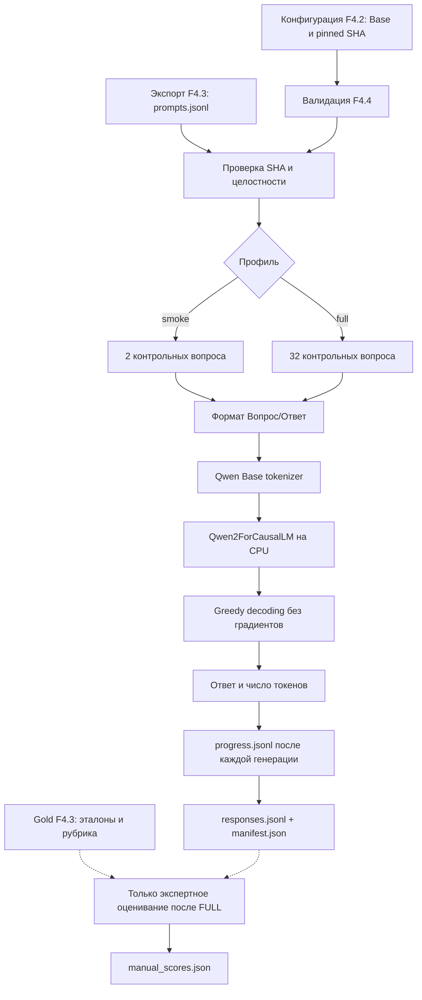
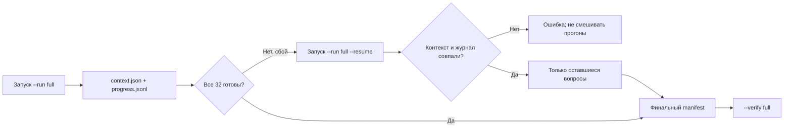

# F4.4 — Base Model Evaluation: первый реальный inference Qwen2.5-0.5B на контрольных вопросах

> **Граница достоверности.** В поставке реализован работающий программный конвейер реального CPU-инференса, но **веса Qwen в среде подготовки поставки не загружались**, и мы не выдаём ответы подставного backend в unit-тестах за ответы LLM. Реальный baseline появляется **только после твоего запуска** `--run full` и последующей проверки `--verify full`. Число «качество ответов» появляется **только после ручной оценки** по F4.3, а не из факта работы `generate()`.

## 1. Цель этапа

### Связь с F4.1–F4.3

**F4.1 — Instruction Dataset.** Мы создали 80 авторских технических инструкций и разделили их на непересекающиеся train (56), validation (12) и test (12). На train в будущих этапах можно обучать адаптер; validation используют для настройки и контроля процесса. Данные test не должны управлять подбором гиперпараметров.

**F4.2 — Model Selection.** Мы выбрали не чат-модель, а **Qwen/Qwen2.5-0.5B Base** с фиксированной ревизией `060db6499f32faf8b98477b0a26969ef7d8b9987`. На Windows подтверждена работа реального токенизатора. Ранее оценивался только расчётный размер параметров (494 032 768, приблизительно 1,84 ГиБ FP32-весов, без дополнительных буферов); веса модели ещё не запускались.

**F4.3 — Evaluation Set.** Мы закрепили **независимые 32 технических задания**: по 8 в Python, Linux, SQL и ML; у каждого вопроса есть два обязательных экспертных критерия (64 пункта). Из них сформирован `data/processed/f4_03/prompts.jsonl`, содержащий **только вопрос, домен и ID**. Эталоны и рубрики остаются в исходном файле и недоступны модели как входные данные. Этот holdout предназначен для сравнения Base и Fine-Tuned и не должен использоваться для обучения.

**Проблема F4.4.** Мы знаем, какие вопросы задавать и какую модель выбрали, но не знаем, как она на самом деле отвечает **до SFT/LoRA**. Без сохранённого baseline нельзя доказательно говорить, что обучение улучшило ответы: может измениться шаблон запроса, длина генерации, сама ревизия модели или способ подсчёта метрики.

**Цель F4.4:** впервые загрузить зафиксированные веса Qwen Base, выполнить генерацию на CPU, сохранить сырые ответы и параметры вычислений, проверить происхождение результатов, а затем при необходимости оценить ответы вручную на независимом F4.3 benchmark. **Ни gradient update, ни optimizer, ни LoRA на этом этапе не выполняются.**

### Что считается успешным результатом

1. На CPU успешно проходят самостоятельные тесты конвейера **без скачивания весов**.
2. Данные F4.3 проверяются на SHA-256; в модель не передаются эталоны, рубрика и экспертные подсказки.
3. У Qwen Base получается **реальная генерация** для smoke-кейсов `ev_py_01`, `ev_ml_01`.
4. Полный набор 32 вопросов обрабатывается с одинаковыми настройками и сохраняется в `responses.jsonl`, а `manifest.json` указывает модель, ревизии, хеши, параметры и версии окружения.
5. Проверка `--verify full` подтверждает комплектность данных, размеры, контрольные суммы и отсутствие незаметной модификации.
6. При желании человек отдельно выставляет баллы 0/1/2 по каждому факту из рубрики F4.3, и код выводит макрооценку. Пока это не выполнено, **числового baseline качества нет**.

Важно: **сильный технический ответ от Base не гарантирован**. Модель прошла pretraining, но ещё не была дообучена следовать инструкциям; она может продолжать шаблон вопроса, отвечать нерелевантно или останавливаться раньше. Такие ответы — фактический результат baseline, а не причина подправлять evaluation set.

## 2. Что реализовано

| Файл | Назначение | Что именно реализовано |
|---|---|---|
| `configs/f4_04_base_model_evaluation.json` | Неизменяемый протокол | Путь к F4.2 и F4.3, ID и SHA ревизий модели/токенизатора, бюджет 384 входных + 96 новых токенов, seed=42, 4 CPU-потока, точный шаблон `Вопрос:/Ответ:`, два smoke-кейса и каталог результатов. |
| `src/llm_f4/base_model_evaluation.py` | Основной конвейер | `load_config`, `load_prompts`, `selection`, `formatted_prompt`, `RealCPUGenerator`, `execute`, `verify`, `_execute_inner`, `template_grades`, `score_grades`, `real_runtime`: контракты, загрузка модели, генерация, журнал, манифест, проверка, ручная оценка. |
| `scripts/f4_base_model_evaluation.py` | Запускаемая CLI-демонстрация | `--plan`, `--run smoke`, `--run full`, `--allow-download`, `--resume`, `--verify smoke/full`, `--grades-template`, `--score-grades FILE`. По умолчанию — безопасный план без загрузки весов. |
| `tests/test_f4_base_model_evaluation.py` | CPU-независимые unit-тесты | Сверка ревизий, формы источников, недопуск gold в prompt, подсчёт ресурсов и длины, целостность ответов, имитация прерывания и resume, обработка ошибок, экспертная арифметика, Windows CLI; **подставной генератор** используется только для тестов, он не является Qwen. |
| `docs/steps/F4_04_base_model_evaluation.md` | Настоящий учебный разбор | Подробная последовательность, формулы, числовые примеры, Mermaid-схемы, протокол реального запуска, ожидаемые результаты, ограничения и повторение от первого лица. |

В ZIP только **пять файлов текущего этапа**. `README.md` не изменяется. Мы не распространяем веса, кэш Hugging Face, данные вывода модели, результаты ручной проверки, виртуальное окружение или файлы F4.1–F4.3.

### Производные артефакты (создаются только локально)

```text
data/processed/f4_04/
├── smoke/
│   ├── context.json       # зафиксированная конфигурация конкретного запуска
│   ├── progress.jsonl     # журнал: одна реальная генерация = одна строка
│   ├── responses.jsonl    # итог, ровно 2 строки
│   └── manifest.json      # фактические метрики и SHA
└── full/
    ├── context.json
    ├── progress.jsonl
    ├── responses.jsonl    # итог, ровно 32 строки
    ├── manifest.json
    ├── grades_template.jsonl   # создаётся отдельно по запросу
    └── manual_scores.json      # создаётся только после ручной оценки
```

Если процесс оборвался до последнего вопроса, в каталоге остаётся `context.json` и частичный `progress.jsonl`; **наличие каталога не является доказательством PASS**.

## 3. Последовательность реализации

### Шаг 1. Закрепили единственную базовую модель

**Что сделали.** В `configs/f4_04_base_model_evaluation.json` записали точные ID и ревизии из F4.2. `load_config()` вызывает `load_catalog()` и сравнивает `model_id`, `revision`, `tokenizer_revision`. Затем проверяет `assess_candidate()` — разрешено ли использовать эту модель в CPU-профиле.

**Зачем.** Нельзя менять Base на Instruct или обновлять `main` между F4.4 и F4.7: такое сравнение уже не проверяет эффект SFT. В конфигурации намеренно нет варианта модели «по умолчанию из интернета».

**Результат.** Несовпадение хотя бы одной ревизии завершает подготовку ошибкой до загрузки весов. SHA самой конфигурации также записывается в контекст.

### Шаг 2. Отделили вход для генерации от правильных ответов

**Что сделали.** `load_prompts()` вызывает `verify_artifacts()` предыдущей фазы: проверяется утверждённый `prompts.jsonl`, его побайтовое совпадение с экспортом F4.3 и закреплённые SHA входов. Затем создаются объекты `Prompt(case_id, domain, prompt)`, в которых **нет `reference_answer`, `rubric`, `required_facts`**.

**Зачем.** В evaluation модель должна сама выдать ответ. Подсказка в виде эталона или критериев завышает результаты и обесценивает baseline. Сам код F4.3 на этапе предварительной проверки имеет доступ к gold для валидации; это не означает передачи gold в `generate()`.

**Результат.** Вызов backend в `RealCPUGenerator.generate(prompt, ...)` получает только текст сформированного запроса. Неверный или неподготовленный экспорт F4.3 вызывает отказ. Для создания экспорта предварительно служит `scripts/f4_evaluation_set.py`.

### Шаг 3. Зафиксировали одинаковую постановку задачи

**Что сделали.** В `formatted_prompt()` определён вид:

```text
Вопрос:
Что выведет Python-код range(2, 7, 2) при преобразовании в список и почему?

Данные:
list(range(2, 7, 2))
Ответ:
```

Вопрос и дополнительные данные берутся из F4.3, а `Вопрос:` и `Ответ:` — из F4.4. Функция только соединяет строки и не добавляет правильный ответ. Это **plain-text prompt для Base-модели**, не `apply_chat_template()` для Instruct.

**Зачем.** Слова и переносы строк могут повлиять на генерацию. Для честного F4.7 шаблон следует сохранить **побуквенно**.

**Что получили.** Для каждого кейса считается `SHA256(formatted_prompt)`. Изменённая формулировка уже не пройдёт проверку итогового ответа как прежняя.

### Шаг 4. Разделили smoke и полный baseline

**Что сделали.** `selection()` выбирает либо фиксированные `ev_py_01` и `ev_ml_01`, либо **все 32** задания в исходном порядке F4.3. Восемь вопросов из каждой предметной области попадают только в полный режим.

**Зачем.** Smoke дешево проверяет, что модель действительно загружается и умеет выдавать токены. Он **не измеряет качество всего benchmark**. Полный режим нужен для осмысленного сравнения на одинаковом множестве задач.

**Результат.** Выходы разнесены по папкам `smoke/` и `full/`. Smoke не может случайно заменить full даже при успешном `--verify smoke`.

### Шаг 5. Проверили окружение и загрузили реальные веса

**Что сделали.** В `real_runtime()` отдельно проверяются установленные версии Python, PyTorch, Transformers и наличие `safetensors`. Затем **только по явному `--run`** выполняется `RealCPUGenerator.__init__()`:

```python
from transformers import AutoModelForCausalLM, AutoTokenizer

tokenizer = AutoTokenizer.from_pretrained(
    model_id, revision=tokenizer_revision,
    local_files_only=not allow_download,
    trust_remote_code=False,
    use_fast=True,
)

# В рабочем коде параметр dtype/torch_dtype выбран по major версии transformers.
model = AutoModelForCausalLM.from_pretrained(
    model_id, revision=model_revision,
    local_files_only=not allow_download,
    trust_remote_code=False,
    use_safetensors=True,
    torch_dtype=torch.float32,  # transformers 4.x
)
model = model.to("cpu")
model.eval()
```

**Зачем.** Контролируем происхождение весов и избегаем удалённого пользовательского кода (`trust_remote_code=False`). `safetensors` предназначен для хранения параметров без произвольного pickle-объекта. `float32` соответствует CPU-бюджету F4.2; `eval()` отключает режим обучающих слоёв (например, dropout), но сам по себе не заменяет `torch.inference_mode()`.

**Что получили.** Возможность использовать реально загруженную Base-модель. Веса не включаются в ZIP. Первое скачивание **может потребовать заметный объём диска и ОЗУ**, так как 1,84 ГиБ — лишь идеальный размер FP32-параметров, а не полный максимум RAM во время загрузки и генерации.

### Шаг 6. Реализовали генерацию без градиентов и без случайной выборки

**Что сделали.** `RealCPUGenerator.generate()` токенизирует вход и **отказывается от усечения**, если длина превышает 384 токена. Для генерации используется:

```python
with torch.inference_mode():
    outputs = model.generate(
        input_ids=ids,
        attention_mask=attention_mask,
        max_new_tokens=96,
        do_sample=False,
        num_beams=1,
        use_cache=True,
        eos_token_id=tokenizer.eos_token_id,
        pad_token_id=tokenizer.eos_token_id,
    )

# У decoder-only Causal LM результат содержит исходный prompt.
new_ids = outputs[0, prompt_token_count:].tolist()
response = tokenizer.decode(new_ids, skip_special_tokens=True,
                            clean_up_tokenization_spaces=False)
```

**Зачем.** `do_sample=False`, `num_beams=1` фиксируют **greedy decoding**: из распределения следующего токена берём наибольший logit, а не случайную выборку. В таком режиме temperature не применяется. `seed=42` зафиксирован дополнительно, но не является доказательством побайтовой идентичности на любом железе и любой версии PyTorch.

**Результат.** Отдельный текст ответа, не включающий префикс входного вопроса; число входных и сгенерированных токенов; признак завершения `eos`. Пустой декодированный текст допустим (например, если модель сразу сгенерировала EOS) и честно сохраняется.

### Шаг 7. Сохранили происхождение и результаты по одному вопросу

**Что сделали.** `_execute_inner()` до загрузки модели создаёт `context.json`, где фиксирует модель, ревизии, шаблон, seed, длины, версии runtime, SHA F4.3 и SHA F4.4. После каждого ответа атомарно по строкам добавляет в `progress.jsonl`:

- `case_id`, `domain`;
- хеш **точного** сформированного вопроса;
- `response` — действительно декодированный текст (без подставного эталона);
- SHA ответа;
- количество входных/новых токенов и признак EOS;
- измеренное время одной генерации (без загрузки весов).

После последнего вопроса создаются `responses.jsonl` и `manifest.json`. В `manifest` вычисляются количество примеров, число сгенерированных токенов, суммарная длительность, токены/с и число пустых ответов.

**Зачем.** Нельзя хранить только красивую итоговую цифру: при неполном прогоне невозможно понять, какие задачи реально выполнены и с какой конфигурацией. SHA защищает от незаметного редактирования файла, хотя **не доказывает истинность смыслового содержания ответа**.

**Результат.** Файлы, пригодные для повторной оценки в F4.7, с точной идентичностью вопросов и модели.

### Шаг 8. Добавили безопасное возобновление после прерывания

**Что сделали.** При запуске `--run full --resume` код читает прежний `context.json` и `progress.jsonl`, требует совпадения контекста и проверяет уже записанные строки. Модель генерирует **только оставшиеся** ответы.

**Зачем.** CPU-прогон 32 заданий может прерваться по причинам, не связанным с качеством модели. Начинать с нуля необязательно, но и молча присоединять результаты другой модели, другого шаблона или другой версии библиотек нельзя.

**Результат.** Продолжение только при неизменных условиях; при повреждённой последней строке журнала выдаётся ошибка, автоматического «лечения» данных нет. Успешно завершённый прогон не перезаписывается — используется `--verify`.

### Шаг 9. Добавили независимую проверку и необязательную ручную оценку

**Что сделали.** `verify()` пересчитывает SHA, порядок и структуру всех ответов, требует ровно 2 или 32 строк согласно профилю, сверяет манифест и контекст с F4.2/F4.3/F4.4. По отдельному запросу `template_grades()` создаёт список **пустых** оценок обязательных фактов с привязкой к SHA каждого ответа; `score_grades()` после заполнения вызывает **существующую** функцию F4.3 `score_manual_grades()`.

**Зачем.** `Inference PASS` означает, что модель выдала ответы — но **не** что ответы правильные. Частоту появления нужных слов нельзя автоматически принимать за техническую корректность. Противоречия, неполноту и фактические ошибки оценивает эксперт.

**Результат.** Отдельный `manual_scores.json` с `macro_over_cases` и `macro_by_domain`, который появляется только после всех 64 оценок. Обновлённые баллы не переписывают сырые ответы и прежний `manifest.json`.

## 4. Алгоритм и математический пример

### 4.1. Что вычисляет Causal Language Model

После токенизации текст превращается в последовательность идентификаторов токенов:

\[
x=(x_1,x_2,\ldots,x_T).
\]

Causal LM оценивает вероятности следующего токена, опираясь только на предыдущие:

\[
p(x_{T+1}\mid x_1,\ldots,x_T)=\mathrm{softmax}(z)_k
=\frac{e^{z_k}}{\sum_{j=1}^{V}e^{z_j}}.
\]

Здесь \(T\) — число входных токенов, \(V\) — размер словаря, \(z_j\) — logit для кандидата \(j\), а \(p\) — вероятность токена после softmax.

Мы использовали **greedy decoding**:

\[
x_{T+1}=\underset{j}{\arg\max}\; z_j.
\]

То есть берём токен с наибольшим logit. Следующий шаг уже учитывает добавленный токен; это **авторегрессионная генерация**. Алгоритм повторяется, пока не появится EOS или не будет достигнут `max_new_tokens`.

### 4.2. Числовой пример (не настоящие logits Qwen)

Предположим, модель предложила три токена с logits:

| Токен | \(z\) | \(e^z\) | Вероятность |
|---|---:|---:|---:|
| A | 2,0 | 7,389 | 0,665 |
| B | 1,0 | 2,718 | 0,245 |
| C | 0,0 | 1,000 | 0,090 |

Сумма экспонент: \(7{,}389+2{,}718+1=11{,}107\). Для A: \(p(A)=7{,}389/11{,}107\approx0{,}665\). Greedy выберет **A**. В рабочем коде этот выбор происходит **внутри** `model.generate(do_sample=False, num_beams=1)`. Это искусственный числовой пример для объяснения принципа, а не измерение распределений настоящего checkpoint.

### 4.3. Почему ограничиваем длину

Пусть один запрос после токенизации содержит \(T=120\) токенов, а предел новых токенов \(G=96\). Максимальная длина последовательности к концу генерации равна \(120+96=216\), что меньше установленного профиля F4.2 \(512\). При этом границы конфигурации F4.4 допускают **не более 384+96=480** токенов на одну последовательность.

**Контроль:** перед вызовом `generate()` проверяем фактическое \(T\le384\). В случае превышения не применяем `truncation=True`, иначе начало вопроса могло бы исчезнуть, а оценка — стать некорректной.

### 4.4. Что считаем после генерации

**Скорость генерации:**

\[
v=\frac{\sum_i G_i}{\sum_i t_i},
\]

где \(G_i\) — количество выданных моделью токенов, \(t_i\) — измеренное время `generate()` для соответствующего примера, **не включая загрузку весов**. Допустим, 15 токенов за 3 секунды и 25 токенов за 5 секунд. Тогда \(v=(15+25)/(3+5)=5\) токенов/с. Это скорость исполнения, **не качество**.

**Экспертное качество (после ручной проверки):** в F4.3 за каждый из двух смысловых пунктов задания даём 0, 1 или 2 балла. Например, пункт «названы элементы `range`» — 2, «объяснена исключённая правая граница» — 1. Тогда \(s=(2+1)/(2\cdot2)=0{,}75\).

Для набора из \(N=32\) вопросов:

\[
S_{\text{macro}}=\frac{1}{N}\sum_{i=1}^{N}s_i.
\]

Это соответствует `score_manual_grades()` F4.3. Ровно один итоговый балл для каждого кейса, затем среднее по кейсам. Чтобы получить настоящий \(S_{\text{macro}}\), человеку нужно заполнить **все 64 балла**. В примере выше 0,75 — учебная арифметика, а не оценка Qwen.

### 4.5. Почему не используем loss или perplexity как замену

Можно оценивать likelihood текста через отрицательную log-likelihood и perplexity: \(\mathrm{PPL}=\exp(-\frac{1}{T}\sum_t\log p(x_t\mid x_{<t}))\). Но для самостоятельной качественной задачи *ответить на инструкцию* это не эквивалент экспертного ответа. В F4.4 не делаем teacher-forced проход по эталонам и **не объявляем PPL**, не вычисляя её в реальном коде. Сырые ответы и отдельная ручная рубрика — честная основа для сравнения F4.7.

## 5. Схема работы

### 5.1. Безопасная подготовка и inference



**Принципиально:** нет стрелки **Gold → Qwen**. Эталонные ответы используются лишь при проверке корректности исходного benchmark и отдельно на этапе выставления оценок человеком.

### 5.2. Прерванная генерация



## 6. Локальная проверка PowerShell

Запуск из корня `F:\DEVELOPMENT\ML\ml-engineering-lab`. Сначала распакуй F4.4 ZIP поверх текущего проекта. `README.md` не трогаем.

### 6.1. Проверить контрольные данные F4.3 (обязательная предпосылка)

```powershell
cd F:\DEVELOPMENT\ML\ml-engineering-lab

.\.venv\Scripts\python.exe scripts/f4_evaluation_set.py
.\.venv\Scripts\python.exe scripts/f4_evaluation_set.py --verify
```

Ожидается `F4.3 BUILD: PASS`, `F4.3 VERIFY: PASS`; сформирован `data/processed/f4_03/prompts.jsonl` (ровно 32 строки). Веса Qwen не используются.

### 6.2. Проверка unit-тестов F4.4

```powershell
.\.venv\Scripts\python.exe -m pytest tests/test_f4_base_model_evaluation.py -q
```

Тесты работают с временной копией предыдущих данных и подставным генератором. Подтверждают **корректность программного конвейера**, но **не** ответы реальной Qwen или её качество. При запуске из чистой локальной установки не требуется скачивать checkpoint.

### 6.3. Проверить план и исходные fingerprints

```powershell
.\.venv\Scripts\python.exe scripts/f4_base_model_evaluation.py --plan
```

Ожидаемые ключевые строки:

```text
F4.4 PLAN: PASS (metadata and prompt export only)
Model: Qwen/Qwen2.5-0.5B | revision=060db6499f32faf8b98477b0a26969ef7d8b9987
Evaluation: f4_03_ru_technical_v1 | full=32 | smoke=2
Input cap: 384 | new token cap: 96
Weights / generation / expert grading: NOT RUN
```

`--plan` ничего не скачивает. Если ошибка `F4.3 export validation failed`, выполни команды **6.1**, а не редактируй файл с эталонами.

### 6.4. Первый реальный CPU-запуск на двух вопросах

При первом запуске на Windows у тебя скачивался только **токенизатор** (F4.2). Веса Qwen Base требуют отдельной загрузки с Hugging Face. Явно разрешаем её:

```powershell
.\.venv\Scripts\python.exe scripts/f4_base_model_evaluation.py --run smoke --allow-download
```

Ожидаемый формат при **фактически завершённой** генерации:

```text
F4.4 RUN SMOKE: PASS
Model: Qwen/Qwen2.5-0.5B | revision=060db6499f32faf8b98477b0a26969ef7d8b9987
Responses: 2/2
Generated tokens: <фактическое целое число>
Quality score: NOT HUMAN GRADED
```

Количество токенов **заранее неизвестно**: не надо подставлять пример вместо реального результата. Если будет нехватка RAM, ошибка загрузки или другой сбой, статус smoke остаётся непроверенным; не следует выдавать `--plan` или unit-тесты за генерацию.

После запуска сверяем артефакты:

```powershell
.\.venv\Scripts\python.exe scripts/f4_base_model_evaluation.py --verify smoke
```

Ожидаем `F4.4 VERIFY SMOKE: PASS`, `Responses: 2/2` и контрольную сумму. Для просмотра **реального** ответа без изменения данных:

```powershell
Get-Content data\processed\f4_04\smoke\responses.jsonl -Encoding UTF8
```

Сырые строки JSON содержат `response`, `case_id`, токен-счётчики и хеши; это материалы для обсуждения исходного поведения Base.

### 6.5. Полный baseline на всех 32 вопросах

После завершённого smoke и уже скачанных весов:

```powershell
.\.venv\Scripts\python.exe scripts/f4_base_model_evaluation.py --run full
```

Если в локальном кеше весов нет, для **первого** выполнения full можно указать `--allow-download`, но скачивание без явного разрешения **не** происходит.

Если прогон прервётся и будет существовать `context.json` с частичным `progress.jsonl`, не удаляй журнал. Для продолжения:

```powershell
.\.venv\Scripts\python.exe scripts/f4_base_model_evaluation.py --run full --resume
```

Если предыдущий процесс упал во время скачивания и версия окружения не изменилась, тот же `--resume` допустимо дополнить `--allow-download`. Если контекст не совпадает или журнал повреждён, конвейер должен отказать: требуется анализ причин, а не смешивание результатов.

Когда полная генерация действительно завершится, должно появиться:

```text
F4.4 RUN FULL: PASS
Responses: 32/32
Quality score: NOT HUMAN GRADED
```

Затем проверка:

```powershell
.\.venv\Scripts\python.exe scripts/f4_base_model_evaluation.py --verify full
```

Ожидаем `F4.4 VERIFY FULL: PASS`, `Responses: 32/32`. Изучаем реальные ответы:

```powershell
Get-Content data\processed\f4_04\full\responses.jsonl -Encoding UTF8
Get-Content data\processed\f4_04\full\manifest.json -Encoding UTF8
```

`manifest.json` содержит технические показатели (примеры, токены, время, ошибки завершения). `quality_score: null` — **ожидаемо** до ручной оценки.

### 6.6. Необязательная, но желательная экспертная оценка качества

Создаём форму **только для подтверждённого full**:

```powershell
.\.venv\Scripts\python.exe scripts/f4_base_model_evaluation.py --grades-template
```

В `data/processed/f4_04/full/grades_template.jsonl` появятся 32 строки с `case_id`, `response_sha256` и `fact_scores` из двух полей, изначально со значениями `null`. Команда не содержит готовых баллов и не сообщает качество.

Для каждого `case_id`:

1. Прочти ответ из `full/responses.jsonl`.
2. Открой критерии и эталон F4.3 (например, `scripts/f4_evaluation_set.py --verify --show-case ev_py_01`); эталон не передавай обратно модели.
3. Выставь **каждому** из двух смысловых пунктов `0`, `1` либо `2`, замени `null` на целые числа.
4. В `notes` кратко объясни вердикт. При разногласиях или двусмысленности фиксируй оговорки в заметке.

После проверки **всех 32** вопросов агрегируем:

```powershell
.\.venv\Scripts\python.exe scripts/f4_base_model_evaluation.py --score-grades data/processed/f4_04/full/grades_template.jsonl
```

Ожидается `F4.4 HUMAN GRADING: PASS` и **фактически вычисленный** `Macro score: ...` (число не задаём заранее). Итог появится в `data/processed/f4_04/full/manual_scores.json`. Если остался хотя бы один `null`, имеются повторные ID или хеши ответов не совпадают — команда должна завершиться ошибкой, **не** притворяться успешной.

### 6.7. Регрессия предыдущих этапов и всего репозитория

```powershell
.\.venv\Scripts\python.exe -m pytest -q tests/test_f4_instruction_dataset.py tests/test_f4_model_selection.py tests/test_f4_evaluation_set.py tests/test_f4_base_model_evaluation.py
.\.venv\Scripts\python.exe -m pytest -q
```

Последний подтверждённый тобой полный результат до F4.4 — **1532 passed**. Количество новых тестов определяется файлами текущей поставки; итоговый `pytest -q` должен показывать отсутствие `FAILED`. Реальные веса не загружаются стандартным pytest-запуском.

### 6.8. Важные ошибки и их интерпретация

| Симптом | Что означает | Как действовать |
|---|---|---|
| `F4.3 export validation failed` | Не создан или изменён prompt-only экспорт | Выполнить F4.3 BUILD и VERIFY; исходную эталонную выборку не менять |
| `Runtime is incompatible` | Не найдена подходящая версия нужной библиотеки | Проверить `torch`, `transformers`, `safetensors` в своём venv; не считать модель загруженной |
| `Cannot load pinned Qwen Base model` | Ошибка получения весов, памяти или HF runtime | Сохранить stderr и проверить доступность кеша, RAM и версии библиотек |
| `Prompt length ... truncation forbidden` | Вопрос слишком длинный для фиксированного протокола | Не подрезать текст молча; отдельно согласовать новый протокол |
| `Output ... is not empty` | Уже есть результат или частичный журнал | Для незавершённого использовать `--resume`, для завершённого `--verify` |
| `Resume context mismatch` | Изменён протокол, версия или модель | Не смешивать два прогона; сохранять старый журнал как отдельный опыт |
| `Grading ... invalid` | Не заполнена/неправильна ручная рубрика | Проверить все 64 балла, соответствие фактов и SHA ответов |

**Отдельно про ресурсы.** Из F4.2 расчётный FP32-объём весов — около **1884,585 МиБ**, но суммарные пиковые затраты RAM могут быть больше из-за промежуточных объектов, кеша и загрузчика. Это **не** GPU-обучение и не память LoRA. CPU-генерация может быть заметно медленнее GPU; скорость измеряется только фактическим запуском, мы её не предсказываем.

## 7. Что доказано тестами и какие ограничения остаются

### Подтверждено автоматическими тестами без весов

- Конфигурация F4.4 совместима с утверждёнными F4.2 и F4.3, ревизии совпадают и полный контекст не превышает выбранное окно 512.
- Ввод для генератора ограничен `Prompt` и текстом `formatted_prompt()`. Источник эталонов хранится отдельно, в prompt-only экспорте нет критериев.
- Повреждённые и подменённые файлы, неизвестные поля JSON, неправильные типы, изменения ревизий и неразрешённые пути вызывают ошибки.
- Прерванный **тестовый конвейер с fake backend** возобновляет только оставшиеся задания, а изменённый контекст или повреждённый журнал отклоняется.
- Функции подсчёта токенов/секунд и ручных оценок согласованы с числовыми эталонами; `null` и неверные баллы не принимаются.
- Тесты проверяют CLI в разных Windows-кодировках при выводе `--help`.

### Не подтверждено до пользовательского запуска

- Наличие/доступность полных весов Qwen на твоём компьютере и фактическая загрузка модели.
- Реальная работа `model.generate()` на Windows с установленной версией Transformers и фактическим объёмом памяти.
- Время полного инференса 32 заданий, число новых токенов, ответы и завершение EOS.
- Реальное качество Base и его сравнение с SFT — **для числовой оценки требуется заполненная ручная рубрика**.
- Универсальное отсутствие смысловых парафраз/скрытой утечки: F4.3 проверяет формальное отсутствие копий и текстовых пересечений, но маленький авторский holdout не даёт статистических гарантий.
- Битовая идентичность между разными CPU/версиями библиотек: фиксируем конфигурацию и greedy decoding, но не обещаем полную кроссплатформенную детерминированность.

### Что означает PASS на каждом уровне

| Уровень | Что реально подтверждено | Чего **не** подтверждает |
|---|---|---|
| Unit tests PASS | Подготовка, протокол и проверка журналов | Что Qwen отвечала на вопросы |
| `--plan` PASS | F4.2/F4.3 входы согласованы | Что веса скачались |
| `--run smoke` и `--verify smoke` PASS | Два настоящих ответа Qwen | Среднее качество по 32 вопросам |
| `--run full` и `--verify full` PASS | Все 32 ответа с единым протоколом | Семантическую правильность |
| `--score-grades` PASS | Арифметика **заполненных человеком** аннотаций | Безошибочность самого эксперта |

В будущем F4.7 нужно применять **тот же контрольный набор, шаблон, максимальные длины, способ генерации и рубрику**, иначе сравнение Base и Fine-Tuned будет смешано с эффектом смены протокола. На текущем этапе **никаких улучшений качества не заявляем**.

## 8. Основная мысль этапа

«До F4.4 я подготовил данные для дообучения, выбрал определённую Base-модель и отдельно собрал независимые 32 тестовых вопроса. Но у меня ещё не было зафиксированного ответа на главный практический вопрос: как **эта самая модель, без моего fine-tuning**, решает заданные технические задачи. Если до обучения не получить такие ответы, потом невозможно достоверно доказать, что новая версия стала лучше».

«Поэтому первым делом я связал модель и тестовые задания через неизменяемые ревизии и SHA-256. Я специально проследил, чтобы в вызов генерации попадали **только вопросы**; правильные ответы и критерии остались в отдельном F4.3-файле. Далее зафиксировал шаблон `Вопрос/Ответ`, ограничение длины и greedy decoding. Это нужно не ради красивой организации, а чтобы следующий эксперимент на Fine-Tuned мог использовать совершенно те же условия. Изменение шаблона или sampling-режима само по себе может изменить результат».

«Затем я реализовал реальный CPU-путь: загрузку checkpoint по точному commit SHA, токенизацию русских вопросов, `model.eval()` и `torch.inference_mode()`, последовательную генерацию ответов и сохранение каждого результата с контрольной суммой. Отдельно сделал smoke на двух вопросах, чтобы не путать проверку работоспособности с полноценной оценкой 32 задач. Для длительного CPU-запуска предусмотрел журнал и resume: можно продолжить с оставшихся вопросов, но нельзя тихо смешать результаты разных версий модели или окружения».

«Самое важное методологическое ограничение: наличие текста ответа не означает, что он верный. Поэтому для F4.4 я отдельно считаю технические метрики исполнения — количество токенов, скорость и время — и **отдельно** оставляю экспертную оценку по рубрике F4.3. Пока человек не проверил все 64 обязательных пункта, цифра качества отсутствует. Я не называю подставной тест моделью, а offline-верификацию — выполненным inference. Если результаты реальной Base оказываются слабыми или неструктурированными, это и есть честный baseline, с которым я буду сравнивать эффект SFT и LoRA».

«Таким образом F4.4 переводит лабораторию от описания выбранной модели к воспроизводимому эксперименту. На техническом собеседовании я могу объяснить не только, как вызывается `generate()`, но и почему нужны pinned revision, изоляция gold, правильный срез новых токенов, единый декодер и фиксация метрик. Теперь следующие шаги смогут обсуждать эффект обучения на конкретных данных, а не на субъективном впечатлении от пары запросов».

## 9. Файлы этапа

| Рекомендуемый порядок | Файл | Что именно стоит изучить |
|---|---|---|
| 1 | `configs/f4_04_base_model_evaluation.json` | Почему модель и tokenizer revision одинаковы, зачем `max_input_tokens`, `max_new_tokens`, seed, шаблон и фиксированный smoke; связь с F4.2. |
| 2 | `src/llm_f4/base_model_evaluation.py` | `load_config()` и `load_prompts()` — привязка к F4.3 и предотвращение утечки; затем `selection()`, `formatted_prompt()`. |
| 3 | `src/llm_f4/base_model_evaluation.py` | `RealCPUGenerator.__init__()` — безопасная загрузка Base; `RealCPUGenerator.generate()` — токенизация, greedy, `inference_mode`, срез ответа после токенов входа. |
| 4 | `src/llm_f4/base_model_evaluation.py` | `_execute_inner()` — порядок генерации и журнал; `profile_context()`, `_validate_result()`, `verify()` — происхождение и проверка; `template_grades()` и `score_grades()` — разделение инференса и экспертной оценки. |
| 5 | `scripts/f4_base_model_evaluation.py` | Все режимы CLI, особенно отличие plan, smoke, full, verify, resume, scoring; явный флаг скачивания. |
| 6 | `tests/test_f4_base_model_evaluation.py` | Как fake backend доказывает корректность конвейера, не подменяя настоящую модель; отрицательные сценарии SHA, JSON, Windows, resume и баллов. |
| 7 | `docs/steps/F4_04_base_model_evaluation.md` | Сверь реальный вывод с ожидаемыми инвариантами и сформулируй результат своими словами. |

**Дополнительно вернись к прошлым фазам:**

- `src/llm_f4/instruction_dataset.py` — нормализация, контракты датасета, train/validation/test; важно понимать, почему F4.4 не берёт train для независимого baseline.
- `src/llm_f4/model_selection.py` и `configs/f4_02_model_selection.json` — `ModelCatalog`, `assess_candidate()`, `runtime_report()`, расчёт FP32-памяти и pinned checkpoint.
- `src/llm_f4/evaluation_set.py` и `data/evaluation/f4_03_ru_technical_v1.jsonl` — `model_prompt()`, `verify_artifacts()`, `score_manual_grades()`: где находится gold и почему его нет в запросе генерации.
- `scripts/f4_evaluation_set.py` — получение и проверка prompt-only экспорта, который F4.4 берёт на вход.
- Исходники **F3.1** про Self-Attention и **F2.4** про Training Loop — сравни inference (нет loss/gradients/optimizer) с обучением, в котором параметры действительно обновляются.

**Что важно запомнить:** F4.4 — *измерение исходного поведения предобученной Causal LM*, а не обучение. Успешная генерация — это проверка механизма, а качество ответов — самостоятельная экспертная задача. Эту границу нужно удержать при переходе к F4.5 (SFT + LoRA) и F4.7 (Base vs Fine-Tuned).
