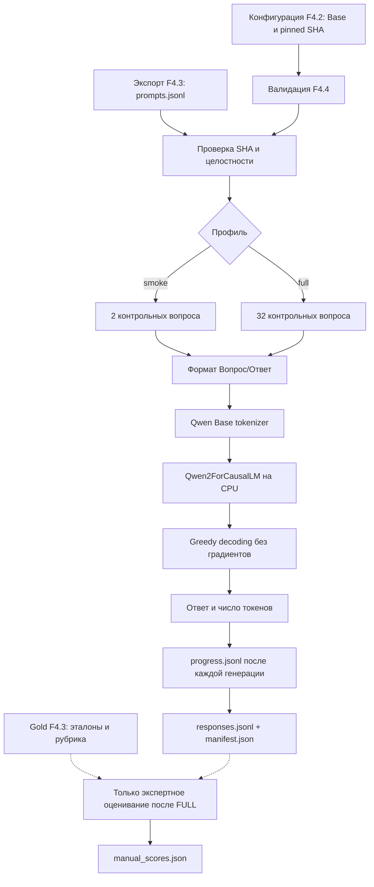
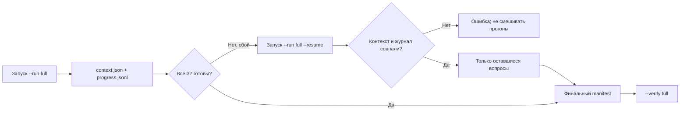

# F4.4 — Base Model Evaluation: первый реальный inference Qwen2.5-0.5B на контрольных вопросах

> **Граница достоверности.** В исходной среде подготовки F4.4 веса Qwen не загружались; подставной backend применялся только для проверки программного конвейера. В дальнейшем реальный CPU-baseline был получен и подтверждён проверкой `--verify full` (**32/32 ответа**). Факт выполнения `generate()` не равен измерению качества: для числовой оценки корректности требуется независимое экспертное оценивание по рубрике F4.3.

## 1. Цель этапа

### Связь с F4.1–F4.3

**F4.1 — Instruction Dataset.** Подготовить 80 авторских технических инструкций и разделить их на непересекающиеся выборки: `train` (56), `validation` (12), `test` (12). Использовать обучающую выборку для последующей адаптации; валидационную — для контроля и настройки обучения. Исключить применение test-данных при подборе гиперпараметров.

**F4.2 — Model Selection.** Выбрать базовую, не instruction-tuned модель **Qwen/Qwen2.5-0.5B Base** и закрепить ревизию `060db6499f32faf8b98477b0a26969ef7d8b9987`. Подтвердить работу токенизатора в Windows. Оценить размер модели по архитектуре: 494 032 768 параметров, приблизительно 1,84 ГиБ FP32-весов без дополнительных буферов. Отделить проверку метаданных и токенизатора от реальной загрузки весов.

**F4.3 — Evaluation Set.** Сформировать **32 независимых технических задания**: по восемь в Python, Linux, SQL и ML. Закрепить два экспертных критерия на каждый вопрос (64 пункта) и подготовить `data/processed/f4_03/prompts.jsonl`, содержащий **только вопрос, предметную область и ID**. Не передавать эталонные ответы и рубрику в запрос модели. Использовать этот holdout для последующего сравнения Base и Fine-Tuned, исключив применение при обучении.

**Проблема F4.4.** Наличие выбранной модели и контрольных вопросов ещё не даёт сведений о её фактических ответах **до SFT/LoRA**. Без сохранённого baseline невозможно достоверно сопоставить результат обучения с исходным поведением модели. При изменении ревизии, шаблона вопроса, длины ответа или способа декодирования возникает дополнительный фактор, способный исказить сравнение.

**Цель F4.4:** загрузить закреплённый checkpoint Qwen Base, выполнить реальную генерацию на CPU, сохранить тексты ответов и параметры исполнения, проверить их происхождение и предусмотреть отдельное экспертное оценивание по рубрике F4.3. **Обновление градиентов, оптимизация параметров и LoRA в F4.4 не выполняются.**

### Что считается успешным результатом

1. Проверить программный конвейер на CPU с помощью unit-тестов **без скачивания весов**.
2. Подтвердить SHA-256 контрольных данных F4.3 и исключить эталоны, рубрики и подсказки эксперта из модельного входа.
3. Выполнить реальную генерацию Qwen Base для smoke-кейсов `ev_py_01` и `ev_ml_01`.
4. Обработать все 32 вопроса с едиными параметрами, сохранить результаты в `responses.jsonl` и зафиксировать модель, ревизии, контрольные суммы, конфигурацию и версии окружения в `manifest.json`.
5. Проверить полноту результатов, порядок ответов, структурные инварианты и целостность файлов командой `--verify full`.
6. При необходимости выполнить ручную оценку каждого обязательного факта по шкале 0/1/2 из F4.3 и вычислить макросредний балл. **До заполнения оценок числовое значение качества не определено.**

**Ограничение модели Base.** Предобученный checkpoint ещё не адаптирован специально к инструкциям. Возможны продолжение шаблона запроса, нерелевантные фрагменты и преждевременное завершение ответа. Такие результаты необходимо сохранять без исправлений: они характеризуют фактический baseline, а не повод менять утверждённый Evaluation Set.

## 2. Что реализовано

| Файл | Назначение | Что именно реализовано |
|---|---|---|
| `configs/f4_04_base_model_evaluation.json` | Неизменяемый протокол | Путь к F4.2 и F4.3, ID и SHA ревизий модели/токенизатора, бюджет 384 входных + 96 новых токенов, seed=42, 4 CPU-потока, точный шаблон `Вопрос:/Ответ:`, два smoke-кейса и каталог результатов. |
| `src/llm_f4/base_model_evaluation.py` | Основной конвейер | `load_config`, `load_prompts`, `selection`, `formatted_prompt`, `RealCPUGenerator`, `execute`, `verify`, `_execute_inner`, `template_grades`, `score_grades`, `real_runtime`: контракты, загрузка модели, генерация, журнал, манифест, проверка, ручная оценка. |
| `scripts/f4_base_model_evaluation.py` | Запускаемая CLI-демонстрация | `--plan`, `--run smoke`, `--run full`, `--allow-download`, `--resume`, `--verify smoke/full`, `--grades-template`, `--score-grades FILE`. По умолчанию — безопасный план без загрузки весов. |
| `tests/test_f4_base_model_evaluation.py` | CPU-независимые unit-тесты | Сверка ревизий, формы источников, недопуск gold в prompt, подсчёт ресурсов и длины, целостность ответов, имитация прерывания и resume, обработка ошибок, экспертная арифметика, Windows CLI; **подставной генератор** используется только для тестов, он не является Qwen. |
| `docs/steps/F4_04_base_model_evaluation.md` | Учебно-техническая документация | Последовательность действий, формулы, числовые примеры, Mermaid-схемы, протокол реального запуска, ожидаемые результаты, ограничения и технические выводы. |

Исходная поставка F4.4 содержит **пять файлов этапа**. При исправлении только документации заменить исключительно `docs/steps/F4_04_base_model_evaluation.md`. `README.md` и исходный код оставить без изменений. Исключить из поставки документации веса, кеш Hugging Face, результаты генерации, данные экспертного оценивания, виртуальное окружение и файлы других этапов.

### Производные артефакты (создаются только локально)

```text
data/processed/f4_04/
├── smoke/
│   ├── context.json       # зафиксированная конфигурация конкретного запуска
│   ├── progress.jsonl     # журнал: одна реальная генерация = одна строка
│   ├── responses.jsonl    # итог, ровно 2 строки
│   └── manifest.json      # фактические метрики и SHA
└── full/
    ├── context.json
    ├── progress.jsonl
    ├── responses.jsonl    # итог, ровно 32 строки
    ├── manifest.json
    ├── grades_template.jsonl   # создаётся отдельно по запросу
    └── manual_scores.json      # создаётся только после ручной оценки
```

Если процесс оборвался до последнего вопроса, в каталоге остаётся `context.json` и частичный `progress.jsonl`; **наличие каталога не является доказательством PASS**.

## 3. Последовательность реализации

### Шаг 1. Зафиксировать единственную базовую модель

**Действие.** Записать в `configs/f4_04_base_model_evaluation.json` точные идентификатор и ревизии модели и токенизатора из F4.2.

**Назначение.** Исключить замену Base на Instruct или незаметное обновление checkpoint между F4.4 и F4.7. При смене модели сравнение перестаёт отражать только влияние SFT.

**Реализация.** В `load_config()` вызвать `load_catalog()`; сравнить `model_id`, `revision`, `tokenizer_revision`. Выполнить проверку пригодности CPU-профиля через `assess_candidate()`. Зафиксировать SHA-256 конфигурации в контексте запуска.

**Результат.** Несоответствие идентификатора или ревизии вызывает ошибку до загрузки весов. Исходный checkpoint однозначно привязан к эксперименту.

### Шаг 2. Отделить запросы генерации от эталонных ответов

**Действие.** Загрузить подготовленный F4.3 `prompts.jsonl` и подтвердить его целостность через `verify_artifacts()`.

**Назначение.** Предотвратить попадание эталонов или рубрик в запрос модели. Передача правильного ответа во время проверки делает baseline методологически недостоверным.

**Реализация.** В `load_prompts()` сравнить экспорт с утверждённым источником и SHA-256; построить объекты `Prompt(case_id, domain, prompt)` без полей `reference_answer`, `rubric`, `required_facts`. Вызвать backend только с текстом подготовленного запроса. Для создания экспорта использовать `scripts/f4_evaluation_set.py`.

**Результат.** Изолированный prompt-only вход для Qwen. Изменённый или невалидный экспорт вызывает отказ до начала генерации. Наличие gold в модуле проверки F4.3 не означает его передачу в `generate()`.

### Шаг 3. Зафиксировать шаблон и текст каждого запроса

**Действие.** Задать единый формат `Вопрос:/Данные:/Ответ:` через `formatted_prompt()`.

**Пример сформированного запроса:**

```text
Вопрос:
Что выведет Python-код range(2, 7, 2) при преобразовании в список и почему?

Данные:
list(range(2, 7, 2))
Ответ:
```

**Назначение.** Обеспечить сопоставимость поведения Base и Fine-Tuned. Даже незначительное изменение слов, пробелов или переводов строк способно повлиять на следующий токен.

**Реализация.** Добавить только метки и данные F4.3, без эталонного ответа. Для Base использовать plain-text prompt без `apply_chat_template()`. Вычислить `SHA256(formatted_prompt)` для каждого задания.

**Результат.** Точный запрос можно сопоставить с сохранённым ответом по контрольной сумме; изменение шаблона обнаруживается при верификации.

### Шаг 4. Разделить smoke-проверку и полный baseline

**Действие.** Реализовать два профиля: smoke на `ev_py_01`, `ev_ml_01` и full на **32** заданиях F4.3.

**Назначение.** Проверить работоспособность загрузки и генерации на малом объёме перед запуском полного набора. Не использовать успешный smoke как оценку качества по всем вопросам.

**Реализация.** В `selection()` вернуть заданную пару smoke-кейсов либо полный список в фиксированном порядке. Для профилей использовать независимые выходные каталоги `smoke/` и `full/`.

**Результат.** Проверка двух заданий и полноценный baseline разделены программно и не могут подменить друг друга.

### Шаг 5. Проверить окружение и загрузить закреплённые веса

**Действие.** Подготовить локальный CPU runtime и загрузить Qwen Base только при явном запуске `--run`.

**Назначение.** Использовать зафиксированный checkpoint без выполнения стороннего пользовательского кода и исключить автоматическое скачивание больших весов при unit-тестах.

**Реализация.** Проверить Python, PyTorch, Transformers и `safetensors` в `real_runtime()`. В `RealCPUGenerator.__init__()` загрузить токенизатор и модель с закреплёнными ревизиями, `trust_remote_code=False`, `use_safetensors=True`, FP32 и переводом в режим `eval()`:

```python
from transformers import AutoModelForCausalLM, AutoTokenizer

tokenizer = AutoTokenizer.from_pretrained(
    model_id, revision=tokenizer_revision,
    local_files_only=not allow_download,
    trust_remote_code=False,
    use_fast=True,
)

# В рабочем коде параметр dtype/torch_dtype выбран по major версии transformers.
model = AutoModelForCausalLM.from_pretrained(
    model_id, revision=model_revision,
    local_files_only=not allow_download,
    trust_remote_code=False,
    use_safetensors=True,
    torch_dtype=torch.float32,  # transformers 4.x
)
model = model.to("cpu")
model.eval()
```

**Результат.** Возможность запуска реальной Base-модели на CPU. Расчётные 1,84 ГиБ FP32-весов не равны полному пиковому потреблению ОЗУ: дополнительно требуются память для загрузчика, промежуточных объектов и кеша.

### Шаг 6. Реализовать авторегрессионную генерацию без обновления весов

**Действие.** Выполнить токенизацию и greedy decoding, ограничить вход 384 токенами и ответ 96 новыми токенами.

**Назначение.** Получить воспроизводимый технический baseline без стохастического sampling и скрытого усечения входа. В режиме inference не вычислять и не сохранять градиенты.

**Реализация.** В `RealCPUGenerator.generate()` проверить фактическую длину `input_ids`; при превышении лимита завершить операцию ошибкой. Использовать `torch.inference_mode()` и `model.generate()`:

```python
with torch.inference_mode():
    outputs = model.generate(
        input_ids=ids,
        attention_mask=attention_mask,
        max_new_tokens=96,
        do_sample=False,
        num_beams=1,
        use_cache=True,
        eos_token_id=tokenizer.eos_token_id,
        pad_token_id=tokenizer.eos_token_id,
    )

# У decoder-only Causal LM результат содержит исходный prompt.
new_ids = outputs[0, prompt_token_count:].tolist()
response = tokenizer.decode(new_ids, skip_special_tokens=True,
                            clean_up_tokenization_spaces=False)
```

**Результат.** Сохранить только сгенерированное продолжение, исключив исходный prompt. Зафиксировать количество токенов входа и ответа, EOS и время выполнения. Пустой ответ допустимо сохранить как наблюдение, а не заменять эталоном.

### Шаг 7. Сохранять ответ и метрики после каждого вопроса

**Действие.** Организовать поэтапную запись результатов и происхождения эксперимента.

**Назначение.** Не терять весь результат длительной CPU-генерации при прерывании и обеспечить проверяемость каждого конкретного ответа.

**Реализация.** Перед загрузкой модели сформировать `context.json` с ревизиями, шаблоном, seed, лимитами, версиями runtime и контрольными суммами F4.3/F4.4. После каждого ответа атомарно дописать одну строку в `progress.jsonl` с `case_id`, `domain`, SHA сформированного prompt, текстом и SHA ответа, количеством токенов, EOS и временем генерации без загрузки весов. После успешного завершения подготовить `responses.jsonl` и `manifest.json` с агрегатами.

**Результат.** Набор сырых ответов, пригодный для последующей независимой оценки и сравнения; метрики скорости отделены от оценки смысловой корректности.

### Шаг 8. Реализовать продолжение прерванного запуска

**Действие.** Добавить режим `--run full --resume` для частично завершённого прогона.

**Назначение.** Не повторять уже выполненные CPU-генерации и одновременно запретить смешивание результатов разных версий модели, библиотек или шаблонов.

**Реализация.** Повторно загрузить `context.json` и `progress.jsonl`, проверить контекст и каждую существующую строку; продолжить только с ещё не обработанных `case_id`. При повреждённом журнале остановить выполнение без автоматического исправления. Для полностью завершённого прогона использовать `--verify`, а не повторный `--run`.

**Результат.** Безопасное возобновление при неизменных условиях и защита от перезаписи подтверждённого baseline.

### Шаг 9. Реализовать проверку результатов и отдельную экспертную оценку

**Действие.** Разделить программную проверку генерации и оценку правильности ответов.

**Назначение.** Не интерпретировать `Inference PASS` как доказательство качества модели. Буквальное совпадение маркеров или наличие текста не гарантирует корректность технических объяснений.

**Реализация.** В `verify()` пересчитать SHA, проверить порядок и структуру ответов, наличие 2 или 32 строк, соответствие `manifest.json` и `context.json` источникам F4.2–F4.4. В `template_grades()` создать пустую рубрику с SHA каждого ответа; после заполнения `score_grades()` вызывает `score_manual_grades()` из F4.3.

**Результат.** Технический статус генерации и оценка качества существуют независимо. `manual_scores.json` с `macro_over_cases` и `macro_by_domain` появляется только после заполнения всех 64 критериев; исходные ответы при этом не изменяются.

## 4. Алгоритм и математический пример

### 4.1. Что вычисляет Causal Language Model

После токенизации текст превращается в последовательность идентификаторов токенов:

\[
x=(x_1,x_2,\ldots,x_T).
\]

Causal LM оценивает вероятности следующего токена, опираясь только на предыдущие:

\[
p(x_{T+1}\mid x_1,\ldots,x_T)=\mathrm{softmax}(z)_k
=\frac{e^{z_k}}{\sum_{j=1}^{V}e^{z_j}}.
\]

Здесь \(T\) — число входных токенов, \(V\) — размер словаря, \(z_j\) — logit для кандидата \(j\), а \(p\) — вероятность токена после softmax.

Для генерации использовать **greedy decoding**:

\[
x_{T+1}=\underset{j}{\arg\max}\; z_j.
\]

На каждом шаге выбрать токен с наибольшим logit. Следующий шаг уже учитывает добавленный токен; это **авторегрессионная генерация**. Алгоритм повторяется, пока не появится EOS или не будет достигнут `max_new_tokens`.

### 4.2. Числовой пример (не настоящие logits Qwen)

Предположим, модель предложила три токена с logits:

| Токен | \(z\) | \(e^z\) | Вероятность |
|---|---:|---:|---:|
| A | 2,0 | 7,389 | 0,665 |
| B | 1,0 | 2,718 | 0,245 |
| C | 0,0 | 1,000 | 0,090 |

Сумма экспонент: \(7{,}389+2{,}718+1=11{,}107\). Для A: \(p(A)=7{,}389/11{,}107\approx0{,}665\). Greedy выберет **A**. В рабочем коде этот выбор происходит **внутри** `model.generate(do_sample=False, num_beams=1)`. Пример иллюстрирует принцип и не является измерением распределений реального checkpoint.

### 4.3. Ограничение длины входа и генерации

Пусть один запрос после токенизации содержит \(T=120\) токенов, а предел новых токенов \(G=96\). Максимальная длина последовательности к концу генерации равна \(120+96=216\), что меньше установленного профиля F4.2 \(512\). При этом границы конфигурации F4.4 допускают **не более 384+96=480** токенов на одну последовательность.

**Контроль:** перед вызовом `generate()` проверить фактическое \(T\le384\). В случае превышения не применяем `truncation=True`, во избежание потери части вопроса и искажения оценки.

### 4.4. Метрики после генерации

**Скорость генерации:**

\[
v=\frac{\sum_i G_i}{\sum_i t_i},
\]

где \(G_i\) — количество выданных моделью токенов, \(t_i\) — измеренное время `generate()` для соответствующего примера, **не включая загрузку весов**. Допустим, 15 токенов за 3 секунды и 25 токенов за 5 секунд. Тогда \(v=(15+25)/(3+5)=5\) токенов/с. Это скорость исполнения, **не качество**.

**Экспертное качество (после ручной проверки):** в F4.3 каждому из двух смысловых пунктов задания присваивается оценка 0, 1 или 2. Например, пункт «названы элементы `range`» — 2, «объяснена исключённая правая граница» — 1. Тогда \(s=(2+1)/(2\cdot2)=0{,}75\).

Для набора из \(N=32\) вопросов:

\[
S_{\text{macro}}=\frac{1}{N}\sum_{i=1}^{N}s_i.
\]

Это соответствует `score_manual_grades()` F4.3. Ровно один итоговый балл для каждого кейса, затем среднее по кейсам. Для получения фактического \(S_{\text{macro}}\), необходимо заполнить **все 64 балла**. В примере выше 0,75 — учебная арифметика, а не оценка Qwen.

### 4.5. Отличие loss и perplexity от экспертной оценки

Можно оценивать likelihood текста через отрицательную log-likelihood и perplexity: \(\mathrm{PPL}=\exp(-\frac{1}{T}\sum_t\log p(x_t\mid x_{<t}))\). Но для самостоятельной качественной задачи *ответить на инструкцию* это не эквивалент экспертного ответа. В F4.4 не выполняется teacher-forced проход по эталонам; **PPL не заявляется**, поскольку соответствующий расчёт не реализован. Сырые ответы и отдельная ручная рубрика — честная основа для сравнения F4.7.

## 5. Схема работы

### 5.1. Безопасная подготовка и inference



**Принципиально:** нет стрелки **Gold → Qwen**. Эталонные ответы используются лишь при проверке корректности исходного benchmark и отдельно на этапе выставления оценок человеком.

### 5.2. Прерванная генерация



## 6. Локальная проверка PowerShell

Все команды выполнять из корня `F:\DEVELOPMENT\ML\ml-engineering-lab`. Перед проверкой распаковать ZIP F4.4 в каталог проекта. `README.md` не изменять.

### 6.1. Проверить контрольные данные F4.3 (обязательная предпосылка)

```powershell
cd F:\DEVELOPMENT\ML\ml-engineering-lab

.\.venv\Scripts\python.exe scripts/f4_evaluation_set.py
.\.venv\Scripts\python.exe scripts/f4_evaluation_set.py --verify
```

Ожидается `F4.3 BUILD: PASS`, `F4.3 VERIFY: PASS`; сформирован `data/processed/f4_03/prompts.jsonl` (ровно 32 строки). Веса Qwen не используются.

### 6.2. Проверка unit-тестов F4.4

```powershell
.\.venv\Scripts\python.exe -m pytest tests/test_f4_base_model_evaluation.py -q
```

Тесты работают с временной копией предыдущих данных и подставным генератором. Подтверждают **корректность программного конвейера**, но **не** ответы реальной Qwen или её качество. При запуске из чистой локальной установки не требуется скачивать checkpoint.

### 6.3. Проверить план и исходные fingerprints

```powershell
.\.venv\Scripts\python.exe scripts/f4_base_model_evaluation.py --plan
```

Ожидаемые ключевые строки:

```text
F4.4 PLAN: PASS (metadata and prompt export only)
Model: Qwen/Qwen2.5-0.5B | revision=060db6499f32faf8b98477b0a26969ef7d8b9987
Evaluation: f4_03_ru_technical_v1 | full=32 | smoke=2
Input cap: 384 | new token cap: 96
Weights / generation / expert grading: NOT RUN
```

`--plan` ничего не скачивает. При ошибке `F4.3 export validation failed` выполнить команды **6.1** без изменения файла эталонов.

### 6.4. Первый реальный CPU-запуск на двух вопросах

После F4.2 в локальном кеше может находиться только **токенизатор**. Веса Qwen Base загружаются отдельно с Hugging Face при явном разрешении:

```powershell
.\.venv\Scripts\python.exe scripts/f4_base_model_evaluation.py --run smoke --allow-download
```

Ожидаемый формат при **фактически завершённой** генерации:

```text
F4.4 RUN SMOKE: PASS
Model: Qwen/Qwen2.5-0.5B | revision=060db6499f32faf8b98477b0a26969ef7d8b9987
Responses: 2/2
Generated tokens: <фактическое целое число>
Quality score: NOT HUMAN GRADED
```

Количество токенов **заранее неизвестно**: использовать только фактическое значение из прогона. Если будет нехватка RAM, ошибка загрузки или другой сбой, статус smoke остаётся неподтверждённым; `--plan` и unit-тесты нельзя считать выполненным inference.

После запуска проверить артефакты:

```powershell
.\.venv\Scripts\python.exe scripts/f4_base_model_evaluation.py --verify smoke
```

Ожидаются `F4.4 VERIFY SMOKE: PASS`, `Responses: 2/2` и контрольная сумма. Для просмотра **реального** ответа без изменения исходных файлов:

```powershell
Get-Content data\processed\f4_04\smoke\responses.jsonl -Encoding UTF8
```

Строки JSON содержат `response`, `case_id`, счётчики токенов и хеши; эти поля используются для проверки исходного поведения Base.

### 6.5. Полный baseline на всех 32 вопросах

После завершённого smoke и уже скачанных весов:

```powershell
.\.venv\Scripts\python.exe scripts/f4_base_model_evaluation.py --run full
```

Если в локальном кеше весов нет, для **первого** выполнения full можно указать `--allow-download`, но скачивание без явного разрешения **не** происходит.

При прерывании прогона с сохранёнными `context.json` и частичным `progress.jsonl` журнал не удалять. Для продолжения выполнить:

```powershell
.\.venv\Scripts\python.exe scripts/f4_base_model_evaluation.py --run full --resume
```

Если предыдущий процесс упал во время скачивания и версия окружения не изменилась, тот же `--resume` допустимо дополнить `--allow-download`. Если контекст не совпадает или журнал повреждён, конвейер должен отказать: требуется анализ причин, а не смешивание результатов.

Когда полная генерация действительно завершится, должно появиться:

```text
F4.4 RUN FULL: PASS
Responses: 32/32
Quality score: NOT HUMAN GRADED
```

Затем проверка:

```powershell
.\.venv\Scripts\python.exe scripts/f4_base_model_evaluation.py --verify full
```

Ожидаются `F4.4 VERIFY FULL: PASS`, `Responses: 32/32`. Для анализа реальных ответов открыть:

```powershell
Get-Content data\processed\f4_04\full\responses.jsonl -Encoding UTF8
Get-Content data\processed\f4_04\full\manifest.json -Encoding UTF8
```

`manifest.json` содержит технические показатели (примеры, токены, время, ошибки завершения). `quality_score: null` — **ожидаемо** до ручной оценки.

### 6.6. Необязательная, но желательная экспертная оценка качества

Форму экспертной оценки создавать **только для подтверждённого full**:

```powershell
.\.venv\Scripts\python.exe scripts/f4_base_model_evaluation.py --grades-template
```

В `data/processed/f4_04/full/grades_template.jsonl` появятся 32 строки с `case_id`, `response_sha256` и `fact_scores` из двух полей, изначально со значениями `null`. Команда не содержит готовых баллов и не сообщает качество.

Для каждого `case_id` выполнить следующие действия:

1. Прочитать ответ из `full/responses.jsonl`.
2. Открыть критерии и эталон F4.3 (например, `scripts/f4_evaluation_set.py --verify --show-case ev_py_01`); не передавать эталон модели.
3. Выставить **каждому** из двух смысловых пунктов `0`, `1` либо `2`; заменить `null` целыми числами.
4. Записать обоснование оценок в `notes`; при разногласиях или неоднозначности указать ограничения оценивания.

После проверки **всех 32** вопросов выполнить агрегацию:

```powershell
.\.venv\Scripts\python.exe scripts/f4_base_model_evaluation.py --score-grades data/processed/f4_04/full/grades_template.jsonl
```

Ожидается `F4.4 HUMAN GRADING: PASS` и **фактически вычисленный** `Macro score: ...` (предварительное числовое значение отсутствует). Итог появится в `data/processed/f4_04/full/manual_scores.json`. Если остался хотя бы один `null`, имеются повторные ID или хеши ответов не совпадают — команда должна завершиться ошибкой, **не** возвращать фиктивный успешный статус.

### 6.7. Регрессия предыдущих этапов и всего репозитория

```powershell
.\.venv\Scripts\python.exe -m pytest -q tests/test_f4_instruction_dataset.py tests/test_f4_model_selection.py tests/test_f4_evaluation_set.py tests/test_f4_base_model_evaluation.py
.\.venv\Scripts\python.exe -m pytest -q
```

Полная регрессия перед F4.4 составляла **1532 passed**. Количество новых тестов определяется файлами текущей поставки; итоговый `pytest -q` должен показывать отсутствие `FAILED`. Реальные веса не загружаются стандартным pytest-запуском.

### 6.8. Важные ошибки и их интерпретация

| Симптом | Что означает | Как действовать |
|---|---|---|
| `F4.3 export validation failed` | Не создан или изменён prompt-only экспорт | Выполнить F4.3 BUILD и VERIFY; исходную эталонную выборку не менять |
| `Runtime is incompatible` | Не найдена подходящая версия нужной библиотеки | Проверить `torch`, `transformers`, `safetensors` в своём venv; не считать модель загруженной |
| `Cannot load pinned Qwen Base model` | Ошибка получения весов, памяти или HF runtime | Сохранить stderr и проверить доступность кеша, RAM и версии библиотек |
| `Prompt length ... truncation forbidden` | Вопрос слишком длинный для фиксированного протокола | Не подрезать текст молча; отдельно согласовать новый протокол |
| `Output ... is not empty` | Уже есть результат или частичный журнал | Для незавершённого использовать `--resume`, для завершённого `--verify` |
| `Resume context mismatch` | Изменён протокол, версия или модель | Не смешивать два прогона; сохранять старый журнал как отдельный опыт |
| `Grading ... invalid` | Не заполнена/неправильна ручная рубрика | Проверить все 64 балла, соответствие фактов и SHA ответов |

**Отдельно про ресурсы.** Из F4.2 расчётный FP32-объём весов — около **1884,585 МиБ**, но суммарные пиковые затраты RAM могут быть больше из-за промежуточных объектов, кеша и загрузчика. Это **не** GPU-обучение и не память LoRA. CPU-генерация может быть заметно медленнее GPU; скорость определяется фактическим запуском, а не предварительным предположением.

## 7. Что доказано тестами и какие ограничения остаются

### Подтверждено автоматическими тестами без весов

- Конфигурация F4.4 совместима с утверждёнными F4.2 и F4.3, ревизии совпадают и полный контекст не превышает выбранное окно 512.
- Ввод для генератора ограничен `Prompt` и текстом `formatted_prompt()`. Источник эталонов хранится отдельно, в prompt-only экспорте нет критериев.
- Повреждённые и подменённые файлы, неизвестные поля JSON, неправильные типы, изменения ревизий и неразрешённые пути вызывают ошибки.
- Прерванный **тестовый конвейер с fake backend** возобновляет только оставшиеся задания, а изменённый контекст или повреждённый журнал отклоняется.
- Функции подсчёта токенов/секунд и ручных оценок согласованы с числовыми эталонами; `null` и неверные баллы не принимаются.
- Тесты проверяют CLI в разных Windows-кодировках при выводе `--help`.

### Ограничения unit-тестов без реального запуска

- Наличие полных весов Qwen в конкретном окружении и возможность загрузить модель: требуется отдельный реальный запуск.
- Реальная работа `model.generate()` на целевом окружении Windows с установленной версией Transformers и фактическим объёмом памяти.
- Время полного инференса 32 заданий, число новых токенов, ответы и завершение EOS.
- Реальное качество Base и его сравнение с SFT — **для числовой оценки требуется заполненная ручная рубрика**.
- Универсальное отсутствие смысловых парафраз/скрытой утечки: F4.3 проверяет формальное отсутствие копий и текстовых пересечений, но маленький авторский holdout не даёт статистических гарантий.
- Битовая идентичность между разными CPU/версиями библиотек: конфигурация и greedy decoding зафиксированы, однако полная кроссплатформенная детерминированность не гарантируется.

### Фактически подтверждённый CPU baseline

В последующей локальной проверке F4.4 подтверждён `VERIFY FULL: PASS`: **32/32 ответа**. Итоговый проверенный отчёт Фазы 4 (F4.9) содержит **2 983 сгенерированных токена**, **562,1422 секунды генерации без загрузки весов** и **5,3065 токена/с**. Эти показатели характеризуют скорость и объём inference, а не правильность ответов. Экспертный `quality_score` не определён.

### Что означает PASS на каждом уровне

| Уровень | Что реально подтверждено | Чего **не** подтверждает |
|---|---|---|
| Unit tests PASS | Подготовка, протокол и проверка журналов | Что Qwen отвечала на вопросы |
| `--plan` PASS | F4.2/F4.3 входы согласованы | Что веса скачались |
| `--run smoke` и `--verify smoke` PASS | Два настоящих ответа Qwen | Среднее качество по 32 вопросам |
| `--run full` и `--verify full` PASS | Все 32 ответа с единым протоколом | Семантическую правильность |
| `--score-grades` PASS | Арифметика **заполненных человеком** аннотаций | Безошибочность самого эксперта |

Для F4.7 необходимо применять **те же контрольный набор, шаблон, максимальные длины, способ генерации и рубрику**. Иначе на результат сравнения повлияет изменение протокола. F4.4 не предназначен для доказательства улучшения качества после обучения.

## 8. Основная мысль этапа

F4.4 предназначен для получения исходного, проверяемого поведения выбранной предобученной модели. После подготовки instruction dataset (F4.1), закрепления checkpoint (F4.2) и создания независимого набора из 32 вопросов (F4.3) необходимо выполнить генерацию ответов **до SFT и LoRA**. Без такой исходной точки невозможно отделить результат дообучения от различий в модели, промптах или параметрах декодирования.

Сначала требуется связать модель, токенизатор и задания через фиксированные ревизии и SHA-256. В генерацию должны поступать **только вопросы**; эталонные ответы и оценочная рубрика остаются вне модельного входа. Далее необходимо закрепить шаблон `Вопрос/Ответ`, предельную длину токенов и greedy decoding. Идентичность этих условий критична для последующего сравнения с Fine-Tuned в F4.7.

Следующий компонент — реальный CPU-инференс: загрузить checkpoint по точному commit SHA, токенизировать вход, перевести модель в `eval()`, использовать `torch.inference_mode()` и последовательно генерировать ответы через `model.generate()`. После генерации отделить новые токены от исходного prompt, сохранить текст, количество токенов, длительность и контрольные суммы. Для предварительной проверки использовать smoke на двух заданиях; для baseline — полный набор из 32 вопросов.

Длительный CPU-прогон необходимо записывать по одному ответу в `progress.jsonl`. При прерывании проверять сохранённый контекст и продолжать только отсутствующие задания через `--resume`. Изменение checkpoint, промпта или окружения должно приводить к отказу от объединения результатов, а не к незаметному продолжению некорректного эксперимента.

Оценку работоспособности конвейера необходимо отделять от оценки качества ответов. Количество токенов, скорость генерации и факт сохранения `responses.jsonl` подтверждают техническое выполнение inference, но не семантическую правильность ответов. Для качества предусмотрена независимая экспертная рубрика F4.3 из 64 фактов. Пока соответствующие баллы не заполнены, числовое качество остаётся неопределённым. Подставной генератор в unit-тестах проверяет программные инварианты и не является измерением поведения Qwen.

**Итог F4.4:** получить воспроизводимый baseline и набор исходных ответов, пригодный для проверки и последующего сравнения с LoRA-адаптером. Основные изучаемые механизмы — идентичность checkpoint, изоляция gold, токенизация, авторегрессионное декодирование, срез новых токенов, журналирование, SHA-256 и разграничение технических метрик с оценкой качества.

## 9. Файлы этапа

| Рекомендуемый порядок | Файл | Что именно стоит изучить |
|---|---|---|
| 1 | `configs/f4_04_base_model_evaluation.json` | Почему модель и tokenizer revision одинаковы, зачем `max_input_tokens`, `max_new_tokens`, seed, шаблон и фиксированный smoke; связь с F4.2. |
| 2 | `src/llm_f4/base_model_evaluation.py` | `load_config()` и `load_prompts()` — привязка к F4.3 и предотвращение утечки; затем `selection()`, `formatted_prompt()`. |
| 3 | `src/llm_f4/base_model_evaluation.py` | `RealCPUGenerator.__init__()` — безопасная загрузка Base; `RealCPUGenerator.generate()` — токенизация, greedy, `inference_mode`, срез ответа после токенов входа. |
| 4 | `src/llm_f4/base_model_evaluation.py` | `_execute_inner()` — порядок генерации и журнал; `profile_context()`, `_validate_result()`, `verify()` — происхождение и проверка; `template_grades()` и `score_grades()` — разделение инференса и экспертной оценки. |
| 5 | `scripts/f4_base_model_evaluation.py` | Все режимы CLI, особенно отличие plan, smoke, full, verify, resume, scoring; явный флаг скачивания. |
| 6 | `tests/test_f4_base_model_evaluation.py` | Как fake backend доказывает корректность конвейера, не подменяя настоящую модель; отрицательные сценарии SHA, JSON, Windows, resume и баллов. |
| 7 | `docs/steps/F4_04_base_model_evaluation.md` | Сопоставить фактический вывод с ожидаемыми инвариантами и сформулировать проверяемый технический результат. |

**Дополнительные исходники предыдущих фаз:**

- `src/llm_f4/instruction_dataset.py` — нормализация, контракты датасета, train/validation/test; проверить причины исключения train из независимого baseline.
- `src/llm_f4/model_selection.py` и `configs/f4_02_model_selection.json` — `ModelCatalog`, `assess_candidate()`, `runtime_report()`, расчёт FP32-памяти и pinned checkpoint.
- `src/llm_f4/evaluation_set.py` и `data/evaluation/f4_03_ru_technical_v1.jsonl` — `model_prompt()`, `verify_artifacts()`, `score_manual_grades()`: место хранения gold и механизм исключения эталонов из генерации.
- `scripts/f4_evaluation_set.py` — подготовка и проверка prompt-only экспорта, используемого в F4.4.
- Исходники **F3.1** про Self-Attention и **F2.4** про Training Loop — сопоставить inference (нет loss/gradients/optimizer) с обучением, при котором параметры обновляются.

**Ключевой технический вывод:** F4.4 — *измерение исходного поведения предобученной Causal LM*, а не обучение. Успешная генерация — это проверка механизма, а качество ответов — самостоятельная экспертная задача. Это разделение следует сохранять при переходе к F4.5 (SFT + LoRA) и F4.7 (Base vs Fine-Tuned).
