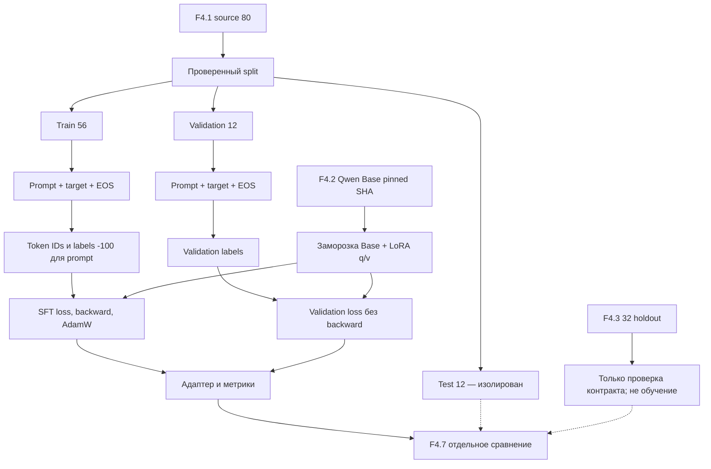

# F4.5 — Supervised Fine-Tuning и LoRA: пошаговая реализация

## 1. Цель этапа

На F4.1 мы подготовили **80 авторских технических инструкций** и разделили их по смысловым группам: `train=56`, `validation=12`, `test=12`. На F4.2 выбрали **Qwen/Qwen2.5-0.5B Base** с фиксированным SHA `060db6499f32faf8b98477b0a26969ef7d8b9987`. На F4.3 зафиксировали **отдельный holdout из 32 заданий**, а на F4.4 реализовали протокол генерации исходных ответов Base-модели.

**Проблема:** базовая модель уже умеет продолжать текст, но ещё не адаптирована специально к нашим коротким русскоязычным техническим инструкциям. Следующая задача — показать, как обновляются параметры модели под пары «вопрос → эталонный ответ», не создавая LLM с нуля и не расходуя память на градиенты для всех ~494 млн параметров.

**SFT (Supervised Fine-Tuning)** — дополнительное обучение предобученной causal language model на правильно подготовленных примерах. **LoRA (Low-Rank Adaptation)** — способ такого обучения, при котором исходные веса модели остаются замороженными, а обучаются небольшие матрицы-добавки к избранным линейным слоям. Это не независимая новая LLM и не предварительное обучение с нуля.

Конкретный результат F4.5: детерминированный план, проверенная токенизация `prompt/answer`, корректные `labels`/`attention_mask`, демонстрация механики LoRA, код **реального** шага обучения Qwen на CPU и профиль обучения на GPU, сохранение адаптера и проверяемого отчёта. Принципиальное ограничение: **наши unit-тесты и синтетический torch-smoke не доказывают фактическое дообучение Qwen**. Оно подтверждается только успешным запуском `--run cpu` или `--run gpu`, затем `--verify` и артефактами реального запуска.

Профили различаются: CPU — **один настоящий optimizer step на одном учебном примере** (проверка, что цепочка работает), GPU — **24 шага, 56 обучающих и 12 валидационных примеров**. Нельзя трактовать CPU smoke как эксперимент над всем корпусом. Отдельная независимая оценка ответов будет выполнена в F4.7.

## 2. Что реализовано

| Новый файл | Назначение | Что конкретно реализовано |
|---|---|---|
| `configs/f4_05_sft_lora.json` | Фиксация эксперимента | Пути утверждённых F4.1/F4.2/F4.3/F4.4, SHA checkpoint, длины токенов, LoRA rank/alpha/target modules, два профиля запуска, параметры optimizer. |
| `src/llm_f4/sft_lora.py` | Алгоритм и контракты | `load_config()`, `make_plan()`, `format_prompt()`, `encode_sample()`, `collate_rows()`, `supervised_token_count()`, `lora_delta()`, `torch_smoke()`, `run_real()`, `verify_run()`. |
| `scripts/f4_sft_lora.py` | Воспроизводимый CLI | Режимы `--plan`, `--torch-smoke`, `--run cpu`, `--run gpu`, `--verify cpu/gpu`, разрешение скачивания только через `--allow-download`; корректная обработка ошибок. |
| `tests/test_f4_sft_lora.py` | Автоматическая проверка | Инварианты train/validation/test, ограничения model revision, точные числовые результаты LoRA, маскирование loss, размеры батча, контракты CLI и Windows-кодировки, отклонение фиктивных результатов. |
| `docs/steps/F4_05_sft_lora.md` | Учебная документация | Порядок работы алгоритма, математика SFT и LoRA, схема, команды PowerShell, проверяемые результаты и ограничения. |

В архиве **нет** изменённых файлов F4.1–F4.4, `README.md`, кэша Hugging Face, `.venv`, весов или адаптеров. Все созданные при запуске файлы сохраняются в `data/processed/f4_05/`, а не в исходниках GitHub.

## 3. Последовательность реализации

### Шаг 1. Связали обучение с неизменными входными данными

**Что сделали.** `load_config()` прочитал F4.5-конфигурацию и проверил соответствие `model_id`, `model_revision`, `tokenizer_revision` значениям каталога F4.2 и F4.4. `make_plan()` вызвал F4.1 `verify_artifacts()` для побайтовой проверки `train.jsonl`, `validation.jsonl`, `test.jsonl`, затем `validate_splits()` для инвариантов групп и идентификаторов. Внешний benchmark F4.3 проходит `prepare_artifacts()` для проверки зафиксированных SHA-256.

**Зачем.** Нельзя случайно обучиться на контрольных вопросах, заменить несколько ответов или сменить checkpoint и после этого приписать эффект LoRA.

**Как.** Источником обучения служит **только** `data/processed/f4_01/train.jsonl`. `validation.jsonl` используется только для вычисления loss без обновления параметров. `test.jsonl` проверяется на отсутствие пересечений, но не используется ни как train, ни как validation. Данные F4.3 также не подаются в optimizer.

**Что получили.** Проверяемый план с размерами выборок и SHA. `--plan` не импортирует PyTorch/Transformers/PEFT и не загружает веса.

### Шаг 2. Согласовали текстовый формат с F4.4

**Что сделали.** `format_prompt()` использует те же поля `prefix` и `suffix`, что и базовый inference F4.4. Для простого вопроса получается:

```text
Вопрос:
Почему в Python опасен изменяемый аргумент по умолчанию?
Ответ:
```

Если у примера есть непустое `input`, добавляется **строго такой же**, как в F4.3, блок `\n\nДанные:\n` **до** `Ответ:`. Этот формат проверяется прямым сравнением с `evaluation_set.model_prompt()` и `base_model_evaluation.formatted_prompt()`, поэтому вход не будет отличаться из-за названия контекстного блока.

**Зачем.** Обучение на одном шаблоне и сравнение при другом шаблоне создаёт дополнительную неконтролируемую переменную. Для F4.7 используем утверждённый F4.4 inference template без переписывания benchmark.

### Шаг 3. Разделили prompt и правильный ответ при токенизации

**Что сделали.** `encode_sample()` отдельно вызвал `tokenizer.encode(prompt, add_special_tokens=False)` и `tokenizer.encode(response, add_special_tokens=False)`, затем добавил единственный EOS:

```python
input_ids = prompt_token_ids + response_token_ids + [eos_token_id]
labels = [-100] * len(prompt_token_ids) + response_token_ids + [eos_token_id]
```

**Зачем.** Мы хотим учить модель **отвечать**, а не дополнительно оптимизировать воспроизведение готового вопроса. В модели Hugging Face для causal LM метка `-100` исключена из `CrossEntropyLoss`. EOS является частью обучаемого завершения ответа.

**Как.** Раздельная токенизация предотвращает изменение token IDs входного префикса на границе вопроса и ответа (из-за слияния токенов при совместной токенизации). Ни prompt, ни response не обрезаются молча: при превышении лимита функция сообщает ID записи и ошибку.

**Что получили.** Для каждого `Encoded` храним `row_id`, `input_ids`, `labels`, `prompt_tokens`, `answer_tokens`. Размеры ограничены `max_prompt_tokens=256`, `max_answer_tokens=256`, `max_total_tokens=512`. Реальное число токенов конкретного примера зависит от выбранного checkpoint/tokenizer; его проверяет runtime.

### Шаг 4. Сделали батчи с `attention_mask` и безопасным padding

**Что сделали.** `collate_rows()` выравнивает входы по длине справа, заполняет `input_ids` токеном EOS, `attention_mask` выставляет 1 для настоящего текста и 0 для паддинга, в `labels` ставит `-100` для паддинга.

**Зачем.** Без masking модель получает ложные целевые значения для заполняющих токенов или пытается учитывать несуществующие позиции.

**Что получили.** Форма всех трёх тензоров одинакова `[batch, sequence]`. Для оценки веса потерь `supervised_token_count()` считает реально контролируемые позиции после shift, не включая `-100`.

### Шаг 5. Продемонстрировали low-rank обновление численно

**Что сделали.** `lora_delta()` вычисляет обновлённую матрицу по формуле `W' = W + (alpha/r)BA`. Эта реализация без PyTorch нужна не для обучения LLM, а как **независимый числовой эталон** алгоритма.

**Зачем.** Нужно понимать, какие параметры меняются, а не только вызывать `get_peft_model()`.

**Что получили.** Автоматический тест проверяет конкретные значения полученной матрицы, а также отбрасывает несовместимые размерности.

### Шаг 6. Проверили настоящий градиент на маленьком синтетическом примере

**Что сделали.** В `torch_smoke()` создана константная базовая матрица `W`, обучаемые `torch.nn.Parameter A, B`, посчитаны MSE loss, `backward()` и шаг SGD.

**Зачем.** Так проверяется механика: `W.requires_grad=False`, у LoRA-компонентов появляются градиенты, после шага оптимизатора меняется `B`.

**Что получили.** Для фиксированных чисел начальная ошибка `0.5`. Это **не** language modeling loss и **не** Qwen: вывод CLI намеренно маркирован `SYNTHETIC, NO LLM TRAINING`.

### Шаг 7. Настроили настоящий запуск предобученной Qwen

**Что сделали.** Только в `run_real()` импортируются `torch`, `transformers`, `peft`. Через `AutoTokenizer.from_pretrained` и `AutoModelForCausalLM.from_pretrained` загружается pinned checkpoint без `trust_remote_code`. Без флага `--allow-download` используются только файлы локального Hugging Face cache.

Затем для causal LM создаётся:

```python
LoraConfig(
    task_type=TaskType.CAUSAL_LM,
    r=8,
    lora_alpha=16,
    lora_dropout=0.0,
    bias="none",
    target_modules=["q_proj", "v_proj"],
)
model = get_peft_model(base, adapter_cfg)
```

**Зачем.** Qwen2.5-0.5B имеет 24 Transformer-слоя и attention projection `q_proj`/`v_proj`; LoRA позволяет обновлять низкоранговые добавки, а не все исходные матрицы. После обёртки код проверяет, что **каждый trainable parameter содержит `lora_` в имени**.

### Шаг 8. Реализовали optimizer и evaluation без утечки

**Что сделали.** В `run_real()` используется `AdamW` только по trainable LoRA-параметрам, gradient accumulation, ограничение нормы градиентов и seed. Цикл обучения вычисляет `model(**batch).loss`, вызывает `backward()` и `optimizer.step()`.

Перед первым шагом и после последнего вычисляется **validation loss** в `model.eval()` и `torch.no_grad()`. Из validation не вызывают `backward()`. Test и внешний F4.3 holdout не открываются как данные обучения.

**Что получили.** При реальном выполнении сохраняются `train_loss`, `grad_norm` для каждого optimizer step, две оценки `validation_loss`, число обучаемых/всех параметров, версия библиотек, тип устройства, SHA входных данных.

Отличие режимов:

| Профиль | Данные | Шаги optimizer | Батч | Accumulation | Тип весов |
|---|---|---:|---:|---:|---|
| `cpu` | 1 train / 1 validation | 1 | 1 | 1 | FP32 |
| `gpu` | 56 train / 12 validation | 24 | 1 | 4 | BF16 |

**CPU-профиль — минимальный реальный опыт, а не доказательство роста качества.** Для GPU-профиля обязателен доступный CUDA GPU с поддержкой BF16; тихо подменять GPU на CPU, а BF16 на FP32 запрещено. Gradient checkpointing используется в GPU-профиле для уменьшения памяти активаций. Обе конфигурации намеренно компактны: 80 примеров из F4.1 слишком мало для уверенных утверждений об общем качестве.

### Шаг 9. Сохранили только адаптер и проверяемые метаданные

**Что сделали.** PEFT `save_pretrained(..., safe_serialization=True)` сохраняет **адаптер**, а не весь checkpoint. После завершения пишутся:

```text
data/processed/f4_05/
  cpu/                    # если прошёл реальный --run cpu
    adapter/
      adapter_config.json
      adapter_model.safetensors
      README.md            # возможно создаётся самой PEFT, только в ignored output
    metrics.jsonl
    run_manifest.json
  gpu/                    # отдельный реальный запуск, если доступен GPU
    ...
```

`README.md` здесь — служебный файл PEFT **внутри игнорируемого каталога адаптера**, не `README.md` корня твоего репозитория. Он не включается в ZIP/Git-коммит.

**Зачем.** Полные веса исходной модели остаются в Hugging Face cache. `verify_run()` без загрузки весов сравнивает SHA-256 адаптера, журнала шагов, конфигурации и train/validation/holdout. Повторно записывать поверх существующего прогона запрещено, чтобы не выдавать два эксперимента за один.

**Что получили.** Отдельные отчёты для CPU/GPU с ключевым полем `real_training_performed: true` — только если весь реальный цикл успешно дошёл до сохранения. `--plan` и `--torch-smoke` такого отчёта не создают.

## 4. Алгоритм и математический пример

### 4.1. Causal Language Modeling и masked SFT

На последовательности токенов `x1, x2, …, xT` causal LM оценивает вероятность следующего токена по предыдущим. При supervised fine-tuning минимизируем:

\[
\mathcal L_{SFT}=-\frac{1}{|S|}\sum_{t\in S}\log p_\theta(x_t\mid x_1,\ldots,x_{t-1}),
\]

где `S` — **только** позиции ответа и EOS, `θ` — обучаемые параметры адаптера (база заморожена). В Hugging Face индексы при обучении сдвигаются на одну позицию: logits на позиции `t-1` предсказывают целевой `labels[t]`. Поэтому для обучения **первого токена ответа** нужен последний токен prompt, хотя для самого prompt выставлены `labels=-100`.

Числовой пример (условные ID, не фактический словарь Qwen):

```text
prompt ID:         [11, 12, 13]
response ID:       [21, 22]
EOS:               [99]
input_ids:         [11, 12, 13, 21, 22, 99]
labels:            [-100, -100, -100, 21, 22, 99]
attention_mask:    [1, 1, 1, 1, 1, 1]
```

Модель должна предсказать `21` по контексту `[11,12,13]`, затем `22` по `[11,12,13,21]` и EOS по `[11,12,13,21,22]`. Если вероятности корректных токенов условно `0.8`, `0.5`, `0.25`, средний SFT loss:

\[
L = -(\ln 0.8 + \ln 0.5 + \ln 0.25)/3
  \approx (0.2231+0.6931+1.3863)/3 \approx 0.7675.
\]

Тест `test_mask_labels_and_eos` проверяет корректное построение массива меток, `test_right_padding` — игнорирование паддинга. Сам этот расчёт иллюстративный; реальный `train_loss` в manifest заранее неизвестен.

### 4.2. LoRA, ранги и градиент

Для исходной матрицы слоя `W ∈ R^(d_out × d_in)` добавляется низкоранговая поправка:

\[
W_{new}=W+\Delta W, \qquad \Delta W=\frac{\alpha}{r}BA,
\]

где `A ∈ R^(r × d_in)`, `B ∈ R^(d_out × r)`, `r` — rank, `α` — масштабный коэффициент, а `W` фиксирована. Важно: при применении LoRA это **не обязательная физическая запись нового W на диск**; перед вычислением слоя добавляется вклад адаптера. В F4.5 `r=8`, `alpha=16`, значит коэффициент `alpha/r=2`.

Числовой пример (проверяется `test_toy_lora_matrix`):

\[
W=\begin{bmatrix}1&0\\0&1\end{bmatrix},\quad
A=\begin{bmatrix}2&3\end{bmatrix},\quad
B=\begin{bmatrix}4\\5\end{bmatrix},\quad
r=1,\;\alpha=2.
\]

\[
BA=\begin{bmatrix}8&12\\10&15\end{bmatrix},\quad
W_{new}=W+2BA=\begin{bmatrix}17&24\\20&31\end{bmatrix}.
\]

Именно такое значение возвращает `lora_delta()`. Для матрицы `d_out × d_in` обучение всей матрицы потребовало бы `d_out*d_in` параметров; LoRA — `r*(d_out+d_in)`. У Qwen2.5-0.5B при `q_proj` (`896×896`) и `v_proj` (`128×896`) и 24 слоях получается **расчётная оценка 540 672 параметра адаптера**: `24 × [8(896+896) + 8(896+128)]`. Это расчёт по архитектуре для выбранных target-модулей, а не результат фактического `get_peft_model()` — реальный счётчик создастся при запуске.

### 4.3. Почему validation loss недостаточен

Низкий `train_loss` на 56 коротких примерах означает, что модель лучше предсказывает обучающие токены. Это **не гарантирует** корректных технических ответов. Даже улучшение `validation_loss` на 12 примерах не измеряет экспертную правильность на 32 вопросах F4.3. Разделяй метрики: `train_loss`, `validation_loss`, затем отдельное **Base vs Fine-Tuned** с ручной рубрикой F4.3 на этапе F4.7.

## 5. Схема работы



Файлы F4.4 `responses.jsonl` и ручные оценки не изменяются этим этапом. В F4.7 для сравнения необходимо зафиксировать совпадающие prompt format, генерацию и полные 32 задания с Base.

## 6. Локальная проверка PowerShell

Все команды выполняются **из корня репозитория** на Windows. Никакие файлы репозитория автоматически не коммитятся. Установка библиотек здесь не описывается: если реальный запуск сообщит о недостающем PEFT, можно отдельно согласовать версии в твоём окружении.

### 6.1. Проверка исходных данных и предыдущих этапов

```powershell
cd F:\DEVELOPMENT\ML\ml-engineering-lab

.\.venv\Scripts\python.exe scripts/f4_instruction_dataset.py --verify
.\.venv\Scripts\python.exe scripts/f4_evaluation_set.py --verify
.\.venv\Scripts\python.exe scripts/f4_model_selection.py
```

Ожидаем `F4.1 VERIFY: PASS`, `F4.3 VERIFY: PASS`, `F4.2 MODEL SELECTION: PASS`. Если предыдущие производные файлы отсутствуют, запусти сначала соответствующий BUILD из F4.1/F4.3.

### 6.2. Тесты F4.5

```powershell
.\.venv\Scripts\python.exe -m pytest tests/test_f4_sft_lora.py -q
```

Нужен статус без `FAILED`. Тесты не скачивают веса Qwen и не выдают синтетический опыт за обучение LLM. Они проверяют фактический контракт функции, числовой эталон и обработку ошибок.

### 6.3. Проверка плана без PyTorch и весов

```powershell
.\.venv\Scripts\python.exe scripts/f4_sft_lora.py --plan
```

Ожидаемые ключевые строки:

```text
F4.5 PLAN: PASS (metadata and verified F4.1/F4.3 only)
Selected: Qwen/Qwen2.5-0.5B | revision=060db6499f32faf8b98477b0a26969ef7d8b9987
Splits: {'train': 56, 'validation': 12, 'test': 12}
LoRA: rank=8 alpha=16 modules=q_proj,v_proj
Model weights / optimizer / training: NOT RUN
```

Отсутствие ошибок здесь означает только согласованность входных данных и версий.

### 6.4. Миниатюрный torch-smoke

```powershell
.\.venv\Scripts\python.exe scripts/f4_sft_lora.py --torch-smoke
```

Ожидаем:

```text
F4.5 TORCH SMOKE: PASS (SYNTHETIC, NO LLM TRAINING)
Loss: 0.500000; adapter_changed=True
```

Так проверяется маленькая матричная реализация градиента на CPU. Это полезный алгоритмический тест, но он **не обновляет веса Qwen**.

### 6.5. Настоящий CPU SFT на Qwen: один обучающий шаг

Выполняй только когда CPU имеет достаточно RAM и установлен совместимый runtime `torch` + `transformers` + `peft` + `safetensors`. Модель ~0,5 млрд параметров, FP32 требует памяти **существенно больше**, чем оценка ~1,84 ГиБ на одни веса, из-за загрузки, промежуточных активаций, LoRA и расчёта loss. Время на CPU заранее не обещаем.

```powershell
.\.venv\Scripts\python.exe scripts/f4_sft_lora.py --run cpu --allow-download
```

`--allow-download` разрешает скачать **именно выбранный pinned checkpoint**, если файлов нет в кеше. Если checkpoint уже есть, можно запускать без этого флага. Начало реального обучения не считается PASS; итоговая строка после сохранения адаптера:

```text
F4.5 REAL SFT CPU: PASS
Optimizer steps: 1; LoRA trainable: <фактическое число>
Validation loss: <фактическое значение> -> <фактическое значение>
Evaluation holdout / manual quality: NOT RUN
```

Значения **не выдумываются**. Если памяти не хватит или зависимости несовместимы, сохрани stderr и зафиксируй `PARTIAL`. CPU smoke всё равно остаётся полезным и честно проверенным.

### 6.6. Проверка настоящих артефактов

```powershell
.\.venv\Scripts\python.exe scripts/f4_sft_lora.py --verify cpu
Get-Content data\processed\f4_05\cpu\run_manifest.json -Encoding UTF8
Get-Content data\processed\f4_05\cpu\metrics.jsonl -Encoding UTF8
```

Ожидаем `F4.5 VERIFY CPU: PASS`, `optimizer_steps=1`, `real_training_performed=true`, списки SHA-256 адаптера и метрик. Если `--run` не прошёл — `--verify` **обязан** завершиться ошибкой. Повторное обучение в той же директории запрещено для защиты истории опыта; ничего не удаляй без сохранения предыдущего результата.

### 6.7. GPU-профиль — отдельный воспроизводимый эксперимент

При наличии подходящего CUDA GPU с BF16 (не обязательное условие CPU-проверки):

```powershell
.\.venv\Scripts\python.exe scripts/f4_sft_lora.py --run gpu --allow-download
.\.venv\Scripts\python.exe scripts/f4_sft_lora.py --verify gpu
```

Здесь задействованы все 56 train и 12 validation примеров и 24 шага optimizer, а `data/processed/f4_05/gpu/` хранит **отдельный** адаптер. Не считай GPU-эксперимент выполненным, пока реально не получишь PASS обеих команд. Для CPU-профиля `--verify cpu` ничего не говорит о GPU-профиле.

### 6.8. Регрессия

```powershell
.\.venv\Scripts\python.exe -m pytest -q tests/test_f4_instruction_dataset.py tests/test_f4_model_selection.py tests/test_f4_evaluation_set.py tests/test_f4_base_model_evaluation.py tests/test_f4_sft_lora.py
.\.venv\Scripts\python.exe -m pytest -q
```

До F4.5 полная регрессия дала **1595 passed, 1 skipped** на твоей Windows. Если файлы и количество тестов не менялись, ожидаем **1659 passed, 1 skipped**. Успешная регрессия не заменяет эксперимент `--run cpu`.

### 6.9. Типичные ошибки

| Симптом | Причина | Действие |
|---|---|---|
| `Нет обязательного файла train.jsonl` | F4.1 экспорт отсутствует | Выполни F4.1 BUILD и VERIFY. |
| `source SHA` / `Modified run context` | Изменился источник или контрольная сумма | Не продолжай обучение: сначала восстанови утверждённые файлы. |
| `token budget exceeded` | Ответ или prompt длиннее лимита | Не обрезай данные молча; отдельно обнови протокол и тесты. |
| `отсутствует библиотека peft` | Нет runtime для real LoRA | Проверить установленные версии; обычные unit-тесты от этого не зависят. |
| `Cannot load pinned checkpoint` | Нет весов, нет доступа, проблема версии или RAM | Проверить кеш, окружение и stderr; не засчитывать REAL SFT. |
| `Output folder already contains files` | Выходная директория от другого/неполного запуска | Сначала сохрани результат, не перезаписывай. |
| `GPU profile requires NVIDIA/CUDA` | Нет GPU | Используй CPU или оставь GPU PARTIAL. |
| `Modified adapter artifact` | Изменился сохранённый адаптер | Не считать VERIFY PASS. |

## 7. Что доказано тестами и какие ограничения остаются

### Подтверждается локальными unit-тестами

- Согласованность 40-символьной ревизии модели/tokenizer с F4.2/F4.4.
- Файлы F4.1 строго проверены, ID и `group_id` не пересекаются между split.
- F4.3 проверен по зафиксированным SHA; в `run_real()` **не** включён в обучение.
- Правильные `labels=-100` для prompt и padding, EOS для конца ответа, двумерные размеры батчей.
- Числовой эталон `W' = W + αBA/r`, точное совпадение результата.
- Маленький torch-smoke обновляет adapter-параметр, не меняя базовую матрицу.
- Проверка SHA сохранённых артефактов, отклонение неуспешного/фиктивного отчёта.
- CLI не загружает веса при `--help`/`--plan` и работает с Windows-совместимым английским выводом.

### Не подтверждается до реального запуска

- Совместимость конкретных версий `transformers`/`peft` с твоим Python 3.13.2 именно при реальном градиентном обучении Qwen.
- Фактический пик RAM и время CPU SFT.
- Число созданных PEFT trainable parameters из фактически загруженной модели.
- Наличие созданного адаптера, пока не получено `F4.5 REAL SFT CPU/GPU: PASS` плюс `VERIFY PASS`.
- Улучшение качества на 32 F4.3 вопросах. **Сравнение — не часть F4.5; это F4.7.**
- Все возможные смысловые утечки за пределами проверенных нормализованных и близких текстовых совпадений.
- Статистически достоверная адаптация большой модели по маленькому авторскому корпусу.

**Статусы:** `LOCAL TESTS PASS` — код и алгоритмические инварианты; `REAL CPU PASS` — один настоящий шаг обновления LoRA; `REAL GPU PASS` — отдельный полный опыт; улучшение качества не заявляется до внешнего benchmark. При отсутствии GPU — `PARTIAL` по GPU, это не ошибка CPU-реализации.

## 8. Основная мысль этапа

«До F4.5 я собирал данные, исследовал токенизацию, фиксировал модель и получал исходные ответы. Теперь я перешёл к принципиально другой операции — к **изменению параметров модели**. Моя цель была не просто запустить `Trainer`, а разобраться, как именно от текстовой инструкции перейти к функции потерь и градиентному шагу».

«Я начал с уже проверенных F4.1-данных. Каждая тематическая группа попала ровно в одну выборку; для обучения я разрешил только train. Validation я отвёл для контроля loss, а отдельные 32 F4.3-вопроса сохранил нетронутыми для будущего независимого сравнения. Я связал модель и токенизатор с тем же commit SHA, с которым делал baseline на F4.4. Иначе даже небольшое изменение исходной модели сделало бы сравнение некорректным».

«Затем я реализовал teacher forcing. На каждом обучающем примере модель видит полный текст вопроса и правильного ответа. Но loss считается **только по токенам ответа**, поскольку позиции вопроса и паддинга имеют метку `-100`. Я отдельно добавляю EOS, чтобы модель училась заканчивать ответ, а не продолжать бесконечно. Мне стало понятнее, что языковая модель на самом деле не сравнивает готовые строки: она предсказывает распределение следующего токена на каждом шаге и получает ошибку через negative log likelihood».

«После этого разобрал LoRA. В классическом fine-tuning нужно обновлять всю большую матрицу `W`. В LoRA я оставляю `W` замороженной и обучаю две маленькие матрицы `A` и `B`, чьё произведение образует поправку к `W`. Я проверил это сначала на числовых матрицах, затем на настоящем PyTorch autograd. В коде реальной Qwen применяю адаптер только к `q_proj` и `v_proj` и отдельно проверяю, что незапланированные параметры не стали обучаемыми».

«Только после алгоритмических проверок я предусмотрел эксперимент с реальной LLM. На CPU это один шаг, который нужен прежде всего для интеграции: загрузить Qwen, токенизировать пример, посчитать loss, сделать backward, обновить адаптер и сохранить его. На GPU можно выполнить 24 шага на всех 56 учебных примерах. Я не подменяю CPU-smoke многократным обучением, а журналы и SHA помогают отличить фактический прогон от тестового. Для завершения я должен показать реальный `run_manifest` и `adapter_model.safetensors`».

«Главный итог этого шага — я теперь понимаю границу между **inference, SFT и LoRA**: inference не меняет веса; SFT минимизирует loss на примерах инструкций; LoRA определяет, **какие именно параметры** доступны оптимизатору. Однако даже успешный SFT не доказывает, что ответы стали точнее. Поэтому в F4.6 я займусь визуализацией метрик, а в F4.7 применю независимую рубрику к Base и Fine-Tuned при одном протоколе. Это тот уровень объяснения, который я смогу использовать на собеседовании ML/LLM Engineer».

## 9. Файлы этапа

| Порядок изучения | Файл | Что именно стоит изучить |
|---|---|---|
| 1 | `configs/f4_05_sft_lora.json` | Почему ограничен контекст и выбраны LoRA rank/alpha, почему CPU/GPU отдельно, откуда берутся версионные зависимости. |
| 2 | `src/llm_f4/sft_lora.py` | `load_config()` и `make_plan()` — проверка неизменности source, отсутствие data leakage, проверка holdout. |
| 3 | `src/llm_f4/sft_lora.py` | `format_prompt()`, `encode_sample()` — построение supervised target, `-100` и EOS; `collate_rows()` — attention_mask и padding. |
| 4 | `src/llm_f4/sft_lora.py` | `lora_delta()` и `torch_smoke()` — математика низкого ранга и настоящий autograd без большой модели. |
| 5 | `src/llm_f4/sft_lora.py` | `run_real()` — подготовка Qwen, заморозка Base, PEFT, AdamW, train/validation, сохранение адаптера. |
| 6 | `src/llm_f4/sft_lora.py` | `verify_run()` — инварианты сохранённого реального опыта и SHA-256. |
| 7 | `scripts/f4_sft_lora.py` | Различия `--plan`, `--torch-smoke`, `--run cpu/gpu`, `--verify`; какой режим допускает download. |
| 8 | `tests/test_f4_sft_lora.py` | Точные числовые эталоны, тесты маскирования, недопустимые конфигурации, Windows CLI. |
| 9 | `docs/steps/F4_05_sft_lora.md` | Сопоставь функции, формулы, реальные результаты и ограничения. |

**Файлы предыдущих фаз:**

- `src/llm_f4/instruction_dataset.py`: `verify_artifacts()`, `validate_splits()`, `group_id`. Посмотри, откуда F4.5 получает train и validation.
- `src/llm_f4/model_selection.py` и `configs/f4_02_model_selection.json`: `load_catalog()`, pinned model SHA и архитектура `qwen2`.
- `src/llm_f4/evaluation_set.py`: `prepare_artifacts()`, проверка внешнего holdout без добавления его в train.
- `src/llm_f4/base_model_evaluation.py` и `configs/f4_04_base_model_evaluation.json`: шаблон `Вопрос/Ответ` и параметры baseline, которые должны оставаться неизменными в F4.7.
- **F2.4 Training Loop**: вернись к `forward → loss → backward → optimizer.step`, теперь тот же цикл работает с causal LM и LoRA.
- **F3.1 Self-Attention**: найди смысл projection-матриц `q_proj`, `v_proj`, в которые LoRA добавляет низкоранговые поправки.

**Запомнить:** unit-тесты F4.5 доказывают свойства *реализации*, реальный `--run` доказывает *факт обучения*, а F4.7 будет проверять *изменение качества ответов*. Это три разных утверждения.
