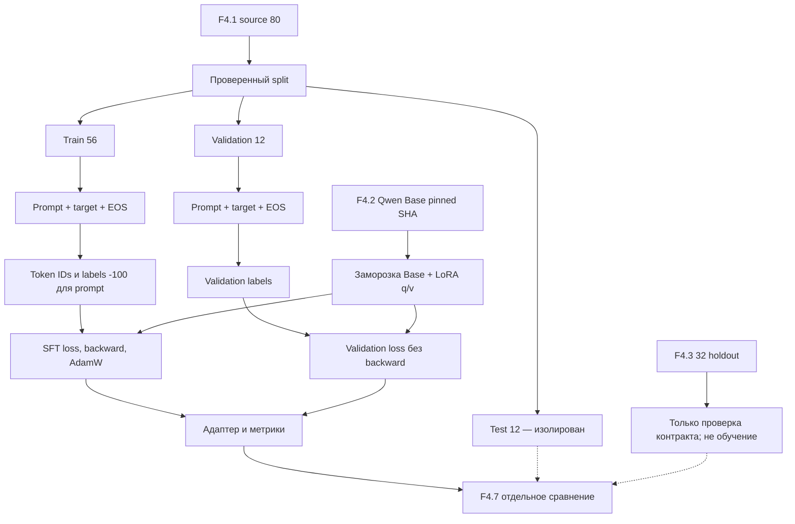

# F4.5 — Supervised Fine-Tuning и LoRA: пошаговая реализация

## 1. Цель этапа

**Связь с предыдущими этапами.** F4.1 — подготовка **80 авторских технических инструкций** с распределением `train=56`, `validation=12`, `test=12` по непересекающимся смысловым группам. F4.2 — выбор **Qwen/Qwen2.5-0.5B Base** и фиксация ревизии `060db6499f32faf8b98477b0a26969ef7d8b9987`. F4.3 — создание **независимого holdout из 32 технических заданий**. F4.4 — получение исходных ответов Base-модели по фиксированному протоколу генерации.

**Проблема.** Предобученная causal language model способна продолжать текст, но её поведение не адаптировано специально к коротким русскоязычным инструкциям из F4.1. Необходимо продемонстрировать обновление параметров на парах «вопрос → эталонный ответ» без полного обучения LLM с нуля и без выделения градиентов для всех ~494 млн базовых параметров.

**SFT (Supervised Fine-Tuning)** — дополнительное обучение предобученной causal LM на размеченных примерах с целевыми ответами. **LoRA (Low-Rank Adaptation)** — параметрически эффективный метод адаптации: базовые веса фиксируются, обучаются небольшие низкоранговые матрицы, подключённые к выбранным линейным преобразованиям Transformer. LoRA не создаёт новую независимую LLM и не является предобучением модели с нуля.

**Цель F4.5:** реализовать проверяемый конвейер SFT с маскированием prompt-токенов, корректным `attention_mask`, EOS, обучаемым LoRA-адаптером, циклом `forward → loss → backward → optimizer.step()`, валидацией без обновления весов, сохранением адаптера и проверкой происхождения результатов.

**Режимы эксперимента:**

- **CPU:** один настоящий optimizer step на **одном train-примере** с проверкой по **одному validation-примеру**. Назначение — интеграционный опыт на реальной Qwen, а не полноценное обучение корпуса.
- **GPU:** конфигурация для 24 шагов, **56 train** и **12 validation** примеров, CUDA/BF16; наличие конфигурации не подтверждает фактический запуск.
- **F4.3:** независимые 32 вопроса не участвуют в обновлении параметров. Сравнение ответов предусмотрено отдельно в F4.7.

**Граница достоверности.** Unit-тесты и синтетический `torch-smoke` проверяют математические инварианты и код, но не подтверждают обучение реальной Qwen. Для подтверждения необходимы успешные `--run cpu/gpu`, `--verify cpu/gpu` и фактически сохранённые артефакты. В последующей локальной проверке **реальный CPU-профиль выполнен и верифицирован**; GPU-эксперимент не засчитывать без отдельных артефактов. Один шаг обучения не доказывает повышения качества ответов.

## 2. Что реализовано

| Новый файл | Назначение | Что конкретно реализовано |
|---|---|---|
| `configs/f4_05_sft_lora.json` | Фиксация эксперимента | Пути утверждённых F4.1/F4.2/F4.3/F4.4, SHA checkpoint, длины токенов, LoRA rank/alpha/target modules, два профиля запуска, параметры optimizer. |
| `src/llm_f4/sft_lora.py` | Алгоритм и контракты | `load_config()`, `make_plan()`, `format_prompt()`, `encode_sample()`, `collate_rows()`, `supervised_token_count()`, `lora_delta()`, `torch_smoke()`, `run_real()`, `verify_run()`. |
| `scripts/f4_sft_lora.py` | Воспроизводимый CLI | Режимы `--plan`, `--torch-smoke`, `--run cpu`, `--run gpu`, `--verify cpu/gpu`, разрешение скачивания только через `--allow-download`; корректная обработка ошибок. |
| `tests/test_f4_sft_lora.py` | Автоматическая проверка | Инварианты train/validation/test, ограничения model revision, точные числовые результаты LoRA, маскирование loss, размеры батча, контракты CLI и Windows-кодировки, отклонение фиктивных результатов. |
| `docs/steps/F4_05_sft_lora.md` | Учебная документация | Порядок работы алгоритма, математика SFT и LoRA, схема, команды PowerShell, проверяемые результаты и ограничения. |

Поставка F4.5 содержит исходники, тесты, конфигурацию и учебную документацию. Изменённые файлы F4.1–F4.4, корневой `README.md`, кеш Hugging Face, `.venv`, веса и адаптеры в поставку не включаются. Производные результаты реального запуска сохраняются в `data/processed/f4_05/` вне исходников GitHub. При исправлении текста документации заменить **только** `docs/steps/F4_05_sft_lora.md`.

## 3. Последовательность реализации

### Шаг 1. Привязать обучение к проверенным входным данным

**Действие.** Согласовать конфигурацию F4.5 с неизменяемыми входами F4.1–F4.4 и проверить целостность исходных выборок.

**Назначение.** Исключить обучение на контрольных заданиях, незаметную замену checkpoint, изменение датасета или смешение результатов разных экспериментов.

**Реализация.** В `load_config()` проверить соответствие `model_id`, `model_revision`, `tokenizer_revision` закреплённым значениям F4.2 и F4.4. В `make_plan()` вызвать F4.1 `verify_artifacts()` для побайтовой проверки `train.jsonl`, `validation.jsonl`, `test.jsonl` и `validate_splits()` для контроля ID и тематических групп. Для F4.3 вызвать `prepare_artifacts()` и проверить зафиксированные SHA-256.

Обучение разрешить **только** на `data/processed/f4_01/train.jsonl`. Для validation использовать отдельный split **без обновления параметров**. Test проверить на отсутствие пересечений, но не передавать в обучение или validation. Внешний benchmark F4.3 также не передавать в optimizer.

**Результат.** План с зафиксированными размерами выборок, ревизиями и SHA. Команда `--plan` не импортирует тяжёлый ML runtime и не загружает веса модели.

### Шаг 2. Зафиксировать шаблон инструкции и ответа

**Действие.** Согласовать `format_prompt()` с `prefix` и `suffix` из F4.4.

**Пример текстового входа:**

```text
Вопрос:
Почему в Python опасен изменяемый аргумент по умолчанию?
Ответ:
```


**Назначение.** Исключить расхождение форматов между SFT и исходным inference: изменение шаблона становится дополнительной переменной при сравнении.

**Реализация.** Для непустого поля `input` вставлять блок `\n\nДанные:\n` **перед** `Ответ:`. Сравнивать сформированный текст с `evaluation_set.model_prompt()` и `base_model_evaluation.formatted_prompt()`. Для последующего F4.7 сохранять утверждённый F4.4 inference template.

**Результат.** Единый формат `Вопрос:/Данные:/Ответ:` для обучения и сопоставимой генерации.

### Шаг 3. Разделить prompt и target при токенизации

**Действие.** Токенизировать вопрос и эталонный ответ раздельно, сформировать causal LM input и маску целевых меток.

**Реализация.** В `encode_sample()` вызвать `tokenizer.encode(..., add_special_tokens=False)` отдельно для `prompt` и `response`, затем добавить единственный EOS:

```python
input_ids = prompt_token_ids + response_token_ids + [eos_token_id]
labels = [-100] * len(prompt_token_ids) + response_token_ids + [eos_token_id]
```


**Назначение.** Вычислять SFT loss **только по токенам ответа и EOS**. Метка `-100` исключает позиции prompt из `CrossEntropyLoss`. Раздельная токенизация дополнительно предотвращает изменение токенизации префикса из-за слияния токенов на границе prompt/response.

**Реализация ограничений.** Проверять `max_prompt_tokens=256`, `max_answer_tokens=256`, `max_total_tokens=512`; при превышении выдавать диагностическую ошибку с ID записи. Не обрезать текст без явного решения.

**Результат.** Для каждой записи получить `Encoded(row_id, input_ids, labels, prompt_tokens, answer_tokens)` с контролируемой длиной и корректным включением EOS в обучаемые позиции.

### Шаг 4. Сформировать батчи с `attention_mask` и безопасным padding

**Действие.** Выровнять токенизированные последовательности до общей длины внутри батча.

**Назначение.** Исключить влияние фиктивных padding-позиций на внимание модели и функцию потерь.

**Реализация.** В `collate_rows()` применить правосторонний padding: `input_ids` заполнить EOS, `attention_mask` установить в `1` для реальных токенов и `0` для padding, `labels` заполнить `-100` на padding-позициях. В `supervised_token_count()` учитывать только действительно обучаемые метки после causal shift.

**Результат.** Тензоры `input_ids`, `attention_mask`, `labels` с общей размерностью `[batch, sequence]`, не включающие padding в supervised loss.

### Шаг 5. Проверить low-rank обновление матрицы численно

**Действие.** Реализовать независимый числовой эталон LoRA без PyTorch.

**Назначение.** Проверить непосредственно математику `W' = W + (alpha/r)BA`, не ограничиваясь вызовом `get_peft_model()`.

**Реализация.** В `lora_delta()` вычислить произведение матриц `B` и `A`, применить коэффициент `alpha/r`, добавить поправку к базовой матрице. Проверить согласование размерностей и ожидаемые числа из раздела 4.2.

**Результат.** Независимый тест низкоранговой параметризации и корректное отклонение несовместимых матриц.

### Шаг 6. Проверить Autograd на синтетической модели

**Действие.** Выполнить градиентный шаг для маленькой фиксированной матрицы `W` с обучаемыми матрицами `A` и `B`.

**Назначение.** Отдельно проверить `requires_grad`, вычисление градиентов и работу оптимизатора до загрузки больших весов LLM.

**Реализация.** В `torch_smoke()` создать `W` без обучения, `torch.nn.Parameter` для LoRA-компонентов, вычислить MSE, выполнить `backward()` и шаг SGD. Проверить, что исходная `W` не изменяется, а адаптер получает градиенты и обновляется.

**Результат.** При фиксированных значениях начальный MSE равен **0,5**. Вывод `SYNTHETIC, NO LLM TRAINING` не допускает интерпретации теста как обучения Qwen.

### Шаг 7. Подключить LoRA к реальной предобученной Qwen

**Действие.** Загрузить закреплённую модель и токенизатор, затем настроить PEFT-адаптер.

**Назначение.** Обновлять только низкоранговые добавки к attention projections, сохраняя базовые веса замороженными.

**Реализация.** Импортировать `torch`, `transformers`, `peft` только внутри `run_real()`. Использовать `AutoTokenizer.from_pretrained()` и `AutoModelForCausalLM.from_pretrained()` с точными ревизиями и `trust_remote_code=False`; без `--allow-download` ограничиться локальным кешем. Для 24 слоёв Qwen2.5-0.5B настроить `q_proj` и `v_proj`:

```python
LoraConfig(
    task_type=TaskType.CAUSAL_LM,
    r=8,
    lora_alpha=16,
    lora_dropout=0.0,
    bias="none",
    target_modules=["q_proj", "v_proj"],
)
model = get_peft_model(base, adapter_cfg)
```


После `get_peft_model(base, adapter_cfg)` проверить, что **каждый обучаемый параметр содержит `lora_` в имени**.

**Результат.** Базовые матрицы исключены из оптимизации. Количество LoRA-параметров для выбранных проекций — **540 672**; расчёт по архитектуре подтверждён реальным CPU-прогоном.

### Шаг 8. Выполнить SFT-цикл и независимый validation pass

**Действие.** Выполнить прямой проход, вычисление loss, обратное распространение, шаг AdamW и отдельную оценку validation loss.

**Назначение.** Проверить реальное изменение LoRA-параметров при исключении контрольных данных из обучения.

**Реализация.** Передать оптимизатору AdamW **только trainable LoRA-параметры**. Настроить seed, gradient accumulation и gradient clipping. Для train-батча вычислить `model(**batch).loss`, выполнить `backward()` и `optimizer.step()`. До первого и после последнего optimizer step запускать validation в `model.eval()` под `torch.no_grad()` **без** `backward()`.

**Параметры режимов:**

| Профиль | Данные | Шаги optimizer | Батч | Accumulation | Тип весов |
|---|---|---:|---:|---:|---|
| `cpu` | 1 train / 1 validation | 1 | 1 | 1 | FP32 |
| `gpu` | 56 train / 12 validation | 24 | 1 | 4 | BF16 |

**Результат.** В ходе реального запуска фиксировать `train_loss`, `grad_norm` для optimizer steps, validation loss до/после, число параметров, версии библиотек, устройство и SHA исходных данных. Для GPU требовать доступный CUDA с BF16; запрещать скрытую подмену устройства или точности. В GPU-профиле использовать gradient checkpointing для уменьшения памяти активаций.

**Граница интерпретации.** CPU — один шаг на одном примере, не полноценное исследование обучения корпуса. Наличие 24-шаговой GPU-конфигурации не означает её выполнения.

### Шаг 9. Сохранить адаптер и верифицировать результаты

**Действие.** Сохранить только обученные LoRA-параметры и метаданные эксперимента.

**Назначение.** Сохранить исходный Base checkpoint неизменным, а результаты привязать к конкретным исходным данным, конфигурации и устройству.

**Реализация.** Вызвать PEFT `save_pretrained(..., safe_serialization=True)` и сформировать структуру:

```text
data/processed/f4_05/
  cpu/                    # если прошёл реальный --run cpu
    adapter/
      adapter_config.json
      adapter_model.safetensors
      README.md            # возможно создаётся самой PEFT, только в ignored output
    metrics.jsonl
    run_manifest.json
  gpu/                    # отдельный реальный запуск, если доступен GPU
    ...
```


Служебный `README.md` внутри `adapter/` может автоматически создаваться PEFT и **не относится к корневому `README.md` репозитория**. Данные адаптера находятся в игнорируемом каталоге результатов, не входят в документационный ZIP и не добавляются в Git.

В `verify_run()` без загрузки весов проверить SHA-256 адаптера, журнала шагов, конфигурации и контрольных данных. Запретить перезапись существующего прогона без отдельного сохранения результата.

**Результат.** `real_training_performed: true` присутствует только после завершённого реального обучения и сохранения адаптера. Команды `--plan` и `--torch-smoke` не формируют подтверждение реального SFT.

## 4. Алгоритм и математический пример

### 4.1. Causal Language Modeling и masked SFT

На последовательности токенов `x1, x2, …, xT` causal LM оценивает вероятность следующего токена по предыдущим. При supervised fine-tuning необходимо минимизировать:

\[
\mathcal L_{SFT}=-\frac{1}{|S|}\sum_{t\in S}\log p_\theta(x_t\mid x_1,\ldots,x_{t-1}),
\]

где `S` — **только** позиции ответа и EOS, `θ` — обучаемые параметры адаптера (база заморожена). В Hugging Face индексы при обучении сдвигаются на одну позицию: logits на позиции `t-1` предсказывают целевой `labels[t]`. Поэтому для обучения **первого токена ответа** нужен последний токен prompt, хотя для самого prompt выставлены `labels=-100`.

Числовой пример (условные ID, не фактический словарь Qwen):

```text
prompt ID:         [11, 12, 13]
response ID:       [21, 22]
EOS:               [99]
input_ids:         [11, 12, 13, 21, 22, 99]
labels:            [-100, -100, -100, 21, 22, 99]
attention_mask:    [1, 1, 1, 1, 1, 1]
```

Модель должна предсказать `21` по контексту `[11,12,13]`, затем `22` по `[11,12,13,21]` и EOS по `[11,12,13,21,22]`. Если вероятности корректных токенов условно `0.8`, `0.5`, `0.25`, средний SFT loss:

\[
L = -(\ln 0.8 + \ln 0.5 + \ln 0.25)/3
  \approx (0.2231+0.6931+1.3863)/3 \approx 0.7675.
\]

Тест `test_mask_labels_and_eos` проверяет корректное построение массива меток, `test_right_padding` — игнорирование паддинга. Этот расчёт иллюстративный; фактический `train_loss` определяется только при выполнении реального обучения. Для подтверждённого CPU-прогона значение приведено в разделе 7.

### 4.2. LoRA, ранги и градиент

Для исходной матрицы слоя `W ∈ R^(d_out × d_in)` добавляется низкоранговая поправка:

\[
W_{new}=W+\Delta W, \qquad \Delta W=\frac{\alpha}{r}BA,
\]

где `A ∈ R^(r × d_in)`, `B ∈ R^(d_out × r)`, `r` — rank, `α` — масштабный коэффициент, а `W` фиксирована. Важно: при применении LoRA это **не обязательная физическая запись нового W на диск**; перед вычислением слоя добавляется вклад адаптера. В F4.5 `r=8`, `alpha=16`, значит коэффициент `alpha/r=2`.

Числовой пример (проверяется `test_toy_lora_matrix`):

\[
W=\begin{bmatrix}1&0\\0&1\end{bmatrix},\quad
A=\begin{bmatrix}2&3\end{bmatrix},\quad
B=\begin{bmatrix}4\\5\end{bmatrix},\quad
r=1,\;\alpha=2.
\]

\[
BA=\begin{bmatrix}8&12\\10&15\end{bmatrix},\quad
W_{new}=W+2BA=\begin{bmatrix}17&24\\20&31\end{bmatrix}.
\]

Именно такое значение возвращает `lora_delta()`. Для матрицы `d_out × d_in` обучение всей матрицы потребовало бы `d_out*d_in` параметров; LoRA — `r*(d_out+d_in)`. У Qwen2.5-0.5B при `q_proj` (`896×896`) и `v_proj` (`128×896`) и 24 слоях получается **расчётная оценка 540 672 параметра адаптера**: `24 × [8(896+896) + 8(896+128)]`. Первоначально число определялось расчётом по архитектуре. Впоследствии фактический CPU-прогон подтвердил **540 672 обучаемых параметра LoRA** (см. раздел 7).

### 4.3. Почему validation loss недостаточен

Снижение `train_loss` при многошаговом обучении на подготовленных 56 примерах могло бы означать, что модель лучше предсказывает обучающие токены. Это **не гарантирует** корректных технических ответов. Даже улучшение `validation_loss` на предусмотренных 12 примерах не измеряет экспертную правильность на 32 вопросах F4.3. Необходимо разделять метрики: `train_loss`, `validation_loss` и отдельное сравнение **Base vs Fine-Tuned** по ручной рубрике F4.3 на этапе F4.7.

## 5. Схема работы



Файлы F4.4 `responses.jsonl` и ручные оценки не изменяются этим этапом. Для сравнения в F4.7 необходимо зафиксировать идентичный prompt format, настройки генерации и полный набор из 32 заданий для Base и Fine-Tuned.

## 6. Локальная проверка PowerShell

Все команды выполнять **из корня репозитория** на Windows. Автоматический Git-коммит не выполняется. При отсутствии совместимого runtime для реального обучения проверить установленные версии `torch`, `transformers`, `peft` и `safetensors`; порядок установки зависимостей не входит в учебный алгоритм этапа.

### 6.1. Проверка исходных данных и предыдущих этапов

```powershell
cd F:\DEVELOPMENT\ML\ml-engineering-lab

.\.venv\Scripts\python.exe scripts/f4_instruction_dataset.py --verify
.\.venv\Scripts\python.exe scripts/f4_evaluation_set.py --verify
.\.venv\Scripts\python.exe scripts/f4_model_selection.py
```

Ожидаемый результат: `F4.1 VERIFY: PASS`, `F4.3 VERIFY: PASS`, `F4.2 MODEL SELECTION: PASS`. При отсутствии производных файлов сначала выполнить соответствующие BUILD и VERIFY этапов F4.1/F4.3.

### 6.2. Тесты F4.5

```powershell
.\.venv\Scripts\python.exe -m pytest tests/test_f4_sft_lora.py -q
```

Нужен статус без `FAILED`. Тесты не скачивают веса Qwen и не выдают синтетический опыт за обучение LLM. Они проверяют фактический контракт функции, числовой эталон и обработку ошибок.

### 6.3. Проверка плана без PyTorch и весов

```powershell
.\.venv\Scripts\python.exe scripts/f4_sft_lora.py --plan
```

Ожидаемые ключевые строки:

```text
F4.5 PLAN: PASS (metadata and verified F4.1/F4.3 only)
Selected: Qwen/Qwen2.5-0.5B | revision=060db6499f32faf8b98477b0a26969ef7d8b9987
Splits: {'train': 56, 'validation': 12, 'test': 12}
LoRA: rank=8 alpha=16 modules=q_proj,v_proj
Model weights / optimizer / training: NOT RUN
```

Отсутствие ошибок здесь означает только согласованность входных данных и версий.

### 6.4. Миниатюрный torch-smoke

```powershell
.\.venv\Scripts\python.exe scripts/f4_sft_lora.py --torch-smoke
```

Ожидаемый вывод:

```text
F4.5 TORCH SMOKE: PASS (SYNTHETIC, NO LLM TRAINING)
Loss: 0.500000; adapter_changed=True
```

Так проверяется маленькая матричная реализация градиента на CPU. Это полезный алгоритмический тест, но он **не обновляет веса Qwen**.

### 6.5. Настоящий CPU SFT на Qwen: один обучающий шаг

Перед запуском проверить достаточный объём RAM и совместимость `torch` + `transformers` + `peft` + `safetensors`. Для модели ~0,5 млрд параметров FP32 потребность памяти **существенно превышает** оценку ~1,84 ГиБ только для базовых весов из-за загрузки, промежуточных активаций и вычисления loss. Фактическая продолжительность зависит от CPU и окружения.

```powershell
.\.venv\Scripts\python.exe scripts/f4_sft_lora.py --run cpu --allow-download
```

`--allow-download` разрешает скачать **именно выбранный pinned checkpoint**, если файлов нет в кеше. Если checkpoint уже есть, можно запускать без этого флага. Начало реального обучения не считается PASS; итоговая строка после сохранения адаптера:

```text
F4.5 REAL SFT CPU: PASS
Optimizer steps: 1; LoRA trainable: <фактическое число>
Validation loss: <фактическое значение> -> <фактическое значение>
Evaluation holdout / manual quality: NOT RUN
```

При ошибке нехватки RAM или несовместимости библиотек сохранить stderr и зафиксировать `PARTIAL`; не подменять фактические результаты произвольными значениями. Успешный synthetic smoke остаётся отдельной проверкой алгоритма и не подтверждает обучение LLM.

### 6.6. Проверка настоящих артефактов

```powershell
.\.venv\Scripts\python.exe scripts/f4_sft_lora.py --verify cpu
Get-Content data\processed\f4_05\cpu\run_manifest.json -Encoding UTF8
Get-Content data\processed\f4_05\cpu\metrics.jsonl -Encoding UTF8
```

Ожидаемый результат: `F4.5 VERIFY CPU: PASS`, `optimizer_steps=1`, `real_training_performed=true`, контрольные суммы адаптера и метрик. После неуспешного `--run` команда `--verify` **обязана** завершаться ошибкой. Повторное обучение в той же директории запрещено; перед отдельным экспериментом необходимо сохранить ранее созданные результаты.

### 6.7. GPU-профиль — отдельный воспроизводимый эксперимент

При наличии подходящего CUDA GPU с BF16 (не обязательное условие CPU-проверки):

```powershell
.\.venv\Scripts\python.exe scripts/f4_sft_lora.py --run gpu --allow-download
.\.venv\Scripts\python.exe scripts/f4_sft_lora.py --verify gpu
```

GPU-профиль предусматривает 56 train и 12 validation примеров и 24 шага optimizer; `data/processed/f4_05/gpu/` предназначен для **отдельного** адаптера. Для признания GPU-эксперимента выполненным требуются реальные PASS обеих команд. `--verify cpu` не подтверждает GPU-профиль.

### 6.8. Регрессия

```powershell
.\.venv\Scripts\python.exe -m pytest -q tests/test_f4_instruction_dataset.py tests/test_f4_model_selection.py tests/test_f4_evaluation_set.py tests/test_f4_base_model_evaluation.py tests/test_f4_sft_lora.py
.\.venv\Scripts\python.exe -m pytest -q
```

До включения F4.5 полная регрессия на Windows содержала **1595 passed, 1 skipped**; для соответствующей версии после добавления тестов этапа ожидалось **1659 passed, 1 skipped**. Количество тестов относится к указанной ревизии и может измениться при развитии репозитория. Успешная регрессия **не заменяет** реальный запуск `--run cpu`.

### 6.9. Типичные ошибки

| Симптом | Причина | Действие |
|---|---|---|
| `Нет обязательного файла train.jsonl` | F4.1 экспорт отсутствует | Выполнить F4.1 BUILD и VERIFY. |
| `source SHA` / `Modified run context` | Изменился источник или контрольная сумма | Остановить обучение и восстановить утверждённые файлы. |
| `token budget exceeded` | Ответ или prompt длиннее лимита | Запретить скрытое усечение; изменение протокола согласовать с тестами. |
| `отсутствует библиотека peft` | Нет runtime для real LoRA | Проверить установленные версии; обычные unit-тесты от этого не зависят. |
| `Cannot load pinned checkpoint` | Нет весов, нет доступа, проблема версии или RAM | Проверить кеш, окружение и stderr; не засчитывать REAL SFT. |
| `Output folder already contains files` | Выходная директория от другого/неполного запуска | Сохранить исходный результат; не выполнять перезапись. |
| `GPU profile requires NVIDIA/CUDA` | Нет GPU | Использовать CPU-профиль; GPU отметить `PARTIAL`. |
| `Modified adapter artifact` | Изменился сохранённый адаптер | Не считать VERIFY PASS. |

## 7. Что доказано тестами и какие ограничения остаются

### Подтверждено автоматическими тестами без весов Qwen

- Согласованность закреплённой ревизии модели и токенизатора с F4.2/F4.4, включая формат 40-символьного commit SHA.
- Проверка целостности F4.1, уникальности ID и непересечения `group_id` между Train, Validation и Test.
- Проверка независимого F4.3 holdout по SHA-256 и исключение его из `run_real()` как обучающего источника.
- Маскирование `labels=-100` для prompt и padding, EOS для конца ответа, согласованные размеры батчей и supervised token count.
- Числовой эталон `W' = W + αBA/r` и проверка матричных размерностей.
- Синтетический `torch-smoke`: градиенты и изменение LoRA-параметров при неизменной базовой матрице.
- Контроль SHA сохранённых артефактов и отклонение фиктивных, повреждённых либо незавершённых отчётов.
- CLI `--help`/`--plan` без загрузки весов и совместимый с Windows текстовый вывод.

### Фактически подтверждённый реальный CPU SFT

После реализации F4.5 выполнены **реальный запуск и проверка CPU-адаптера**, статус `F4.5 VERIFY CPU: PASS`. В зафиксированном прогоне использованы **1 train-пример, 1 validation-пример, 1 optimizer step**.

| Показатель | Фактическое значение | Интерпретация |
|---|---:|---|
| Базовая модель | `Qwen/Qwen2.5-0.5B` | Точная ревизия закреплена в F4.2 |
| Trainable LoRA | **540 672** | Обучаемые параметры адаптера |
| Все параметры с LoRA | **494 573 440** | База + адаптер |
| Доля trainable | **≈ 0,1093%** | Не вся модель обновлялась |
| Optimizer steps | **1** | Один реальный шаг |
| Train loss | **2,39262414** | Значение на одном train-примере |
| Validation loss до | **2,28815675** | Одна validation-запись |
| Validation loss после | **2,28161216** | Одна validation-запись |
| Изменение validation loss | **−0,00654459 (−0,2860%)** | Наблюдение одного эксперимента, не тенденция |
| Gradient norm до clipping | **3,52239037** | Не является самостоятельной оценкой качества |
| Learning rate в конфигурации | **0,0002** | Настройка оптимизатора, не измеренная покадровая скорость |

Числовые значения относятся **только к подтверждённому CPU-профилю**. Успешный один шаг подтверждает градиентное обновление LoRA и сохранение артефактов, но не качество ответов на независимых заданиях.

### Что не доказано данным этапом

- Эффективность полноценного многошагового GPU fine-tuning: для этого необходимы отдельные реальные `--run gpu` и `--verify gpu`.
- Динамика `train_loss` и устойчивость сходимости: один optimizer step не образует временного ряда.
- Статистически устойчивое улучшение на всём авторском корпусе: реальный CPU-профиль использовал только один обучающий и один валидационный пример.
- Рост фактической правильности на 32 вопросах F4.3: для этого требуется независимая экспертная оценка в F4.7.
- Отсутствие всех возможных семантических утечек: контролируются известные ID, группы, SHA и текстовые ограничения, но не все потенциальные парафразы.
- Переносимость времени, расхода RAM и побитовой детерминированности на другие CPU, версии библиотек и платформы.

### Различать уровни подтверждения

| Уровень | Что подтверждает | Чего не подтверждает |
|---|---|---|
| `--plan` PASS | Целостность конфигурации, данных, ревизий | Загрузку весов и обучение |
| Unit tests PASS | Корректность алгоритмических контрактов | Градиентный шаг на реальной Qwen |
| `--torch-smoke` PASS | Autograd в маленьком синтетическом примере | Fine-tuning LLM |
| `--run cpu` + `--verify cpu` PASS | Один реальный шаг SFT и целостность LoRA-адаптера | Улучшение пользовательских ответов |
| `--run gpu` + `--verify gpu` PASS | Отдельный GPU-эксперимент, если выполнен | Автоматическое доказательство качества |
| F4.7 + независимая рубрика | Сопоставление корректности Base и Fine-Tuned | Универсальную применимость по всем задачам |

## 8. Основная мысль этапа

F4.5 переводит проект от подготовки данных, выбора checkpoint и базового inference к **изменению обучаемых параметров языковой модели**. Цель этапа — построить связь между instruction dataset, токенизацией, функцией потерь, автоматическим дифференцированием и обновлением весов через LoRA.

Вначале необходимо закрепить входные данные и версию Qwen: загрузить проверенные Train/Validation/Test из F4.1, проверить независимость F4.3 и связать checkpoint с зафиксированной ревизией F4.2/F4.4. Обучение проводить исключительно на Train. Validation применять только для оценки loss без обратного распространения, Test и 32 задания F4.3 исключить из оптимизации. Это обеспечивает сопоставимость с будущим сравнением Base и Fine-Tuned.

Затем требуется сформировать обучающую последовательность `prompt + target + EOS`. Для causal LM модель видит весь контекст, но **в функцию потерь должны попадать только токены ответа и EOS**. Установить `labels=-100` для prompt и padding; использовать `attention_mask`, чтобы не учитывать заполняющие позиции; проверить длину каждого примера до обучения. При teacher forcing вероятность каждого целевого токена вычисляется с учётом предыдущих токенов, а negative log-likelihood служит основой SFT-loss.

Следующий компонент — параметрически эффективная адаптация LoRA. Зафиксировать базовую матрицу `W`; сформировать низкоранговые матрицы `A` и `B`; добавить поправку `(α/r)BA` к выходу линейного преобразования. Проверить формулу на конкретном матричном примере и отдельно — с помощью PyTorch Autograd на синтетическом опыте. В реальной Qwen подключить адаптер к `q_proj` и `v_proj`, проверить, что оптимизатор получает только `lora_`-параметры.

Реальный обучающий шаг должен включать `forward → loss → backward → optimizer.step()`, после чего необходимо сохранить обученный адаптер и метрики. Валидационный проход запускать отдельно в `eval()` и `torch.no_grad()`; запрещать `backward()` на validation. Все исходные файлы, конфигурации, адаптер и журналы связывать контрольными суммами. `--verify` должен отличать фактический завершённый прогон от плана или синтетического теста.

Подтверждённый CPU-профиль выполнил **один optimizer step на одном train-примере**; LoRA содержит **540 672 обучаемых параметра**. Validation loss изменился с **2,28815675 до 2,28161216**. Такой опыт доказывает работоспособность цепочки обучения, но недостаточен для построения тренда, оценки обобщения и утверждения об улучшении ответов. Более длительное обучение относится к отдельному GPU-эксперименту, а независимое сравнение поведения моделей — к F4.7.

**Итог F4.5:** получить проверяемый SFT/LoRA-конвейер и реальный сохранённый CPU-адаптер. Основные изучаемые механизмы — causal next-token prediction, маскирование `labels`, teacher forcing, LoRA rank/scale, freezing базовых весов, Autograd, AdamW, gradient clipping, validation без обновления параметров и верификация артефактов. **Инженерная работоспособность обучения и прирост качества модели — разные результаты, требующие разных проверок.**

## 9. Файлы этапа

| Порядок изучения | Файл | Что именно стоит изучить |
|---|---|---|
| 1 | `configs/f4_05_sft_lora.json` | Почему ограничен контекст и выбраны LoRA rank/alpha, почему CPU/GPU отдельно, откуда берутся версионные зависимости. |
| 2 | `src/llm_f4/sft_lora.py` | `load_config()` и `make_plan()` — проверка неизменности source, отсутствие data leakage, проверка holdout. |
| 3 | `src/llm_f4/sft_lora.py` | `format_prompt()`, `encode_sample()` — построение supervised target, `-100` и EOS; `collate_rows()` — attention_mask и padding. |
| 4 | `src/llm_f4/sft_lora.py` | `lora_delta()` и `torch_smoke()` — математика низкого ранга и настоящий autograd без большой модели. |
| 5 | `src/llm_f4/sft_lora.py` | `run_real()` — подготовка Qwen, заморозка Base, PEFT, AdamW, train/validation, сохранение адаптера. |
| 6 | `src/llm_f4/sft_lora.py` | `verify_run()` — инварианты сохранённого реального опыта и SHA-256. |
| 7 | `scripts/f4_sft_lora.py` | Различия `--plan`, `--torch-smoke`, `--run cpu/gpu`, `--verify`; какой режим допускает download. |
| 8 | `tests/test_f4_sft_lora.py` | Точные числовые эталоны, тесты маскирования, недопустимые конфигурации, Windows CLI. |
| 9 | `docs/steps/F4_05_sft_lora.md` | Сопоставить функции, формулы, реальные результаты и ограничения. |

**Файлы предыдущих фаз:**

- `src/llm_f4/instruction_dataset.py`: `verify_artifacts()`, `validate_splits()`, `group_id`. Проследить получение train и validation для F4.5.
- `src/llm_f4/model_selection.py` и `configs/f4_02_model_selection.json`: `load_catalog()`, pinned model SHA и архитектура `qwen2`.
- `src/llm_f4/evaluation_set.py`: `prepare_artifacts()`, проверка внешнего holdout без добавления его в train.
- `src/llm_f4/base_model_evaluation.py` и `configs/f4_04_base_model_evaluation.json`: шаблон `Вопрос/Ответ` и параметры baseline, которые должны оставаться неизменными в F4.7.
- **F2.4 Training Loop**: сопоставить цикл `forward → loss → backward → optimizer.step` с обучением causal LM и LoRA.
- **F3.1 Self-Attention**: изучить назначение attention projection-матриц `q_proj`, `v_proj` и подключение к ним LoRA.

**Ключевой технический вывод:** unit-тесты F4.5 подтверждают свойства *реализации*, `--run` с последующим `--verify` — *факт выполнения обучения*, а независимая рубрика F4.7 должна оценивать *изменение качества ответов*. Это три разных утверждения.
