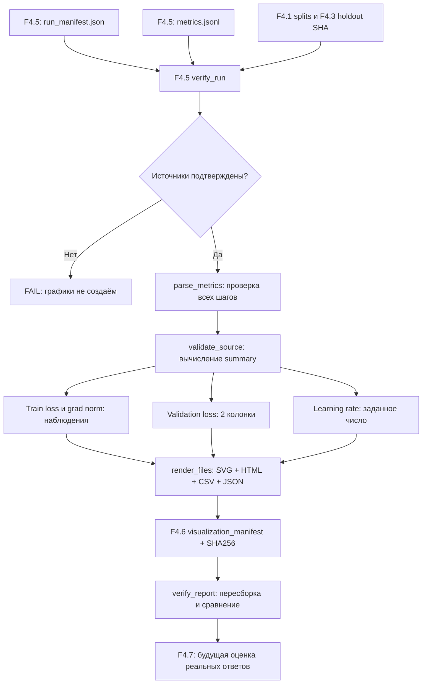

# F4.6 — Training Visualization: от журнала SFT к проверяемому отчёту

## 1. Цель этапа

**Связь с предыдущими этапами.** F4.1 — подготовка **80 технических инструкций** с разбиением `train=56`, `validation=12`, `test=12`. F4.2 — выбор **Qwen/Qwen2.5-0.5B Base** и фиксация ревизии `060db6499f32faf8b98477b0a26969ef7d8b9987`. F4.3 — формирование независимого benchmark из **32 вопросов**. F4.4 — получение воспроизводимого baseline исходной модели. F4.5 — реализация **SFT + LoRA** с обновлением адаптеров `q_proj` и `v_proj` при замороженных базовых весах.

**Проблема.** Результат обучения F4.5 представлен числовым журналом `metrics.jsonl` и манифестом `run_manifest.json`. Первый файл содержит показатели для каждого optimizer step, второй — параметры эксперимента, два измерения validation loss и контрольные суммы. Необходимо преобразовать эти данные в проверяемые графики и сводный отчёт без подмены наблюдений настройками или синтетическими значениями.

**Ключевое ограничение.** В профиле CPU выполнен **один** optimizer step на одном train-примере с валидацией на одном validation-примере. Одно наблюдение `train_loss` и `grad_norm` не образует временной ряд, поэтому график должен отображать **одну точку**, а не тренд. Конфигурация GPU предусматривает 24 шага, но наличие профиля не означает выполнения GPU-эксперимента.

**Цель F4.6:** реализовать воспроизводимый конвейер преобразования подтверждённых артефактов F4.5 в таблицы, количественные SVG-графики, автономный HTML-отчёт и манифест целостности. Разделить **фактически измеренные значения**, **вычисленные сводные показатели** и **параметры конфигурации**. Исключить отображение несуществующих измерений и неподтверждённые выводы о качестве LLM.

**Граница вычислений.** F4.6 не обучает модель, не выполняет inference, не импортирует `torch`, `transformers` или `peft` при построении отчёта и не скачивает веса Qwen. Используются стандартная библиотека Python, существующие модули проверки F4.5 и локальные результаты успешного `--verify`.

**Выходные артефакты:** `report.html`, четыре SVG-файла, `metrics.csv`, `summary.json`, `visualization_manifest.json` в каталоге `data/processed/f4_06/<profile>/`. Производные результаты не включать в Git и ZIP с исходным кодом.

## 2. Что реализовано

| Новый файл | Назначение | Что реализовано |
|---|---|---|
| `configs/f4_06_training_visualization.json` | Контракт запуска | Ссылка на утверждённую конфигурацию F4.5, отдельный каталог результатов, размеры SVG, верхняя граница количества шагов. |
| `src/llm_f4/training_visualization.py` | Алгоритм обработки и построения | `load_config()`, `plan()`, `parse_metrics()`, `validate_source()`, `render_files()`, `build_report()`, `verify_report()`; генераторы графиков, HTML, CSV, SHA-256-проверка. |
| `scripts/f4_training_visualization.py` | CLI | `--plan`, `--build cpu/gpu`, `--verify cpu/gpu`; обработка ошибок и безопасный для Windows вывод. |
| `tests/test_f4_training_visualization.py` | Автоматические проверки | Числовые эталоны, повреждённые JSONL, последовательность шагов, защита путей, Windows-кодировки, SVG/HTML, отказ от подмены источника, запрет перезаписи, SHA отчёта. |
| `docs/steps/F4_06_training_visualization.md` | Учебно-техническое объяснение | Последовательность реализации, расчёты, реальные интерфейсы, формат вывода, ограничения. |

### Реальные файлы-предшественники

- `src/llm_f4/sft_lora.py`: функции `load_config()`, `make_plan()` и **`verify_run()`** являются обязательной границей доверия для F4.6.
- `configs/f4_05_sft_lora.json`: реальное `learning_rate=0.0002`, `max_steps=1` для CPU и `max_steps=24` для GPU; нельзя подменять эти значения «усреднениями».
- `data/processed/f4_05/cpu/metrics.jsonl`: зарегистрированные значения реального CPU-запуска F4.5 — по одному JSON-объекту на optimizer step.
- `data/processed/f4_05/cpu/run_manifest.json`: `initial_validation_loss`, `final_validation_loss`, `trainable_parameters`, `optimizer_steps`, `metrics_sha256`, SHA адаптера и входных данных.
- `src/llm_f4/instruction_dataset.py`, `src/llm_f4/evaluation_set.py`: контракт разбиений и внешнего holdout; F4.6 не обучается ни на одном из этих наборов.

Каталог `data/processed/f4_06/` предназначен только для **производных результатов**. Не включать его в ZIP поставки и GitHub.

## 3. Последовательность реализации

### Шаг 1. Зафиксировать структуру исходной телеметрии F4.5

**Действие.** Изучить запись показателей в `run_real()` модуля `src/llm_f4/sft_lora.py` и структуру `run_manifest.json`.

**Пример одной строки `metrics.jsonl` (тестовая фикстура, НЕ измерение Qwen):**

```json
{"step":1,"train_loss":2.5,"grad_norm":0.375,"micro_batches":1}
```

**Назначение.** Определить, какие показатели действительно регистрируются для каждого optimizer step, а какие доступны только как параметры или контрольные измерения. Предотвратить построение фиктивных кривых.

**Реализация.** Установить назначение каждого поля: `train_loss` — средний loss по микробатчам одного шага; `grad_norm` — норма градиента **до** clipping (`max_norm=1.0`); `micro_batches` — число микробатчей с накопленными градиентами. Учесть отсутствие `validation_loss` и `learning_rate` в `metrics.jsonl`: validation loss записан дважды в манифесте, а learning rate задан в конфигурации F4.5.

**Результат.** Контракт входных метрик без подмены измеренных значений данными конфигурации и без реконструкции отсутствующей телеметрии.

### Шаг 2. Привязать визуализацию к проверенному запуску

**Действие.** Настроить чтение F4.5 и отдельный выходной каталог F4.6 через `load_config()` и `plan()`.

**Назначение.** Исключить смешение результатов разных моделей, повреждение адаптера F4.5 и создание отчёта до выполнения реального обучения.

**Реализация.** Зафиксировать путь `configs/f4_05_sft_lora.json`, проверить относительные пути и запретить запись результатов внутрь F4.5. В `plan()` использовать `make_plan()` из F4.5 и определять наличие проверяемых артефактов `cpu` и `gpu` без загрузки модели.

**Результат.** Режим `--plan` работает без ML-зависимостей, весов Qwen и сети. Отсутствие GPU-артефактов не трактуется как неисправность плана.

### Шаг 3. Проверить целостность источника до вычисления метрик

**Действие.** Выполнить полную верификацию результатов F4.5 через `_source()` и `sft_lora.verify_run()`.

**Назначение.** Не допускать построения графиков по повреждённым логам, синтетическому `--torch-smoke` или файлам от другого запуска.

**Реализация.** Проверить SHA-256 `metrics.jsonl`, адаптера, конфигурации и исходных split/holdout, последовательность шагов и признак `real_training_performed: true`. После успешной проверки повторно прочитать `metrics.jsonl` и `run_manifest.json` и убедиться в отсутствии изменений между обращениями.

**Результат.** Неподтверждённый источник отклоняется до генерации SVG или HTML. Синтетические значения допускаются исключительно в явно помеченных unit-тестах.

### Шаг 4. Преобразовать журнал в строго проверенную последовательность точек

**Действие.** Разобрать UTF-8 JSONL с помощью `parse_metrics()` и сопоставить количество строк с `optimizer_steps`.

**Назначение.** Исключить потерянные и повторные шаги, неверные типы, `NaN` и недопустимые поля, способные исказить графики.

**Реализация.** Запретить повторяющиеся JSON-ключи, `NaN`, `Infinity`, строковые значения вместо чисел и дополнительные поля. Для строки `i` требовать `step == i`; число строк должно совпадать с `optimizer_steps` проверенного манифеста. Сформировать последовательность `Point(step, train_loss, grad_norm, micro_batches)` без интерполяции и сглаживания.

**Результат.** Валидация каждой точки и строгое соответствие между графиком и реально записанными шагами оптимизатора.

### Шаг 5. Вычислить сводные метрики без изменения измерений

**Действие.** Сопоставить исходные значения с профилем F4.5 в `validate_source()` и рассчитать производные показатели.

**Назначение.** Получить сравнимую числовую сводку без неверного преобразования step-level loss в token-weighted loss и без заявления об улучшении ответов LLM.

**Реализация.** Проверить количество шагов и микробатчей, размеры train/validation, долю обучаемых параметров и изоляцию F4.3. Рассчитать:

- `train_loss_first` и `train_loss_last` — значения на первом и последнем зарегистрированных шагах;
- `train_loss_step_mean` — среднее арифметическое **по шагам** без взвешивания по токенам;
- `grad_norm_max_pre_clipping` — максимальную зарегистрированную норму до clipping;
- `validation_loss_delta` — разность `after - before`;
- `validation_loss_relative_pct` — относительное изменение при положительном исходном значении;
- `learning_rate_configured` — заданный learning rate из F4.5 при `learning_rate_observed_per_step=false`.

**Результат.** `summary.json` с исходными SHA, вычисленными метриками и флагами `quality_improvement_measured=false` и, при одном CPU-шаге, `trend_interpretation=single_step_no_trend`.

### Шаг 6. Выбрать тип графика по числу реальных наблюдений

**Действие.** Реализовать представление `train_loss` и `grad_norm` в `_svg_line()`.

**Назначение.** Исключить визуальное утверждение о тенденции по единственному измерению.

**Реализация.** При `optimizer_steps=1` строить одну точку с пометкой `1 point: no trend`. При двух и более фактических наблюдениях соединять зарегистрированные точки линией. Для `grad_norm` задавать нулевую нижнюю границу оси, так как норма неотрицательна.

**Результат.** Два отдельных SVG-графика, отображающих только измеренные значения без синтетических промежуточных точек.

### Шаг 7. Разделить validation loss и настройку learning rate

**Действие.** Сформировать отдельные SVG-представления двух контрольных значений loss и одного заданного learning rate.

**Назначение.** Не смешивать наблюдения до/после обучения с per-step телеметрией и не выдавать конфигурацию оптимизатора за измеренный scheduler.

**Реализация.** В `_svg_validation()` построить **две колонки** `Before` и `After N steps`. В `_svg_lr()` показать `learning_rate_configured` как отдельную карточку с пометкой `NO per-step LR telemetry`. Не создавать искусственные точки validation loss для каждого optimizer step.

**Результат.** Четыре независимых SVG-файла в светлой теме без зависимости от `matplotlib`.

### Шаг 8. Сформировать автономные HTML, CSV и JSON

**Действие.** Реализовать сериализацию аналитических результатов в `render_files()`.

**Назначение.** Обеспечить чтение и проверку отчёта без запуска кода и без подключения к интернету.

**Реализация.** Сформировать `metrics.csv`, `summary.json`, четыре SVG и `report.html`. Разместить точные числа, диаграммы, происхождение показателей и предупреждение об одном шаге CPU в автономном HTML. Использовать относительные ссылки без внешних CSS, JS и CDN.

**Результат.** Локальный отчёт с раздельными машиночитаемыми данными и визуальными представлениями. ZIP поставки содержит **генератор**, а не фиктивные результаты обучения.

### Шаг 9. Сохранить файлы атомарно и реализовать независимую проверку

**Действие.** Зафиксировать выходные файлы через `build_report()` и проверить их целостность через `verify_report()`.

**Назначение.** Исключить частично записанные отчёты, незаметную перезапись и подмену чисел или изображений после построения.

**Реализация.** Сначала записать все файлы во временный каталог, создать `visualization_manifest.json` с SHA-256, затем атомарно переименовать каталог в `data/processed/f4_06/<profile>/`. При наличии целевого каталога запретить повторный `--build`. При `--verify` повторно проверить F4.5, сформировать ожидаемые байты и сравнить их с текущими файлами и SHA.

**Результат.** Детерминированный набор артефактов, связанный с конкретным запуском F4.5 и защищённый от незаметного изменения.

## 4. Алгоритм и математический пример

### 4.1. От step-level train loss к числам на графике

Для каждого шага `k` F4.5 накапливает `m_k` микробатчей и сохраняет:

\[
L_{k}=\frac{1}{m_k}\sum_{j=1}^{m_k}L_{k,j}.
\]

Где `L_k` — сохранённый `train_loss` на шаге `k`, `L_{k,j}` — loss микробатча `j`, `m_k` — количество `micro_batches`. Например, для четырёх условных микробатчей с loss `2.6`, `2.2`, `2.8`, `2.0` результат равен:

\[
L_k=(2.6+2.2+2.8+2.0)/4=2.4.
\]

Именно **уже агрегированное значение** `2.4` записывает F4.5 в `metrics.jsonl`. F4.6 **не получает отдельные значения микробатчей** и не пытается их восстановить.

Для `K` шагов F4.6 вычисляет:

\[
\overline{L}_{step}=\frac{1}{K}\sum_{k=1}^{K}L_k.
\]

Например, для `[2.4,2.2,2.3]` среднее равно `2.3`. Полученное значение — **среднее шагов**, не взвешенное по количеству токенов. В коде: `sum(p.train_loss for p in points)/len(points)` в `validate_source()`. Unit-тест `test_validation_math` проверяет расчёт на константах фикстуры. У CPU `K=1`, поэтому `train_loss_first = train_loss_last = train_loss_step_mean`; это не доказательство изменения loss.

### 4.2. Validation loss: два измерения

F4.5 оценивает validation до и после обучения. Для датасета из нескольких батчей внутри **F4.5** loss агрегируется с весами `supervised_token_count()`. Для F4.6 доступны только готовые два числа:

\[
\Delta L_{val}=L_{after}-L_{before},\qquad
\Delta L_{val,\%}=\frac{L_{after}-L_{before}}{L_{before}}\cdot100\%,\quad L_{before}>0.
\]

**Иллюстративная фикстура (НЕ измерение Qwen):** `L_before=3.0`, `L_after=2.5`:

\[
\Delta L_{val}=-0.5,\qquad \Delta L_{val,\%}\approx-16.67\%.
\]

Если начальное значение равно `0`, процент не рассчитывается (`null`), чтобы избежать деления на ноль. Изменение validation loss на **одном** примере CPU не является подтверждением роста качества ответов. Unit-тесты `test_validation_math` и `test_validation_zero_denominator` проверяют формулы.

### 4.3. Gradient norm

В F4.5 вызывается:

```python
norm = torch.nn.utils.clip_grad_norm_([p for _, p in trainable], 1.0)
```

При евклидовой норме вычисляется:

\[
\lVert g\rVert_2=\sqrt{\sum_i g_i^2}.
\]

Пример `g=[3,4]`: `||g||=5`. При clipping `max_norm=1` сам градиент масштабируется примерно в пять раз, но возвращённая `norm` относится **к значению до clipping**. F4.6 показывает именно эту величину и её максимум, но не утверждает, что она равна фактически применённой норме после clipping. Для CPU остаётся одна точка.

### 4.4. Learning rate: настройка ≠ наблюдение

F4.5 использует `AdamW(..., lr=cfg.learning_rate)`, а в утверждённой конфигурации `learning_rate=0.0002` для обоих профилей. При этом никакого массива `learning_rate` в `metrics.jsonl` нет.

Поэтому F4.6 **не рисует «динамику LR»**. Отображается карточка с **заданным** числом и явным полем `learning_rate_observed_per_step=false`. Ограничение предотвращает неверную интерпретацию исходных данных.

### 4.5. Почему нельзя сравнить CPU и GPU как два чистых варианта одного эксперимента

CPU в F4.5 — `1 train / 1 validation`, один шаг, batch=1, FP32; GPU — `56 train / 12 validation`, 24 шага, accumulation=4, BF16. Они различаются и данными, и обучением, и точностью. Нельзя приписывать различие validation loss исключительно устройству, LoRA или «большему числу шагов». Формировать отчёт **отдельно для каждого профиля**, не объединять CPU/GPU в одну кривую.

## 5. Схема работы



Схема соответствует функциям **действующего модуля** `src/llm_f4/training_visualization.py`, а не абстрактному ML pipeline. В F4.6 генерация ответов модели и вычисление правильности по F4.3 **не выполняются**.

## 6. Локальная проверка PowerShell

Выполнять из корневого каталога проекта на Windows:

```powershell
cd F:\DEVELOPMENT\ML\ml-engineering-lab
```

**Шаг A — тесты этапа** (без скачивания весов и изменения F4.5):

```powershell
.\.venv\Scripts\python.exe -m pytest tests/test_f4_training_visualization.py -q
```

Ожидаемый результат тестов этапа: **`85 passed`**. Успешное выполнение подтверждает числовые преобразования, проверку источников, структуру графиков и контроль файлов; **не означает получение новых данных обучения**.

**Шаг B — план**:

```powershell
.\.venv\Scripts\python.exe scripts/f4_training_visualization.py --plan
```

План должен содержать строку `F4.6 PLAN: PASS (metadata only)`, выбранный checkpoint и размеры split. Наличие CPU-манифеста должно быть `True`, если F4.5 выполнен в ожидаемом каталоге. Отсутствие GPU-манифеста допускается. Режим `--plan` не создаёт графиков.

**Шаг C — построение отчёта по реальному CPU-запуску**:

```powershell
.\.venv\Scripts\python.exe scripts/f4_sft_lora.py --verify cpu
.\.venv\Scripts\python.exe scripts/f4_training_visualization.py --build cpu
```

Первая команда **должна** подтвердить `F4.5 VERIFY CPU: PASS`. Вторая создаст HTML и графики, но не обучит Qwen. При успешной сборке выводится `F4.6 BUILD CPU: PASS`, `Optimizer steps: 1; trend: single_step_no_trend` и путь к `report.html`. Значения validation loss считываются из **реальных** файлов F4.5 и не заменяются демонстрационными числами.

**Шаг D — проверка целостности отчёта**:

```powershell
.\.venv\Scripts\python.exe scripts/f4_training_visualization.py --verify cpu

Get-Content data\processed\f4_06\cpu\summary.json -Encoding UTF8
Get-Content data\processed\f4_06\cpu\metrics.csv -Encoding UTF8
Start-Process (Resolve-Path 'data\processed\f4_06\cpu\report.html').Path
```

Успешная проверка завершается сообщением `F4.6 VERIFY CPU: PASS`. Автономный HTML содержит сводку и четыре SVG-графика. В графике `train_loss.svg` **одна точка**; на диаграмме validation loss — **две колонки**. В разделе learning rate — **значение конфигурации**, а не временной ряд. `summary.json` позволяет сверить все значения с F4.5.

**Шаг E — полная регрессия**:

```powershell
.\.venv\Scripts\python.exe -m pytest -q
```

При завершённой локальной проверке F4.6 на Windows зафиксировано **`1744 passed, 1 skipped`**. Этот результат относится к полной регрессии; отдельная команда тестирования F4.6 содержит 85 тестов.

**GPU-профиль — только после реального F4.5 `--run gpu`**:

```powershell
.\.venv\Scripts\python.exe scripts/f4_sft_lora.py --verify gpu
.\.venv\Scripts\python.exe scripts/f4_training_visualization.py --build gpu
.\.venv\Scripts\python.exe scripts/f4_training_visualization.py --verify gpu
```

При отсутствии GPU-манифеста `--build gpu` должен завершиться **ошибкой**, не создавая 24 фиктивные точки. Числовые результаты GPU не приводить без реального запуска.

**Повторный build:** по контракту запрещён при наличии выходного каталога. При наличии отчёта выполнять `--verify cpu`, не удалять и не изменять исходные артефакты F4.5 для повторной генерации.

## 7. Что доказано тестами и какие ограничения остаются

### Подтверждено

- **85 unit-тестов F4.6** прошли в среде подготовки на Python 3.13.5. Тесты проверяют математику, контракт данных и файлов, а не качество ответов модели.
- В локальной регрессии Windows после F4.6 подтверждён результат **`1744 passed, 1 skipped`**. Реальная проверка **`F4.6 VERIFY CPU: PASS`** также завершена успешно.
- `--plan` проверяет upstream-конфигурации F4.1–F4.5 без загрузки модели и обучения.
- Арифметические фикстуры подтверждают вычисление `validation_loss_delta`, относительного изменения, step-level среднего loss и максимума gradient norm.
- SVG содержит отдельную точку для одного шага и линию только для двух или более фактически представленных шагов. Валидация отображается двумя колонками; learning rate — значением конфигурации.
- Синтетические фикстуры обеспечивают тестирование 24-step GPU-сценария, но **не означают фактического GPU-обучения**.
- Отрицательные тесты отклоняют испорченные JSON/JSONL, `NaN`, несогласованную последовательность шагов, подменённую конфигурацию, неуместную экспертную оценку и попытку перезаписи существующего отчёта.
- `--verify` повторно подтверждает источник через F4.5, пересобирает отчёт и сопоставляет SHA-256 производных файлов.

### Результаты фактического CPU-эксперимента

Подтверждённые значения F4.5, отображаемые F4.6 после проверки источника:

| Показатель | Значение | Интерпретация |
|---|---:|---|
| Шаги оптимизатора | **1** | Отсутствует ряд для анализа тенденции. |
| Train records / validation records | **1 / 1** | Минимальный интеграционный CPU-эксперимент. |
| `train_loss` | **2.3926241397857666** | Единственная step-level точка. |
| `validation_loss_before` | **2.288156747817993** | Контрольное значение до обучения. |
| `validation_loss_after` | **2.2816121578216553** | Контрольное значение после шага. |
| `validation_loss_delta` | **−0.006544589996337891** | Изменение на одной validation-записи. |
| Относительное изменение validation loss | **−0.2860%** | Не является независимой оценкой качества ответов. |
| `grad_norm` до clipping | **3.522390365600586** | Норма до применения ограничения градиента. |
| `learning_rate_configured` | **0.0002** | Параметр конфигурации, не per-step наблюдение. |
| Trainable LoRA parameters | **540 672** | При 494 573 440 параметрах модели с адаптером (≈ 0.1093%). |

### Ограничения интерпретации

- **Один optimizer step не позволяет оценить тренд**, устойчивость обучения, переобучение или обобщающую способность модели.
- `validation_loss` на одной записи не заменяет независимую проверку правильности технических ответов на 32 вопросах F4.3. **Улучшение качества не измерено** (`quality_improvement_measured=false`).
- GPU-конфигурация на 24 шага существует, но фактический GPU F4.5/F4.6-эксперимент не подтверждён отдельными результатами.
- Learning rate не логируется на каждом шаге: график scheduler не предусмотрен и не должен реконструироваться из заданного числа.
- SHA-256 подтверждает целостность и согласованность файлов, но не является независимым криптографически подписанным доказательством факта обучения. Для факта запуска требуется учитывать результаты выполнения F4.5 и его верификацию.
- Корректность структуры HTML/SVG проверена тестами; читабельность отдельных графиков в браузере оценивается непосредственно по локальному отчёту.

## 8. Основная мысль этапа

**Назначение F4.6 — превратить телеметрию обучения в проверяемые аналитические артефакты без изменения её смысла.** Основные источники — `metrics.jsonl` и `run_manifest.json`, полученные в F4.5. Перед визуализацией требуется подтвердить их согласованность с моделью, конфигурацией и входными данными через `sft_lora.verify_run()`.

`train_loss`, `grad_norm` и `micro_batches` регистрируются по шагам оптимизатора. `validation_loss` присутствует только в двух контрольных измерениях — до обучения и после него. `learning_rate` задаётся конфигурацией и не является наблюдаемым временным рядом. Следовательно, каждый тип данных необходимо отображать отдельно: шаговые метрики — точками или линией при наличии нескольких шагов; validation loss — двумя колонками; learning rate — карточкой заданного значения.

**Порядок обработки:** верифицировать F4.5 → разобрать JSONL → проверить последовательность `step` → вычислить числовую сводку → построить четыре SVG → сформировать HTML/CSV/JSON → записать SHA-256 → воспроизвести и проверить выходные файлы.

При одном CPU-шаге `train_loss` содержит ровно одну точку. Значения `train_loss_first`, `train_loss_last` и `train_loss_step_mean` при этом совпадают по определению; по ним нельзя установить направление изменения. Два значения validation loss позволяют вычислить абсолютное и относительное изменение, но не предоставляют оснований утверждать повышение качества ответов на независимых заданиях.

**Технический результат** — автономный и воспроизводимый отчёт по реальному CPU-запуску Qwen2.5-0.5B с SFT + LoRA. Отчёт содержит измеренные значения, вычисленные показатели и явно сформулированные ограничения. Оценку качества генерируемых ответов выполнять отдельно в F4.7 на едином benchmark F4.3. Такой подход разделяет **наблюдаемость процесса обучения (training observability)** и **оценку качества модели (model evaluation)**.

## 9. Файлы этапа

| Рекомендуемый порядок | Файл | Что изучить |
|---:|---|---|
| 1 | `src/llm_f4/sft_lora.py` | `run_real()`: откуда берутся `train_loss`, `grad_norm`, две проверки validation loss, `metrics_sha256`; `verify_run()` — проверка подлинности источника. |
| 2 | `configs/f4_05_sft_lora.json` | Разница CPU/GPU-профилей, `learning_rate`, количество шагов и примеров. |
| 3 | `configs/f4_06_training_visualization.json` | Путь к исходному F4.5, отдельный выходной каталог, разрешение изображений. |
| 4 | `src/llm_f4/training_visualization.py` | `parse_metrics()` → `validate_source()` → `render_files()` → `build_report()` → `verify_report()`; в чём заключается защита от фиктивных результатов. |
| 5 | `scripts/f4_training_visualization.py` | Какие режимы доступны и почему только `--build` генерирует отчёт из реального запуска. |
| 6 | `tests/test_f4_training_visualization.py` | Независимые числовые примеры, запрет линии для одного шага, проверка раздельных источников LR и loss, обнаружение искажений. |
| 7 | `data/processed/f4_06/cpu/report.html` | Открыть после подтверждённого локального BUILD/VERIFY; сопоставить таблицу и SVG с `summary.json` и манифестом F4.5. |

**Важная связь с F4.3/F4.4:** этот отчёт отслеживает **ход обучения**, но не содержит оценки правильности ответов. Для F4.7 потребуется использовать одни и те же вопросы, декодирование и критерии F4.3 для Base и Fine-Tuned; нельзя выдавать изменение loss за результат такой оценки.
