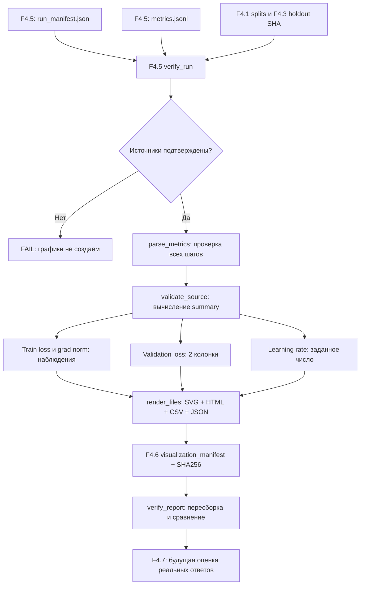

# F4.6 — Training Visualization: от журнала SFT к проверяемому отчёту

## 1. Цель этапа

В F4.1 мы создали 80 технических инструкций и выполнили разбиение на `train=56`, `validation=12`, `test=12`. В F4.2 зафиксировали Qwen2.5-0.5B Base и SHA ревизии `060db6499f32faf8b98477b0a26969ef7d8b9987`. В F4.3 подготовили независимый набор из 32 вопросов, а в F4.4 — конвейер оценки базовой модели. В F4.5 реализовали SFT + LoRA, где адаптируются `q_proj` и `v_proj`, а исходные веса заморожены.

**Теперь проблема другая.** После обучения F4.5 остаются два файла: `metrics.jsonl` с показателями каждого шага оптимизатора и `run_manifest.json` с настройками, двумя измерениями validation loss и хешами источников. Сами по себе числа в JSONL трудно читать. При этом легко сделать ошибку: показать одну точку `train_loss` как якобы «кривую снижения потерь» или выдать запланированное значение learning rate за записанную телеметрию оптимизатора.

**Цель F4.6** — получить из **действительно подтверждённого** запуска F4.5 удобные таблицы, отдельные количественные SVG-графики и связный HTML-отчёт. В отчёте должны быть честно разделены наблюдаемые данные, вычисленные сводные показатели и ограничения эксперимента. Для `cpu` с одним шагом строится **одна точка**, а не линия; для `gpu` с 24 шагами — линия из 24 реально записанных наблюдений, если такой запуск когда-либо будет выполнен.

F4.6 не запускает `torch`, `transformers` или `peft`, не скачивает модель и **не выполняет обучение**. Для генерации файлов нужны только стандартная библиотека Python, исходники проекта и локальные артефакты **успешного** F4.5 `--verify`.

**Итог:** воспроизводимые `report.html`, четыре SVG-файла, `metrics.csv`, `summary.json` и `visualization_manifest.json`, размещённые **вне Git** — в `data/processed/f4_06/<profile>/`.

## 2. Что реализовано

| Новый файл | Назначение | Что реализовано |
|---|---|---|
| `configs/f4_06_training_visualization.json` | Контракт запуска | Ссылка на утверждённую конфигурацию F4.5, отдельный каталог результатов, размеры SVG, верхняя граница количества шагов. |
| `src/llm_f4/training_visualization.py` | Алгоритм обработки и построения | `load_config()`, `plan()`, `parse_metrics()`, `validate_source()`, `render_files()`, `build_report()`, `verify_report()`; генераторы графиков, HTML, CSV, SHA-256-проверка. |
| `scripts/f4_training_visualization.py` | CLI | `--plan`, `--build cpu/gpu`, `--verify cpu/gpu`; обработка ошибок и безопасный для Windows вывод. |
| `tests/test_f4_training_visualization.py` | Автоматические проверки | Числовые эталоны, повреждённые JSONL, последовательность шагов, защита путей, Windows-кодировки, SVG/HTML, отказ от подмены источника, запрет перезаписи, SHA отчёта. |
| `docs/steps/F4_06_training_visualization.md` | Учебно-техническое объяснение | Последовательность реализации, расчёты, реальные интерфейсы, формат вывода, ограничения. |

### Реальные файлы-предшественники

- `src/llm_f4/sft_lora.py`: функции `load_config()`, `make_plan()` и **`verify_run()`** являются обязательной границей доверия для F4.6.
- `configs/f4_05_sft_lora.json`: реальное `learning_rate=0.0002`, `max_steps=1` для CPU и `max_steps=24` для GPU; нельзя подменять эти значения «усреднениями».
- `data/processed/f4_05/cpu/metrics.jsonl`: реальные значения, которые получишь у себя после успешного F4.5, по одному JSON-объекту на шаг оптимизатора.
- `data/processed/f4_05/cpu/run_manifest.json`: `initial_validation_loss`, `final_validation_loss`, `trainable_parameters`, `optimizer_steps`, `metrics_sha256`, SHA адаптера и входных данных.
- `src/llm_f4/instruction_dataset.py`, `src/llm_f4/evaluation_set.py`: контракт разбиений и внешнего holdout; F4.6 не обучается ни на одном из этих наборов.

Каталог `data/processed/f4_06/` содержит только **производные результаты**. Его не добавляем в ZIP и GitHub.

## 3. Последовательность реализации

### Шаг 1. Разобрали фактический формат F4.5

**Что сделали.** Прочитали участок `run_real()` из `src/llm_f4/sft_lora.py`, в котором заполняется `records`, и участок записи `run_manifest.json`. Каждый объект в `metrics.jsonl` содержит **ровно**:

```json
{"step":1,"train_loss":2.5,"grad_norm":0.375,"micro_batches":1}
```

**Важно:** это **искусственный пример формата**, а не результат твоего запуска Qwen. Настоящие значения F4.5 не переносим в документацию без чтения твоего файла.

`train_loss` — среднее арифметическое loss по микробатчам **одного optimizer step**. `grad_norm` — возвращённая `torch.nn.utils.clip_grad_norm_` норма **до** ограничения градиентов (в F4.5 порог `1.0`). `micro_batches` указывает, сколько микробатчей накопили градиент на этом шаге.

В `metrics.jsonl` **нет** `validation_loss` и **нет** `learning_rate`. Первые два значения validation loss расположены в `run_manifest.json`. Learning rate берётся только из F4.5-конфигурации, без утверждения, что он измерялся по шагам.

**Зачем.** Так не возникает ложных кривых или искусственных дополнительных точек.

### Шаг 2. Привязали визуализацию к действительному запуску

**Что сделали.** `load_config()` фиксирует путь `configs/f4_05_sft_lora.json`, проверяет безопасные относительные пути и запрещает размещать выход F4.6 внутри каталога F4.5. `plan()` обращается к F4.5 `make_plan()`, не требуя готовых результатов обучения, и показывает, присутствуют ли файлы запусков `cpu` и `gpu`.

**Зачем.** Мы не должны переписать исходный адаптер, перемешать отчёты разных моделей или нарисовать график до реального обучения.

**Что получили.** Команда `--plan` работает без ML-библиотек, без весов и без сети. Отсутствие GPU-артефактов в плане — нормальный статус.

### Шаг 3. Проверили целостность оригинальных артефактов

**Что сделали.** Функция `_source()` сначала вызывает **`sft_lora.verify_run()`** для указанного профиля. Эта уже протестированная функция сравнивает SHA-256 `metrics.jsonl`, адаптера, конфигурации и исходных split/holdout, а также проверяет `real_training_performed: true` и последовательность шагов. После её успешного возврата F4.6 самостоятельно перечитывает `metrics.jsonl` и `run_manifest.json` и проверяет, что они не изменились между чтениями.

**Зачем.** Визуализация повреждённых логов недопустима, а независимая HTML-картинка без подтверждённого запуска не является экспериментальным результатом.

**Что получили.** F4.6 **отказывается** строить отчёт из одного `--torch-smoke` и из несуществующего GPU-прогона. Тесты используют *явно маркированные фикстуры* для отдельных функций; такие числа не публикуются как результаты обучения Qwen.

### Шаг 4. Проверили каждую строку метрик

**Что сделали.** `parse_metrics()` читает UTF-8 JSONL, запрещает дублирующиеся ключи, `NaN`, `Infinity`, строки вместо чисел и непредусмотренные поля. Для строки `i` требуется `step == i`. Количество строк должно точно совпадать с `optimizer_steps` в проверенном F4.5-манифесте.

**Зачем.** Нельзя рисовать линию через пропущенные шаги, воспринимать ошибочное `NaN` как loss или удваивать один шаг из-за повторного лога.

**Что получили.** Последовательность `Point(step, train_loss, grad_norm, micro_batches)` из **фактически записанных** значений. Значения не интерполируются и не сглаживаются.

### Шаг 5. Рассчитали сводные показатели, но не изменили исходные измерения

**Что сделали.** `validate_source()` сопоставляет метрики с действительным профилем F4.5, проверяет число шагов и микробатчей, долю обучаемых параметров, объём используемых train/validation-записей и изоляцию benchmark F4.3.

Далее вычисляются:

- `train_loss_first`, `train_loss_last` и `train_loss_step_mean` — среднее **между step-level значениями**, без выдуманного token weighting.
- `grad_norm_max_pre_clipping` — максимум нормы градиента, записанной до clipping.
- `validation_loss_delta` — изменение от **исходного** до **конечного** значения.
- `validation_loss_relative_pct` — относительное изменение, если исходное значение больше нуля.
- `learning_rate_configured` — **заданное значение** `learning_rate` из профиля F4.5; `learning_rate_observed_per_step=false`.

**Что получили.** `summary.json` со ссылками на исходные SHA и флагами честной интерпретации. `quality_improvement_measured=false`: **по loss ещё нельзя утверждать**, что модель стала качественнее отвечать на 32 независимых вопроса F4.3.

### Шаг 6. Выбрали форму визуализации по объёму реальных измерений

**Что сделали.** Генератор `_svg_line()` для `train_loss` и `grad_norm` отображает одну точку при `optimizer_steps=1`. При двух и более **реальных** наблюдениях он строит линию между записанными точками и подписывает номер шага. `grad_norm` показывается с нулевой нижней границей, поскольку это величина нормы.

**Зачем.** Один обучающий шаг не задаёт тенденцию. Линия из двух валидационных измерений может ошибочно выглядеть как детальная кривая.

**Что получили.** Два отдельных SVG-графика для train loss и grad norm; график с единственной точкой прямо помечен `1 point: no trend`.

### Шаг 7. Отдельно показали validation loss и learning rate

**Что сделали.** `_svg_validation()` строит **две подписанные колонки**: `Before` и `After N steps` — это ровно два контрольных значения, а не ряд длиной N. `_svg_lr()` показывает значение learning rate на карточке с пометкой **`NO per-step LR telemetry`**. Значение конфигурации не выдаётся за записанный scheduler.

**Зачем.** Это наглядно сохраняет различие между наблюдениями и настройками эксперимента.

**Что получили.** Четыре SVG в светлой теме, которые можно открыть в браузере отдельно. Они создаются стандартной библиотекой Python и не зависят от наличия `matplotlib`.

### Шаг 8. Создали единый offline HTML и CSV

**Что сделали.** `render_files()` формирует `metrics.csv`, `summary.json`, четыре SVG и `report.html`. HTML содержит таблицу точных значений, изображения, пояснения происхождения метрик и предупреждение про один optimizer step для CPU. Файлы связаны относительными путями, внешние CSS/JS/CDN отсутствуют.

**Зачем.** Результат должен быть понятен без чтения исходников, переносим между компьютерами и пригоден для обсуждения на техническом собеседовании.

**Что получили.** Один HTML-файл для открытия из проводника Windows и исходные численные данные рядом с ним. **В ZIP включён код генерации**, а не отчёт с придуманными числами.

### Шаг 9. Сохранили отчёт атомарно и реализовали верификацию

**Что сделали.** `build_report()` сначала готовит все файлы во временной директории, записывает `visualization_manifest.json` с SHA-256 каждого, затем переименовывает директорию в `data/processed/f4_06/<profile>/`. Если профиль уже существует, перезаписи **нет**.

`verify_report()` повторно выполняет F4.5 VERIFY, формирует ожидаемый байтовый набор файлов и сравнивает каждый с тем, что записан на диск, и с SHA в манифесте. Любое изменение SVG, CSV, HTML или конфига считается несовпадением.

**Зачем.** Получается воспроизводимый отчёт, привязанный к конкретному эксперименту, а не произвольный скриншот.

**Что получили.** Детерминированная и проверяемая поставка локальных аналитических результатов.

## 4. Алгоритм и математический пример

### 4.1. От step-level train loss к числам на графике

В F4.5 на каждом шаге `k` обучение накапливает `m_k` микробатчей и сохраняет:

\[
L_{k}=\frac{1}{m_k}\sum_{j=1}^{m_k}L_{k,j}.
\]

Где `L_k` — сохранённый `train_loss` на шаге `k`, `L_{k,j}` — loss микробатча `j`, `m_k` — количество `micro_batches`. Например, четыре условных микробатча имеют loss `2.6`, `2.2`, `2.8`, `2.0`. Получим:

\[
L_k=(2.6+2.2+2.8+2.0)/4=2.4.
\]

Именно **уже агрегированное значение** `2.4` записывает F4.5 в `metrics.jsonl`. F4.6 **не получает отдельные значения микробатчей** и не пытается их восстановить.

Для `K` шагов F4.6 вычисляет:

\[
\overline{L}_{step}=\frac{1}{K}\sum_{k=1}^{K}L_k.
\]

Например, для `[2.4,2.2,2.3]` получится `2.3`. Это **среднее шагов**, не взвешенное по количеству токенов. В коде: `sum(p.train_loss for p in points)/len(points)` в `validate_source()`. Unit-тест `test_validation_math` проверяет расчёт на константах фикстуры. У CPU `K=1`, поэтому `train_loss_first = train_loss_last = train_loss_step_mean`; это не доказательство изменения loss.

### 4.2. Validation loss: два измерения

F4.5 оценивает validation до и после обучения. Для датасета из нескольких батчей внутри **F4.5** loss агрегируется с весами `supervised_token_count()`. Для F4.6 доступны только готовые два числа:

\[
\Delta L_{val}=L_{after}-L_{before},\qquad
\Delta L_{val,\%}=\frac{L_{after}-L_{before}}{L_{before}}\cdot100\%,\quad L_{before}>0.
\]

**Иллюстративная фикстура (НЕ измерение Qwen):** `L_before=3.0`, `L_after=2.5`:

\[
\Delta L_{val}=-0.5,\qquad \Delta L_{val,\%}\approx-16.67\%.
\]

Если начальное значение равно `0`, процент не рассчитывается (`null`), чтобы избежать деления на ноль. Изменение validation loss на **одном** примере CPU не является подтверждением роста качества ответов. Unit-тесты `test_validation_math` и `test_validation_zero_denominator` проверяют формулы.

### 4.3. Gradient norm

В F4.5 вызывается:

```python
norm = torch.nn.utils.clip_grad_norm_([p for _, p in trainable], 1.0)
```

При евклидовой норме вычисляется:

\[
\lVert g\rVert_2=\sqrt{\sum_i g_i^2}.
\]

Пример `g=[3,4]`: `||g||=5`. При clipping `max_norm=1` сам градиент масштабируется примерно в пять раз, но возвращённая `norm` относится **к значению до clipping**. F4.6 показывает именно эту величину и её максимум, но не утверждает, что она равна фактически применённой норме после clipping. Для CPU остаётся одна точка.

### 4.4. Learning rate: настройка ≠ наблюдение

F4.5 использует `AdamW(..., lr=cfg.learning_rate)`, а в утверждённой конфигурации `learning_rate=0.0002` для обоих профилей. При этом никакого массива `learning_rate` в `metrics.jsonl` нет.

Поэтому F4.6 **не рисует «динамику LR»**. Отображается карточка с **заданным** числом и явным полем `learning_rate_observed_per_step=false`. Это сознательное ограничение, сохраняющее достоверность результатов.

### 4.5. Почему нельзя сравнить CPU и GPU как два чистых варианта одного эксперимента

CPU в F4.5 — `1 train / 1 validation`, один шаг, batch=1, FP32; GPU — `56 train / 12 validation`, 24 шага, accumulation=4, BF16. Они различаются и данными, и обучением, и точностью. Нельзя приписывать различие validation loss исключительно устройству, LoRA или «большему числу шагов». F4.6 делает отчёт **отдельно для каждого профиля**, не объединяя их в одну кривую.

## 5. Схема работы



Схема отражает **текущий код**: `src/llm_f4/training_visualization.py`, а не абстрактный ML pipeline. В F4.6 генерация ответов модели и вычисление правильности по F4.3 **не выполняются**.

## 6. Локальная проверка PowerShell

Из корня проекта на Windows:

```powershell
cd F:\DEVELOPMENT\ML\ml-engineering-lab
```

**Шаг A — тесты нового этапа** (не скачивают веса, не меняют F4.5):

```powershell
.\.venv\Scripts\python.exe -m pytest tests/test_f4_training_visualization.py -q
```

Ожидаемый результат для подготовленной поставки: **`85 passed`**. Он доказывает работу числовых преобразований, защиту от битых источников, структуру графиков и контроль файлов; **не** означает, что мы получили новые данные обучения.

**Шаг B — план**:

```powershell
.\.venv\Scripts\python.exe scripts/f4_training_visualization.py --plan
```

Ожидается строка `F4.6 PLAN: PASS (metadata only)`, выбранный checkpoint и размеры split. Наличие CPU-манифеста должно быть `True`, если F4.5 выполнен в ожидаемом каталоге. GPU-манифеста может не быть: это штатная ситуация. План не создаёт графиков.

**Шаг C — фактический отчёт CPU**:

```powershell
.\.venv\Scripts\python.exe scripts/f4_sft_lora.py --verify cpu
.\.venv\Scripts\python.exe scripts/f4_training_visualization.py --build cpu
```

Первая команда **должна** подтвердить `F4.5 VERIFY CPU: PASS`. Вторая создаст HTML и графики, но не обучит Qwen. Ожидаем `F4.6 BUILD CPU: PASS`, `Optimizer steps: 1; trend: single_step_no_trend` и напечатанный путь к `report.html`. Значения validation loss будут взяты из твоих **реальных** файлов, поэтому заранее их не подставляем в пример вывода.

**Шаг D — проверка отчёта**:

```powershell
.\.venv\Scripts\python.exe scripts/f4_training_visualization.py --verify cpu

Get-Content data\processed\f4_06\cpu\summary.json -Encoding UTF8
Get-Content data\processed\f4_06\cpu\metrics.csv -Encoding UTF8
Start-Process (Resolve-Path 'data\processed\f4_06\cpu\report.html').Path
```

Ожидаем `F4.6 VERIFY CPU: PASS`. В браузере должен открыться автономный HTML со сводкой и четырьмя SVG-графиками. В графике `train_loss.svg` **одна точка**; на диаграмме validation loss — **две колонки**. В разделе learning rate — **значение конфигурации**, а не временной ряд. `summary.json` позволяет сверить все значения с F4.5.

**Шаг E — полная регрессия**:

```powershell
.\.venv\Scripts\python.exe -m pytest -q
```

До F4.6 пользователь подтвердил `1659 passed, 1 skipped`. В новой поставке добавлены 85 тестов. Если больше ничего не менялось и skip остаётся, **ожидаем** `1744 passed, 1 skipped`. Это расчётное ожидание, а не заявленный фактический Windows-результат.

**GPU-профиль — только если реально выполнен F4.5 `--run gpu`**:

```powershell
.\.venv\Scripts\python.exe scripts/f4_sft_lora.py --verify gpu
.\.venv\Scripts\python.exe scripts/f4_training_visualization.py --build gpu
.\.venv\Scripts\python.exe scripts/f4_training_visualization.py --verify gpu
```

Если GPU-манифеста нет — `--build gpu` должен завершиться **ошибкой**, а не создать 24 фиктивные точки. Конкретные loss и время работы GPU здесь не приводятся.

**Повторный build:** намеренно запрещён без удаления предыдущего выходного каталога. Если отчёт уже существует, используй `--verify cpu`. Не удаляй исходники F4.5 и не меняй их для перегенерации.

## 7. Что доказано тестами и какие ограничения остаются

### Подтверждено при подготовке поставки

- **85 unit-тестов F4.6** прошли на Python 3.13.5 в среде подготовки.
- `--plan` построен на действительных F4.1–F4.5-конфигурациях и исходных подготовленных split/benchmark без модели.
- Искусственные **тестовые фикстуры** проверили точные арифметические значения и правильную отрисовку одного/24 шагов.
- SVG-представления являются корректным XML, HTML имеет автономные относительные ссылки, выходные файлы детерминированы.
- Отрицательные тесты отклоняют отсутствующие или чужие поля метрик, повреждённые JSON, NaN, непоследовательные шаги, подменённую конфигурацию, неуместную экспертную оценку и попытку перезаписать отчёт. Отдельный интеграционный тест запускает настоящий F4.5 `verify_run()` на явно помеченных искусственных файлах **только внутри pytest**; он проверяет контракт, а не факт обучения модели.
- Команда `--verify` сверяет SHA-256 и пересобирает ожидаемые файлы из источника.

### Ещё не подтверждено

- Реальные значения `train_loss`, `grad_norm` и validation loss **твоего** CPU-запуска ещё не прочитаны в моей среде. Следовательно, **настоящий F4.6 BUILD CPU / VERIFY CPU на Windows — до твоего запуска**.
- Никакой новый GPU SFT не выполнен в F4.6; GPU 24-step графики появятся только при действительном F4.5 GPU-эксперименте.
- Одним шагом CPU невозможно измерить кривую обучения, стабильность loss, generalization или выигрыш в качестве технических ответов.
- Learning rate фиксирован конфигурацией; нет записанной per-step телеметрии или доказанного графика scheduler.
- Корректная отрисовка SVG/HTML тестируется структурно; визуальную читабельность итогового браузерного вывода следует подтвердить вручную после локальной генерации.
- SHA-256 проверяет согласованность файлов, но не является криптографически подписанным свидетельством реального обучения: манифест и сами файлы могут быть умышленно изготовлены вместе. Доверие к тому, что обучение действительно выполнялось, опирается также на журнал исполнения F4.5, который подтверждён пользователем.
- Не проверены новые зависимости: их **нет**, поскольку модуль использует только Python stdlib и существующие модули проекта.

## 8. Основная мысль этапа

На F4.6 я перестал смотреть на тренировочный лог просто как на файл с числами. В F4.5 мы уже научились выполнять LoRA-обновление параметров Qwen; теперь я научился отличать **наблюдение на шаге оптимизатора** от **настройки запуска**, а также отличать **loss на обучении** от **качества ответов**. Это важное умение ML-инженера: красиво нарисованный график ещё не означает корректный эксперимент.

Сначала я открыл `sft_lora.py` и нашёл, в какой момент и в каком формате записываются показатели. Оказалось, что F4.5 логирует `train_loss`, норму градиента и число микробатчей для каждого шага, а validation loss сохраняет только в двух точках — до обучения и после него. Поэтому я не стал объединять эти данные в одну кривую. Learning rate тоже не оказался в телеметрии — он есть в конфигурации. Я отдельно отметил его как заданное значение, а не подставил одинаковые точки в мнимую линию.

Затем я реализовал проверку источника через F4.5 `verify_run()`. Перед отображением каждого значения программа проверяет реальный манифест, целостность логов, модель, ревизию и ограничения данных. Уже после этого она рассчитывает `validation_loss_delta`, средний по шагам `train_loss` и максимальную норму градиента. Я могу объяснить математически, что означает каждое значение и почему среднее по шагам нельзя автоматически считать средним по всем токенам.

Далее я сделал автономные SVG-графики и HTML-отчёт. Самое важное архитектурное решение — **не симулировать прогресс**. Наш текущий CPU-прогон F4.5 имеет только один реальный шаг, поэтому на графике появляется одна точка и предупреждение о невозможности сделать вывод о тенденции. Если позже мы реально выполним 24-шаговое обучение на GPU, отчёт покажет последовательность реальных измерений. Таким образом, формат масштабируется вместе с экспериментом, но никогда не дорисовывает данные.

В результате я получил проверяемый конвейер анализа обучения: от исходного JSONL и SHA-256 до рассчитанных метрик и оформленного отчёта. Для меня это практический пример **ML observability и experiment reporting**: диагностика нужна, чтобы понять, что произошло внутри обучения, а отдельный benchmark — чтобы судить о качестве самой модели. Следующая задача F4.7 как раз будет посвящена сравнению ответов Base и Fine-Tuned на одинаковом независимом наборе.

## 9. Файлы этапа

| Рекомендуемый порядок | Файл | Что изучить |
|---:|---|---|
| 1 | `src/llm_f4/sft_lora.py` | `run_real()`: откуда берутся `train_loss`, `grad_norm`, две проверки validation loss, `metrics_sha256`; `verify_run()` — проверка подлинности источника. |
| 2 | `configs/f4_05_sft_lora.json` | Разница CPU/GPU-профилей, `learning_rate`, количество шагов и примеров. |
| 3 | `configs/f4_06_training_visualization.json` | Путь к исходному F4.5, отдельный выходной каталог, разрешение изображений. |
| 4 | `src/llm_f4/training_visualization.py` | `parse_metrics()` → `validate_source()` → `render_files()` → `build_report()` → `verify_report()`; в чём заключается защита от фиктивных результатов. |
| 5 | `scripts/f4_training_visualization.py` | Какие режимы доступны и почему только `--build` генерирует отчёт из реального запуска. |
| 6 | `tests/test_f4_training_visualization.py` | Независимые числовые примеры, запрет линии для одного шага, проверка раздельных источников LR и loss, обнаружение искажений. |
| 7 | `data/processed/f4_06/cpu/report.html` | Открыть **после настоящего BUILD на Windows**; сопоставить таблицу и графики с `summary.json` и F4.5-манифестом. |

**Важная связь с F4.3/F4.4:** этот отчёт отслеживает **ход обучения**, но не содержит оценки правильности ответов. Для F4.7 потребуется использовать одни и те же вопросы, декодирование и критерии F4.3 для Base и Fine-Tuned; нельзя выдавать изменение loss за результат такой оценки.
