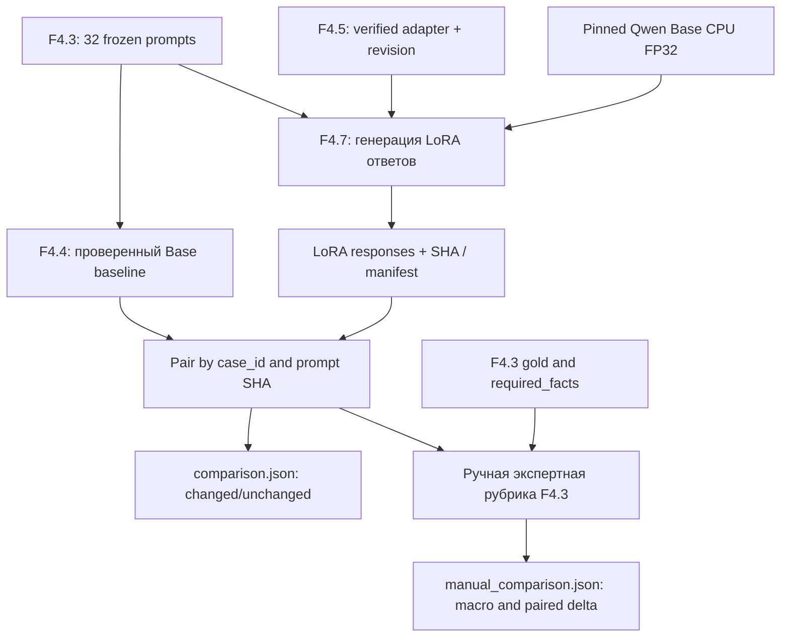
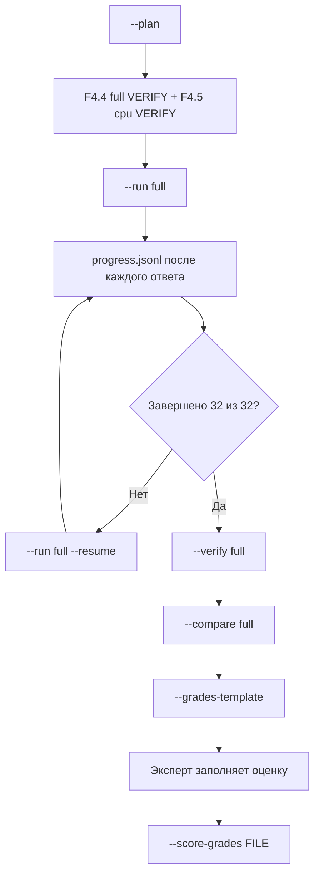

# F4.7 — Base vs Fine-Tuned: сравнение Qwen Base и Qwen + LoRA

## 1. Цель этапа

На F4.1 я подготовил корпус инструкций с раздельными выборками. На F4.2 зафиксировал базовую модель `Qwen/Qwen2.5-0.5B`, конкретную ревизию и токенизатор. В F4.3 независимо от обучающих текстов создал 32 русскоязычных контрольных задания по Python, Linux, SQL и ML. F4.4 научил проект сохранять ответы **базовой** модели на этих заданиях; F4.5 добавил SFT с LoRA; F4.6 построил визуализации реальных обучающих метрик.

**Но само выполнение одного шага SFT и уменьшение loss не доказывают улучшение ответов.** Для такого вывода требуется дать двум версиям модели **одни и те же вопросы**, получить ответы при **одинаковых правилах декодирования** и оценить их по **одной рубрике**. Именно это и делает F4.7.

Мы сравниваем:

- **Base:** неизменённая Qwen2.5-0.5B, ответы которой уже сохранены F4.4;
- **Fine-Tuned:** та же Qwen2.5-0.5B с реально сохранённым LoRA-адаптером из F4.5;
- **Evaluation:** тот же зафиксированный F4.3 набор (32 задания, 64 смысловых факта);
- **Метод:** greedy decoding, CPU, FP32, 384 входных и 96 новых токенов, один шаблон вопроса.

F4.7 **не** обучает модель повторно, не подбирает гиперпараметры по тестовым заданиям и не заменяет работу эксперта подсчётом ключевых слов. Эксперимент в одном CPU-шаге F4.5 обучался на **одной** записи и оценивался по **одной** validation-записи. Поэтому он проверяет механику LoRA, а не способность модели обобщать. F4.7 позволяет исследовать, как именно такое ограниченное изменение повлияло на ответы; отсутствие улучшения считается допустимым результатом.

Результат этапа состоит из трёх отдельно проверяемых частей: подлинные ответы обеих моделей; попарная таблица и сводка технических различий; необязательная **заполненная человеком** оценка по исходной рубрике F4.3.

## 2. Что реализовано

В поставке **ровно пять новых файлов**; завершённые F4.1–F4.6 не изменяются.

| Файл | Назначение | Что в нём реализовано |
|---|---|---|
| `configs/f4_07_base_vs_finetuned.json` | Фиксирует источники и профиль | Пути к F4.4/F4.5, профиль обученного адаптера `cpu`, отдельный каталог результатов F4.7 |
| `src/llm_f4/base_vs_finetuned.py` | Проверяемый конвейер | `load_config`, `plan`, `_require_sources`, `RealAdapterGenerator`, `run`, `verify`, `paired_rows`, `compare`, `verify_comparison`, `grades_template`, `score_grades` |
| `scripts/f4_base_vs_finetuned.py` | Командный интерфейс | `--plan`, `--run`, `--resume`, `--compare`, `--verify`, `--grades-template`, `--score-grades` |
| `tests/test_f4_base_vs_finetuned.py` | Контрактные, отрицательные и числовые тесты | Отдельный временный репозиторий с **TEST-DOUBLE** генератором, проверка неизменности provenance, сопоставления 32 заданий и ручной рубрики |
| `docs/steps/F4_07_base_vs_finetuned.md` | Данная методичка | Последовательность реализации, интерфейсы, числовой пример, PowerShell, проверенные и непроверенные свойства |

Вне Git после реального запуска создаются следующие артефакты (пример для `full`):

| Файл | Содержание |
|---|---|
| `data/processed/f4_07/full/context.json` | Ревизия модели, хеши источников, настройки декодирования, версии библиотек |
| `data/processed/f4_07/full/progress.jsonl` | Журнал ответов с записью после каждого вопроса |
| `data/processed/f4_07/full/responses.jsonl` | 32 ответа модели **с LoRA** (без эталонов) |
| `data/processed/f4_07/full/manifest.json` | SHA-256, 32/32, служебные метрики генерации, `NOT_HUMAN_GRADED` |
| `data/processed/f4_07/full/paired_responses.jsonl` | Попарные ответы `Base / LoRA` с тем же `case_id` и SHA каждого текста |
| `data/processed/f4_07/full/comparison.json` | Число изменённых/совпавших текстов; *не* баллы качества |
| `data/processed/f4_07/full/grades_template.jsonl` | Пустая форма экспертной оценки (2 набора баллов 0/1/2) |
| `data/processed/f4_07/full/human_review.md` | Вопрос, эталон, рубрика, два ответа для экспертного чтения |
| `data/processed/f4_07/full/manual_comparison.json` | Возникает **только после фактически заполненных экспертных оценок** |

Выходы `smoke` и `full` разделены. Ответы Base остаются на прежнем месте — в `data/processed/f4_04/{smoke,full}/`; адаптер и результаты обучения остаются в `data/processed/f4_05/cpu/`. Каталог F4.7 не перезаписывает их.

### Связь с уже существующим кодом

- `src/llm_f4/base_model_evaluation.py`: `RealCPUGenerator.generate` выполняет токенизацию, `model.generate` и декодирование новых токенов. `verify` подтверждает сохранённые Base-ответы. `formatted_prompt` гарантирует шаблон вопроса.
- `src/llm_f4/sft_lora.py`: `verify_run` проверяет контрольные суммы `adapter_model.safetensors`, `adapter_config.json`, журнала и обучающего контекста.
- `src/llm_f4/evaluation_set.py`: `load_cases` извлекает эталоны **только для экспертной проверки**, а `score_manual_grades` вычисляет нормированные баллы по рубрике.
- `src/llm_f4/instruction_dataset.py`: тот же исходный корпус и групповой split; F4.7 **не обращается** к train/test при генерации.

## 3. Последовательность реализации

### Шаг 1. Сохранили прежние экспериментальные контракты

**Что сделали.** Зафиксировали ссылки на неизменные F4.4- и F4.5-конфигурации. Проверяем, что идентификаторы модели, 40-символьная ревизия и токенизатор совпадают.

**Зачем.** Модель с другим checkpoint или tokenizer нельзя считать результатом того же эксперимента.

**Как.** `load_config()` последовательно вызывает `load_base()` и `load_sft()`, затем сравнивает тройки `(model_id, model_revision, tokenizer_revision)`. Конфигурация F4.7 имеет собственный SHA-256.

**Что получили.** Параметры сравнения не могут незаметно переключиться на другую LLM.

### Шаг 2. Взяли только 32 утверждённых вопроса

**Что сделали.** Вызываем `load_prompts()` из F4.4, которая проверяет `data/processed/f4_03/prompts.jsonl` и SHA F4.3.

**Зачем.** Не хотим случайно сравнить модели на разных подборках или передать в промпт эталон.

**Как.** `Prompt` содержит только `case_id`, `domain`, `prompt`. Проверяются число вопросов, уникальность ID и отсутствие полей `reference_answer`/`rubric`.

**Что получили.** 32 вопроса (`full`) или два фиксированных идентификатора (`smoke`), в однозначном порядке.

### Шаг 3. Проверили существующий Base baseline

**Что сделали.** `verify_base()` проверяет действительность уже сохранённых F4.4-ответов.

**Зачем.** Повторная генерация Base могла бы изменить условия сравнения и уничтожить исходный результат.

**Как.** Сверяем `responses.jsonl`, `progress.jsonl`, `manifest.json`, SHA-256, `model_stage=base`, `decoding=greedy`, идентификаторы и порядок заданий.

**Что получили.** Мы **не генерируем Base заново** в F4.7. Если сохранённого `full` не существует, программа останавливается и прямо требует выполнить соответствующий F4.4-run.

### Шаг 4. Проверили обученный адаптер F4.5

**Что сделали.** Прочитали реальный манифест обучения и проверили его по `verify_run()`.

**Зачем.** Загрузка непроверенных или случайно заменённых `.safetensors` лишает эксперимент воспроизводимости.

**Как.** Проверяются SHA-256 веса адаптера, `adapter_config.json`, `metrics.jsonl` и контекст обучающего run; сравниваются ревизия модели и SHA holdout.

**Что получили.** Генерация запрещена, если зафиксированный LoRA-адаптер изменился.

### Исправление F4.7 r2 — делегирование проверки runtime F4.4

При первом реальном запуске F4.7 обнаружилась ошибка `TypeError: real_runtime() missing 1 required keyword-only argument: 'root'`. Причина: имя `real_runtime`, импортированное из F4.4, перекрывалось одноимённой функцией F4.7. Вызов из `real_runtime_base()` попадал обратно в F4.7 вместо проверки окружения F4.4. Данные F4.3, Base-ответы F4.4 и адаптер F4.5 при этом не изменялись, обучение и генерация LoRA не начинались.

Исправление: `real_runtime` из `base_model_evaluation` импортируется как `base_real_runtime`; функция `real_runtime_base()` вызывает именно `base_real_runtime(base)` и переводит `BaselineError` в `ComparisonError`. Добавлены два регрессионных теста: проверка маршрута к исходной функции F4.4 (с тестовым двойником, без загрузки весов) и проверка преобразования ошибки. Полный реальный inference остаётся отдельной проверкой на Windows. Ранее полученный F4.4 baseline `32/32` повторно запускать не требуется.

### Шаг 5. Повторно использовали точный механизм Base-генерации

**Что сделали.** `RealAdapterGenerator` наследуется от `RealCPUGenerator` и не переписывает логику токенизации/генерации.

**Зачем.** Иначе различия ответов могли бы объясняться разными правилами формирования prompt или decoding.

**Как.** Загружаем базовую Qwen на CPU/FP32 по pinned revision, затем применяем:

```python
self.model = PeftModel.from_pretrained(
    self.model,
    str(adapter_dir),
    is_trainable=False,
).to("cpu")
self.model.eval()
```

Метод `generate()` остаётся F4.4: `do_sample=False`, `num_beams=1`, `max_new_tokens=96`, срез `outputs[0, prompt_length:]`; `attention_mask` и `eos_token_id` одинаковые.

**Что получили.** Два сопоставимых inference-пути; в Fine-Tuned включён единственный исследуемый фактор — сохранённый LoRA-адаптер. Если версии runtime Base и LoRA отличаются, это видно в манифестах и должно учитываться при строгих выводах.

### Шаг 6. Сохранили каждый ответ и научились продолжать запуск

**Что сделали.** Перед генерацией пишем `context.json`. После каждого ответа — строку `progress.jsonl` с `fsync`.

**Зачем.** CPU inference на 32 заданиях может прерываться. Потеря всех ответов из-за сбоя недопустима.

**Как.** `_execute()` записывает `case_id`, SHA prompt, текст и SHA ответа, число токенов, флаг EOS, время выполнения. `--resume` проверяет полное равенство контекста, прочитывает корректный префикс журнала и обрабатывает только оставшиеся задания.

**Что получили.** Возможность продолжить остановившийся `full`, не смешивая старые результаты с другими параметрами.

### Шаг 7. Проверили полноту и целостность Fine-Tuned-ответов

**Что сделали.** `verify()` перечитывает результаты, повторно вычисляет служебные данные и побайтово сравнивает манифест.

**Зачем.** Нельзя объявить `PASS`, если не все 32 задания получили ответ, либо результаты были изменены после генерации.

**Как.** Сверяем `case_id`, `domain`, SHA prompt, SHA ответа, число токенов, `model_generated=True`, `run_complete=True`, `context_sha256`.

**Что получили.** Отдельно доказано завершение записанного inference-процесса. Это пока **не** оценка качества.

### Шаг 8. Построили попарную таблицу по case_id

**Что сделали.** `paired_rows()` объединяет сохранённые Base- и Fine-Tuned-ответы **по одинаковому порядку и ID**.

**Зачем.** Сравнение ответа на `ev_py_01` с ответом на `ev_py_02` математически бессмысленно.

**Как.** Каждый элемент содержит два текста, два хеша, общий `prompt_sha256`, числа сгенерированных токенов и `exact_text_match`. При расхождении SHA prompt операция прерывается.

**Что получили.** `paired_responses.jsonl` и `comparison.json` с количеством отличающихся текстов. Поле `quality_conclusion` всегда равно `NOT_GRADED; text changes are not quality gains`.

### Шаг 9. Сделали экспертную оценку отдельной операцией

**Что сделали.** После полного inference `grades_template()` генерирует `human_review.md` и шаблон `grades_template.jsonl`.

**Зачем.** Технические факты, причинно-следственные объяснения и ошибки модели нельзя надёжно оценивать наличием нескольких ключевых слов.

**Как.** Эксперт читает два ответа, эталон и одинаковые пункты рубрики, выставляет 0/1/2 для каждого факта и добавляет комментарий. Незаполненное значение `null` блокирует подсчёт.

**Что получили.** Возможность сформировать настоящие показатели качества без выдачи автоматически придуманных баллов за человеческое оценивание.

### Шаг 10. Посчитали результат по единому протоколу

**Что сделали.** `score_grades()` проверяет хеши обоих оценённых ответов, уникальность 32 ID и строгое соответствие fact IDs исходному F4.3. Затем дважды вызывает `score_manual_grades()`.

**Зачем.** Для объективного сравнения нужны одинаковые знаменатели и одна и та же шкала.

**Как.** Из нормированных баллов получаем средний по 32 заданиям Base/Fine-Tuned, разницу, результаты по четырём областям, изменения по каждому заданию и счётчик «LoRA выше / ниже / равны».

**Что получили.** `manual_comparison.json` появляется только при валидных **заполненных** экспертных оценках.

### Шаг 11. Ограничили значение слова PASS

**Что сделали.** Отделили `PLAN`, `RUN`, `VERIFY`, `COMPARE` и `HUMAN SCORE`.

**Зачем.** Пройденные unit-тесты не доказывают качество LLM, а генерация текстов не является ручной оценкой.

**Как.** Каждая CLI-команда сообщает собственный статус. Манифест без оценок содержит `quality_status=NOT_HUMAN_GRADED`; сводка текстовых изменений содержит `human_scoring_performed=false`.

**Что получили.** Можно честно зафиксировать техническое выполнение без произвольных обещаний качества.

## 4. Алгоритм и математический пример

### 4.1. Что сравниваем в весах

Обычная линейная проекция модели содержит матрицу весов `W`. При LoRA обучаемые матрицы `A` и `B` добавляют низкоранговое изменение:

\[
W'=W+\frac{\alpha}{r}BA.
\]

Здесь `W` — неизменённая базовая матрица; `A` и `B` — обучаемые матрицы LoRA; `r=8` — ранг; `α=16` — масштаб. Для F4.5 `α/r=2`. В F4.7 мы не вычисляем заново `BA`; библиотека PEFT загружает сохранённые параметры адаптера и применяет их при `forward` модели.

Числовой **учебный** пример: если для некоторого веса `W=0.20`, соответствующий элемент `BA=0.03`, то после применения масштаба `W'=0.20+2×0.03=0.26`. Это не реальное значение веса Qwen; оно иллюстрирует механизм. Работа F4.7 начинается уже **после** обучения матриц A/B в F4.5.

### 4.2. Жадное декодирование и одинаковые настройки

На каждом шаге модель выбирает наиболее вероятный следующий токен:

\[
\hat y_t = \operatorname*{argmax}_{v\in V} P(v\mid x,\hat y_{<t};\theta).
\]

`x` — одинаковый входной prompt, `V` — словарь токенизатора, `θ` — параметры Base или Base+LoRA, `t` — позиция генерации. У Base и LoRA должны совпадать `x`, токенизатор и настройки `do_sample=False`, `num_beams=1`, `max_new_tokens=96`.

Пример: Base присвоила следующему токену вероятности `A=0.55`, `B=0.45` и выбрала `A`; LoRA после адаптации дала `A=0.40`, `B=0.60` и выбрала `B`. Изменившийся ответ сам по себе **не** означает, что второй вариант правильнее.

### 4.3. Балл по каждому контрольному вопросу

Возьмём фактическое задание `ev_py_01` из F4.3: объяснить `list(range(2, 7, 2))`. Два критерия:

1. `items`: назвать `[2, 4, 6]`;
2. `exclusive`: объяснить, что правая граница `7` не включается.

Оценка каждого факта: 0 — неверно, 1 — частично, 2 — полностью. Нормированный балл ответа:

\[
S_i = \frac{\sum_{j=1}^{m_i} g_{ij}}{2m_i},\quad g_{ij}\in\{0,1,2\}.
\]

`m_i` — число обязательных фактов данного задания, `g_ij` — экспертная оценка факта `j`.

**Числовой пример, не реальные результаты:** эксперт выставил Base `items=2`, `exclusive=0`; LoRA — `items=2`, `exclusive=2`. Тогда:

\[
S_{i,Base} = \frac{2+0}{4}=0.5;\qquad
S_{i,LoRA}=\frac{2+2}{4}=1.0.
\]

Разница на данном задании: `Δ_i = 1.0 − 0.5 = +0.5`. Функция `score_manual_grades()` из F4.3 выполняет именно эту арифметику, после строгой проверки fact IDs.

### 4.4. Macro-average и paired delta

Для **одних и тех же** 32 заданий:

\[
\bar S_{Base} = \frac{1}{N}\sum_{i=1}^{N} S_{i,Base},
\qquad
\bar S_{LoRA} = \frac{1}{N}\sum_{i=1}^{N} S_{i,LoRA},
\]

\[
\Delta = \bar S_{LoRA} - \bar S_{Base}
       = \frac{1}{N}\sum_{i=1}^{N}(S_{i,LoRA}-S_{i,Base}),\quad N=32.
\]

Каждый контрольный вопрос имеет одинаковый вес; каждый факт **внутри вопроса** входит в нормированный балл с одинаковым весом. У нас 8 вопросов в каждой из четырёх областей, поэтому macro по областям и macro по вопросам совпадают при равных квотах (но это не общее тождество для несбалансированных наборов).

Тестовая числовая проверка в `tests/test_f4_base_vs_finetuned.py` использует **искусственные экспертные баллы**: Base имеет `0.50` на всех вопросах, LoRA получает `1.0` на восьми и `0.50` на двадцати четырёх. Тогда:

\[
\bar S_{LoRA}=\frac{8\cdot1+24\cdot0.5}{32}=0.625,\quad
\Delta=0.625-0.50=0.125.
\]

Счётчик пар: `wins=8`, `losses=0`, `ties=24`. Тест доказывает правильность **подсчёта**, но не качество настоящей модели.

### 4.5. Почему доля изменившихся ответов не является accuracy

Техническое сравнение имеет наблюдаемый показатель:

\[
C=\frac{\#\{i: \text{Base response}_i\ne \text{LoRA response}_i\}}{N}.
\]

Если, например, 20 ответов различаются, то `C=20/32=62.5%`. Это **условный пример**, не измеренный результат Qwen. `C` не показывает ни полноту фактов, ни безопасность, ни точность, ни выигрыш. Даже 100% изменённых текстов могут оказаться менее корректными.

### 4.6. Ограничения интерпретации

- Применяем одинаковые ограничения длины, но поколения Base и LoRA могут иметь разную фактическую длину и EOS. Это наблюдаемые признаки, а не причина засчитать качество.
- Для строгого причинного вывода желательно совпадение runtime/версий библиотек Base и Fine-Tuned. Манифесты хранят версии, а F4.7 их не скрывает; при несовпадении контекст следует учитывать.
- Набор из 32 авторских вопросов мал, без доверительных интервалов и внешней экспертной репликации. Результат относится именно к этому benchmark.
- Даже положительная `Δ` после одного шага на одном train-примере не докажет устойчивого улучшения на широком распределении технических задач.

## 5. Схема работы



Важно, что стрелка к `gold/required_facts` появляется **только после генерации**: эти данные никогда не передаются в `RealAdapterGenerator.generate()`.

Вторая схема — процедура безопасного запуска:



## 6. Локальная проверка PowerShell

Все команды ниже выполняются в **Windows PowerShell** из корня локального репозитория:

```powershell
cd F:\DEVELOPMENT\ML\ml-engineering-lab
```

### 6.1. Распаковка отдельного этапа

```powershell
Expand-Archive `
  -LiteralPath "$HOME\Downloads\ML_Engineering_Lab_F4_7.zip" `
  -DestinationPath . -Force
```

ZIP содержит только пять файлов F4.7, относительно корня проекта. `README.md` не включён.

### 6.2. Юнит-тесты без загрузки весов

```powershell
.\.venv\Scripts\python.exe -m pytest tests/test_f4_base_vs_finetuned.py -q
```

Ожидаем `62 passed` на версии этой поставки. Тесты используют временные test-double ответы и **не** измеряют качество Qwen.

### 6.3. План и проверка прежних результатов

```powershell
.\.venv\Scripts\python.exe scripts/f4_base_vs_finetuned.py --plan

.\.venv\Scripts\python.exe scripts/f4_sft_lora.py --verify cpu

.\.venv\Scripts\python.exe scripts/f4_base_model_evaluation.py --verify smoke
```

Ожидаем `F4.7 PLAN: PASS`, `F4.5 VERIFY CPU: PASS`, `F4.4 VERIFY SMOKE: PASS` (при наличии соответствующего реального Base smoke).

**Обязательный вопрос перед полным F4.7:** существует ли реальный полный Base baseline F4.4?

```powershell
.\.venv\Scripts\python.exe scripts/f4_base_model_evaluation.py --verify full
```

Если команда сообщает, что нет файла `data/processed/f4_04/full/manifest.json`, нужно вначале выполнить **именно F4.4 full**:

```powershell
.\.venv\Scripts\python.exe scripts/f4_base_model_evaluation.py --run full
.\.venv\Scripts\python.exe scripts/f4_base_model_evaluation.py --verify full
```

Если скачивание весов Qwen в F4.4 ранее не выполнялось и кеш пуст, для первого запуска предусмотрено явное `--allow-download` (только по необходимости). Не включай его автоматически при обычной проверке.

### 6.4. Smoke: реальная LoRA-генерация на двух вопросах

```powershell
.\.venv\Scripts\python.exe scripts/f4_base_vs_finetuned.py --run smoke
```

Ожидаемые признаки:

```text
F4.7 RUN SMOKE: PASS (REAL LoRA inference)
Responses: 2/2
Quality: NOT HUMAN GRADED
```

При отсутствии закешированных весов и явном желании разрешить загрузку:

```powershell
.\.venv\Scripts\python.exe scripts/f4_base_vs_finetuned.py --run smoke --allow-download
```

После генерации:

```powershell
.\.venv\Scripts\python.exe scripts/f4_base_vs_finetuned.py --verify smoke
.\.venv\Scripts\python.exe scripts/f4_base_vs_finetuned.py --compare smoke
.\.venv\Scripts\python.exe scripts/f4_base_vs_finetuned.py --verify smoke
```

Сравнение показывает `Changed: N/2; unchanged: M` и `Quality: NOT HUMAN GRADED`. Величины `N, M` **не предсказываем** — они должны быть получены реально.

### 6.5. Full: реальные ответы LoRA на 32 вопроса

**Только после успешных F4.4 VERIFY FULL, F4.5 VERIFY CPU и smoke:**

```powershell
.\.venv\Scripts\python.exe scripts/f4_base_vs_finetuned.py --run full
```

Если выполнение оборвалось и в `data/processed/f4_07/full/` остался незавершённый `progress.jsonl`, продолжить так:

```powershell
.\.venv\Scripts\python.exe scripts/f4_base_vs_finetuned.py --run full --resume
```

При успешном завершении:

```text
F4.7 RUN FULL: PASS (REAL LoRA inference)
Responses: 32/32
Quality: NOT HUMAN GRADED
```

**Второй запуск `--run full` без `--resume` запрещён:** существующие результаты защищены от перезаписи.

### 6.6. Создание попарного сравнения

```powershell
.\.venv\Scripts\python.exe scripts/f4_base_vs_finetuned.py --verify full
.\.venv\Scripts\python.exe scripts/f4_base_vs_finetuned.py --compare full
.\.venv\Scripts\python.exe scripts/f4_base_vs_finetuned.py --verify full
```

Теперь можно посмотреть таблицу:

```powershell
Get-Content data\processed\f4_07\full\comparison.json -Encoding UTF8
Get-Content data\processed\f4_07\full\paired_responses.jsonl -Encoding UTF8 | Select-Object -First 2
```

Проверь `cases=32`, `base_responses_sha256`, `finetuned_responses_sha256`, количество изменившихся текстов. Эти значения **не** являются экспертными баллами.

### 6.7. Форма ручной оценки

```powershell
.\.venv\Scripts\python.exe scripts/f4_base_vs_finetuned.py --grades-template
```

Открываем файл с вопросами, эталонами, критериями и обоими ответами:

```powershell
notepad data\processed\f4_07\full\human_review.md
```

Копируем шаблон **в новый файл**, чтобы не потерять первозданный шаблон:

```powershell
Copy-Item `
  data\processed\f4_07\full\grades_template.jsonl `
  data\processed\f4_07\full\grades_filled.jsonl
```

В каждой из 32 строк `grades_filled.jsonl` заполни `base_fact_scores` и `finetuned_fact_scores` целыми 0/1/2 и содержательный `notes`. **Не меняй** `case_id` и два `response_sha256`. Значение `null` означает отсутствие оценки, такую строку программа отклонит. Это работа эксперта, не автоматическая имитация.

После заполнения:

```powershell
.\.venv\Scripts\python.exe scripts/f4_base_vs_finetuned.py --score-grades data/processed/f4_07/full/grades_filled.jsonl

Get-Content data\processed\f4_07\full\manual_comparison.json -Encoding UTF8
```

Ожидаемые поля: `base_macro`, `finetuned_macro`, `delta_macro`, `base_by_domain`, `finetuned_by_domain`, `paired_wins`, `paired_losses`, `paired_ties`, `per_case_delta`, `grades_sha256`. Реальные значения не придумываем: они зависят от ответов и выставленных баллов.

### 6.8. Общая регрессия

```powershell
.\.venv\Scripts\python.exe -m pytest -q
```

При неизменном составе прежних тестов ожидаем **1806 passed, 1 skipped**: ранее было 1744 passed, 1 skipped, добавлены 62 unit-теста F4.7. Это расчётное ожидание, не утверждение о том, что проверка уже прошла на Windows.

### 6.9. GitHub — после твоего локального PASS

Команды Git-публикации предоставляем **отдельно после приёмки**. В коммит F4.7 входят только пять файлов из раздела 2. `README.md`, веса моделей, адаптер и все `data/processed/` не добавляются. Сначала `git status`, затем адресный `git add --`, `git diff --cached --check`, только после PASS — коммит и push без `--force`. GitHub Actions проверяется отдельно.

## 7. Что доказано тестами и какие ограничения остаются

### 7.1. Подтверждено при сборке поставки

- Конфигурации F4.4/F4.5 действительно относятся к одной закреплённой версии Qwen.
- 32 уникальных eval-случая загружаются с неизменными prompt SHA.
- Для каждого случая предусмотрены два ответа; сравнение гарантирует соответствие case_id.
- Подставные **TEST-DOUBLE** генерации используются только в изолированных `tmp_path` тестах.
- Ошибки в source/adapter hashes, JSON, контексте или incomplete progress блокируют проверку.
- После прерывания journal позволяет продолжить оставшиеся вопросы без переписывания уже записанных.
- Голд-ответы и рубрика не входят в экспорт генерации; они появляются только в документе ручной оценки.
- Пустые баллы, неизвестные fact IDs, подменённые хеши и неполное оценивание отклоняются.
- Арифметика нормированного macro и paired delta совпадает с независимым числовым примером 0.50/0.625/0.125.
- Команда CLI `--help` безопасна для основных кодировок Windows.

### 7.2. Пока не подтверждено

- **Реальная генерация 32 ответов LoRA на твоём CPU:** будет подтверждена только после `--run full` + `--verify full`.
- **Реальное сравнение текстов:** появится после F4.4 FULL и F4.7 FULL.
- **Улучшение качества:** требуется экспертное заполнение 32 оценок для каждой версии модели и `--score-grades`.
- **Статистическая значимость и генерализация:** нельзя обосновать одним учебным benchmark и одним шагом SFT.
- **Стабильная эффективность обучения:** CPU-профиль F4.5 содержал один train-example и один optimizer step.
- **Полная независимость от версий runtime:** результаты обязательно трактуются в контексте сохранённых версий PyTorch/Transformers/PEFT.

### 7.3. Что было бы ошибкой

Нельзя: объявлять рост `accuracy` по количеству изменённых текстов; подбирать LoRA на F4.3 benchmark; выдавать `RUN PASS` за `QUALITY PASS`; игнорировать неравные prompt или разные ревизии; считать один удачный вопрос доказательством улучшения всей LLM.

## 8. Основная мысль этапа

На этом этапе я впервые связал подготовленный независимый benchmark, исходные ответы языковой модели и обученный LoRA-адаптер в одну проверяемую процедуру сравнения. До F4.7 у меня были рабочие части: я мог запустить Qwen Base, отдельно дообучить небольшую часть её параметров и построить графики loss. Но у меня ещё не было надёжного механизма, который объяснил бы, *изменилось ли поведение модели на тех же вопросах и насколько качественно*.

Сначала я привязал сравнение к тем же pinned checkpoint, tokenizer revision и контрольным заданиям. Затем проверил ранее сохранённый Base baseline вместо повторной генерации. Проверил целостность LoRA-адаптера, чтобы точно знать, какие веса применяются. Для Fine-Tuned взял тот же конвейер inference, что и у Base: одинаковые промпты, ограничения длины, FP32 и greedy decoding. Такое проектное решение уменьшает число факторов, которые могут влиять на результат помимо самого адаптера.

Далее я научился безопасно сохранять ответы и продолжать оборванный CPU-запуск. После генерации объединяю ответы строго по ID задания и отпечатку исходного prompt. Получаю таблицу реальных различий, но сознательно не называю долю изменившихся текстов качеством модели: ответ может поменяться как в лучшую, так и в худшую сторону.

Наконец, я вынес оценку в отдельный, явно экспертный шаг. Каждый из 32 контрольных вопросов содержит конкретные проверяемые факты, и эксперт ставит обеим моделям оценки 0/1/2 по одной рубрике. Только после этого рассчитываются macro-average, разница по заданиям и областям, а также количество пар, где адаптированная модель лучше, хуже или не отличается. Это объяснимый и воспроизводимый baseline для дальнейшей работы.

Особенно важно, что мой текущий CPU-эксперимент F4.5 обновил LoRA **один раз на одном примере**. Поэтому даже если ответы немного изменятся или отдельные оценки улучшатся, я не буду утверждать, что полноценный fine-tuning уже оказался успешным. Теперь я умею **отделять работоспособность пайплайна от измеренного качества и ограничения эксперимента** — это существенный навык прикладного ML/LLM-инженера.

## 9. Файлы этапа

Читать исходники рекомендую **в следующем порядке**:

| Файл | Что именно изучить |
|---|---|
| `configs/f4_07_base_vs_finetuned.json` | Ссылки на F4.4/F4.5 и независимость каталога F4.7 |
| `scripts/f4_base_vs_finetuned.py` | Разделение PLAN/RUN/VERIFY/COMPARE/HUMAN SCORE, запреты на неявную загрузку и перезапись |
| `src/llm_f4/base_vs_finetuned.py` → `load_config`, `plan` | Совпадение model ID/revision, метаданные и ограничения перед запуском |
| `src/llm_f4/base_vs_finetuned.py` → `_require_sources`, `_context` | Доказуемая цепочка F4.3/F4.4/F4.5, SHA и pinned runtime |
| `src/llm_f4/base_vs_finetuned.py` → `RealAdapterGenerator` | Как PEFT подключает сохранённый LoRA-адаптер к тому же Qwen Base |
| `src/llm_f4/base_vs_finetuned.py` → `_execute`, `verify` | Последовательная генерация, журнал, `--resume`, повторное вычисление манифеста |
| `src/llm_f4/base_vs_finetuned.py` → `paired_rows`, `compare` | Проверка `case_id` и prompt hash, сравнение текстов без оценки истинности |
| `src/llm_f4/base_vs_finetuned.py` → `grades_template`, `score_grades` | Отложенное подключение эталонов, проверка ручных оценок, macro/delta |
| `tests/test_f4_base_vs_finetuned.py` | Отрицательные тесты и математические эталоны, разница между TEST-DOUBLE и реальным inference |

**Обязательно открыть из предыдущих этапов:**

- `src/llm_f4/base_model_evaluation.py`: `formatted_prompt`, `RealCPUGenerator.generate`, `verify`, `_final_payload` — здесь находится эталон inference-контракта.
- `src/llm_f4/sft_lora.py`: `run_real`, `verify_run`, `encode_sample` — что именно обучали и как защищены артефакты LoRA.
- `src/llm_f4/evaluation_set.py`: `load_cases`, `score_manual_grades` — откуда берутся fact IDs и как считаются человеческие баллы.
- `configs/f4_04_base_model_evaluation.json` и `configs/f4_05_sft_lora.json` — как связаны модель, ограничения генерации и режим SFT.
- `data/evaluation/f4_03_ru_technical_v1.jsonl` — фактические 32 вопроса и их авторские рубрики.

**Главная мысль для собеседования:** «Я не просто дообучил модель, а реализовал строгий попарный evaluation с контролем версии checkpoint, хешей вопросов и адаптера, одинаковым декодированием, возобновляемым CPU-инференсом и отдельной экспертной оценкой. При этом не выдаю изменение текста или снижение loss за доказательство роста качества».
