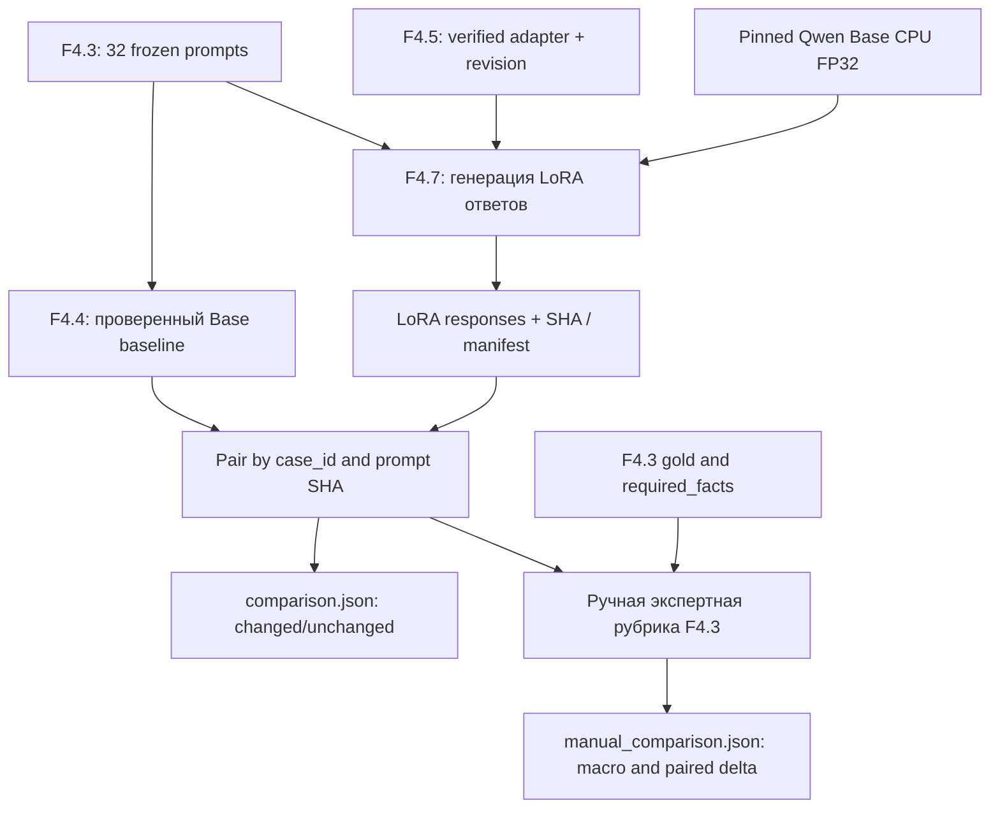
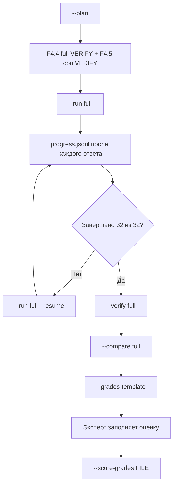

# F4.7 — Base vs Fine-Tuned: сравнение Qwen Base и Qwen + LoRA

## 1. Цель этапа

**Связь с предыдущими этапами.** F4.1 — подготовка instruction dataset из 80 технических записей с разделением на Train/Validation/Test. F4.2 — фиксация базовой модели `Qwen/Qwen2.5-0.5B`, её ревизии и токенизатора. F4.3 — независимый набор из **32 контрольных заданий** и 64 проверяемых смысловых фактов. F4.4 — получение ответов Base-модели на этих заданиях. F4.5 — реализация SFT с LoRA и сохранение обученного адаптера. F4.6 — визуализация реальных метрик SFT.

**Проблема.** Один шаг SFT и уменьшение validation loss не доказывают улучшение технических ответов. Для проверки влияния адаптации необходимо сопоставить генерации **двух состояний одной модели** на **одинаковых вопросах**, при одинаковом декодировании и с контролем источников. Изменение текста и повышение качества — разные свойства; для оценки качества дополнительно требуется экспертная рубрика.

**Сравниваемые варианты:**

- **Base:** исходная Qwen2.5-0.5B без адаптера; ранее сохранённые ответы F4.4.
- **Fine-Tuned:** та же Qwen2.5-0.5B с проверенным LoRA-адаптером из F4.5.
- **Evaluation:** зафиксированный набор F4.3 (32 вопроса, 64 смысловых факта), без передачи эталонов в prompt.
- **Условия:** greedy decoding, CPU, FP32, максимальная длина входа 384 токена, `max_new_tokens=96`, общий шаблон вопроса.

**Цель F4.7:** реализовать проверяемый конвейер попарного сравнения Base и Fine-Tuned: верифицировать исходные ответы и адаптер, сгенерировать новые ответы, сопоставить их по `case_id` и SHA-256 prompt, зафиксировать наблюдаемые различия и предоставить отдельный механизм экспертного оценивания.

**Границы этапа.** Не выполнять повторное обучение, не подбирать гиперпараметры по контрольным вопросам, не подменять экспертные баллы частотой совпадений текста. F4.5 содержит **один CPU-шаг обучения на одной train-записи**; такой эксперимент подтверждает работоспособность LoRA, но не гарантирует обобщение. При отсутствии полноценной экспертной оценки статус качества должен оставаться `NOT_HUMAN_GRADED`.

**Подтверждённый результат полного CPU-сравнения:** **32 пары ответов**, из которых **12 (37,5%) различаются** и **20 (62,5%) совпадают**. Эти доли измеряют изменение текста, а не точность или улучшение качества. Нормированные баллы Base/LoRA, `delta_macro` и показатели превосходства по рубрике требуют заполненных экспертных оценок.

**Выходные артефакты:** проверенные ответы обеих версий, `paired_responses.jsonl`, `comparison.json` и отдельные шаблоны `human_review.md` / `grades_template.jsonl` для ручной оценки.

## 2. Что реализовано

В поставке **ровно пять новых файлов**; завершённые F4.1–F4.6 не изменяются.

| Файл | Назначение | Что в нём реализовано |
|---|---|---|
| `configs/f4_07_base_vs_finetuned.json` | Фиксирует источники и профиль | Пути к F4.4/F4.5, профиль обученного адаптера `cpu`, отдельный каталог результатов F4.7 |
| `src/llm_f4/base_vs_finetuned.py` | Проверяемый конвейер | `load_config`, `plan`, `_require_sources`, `RealAdapterGenerator`, `run`, `verify`, `paired_rows`, `compare`, `verify_comparison`, `grades_template`, `score_grades` |
| `scripts/f4_base_vs_finetuned.py` | Командный интерфейс | `--plan`, `--run`, `--resume`, `--compare`, `--verify`, `--grades-template`, `--score-grades` |
| `tests/test_f4_base_vs_finetuned.py` | Контрактные, отрицательные и числовые тесты | Отдельный временный репозиторий с **TEST-DOUBLE** генератором, проверка неизменности provenance, сопоставления 32 заданий и ручной рубрики |
| `docs/steps/F4_07_base_vs_finetuned.md` | Данная методичка | Последовательность реализации, интерфейсы, числовой пример, PowerShell, проверенные и непроверенные свойства |

Вне Git после реального запуска создаются следующие артефакты (пример для `full`):

| Файл | Содержание |
|---|---|
| `data/processed/f4_07/full/context.json` | Ревизия модели, хеши источников, настройки декодирования, версии библиотек |
| `data/processed/f4_07/full/progress.jsonl` | Журнал ответов с записью после каждого вопроса |
| `data/processed/f4_07/full/responses.jsonl` | 32 ответа модели **с LoRA** (без эталонов) |
| `data/processed/f4_07/full/manifest.json` | SHA-256, 32/32, служебные метрики генерации, `NOT_HUMAN_GRADED` |
| `data/processed/f4_07/full/paired_responses.jsonl` | Попарные ответы `Base / LoRA` с тем же `case_id` и SHA каждого текста |
| `data/processed/f4_07/full/comparison.json` | Число изменённых/совпавших текстов; *не* баллы качества |
| `data/processed/f4_07/full/grades_template.jsonl` | Пустая форма экспертной оценки (2 набора баллов 0/1/2) |
| `data/processed/f4_07/full/human_review.md` | Вопрос, эталон, рубрика, два ответа для экспертного чтения |
| `data/processed/f4_07/full/manual_comparison.json` | Возникает **только после фактически заполненных экспертных оценок** |

Выходы `smoke` и `full` разделены. Ответы Base остаются на прежнем месте — в `data/processed/f4_04/{smoke,full}/`; адаптер и результаты обучения остаются в `data/processed/f4_05/cpu/`. Каталог F4.7 не перезаписывает их.

### Связь с уже существующим кодом

- `src/llm_f4/base_model_evaluation.py`: `RealCPUGenerator.generate` выполняет токенизацию, `model.generate` и декодирование новых токенов. `verify` подтверждает сохранённые Base-ответы. `formatted_prompt` гарантирует шаблон вопроса.
- `src/llm_f4/sft_lora.py`: `verify_run` проверяет контрольные суммы `adapter_model.safetensors`, `adapter_config.json`, журнала и обучающего контекста.
- `src/llm_f4/evaluation_set.py`: `load_cases` извлекает эталоны **только для экспертной проверки**, а `score_manual_grades` вычисляет нормированные баллы по рубрике.
- `src/llm_f4/instruction_dataset.py`: тот же исходный корпус и групповой split; F4.7 **не обращается** к train/test при генерации.

## 3. Последовательность реализации

### Шаг 1. Зафиксировать совместимость конфигураций F4.4 и F4.5

**Действие.** Проверить исходные конфигурации Base и SFT, закрепить идентификатор модели, ревизию checkpoint и ревизию токенизатора.

**Назначение.** Предотвратить сопоставление моделей с разными исходными весами или токенизаторами.

**Реализация.** `load_config()` последовательно вызывает `load_base()` и `load_sft()`, сопоставляет `(model_id, model_revision, tokenizer_revision)` и фиксирует SHA-256 конфигурации F4.7.

**Результат.** Условия сравнения привязаны к одной версии Qwen; несовместимые конфигурации отклоняются.

### Шаг 2. Загрузить неизменный набор контрольных вопросов

**Действие.** Получить утверждённые prompts из F4.3 через интерфейс F4.4.

**Назначение.** Исключить различия в составе заданий и попадание эталонного ответа в контекст генерации.

**Реализация.** `load_prompts()` проверяет `data/processed/f4_03/prompts.jsonl`, его SHA-256 и состав полей `case_id`, `domain`, `prompt`. Проверить количество и уникальность ID; не включать `reference_answer` и `rubric` в prompt.

**Результат.** Для `full` сформирована фиксированная последовательность из 32 вопросов; для `smoke` — два заранее заданных случая.

### Шаг 3. Проверить сохранённый Base baseline

**Действие.** Выполнить `verify_base()` для результатов F4.4 до генерации LoRA-ответов.

**Назначение.** Использовать исходный baseline без повторной генерации и исключить повреждённые или несовместимые результаты.

**Реализация.** Проверить `responses.jsonl`, `progress.jsonl`, `manifest.json`, SHA-256, `model_stage=base`, `decoding=greedy`, порядок и идентификаторы вопросов.

**Результат.** Сравнение использует сохранённые ответы Base. При отсутствии проверенного F4.4 `full` выполнение останавливается с указанием необходимой предварительной проверки.

### Шаг 4. Проверить обученный LoRA-адаптер F4.5

**Действие.** Прочитать манифест реального CPU-обучения и выполнить `verify_run()`.

**Назначение.** Исключить подключение изменённых `.safetensors`, несовместимого адаптера или неполного обучения.

**Реализация.** Сопоставить SHA-256 `adapter_model.safetensors`, `adapter_config.json`, `metrics.jsonl`, контекста обучения, ревизии модели и SHA holdout.

**Результат.** При несогласованности источников генерация Fine-Tuned прекращается до загрузки модели.

### Исправление F4.7 r2 — делегирование проверки runtime F4.4

При первом реальном запуске F4.7 обнаружилась ошибка `TypeError: real_runtime() missing 1 required keyword-only argument: 'root'`. Причина: имя `real_runtime`, импортированное из F4.4, перекрывалось одноимённой функцией F4.7. Вызов из `real_runtime_base()` попадал обратно в F4.7 вместо проверки окружения F4.4. Данные F4.3, Base-ответы F4.4 и адаптер F4.5 при этом не изменялись, обучение и генерация LoRA не начинались.

Исправление: `real_runtime` из `base_model_evaluation` импортируется как `base_real_runtime`; функция `real_runtime_base()` вызывает именно `base_real_runtime(base)` и переводит `BaselineError` в `ComparisonError`. Добавлены два регрессионных теста: проверка маршрута к исходной функции F4.4 (с тестовым двойником, без загрузки весов) и проверка преобразования ошибки. Полный реальный inference остаётся отдельной проверкой на Windows. Ранее полученный F4.4 baseline `32/32` повторно запускать не требуется.

### Шаг 5. Использовать единый механизм генерации для Base и LoRA

**Действие.** Подключить проверенный адаптер к исходной Qwen с помощью `RealAdapterGenerator`, унаследованного от `RealCPUGenerator`.

**Назначение.** Свести различия в генерации к наличию адаптера, не изменяя токенизацию, шаблон prompt и настройки декодирования.

**Реализация.** Загрузить Qwen на CPU/FP32 по закреплённой ревизии, применить `PeftModel.from_pretrained(..., is_trainable=False)` и вызвать `eval()`. Сохранить метод `generate()` из F4.4 с `do_sample=False`, `num_beams=1`, `max_new_tokens=96`, теми же `attention_mask` и `eos_token_id`; декодировать только новые токены.

```python
self.model = PeftModel.from_pretrained(
    self.model,
    str(adapter_dir),
    is_trainable=False,
).to("cpu")
self.model.eval()
```

**Результат.** Fine-Tuned inference использует тот же генератор, дополненный LoRA. Версии runtime обеих генераций фиксируются в манифестах; различия окружения учитывать при интерпретации.

### Шаг 6. Реализовать сохранение прогресса и возобновление CPU-генерации

**Действие.** Сохранять контекст запуска и каждую полученную генерацию по мере выполнения.

**Назначение.** Предотвратить потерю результатов длительного CPU inference и смешение ответов разных запусков.

**Реализация.** Перед началом записать `context.json`. Для каждого задания `_execute()` добавляет строку в `progress.jsonl` с `case_id`, SHA prompt, SHA ответа, текстом, числом токенов, EOS и временем; использовать `fsync`. В режиме `--resume` проверить совпадение контекста и корректность префикса журнала, затем продолжить с первого незавершённого задания.

**Результат.** Прерванный полный запуск можно продолжить без повторной генерации уже записанных ответов.

### Шаг 7. Верифицировать полноту и целостность ответов с LoRA

**Действие.** Выполнить `verify()` после завершения генерации.

**Назначение.** Подтвердить завершение всех 32 заданий и защититься от незаметного изменения результатов.

**Реализация.** Повторно прочитать выходные JSONL и манифест, проверить `case_id`, `domain`, SHA prompt/ответа, токены, `model_generated=True`, `run_complete=True` и `context_sha256`.

**Результат.** Подтверждается целостность и полнота результатов inference; качество ответов этой проверкой не оценивается.

### Шаг 8. Сопоставить ответы Base и LoRA по идентификаторам

**Действие.** Построить таблицу пар через `paired_rows()` и агрегированную техническую сводку через `compare()`.

**Назначение.** Не допускать сравнения ответов на разные задания или на различающиеся промпты.

**Реализация.** Для каждой пары проверить равенство `case_id` и `prompt_sha256`; сохранить тексты, SHA-256 ответов, числа токенов и `exact_text_match`. При несовпадении prompt SHA прервать операцию.

**Результат.** Формируются `paired_responses.jsonl` и `comparison.json`. В полном CPU-прогоне зафиксировано **12 изменившихся** и **20 неизменившихся** текстов; `quality_conclusion` остаётся `NOT_GRADED; text changes are not quality gains`.

### Шаг 9. Отделить экспертную оценку от генерации

**Действие.** Сформировать `human_review.md` и `grades_template.jsonl` с помощью `grades_template()`.

**Назначение.** Оценивать фактическую правильность по рубрике F4.3, не заменяя смысловую проверку поиском ключевых слов.

**Реализация.** После завершения inference предоставить эксперту вопрос, эталон, факты рубрики и ответы обеих моделей. Для каждого факта предусмотреть оценку 0/1/2 и комментарий; `null` означает отсутствие оценки и блокирует расчёт.

**Результат.** Создан контракт ручной проверки. Пустые шаблоны не считаются экспертными результатами.

### Шаг 10. Рассчитать экспертные показатели по единому протоколу

**Действие.** Проверить заполненные оценки и вычислить попарные метрики через `score_grades()`.

**Назначение.** Получить количественное сравнение фактической правильности при одинаковых критериях и знаменателях.

**Реализация.** Сопоставить SHA ответов, набор 32 `case_id` и fact IDs с исходным F4.3; вызвать `score_manual_grades()` для каждой версии. Рассчитать `base_macro`, `finetuned_macro`, `delta_macro`, доменные средние, дельты по заданиям, `paired_wins`, `paired_losses`, `paired_ties`.

**Результат.** `manual_comparison.json` создаётся только при полностью заполненном и проверенном экспертном файле. Для текущего эксперимента подтверждённые значения экспертных показателей отсутствуют.

### Шаг 11. Разделить статусы выполнения и доказательства качества

**Действие.** Предусмотреть независимые операции `PLAN`, `RUN`, `VERIFY`, `COMPARE` и `HUMAN SCORE`.

**Назначение.** Не отождествлять успешную генерацию, прохождение unit-тестов и подтверждённое повышение качества.

**Реализация.** Для каждой CLI-операции выводить отдельный статус. До получения экспертных оценок сохранять `quality_status=NOT_HUMAN_GRADED` и `human_scoring_performed=false`.

**Результат.** Инженерное выполнение pipeline подтверждается отдельно от сравнительной оценки правильности ответов.

## 4. Алгоритм и математический пример

### 4.1. Сопоставление базовых весов и LoRA-адаптера

Обычная линейная проекция модели содержит матрицу весов `W`. При LoRA обучаемые матрицы `A` и `B` добавляют низкоранговое изменение:

\[
W'=W+\frac{\alpha}{r}BA.
\]

Здесь `W` — неизменённая базовая матрица; `A` и `B` — обучаемые матрицы LoRA; `r=8` — ранг; `α=16` — масштаб. Для F4.5 `α/r=2`. В F4.7 не требуется заново вычислять `BA`: библиотека PEFT загружает сохранённые параметры адаптера и применяет их при `forward` модели.

Числовой **учебный** пример: если для некоторого веса `W=0.20`, соответствующий элемент `BA=0.03`, то после применения масштаба `W'=0.20+2×0.03=0.26`. Это не реальное значение веса Qwen; оно иллюстрирует механизм. Работа F4.7 начинается уже **после** обучения матриц A/B в F4.5.

### 4.2. Жадное декодирование и одинаковые настройки

На каждом шаге модель выбирает наиболее вероятный следующий токен:

\[
\hat y_t = \operatorname*{argmax}_{v\in V} P(v\mid x,\hat y_{<t};\theta).
\]

`x` — одинаковый входной prompt, `V` — словарь токенизатора, `θ` — параметры Base или Base+LoRA, `t` — позиция генерации. У Base и LoRA должны совпадать `x`, токенизатор и настройки `do_sample=False`, `num_beams=1`, `max_new_tokens=96`.

Пример: Base присвоила следующему токену вероятности `A=0.55`, `B=0.45` и выбрала `A`; LoRA после адаптации дала `A=0.40`, `B=0.60` и выбрала `B`. Изменившийся ответ сам по себе **не** означает, что второй вариант правильнее.

### 4.3. Балл по каждому контрольному вопросу

Пример фактического задания `ev_py_01` из F4.3: объяснить `list(range(2, 7, 2))`. Два критерия:

1. `items`: назвать `[2, 4, 6]`;
2. `exclusive`: объяснить, что правая граница `7` не включается.

Оценка каждого факта: 0 — неверно, 1 — частично, 2 — полностью. Нормированный балл ответа:

\[
S_i = \frac{\sum_{j=1}^{m_i} g_{ij}}{2m_i},\quad g_{ij}\in\{0,1,2\}.
\]

`m_i` — число обязательных фактов данного задания, `g_ij` — экспертная оценка факта `j`.

**Числовой пример, не реальные результаты:** эксперт выставил Base `items=2`, `exclusive=0`; LoRA — `items=2`, `exclusive=2`. Тогда:

\[
S_{i,Base} = \frac{2+0}{4}=0.5;\qquad
S_{i,LoRA}=\frac{2+2}{4}=1.0.
\]

Разница на данном задании: `Δ_i = 1.0 − 0.5 = +0.5`. Функция `score_manual_grades()` из F4.3 выполняет именно эту арифметику, после строгой проверки fact IDs.

### 4.4. Macro-average и paired delta

Для **одних и тех же** 32 заданий:

\[
\bar S_{Base} = \frac{1}{N}\sum_{i=1}^{N} S_{i,Base},
\qquad
\bar S_{LoRA} = \frac{1}{N}\sum_{i=1}^{N} S_{i,LoRA},
\]

\[
\Delta = \bar S_{LoRA} - \bar S_{Base}
       = \frac{1}{N}\sum_{i=1}^{N}(S_{i,LoRA}-S_{i,Base}),\quad N=32.
\]

Каждый контрольный вопрос имеет одинаковый вес; каждый факт **внутри вопроса** входит в нормированный балл с одинаковым весом. По восемь вопросов относятся к каждой из четырёх областей. При равных квотах macro по областям и macro по вопросам совпадают; для несбалансированного набора такое равенство не гарантируется.

Тестовая числовая проверка в `tests/test_f4_base_vs_finetuned.py` использует **искусственные экспертные баллы**: Base имеет `0.50` на всех вопросах, LoRA получает `1.0` на восьми и `0.50` на двадцати четырёх. Тогда:

\[
\bar S_{LoRA}=\frac{8\cdot1+24\cdot0.5}{32}=0.625,\quad
\Delta=0.625-0.50=0.125.
\]

Счётчик пар: `wins=8`, `losses=0`, `ties=24`. Тест доказывает правильность **подсчёта**, но не качество настоящей модели.

### 4.5. Почему доля изменившихся ответов не является accuracy

Техническое сравнение имеет наблюдаемый показатель:

\[
C=\frac{\#\{i: \text{Base response}_i\ne \text{LoRA response}_i\}}{N}.
\]

**Учебный пример:** при 20 различающихся ответах `C=20/32=62.5%`. **Фактическое измерение F4.7 full:** `C=12/32=37.5%`; остальные 20 ответов совпадают. `C` не показывает ни полноту фактов, ни безопасность, ни точность, ни выигрыш. Даже 100% изменённых текстов могут оказаться менее корректными.

### 4.6. Ограничения интерпретации

- Применять одинаковые ограничения длины. Генерации Base и LoRA могут различаться по фактической длине и EOS; эти различия характеризуют вывод, но не качество ответа.
- Для строгого причинного вывода желательно совпадение runtime/версий библиотек Base и Fine-Tuned. Манифесты хранят версии, а F4.7 их не скрывает; при несовпадении контекст следует учитывать.
- Набор из 32 авторских вопросов мал, без доверительных интервалов и внешней экспертной репликации. Результат относится именно к этому benchmark.
- Даже положительная `Δ` после одного шага на одном train-примере не докажет устойчивого улучшения на широком распределении технических задач.

## 5. Схема работы



Эталоны `gold/required_facts` подключаются **только после генерации**: они не передаются в `RealAdapterGenerator.generate()`.

Вторая схема — процедура безопасного запуска:



## 6. Локальная проверка PowerShell

Команды выполнять в **Windows PowerShell** из корня локального репозитория:

```powershell
cd F:\DEVELOPMENT\ML\ml-engineering-lab
```

### 6.1. Распаковка отдельного этапа

```powershell
Expand-Archive `
  -LiteralPath "$HOME\Downloads\ML_Engineering_Lab_F4_7.zip" `
  -DestinationPath . -Force
```

ZIP содержит только пять файлов F4.7, относительно корня проекта. `README.md` не включён.

### 6.2. Юнит-тесты без загрузки весов

```powershell
.\.venv\Scripts\python.exe -m pytest tests/test_f4_base_vs_finetuned.py -q
```

Результат проверки F4.7 r2 на восстановленном наборе исходников: **64/64 теста PASS**. Используются изолированные test-double ответы; этот результат **не** является оценкой качества Qwen.

### 6.3. План и проверка прежних результатов

```powershell
.\.venv\Scripts\python.exe scripts/f4_base_vs_finetuned.py --plan

.\.venv\Scripts\python.exe scripts/f4_sft_lora.py --verify cpu

.\.venv\Scripts\python.exe scripts/f4_base_model_evaluation.py --verify smoke
```

При наличии проверенных upstream-результатов ожидаются `F4.7 PLAN: PASS`, `F4.5 VERIFY CPU: PASS`, `F4.4 VERIFY SMOKE: PASS`.

**Обязательное предварительное условие для F4.7 full:** наличие реального, проверенного Base baseline F4.4.

```powershell
.\.venv\Scripts\python.exe scripts/f4_base_model_evaluation.py --verify full
```

При отсутствии `data/processed/f4_04/full/manifest.json` сначала выполнить **F4.4 full**:

```powershell
.\.venv\Scripts\python.exe scripts/f4_base_model_evaluation.py --run full
.\.venv\Scripts\python.exe scripts/f4_base_model_evaluation.py --verify full
```

При отсутствии локально закешированных весов Qwen допускается явный флаг `--allow-download`. Не использовать его автоматически во время обычной проверки.

### 6.4. Smoke: реальная LoRA-генерация на двух вопросах

```powershell
.\.venv\Scripts\python.exe scripts/f4_base_vs_finetuned.py --run smoke
```

Признаки успешного выполнения:

```text
F4.7 RUN SMOKE: PASS (REAL LoRA inference)
Responses: 2/2
Quality: NOT HUMAN GRADED
```

При необходимости явно разрешить загрузку отсутствующих весов:

```powershell
.\.venv\Scripts\python.exe scripts/f4_base_vs_finetuned.py --run smoke --allow-download
```

После генерации:

```powershell
.\.venv\Scripts\python.exe scripts/f4_base_vs_finetuned.py --verify smoke
.\.venv\Scripts\python.exe scripts/f4_base_vs_finetuned.py --compare smoke
.\.venv\Scripts\python.exe scripts/f4_base_vs_finetuned.py --verify smoke
```

Сравнение smoke выводит `Changed: N/2; unchanged: M` и `Quality: NOT HUMAN GRADED`. Значения `N` и `M` необходимо считывать из фактического smoke-результата, не подставлять заранее.

### 6.5. Full: реальные ответы LoRA на 32 вопроса

**Запускать после успешных F4.4 VERIFY FULL, F4.5 VERIFY CPU и smoke:**

```powershell
.\.venv\Scripts\python.exe scripts/f4_base_vs_finetuned.py --run full
```

Если выполнение оборвалось и в `data/processed/f4_07/full/` остался незавершённый `progress.jsonl`, продолжить так:

```powershell
.\.venv\Scripts\python.exe scripts/f4_base_vs_finetuned.py --run full --resume
```

При успешном завершении:

```text
F4.7 RUN FULL: PASS (REAL LoRA inference)
Responses: 32/32
Quality: NOT HUMAN GRADED
```

**Второй запуск `--run full` без `--resume` запрещён:** существующие результаты защищены от перезаписи.

### 6.6. Создание попарного сравнения

```powershell
.\.venv\Scripts\python.exe scripts/f4_base_vs_finetuned.py --verify full
.\.venv\Scripts\python.exe scripts/f4_base_vs_finetuned.py --compare full
.\.venv\Scripts\python.exe scripts/f4_base_vs_finetuned.py --verify full
```

Для просмотра попарной таблицы и сводки выполнить:

```powershell
Get-Content data\processed\f4_07\full\comparison.json -Encoding UTF8
Get-Content data\processed\f4_07\full\paired_responses.jsonl -Encoding UTF8 | Select-Object -First 2
```

Проверить `cases=32`, `base_responses_sha256`, `finetuned_responses_sha256` и количество изменившихся текстов. **Фактический результат полного сравнения: 12 изменившихся и 20 совпавших ответов.** Эти показатели **не** являются экспертными баллами.

### 6.7. Форма ручной оценки

```powershell
.\.venv\Scripts\python.exe scripts/f4_base_vs_finetuned.py --grades-template
```

Открыть документ с вопросами, эталонами, критериями и обоими ответами:

```powershell
notepad data\processed\f4_07\full\human_review.md
```

Скопировать шаблон **в новый файл**, сохранив неизменным оригинал:

```powershell
Copy-Item `
  data\processed\f4_07\full\grades_template.jsonl `
  data\processed\f4_07\full\grades_filled.jsonl
```

В каждой из 32 строк `grades_filled.jsonl` заполнить `base_fact_scores` и `finetuned_fact_scores` целыми значениями 0/1/2, добавить содержательный `notes`. **Не изменять** `case_id` и два `response_sha256`. Значение `null` означает отсутствие оценки; такая строка отклоняется. Экспертное оценивание не заменять автоматически сгенерированными баллами.

После заполнения:

```powershell
.\.venv\Scripts\python.exe scripts/f4_base_vs_finetuned.py --score-grades data/processed/f4_07/full/grades_filled.jsonl

Get-Content data\processed\f4_07\full\manual_comparison.json -Encoding UTF8
```

Ожидаемые поля: `base_macro`, `finetuned_macro`, `delta_macro`, `base_by_domain`, `finetuned_by_domain`, `paired_wins`, `paired_losses`, `paired_ties`, `per_case_delta`, `grades_sha256`. Реальные значения рассчитываются только по фактическим ответам и заполненным экспертным оценкам. При отсутствии оценок результат не формировать.

### 6.8. Общая регрессия

```powershell
.\.venv\Scripts\python.exe -m pytest -q
```

В первой поставке F4.7 было 62 unit-теста, в исправлении **r2 добавлены ещё 2**. При неизменном составе прежних тестов расчётное ожидание после F4.7 r2 составляло **1808 passed, 1 skipped**. Позднее в Фазе 4 выполнялась расширенная регрессия; это историческое ожидание не следует трактовать как текущий итог всего проекта.

### 6.9. GitHub — после подтверждения локального PASS

Публикацию выполнять **после локальной приёмки**. В коммит F4.7 включать только пять исходных файлов раздела 2. `README.md`, веса модели, адаптер и `data/processed/` не добавлять. Последовательность: `git status` → адресный `git add --` → `git diff --cached --check` → коммит и push без `--force`. Проверку GitHub Actions проводить отдельно.

## 7. Что доказано тестами и какие ограничения остаются

### 7.1. Подтверждено тестами и реальным CPU-запуском

- Проверяется совпадение модельного checkpoint, ревизии токенизатора и конфигураций F4.4/F4.5.
- Подтверждается целостность исходного Base baseline и обученного LoRA-адаптера по сохранённым манифестам и SHA-256.
- 32 eval-случая сохраняют исходный `case_id` и `prompt_sha256`; reference answer и рубрика не передаются генератору.
- Попарное сопоставление выполняется по ID задания и хешу промпта, а не по произвольной позиции в файле.
- При прерывании `progress.jsonl` позволяет продолжить генерацию без смешения контекстов или перезаписи завершённых записей.
- Тестовые ответы **TEST-DOUBLE** используются только в изолированных unit-тестах; реальная CPU-генерация выполнялась отдельно.
- Ошибочные SHA, несогласованные манифесты, неполный прогресс, незаполненные баллы и неизвестные fact IDs отклоняются проверками.
- Для тестовой числовой фикстуры воспроизводится macro-разница `0.625 − 0.50 = 0.125`; эти числа не являются оценками реальных ответов Qwen.
- **Реальный F4.7 full:** получены **32/32 ответа с LoRA** и выполнено сравнение с 32 ответами Base; **12 текстов различаются, 20 совпадают**.

### 7.2. Требует дополнительного подтверждения

- **Рост качества ответов не установлен.** Число изменившихся текстов не является `accuracy`, экспертным score или доказательством улучшения.
- **Ручная оценка:** заполненные баллы по фактам для всех 32 пар не подтверждены. Не создавать `manual_comparison.json` с вымышленными значениями.
- **Статистическая значимость и обобщение:** 32 авторских задания и один шаг SFT на одном train-примере не позволяют оценить устойчивое улучшение на широкой выборке задач.
- **Сопоставимость runtime:** при строгой причинной интерпретации учитывать версии PyTorch/Transformers/PEFT и прочие параметры сохранённых манифестов.
- **Повторяемость качества:** для оценки устойчивости потребуются дополнительные запуски, различные seed и независимая экспертная проверка.

### 7.3. Недопустимые интерпретации

Не считать долю изменившихся текстов приростом accuracy; не подбирать адаптер на контрольных заданиях F4.3; не приравнивать `RUN PASS` к `QUALITY PASS`; не игнорировать несовпадение prompt SHA или версии checkpoint; не делать вывод о качестве LLM на основании одного удачного ответа.

## 8. Основная мысль этапа

**Назначение F4.7 — построить воспроизводимое попарное сравнение исходной и адаптированной языковой модели.** Входные источники: независимый benchmark F4.3, проверенный Base baseline F4.4 и сохранённый LoRA-адаптер F4.5. Перед генерацией необходимо проверить идентичность checkpoint, ревизий модели/токенизатора, хешей исходных файлов и параметров декодирования.

**Порядок выполнения:** проверить F4.3/F4.4/F4.5 → загрузить Qwen Base → подключить LoRA для Fine-Tuned inference → сгенерировать ответы на те же вопросы → подтвердить полноту `responses.jsonl` → объединить Base/LoRA по `case_id` и `prompt_sha256` → вычислить показатели текстовых различий → подготовить отдельную экспертную оценку.

**Контроль сопоставимости.** Использовать одинаковый текст prompt, greedy decoding и ограничения длины. Эталоны ответов и `required_facts` подключать только после генерации. При каждом CPU-ответе регистрировать данные в `progress.jsonl`; при восстановлении незавершённого запуска проверять исходный контекст. Пары ответов сопоставлять по идентификатору задания и SHA исходного prompt, исключая смещение или подмену вопросов.

**Технический результат:** полная генерация Fine-Tuned на 32 вопросах и сравнение с Base. Зафиксированы **12 изменившихся ответов (37,5%)** и **20 совпавших (62,5%)**. Показатель `exact_text_match` измеряет совпадение строк; изменение формулировки не означает изменения правильности.

**Оценка содержания — отдельная процедура.** По каждому вопросу F4.3 предусмотрены две смысловые проверки с оценкой 0/1/2. При полном экспертном заполнении можно вычислить нормированные баллы, `base_macro`, `finetuned_macro`, `delta_macro`, результаты по областям и счётчики `paired_wins/losses/ties`. До заполнения рубрики сохранять статус `NOT_HUMAN_GRADED`; числовые примеры из тестов нельзя использовать как фактические оценки модели.

**Ограничение интерпретации:** LoRA-адаптер F4.5 обучен одним optimizer step на одном примере. F4.7 подтверждает влияние адаптера на часть ответов и техническую корректность процедуры сравнения, но не доказывает улучшение качества или обобщающей способности LLM. Разделять **работоспособность inference/evaluation pipeline**, **наблюдаемые текстовые изменения** и **экспертно измеренное качество**.

## 9. Файлы этапа

Изучать исходники **в следующем порядке**:

| Файл | Что именно изучить |
|---|---|
| `configs/f4_07_base_vs_finetuned.json` | Ссылки на F4.4/F4.5 и независимость каталога F4.7 |
| `scripts/f4_base_vs_finetuned.py` | Разделение PLAN/RUN/VERIFY/COMPARE/HUMAN SCORE, запреты на неявную загрузку и перезапись |
| `src/llm_f4/base_vs_finetuned.py` → `load_config`, `plan` | Совпадение model ID/revision, метаданные и ограничения перед запуском |
| `src/llm_f4/base_vs_finetuned.py` → `_require_sources`, `_context` | Доказуемая цепочка F4.3/F4.4/F4.5, SHA и pinned runtime |
| `src/llm_f4/base_vs_finetuned.py` → `RealAdapterGenerator` | Как PEFT подключает сохранённый LoRA-адаптер к тому же Qwen Base |
| `src/llm_f4/base_vs_finetuned.py` → `_execute`, `verify` | Последовательная генерация, журнал, `--resume`, повторное вычисление манифеста |
| `src/llm_f4/base_vs_finetuned.py` → `paired_rows`, `compare` | Проверка `case_id` и prompt hash, сравнение текстов без оценки истинности |
| `src/llm_f4/base_vs_finetuned.py` → `grades_template`, `score_grades` | Отложенное подключение эталонов, проверка ручных оценок, macro/delta |
| `tests/test_f4_base_vs_finetuned.py` | Отрицательные тесты и математические эталоны, разница между TEST-DOUBLE и реальным inference |

**Дополнительные исходники предыдущих этапов:**

- `src/llm_f4/base_model_evaluation.py`: `formatted_prompt`, `RealCPUGenerator.generate`, `verify`, `_final_payload` — здесь находится эталон inference-контракта.
- `src/llm_f4/sft_lora.py`: `run_real`, `verify_run`, `encode_sample` — что именно обучали и как защищены артефакты LoRA.
- `src/llm_f4/evaluation_set.py`: `load_cases`, `score_manual_grades` — откуда берутся fact IDs и как считаются человеческие баллы.
- `configs/f4_04_base_model_evaluation.json` и `configs/f4_05_sft_lora.json` — как связаны модель, ограничения генерации и режим SFT.
- `data/evaluation/f4_03_ru_technical_v1.jsonl` — фактические 32 вопроса и их авторские рубрики.

**Ключевой технический вывод:** строгий попарный evaluation требует контроля версии checkpoint, SHA-256 вопросов и адаптера, идентичного декодирования, возобновляемого CPU inference и отдельной экспертной оценки. Изменение текста или снижение loss нельзя трактовать как доказательство роста качества.
