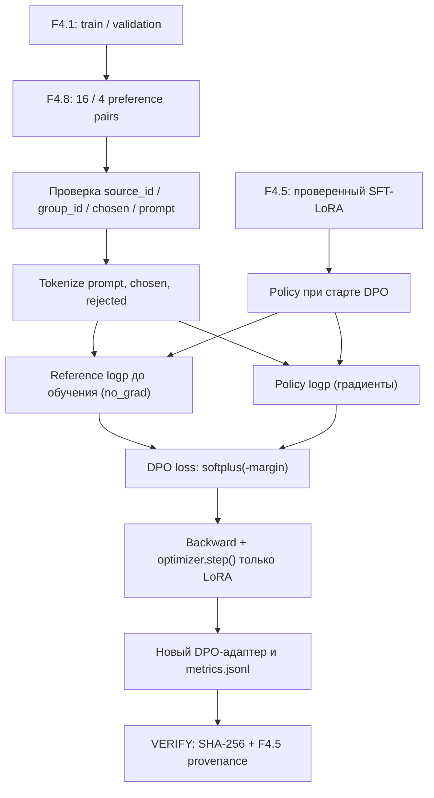

# F4.8 — Direct Preference Optimization (DPO): от пар предпочтений к обновлению LoRA

## 1. Цель этапа

На F4.1 я подготовил instruction dataset и разделил его по смысловым группам на train, validation и test. На F4.2 выбрал `Qwen/Qwen2.5-0.5B` и зафиксировал checkpoint и токенизатор. На F4.3 сделал независимый технический benchmark из 32 вопросов. В F4.4 измерял исходные ответы Base, в F4.5 выполнял SFT с LoRA, в F4.6 сохранял и визуализировал его метрики, а в F4.7 сравнивал тексты Base и LoRA. **Последний эксперимент технически прошёл, но пользовательская экспертная оценка F4.7 по всей рубрике пока не подтверждена как завершённая.**

Теперь я хочу понять другую постановку задачи. SFT говорит модели: «Вот инструкция и правильное продолжение; повышай вероятность токенов этого продолжения». **DPO** работает с тройкой `prompt / chosen / rejected`: «При одинаковом запросе этот ответ предпочтительнее другого». Вместо отдельной обучаемой reward model применяется функция потерь, построенная из логвероятностей двух продолжений относительно неподвижной reference policy.

**Граница эксперимента.** DPO выполняется *после* SFT: policy стартует с сохранённой Qwen + LoRA F4.5, а reference соответствует **этому же SFT-адаптеру в начальном состоянии, до любых DPO-обновлений**. Это важно: если в качестве reference случайно взять чистую Base без F4.5, смысл полученного результата изменится. В нашей компактной реализации не создаётся вторая копия Qwen: log-probabilities reference вычисляются и сохраняются в RAM **до первого шага оптимизатора**. Все последующие вычисления reference основаны только на этих неизменных значениях.

Предусмотрены: валидация датасета из 20 специально написанных пар предпочтений; вычисление DPO-loss на scalar-эталоне и на PyTorch; проверка labels и токенов; отдельное настоящее CPU-обучение одним шагом и опциональный GPU-профиль. Цель — изучить **механику DPO**, а не объявить промышленную preference optimization на 20 примерах.

**Что необходимо получить:** воспроизводимый учебный preference dataset, независимые тесты DPO-математики, проверенный контекст исходного SFT, и — только после отдельного настоящего запуска — новый DPO-адаптер `adapter_model.safetensors`, `metrics.jsonl` и `run_manifest.json`. F4.3 и F4.7 не входят в тренировочный набор: нет ни копирования контрольных ответов, ни скрытого подбора по их метрикам.

## 2. Что реализовано

Файлы нового этапа:

| Файл | Назначение | Реальные функции и данные |
|---|---|---|
| `configs/f4_08_dpo_experiment.json` | Фиксирует эксперимент | Источник предпочтений, зависимость от F4.1/F4.4/F4.5, `beta=0.1`, `seed=42`, token budgets, CPU/GPU профили |
| `data/preferences/f4_08_dpo_pairs_v1.jsonl` | Пары предпочтений | 16 train + 4 validation, по одной группе на pair, поля `prompt`, `chosen`, `rejected`, `rationale`, `split`, `source_id`, `group_id`, `domain`, `origin` |
| `src/llm_f4/dpo_experiment.py` | Основной алгоритм | `load_config`, `load_preferences`, `make_plan`, `dpo_loss`, `tokenize_pair`, `completion_logprob`, `torch_dpo_loss`, `run_real`, `verify_run` |
| `scripts/f4_dpo_experiment.py` | Командный интерфейс | `--plan`, `--math-demo`, `--torch-smoke`, `--run cpu/gpu`, `--verify cpu/gpu`, явное `--allow-download` |
| `tests/test_f4_dpo_experiment.py` | Автоматическая проверка | Scalar-эталоны, Torch autograd, отбрасывание повреждённых данных/конфигураций, split leakage, Windows CLI |
| `docs/steps/F4_08_dpo_experiment.md` | Учебно-техническая документация | Последовательность разработки, формулы, примеры, схема, PowerShell, ограничения и путеводитель по исходникам |

**Данные.** Все 20 `chosen` дословно совпадают с `response` соответствующего ID исходной F4.1. Поле `prompt` — это в точности тот же шаблон `Вопрос:\n...\nОтвет:\n`, что использовали F4.4/F4.5. `rejected` — отдельно написанный ошибочный, но тематически связанный ответ: например, утверждение, что изменяемый аргумент функции Python создаётся при каждом вызове (неверно), противопоставлено правильному объяснению. `rationale` показывает, *почему* выбранный ответ предпочтительнее. Это **авторский синтетический учебный набор**, а не реальные человеческие оценки outputs модели. Он не предназначен для утверждений о масштабируемости DPO.

Распределение пар:

| Область | Train | Validation | Итого |
|---|---:|---:|---:|
| Python | 4 | 1 | 5 |
| Linux | 4 | 1 | 5 |
| SQL | 4 | 1 | 5 |
| ML | 4 | 1 | 5 |
| **Всего** | **16** | **4** | **20** |

**Производные результаты** создаются вне Git в `data/processed/f4_08/{cpu,gpu}/`: `metrics.jsonl`, `run_manifest.json`, `adapter/adapter_config.json`, `adapter/adapter_model.safetensors` и иногда внутренний `adapter/README.md` PEFT. Исходный адаптер F4.5 остаётся без изменений.

## 3. Последовательность реализации

### Шаг 1. Определили объект обучения

**Что сделали.** Отделили SFT от DPO. В F4.5 функция потерь — средний causal cross-entropy на токенах правильного продолжения. Для DPO требуется *сравнить два продолжения одного и того же запроса*.

**Зачем.** Модель может выучить формулировку эталонного ответа, не научившись различать правильный и неправильный ответы. DPO создаёт прямое предпочтение по отношению к reference policy.

**Как.** В `Preference` закрепили `prompt`, `chosen`, `rejected` и объяснение `rationale`. Каждая пара имеет ID и связь с F4.1 `source_id/group_id`.

**Что получили.** Проверяемую единицу preference-learning без необходимости скачивать чужой датасет.

### Шаг 2. Составили пары на *известной* train/validation границе

**Что сделали.** Отобрали 16 F4.1 train-инструкций и 4 F4.1 validation-инструкции, по одной инструкции из разных смысловых групп. Не использовали F4.1 test, F4.3 benchmark или незавершённые экспертные оценки F4.7.

**Зачем.** Попадание вариантов одной темы в train и validation завысит впечатление о переносе знаний. Использование F4.3 или F4.7 для тренировки сделало бы прежний benchmark зависимым от обучения.

**Как.** JSONL с исходным `source_id`, `group_id`, `domain`, split. В `make_plan()` для каждой пары получаем реальную F4.1-запись, сравниваем `chosen == response`, `prompt == format_prompt(...)`, `group_id` и split. Любая подмена вызывает `DPOError`.

**Что получили.** Разделение 16/4 с независимыми группами, связанное с SHA-256 исходного набора.

### Шаг 3. Ввели строгую проверку текстов и provenance

**Что сделали.** Запретили пустые или структурно неверные JSONL-записи, повторные ID, повторные запросы, одинаковые chosen/rejected, пути с `..`, изменения договорённого checkpoint.

**Зачем.** Случайный дубль или незаметная подмена данных делает интерпретацию DPO-loss ненадёжной. Кроме того, по одному `rejected` невозможно восстановить смысл без исходного вопроса.

**Как.** `load_config()`, `load_preferences()`, `make_plan()` и `verify_f41()`; вызываются готовые контракты F4.1, F4.3 и F4.5. Отдельно проверяем фиксированную ревизию модели и токенизатора.

**Что получили.** `F4.8 PLAN: PASS` — подтверждение данных и зависимостей **без** inference и обучения.

### Шаг 4. Реализовали scalar-эталон DPO

**Что сделали.** Реализовали `dpo_loss()` только на стандартной библиотеке Python: вычисляет значение loss, margin и условную предпочтительную вероятность. Численный пример показан в следующем разделе.

**Зачем.** Нельзя доверять только большой обучающей библиотеке. Нужен понятный независимый числовой эталон и проверка для положительных, нулевых, отрицательных и больших margin.

**Как.** Устойчивая форма `softplus(-margin)` через `log1p(exp(-abs(m))) + max(-m,0)`; при `margin=0` ожидается `ln(2)`.

**Что получили.** Небольшую функцию, которая может быть проверена вручную.

### Шаг 5. Подготовили последовательности токенов

**Что сделали.** Один и тот же `prompt` кодируется один раз, затем отдельно кодируются `chosen` и `rejected`, каждому добавляется EOS. Метки prompt равны `-100`, а метки ответа содержат его токены, включая EOS. Паддинг в выбранном batch-size=1 не нужен.

**Зачем.** В DPO необходимо вычислять условные `log π(answer | prompt)`. Если включить токены prompt в сумму, получится смешение вероятностей запроса и ответа. Если молча обрезать длинный ответ, предпочтения относятся не к исходной записи.

**Как.** `tokenize_pair()` создаёт два `input_ids` и два `labels` с общим префиксом и запрещает усечение: ≤256 prompt, ≤256 answer, ≤512 вместе. `max_total_tokens` и `eos_token_id` явно проверяются.

**Что получили.** Сопоставимые последовательности для расчёта двух логвероятностей.

### Шаг 6. Вычислили настоящую log probability продолжения

**Что сделали.** `completion_logprob()` выполняет forward causal LM, сдвигает логиты на один токен и суммирует `log_softmax` только на позициях продолжения (`labels != -100`).

**Зачем.** Нужна не вероятность всей строки с вопросом, а суммарная условная вероятность именно продолжения. При causal LM токен в позиции `t` предсказывается из логитов позиции `t−1`.

**Как.** `logits[:, :-1, :]` соответствует `labels[1:]`; затем `gather()` выбирает logp правильного token ID и `valid` маскирует нецелевые позиции. Суммируем, а не усредняем: это **стандартное sequence log-probability**, но длины `chosen/rejected` способны влиять на результат; это одно из ограничений датасета.

**Что получили.** Дифференцируемые logp для policy и числовые logp для reference.

### Шаг 7. Закрепили неизменную reference policy

**Что сделали.** В `run_real()` сначала открывается **проверенная F4.5 SFT-LoRA**, затем до любых optimizer steps в режиме `eval()` + `torch.no_grad()` для всех задействованных train/validation пар считаются reference logp. Результаты помещаются в `ref_values` в оперативной памяти.

**Зачем.** Если пересчитывать reference из обновляемой policy на каждом шаге, reference будет «догонять» текущую policy и DPO-сигнал исчезнет. Потреблять память под вторую копию модели при CPU-обучении тоже неразумно.

**Как.** Сохраняем пары чисел `ref_chosen`, `ref_rejected` для каждого ID до обучения. В формуле torch используем константные tensor-values этих чисел. Никакой gradient к reference не проходит.

**Что получили.** Точный неподвижный ориентир для выбранного набора пар. Эта стратегия эквивалентна применению замороженной reference при той же версии весов и неизменном режиме eval, с учётом числовой точности.

### Шаг 8. Выполнили DPO optimizer loop

**Что сделали.** Вводим `torch_dpo_loss()`, `AdamW` только для `requires_grad=True` параметров PEFT-LoRA; считаем градиенты, клиппируем норму, обновляем веса. В CPU профиле **один** реальный шаг на **одной** паре, GPU — **16 шагов на 16 парах** при допустимом железе.

**Зачем.** Изучаем отличие от F4.5: gradient идёт не от отдельного целевого ответа, а от сравнения отношения двух последовательностей к reference.

**Как.** `loss.backward()`, `clip_grad_norm_(...,1.0)`, `optimizer.step()`. До и после записываем validation preference margin; на каждом шаге сохраняем DPO-loss, pre-clipping gradient norm, margin/preference probability. Не вычисляем «качество ответов» из train loss.

**Что получили.** Код настоящего update LoRA. **Это не утверждение, что update уже выполнялся на локальной Qwen** — факт устанавливается только по `--run` и `--verify`.

### Шаг 9. Сохранили адаптер и контрольные суммы

**Что сделали.** Отдельный каталог `data/processed/f4_08/{profile}`; `model.save_pretrained(...,safe_serialization=True)`, затем SHA-256 всех артефактов, журнала, preference dataset и исходного SFT.

**Зачем.** Должна быть возможность доказать, что DPO-адаптер получен именно из выбранного F4.5 и с тем же checkpoint. Предыдущие SFT и benchmark файлы не изменяются.

**Как.** `run_manifest.json` содержит `reference_frozen`, `source_sft_manifest_sha256`, `source_sft_adapter_sha256`, `optimizer_steps`, `real_dpo_performed`, а `verify_run()` повторно проверяет хеши и последовательность шагов без загрузки модели.

**Что получили.** Разделение: **unit PASS** проверяет код; **real DPO PASS** проверяет выполненный optimizer step; **VERIFY PASS** подтверждает неизменность сохранённых файлов; **quality improvement** отдельно не измерялось.

### Шаг 10. Разделили независимые тесты и реальные запуски

**Что сделали.** Написали тесты конфигураций, источников данных, числовых эталонов, направления градиентов, токенизации, логвероятностей с фиктивной моделью и Windows `--help`.

**Зачем.** Реальный checkpoint большой: стандартный `pytest` не должен скачивать Qwen и не должен запускать многоминутное обучение. Но математические ошибки должны обнаруживаться на коротких тестах.

**Что получили.** 96 локальных тестов F4.8 в среде подготовки; условия Windows, реального SFT adapter loading, RAM и вычисления loss на Qwen требуют самостоятельного подтверждения.

## 4. Алгоритм и математический пример

### 4.1. Переход от SFT к DPO

Для одной пары `(x, y⁺, y⁻)`:

- `x` — вопрос/промпт;
- `y⁺` — предпочитаемое продолжение `chosen`;
- `y⁻` — менее предпочтительное продолжение `rejected`;
- `πθ` — текущая policy, которую мы обучаем;
- `πref` — frozen reference, состояние SFT до начала DPO;
- `β > 0` — коэффициент масштаба предпочтения (здесь `0.1`).

Сначала вычислим разницу между log-probability выбранного и отклонённого ответов:

\[
 d_{\theta}=\log\pi_{\theta}(y^+\mid x)-\log\pi_{\theta}(y^-\mid x)
\]

\[
 d_{ref}=\log\pi_{ref}(y^+\mid x)-\log\pi_{ref}(y^-\mid x)
\]

**Preference margin:**

\[
 m=\beta(d_{\theta}-d_{ref})
\]

**Direct Preference Optimization loss:**

\[
 \mathcal L_{DPO}=-\log\sigma(m)=\operatorname{softplus}(-m)
\]

Где `σ(m)=1/(1+e^(−m))` — sigmoid. Уменьшая loss, оптимизатор увеличивает предпочтение `chosen` относительно `rejected` **с поправкой на reference**. Положительный margin говорит об относительном изменении log-odds по сравнению с reference, но сам по себе не является оценкой корректности ответа.

### 4.2. Числовой пример, который можно пересчитать

Допустим, для вопроса об `is` и `==` получены игрушечные logp:

| Значение | Число |
|---|---:|
| `logπθ(chosen)` | −2.0 |
| `logπθ(rejected)` | −3.0 |
| `logπref(chosen)` | −2.5 |
| `logπref(rejected)` | −3.0 |
| `β` | 0.1 |

`dθ = −2 − (−3) = 1.0`, `dref = −2.5 − (−3) = 0.5`, значит `m = 0.1 × (1−0.5) = 0.05`.

Тогда:

\[
 \sigma(0.05)\approx 0.512497,
 \qquad \mathcal L_{DPO}\approx0.668460.
\]

Если policy полностью совпадает с reference (`dθ=dref`), то `m=0`, `loss = ln(2) ≈ 0.693147`. Это **важнейший unit-эталон**. Реальный запуск на F4.5 до первого шага должен стартовать близко к нему для каждой пары, потому что policy и reference изначально равны. Числа в примере **не являются** метриками Qwen.

Функция `dpo_loss(...)` получает ровно пять чисел и возвращает `(loss,margin,probability)`. Тесты проверяют случай `ln(2)`, монотонность и большие величины. Функция `torch_dpo_loss(...)` независимо реализует `F.softplus(-margin).mean()`, тест сравнивает её с scalar-эталоном и проверяет знак производной: градиент по `policy_chosen` должен быть отрицательным, а по `policy_rejected` — положительным.

### 4.3. Связь logp с реальными токенами

Для continuation-токенов `t1, …, tN` log probability равна сумме:

\[
 \log\pi(y\mid x)=\sum_{i=1}^N \log p_\theta(t_i\mid x,t_{1:i-1}).
\]

В коде `completion_logprob` берёт `logits[:, :-1]` и метки `labels[1:]`. Позиции вопроса равны `-100`, поэтому не участвуют в сумме. EOS включён. Числовой тест использует одинаковые логиты по 9 токенам: если ответ состоит из двух целевых токенов, сумма обязана быть `−2·ln(9)`, а не `−4·ln(9)` и не `−ln(9)`.

Длина chosen/rejected может влиять на сумму logp. В нашем учебном датасете отклонённые ответы иногда короче правильных; сравнение **не скорректировано на длину**. Эту особенность необходимо учитывать при интерпретации результатов и при будущей подготовке производственного preference corpus.

## 5. Схема работы



Reference остаётся в памяти как набор чисел, вычисленных **до** обновления policy. Схема не изображает вторую копию Qwen, потому что её **нет** в коде. F4.3 benchmark не входит в граф обучения, а F4.7 human grades не используются.

## 6. Локальная проверка PowerShell

Все команды выполняются из корня проекта на Windows с Python 3.13.2.

### 6.1. Проверить структуру и математику (CPU, без скачивания модели)

```powershell
cd F:\DEVELOPMENT\ML\ml-engineering-lab

.\.venv\Scripts\python.exe -m pytest tests/test_f4_dpo_experiment.py -q

.\.venv\Scripts\python.exe scripts/f4_dpo_experiment.py --plan

.\.venv\Scripts\python.exe scripts/f4_dpo_experiment.py --math-demo
```

Ожидается `96 passed` (или `skipped` для исключительно PyTorch-зависимых тестов, если torch отсутствует), далее `F4.8 PLAN: PASS` с количеством `train=16`, `validation=4` и строкой `Weights / optimizer / real DPO: NOT RUN`.

Для числового примера: `F4.8 MATH DEMO: PASS | loss=0.668460 margin=0.050000 preferred_probability=0.512497`. Это доказывает вычисление формулы, а не работу Qwen.

### 6.2. PyTorch smoke: реальные градиенты на скалярах, но **не** реальный DPO модели

```powershell
.\.venv\Scripts\python.exe scripts/f4_dpo_experiment.py --torch-smoke
```

Ожидается `F4.8 TORCH SMOKE: PASS (SYNTHETIC, NO LLM TRAINING)`. Функция `torch_dpo_loss` вызовет `backward()`, и программа проверит знак производной по двум scalar-переменным. Модель Qwen не загружается.

### 6.3. Проверить доступность настоящего SFT F4.5

```powershell
.\.venv\Scripts\python.exe scripts/f4_sft_lora.py --verify cpu
```

Ожидается `F4.5 VERIFY CPU: PASS`. F4.8 **не** создаёт SFT-адаптер и не может продолжить обучение, если исходный адаптер был изменён.

### 6.4. Необязательный реальный CPU DPO — один шаг

```powershell
.\.venv\Scripts\python.exe scripts/f4_dpo_experiment.py --run cpu
```

Если pinned веса Qwen ещё не находятся в кеше, разреши скачивание явным флагом:

```powershell
.\.venv\Scripts\python.exe scripts/f4_dpo_experiment.py --run cpu --allow-download
```

Это **настоящий** запуск: исходный PEFT-адаптер F4.5 становится trainable, reference logp вычисляются при замороженном initial state, после чего выполняются DPO `forward/backward/AdamW` и сохранение нового адаптера. При недостатке памяти или несовместимых библиотеках запуск может завершиться FAIL — это нужно фиксировать, а не заменять синтетической метрикой.

При удачном выполнении ожидается `F4.8 REAL DPO CPU: PASS` и `Optimizer steps: 1 | train pairs: 1`. После этого:

```powershell
.\.venv\Scripts\python.exe scripts/f4_dpo_experiment.py --verify cpu
Get-Content data\processed\f4_08\cpu\metrics.jsonl -Encoding UTF8
Get-Content data\processed\f4_08\cpu\run_manifest.json -Encoding UTF8
```

Ожидаем `F4.8 VERIFY CPU: PASS`. В `metrics.jsonl` должна быть одна строка: step, pair_id, `loss`, `preclip_gradient_norm`, `margin_pre_step`, `chosen_win_probability_pre_step`. В манифесте — 1 optimizer step, реальные версии torch/transformers/peft, SHA исходного SFT и нового адаптера, `quality_improvement_proven=false`. **Не ожидай заранее конкретных чисел loss: они должны прийти от реальной Qwen.**

Результаты намеренно не перезаписываются. Если уже создан непустой каталог `data/processed/f4_08/cpu`, повторное `--run cpu` завершится отказом; используй `--verify cpu`. Повторный независимый запуск требует отдельного каталога и согласованной конфигурации, а не удаления подтверждённых артефактов без копии.

### 6.5. GPU-профиль (только если есть совместимое оборудование)

```powershell
.\.venv\Scripts\python.exe scripts/f4_dpo_experiment.py --run gpu
.\.venv\Scripts\python.exe scripts/f4_dpo_experiment.py --verify gpu
```

GPU-профиль **не** требует QLoRA/bitsandbytes и требует CUDA + BF16. Он опирается на тот же зафиксированный CPU SFT-адаптер (значение `sft_profile=cpu`) и выполняет 16 DPO-steps. Это учебный профиль, а не доказательство готовности к промышленной эксплуатации; он не запускается автоматически и не может получить PASS только по CPU smoke.

### 6.6. Полная регрессия

```powershell
.\.venv\Scripts\python.exe -m pytest -q
```

В известной конфигурации предыдущих фаз было `1808 passed, 1 skipped`. При 96 новых тестах, доступном PyTorch и неизменном репозитории ожидаем `1904 passed, 1 skipped`. Это **ожидание**, не результат, полученный на твоей Windows. Не коммитить при новых FAIL.

## 7. Что подтверждено тестами и какие ограничения остаются

**Подтверждено в среде подготовки:**

- Количество preference-пар 16 train + 4 validation, распределение по доменам и `group_id` без пересечения.
- `prompt` совпадает с форматом F4.4/F4.5; `chosen` дословно соответствует записи F4.1; изменения этих полей обнаруживаются.
- Отсутствие F4.1 test/F4.3 holdout/F4.7 human grades в обучающем наборе.
- Детерминированные hash-контракты исходных данных и настройки `beta`.
- Точные scalar-тесты `ln(2)` и `0.668460`, Torch autograd direction.
- Сдвиг label на один токен, маскирование prompt, EOS, невозможность тихого truncation.
- `--help`, `--plan`, `--math-demo` не требуют model weights и работают в стандартной библиотеке; `--torch-smoke` не загружает Qwen.
- Локальные unit-тесты проходят (отдельный реальный запуск Qwen ещё не выполнялся).

**Не подтверждено до твоего запуска:**

- Реальное обучение с `PeftModel.from_pretrained(..., is_trainable=True)` в конкретном Windows-окружении.
- Фактические параметры, расход RAM/VRAM, версия PEFT/Transformers и реальный `metrics.jsonl`.
- Эффективность preference learning на новых вопросах. Никакого подтверждённого улучшения качества ответов F4.7 нет.
- Репрезентативность синтетических `rejected`, отсутствие всех видов смысловых утечек вне строго проверенных ID, source и групп.
- Влияние различной длины `chosen/rejected` на DPO; устойчивость при других seeds или гиперпараметрах.
- Тренировка на GPU, если отдельный GPU-прогон не запускался.

**Статус определяется по отдельным признакам:**

| Событие | Что можно утверждать |
|---|---|
| `96 passed` + `PLAN PASS` | Данные, математические инварианты и проверки реализации выполнены |
| `TORCH SMOKE PASS` | PyTorch autograd на synthetic scalar с DPO-loss работает |
| `REAL DPO CPU PASS` + `VERIFY CPU PASS` | Один реальный CPU optimizer step и проверяемый адаптер созданы |
| `REAL DPO GPU PASS` + `VERIFY GPU PASS` | Отдельный GPU-эксперимент реально выполнен |
| Оценка качества на независимых данных | Только тогда можно обсуждать изменения правильности ответов, не смешивая их с DPO loss |

Нет GPU — это не автоматический FAIL алгоритмической части; отсутствие реального CPU DPO означает **PARTIAL**, а не «DPO завершён».

## 8. Основная мысль этапа

«На F4.5 я научился выполнять SFT: брал вопрос и эталонный ответ, кодировал их в токены и уменьшал cross-entropy на токенах ответа. Теперь у меня другая цель: показать модели, что два ответа на один вопрос неравноценны. Для этого я составил небольшую выборку из 20 троек `prompt/chosen/rejected`, причём проверил, что каждый правильный ответ пришёл из исходного F4.1, а неправильный вариант специально написан для той же темы».

«Сначала я снова позаботился об отсутствии утечки. Все DPO train-примеры происходят только из F4.1 train и не пересекаются по смысловым группам с DPO validation. Внешние вопросы F4.3 и человеческие формы F4.7 я не использую в обучении. Важно, что DPO не исправит ситуацию автоматически, если сами preference-пары плохие: модель будет учиться различать именно те ответы, которые ей показали».

«Следующий шаг — понять саму математику. Я не просто вызвал готовый `DPOTrainer`, а написал независимую функцию: вычислил разницу логвероятностей chosen/rejected для текущей policy, вычел аналогичную разницу frozen reference, умножил на beta и применил softplus. Я могу вручную объяснить, почему при одинаковых policy и reference loss равен `ln(2)`, и показать, в какую сторону меняются градиенты для предпочитаемого и отклонённого ответов».

«Потом я связал формулу с настоящей causal LLM. Модель выдаёт logits на каждой позиции; из них я получаю log-probability конкретных токенов continuation. Токены вопроса маскируются, поэтому не входят в score, а EOS участвует. Я отдельно проверил этот сдвиг на игрушечных логитах, потому что ошибка на один токен способна сделать все красивые числа бессмысленными».

«Для reference я беру не чистую предобученную Qwen, а то самое начальное SFT-состояние, которое получил в F4.5. Я вычисляю reference logp **один раз до обучения**, тем самым не выделяю память под вторую модель и не позволяю reference меняться вместе с policy. Затем уже можно сделать реальный update LoRA, сохранить его и доказать происхождение через SHA-256. Но до фактического запуска я не называю этот результат обученным DPO-адаптером».

«Я также понимаю ограничение нашего учебного опыта: один CPU-шаг и 20 искусственно подготовленных пар показывают, как устроен DPO, но не гарантируют более правильных ответов. Даже успешное уменьшение DPO-loss говорит только о выбранной паре относительно reference. Для полезного ML-вывода нужна более качественная preference-разметка и независимая оценка поведения модели, как в F4.7. Это разграничение между *алгоритмом*, *инженерной реализацией* и *измеренным качеством* — главный итог F4.8».

## 9. Файлы этапа

| Порядок | Файл | На какие функции, структуры и проверки смотреть |
|---|---|---|
| 1 | `data/preferences/f4_08_dpo_pairs_v1.jsonl` | Сопоставить реальные `prompt`, `chosen`, `rejected`, `rationale`, `source_id`, `group_id`, `split` |
| 2 | `configs/f4_08_dpo_experiment.json` | Почему beta=0.1, какие бюджеты на токены и как разделены CPU/GPU профили |
| 3 | `src/llm_f4/dpo_experiment.py` | `load_preferences`, `make_plan`: все инварианты и происхождение данных |
| 4 | `src/llm_f4/dpo_experiment.py` | `dpo_loss` и `torch_dpo_loss`: scalar-эталон против differentiable loss |
| 5 | `src/llm_f4/dpo_experiment.py` | `tokenize_pair` и `completion_logprob`: `labels=-100`, сдвиг и сумма логвероятностей |
| 6 | `src/llm_f4/dpo_experiment.py` | `_model_and_tokenizer`, `run_real`: исходный F4.5 adapter, предвычисление reference, optimizer, checkpoint |
| 7 | `src/llm_f4/dpo_experiment.py` | `verify_run`: SHA-256, проверка числа шагов, исходного SFT и адаптера |
| 8 | `scripts/f4_dpo_experiment.py` | Как различаются `--plan`, `--math-demo`, `--torch-smoke`, `--run`, `--verify` |
| 9 | `tests/test_f4_dpo_experiment.py` | Числовые тесты, negative tests, ошибки источников, provenance, Windows codec |

**Какие файлы прошлых фаз перечитать:**

- `src/llm_f4/instruction_dataset.py` — `load_examples`, `verify_artifacts`, групповое разделение F4.1.
- `src/llm_f4/base_model_evaluation.py` — тот же prefix/suffix вопроса из F4.4.
- `src/llm_f4/sft_lora.py` — `format_prompt`, `make_plan`, `verify_run`, существующий LoRA, torch train loop.
- `src/llm_f4/evaluation_set.py` — зафиксированный F4.3 holdout, который DPO не использует в обучении.
- `src/llm_f4/base_vs_finetuned.py` — разница между сравнением ответов (F4.7) и новым preference training (F4.8).
- F2.4 — `forward → backward → optimizer.step`; F3.1 — query/value projection weights, в которых обучается LoRA.

**Ссылки для проверки интерфейсов при последующем развитии:** [Hugging Face TRL DPOTrainer](https://huggingface.co/docs/trl/dpo_trainer) и [PEFT LoRA](https://huggingface.co/docs/peft/main/package_reference/lora). В текущей поставке TRL **не требуется**: реализована учебная формула DPO непосредственно через PyTorch, чтобы не зависеть от меняющегося интерфейса Trainer и иметь прозрачные числовые эталоны.
