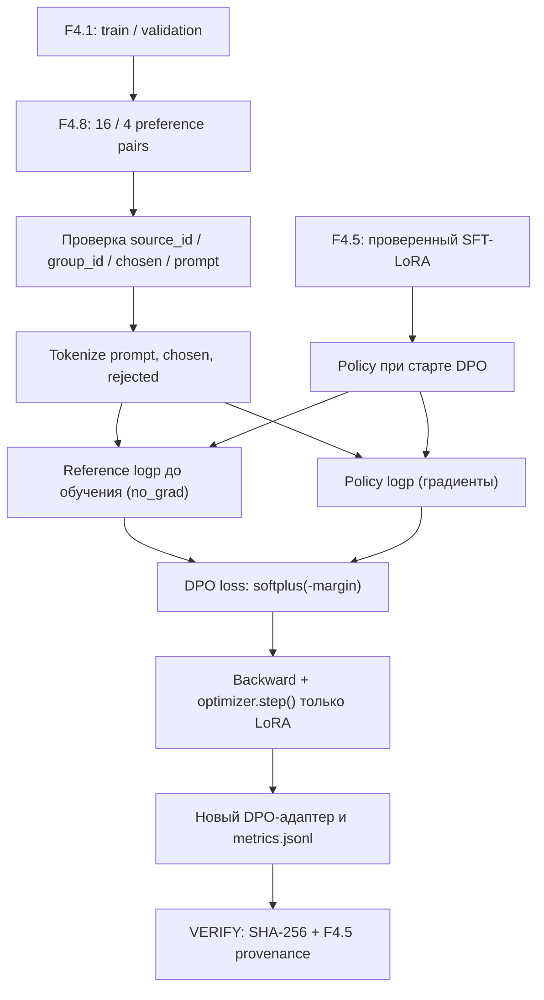

# F4.8 — Direct Preference Optimization (DPO): от пар предпочтений к обновлению LoRA

## 1. Цель этапа

**Связь с предыдущими этапами.** F4.1 — подготовка instruction dataset из 80 технических записей и разделение на `train=56`, `validation=12`, `test=12` по смысловым группам. F4.2 — выбор и фиксация `Qwen/Qwen2.5-0.5B`, ревизии checkpoint и токенизатора. F4.3 — создание независимого benchmark из 32 вопросов с 64 смысловыми критериями. F4.4 — получение исходных ответов Base. F4.5 — реализация SFT + LoRA, F4.6 — анализ реальной телеметрии обучения, F4.7 — попарное сравнение Base и LoRA. Полная экспертная оценка F4.7 по рубрике F4.3 не завершена; изменение текста ответа нельзя считать доказательством повышения качества.

**Проблема.** При SFT функция потерь увеличивает вероятность эталонных токенов продолжения. Для дополнительной адаптации к предпочтениям требуется другая постановка: для одного `prompt` задать два продолжения — `chosen` и `rejected` — и оптимизировать относительное предпочтение первого варианта. **Direct Preference Optimization (DPO)** позволяет использовать пары предпочтений без отдельной обучаемой reward model. Критерий вычисляется по логвероятностям обоих продолжений у текущей policy и замороженной reference policy.

**Объект обучения.** Начальным состоянием обучаемой policy служит проверенная Qwen + LoRA из F4.5. Reference соответствует **тому же SFT-адаптеру до первого обновления DPO**, а не исходной Base-модели. В реализации `src/llm_f4/dpo_experiment.py` нет второй копии Qwen: reference log-probabilities для выбранных пар вычисляются заранее в режиме `eval()` и `torch.no_grad()`, затем сохраняются как неизменяемые числовые значения в оперативной памяти. Такая стратегия сокращает потребление памяти и удерживает фиксированную reference во время оптимизации.

**Цель F4.8:** реализовать и проверить воспроизводимый учебный конвейер preference optimization: сформировать датасет из 20 пар, проверить происхождение и split, реализовать scalar-эталон DPO-loss, вычисление настоящих sequence log-probabilities, один шаг оптимизации LoRA на CPU и независимую проверку сохранённых результатов.

**Границы эксперимента.** Учебный датасет содержит 16 train-пар и 4 validation-пары. `chosen` берутся из проверенного корпуса F4.1, а `rejected` составлены специально для демонстрации различий. Эти пары не являются собранными оценками реальных пользователей. CPU-профиль предусматривает **один optimizer step на одной train-паре** и контроль одной validation-пары; GPU-профиль предусматривает 16 шагов, но не считается выполненным без отдельных артефактов. Контрольные задания F4.3 и экспертные оценки F4.7 не используются при обучении.

**Подтверждённый результат CPU-эксперимента.** Реальный DPO-шаг выполнен на сохранённом SFT-LoRA. При контрольной проверке одной validation-пары preference margin изменился приблизительно с `0` до `0.00066223`. Это числовое свидетельство изменения относительного предпочтения в конкретной проверке; **улучшение правильности ответов на независимом наборе не доказано**.

**Выходные артефакты:** `data/processed/f4_08/cpu/metrics.jsonl`, `run_manifest.json`, `adapter/adapter_config.json`, `adapter/adapter_model.safetensors` с SHA-256 и указанием происхождения исходного F4.5. Результаты выполнения не включать в Git и ZIP с исходниками.

## 2. Что реализовано

Файлы нового этапа:

| Файл | Назначение | Реальные функции и данные |
|---|---|---|
| `configs/f4_08_dpo_experiment.json` | Фиксирует эксперимент | Источник предпочтений, зависимость от F4.1/F4.4/F4.5, `beta=0.1`, `seed=42`, token budgets, CPU/GPU профили |
| `data/preferences/f4_08_dpo_pairs_v1.jsonl` | Пары предпочтений | 16 train + 4 validation, по одной группе на pair, поля `prompt`, `chosen`, `rejected`, `rationale`, `split`, `source_id`, `group_id`, `domain`, `origin` |
| `src/llm_f4/dpo_experiment.py` | Основной алгоритм | `load_config`, `load_preferences`, `make_plan`, `dpo_loss`, `tokenize_pair`, `completion_logprob`, `torch_dpo_loss`, `run_real`, `verify_run` |
| `scripts/f4_dpo_experiment.py` | Командный интерфейс | `--plan`, `--math-demo`, `--torch-smoke`, `--run cpu/gpu`, `--verify cpu/gpu`, явное `--allow-download` |
| `tests/test_f4_dpo_experiment.py` | Автоматическая проверка | Scalar-эталоны, Torch autograd, отбрасывание повреждённых данных/конфигураций, split leakage, Windows CLI |
| `docs/steps/F4_08_dpo_experiment.md` | Учебно-техническая документация | Последовательность разработки, формулы, примеры, схема, PowerShell, ограничения и путеводитель по исходникам |

**Данные.** Все 20 `chosen` дословно совпадают с `response` соответствующей записи F4.1. Поле `prompt` использует тот же шаблон `Вопрос:\n...\nОтвет:\n`, что применяется в F4.4/F4.5. `rejected` — отдельно написанный ошибочный, но тематически связанный ответ: например, утверждение, что изменяемый аргумент функции Python создаётся при каждом вызове (неверно), противопоставлено правильному объяснению. `rationale` показывает, *почему* выбранный ответ предпочтительнее. Это **авторский синтетический учебный набор**, а не реальные человеческие оценки outputs модели. Он не предназначен для утверждений о масштабируемости DPO.

Распределение пар:

| Область | Train | Validation | Итого |
|---|---:|---:|---:|
| Python | 4 | 1 | 5 |
| Linux | 4 | 1 | 5 |
| SQL | 4 | 1 | 5 |
| ML | 4 | 1 | 5 |
| **Всего** | **16** | **4** | **20** |

**Производные результаты** реального запуска сохраняются вне Git в `data/processed/f4_08/{cpu,gpu}/`: `metrics.jsonl`, `run_manifest.json`, `adapter/adapter_config.json`, `adapter/adapter_model.safetensors` и иногда внутренний `adapter/README.md` PEFT. Исходный адаптер F4.5 остаётся без изменений.

## 3. Последовательность реализации

### Шаг 1. Определить задачу обучения по предпочтениям

**Действие.** Разграничить цель SFT и DPO; определить структуру пары предпочтений `prompt / chosen / rejected`.

**Назначение.** Перейти от максимизации вероятности одного эталонного продолжения к сравнению двух ответов на одинаковый запрос относительно фиксированного состояния модели.

**Реализация.** Описать поля структуры `Preference`: `prompt`, `chosen`, `rejected`, `rationale`, идентификаторы и сведения о происхождении. Зафиксировать начальное состояние policy как проверенный SFT-LoRA из F4.5.

**Результат.** Единица preference learning с проверяемой связью между вопросом, предпочтительным ответом, альтернативным ответом и исходным корпусом.

### Шаг 2. Подготовить пары на известной границе Train/Validation

**Действие.** Выбрать 16 инструкций из F4.1 train и 4 инструкции из F4.1 validation, не допуская пересечения смысловых групп.

**Назначение.** Предотвратить утечку между разбиениями, а также попадание F4.1 test, независимого F4.3 benchmark или материалов оценки F4.7 в обучающие данные.

**Реализация.** Сформировать JSONL с `source_id`, `group_id`, `domain`, `split`. В `make_plan()` сопоставлять каждую запись с исходной F4.1: `chosen == response`, `prompt == format_prompt(...)`, согласованные идентификаторы и split. Любое несоответствие приводить к `DPOError`.

**Результат.** Проверенный набор из 20 пар: 16 train и 4 validation, по одной контрольной паре для каждого домена Python, Linux, SQL, ML.

### Шаг 3. Проверить корректность данных и происхождение источников

**Действие.** Реализовать валидацию конфигурации, JSONL, идентификаторов, путей и связей с предшествующими этапами.

**Назначение.** Исключить дубликаты, случайные подмены ответов, пересечения групп, небезопасные пути и использование несовместимого checkpoint.

**Реализация.** Применить `load_config()`, `load_preferences()`, `make_plan()`, `verify_f41()`. Проверять непустые поля, уникальные ID и prompts, различие `chosen/rejected`, разрешённые относительные пути, SHA-256 и фиксированную ревизию Qwen и токенизатора.

**Результат.** Контракт `F4.8 PLAN: PASS`: проверка структуры и зависимостей без загрузки модели, inference или обновления весов.

### Шаг 4. Реализовать независимый числовой эталон DPO-loss

**Действие.** Вычислить DPO-loss на scalar-входах, без использования модели и фреймворка обучения.

**Назначение.** Создать проверяемую математическую основу для дальнейшей реализации на PyTorch и обнаружения ошибок знака, коэффициента `beta` и численной устойчивости.

**Реализация.** В `dpo_loss()` вычислять разность log-probability `chosen/rejected` отдельно для policy и reference, затем `margin = beta × (d_policy − d_reference)` и устойчивую форму `softplus(-margin)`. Проверить равенство `loss=ln(2)` при `margin=0`, монотонность и конечность при больших значениях.

**Результат.** Независимый эталон функции потерь, воспроизводимый вручную и unit-тестами.

### Шаг 5. Сформировать токенизированные пары продолжений

**Действие.** Закодировать один `prompt` и два отдельных продолжения `chosen` и `rejected`.

**Назначение.** Вычислять условные вероятности **ответов при заданном запросе**, не включая токены самого запроса в целевую сумму.

**Реализация.** В `tokenize_pair()` формировать `input_ids` и `labels` для каждого ответа. Устанавливать метку `-100` для токенов prompt, включать токены продолжения и EOS. Проверять ограничения `max_prompt_tokens=256`, `max_answer_tokens=256`, `max_total_tokens=512`; запрещать тихое усечение. Для профиля с batch size 1 padding не нужен.

**Результат.** Две сопоставимые последовательности с общим prompt и корректной маской целевых токенов.

### Шаг 6. Вычислить логвероятности реальных продолжений

**Действие.** Получить sequence log-probability ответов из логитов causal LM.

**Назначение.** Подать в DPO-loss дифференцируемые вероятности продолжений вместо произвольных scalar-значений или вероятностей всего входного текста.

**Реализация.** В `completion_logprob()` выполнить `forward`, применить `log_softmax`, сдвинуть `logits[:, :-1, :]` относительно `labels[1:]`, выбрать значения для нужных token IDs через `gather()` и суммировать только позиции с `labels != -100`. Учитывать EOS и влияние различной длины ответов на сумму.

**Результат.** Корректная сумма условных log-probabilities для текущей policy; соответствующий механизм применяется к reference до начала обучения.

### Шаг 7. Зафиксировать reference policy до первого обновления

**Действие.** Загрузить проверенную F4.5 SFT-LoRA и предварительно вычислить reference log-probabilities для задействованных train/validation-пар.

**Назначение.** Исключить изменение reference вместе с обучаемой policy и сократить расходы памяти за счёт отказа от второй копии Qwen.

**Реализация.** В `run_real()` выполнить предварительный проход с `eval()` и `torch.no_grad()`, сохранить пары значений `ref_chosen/ref_rejected` в `ref_values`. Во время дальнейших шагов оптимизатора использовать их как константы без градиентов. Контролировать соответствие исходному SFT-адаптеру по манифесту и SHA-256.

**Результат.** Неподвижная reference, равная начальному состоянию policy для заданных пар в пределах численной точности вычислений.

### Шаг 8. Выполнить DPO-обновление LoRA-параметров

**Действие.** Реализовать `torch_dpo_loss()` и оптимизационный цикл на параметрах LoRA с `requires_grad=True`.

**Назначение.** Обновлять относительное предпочтение `chosen` перед `rejected` по сравнению с reference, а не просто увеличивать likelihood одного эталонного ответа.

**Реализация.** Создать оптимизатор `AdamW`, вызвать `loss.backward()`, `clip_grad_norm_(..., 1.0)` и `optimizer.step()`. Регистрировать `loss`, `preclip_gradient_norm`, `margin_pre_step`, `chosen_win_probability_pre_step`. Вычислять validation margin до первого и после последнего шага.

**Результат.** Реальный CPU-запуск выполнил **один optimizer step на одной train-паре**; на одной validation-паре margin изменился приблизительно `0 → 0.00066223`. Этот показатель не является измерением качества ответов.

### Шаг 9. Сохранить обученный адаптер и доказательства происхождения

**Действие.** Записать LoRA-адаптер после DPO, журнал оптимизации и манифест запуска в отдельный каталог `data/processed/f4_08/<profile>/`.

**Назначение.** Сохранить проверяемую связь с исходным SFT F4.5 и предотвратить перезапись предыдущих весов и данных.

**Реализация.** Применить `model.save_pretrained(..., safe_serialization=True)`; зафиксировать SHA-256 адаптера, журнала, preference dataset и исходного SFT. В `run_manifest.json` записать `reference_frozen`, `source_sft_manifest_sha256`, `source_sft_adapter_sha256`, `optimizer_steps` и `real_dpo_performed`. Проверять всё повторно через `verify_run()` без загрузки весов модели.

**Результат.** Отдельный DPO-адаптер с прослеживаемым provenance. Статусы unit-тестов, реального optimizer step, верификации артефактов и улучшения качества разделены.

### Шаг 10. Проверить математику, интерфейс и сохранённые результаты

**Действие.** Организовать unit-тесты, PyTorch smoke и отдельные команды настоящего запуска и верификации.

**Назначение.** Разделить быструю проверку алгоритма без весов Qwen и полноценное обучение, требующее загрузки checkpoint и достаточного объёма памяти.

**Реализация.** Проверить конфигурации, происхождение данных, градиенты, маску меток, сдвиг логитов, `ln(2)`, логирование шагов, SHA-256 и Windows CLI. Использовать `--plan`, `--math-demo`, `--torch-smoke` для быстрых проверок; `--run cpu` и `--verify cpu` — для реального DPO.

**Результат.** Для первоначальной поставки F4.8 подготовлено 96 контрактных тестов; реальный CPU DPO подтверждён отдельными артефактами. GPU-профиль без отдельного запуска не считается выполненным.

## 4. Алгоритм и математический пример

### 4.1. Переход от SFT к DPO

Для одной пары `(x, y⁺, y⁻)`:

- `x` — вопрос/промпт;
- `y⁺` — предпочитаемое продолжение `chosen`;
- `y⁻` — менее предпочтительное продолжение `rejected`;
- `πθ` — текущая обучаемая policy;
- `πref` — frozen reference, состояние SFT до начала DPO;
- `β > 0` — коэффициент масштаба предпочтения (здесь `0.1`).

Вычислить разность log-probability выбранного и отклонённого ответов:

\[
 d_{\theta}=\log\pi_{\theta}(y^+\mid x)-\log\pi_{\theta}(y^-\mid x)
\]

\[
 d_{ref}=\log\pi_{ref}(y^+\mid x)-\log\pi_{ref}(y^-\mid x)
\]

**Preference margin:**

\[
 m=\beta(d_{\theta}-d_{ref})
\]

**Direct Preference Optimization loss:**

\[
 \mathcal L_{DPO}=-\log\sigma(m)=\operatorname{softplus}(-m)
\]

Где `σ(m)=1/(1+e^(−m))` — sigmoid. Минимизация loss увеличивает предпочтение `chosen` относительно `rejected` **с поправкой на reference**. Положительный margin говорит об относительном изменении log-odds по сравнению с reference, но сам по себе не является оценкой корректности ответа.

### 4.2. Числовой пример, который можно пересчитать

**Учебный числовой пример (не измерения Qwen):** для вопроса об `is` и `==` заданы logp:

| Значение | Число |
|---|---:|
| `logπθ(chosen)` | −2.0 |
| `logπθ(rejected)` | −3.0 |
| `logπref(chosen)` | −2.5 |
| `logπref(rejected)` | −3.0 |
| `β` | 0.1 |

`dθ = −2 − (−3) = 1.0`, `dref = −2.5 − (−3) = 0.5`, значит `m = 0.1 × (1−0.5) = 0.05`.

Тогда:

\[
 \sigma(0.05)\approx 0.512497,
 \qquad \mathcal L_{DPO}\approx0.668460.
\]

Если policy полностью совпадает с reference (`dθ=dref`), то `m=0`, `loss = ln(2) ≈ 0.693147`. Это **контрольный unit-эталон**. До первого optimizer step у policy и reference одинаковые веса SFT-LoRA, поэтому для каждой пары ожидается margin, близкий к нулю, с учётом численной точности. Числа в примере **не являются** метриками Qwen.

Функция `dpo_loss(...)` получает ровно пять чисел и возвращает `(loss,margin,probability)`. Тесты проверяют случай `ln(2)`, монотонность и большие величины. Функция `torch_dpo_loss(...)` независимо реализует `F.softplus(-margin).mean()`, тест сравнивает её с scalar-эталоном и проверяет знак производной: градиент по `policy_chosen` должен быть отрицательным, а по `policy_rejected` — положительным.

### 4.3. Связь logp с реальными токенами

Для continuation-токенов `t1, …, tN` log probability равна сумме:

\[
 \log\pi(y\mid x)=\sum_{i=1}^N \log p_\theta(t_i\mid x,t_{1:i-1}).
\]

Функция `completion_logprob` использует `logits[:, :-1]` и метки `labels[1:]`. Позиции вопроса равны `-100`, поэтому не участвуют в сумме. EOS включён. Числовой тест использует одинаковые логиты по 9 токенам: если ответ состоит из двух целевых токенов, сумма обязана быть `−2·ln(9)`, а не `−4·ln(9)` и не `−ln(9)`.

Длина chosen/rejected может влиять на сумму logp. В учебном датасете отклонённые ответы иногда короче правильных; сравнение **не скорректировано на длину**. Эту особенность необходимо учитывать при интерпретации результатов и при будущей подготовке производственного preference corpus.

## 5. Схема работы



Reference остаётся в памяти как набор чисел, вычисленных **до** обновления policy. Схема не изображает вторую копию Qwen, потому что её **нет** в коде. F4.3 benchmark не входит в граф обучения, а F4.7 human grades не используются.

## 6. Локальная проверка PowerShell

Команды выполнять из корня проекта на Windows с Python 3.13.2.

### 6.1. Проверить структуру и математику (CPU, без скачивания модели)

```powershell
cd F:\DEVELOPMENT\ML\ml-engineering-lab

.\.venv\Scripts\python.exe -m pytest tests/test_f4_dpo_experiment.py -q

.\.venv\Scripts\python.exe scripts/f4_dpo_experiment.py --plan

.\.venv\Scripts\python.exe scripts/f4_dpo_experiment.py --math-demo
```

Для первоначального набора F4.8 предусмотрено **96 unit-тестов** (возможен `skipped` для исключительно PyTorch-зависимых проверок при отсутствии torch). Команда `F4.8 PLAN: PASS` должна показывать `train=16`, `validation=4` и `Weights / optimizer / real DPO: NOT RUN`: это статус **планирования**, а не отрицание существования отдельного ранее выполненного CPU-запуска.

Для числового примера: `F4.8 MATH DEMO: PASS | loss=0.668460 margin=0.050000 preferred_probability=0.512497`. Это доказывает вычисление формулы, а не работу Qwen.

### 6.2. PyTorch smoke: реальные градиенты на скалярах, но **не** реальный DPO модели

```powershell
.\.venv\Scripts\python.exe scripts/f4_dpo_experiment.py --torch-smoke
```

Признак корректной проверки — `F4.8 TORCH SMOKE: PASS (SYNTHETIC, NO LLM TRAINING)`. Функция `torch_dpo_loss` вызовет `backward()`, и программа проверит знак производной по двум scalar-переменным. Модель Qwen не загружается.

### 6.3. Проверить доступность настоящего SFT F4.5

```powershell
.\.venv\Scripts\python.exe scripts/f4_sft_lora.py --verify cpu
```

Ожидается `F4.5 VERIFY CPU: PASS`. F4.8 **не** создаёт SFT-адаптер и не может продолжить обучение, если исходный адаптер был изменён.

### 6.4. Реальный CPU DPO — один шаг

```powershell
.\.venv\Scripts\python.exe scripts/f4_dpo_experiment.py --run cpu
```

При отсутствии зафиксированных весов Qwen в локальном кеше разрешить скачивание только явным флагом:

```powershell
.\.venv\Scripts\python.exe scripts/f4_dpo_experiment.py --run cpu --allow-download
```

Это команда **настоящего DPO-обучения**: исходный PEFT-адаптер F4.5 становится trainable, reference logp вычисляются при замороженном initial state, затем выполняются `forward/backward/AdamW` и сохранение нового адаптера. **CPU-профиль уже выполнялся; при наличии сохранённых артефактов сначала использовать `--verify cpu`.** При недостатке памяти или несовместимых библиотеках возможен FAIL; не заменять неуспешный запуск синтетическими метриками.

Для успешного реального запуска предусмотрены `F4.8 REAL DPO CPU: PASS` и `Optimizer steps: 1 | train pairs: 1`. Для проверки сохранённых артефактов выполнить:

```powershell
.\.venv\Scripts\python.exe scripts/f4_dpo_experiment.py --verify cpu
Get-Content data\processed\f4_08\cpu\metrics.jsonl -Encoding UTF8
Get-Content data\processed\f4_08\cpu\run_manifest.json -Encoding UTF8
```

Признак успешной верификации — `F4.8 VERIFY CPU: PASS`. В `metrics.jsonl` должна содержаться одна строка: step, pair_id, `loss`, `preclip_gradient_norm`, `margin_pre_step`, `chosen_win_probability_pre_step`. В манифесте — 1 optimizer step, реальные версии torch/transformers/peft, SHA исходного SFT и нового адаптера, `quality_improvement_proven=false`. **Значения loss, нормы градиента и margin считывать из реальных результатов Qwen, а не из математического примера.**

Результаты защищены от перезаписи. Если каталог `data/processed/f4_08/cpu` уже содержит подтверждённый запуск, **не повторять `--run cpu`**; использовать `--verify cpu`. Повторный независимый запуск требует отдельного каталога и согласованной конфигурации. Не удалять существующие подтверждённые артефакты без резервной копии.

### 6.5. GPU-профиль (только если есть совместимое оборудование)

```powershell
.\.venv\Scripts\python.exe scripts/f4_dpo_experiment.py --run gpu
.\.venv\Scripts\python.exe scripts/f4_dpo_experiment.py --verify gpu
```

GPU-профиль не использует QLoRA/bitsandbytes; необходимы CUDA и BF16. Источник — тот же зафиксированный CPU SFT-адаптер (`sft_profile=cpu`); конфигурация предусматривает 16 DPO-шагов. Наличие профиля не означает, что GPU-прогон выполнен; статус GPU PASS возможен только при отдельном успешном запуске и верификации.

### 6.6. Полная регрессия

```powershell
.\.venv\Scripts\python.exe -m pytest -q
```

На момент первоначальной поставки F4.8 расчёт составлял `1808 passed, 1 skipped` для предыдущего состояния репозитория и ещё 96 тестов F4.8. Это **историческая оценка**, а не актуальный итог проверки. После завершения Фазы 4 сообщался общий результат `1965 passed, 1 skipped`; текущие значения определять только фактическим запуском `pytest`. При FAIL публикацию не выполнять.

## 7. Что подтверждено тестами и какие ограничения остаются

### 7.1. Проверено на уровне данных и алгоритма

- Preference dataset: **16 train + 4 validation**; равномерное распределение по Python, Linux, SQL, ML и отсутствие пересечения `group_id` между разбиениями.
- `prompt` соответствует шаблону F4.4/F4.5; `chosen` дословно совпадает с исходным `response` F4.1; подмена полей обнаруживается проверками.
- F4.1 test, F4.3 holdout и экспертные оценки F4.7 не используются для обучения DPO.
- Конфигурация `beta=0.1`, SHA-256 источников и фиксированная ревизия модели контролируются в `make_plan()`.
- Scalar DPO-loss проверяется по эталонам `ln(2)` и `0.668460`; PyTorch smoke проверяет autograd и направление градиентов.
- Токенизация и `completion_logprob()` проверяются на маске prompt, включении EOS, causal shift и запрете усечения.
- Команды `--help`, `--plan`, `--math-demo` не требуют загрузки Qwen; `--torch-smoke` использует PyTorch на синтетических scalar-входах.
- В первоначальной поставке F4.8 предусмотрено **96 unit-тестов**. Их прохождение подтверждает корректность тестируемых контрактов, но не заменяет реальный запуск модели.

### 7.2. Подтверждённый реальный CPU-эксперимент

- Начальное состояние policy и reference: проверенный **SFT-LoRA F4.5**.
- Профиль: `cpu`, **1 optimizer step**, **1 train-пара**, **1 validation-пара**, `beta=0.1`, настроенный `learning_rate=0.00001`.
- Выполнено обновление trainable LoRA через forward, backward и AdamW; результат сохранён отдельно от исходного адаптера F4.5.
- Контрольный validation preference margin изменился приблизительно **`0 → 0.00066223`**. Это изменение относительного DPO-сигнала на единственной паре, а не показатель точности или полезности ответов.
- Артефакты запуска проверяются по `metrics.jsonl`, `run_manifest.json`, адаптеру, SHA-256 исходного SFT и признаку `reference_frozen`.

### 7.3. Ограничения интерпретации

- Одного шага обучения недостаточно для оценки сходимости и устойчивого улучшения модели.
- Отвергнутые ответы подготовлены специально для учебного корпуса и не отражают репрезентативность реальных пользовательских предпочтений.
- Разная длина `chosen/rejected` влияет на сумму log-probability; коррекция по длине не реализована.
- Отсутствуют независимые экспертные оценки качества ответов после DPO на новом benchmark; **quality improvement не доказан**.
- Не подтверждены результаты отдельного GPU-прогона и устойчивость при иных seed, гиперпараметрах и наборах предпочтений.

### 7.4. Разделение статусов

| Событие | Допустимый вывод |
|---|---|
| `PLAN PASS` и unit-тесты | Данные, математические инварианты и интерфейсы проверены |
| `TORCH SMOKE PASS` | Вычисление DPO-loss и PyTorch autograd работают на синтетических scalar-входах |
| `REAL DPO CPU PASS` + `VERIFY CPU PASS` | Выполнен реальный CPU optimizer step; адаптер и происхождение артефактов проверены |
| `REAL DPO GPU PASS` + `VERIFY GPU PASS` | Выполнен отдельный GPU-эксперимент при наличии соответствующих артефактов |
| Оценка ответов на независимых заданиях | Только после неё допустим вывод об изменении качества ответов |

Отсутствие GPU не означает ошибку алгоритма. Статус DPO-learning не подменять прохождением математических unit-тестов; статус качества оценивать отдельно.

## 8. Основная мысль этапа

SFT и DPO решают связанные, но различные задачи адаптации языковой модели. При **SFT** минимизируется ошибка предсказания токенов эталонного ответа. При **DPO** изменяется относительное предпочтение между двумя ответами `chosen` и `rejected`, сформированными для одного `prompt`. Отличие фиксируется в целевой функции: вместо обычного cross-entropy используется сравнение **разностей логвероятностей** policy и frozen reference.

Подготовка данных начинается с проверяемого корпуса F4.1. Сформировать 20 троек `prompt/chosen/rejected`, сохранить `source_id`, `group_id` и split. Для `chosen` использовать утверждённый ответ исходной инструкции; для `rejected` — специально подготовленный тематически связанный, но неверный вариант. Разделить пары на 16 train и 4 validation, не допускать пересечения смысловых групп. Контрольный F4.3 и материалы экспертной оценки F4.7 исключить из обучающего набора.

Математическую часть реализовать независимо от больших ML-библиотек. Сначала вычислить `logπθ(chosen) − logπθ(rejected)` для обучаемой policy, затем аналогичную разность для reference. Из разности этих величин получить `margin`, умножить на `beta=0.1` и применить `softplus(-margin)`. При одинаковых policy и reference выполняется `margin=0`, следовательно `loss=ln(2)≈0.693147`. Отдельно проверить знак производных: минимизация DPO-loss должна повышать относительную вероятность `chosen` и снижать относительную вероятность `rejected`.

Для перехода к настоящей causal LM вычислять условную log-probability всего продолжения из логитов модели. Токены prompt маскировать меткой `-100`, причинный сдвиг выполнять через соответствие `logits[:, :-1]` и `labels[1:]`, EOS включать в целевую последовательность. Суммировать log-probabilities целевых токенов без искусственного усреднения по длине; учитывать влияние длины ответа при интерпретации полученного margin.

В качестве начального состояния policy использовать проверенный SFT-LoRA F4.5. Reference определить **из этого же состояния до первого DPO-шага**, а не из чистой Qwen Base. Предварительно вычислить reference log-probabilities для выбранных пар в режиме `eval()` / `no_grad()` и сохранять неизменными во время optimizer loop. Такой подход исключает необходимость второй копии Qwen и обеспечивает фиксированный ориентир для формулы DPO.

В CPU-профиле выполнить один настоящий шаг `forward → DPO loss → backward → gradient clipping → AdamW optimizer.step()`. Сохранить новый LoRA-адаптер, `metrics.jsonl`, `run_manifest.json` и контрольные суммы. Проверить происхождение от F4.5, количество шагов и неизменность файлов. В выполненном опыте margin одной validation-пары изменился приблизительно `0 → 0.00066223`; этот результат характеризует **локальный DPO-сигнал**, но не качество ответов на независимых задачах.

**Ключевой технический вывод:** этап F4.8 подтверждает возможность реальной адаптации LoRA через DPO и воспроизводимого контроля результатов. Один CPU-шаг и 20 искусственно подготовленных пар недостаточны для выводов о стабильном улучшении LLM. Для оценки практической эффективности требуются репрезентативные preference-данные, большее число шагов и независимое экспертное сравнение ответов.

## 9. Файлы этапа

| Порядок | Файл | На какие функции, структуры и проверки смотреть |
|---|---|---|
| 1 | `data/preferences/f4_08_dpo_pairs_v1.jsonl` | Сопоставить реальные `prompt`, `chosen`, `rejected`, `rationale`, `source_id`, `group_id`, `split` |
| 2 | `configs/f4_08_dpo_experiment.json` | Почему beta=0.1, какие бюджеты на токены и как разделены CPU/GPU профили |
| 3 | `src/llm_f4/dpo_experiment.py` | `load_preferences`, `make_plan`: все инварианты и происхождение данных |
| 4 | `src/llm_f4/dpo_experiment.py` | `dpo_loss` и `torch_dpo_loss`: scalar-эталон против differentiable loss |
| 5 | `src/llm_f4/dpo_experiment.py` | `tokenize_pair` и `completion_logprob`: `labels=-100`, сдвиг и сумма логвероятностей |
| 6 | `src/llm_f4/dpo_experiment.py` | `_model_and_tokenizer`, `run_real`: исходный F4.5 adapter, предвычисление reference, optimizer, checkpoint |
| 7 | `src/llm_f4/dpo_experiment.py` | `verify_run`: SHA-256, проверка числа шагов, исходного SFT и адаптера |
| 8 | `scripts/f4_dpo_experiment.py` | Как различаются `--plan`, `--math-demo`, `--torch-smoke`, `--run`, `--verify` |
| 9 | `tests/test_f4_dpo_experiment.py` | Числовые тесты, negative tests, ошибки источников, provenance, Windows codec |

**Связанные исходники предыдущих этапов:**

- `src/llm_f4/instruction_dataset.py` — `load_examples`, `verify_artifacts`, групповое разделение F4.1.
- `src/llm_f4/base_model_evaluation.py` — тот же prefix/suffix вопроса из F4.4.
- `src/llm_f4/sft_lora.py` — `format_prompt`, `make_plan`, `verify_run`, существующий LoRA, torch train loop.
- `src/llm_f4/evaluation_set.py` — зафиксированный F4.3 holdout, который DPO не использует в обучении.
- `src/llm_f4/base_vs_finetuned.py` — разница между сравнением ответов (F4.7) и новым preference training (F4.8).
- F2.4 — `forward → backward → optimizer.step`; F3.1 — query/value projection weights, в которых обучается LoRA.

**Документация интерфейсов для дальнейшего развития:** [Hugging Face TRL DPOTrainer](https://huggingface.co/docs/trl/dpo_trainer) и [PEFT LoRA](https://huggingface.co/docs/peft/main/package_reference/lora). В текущей поставке TRL **не требуется**: реализована учебная формула DPO непосредственно через PyTorch, чтобы не зависеть от меняющегося интерфейса Trainer и иметь прозрачные числовые эталоны.
