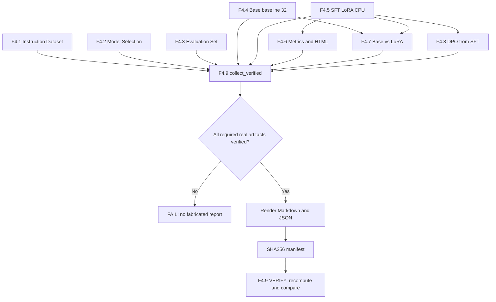
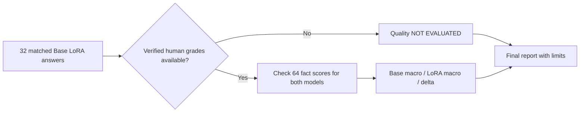

# F4.9 — Final Phase Report: как собрать проверяемый итог Фазы 4

## 1. Цель этапа

За восемь предыдущих шагов мы прошли путь от исходных инструкций до реального, хотя и очень короткого, адаптерного обучения языковой модели. При этом результаты хранятся не в одной таблице. Данные F4.1, характеристики Qwen F4.2, независимый контрольный набор F4.3, ответы Base F4.4, метрики SFT F4.5–F4.6, парное сравнение F4.7 и эксперимент DPO F4.8 находятся в разных JSON/JSONL и каталогах. Открывать по очереди восемь документов и вручную копировать оттуда цифры неудобно и опасно: легко сопоставить результаты разных запусков или выдать синтетическую проверку за настоящее обучение.

**Задача F4.9 — реализовать воспроизводимый итоговый технический отчёт, который строится только из проверенных артефактов.** Мы не обучаем модель и не генерируем новые ответы, а повторно валидируем уже выполненные этапы и сводим их в один документ.

Здесь особенно важно отвечать на три разных вопроса:

1. **Что реализовано инженерно?** Конкретные датасеты, алгоритмы, конфигурации, воспроизводимые интерфейсы, тесты и сохранённые модели.
2. **Какие эксперименты действительно выполнены?** Был ли реальный Base inference, `optimizer.step()` для LoRA и DPO, сколько записей использовано, сохранены ли результаты.
3. **Какие выводы эти результаты позволяют сделать?** Из одного шага обучения нельзя вывести устойчивый тренд, а из совпадения текстов нельзя заключить, что модель не изменилась. Без завершённой экспертной рубрики нельзя присвоить Base или Fine-Tuned выдуманный балл качества.

F4.9 завершается файлами `final_report.md`, `evidence_summary.json`, `report_manifest.json`, созданными из локального репозитория. Первые два — итог и машиночитаемая сводка, третий — доказательство целостности и связь с исходными артефактами.

Состояние GitHub CI и общее число тестов пользователь подтверждает отдельно. Они **не содержатся** в журнале обучения и не могут автоматически появляться в отчёте как доказанные поля только потому, что пользователь ранее сообщил `PASS`.

## 2. Что реализовано

| Файл | Назначение | Что изучить внутри |
|---|---|---|
| `configs/f4_09_final_phase_report.json` | Фиксирует контракт сборки | Пути F4.1–F4.8, `cpu`, место записи результата |
| `src/llm_f4/final_phase_report.py` | Верификатор и составитель отчёта | `load_config`, `plan`, `collect_verified`, `render_markdown`, `build_report`, `verify_report` |
| `scripts/f4_final_phase_report.py` | Командный интерфейс | `--plan`, `--build cpu`, `--verify cpu`; вывод результатов без ML-зависимостей |
| `tests/test_f4_final_phase_report.py` | Автоматическая проверка контрактов | Фикстуры, отсутствие ложных выводов, проверка SHA, перезапись, повреждение и Windows-кодировки |
| `docs/steps/F4_09_final_phase_report.md` | Текущий учебно-технический документ | Последовательность, математика, ограничения и интерпретация |

Производные файлы (не входят в коммит):

| Файл | Содержимое |
|---|---|
| `data/processed/f4_09/cpu/final_report.md` | Итоговый Markdown с реальными числами конкретного локального эксперимента |
| `data/processed/f4_09/cpu/evidence_summary.json` | Точные метрики, счётчики и явно обозначенные ограничения |
| `data/processed/f4_09/cpu/report_manifest.json` | SHA-256 контролирующих конфигураций, манифестов этапов и двух файлов результата |

**Обратная совместимость:** не меняются реализация обучения, токенизатор, оценочный корпус, конфигурации других этапов и `README.md`. Не создаются файлы `.cmd`, `.bat`, `.ps1`. Публикация в GitHub содержит только пять перечисленных файлов F4.9.

## 3. Последовательность реализации

### Шаг 1. Зафиксировали контракт входов

**Что сделали.** В конфигурации перечислили восемь точных путей к настройкам предыдущих этапов. Для F4.9 выбрали фиксированный профиль `cpu`; это профиль подтверждённых коротких прогонов, а не GPU-экспериментов, о которых нельзя заявлять без свидетельств.

**Зачем.** Если случайно подставить другой checkpoint, другой набор вопросов или другой адаптер, численное сравнение станет невалидным. Одна цифра `validation_loss` не имеет смысла без модели, данных и параметров запуска.

**Как.** `load_config()` требует `schema_version == 1`, известный набор ключей, точные пути, `profile == "cpu"` и корректный каталог вывода. Обнаруженные неизвестные поля и подменённые пути приводят к `ReportError`.

**Что получили.** Фиксированную границу эксперимента. Произвольные результаты `data/processed/f4_x` программа не подхватывает.

### Шаг 2. Подготовили безопасную предварительную проверку (`PLAN`)

**Что сделали.** `plan()` вызывает подготовительные функции F4.1 и F4.3, читает каталог F4.2 и проверяет наличие манифестов ранее выполненных запусков.

**Зачем.** До дорогостоящих операций нужно узнать, что источники существуют и наборы согласованы. План не должен требовать установку `torch`, загрузку Qwen или наличие доступа в интернет.

**Как.** Для метаданных используем `prepare_artifacts()` (не создающую файлы) и `load_catalog()`. Для существующих обучающих артефактов показываем `PRESENT`/`MISSING` — **это не означает, что содержимое прошло VERIFY**.

**Что получили.** Команду `--plan`, пригодную для CPU и CI даже до выполнения real inference.

### Шаг 3. Повторно проверили датасет и контрольный набор

**Что сделали.** В `collect_verified()` запустили `verify_artifacts()` из F4.1 и F4.3.

**Зачем.** Иначе отчёт может опираться на случайно изменённые `train.jsonl`, `validation.jsonl`, `test.jsonl` или `prompts.jsonl`.

**Как.** Предыдущие верификаторы заново формируют ожидаемые байты по исходным данным и конфигурации, затем сравнивают с сохранёнными файлами. F4.3 проверяет 32 контрольных задания и связанность с исходным instruction corpus.

**Что получили.** Точные количества записей, тематических групп, заданий и пунктов рубрики. Количество не зашито в итоговый модуль: оно берётся из исходников после проверки.

### Шаг 4. Проверили модель и реальный Base baseline

**Что сделали.** Взяли выбранную модель из каталога F4.2 и вызвали `verify()` F4.4 для профиля `full`.

**Зачем.** Техническая оценка должна относиться к одному checkpoint, без незаметной смены базовой модели или токенизатора.

**Как.** Совпадение `model_id`, `model_revision`, `tokenizer_revision` контролируется исходными функциями. В F4.4 повторно проверяются `context.json`, `responses.jsonl`, `progress.jsonl`, `manifest.json`, контрольные суммы, состав контрольных вопросов и флаг настоящей генерации.

**Что получили.** Сводку о реально сгенерированных 32 ответах Base. Здесь не происходит повторного `model.generate()`.

### Шаг 5. Проверили реальное SFT и визуализацию

**Что сделали.** Вызвали `verify_run()` F4.5 и `verify_report()` F4.6.

**Зачем.** Одного `torch-smoke` недостаточно, чтобы утверждать, что Qwen обучалась. Нам нужны сохранённые метрики и адаптер настоящего запуска.

**Как.** Верификатор F4.5 проверяет настоящий режим, настройки, адаптер и SHA. F4.6 пересчитывает показатели из `run_manifest.json` и `metrics.jsonl`, сверяет HTML/SVG/CSV/JSON. В итог забираются значения `optimizer_steps`, `train_loss`, `grad_norm`, `validation_loss_before`, `validation_loss_after` и заданный learning rate.

**Что получили.** Объективную, но ограниченную оценку одного CPU-шагa. При одном значении `train_loss` не рисуется тренд.

### Шаг 6. Проверили парное сравнение и не подменили качество различием текстов

**Что сделали.** Использовали `verify_comparison()` из F4.7 для полного набора.

**Зачем.** Разные формулировки Base/LoRA — это только наблюдение об изменении текста. Оно не доказывает правильность, полноту или полезность ответа.

**Как.** F4.7 заново связывает записи по `case_id` и хешам prompt/response и воспроизводит сравнение. Если `manual_comparison.json` и заполненный `grades_filled.jsonl` отсутствуют, итоговый отчёт явно пишет: **экспертная оценка не проведена**. Простой `grades_template.jsonl` с `null` не является оценкой.

Если ручная оценка действительно существует, F4.9 заново подсчитывает результаты из `grades_filled.jsonl` по рубрике F4.3 и сверяет их с `manual_comparison.json`. При несовпадении сборка останавливается. Отдельно сверяются хеши исходных ответов.

**Что получили.** Либо проверенное сравнение качества по 32 случаям, либо честный статус `NOT EVALUATED`, без фиктивных нулей.

### Шаг 7. Проверили DPO и зафиксировали frozen reference

**Что сделали.** Использовали `verify_run()` F4.8.

**Зачем.** Реальный DPO должен отличаться от математической демонстрации: он должен иметь собственный обученный адаптер, журнал оптимизатора и подтверждённую reference policy, не изменявшуюся в ходе обучения.

**Как.** Проверяются `real_dpo_performed`, `optimizer_steps`, DPO metrics, файлы адаптера, хеш исходного SFT, `reference_frozen`, отсутствующее использование F4.3/F4.7 при обучении. В итог попадают `initial_validation_margin` и `final_validation_margin`, но не фраза «DPO улучшил качество», поскольку это не измерялось на независимой рубрике.

**Что получили.** Подтверждённую инженерную возможность одного реального DPO-шагa в CPU-профиле и честное ограничение эксперимента.

### Шаг 8. Сформировали Markdown и машиночитаемую сводку

**Что сделали.** `render_markdown()` организует результаты в логический отчёт, а `render_files()` параллельно создаёт `evidence_summary.json`.

**Зачем.** Markdown удобно читать и объяснять на собеседовании; JSON нужен для независимого сравнения чисел и дальнейшего анализа без извлечения значений из текстовых предложений.

**Как.** Формулы выводов основаны на уже проверенных метриках. Объекты не содержат raw-ответы, веса модели, секреты, абсолютные пользовательские пути. Проверяются согласованность объёма split и количества пар, конечность чисел и метаданные модели.

**Что получили.** Один читаемый отчёт и его числовой источник.

### Шаг 9. Защитили результат от подмены и перезаписи

**Что сделали.** `build_report()` вычисляет SHA-256 всех контролирующих конфигураций и исходных манифестов. Результат создаётся во временной директории, которая затем переименовывается в `data/processed/f4_09/cpu`.

**Зачем.** Отчёт не должен перезаписать существующую принятую версию или незаметно оставаться валидным после подмены первичного эксперимента.

**Как.** При уже существующем каталоге получаем понятный отказ. `verify_report()` вновь вызывает `collect_verified()`, побайтово пересобирает два файла и проверяет все сохранённые хеши. Случайно изменённое значение, лишний файл или переписанный исходный манифест приводят к FAIL.

**Что получили.** Воспроизводимую приёмку отчёта как инженерного артефакта. Обновлённый эксперимент требует новой версии отчёта, а не незаметной правки старого.

## 4. Алгоритм и математические примеры

### 4.1. Доля обучаемых параметров

В F4.5 большинство параметров предобученной Qwen заморожено. LoRA добавляет сравнительно небольшой набор обучаемых матриц.

\[
P_{trainable}(\%) = \frac{N_{trainable}}{N_{all}} \times 100
\]

Где `N_trainable` — количество параметров с `requires_grad=True`, а `N_all` — количество всех параметров модели **с уже подключённым адаптером**. По подтверждённому CPU-эксперименту F4.6 было:

- `N_trainable = 540672`;
- `N_all = 494573440`.

\[
\frac{540672}{494573440}\times100 \approx 0.1093\%.
\]

Это доказывает параметрическую экономность LoRA, но не качество полученных ответов. В `render_markdown()` процент пересчитывается из фактических чисел, а не берётся из заранее вставленной строки.

### 4.2. Изменение validation loss

\[
\Delta L_{val} = L_{after} - L_{before}, \qquad
\Delta L_{val,\%} = \frac{\Delta L_{val}}{L_{before}} \times 100\%.
\]

Для подтверждённого локального CPU-запуска F4.5 (значения сообщены при разборе `summary.json` F4.6):

- `before = 2.288156747817993`;
- `after = 2.2816121578216553`.

Тогда:

\[
\Delta L_{val}=-0.006544589996337891 \approx -0.2860\%.
\]

**Как это понимать:** на одной валидационной записи после одного обучающего шага loss стал меньше. Не следует вывод, что модель приобрела новые навыки или стала лучше работать на независимых вопросах. В отчёт F4.9 эти значения попадают **из проверенного F4.6 на твоём компьютере**, а не из примера документации.

### 4.3. Попарное сравнение ответов

\[
N_{changed} = \sum_{i=1}^{N}\mathbf{1}(a_i^{base}\ne a_i^{LoRA}),\qquad
N_{same}=N-N_{changed}.
\]

Здесь `a_i` — строка ответа на один и тот же вопрос `case_id`, `N = 32` в утверждённом benchmark. Индикатор принимает значение 1 при отличии и 0 при полном совпадении.

Например, если **в учебной условной ситуации** изменились 3 ответа из 32, то `N_changed=3`, `N_same=29`. Это **не реальное измерение F4.7**. Окончательные числа программа берёт только из проверенного `comparison.json`.

### 4.4. Экспертное оценивание по рубрике

Каждый контрольный вопрос содержит два смысловых факта, каждый получает `0`, `1` или `2` балла. Нормированный балл задания:

\[
score_i = \frac{s_{i,1}+s_{i,2}}{4}.
\]

При оценках `2` и `1` получится `(2+1)/4=0.75`. Сначала считаем нормированные значения **для каждого задания**, потом среднее по 32 заданиям. Разница `LoRA_macro - Base_macro` появляется в отчёте лишь при наличии всех 32 проверенных ручных оценок обеих моделей.

Не допускается автоматически поставить нули вместо `null`: тогда отсутствие человеческой работы будет замаскировано под крайне низкое качество модели.

### 4.5. DPO preference margin

DPO использует логвероятности предпочтительного и отклонённого ответов относительно замороженной reference policy. Изменение validation preference margin можно вычислить как `m_after - m_before`, однако положительная разница на одной паре предпочтений не равна приросту точности на независимом наборе вопросов.

Результаты DPO-loss, `beta` и margin мы не выдумываем: фактические значения читаются из `run_manifest.json` F4.8 и проходят `verify_run()`. Условие `reference_frozen=True` проверяется предыдущим этапом.

### 4.6. Проверка SHA-256

Для файла `X` вычисляется `H(X)=SHA256(bytes(X))`. Если старый `report_manifest.json` содержит `H(X)`, а после изменения файла вычисленный SHA другой, F4.9 прекращает проверку. В частности, сравниваются:

- конфигурации F4.1–F4.8;
- `manifest.json`/`run_manifest.json` реальных этапов;
- сохранённый `comparison.json` F4.7;
- `evidence_summary.json` и `final_report.md`.

Концептуально это **проверка целостности и происхождения**, а не криптографическая цифровая подпись или подтверждение истинности оценки эксперта.

## 5. Схема работы



Отдельная схема оценки:



Именно этот выбор защищает финальную фазу от ложного утверждения о пользе одного шага fine-tuning.

## 6. Локальная проверка PowerShell

Все команды запускаются из корня репозитория. Используй уже согласованный путь `F:\DEVELOPMENT\ML\ml-engineering-lab`.

**6.1. Проверить тесты только F4.9:**

```powershell
cd F:\DEVELOPMENT\ML\ml-engineering-lab
.\.venv\Scripts\python.exe -m pytest tests/test_f4_final_phase_report.py -q
```

Проверяются структура конфигурации, математические расчёты, выводы об ограниченности экспериментов, отсутствие переписывания отчёта, обнаружение подмены SHA и поведение `--help` на кодировках Windows. **Тесты не загружают веса Qwen.**

**6.2. Предварительно проверить источники:**

```powershell
.\.venv\Scripts\python.exe scripts/f4_final_phase_report.py --plan
```

Ожидаем `F4.9 PLAN: PASS (metadata only)`. Команда перечисляет доступные исходные манифесты, но не объявляет их содержимое проверенным.

**6.3. Убедиться, что прежние результаты проверяются:**

```powershell
.\.venv\Scripts\python.exe scripts/f4_base_model_evaluation.py --verify full
.\.venv\Scripts\python.exe scripts/f4_sft_lora.py --verify cpu
.\.venv\Scripts\python.exe scripts/f4_training_visualization.py --verify cpu
.\.venv\Scripts\python.exe scripts/f4_base_vs_finetuned.py --verify full
.\.venv\Scripts\python.exe scripts/f4_base_vs_finetuned.py --compare full
.\.venv\Scripts\python.exe scripts/f4_dpo_experiment.py --verify cpu
```

Нужны уже существующие F4.4 Base ответы (`32/32`), настоящий SFT CPU, визуализация, F4.7 paired comparison и настоящий DPO CPU. Команды не переобучают модель и не перезаписывают проверенные артефакты. Если какой-то необходимый эксперимент отсутствует, F4.9 не заменяет его тестовой имитацией.

**6.4. Создать финальный отчёт:**

```powershell
.\.venv\Scripts\python.exe scripts/f4_final_phase_report.py --build cpu
```

Признак успеха: `F4.9 BUILD CPU: PASS (verified evidence, no training)`. В `data\processed\f4_09\cpu` появятся **три** файла. Повторный `--build cpu` специально отклоняется: используйте `--verify cpu`.

**6.5. Перепроверить документ и посмотреть результаты:**

```powershell
.\.venv\Scripts\python.exe scripts/f4_final_phase_report.py --verify cpu
Get-Content data\processed\f4_09\cpu\evidence_summary.json -Encoding UTF8
notepad data\processed\f4_09\cpu\final_report.md
```

Ожидаем `F4.9 VERIFY CPU: PASS`. Сравни числа с F4.6/F4.7/F4.8: optimizer steps, доля LoRA-параметров, validation loss, число изменённых ответов, DPO validation margin. Убедись, что до заполнения ручных оценок там стоит `NOT EVALUATED`, а не вымышленный прирост.

**6.6. Общая регрессия:**

```powershell
.\.venv\Scripts\python.exe -m pytest -q
```

До F4.9 подтверждены `1904 passed, 1 skipped`. В этой поставке добавлено **61 тест F4.9**, поэтому при неизменном остальном составе ожидается **1965 passed, 1 skipped**. Это только ожидаемое значение; реальные цифры потребуют запуска на Windows.

**Что даже после PASS остаётся ограничением:** полный unit/CI PASS доказывает проверенные программные инварианты, а не то, что одношаговое обучение улучшило ответы. `F4.9 VERIFY` доказывает целостность и воспроизводимость итогового отчёта по текущим артефактам.

## 7. Что подтверждено и какие ограничения остаются

| Утверждение | Основание | Ограничение |
|---|---|---|
| Данные F4.1 разделены по тематическим группам | `verify_f41()` и SHA исходников | Возможны невыявленные смысловые дубликаты |
| Выбрана Qwen2.5-0.5B Base с фиксированной ревизией | Каталог F4.2, сверка модели и токенизатора | Не означает высокое качество ответов |
| Base реально сгенерировала 32 ответа | `verify_f44(full)` | Без рубрики нельзя присвоить балл качества |
| SFT-LoRA реально выполнил CPU-шаг | `verify_f45(cpu)` и `verify_f46(cpu)` | Один шаг не образует траекторию обучения |
| Base и LoRA сопоставлены на тех же вопросах | `verify_f47(full)` | Отличие текста не равно улучшению |
| DPO действительно выполнен | `verify_f48(cpu)`, адаптер, reference logp | Мало пар/шагов, нет независимой проверки качества DPO |
| Markdown и JSON не изменились и опираются на исходники | `verify_report()` F4.9 | SHA-256 не заменяет аудита правильности самих эталонов |
| Улучшение качества после LoRA | Только при заполненных и проверенных экспертных оценках | До них **не подтверждено** |
| Преимущество DPO после LoRA | Нужен отдельный eval DPO на независимых заданиях | В рамках F4.9 **не доказано** |

Если полная экспертная оценка F4.7 отсутствует, итоговая Фаза 4 всё равно может быть **инженерно завершена**: в отчёте сохраняется ограничение и программа не принимает пустой шаблон за реальные оценки. Это не то же самое, что «качество доказано».

## 8. Основная мысль этапа

На F4.9 я собрал в одну цепочку все компоненты, которые реализовал в Фазе 4. Раньше я сначала подготовил учебный instruction dataset и разделил его на train, validation и test. Затем выбрал конкретную предобученную модель Qwen2.5-0.5B и зафиксировал ревизию её весов и токенизатора, чтобы эксперимент не менялся незаметно между запусками. После этого я создал отдельный оценочный набор и сохранил исходные ответы Base-модели.

Дальше я реализовал SFT и LoRA. На CPU провёл один настоящий обучающий шаг, сохранил адаптер и измерил loss и градиенты. Затем визуализировал эти реальные метрики, не рисуя искусственную кривую по одной точке. На следующем этапе я подключил адаптер к Qwen и сопоставил её ответы с прежним Base baseline по одинаковым контрольным заданиям. Здесь я понял принципиальную разницу между **изменением ответов** и **улучшением качества**: без экспертных оценок это разные задачи.

Наконец я реализовал DPO: обучение по парам предпочтений, где есть предпочтительный и отклонённый ответ. Я проверил формулу DPO-loss, градиенты, неподвижность reference policy и отдельный реальный CPU-запуск. Но я не называю это доказанным улучшением языковой модели: набор предпочтений и длительность обучения ещё слишком малы.

Итоговый F4.9 превращает эти результаты в воспроизводимое техническое свидетельство. Отчёт не просто переписывает цифры: он повторно запускает проверки предыдущих этапов, контролирует идентичность модели, данных и экспериментов, пересчитывает сводные метрики и хеширует исходные материалы. Если кто-то поменяет файлы после построения отчёта, верификация перестанет проходить. Для меня это важный навык ML Engineering: **не только научить модель, но и доказать, что именно было запущено и какие выводы из этого действительно следуют**.

## 9. Файлы этапа

Рекомендуемый порядок чтения:

| Очерёдность | Файл | Что именно изучить |
|---:|---|---|
| 1 | `configs/f4_09_final_phase_report.json` | Контракт модели, зависимостей и зафиксированного CPU-профиля |
| 2 | `src/llm_f4/final_phase_report.py` | `load_config()` и `plan()` — различие между существующим и верифицированным источником |
| 3 | `src/llm_f4/final_phase_report.py` | `collect_verified()` — как связываются F4.1–F4.8 и не допускается подмена модели или адаптера |
| 4 | `src/llm_f4/final_phase_report.py` | `_read_optional_human_score()` — почему `null` не равен нулевой оценке |
| 5 | `src/llm_f4/final_phase_report.py` | `render_markdown()` — формулы и интерпретация ограничений |
| 6 | `src/llm_f4/final_phase_report.py` | `build_report()` и `verify_report()` — SHA, атомарная запись и повторная сборка |
| 7 | `scripts/f4_final_phase_report.py` | Порядок запуска CLI и различие PLAN/BUILD/VERIFY |
| 8 | `tests/test_f4_final_phase_report.py` | Искусственные фикстуры, проверка инвариантов, отказ от фиктивного качества, ошибки целостности |

Чтобы понять зависимости, дополнительно открой следующие исходники предыдущих этапов:

- `src/llm_f4/instruction_dataset.py`: `split_examples()`, `validate_splits()`, `verify_artifacts()`;
- `src/llm_f4/model_selection.py`: `load_catalog()`, `assess_candidate()`;
- `src/llm_f4/evaluation_set.py`: `validate_cases()`, `score_manual_grades()`;
- `src/llm_f4/base_model_evaluation.py`: `verify()` и привязка real inference к sealed prompts;
- `src/llm_f4/sft_lora.py`: `run_real()`, `verify_run()` и trainable parameters;
- `src/llm_f4/training_visualization.py`: `validate_source()`, `verify_report()`;
- `src/llm_f4/base_vs_finetuned.py`: `paired_rows()`, `verify_comparison()`, `score_grades()`;
- `src/llm_f4/dpo_experiment.py`: `dpo_loss()`, `run_real()`, `verify_run()`.

**Финальная мысль:** F4.9 не добавляет ещё одну «модель»; он делает всю Фазу 4 проверяемым, честно описанным инженерным экспериментом. Это позволяет рассказывать о проекте на собеседовании через исходные данные, протокол, вычисления, результаты и ограничения — без преувеличения эффективности обучения.
