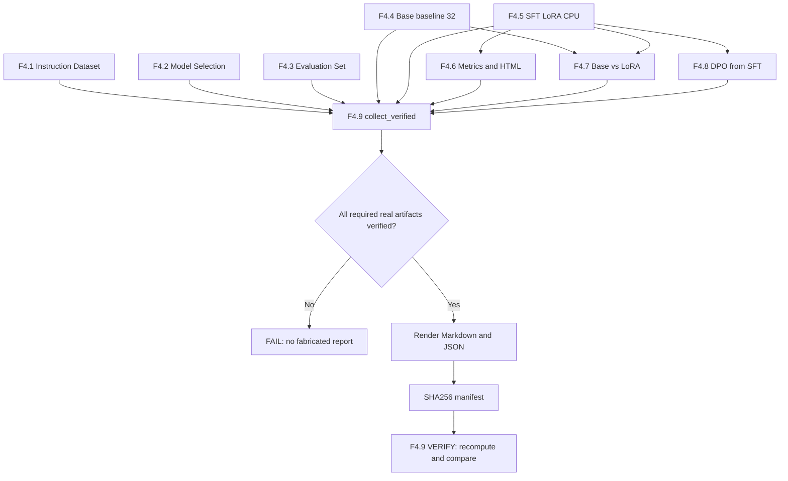
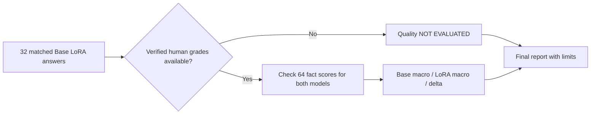

# F4.9 — Final Phase Report: формирование проверяемого итога Фазы 4

## 1. Цель этапа

**Связь с предыдущими этапами.** F4.1 — подготовка instruction dataset из 80 записей с группозависимым разбиением на `train=56`, `validation=12`, `test=12`. F4.2 — выбор и фиксация `Qwen/Qwen2.5-0.5B`, ревизий модели и токенизатора. F4.3 — создание независимого benchmark из 32 заданий и 64 смысловых критериев. F4.4 — сохранение реальных ответов Base на 32 задания. F4.5 — реализация SFT + LoRA и одного CPU optimizer step. F4.6 — визуализация фактических метрик обучения. F4.7 — сравнение Base и LoRA на одинаковых вопросах. F4.8 — проверка DPO-loss и один реальный CPU-шаг обучения по предпочтениям.

**Проблема.** Результаты восьми этапов распределены по разным каталогам и форматам JSON/JSONL: конфигурации, исходные данные, сохранённые ответы, журналы обучения, адаптеры, манифесты, контрольные суммы. Простое копирование чисел в итоговую таблицу создаёт риск сопоставления несовместимых запусков, незаметного изменения исходников и подмены unit-теста утверждением о реально выполненном fine-tuning. Отдельный риск — принять отличие текстов Base/LoRA за повышение качества ответов.

**Цель F4.9:** реализовать воспроизводимый итоговый отчёт **только на основе повторно проверенных артефактов F4.1–F4.8**, без нового обучения и повторной генерации ответов. Обеспечить согласованность модельных ревизий, источников данных и экспериментов; рассчитать итоговые показатели; явно обозначить пределы интерпретации; защитить результаты контрольными суммами.

Необходимо разделять три категории утверждений:

1. **Реализованные инженерные компоненты:** датасеты, конфигурации, алгоритмы, интерфейсы, тесты и форматы результатов.
2. **Подтверждённые экспериментальные действия:** реальный Base inference, `optimizer.step()` для SFT-LoRA и DPO, фактическое количество задействованных примеров и сохранённые артефакты.
3. **Обоснованные выводы о качестве:** результаты независимой оценки по рубрике при наличии заполненных и проверенных экспертных баллов. Снижение validation loss на одной записи и изменение текста ответов такой оценкой не являются.

**Выходные артефакты:** `data/processed/f4_09/cpu/final_report.md` (читаемый отчёт), `evidence_summary.json` (машиночитаемая сводка), `report_manifest.json` (контрольные суммы и происхождение данных). Эти файлы создаются из локально проверенных материалов; повторный запуск `--verify cpu` позволяет проверить их целостность без загрузки Qwen.

**Границы ответственности.** F4.9 не обучает модель, не генерирует ответы и не заменяет экспертную проверку. Состояние удалённого GitHub CI не выводится из локального журнала обучения. Количество успешно пройденных тестов фиксируется отдельно по фактическому запуску pytest, а не подставляется в отчёт без подтверждения.

## 2. Что реализовано

| Файл | Назначение | Что изучить внутри |
|---|---|---|
| `configs/f4_09_final_phase_report.json` | Фиксирует контракт сборки | Пути F4.1–F4.8, `cpu`, место записи результата |
| `src/llm_f4/final_phase_report.py` | Верификатор и составитель отчёта | `load_config`, `plan`, `collect_verified`, `render_markdown`, `build_report`, `verify_report` |
| `scripts/f4_final_phase_report.py` | Командный интерфейс | `--plan`, `--build cpu`, `--verify cpu`; вывод результатов без ML-зависимостей |
| `tests/test_f4_final_phase_report.py` | Автоматическая проверка контрактов | Фикстуры, отсутствие ложных выводов, проверка SHA, перезапись, повреждение и Windows-кодировки |
| `docs/steps/F4_09_final_phase_report.md` | Текущий учебно-технический документ | Последовательность, математика, ограничения и интерпретация |

Производные файлы (не входят в коммит):

| Файл | Содержимое |
|---|---|
| `data/processed/f4_09/cpu/final_report.md` | Итоговый Markdown с реальными числами конкретного локального эксперимента |
| `data/processed/f4_09/cpu/evidence_summary.json` | Точные метрики, счётчики и явно обозначенные ограничения |
| `data/processed/f4_09/cpu/report_manifest.json` | SHA-256 контролирующих конфигураций, манифестов этапов и двух файлов результата |

**Обратная совместимость:** не меняются реализация обучения, токенизатор, оценочный корпус, конфигурации других этапов и `README.md`. Не создаются файлы `.cmd`, `.bat`, `.ps1`. Публикация в GitHub содержит только пять перечисленных файлов F4.9.

## 3. Последовательность реализации

### Шаг 1. Зафиксировать контракт входных артефактов

**Действие.** Определить точный перечень конфигураций F4.1–F4.8 и целевой профиль `cpu` в `configs/f4_09_final_phase_report.json`.

**Назначение.** Исключить неявное использование другого checkpoint, токенизатора, instruction dataset, benchmark или обученного адаптера. Обеспечить сопоставимость результатов между этапами.

**Реализация.** В `load_config()` проверить `schema_version == 1`, обязательные ключи, допустимые относительные пути, фиксированный профиль `cpu` и каталог выходных файлов. Неизвестные поля и подменённые пути обрабатывать через `ReportError`.

**Результат.** Зафиксированный контракт происхождения данных: произвольные файлы из `data/processed` не подхватываются автоматически.

### Шаг 2. Реализовать предварительную проверку источников (`PLAN`)

**Действие.** Подготовить команду `--plan`, определяющую доступность входов без запуска модели и без создания отчёта.

**Назначение.** Выявить отсутствующие файлы до полноценной верификации. Разделить два состояния: физическое наличие артефакта (`PRESENT`) и доказанную корректность его содержимого (`VERIFIED`).

**Реализация.** В `plan()` использовать `prepare_artifacts()` F4.1 и F4.3 в режиме без записи, `load_catalog()` F4.2, проверки наличия манифестов реальных запусков F4.4–F4.8. Не импортировать тяжёлые ML-зависимости для просмотра плана.

**Результат.** Метаданные доступности источников и воспроизводимый `F4.9 PLAN: PASS (metadata only)`. Этот статус не означает, что все источники прошли `VERIFY`.

### Шаг 3. Повторно проверить instruction dataset и evaluation set

**Действие.** Выполнить верификаторы F4.1 и F4.3 до извлечения числовых характеристик.

**Назначение.** Исключить использование изменённых `train.jsonl`, `validation.jsonl`, `test.jsonl`, `prompts.jsonl` и неправильных разбиений при формировании итогового документа.

**Реализация.** В `collect_verified()` вызвать `verify_artifacts()` предыдущих этапов. Повторно построить ожидаемые представления из исходного корпуса и конфигураций; проверить SHA-256, разбиение `group_id`, идентификаторы заданий и связь независимого benchmark с утверждённым корпусом.

**Результат.** Проверенные счётчики F4.1 и F4.3: 80 инструкций (`56/12/12`), 32 контрольных задания, 64 критерия. Значения извлекаются из проверенных артефактов, а не задаются константами в отчёте.

### Шаг 4. Проверить выбранную модель и исходный Base baseline

**Действие.** Сопоставить каталог F4.2 с модельными метаданными F4.4 и повторно проверить полный Base inference.

**Назначение.** Предотвратить сравнение результатов разных версий модели или токенизатора и исключить фиктивные ответы вместо реальной генерации.

**Реализация.** Проверить `model_id`, `model_revision`, `tokenizer_revision`. Выполнить `verify()` F4.4 для профиля `full`, включая проверку `context.json`, `responses.jsonl`, `progress.jsonl`, `manifest.json`, SHA-256 и состава 32 sealed prompts.

**Результат.** Подтверждённый Base baseline `32/32` с возможностью извлечь скорость генерации и количество токенов. Повторный `model.generate()` при формировании итогового отчёта не требуется.

### Шаг 5. Верифицировать SFT-LoRA и визуализацию обучения

**Действие.** Проверить реальные результаты F4.5 и производный аналитический отчёт F4.6.

**Назначение.** Отделить контрактные и синтетические тесты оптимизатора от фактически выполненного обучения Qwen с сохранённым LoRA-адаптером.

**Реализация.** Выполнить `verify_run()` F4.5 и `verify_report()` F4.6. Проверить `run_manifest.json`, `metrics.jsonl`, SHA-256 адаптера, режим реального обучения, количество `optimizer_steps`, корректность HTML/SVG/CSV/JSON. Извлечь `train_loss`, `grad_norm`, `validation_loss_before`, `validation_loss_after`, `learning_rate` и число обучаемых параметров.

**Результат.** Проверенный CPU-эксперимент с одним optimizer step; `N_trainable = 540672`, `N_all = 494573440`, `validation_loss: 2.28815675 → 2.28161216`. Единственная точка training loss не интерпретируется как тренд.

### Шаг 6. Проверить парное сравнение Base и LoRA

**Действие.** Повторно сверить 32 пары ответов F4.7, контрольные суммы и наличие завершённых экспертных оценок.

**Назначение.** Исключить подмену показателя изменения текста показателем качества модели. Не интерпретировать незаполненный шаблон оценок как нулевой результат.

**Реализация.** Выполнить `verify_comparison()` F4.7; сопоставить `case_id`, SHA запросов и ответов, `comparison.json`. При наличии заполненных `grades_filled.jsonl` и `manual_comparison.json` повторно рассчитать баллы по рубрике F4.3 и проверить согласованность. При отсутствии фактической ручной проверки сохранить явный статус `NOT EVALUATED`.

**Результат.** Подтверждённое техническое сравнение: 32 пары, 12 отличающихся и 20 совпадающих текстов. Экспертное превосходство LoRA над Base не утверждается без заполненных баллов.

### Шаг 7. Проверить эксперимент DPO и неизменность reference

**Действие.** Проверить результаты F4.8, исходный SFT-адаптер и сохранённую reference policy.

**Назначение.** Установить, что preference optimization действительно выполнялась на LoRA-параметрах и что reference не изменялась вместе с обучаемой policy.

**Реализация.** Вызвать `verify_run()` F4.8; проверить `real_dpo_performed`, `optimizer_steps`, `reference_frozen`, SHA исходного F4.5 SFT, отдельный DPO-адаптер, метрики и отсутствие обучающей утечки из F4.3/F4.7. Считать `initial_validation_margin` и `final_validation_margin` из проверенного манифеста.

**Результат.** Подтверждён один реальный DPO optimizer step на CPU; preference margin на одной validation-паре изменился приблизительно `0 → 0.00066223`. Это не эквивалент приросту точности независимых ответов.

### Шаг 8. Сформировать Markdown и машиночитаемую сводку

**Действие.** Свести подтверждённые результаты в два согласованных представления: `final_report.md` и `evidence_summary.json`.

**Назначение.** Предоставить читаемую интерпретацию этапов и отдельные структурированные показатели для машинной проверки, без ручного копирования чисел.

**Реализация.** Использовать `render_markdown()` и `render_files()`. Пересчитать долю LoRA-параметров, изменение validation loss, доли совпавших/изменившихся текстов. Сопоставить split и размер benchmark, проверить конечность числовых значений. Исключить секреты, исходные веса, raw-ответы и абсолютные пути пользователя.

**Результат.** Единый отчёт с машиночитаемым источником, перечнем доказанных свойств и явно указанными ограничениями эксперимента.

### Шаг 9. Защитить отчёт от перезаписи и изменения источников

**Действие.** Добавить контроль целостности входов и результатов, атомарную сборку и независимую команду `--verify cpu`.

**Назначение.** Не допустить незаметной замены ранее принятого отчёта и ложного статуса `PASS` после изменения исходного эксперимента.

**Реализация.** В `build_report()` вычислять SHA-256 конфигураций и манифестов, собирать три файла во временном каталоге и атомарно переносить в `data/processed/f4_09/cpu`. При наличии результата повторная сборка отклоняется. В `verify_report()` заново выполнить `collect_verified()`, побайтово воспроизвести содержимое Markdown/JSON, сверить манифест и SHA всех контролируемых файлов.

**Результат.** Воспроизводимая проверка итогового эксперимента. Повреждённый файл, подмена конфигурации или несогласованный результат приводят к отказу верификации.

## 4. Алгоритм и математические примеры

### 4.1. Доля обучаемых параметров

В F4.5 большинство параметров предобученной Qwen заморожено. LoRA добавляет сравнительно небольшой набор обучаемых матриц.

\[
P_{trainable}(\%) = \frac{N_{trainable}}{N_{all}} \times 100
\]

Где `N_trainable` — количество параметров с `requires_grad=True`, а `N_all` — количество всех параметров модели **с уже подключённым адаптером**. В подтверждённом CPU-эксперименте F4.5–F4.6 зафиксированы значения:

- `N_trainable = 540672`;
- `N_all = 494573440`.

\[
\frac{540672}{494573440}\times100 \approx 0.1093\%.
\]

Это доказывает параметрическую экономность LoRA, но не качество полученных ответов. В `render_markdown()` процент пересчитывается из фактических чисел, а не берётся из заранее вставленной строки.

### 4.2. Изменение validation loss

\[
\Delta L_{val} = L_{after} - L_{before}, \qquad
\Delta L_{val,\%} = \frac{\Delta L_{val}}{L_{before}} \times 100\%.
\]

Для подтверждённого CPU-запуска F4.5–F4.6 (`summary.json` F4.6):

- `before = 2.288156747817993`;
- `after = 2.2816121578216553`.

Тогда:

\[
\Delta L_{val}=-0.006544589996337891 \approx -0.2860\%.
\]

**Интерпретация.** После одного обучающего шага loss на одной validation-записи уменьшился. По этому измерению нельзя заключить, что модель приобрела новые навыки или стала лучше отвечать на независимые вопросы. F4.9 извлекает значения только из проверенного F4.6, а не из иллюстративного текста документации.

### 4.3. Попарное сравнение ответов

\[
N_{changed} = \sum_{i=1}^{N}\mathbf{1}(a_i^{base}\ne a_i^{LoRA}),\qquad
N_{same}=N-N_{changed}.
\]

Здесь `a_i` — строка ответа на один и тот же вопрос `case_id`, `N = 32` в утверждённом benchmark. Индикатор принимает значение 1 при отличии и 0 при полном совпадении.

**Реальный пример F4.7:** для 32 пар зафиксировано `N_changed=12` и `N_same=20`. Доля различающихся текстов составляет `12 / 32 × 100% = 37.5%`, доля совпадающих — `62.5%`. Показатели отражают буквальное изменение ответов, но **не являются оценкой их фактической правильности**. Значения отчёта F4.9 считываются из проверенного `comparison.json`.

### 4.4. Экспертное оценивание по рубрике

Каждый контрольный вопрос содержит два смысловых факта, каждый получает `0`, `1` или `2` балла. Нормированный балл задания:

\[
score_i = \frac{s_{i,1}+s_{i,2}}{4}.
\]

При оценках `2` и `1` получится `(2+1)/4=0.75`. Сначала считаем нормированные значения **для каждого задания**, потом среднее по 32 заданиям. Разница `LoRA_macro - Base_macro` появляется в отчёте лишь при наличии всех 32 проверенных ручных оценок обеих моделей.

Не допускается автоматически поставить нули вместо `null`: тогда отсутствие человеческой работы будет замаскировано под крайне низкое качество модели.

### 4.5. DPO preference margin

DPO использует логвероятности предпочтительного и отклонённого ответов относительно замороженной reference policy. Изменение validation preference margin можно вычислить как `m_after - m_before`, однако положительная разница на одной паре предпочтений не равна приросту точности на независимом наборе вопросов.

Значения DPO-loss, `beta` и margin извлекать исключительно из `run_manifest.json` F4.8 после успешного `verify_run()`. Условие `reference_frozen=True` проверяется предыдущим этапом.

### 4.6. Проверка SHA-256

Для файла `X` вычисляется `H(X)=SHA256(bytes(X))`. Если старый `report_manifest.json` содержит `H(X)`, а после изменения файла вычисленный SHA другой, F4.9 прекращает проверку. В частности, сравниваются:

- конфигурации F4.1–F4.8;
- `manifest.json`/`run_manifest.json` реальных этапов;
- сохранённый `comparison.json` F4.7;
- `evidence_summary.json` и `final_report.md`.

Концептуально это **проверка целостности и происхождения**, а не криптографическая цифровая подпись или подтверждение истинности оценки эксперта.

## 5. Схема работы



Отдельная схема оценки:



Именно этот выбор защищает финальную фазу от ложного утверждения о пользе одного шага fine-tuning.

## 6. Локальная проверка PowerShell

Все команды выполнять из корня репозитория `F:\DEVELOPMENT\ML\ml-engineering-lab`. Запускать в существующем Python-окружении проекта.

**6.1. Проверить тесты только F4.9:**

```powershell
cd F:\DEVELOPMENT\ML\ml-engineering-lab
.\.venv\Scripts\python.exe -m pytest tests/test_f4_final_phase_report.py -q
```

Проверяются структура конфигурации, математические расчёты, выводы об ограниченности экспериментов, отсутствие переписывания отчёта, обнаружение подмены SHA и поведение `--help` на кодировках Windows. **Тесты не загружают веса Qwen.**

**6.2. Предварительно проверить источники:**

```powershell
.\.venv\Scripts\python.exe scripts/f4_final_phase_report.py --plan
```

Ожидаемый вывод: `F4.9 PLAN: PASS (metadata only)`. Команда перечисляет доступные исходные манифесты, но не присваивает их содержимому статус полной верификации.

**6.3. Убедиться, что прежние результаты проверяются:**

```powershell
.\.venv\Scripts\python.exe scripts/f4_base_model_evaluation.py --verify full
.\.venv\Scripts\python.exe scripts/f4_sft_lora.py --verify cpu
.\.venv\Scripts\python.exe scripts/f4_training_visualization.py --verify cpu
.\.venv\Scripts\python.exe scripts/f4_base_vs_finetuned.py --verify full
.\.venv\Scripts\python.exe scripts/f4_base_vs_finetuned.py --compare full
.\.venv\Scripts\python.exe scripts/f4_dpo_experiment.py --verify cpu
```

Нужны уже существующие F4.4 Base ответы (`32/32`), настоящий SFT CPU, визуализация, F4.7 paired comparison и настоящий DPO CPU. Команды не переобучают модель и не перезаписывают проверенные артефакты. Если какой-то необходимый эксперимент отсутствует, F4.9 не заменяет его тестовой имитацией.

**6.4. Создать финальный отчёт:**

```powershell
.\.venv\Scripts\python.exe scripts/f4_final_phase_report.py --build cpu
```

Признак успеха: `F4.9 BUILD CPU: PASS (verified evidence, no training)`. В `data\processed\f4_09\cpu` появятся **три** файла. Повторный `--build cpu` намеренно отклоняется. Для проверки уже сформированного результата использовать `--verify cpu`.

**6.5. Перепроверить документ и посмотреть результаты:**

```powershell
.\.venv\Scripts\python.exe scripts/f4_final_phase_report.py --verify cpu
Get-Content data\processed\f4_09\cpu\evidence_summary.json -Encoding UTF8
notepad data\processed\f4_09\cpu\final_report.md
```

Ожидаемый вывод: `F4.9 VERIFY CPU: PASS`. Дополнительно сопоставить с F4.6/F4.7/F4.8 количество optimizer steps, долю LoRA-параметров, validation loss, количество изменённых ответов и DPO validation margin. При отсутствии заполненных экспертных оценок убедиться в наличии статуса `NOT EVALUATED`, а не несуществующего прироста качества.

**6.6. Общая регрессия:**

```powershell
.\.venv\Scripts\python.exe -m pytest -q
```

При завершении Фазы 4 ранее зафиксирован полный локальный результат **`1965 passed, 1 skipped`**. Для первоначальной поставки F4.9 было добавлено 61 тест. При повторной проверке текущего checkout ориентироваться на **фактический вывод pytest**, поскольку изменения исходников или состава тестов могут изменить итоговые значения. Одни лишь тесты F4.9 не загружают веса Qwen.

**Ограничение даже при PASS:** успешные unit/CI-тесты подтверждают предусмотренные программные инварианты, но не доказывают, что одношаговое обучение повысило качество ответов. `F4.9 VERIFY` доказывает целостность и воспроизводимость итогового отчёта по текущим артефактам.

## 7. Что подтверждено и какие ограничения остаются

| Утверждение | Основание | Ограничение |
|---|---|---|
| Данные F4.1 разделены по тематическим группам | `verify_f41()` и SHA исходников | Возможны невыявленные смысловые дубликаты |
| Выбрана Qwen2.5-0.5B Base с фиксированной ревизией | Каталог F4.2, сверка модели и токенизатора | Не означает высокое качество ответов |
| Base реально сгенерировала 32 ответа | `verify_f44(full)` | Без рубрики нельзя присвоить балл качества |
| SFT-LoRA реально выполнил CPU-шаг | `verify_f45(cpu)` и `verify_f46(cpu)` | Один шаг не образует траекторию обучения |
| Base и LoRA сопоставлены на тех же вопросах | `verify_f47(full)` | Отличие текста не равно улучшению |
| DPO действительно выполнен | `verify_f48(cpu)`, адаптер, reference logp | Мало пар/шагов, нет независимой проверки качества DPO |
| Markdown и JSON не изменились и опираются на исходники | `verify_report()` F4.9 | SHA-256 не заменяет аудита правильности самих эталонов |
| Улучшение качества после LoRA | Только при заполненных и проверенных экспертных оценках | До них **не подтверждено** |
| Преимущество DPO после LoRA | Нужен отдельный eval DPO на независимых заданиях | В рамках F4.9 **не доказано** |

Если полная экспертная оценка F4.7 отсутствует, итоговая Фаза 4 всё равно может быть **инженерно завершена**: в отчёте сохраняется ограничение и программа не принимает пустой шаблон за реальные оценки. Это не то же самое, что «качество доказано».

## 8. Основная мысль этапа

**Назначение F4.9 — формировать проверяемый итог всей Фазы 4, а не выполнять ещё один этап обучения.** Результаты предшествующих этапов образуют зависимую последовательность: instruction dataset определяет материал SFT; выбор модели и токенизатора фиксирует вычислительную основу; evaluation set задаёт независимые задания; Base baseline сохраняет исходные ответы; SFT-LoRA создаёт обученный адаптер; визуализация показывает фактические метрики; F4.7 сопоставляет ответы двух версий; F4.8 добавляет эксперимент preference optimization.

**Первая задача — установить происхождение каждого числа.** Для количества обучающих записей необходимо проверить групповой split F4.1. Для числа контрольных заданий — проверить F4.3 и соответствие prompts. Для ответов Base — удостовериться в реальной генерации F4.4 и целостности сохранённых JSONL. Для значения validation loss — подтвердить источник F4.5–F4.6, профиль `cpu`, количество optimizer steps и неизменность SFT-адаптера. Для DPO preference margin — проверить reference policy и метрики конкретного F4.8-запуска.

**Вторая задача — исключить некорректные выводы.** В F4.5 подтверждён один реальный шаг обучения LoRA и небольшое уменьшение validation loss на одной записи. Такой результат демонстрирует работу механизма оптимизации, но не устойчивую динамику обучения. В F4.7 обнаружено 12 отличающихся текстов из 32, однако изменение формулировки не эквивалентно повышению фактической правильности. В F4.8 один DPO-шаг изменил preference margin на одной validation-паре, но независимая оценка качества DPO не проводилась. При отсутствии заполненной экспертной рубрики F4.7 необходимо сохранять статус `NOT EVALUATED`, а не подставлять нулевой или положительный балл.

**Третья задача — обеспечить воспроизводимость.** В `collect_verified()` повторно вызываются проверки предыдущих этапов. Итоговые показатели рассчитываются на основе возвращённых подтверждённых значений. `build_report()` формирует Markdown, JSON и манифест с контрольными суммами SHA-256. `verify_report()` повторно получает исходные данные, пересоздаёт ожидаемый результат и обнаруживает изменения в исходниках или итоговых файлах. Контрольная сумма гарантирует обнаружение изменений байтов, но не подтверждает истинность экспертных эталонов и не заменяет независимой научной оценки.

**Практический результат:** формирование итогового инженерного свидетельства о работе ML-конвейера: какие компоненты реализованы, какие операции действительно выполнены, какие метрики измерены и какие утверждения нельзя сделать на основании этих измерений. Такое разделение позволяет проверить эксперимент, продолжить исследования на GPU и аргументированно представить ограничения результатов при техническом аудите или собеседовании.

## 9. Файлы этапа

Рекомендуемый порядок чтения:

| Очерёдность | Файл | Что именно изучить |
|---:|---|---|
| 1 | `configs/f4_09_final_phase_report.json` | Контракт модели, зависимостей и зафиксированного CPU-профиля |
| 2 | `src/llm_f4/final_phase_report.py` | `load_config()` и `plan()` — различие между существующим и верифицированным источником |
| 3 | `src/llm_f4/final_phase_report.py` | `collect_verified()` — как связываются F4.1–F4.8 и не допускается подмена модели или адаптера |
| 4 | `src/llm_f4/final_phase_report.py` | `_read_optional_human_score()` — почему `null` не равен нулевой оценке |
| 5 | `src/llm_f4/final_phase_report.py` | `render_markdown()` — формулы и интерпретация ограничений |
| 6 | `src/llm_f4/final_phase_report.py` | `build_report()` и `verify_report()` — SHA, атомарная запись и повторная сборка |
| 7 | `scripts/f4_final_phase_report.py` | Порядок запуска CLI и различие PLAN/BUILD/VERIFY |
| 8 | `tests/test_f4_final_phase_report.py` | Искусственные фикстуры, проверка инвариантов, отказ от фиктивного качества, ошибки целостности |

Для изучения зависимостей дополнительно проверить следующие исходники предыдущих этапов:

- `src/llm_f4/instruction_dataset.py`: `split_examples()`, `validate_splits()`, `verify_artifacts()`;
- `src/llm_f4/model_selection.py`: `load_catalog()`, `assess_candidate()`;
- `src/llm_f4/evaluation_set.py`: `validate_cases()`, `score_manual_grades()`;
- `src/llm_f4/base_model_evaluation.py`: `verify()` и привязка real inference к sealed prompts;
- `src/llm_f4/sft_lora.py`: `run_real()`, `verify_run()` и trainable parameters;
- `src/llm_f4/training_visualization.py`: `validate_source()`, `verify_report()`;
- `src/llm_f4/base_vs_finetuned.py`: `paired_rows()`, `verify_comparison()`, `score_grades()`;
- `src/llm_f4/dpo_experiment.py`: `dpo_loss()`, `run_real()`, `verify_run()`.

**Итог:** F4.9 не добавляет новую модель; этап формирует проверяемое техническое описание всей Фазы 4. Это позволяет рассказывать о проекте на собеседовании через исходные данные, протокол, вычисления, результаты и ограничения — без преувеличения эффективности обучения.
