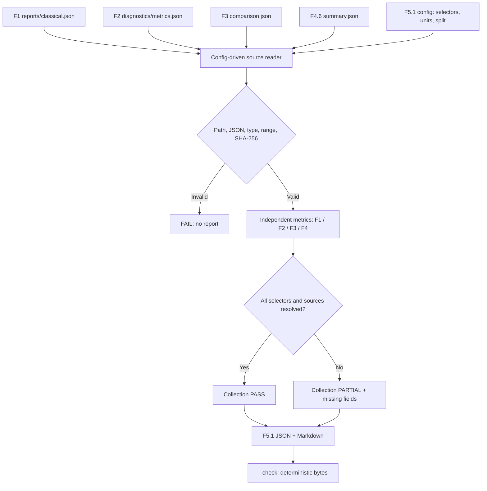

# F5.1 - Unified Evaluation Report: Единая оценка

## 1. Цель этапа

Подготовить общий протокол публикации **уже вычисленных** показателей Фаз 1–4 без переобучения моделей, повторного запуска генерации, перенастройки retrieval и искусственного сведения разнородных метрик в общий score.

Вход: сохранённые JSON-артефакты F1, F2, F3, F4, описанные в [configs/f5_01_unified_evaluation.json](https://github.com/trasher88/ml-engineering-lab/blob/main/configs/f5_01_unified_evaluation.json). Выход: воспроизводимые отчёты `reports/public/f5_01/F5_01_unified_evaluation.json` и `docs/reports/F5_01_UNIFIED_EVALUATION.md`, генерируемые в пользовательском checkout.

Единый протокол объединяет **происхождение, единицы измерения, название задачи, dataset/split, извлечённые численные значения и ограничения**. Он не означает объединение чисел Accuracy, Recall@5, MRR@5 и validation loss в один показатель качества.

F1/F2 используют классификацию источников технических вопросов, F3 — frozen retrieval на синтетических запросах, F4 — диагностику LoRA fine-tuning Qwen. Различия в задачах, выборках и методах расчёта не позволяют интерпретировать численные результаты как общий рейтинг фаз.

## 2. Что реализовано

| Новый файл | Основные сущности | Назначение |
|---|---|---|
| `src/evaluation_f5/__init__.py` | Экспорт `build_report`, `render_markdown`, `serialize_json` | Публичный интерфейс пакета F5.1 |
| `src/evaluation_f5/unified_report.py` | `EvaluationError`, `SourceResult`, `build_report()`, `render_markdown()`, `run()`, `numeric_paths()` | Загрузка, типизация, проверка и отчётность без ML-зависимостей |
| `scripts/f5_unified_report.py` | `main()` | CLI: сборка, проверка, диагностика JSON selectors |
| `configs/f5_01_unified_evaluation.json` | `sources[]`, `metrics[]`, `selectors[]`, `outputs` | Декларативное сопоставление реальных артефактов с точными полями метрик |
| `tests/test_f5_unified_report.py` | Контрактные pytest-тесты | Синтетические фикстуры; проверки полноты, чисел, SHA, идемпотентности, CLI, безопасности путей |
| `docs/steps/F5_01_unified_evaluation.md` | Девять разделов | Учебно-техническое объяснение реализованного алгоритма и проверки |

Файлы F1–F4 **не изменяются**. `README.md` не затрагивается. Сгенерированные пользовательские отчёты в ZIP не включены: их численные значения должны определяться реальными локальными артефактами, а не синтетическими примерами тестов.

### Связь с предыдущими этапами

| Фаза | Сохранённый источник | Что извлекается | Ограничение |
|---|---|---|---|
| F1 | `reports/classical.json` (F1.7) | Accuracy, Macro F1, Macro Precision/Recall, если поля совпадают с объявленными selectors | Классификация категории источника, а не истинность ответа |
| F2 | `outputs/f2_6_diagnostics/metrics.json` (F2.6) | Лучший validation Macro F1, номер лучшей эпохи и число эпох | Источник F2.6 не содержит test-метрик; F1 test и F2 validation напрямую не сопоставлять |
| F3 | `reports/public/f3_07/F3_07_comparison.json` (F3.7) | BM25, Vector и Hybrid: Recall@5, MRR@5 при наличии агрегатов по указанным selectors | Frozen синтетический benchmark, 80 запросов; score не характеризует качество генерации |
| F4 | `data/processed/f4_06/cpu/summary.json` (F4.6) | Число optimizer steps, train/validation loss, trainable parameters, настроенный LR | Один шаг обучения, улучшение качества ответа не установлено |

Селекторы F3.7 используют вложенную структуру `metrics.<method>.5.recall_at_k` и `metrics.<method>.5.mrr_at_k`; числовое поле `5` обозначает K=5. F2.6 использует `best_val_macro_f1`, `best_epoch`, `epochs` и split `validation`, не test. Файлы и поля в конфигурации привязаны к утверждённым источникам по этапам. **Структура конкретного JSON может отличаться.** В этом случае модуль не угадывает значение, а пишет `missing_metrics` и выставляет `PARTIAL`. Для диагностики схемы имеется безопасный `--inspect-paths`, показывающий пути числовых полей, но не сами данные. Для F4.9 аудит provenance выполняется в своём этапе, F5.1 не заменяет его проверку.

## 3. Последовательность реализации

### Шаг 1. Зафиксировать источники и протокол

- **Действие:** перечислить входные JSON и точные кандидаты selectors в `sources[]`.
- **Назначение:** исключить случайное смешивание test/validation, classification/retrieval/LLM, различных методов и экспериментальных запусков.
- **Реализация:** каждая запись содержит `id`, `phase`, `task`, `path`, `split`, `dataset`, `protocol`, `metrics`. Каждая метрика определяет `name`, `unit`, массив `selectors`; имя файла и поле объявлены явно.
- **Результат:** версия контракта `schema_version=1`, четыре независимых источника; никакие значения метрик не захардкожены в конфигурации.

### Шаг 2. Проверить границы и валидность входов

- **Действие:** проверить разрешённость путей, тип JSON и согласованность `phase/task`.
- **Назначение:** исключить чтение соседних каталогов и ошибочную маркировку показателя как результата иной задачи.
- **Реализация:** `_validate_relative_path()` запрещает абсолютные пути, `..`, пустые сегменты и Windows-разделители; `_safe_path()` использует `Path.resolve()` и проверяет принадлежность пути корню, в том числе для symbolic links. `_read_json()` отвергает некорректный JSON и числовые константы `NaN/Infinity`.
- **Результат:** недопустимый источник останавливает построение; отсутствующий разрешённый файл получает статус `MISSING_SOURCE`.

### Шаг 3. Прочитать исходный JSON и вычислить provenance

- **Действие:** прочитать файл, вычислить SHA-256 его байтов, найти данные по точным селекторам.
- **Назначение:** связать опубликованный показатель с конкретным содержимым источника.
- **Реализация:** `_parse_source()` формирует `SourceResult`; `_resolve_selector()` проходит по ключам словаря и числовым индексам списка через точечную нотацию. Попадание в несколько селекторов с **разными значениями** — ошибка контракта, а не выбор удобного результата.
- **Результат:** `sha256`, `path`, `selector`, `value`, `unit` для каждой извлечённой метрики; неподтверждённые поля заносятся в `missing_metrics`.

### Шаг 4. Выполнить числовую проверку

- **Действие:** проверить тип и область значений каждой метрики.
- **Назначение:** предотвратить публикацию текстовых чисел, `True` вместо `1`, бесконечности, отрицательного loss, долей вне `[0,1]`.
- **Реализация:** `_metric_value()`: `fraction ∈ [0,1]`, `percent ∈ [0,100]`, `count ∈ {0,1,...}`, `loss ≥ 0`, `learning_rate ≥ 0`; `margin`/`scalar` допускают конечные вещественные значения обоих знаков.
- **Результат:** числовые метрики передаются в отчёт только после валидации диапазона.

### Шаг 5. Оценить полноту, не усредняя разнородные величины

- **Действие:** агрегировать исключительно статусы источников и количество обнаруженных метрик.
- **Назначение:** показать техническую полноту отчёта, не выдавая это за прирост ML-качества.
- **Реализация:** `build_report()` вычисляет `phases_with_metrics`, `phases_without_metrics`, `metric_count`, `sources_with_metrics`. `PASS` означает, что во всех четырёх фазах найдены заявленные в конфигурации метрики и ни один источник не пропущен. Иначе `PARTIAL`.
- **Результат:** прозрачный статус сборки. `PASS` **не является** доказательством воспроизводимости исходного эксперимента или эффективности модели.

### Шаг 6. Сформировать структурированный и человекочитаемый отчёты

- **Действие:** построить JSON и Markdown с четырьмя независимыми разделами F1–F4.
- **Назначение:** обеспечить программную проверку и доступное чтение без копирования приватных текстов.
- **Реализация:** `serialize_json()` выдаёт UTF-8 JSON с фиксированным порядком ключей и LF; `render_markdown()` включает таблицы по фазам, хеши, split, dataset, источник и фиксированные ограничения. Произвольные текстовые поля входных документов не экспортируются.
- **Результат:** две детерминированные репрезентации одних и тех же чисел, протоколов и ограничений.

### Шаг 7. Проверить актуальность отчёта

- **Действие:** сравнить ожидаемые байты с существующими файлами без записи.
- **Назначение:** обнаружить устаревший вывод после изменения исходной метрики, файла или его хеша.
- **Реализация:** `run(check=True)` требует байтового совпадения JSON и Markdown; `--require-complete` блокирует выход со статусом `PARTIAL`; `numeric_paths()` выводит только адреса числовых полей при диагностике несовпадающей структуры.
- **Результат:** `--check` возвращает ошибку при пропущенном/устаревшем отчёте, не перезаписывая файл.

## 4. Алгоритм и математический пример

### 4.1. Почему невозможен общий score

Классификация определяет долю верных меток:

\[
\operatorname{Accuracy}=\frac{N_{correct}}{N_{all}}.
\]

Retrieval использует разметку релевантных документов:

\[
\operatorname{Recall@K}=\frac{1}{|Q|}\sum_{q\in Q}\frac{|\operatorname{topK}(q)\cap R(q)|}{|R(q)|}.
\]

Диагностика LoRA фиксирует среднюю отрицательную логарифмическую правдоподобность целевых токенов:

\[
\mathcal{L}_{CE}=-\frac{1}{T}\sum_{t=1}^{T}\log p_{\theta}(y_t\mid x,y_{<t}).
\]

Знаменатели различны: `N_all` — классифицируемые примеры, `|R(q)|` — число релевантных документов, `T` — целевые токены. Больше Accuracy и Recall@K обычно лучше, но меньше validation loss не обязательно означает лучший ответ. Поэтому операция вида `(Accuracy + Recall@5 + (1 − Loss))/3` методологически неверна и в коде **не реализована**.

### 4.2. Минимальный числовой пример (синтетический тест, НЕ результат модели)

Синтетическая фикстура `tests/test_f5_unified_report.py` содержит:

| Задача | Пример | Значение | Что означает |
|---|---|---:|---|
| F1 classification | `test.accuracy` | `0.75` | Три верные метки из четырёх |
| F2 classification | `test.macro_f1` | `0.50` | Условная тестовая метрика |
| F3 retrieval | `retrieval.recall_at_5` | `0.25` | Один из четырёх релевантных объектов найден в top-5 |
| F4 LLM | `validation.loss_after` | `2.00` | Условный validation loss |

Сборщик переносит четыре исходных значения **в отдельные разделы**. Число `0.875` из `(0.75+0.50+0.25+2.00)/4` запрещено трактовать как качество проекта. В тесте проверяется сохранение каждого отдельного значения и `aggregation=none_cross_task`.

### 4.3. Контроль источника

Для каждого прочитанного исходного файла:

\[
h=\operatorname{SHA256}(\text{file bytes}).
\]

Поле `sha256` сохраняется рядом с метрикой. Изменение файла изменяет контрольную сумму с крайне высокой вероятностью; `--check` обнаруживает изменение сформированного отчёта. Это контроль **консистентности**, не криптографическое подтверждение правдивости эксперимента, поскольку SHA вычисляется из текущего файла, а не сопоставляется с доверенной подписью.

## 5. Схема работы



Схема описывает фактический сборщик отчёта, а не процесс обучения. В режиме `--require-complete` частичная сборка блокируется до записи.

## 6. Локальная проверка PowerShell

Все команды выполняются из корня репозитория на Windows:

```powershell
cd F:\DEVELOPMENT\ML\ml-engineering-lab

# Контрактные тесты: только временные синтетические JSON, без весов и сети.
.\.venv\Scripts\python.exe -m pytest tests/test_f5_unified_report.py -q

# Сформировать отчёт из локальных результатов предыдущих фаз.
.\.venv\Scripts\python.exe -m scripts.f5_unified_report

# Проверить актуальность сохранённых отчётов без перезаписи.
.\.venv\Scripts\python.exe -m scripts.f5_unified_report --check

# Показать возможные адреса числовых JSON-полей без публикации значений.
.\.venv\Scripts\python.exe -m scripts.f5_unified_report --inspect-paths

# Требовать полного совпадения всех объявленных метрик и всех четырёх фаз.
.\.venv\Scripts\python.exe -m scripts.f5_unified_report --require-complete
```

`--inspect-paths` полезен при реальном JSON с иной вложенностью: путь конкретного числового поля можно добавить в `selectors` соответствующей метрики. Отсутствующий источник нельзя заменять исторической цифрой. Важный принцип: сначала восстановить прежний разрешённый артефакт, затем строить полный отчёт.

Дополнительная регрессия без тяжёлой модели:

```powershell
.\.venv\Scripts\python.exe -m pytest tests/test_f1_report.py tests/test_f3_phase_report.py tests/test_f4_final_phase_report.py -q
```

Эти названия относятся к ранее выполнявшимся этапам и должны присутствовать в текущем checkout перед запуском. При отсутствии отдельного тестового файла выполнить общий локально допустимый pytest, не считая пропущенный тест пройденным.

Ожидаемые критерии: unit-тесты F5.1 не требуют сети; число PASS указывает pytest и зависит от среды. Для реального отчёта `F5.1 PASS` допустим только если все объявленные источники и selectors подтверждены; `F5.1 PARTIAL` — корректное диагностическое состояние при отсутствии части источников/полей. Для Windows-реализации и remote CI требуется отдельная фактическая проверка после распаковки.

## 7. Что доказано тестами и какие ограничения остаются

**Проверяется контрактными тестами:** корректность простейшего извлечения из вложенных JSON, диапазоны долей, запрет bool/строк/NaN, детерминизм байтов вывода, SHA-256 прочитанного файла, обнаружение устаревшего отчёта, обнаружение missing source/selector, отсутствие общего score, запрет выхода за пределы root, включая symlink, диагностический режим CLI без числовых значений.

**Не подтверждается этими тестами:** фактические показатели F1–F4, полный набор реальных JSON selectors, правильность исходных меток/разметки, отсутствие data leakage в старых экспериментах, улучшение качества Qwen, воспроизводимость обучения, GPU/Docker/HTTP, качество генерации в открытой среде и состояние GitHub Actions.

**Ограничения данных и оборудования:** F1 test и F2 validation относятся к разным split; непосредственный рейтинг по ним некорректен, даже если метки совпадают; F3 использует собственный синтетический frozen benchmark; F4.6 фиксирует один шаг и training diagnostics. Сборщик CPU-only и не обращается к весам, сетевым API и внешним inference сервисам.

**Следующая проверка:** запустить F5.1 на актуальном пользовательском checkout с реальными JSON-артефактами; при `PARTIAL` определить недостающий файл/selector с помощью `--inspect-paths`, сверить семантику числового поля и повторить сборку. После локального PASS зафиксировать Git и CI отдельно.

## 8. Основная мысль этапа

Unified Evaluation следует рассматривать как **отчётный слой над готовыми экспериментами**, а не как новую модель оценивания. Цель слоя — связать каждое число с конкретным исходным файлом, задачей, dataset/split, экспериментальным протоколом и проверяемым селектором JSON.

Функция чтения обязана отвергать недопустимые пути и значения, сохранять SHA-256 источника, не извлекать неопределённые поля и не выводить приватные записи. Метрики классификации, retrieval и диагностики LLM должны оставаться в независимых разделах. Это сохраняет смысл чисел и не допускает некорректного ранжирования разнородных алгоритмов по общей фиктивной величине.

Статус сборки отражает только соответствие заданному отчётному контракту. Отдельные фазовые тесты и исходные эксперименты необходимы для проверки содержательной правильности данных. Один optimizer step и уменьшение validation loss не доказывают улучшения генерации; высокий retrieval Recall@K на синтетике не доказывает качество RAG-ответа.

Детерминированные JSON/Markdown и проверка `--check` позволяют обнаруживать изменение исходных результатов и повторно формировать отчёт после локального обновления артефактов без повторного обучения. Этот раздел ответственности является основой следующего этапа F5.2 — LLM Evaluation & Diagnostics, но не заменяет его.

## 9. Файлы, с которыми стоит познакомиться

| Порядок | Файл | Изучить |
|---:|---|---|
| 1 | `configs/f5_01_unified_evaluation.json` | `sources`, `metrics`, `selectors`, `units`, provenance; связь входных JSON со split и протоколами |
| 2 | `src/evaluation_f5/unified_report.py` | `_safe_path()`, `_resolve_selector()`, `_metric_value()`, `build_report()`, `run()` |
| 3 | `tests/test_f5_unified_report.py` | Изолированные fixtures, метрики, SHA, отсутствие общего score, частичные источники и безопасность путей |
| 4 | `scripts/f5_unified_report.py` | CLI и отличия режимов `build`, `check`, `inspect-paths`, `require-complete` |
| 5 | `src/reporting/f1.py` | Источники и инварианты F1; отличие готового фазового аудита от объединения метрик |
| 6 | `reports/classical.json` | Фактическая структура метрик F1 на локальном checkout |
| 7 | `src/pytorch_f2/final_report.py` | Итоговые метрики и ограничения F2; независимость отчётности от обучения |
| 8 | `src/transformers_f3/retrieval_benchmark.py` | `evaluate_rankings()` и определения Recall@K / MRR@K |
| 9 | `src/transformers_f3/phase_report.py` | Аудит provenance/rankings F3.9 до экспорта метрик |
| 10 | `src/llm_f4/final_phase_report.py` | Проверка provenance F4.9 и границы утверждений о качестве |
| 11 | `data/processed/f4_06/cpu/summary.json` | `optimizer_steps`, `validation_loss_before/after`, диагностические значения и пределы интерпретации |

Локальные `reports/`, `outputs/`, `data/processed/` могут быть исключены из Git — их следует проверять в том окружении, где они были действительно сформированы. **Синтетические pytest fixtures не использовать как портфолио-результаты F1–F4.**
