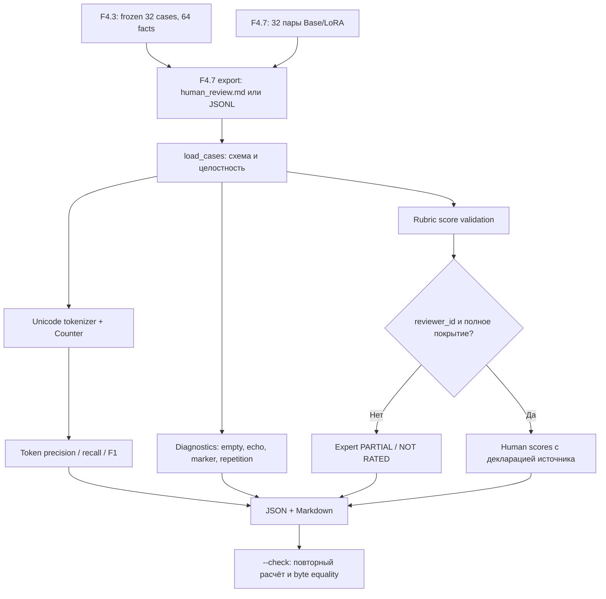

# F5.2 — LLM Evaluation & Diagnostics

## 1. Цель этапа

**Задача:** оценить сохранённые ответы Qwen Base и Qwen LoRA на одном наборе контрольных вопросов F4.3/F4.7, получить воспроизводимые автоматические *proxy-метрики*, обнаружить технические признаки некачественной генерации и отобразить покрытие экспертной рубрики. **Не** переобучать модель, не генерировать новые ответы и не приписывать текстовому сходству статус фактической правильности.

Входы: сохранённые ответы Base/LoRA, тексты эталонов, идентификаторы заданий, два критерия для каждого задания; при наличии — заполненные человеком оценки отдельных фактов. F4.3 зафиксировал 32 задания с 64 критериями, F4.7 сформировал пары Base/LoRA. F5.1 уже предоставляет отдельную отчётность по метрикам фаз; F5.2 дополняет её диагностикой ответов, не изменяя F5.1.

Выходы: `reports/public/f5_02/F5_02_llm_diagnostics.json` и `docs/reports/F5_02_LLM_DIAGNOSTICS.md`. Генератор не переносит в них исходные промпты, эталоны и тексты генераций. В отчёт входят агрегаты, допустимые `case_id`, сигналы диагностики и происхождение файла через SHA-256.

Ограничения: CPU-first, Python 3.13+, только стандартная библиотека в runtime; `pytest` нужен для тестов. Модель и токенизатор Transformers не загружаются. Локальные файлы F4.7 **не включаются в ZIP**; их фактическое расположение определяется конфигурацией/`--input`.

## 2. Что реализовано

Все новые файлы этапа (предыдущие фазы и `README.md` не изменяются):

| Файл | Назначение | Основные интерфейсы |
|---|---|---|
| `configs/f5_02_llm_diagnostics.json` | Контракт 32×2, допустимые источники, threshold, назначение отчётов | `input_candidates`, `expected_cases`, `outputs` |
| `src/evaluation_f5/llm_diagnostics.py` | Парсинг F4.7, строгая валидация, token overlap, сигналы, учёт экспертных баллов, отчёты | `load_cases`, `tokenize`, `overlap`, `evaluate`, `run` |
| `scripts/f5_llm_diagnostics.py` | PowerShell-совместимый CLI без обращения к сети и модели | `main`, `--input`, `--check`, `--require-expert` |
| `tests/test_f5_llm_diagnostics.py` | Контрактные unit/integration тесты на **искусственных** примерах, проверка отрицательных сценариев | `test_source_build_and_check`, `test_human_review_complete`, `test_proxies_never_count_as_expert` и др. |
| `docs/steps/F5_02_llm_diagnostics.md` | Учебно-техническое описание метода, интерфейса, проверки, ограничений | Девять обязательных разделов |

Никакие исходники, тесты, отчёты F1–F4 и файлы F5.1 не переписываются. Наличие `src/evaluation_f5/__init__.py`, поставленного в F5.1, является зависимостью пакета.

## 3. Последовательность реализации

### Шаг 1. Зафиксировать источник и область анализа

- **Действие:** указать путь к сохранённому F4.7 через `input_candidates` или `--input`.
- **Назначение:** исключить повторную генерацию ответов и смешивание разных runs.
- **Реализация:** `load_config()`, `_choose_input()`, `_path()` проверяют конфигурацию, существование, относительность и безопасность путей. При обнаружении нескольких допустимых входов без явного выбора выполняется отказ, а не автоматический выбор «самого свежего».
- **Результат:** точный относительный путь, `SHA-256` прочитанных байтов и формат источника, включённые в отчёт. При отсутствии источника — `FAIL`, без синтетической подмены.

### Шаг 2. Загрузить и нормализовать 32 пары ответов

- **Действие:** прочитать JSON/JSONL или Markdown-экспорт `human_review.md` из F4.7.
- **Назначение:** преобразовать разные разрешённые формы входа к общим полям.
- **Реализация:** `load_cases()` формирует объекты `Case(case_id, domain, question, reference, base, lora, fact_ids, raw_scores, reviewer)`. Для JSONL используются алиасы имен полей, перечисленные в `_normalize()`; для Markdown — явные секции `Вопрос`, `Данные`, `Эталон`, `Факты для проверки`, `Base`, `LoRA` и строки ``- `fact_id`: описание``.
- **Результат:** ровно 32 уникальных `case_id`, у каждого два различных идентификатора факта. Некорректная схема, двойные идентификаторы и неполный набор блокируют отчёт.

### Шаг 3. Вычислить token overlap независимо для Base и LoRA

- **Действие:** токенизировать каждый `reference`, `base`, `lora`; рассчитать precision, recall, F1, exact_match и длины токенизированных последовательностей.
- **Назначение:** получить воспроизводимую количественную характеристику **лексического совпадения** с эталоном без дополнительных inference-вызовов.
- **Реализация:** `tokenize()` применяет Unicode `casefold()` и регулярное выражение `\w+|[^\w\s]`; `overlap()` пересекает мультимножества токенов через `Counter`. Одинаковые токены учитываются с кратностями. Фиксированное значение при пустом знаменателе — 0.
- **Результат:** покейсные proxy-значения и отдельные средние F1 для каждой модели, без общей «оценки правильности».

### Шаг 4. Выделить диагностические признаки

- **Действие:** проверить пустой ответ, низкий token overlap, фрагменты меток шаблона, частичное эхо промпта и повторяющиеся четырёхграммы.
- **Назначение:** направить последующую ручную проверку на подозрительные случаи.
- **Реализация:** `_flags()` формирует `empty_response`, `low_reference_overlap`, `prompt_template_marker`, `possible_prompt_echo`, `repeated_fourgram`; порог низкого overlap по F1 = `0.25` и зафиксирован в конфигурации. `_repetition()` считает четырёхграммы и срабатывает при повторе одной четырёхграммы от 3 раз.
- **Результат:** флаги по `case_id` и агрегаты по Base/LoRA. Признаки **не означают** доказанную галлюцинацию или фактическую ошибку.

### Шаг 5. Разделить rubric coverage и реальную экспертную оценку

- **Действие:** сверить 64 идентификатора критериев и принять только явно введённые баллы `0`, `1`, `2` или `null`.
- **Назначение:** не заменять экспертный факт-чек автоматически вычисленным token F1.
- **Реализация:** `_fact_scores()` контролирует диапазон и соответствие ключей рубрики; `evaluate()` учитывает баллы **только при наличии непустого `reviewer_id`** в записи. Для всех остальных записей экспертные оценки выводятся как `null`/`NOT RATED`. Даже при наличии reviewer_id происхождение носит декларативный характер: квалификация и качество проверки автоматически не удостоверяются.
- **Результат:** `base_criteria_scored`, `lora_criteria_scored`, средние по фактически оценённым критериям, число полностью оценённых задач, число проигнорированных баллов без атрибуции.

### Шаг 6. Сопоставить Base и LoRA, не смешивая задачи

- **Действие:** сравнить ответы как строки (`answers_changed`) и сопоставить proxy-метрики на **одних и тех же** заданиях.
- **Назначение:** отделить факт изменения генерации от изменения её фактического качества.
- **Реализация:** `evaluate()` считает число изменившихся/неизменившихся пар и разницу средних token F1 (LoRA − Base); тесты проверяют независимость от экспертных баллов.
- **Результат:** `changed_pairs`, `unchanged_pairs`, `delta_token_f1_lora_minus_base`. Исторический ориентир F4.7 — 12/32 изменившихся ответов, **но** отчёт вычисляет число из текущих входов, без жёсткой подстановки 12.

### Шаг 7. Сформировать отчёты и проверить воспроизводимость

- **Действие:** сформировать два артефакта и сопоставить результат повторного запуска.
- **Назначение:** обеспечить проверяемую отчётность и не допустить тихой публикации другого прогона.
- **Реализация:** `run()` выполняет парсинг, расчёты и запись UTF-8/LF без случайных значений и временных меток; `--check` пересчитывает ожидаемый контент и сопоставляет байты с файлами. Выходы ограничены подкаталогами `reports/public/f5_02/` и `docs/reports/F5_02_*`.
- **Результат:** JSON+Markdown, возможность детектировать изменение источника или порчу отчёта без записи.

## 4. Алгоритм и математический пример

Пусть `R` — мультимножество токенов эталона, `A` — мультимножество токенов ответа. Число совпадающих токенов с кратностями:

\[
M=\sum_{t\in V}\min\left(\operatorname{count}_R(t),\operatorname{count}_A(t)\right).
\]

Precision и Recall на уровне токенов:

\[
P=\frac{M}{|A|},\qquad R_{tok}=\frac{M}{|R|}.
\]

Гармоническое среднее:

\[
F1_{tok}=\frac{2PR_{tok}}{P+R_{tok}}.
\]

**Учебный пример:** reference `a a b`; candidate `a b b`. При одинаковых длинах 3 токена пересечение с кратностями включает один `a` и один `b`: `M=2`; `P=2/3`, `R_tok=2/3`, `F1_tok=2/3 ≈ 0.6667`. `exact_match=false`. Это **не** результат Qwen; его воспроизводит `test_multiset_overlap_and_exact()`.

Для `N=32` заданий макро-агрегат отдельной модели:

\[
\overline{F1}_{tok}=\frac{1}{N}\sum_{i=1}^{N} F1_{tok,i},\quad
\Delta=\overline{F1}_{tok,LoRA}-\overline{F1}_{tok,Base}.
\]

Одинаковая `token F1` возможна у фактически неправильного и правильного ответов; перефразирование правильного ответа может уменьшить overlap. В алгоритме отсутствует LLM-as-a-judge. Рубрика с двумя фактами на задание — **объект для выставления оценки человеком**, а не способ вывести correctness из лексики.

Шкала ручной оценки факта при наличии review: `0` — неверно, `1` — частично, `2` — полностью; `null` — оценка не внесена. Среднее рассчитывается **только по фактически выставленным** значениям, поэтому неполное покрытие нельзя интерпретировать как общий успех модели. Чтобы экспертная часть имела `PASS`, для Base и LoRA должны быть оценены оба факта всех 32 задач и иметь `reviewer_id`.

## 5. Схема работы



**Граница ответственности:** F4.3 отвечает за фиксированные критерии, F4.7 — за сохранённые тексты двух моделей, F5.2 — за чтение, лексические proxy, технические сигналы и прозрачный учёт выставленных человеком оценок. Файлы F5.1/F4 не редактируются.

## 6. Локальная проверка PowerShell

Все команды выполняются из корня `F:\DEVELOPMENT\ML\ml-engineering-lab` после распаковки ZIP. В стандартном запуске **не нужны** Transformers, PEFT, GPU и доступ в интернет.

```powershell
cd F:\DEVELOPMENT\ML\ml-engineering-lab

# Проверить контракт F5.2 без загрузки модели:
.\.venv\Scripts\python.exe -m pytest tests/test_f5_llm_diagnostics.py -q

# Доступная регрессия F5.1:
.\.venv\Scripts\python.exe -m pytest tests/test_f5_unified_report.py -q

# Генератор выбирает ровно один существующий F4.7 источник из config:
.\.venv\Scripts\python.exe -m scripts.f5_llm_diagnostics

# Проверить идентичность отчётов текущим исходным данным:
.\.venv\Scripts\python.exe -m scripts.f5_llm_diagnostics --check
```

Если вход лежит в другом месте, указать его **относительный путь** через `--input`. Дополнительно поддерживается поиск `human_review.*` в вложенных подкаталогах F4.7 внутри `data/processed`, `reports/public`, `outputs` и `artifacts`; если найдено несколько кандидатов, требуется `--input`. Пример для одного из путей конфигурации:

```powershell
.\.venv\Scripts\python.exe -m scripts.f5_llm_diagnostics --input data/processed/f4_07/cpu/human_review.md
```

Для просмотра фактического расположения файлов F4.7 без изменения данных:

```powershell
Get-ChildItem -Path data, reports -Recurse -File -ErrorAction SilentlyContinue |
  Where-Object { $_.Name -match 'human_review|f4_07' } |
  Select-Object -ExpandProperty FullName
```

**Ожидаемый успешный build:** `F5.2 PARTIAL: 32 cases, 64 criteria, ...; expert complete 0/32; mode=build` при отсутствии заполненной экспертной оценки. `PARTIAL` в данном случае не свидетельствует о падении программы; означает границу доказательств. После заполнения и атрибуции всех оценок ожидается `F5.2 PASS`. `--check` без расхождений возвращает код 0. Отсутствующий источник, нарушение схемы, дубликат или устаревший отчёт возвращают код 2.

Статус тестов для данной поставки: **64 passed** при локальном запуске F5.1+F5.2 на синтетических fixture/временных каталогах, Python 3.13.5; это не запуск реальной модели Qwen и не проверка путей на пользовательском Windows checkout.

## 7. Что доказано тестами и какие ограничения остаются

**Подтверждено локальными тестами:**

- Корректный multiset token overlap, Unicode/casefold и защита от деления на ноль.
- Строгая проверка идентификаторов, числа задач, количества критериев и схемы ручных баллов.
- Парсинг JSON, JSONL и Markdown на **синтетических** тестовых экспортах с аналогичным контрактом.
- Детерминированная сборка и `--check`, обнаружение изменённого файла через SHA и побайтовое сравнение.
- Отсутствие исходных промптов/ответов в публикуемых JSON/MD.
- Неучёт баллов без `reviewer_id`, сохранение `null` для отсутствующих оценок, запрет объявления экспертного PASS при неполном покрытии.
- Изоляция unit-тестов от реальных весов LLM и сети.

**Не подтверждено:**

- Числовые token F1 на полном реальном F4.7 до запуска локального генератора с твоим текущим экспортом.
- Корректность **содержания** ответов, наличие/отсутствие hallucinations и качество обучения LoRA.
- Квалификация эксперта, достоверность вводимых вручную оценок и обобщаемость на внешние датасеты.
- Актуальная полная Windows-регрессия F1–F5 и идентичность конкретного локального source checkout.

**Ограничения данных/оборудования:** frozen F4.3 содержит 32 учебных задания и 64 критерия, размер мал; модель Qwen для F5.2 не требуется. Отчёт по одному набору не является доказательством production quality.

**Следующая проверка:** локально выполнить build/check на действительном F4.7 и сверить число изменившихся ответов с исходным F4.7 (ориентир 12/32). При необходимости выполнить независимую ручную разметку всех критериев и воспроизвести отчёт без изменения исходных генераций.

## 8. Основная мысль этапа

Сохранённые ответы Base и LoRA необходимо оценивать по неизменному набору заданий. Загрузить фактический F4.7 export, проверить полноту 32 пар и список 64 критериев, привязать расчёты к SHA-256 конкретного входа. Нельзя объединять результаты разных runs при выборе отсутствующих источников.

Token overlap измеряет точность и полноту совпадения *токенов*, а не правильность ответа. Сначала подсчитать мультимножественное пересечение, затем precision, recall и F1 для каждой модели отдельно. После этого выделить эвристические флаги — эхо промпта, технические метки и повторяющиеся фрагменты — для ручной диагностики.

Оценку выполнения критериев переносить только из явно заполненной человеком рубрики с атрибуцией reviewer_id; остальные баллы сохранять как отсутствующие. Сопоставление Base/LoRA должно хранить как число отличающихся ответов, так и значение proxy-дельты с ограничениями интерпретации. Сгенерированный отчёт необходимо воспроизводимо проверять командой `--check`; отсутствие данных не заменяется фиктивной метрикой.

## 9. Файлы, с которыми стоит познакомиться

| Порядок | Реальный путь / источник | Что изучить |
|---:|---|---|
| 1 | `configs/f5_02_llm_diagnostics.json` | Договорённость о 32×2, критерии выбора источника, порог, output-пути. |
| 2 | `src/evaluation_f5/llm_diagnostics.py` | `Case`, `_parse_md`, `_normalize`, `load_cases` — перевод сохранённого F4.7 в единую структуру. |
| 3 | `src/evaluation_f5/llm_diagnostics.py` | `tokenize`, `overlap`, `_flags`, `_repetition` — точные механизмы proxy и флагов. |
| 4 | `src/evaluation_f5/llm_diagnostics.py` | `_fact_scores`, `evaluate` — принципиальное отделение экспертной шкалы от лексического сходства. |
| 5 | `scripts/f5_llm_diagnostics.py` | `main`, ключи CLI, коды выхода, разделение build/check. |
| 6 | `tests/test_f5_llm_diagnostics.py` | Числовые примеры, отрицательные тесты, контроль отчёта, тест отсутствующих оценок. |
| 7 | `src/evaluation_f5/unified_report.py` | F5.1: разделение метрик по фазам, статус `PARTIAL`, SHA-256, проверка `--check`. |
| 8 | `configs/f5_01_unified_evaluation.json` | F5.1: почему нельзя усреднить classification, retrieval и LLM loss в единый показатель. |
| 9 | Экспорт `human_review.md` или `human_review.jsonl` из F4.7 (фактический путь указывается в `--input`) | Разметка F4.3, две генерации и два факта на случай; в ZIP не включается. |

**Для публикации:** коммитить только пять файлов F5.2. Сформированные отчёты F5.2 не добавлять в Git без отдельной проверки фактического входа и отсутствия спорных данных. `README.md` остаётся под ручным контролем владельца репозитория.
