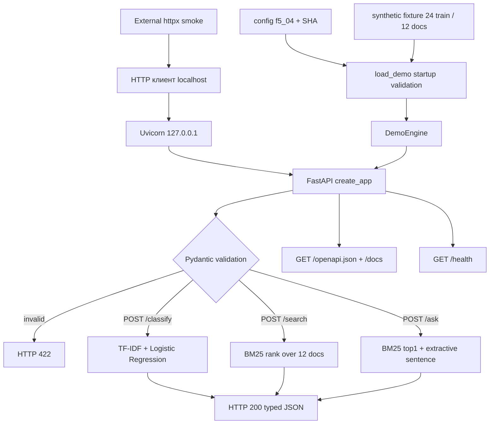

# F5.4 — FastAPI: типизированный HTTP-интерфейс над контролируемыми ML-данными

## 1. Цель этапа

**Инженерная задача:** преобразовать вычислительные компоненты ML Engineering Lab в вызываемый по HTTP интерфейс с формализованными входами, выходами, ошибками и проверяемой схемой OpenAPI. Реализовать маршруты `POST /classify`, `POST /search`, `POST /ask` и вспомогательный `GET /health`, запускать сервер локально и проверять **настоящие HTTP-запросы к Uvicorn по TCP**, а не только прямые вызовы Python-функций.

**Связь с предыдущими этапами:**

- F1.7 — алгоритмический образец TF-IDF + Logistic Regression для текстовой классификации.
- F3.3 — BM25; F3.8 — RAG с проверяемым происхождением цитат и extractive fallback.
- F5.1–F5.3 — инженерное разграничение задач, доказательств и автоматических проверок.

**Ограничение интеграции:** F5.4 не объявляет неподтверждённое подключение обученной модели F1, frozen F3.6/3.7, F3.8 RAG или Qwen F4. Вместо этого используется **отдельный, честно обозначенный `synthetic_demo` backend**: 24 искусственных обучающих примера, 12 собственных синтетических документов, TF-IDF + Logistic Regression, формула BM25 и дословный ответ из найденного источника. Алгоритмы выполняются реально, но качество модели F1 и retrieval-метрики F3 **не измеряются и не переносятся** в этот API.

**Вход:** `configs/f5_04_api.json`, `tests/fixtures/f5_04_api_demo_v1.json` с зафиксированным SHA-256, HTTP JSON-запросы. **Выход:** HTTP-ответы, автоматически сгенерированная OpenAPI-схема, результат API/HTTP-тестирования без создания непредусмотренных файлов в репозитории.

**Критерий завершения:** маршруты реально отвечают на допустимый JSON; некорректный ввод возвращает HTTP 422; OpenAPI описывает три `POST`; `GET /health` раскрывает режим и версию fixtures; независимый процесс Uvicorn обслуживает HTTP smoke. Это **не** критерий production readiness и не доказательство работоспособности реальных F1–F4 checkpoints.

## 2. Что реализовано

| Файл | Назначение | Ключевые функции / связи |
|---|---|---|
| `configs/f5_04_api.json` | Неизменяемый режим `synthetic_demo`, пути, checksum, параметры BM25, ограничения | `fixture_sha256`, `bm25_k1=1.5`, `bm25_b=0.75`, `max_top_k=5` |
| `tests/fixtures/f5_04_api_demo_v1.json` | Разрешённые искусственные данные | 24 `training_examples` и 12 `documents`; четыре метки `linux/ml/python/sql`, `synthetic://` source IDs |
| `src/api_f5/__init__.py` | Публичный экспорт фабрики приложения | `create_app` |
| `src/api_f5/demo_service.py` | Валидация данных, классификация, BM25, извлечение цитаты | `load_demo()`, `DemoEngine.classify()`, `search()`, `ask()`, `tokens()` |
| `src/api_f5/app.py` | REST API, Pydantic схемы, OpenAPI | `create_app()`, модели request/response, `/health`, `/classify`, `/search`, `/ask` |
| `scripts/f5_api.py` | CLI сервера и проверок реального HTTP | `main()`, `run_http_smoke()`, команды `serve`, `smoke` |
| `tests/test_f5_api.py` | Unit, negative, ASGI и реальный TCP HTTP | `TestClient`, `subprocess.Popen`, 8 HTTP smoke assertions, negative input tests |
| `requirements-f5_04.txt` | Изолированный перечень зависимостей HTTP-этапа | `fastapi`, `uvicorn`, `httpx`, `scikit-learn`, `pytest`; не меняет общий lock |
| `docs/steps/F5_04_fastapi.md` | Девятираздельный учебно-технический документ | Код, алгоритмы, схема, точные PowerShell-команды, результаты и пределы проверки |

**Не изменяются:** `README.md`, исходники, сохранённые экспериментальные результаты и конфигурации F1–F4/F5.1–F5.3. Не создаются `.cmd`, `.ps1`, Docker или model checkpoints. F5.5 отдельно займётся Docker.

## 3. Последовательность реализации

### Шаг 1. Зафиксировать автономный HTTP-demo corpus

- **Действие:** создать неизменяемую JSON fixture из текстов по четырём техническим темам.
- **Назначение:** выполнить настоящие операции классификации и retrieval локально, без доступа к реальным Q&A из F1 и без загрузки модели из сети.
- **Реализация:** `tests/fixtures/f5_04_api_demo_v1.json`: 24 коротких обучающих текста, по 6 на метку; 12 документов, по 3 на метку. У каждого документа есть уникальный `doc_id`, локальный учебный `source_id` и `text`. Конфигурация `configs/f5_04_api.json` содержит SHA-256 **фактических байтов** fixture.
- **Результат:** загрузка однозначно задаёт 4 метки, 24 обучающих записи и 12 документов. Замена текста без обновления протокола вызывает ошибку и препятствует запуску приложения.

### Шаг 2. Валидировать данные до создания сервера

- **Действие:** проверить схему, контрольную сумму, допустимые пути и размеры до регистрации маршрутов.
- **Назначение:** не обслуживать HTTP при ошибочном или неожиданном наборе данных; не получать произвольные системные пути из внешнего запроса.
- **Реализация:** `load_demo(root)` читает жёстко заданную конфигурацию, проверяет `schema_version`, единственный допустимый `fixture_path`, `fixture_sha256`, количество данных, допустимые labels, неповторяющиеся `doc_id`/`source_id`. `_no_duplicate_keys()` блокирует повторённые JSON-ключи; `_invalid_constant()` отвергает `NaN/Infinity`; `.resolve().is_relative_to()` не допускает выхода из корня через symlink. Файлы ограничены размером.
- **Результат:** неверные checksum, поля, идентификаторы и изменённые параметры вызывают `APIFixtureError` на startup. HTTP-маршруты не принимают пользовательские файловые пути.

### Шаг 3. Построить лёгкий классификатор

- **Действие:** обучить учебную классификационную модель на фиксированных текстах в памяти.
- **Назначение:** продемонстрировать **реальный** ML-инференс по HTTP, не выдавая искусственную модель за F1 checkpoint.
- **Реализация:** `DemoEngine.__init__()` создаёт `TfidfVectorizer(ngram_range=(1,2), token_pattern=..., lowercase=True)` и `LogisticRegression(max_iter=300, random_state=42, solver="lbfgs")`, выполняет `fit()` на 24 synthetic-примерах. `classify(text)` вычисляет `transform()`, затем `predict_proba()`. Ответ содержит метку, максимальную оценку вероятности, `status`, `backend="demo_tfidf_logreg"` и `fixture_id`. При `nnz=0` возвращается `status="no_features"`, а не необоснованный класс.
- **Результат:** контролируемый пример `Python enumerate start индекс` классифицируется как `python`; число `score` является **неоткалиброванной** модельной оценкой, не показателем качества.

### Шаг 4. Реализовать полнотекстовый поиск BM25

- **Действие:** вычислять рейтинг документов по лексическим совпадениям запроса.
- **Назначение:** иметь воспроизводимый backend для `/search`, независимый от доступности F3 pretrained embeddings.
- **Реализация:** `tokens()` приводит слова к нижнему регистру и выделяет Unicode-последовательности `\w+`. `DemoEngine` один раз вычисляет `Counter` термов, длину каждого документа, `df(t)` и среднюю длину. `search(query, top_k)` применяет BM25 с `k1=1.5`, `b=0.75`; документы с `score=0` исключаются; сортировка `(-score, doc_id)` делает разрешение равенства детерминированным. В HTTP ответ передаются `doc_id`, `source_id`, `label`, `score`, `text` из разрешённой fixture.
- **Результат:** запрос `SQL HAVING GROUP BY` возвращает `sql_02` первым. При отсутствии знакомых терминов `/search` возвращает `hits=[]`, а не фиктивную релевантность.

### Шаг 5. Построить extractive `/ask` с provenance

- **Действие:** вернуть короткий дословный фрагмент найденного документа или признак отсутствия фактического основания.
- **Назначение:** показать, как API может сохранять связь ответа с источником, не обещая фактическую правильность генеративной LLM.
- **Реализация:** `DemoEngine.ask(question)` вызывает `search(question, 1)`; при наличии hit выделяет предложения регулярным выражением, выбирает предложение с максимальным количеством совпадающих термов и возвращает его **без пересказа**. `evidence` содержит `doc_id`, `source_id`, символьные индексы `[start:end]`, точную цитату `quote` и SHA-256 полного текста. При отсутствии hit — `mode="no_evidence"`, `answer=null`, `evidence=[]`. Ответ никогда не создаётся моделью Qwen.
- **Результат:** условие `document_text[start:end] == quote == answer` проверяется тестом; запрос с неизвестным словом возвращает `no_evidence`.

### Шаг 6. Определить REST-контракт FastAPI

- **Действие:** создать приложение с типизированными схемами запросов и ответов.
- **Назначение:** предоставить проверяемый интерфейс, независимый от внутренних Python-классов.
- **Реализация:** `create_app()` загружает fixture и создаёт один `DemoEngine` до обслуживания запросов. Pydantic `StringConstraints` удаляет окружающие пробелы и требует длину 1–500 символов. `ConfigDict(extra="forbid")` запрещает неизвестные поля. `SearchRequest.top_k` — строгое целое от 1 до 5; булевы значения и числовые строки отклоняются. Ответы используют собственные `response_model`. FastAPI автоматически генерирует `GET /openapi.json`, Swagger UI — `GET /docs`.
- **Результат:** допустимый JSON → HTTP 200 и корректная схема; пустые поля, лишние поля, неправильные типы и ограничения → HTTP 422; неизвестные маршруты → 404; неправильный HTTP-метод → 405.

### Шаг 7. Подключить локальный сервер и независимый HTTP smoke

- **Действие:** разнести запуск Uvicorn и внешнюю проверку по TCP.
- **Назначение:** подтвердить полный путь HTTP-клиент → локальный socket → Uvicorn → FastAPI → backend → JSON-ответ.
- **Реализация:** `python -m scripts.f5_api serve --host 127.0.0.1 --port 8000` поднимает Uvicorn только на loopback. `python -m scripts.f5_api smoke --url http://127.0.0.1:8000` через `httpx.Client` выполняет восемь HTTP-проверок: `/health`, OpenAPI, `/classify`, `/search`, `/ask`, отсутствие evidence, ошибочный ввод 422 и неизвестный маршрут 404. Клиент проверки запрещает обращения на внешние узлы. Успех печатается только по результату фактических HTTP-ответов.
- **Результат:** локальный `smoke` возвращает нулевой exit code и `F5.4 HTTP PASS: 8/8 ...`. При незапущенном сервере, неправильном маршруте или схеме — ненулевой код.

### Шаг 8. Проверить регрессию, ошибки и чистоту поставки

- **Действие:** выполнить независимые unit-тесты API, негативные сценарии и тест настоящего TCP-сервера вместе с предыдущими F5-модулями.
- **Назначение:** отделить успешную регистрацию маршрута от реально работающего вычисления; не нарушать функции и отчёты F5.1–F5.3.
- **Реализация:** `tests/test_f5_api.py`: `TestClient` для HTTP-валидации, сверка BM25 с отдельной числовой формулой, проверка SHA и текстовых диапазонов, детерминизм, порча fixture, ошибки командной строки, запросы из нескольких потоков. `test_real_tcp_http_smoke()` запускает **отдельный процесс** Uvicorn на свободном локальном порту, проверяет readiness через socket и вызывает 8 HTTP-проверок.
- **Результат:** новый этап — **50 passed**, общая регрессия F5.1–F5.4 — **176 passed** в изолированном каталоге Python 3.13.5. Результат на локальной Windows с Python 3.13.2 и CI требует самостоятельной проверки.

## 4. Алгоритм и математический пример

### 4.1. TF-IDF и Logistic Regression (`/classify`)

Для обучающих текстов `N=24` и терма `t` scikit-learn использует сглаженный IDF:

\[
\operatorname{idf}(t)=\ln\left(\frac{N+1}{\operatorname{df}(t)+1}\right)+1.
\]

Умножить частоту терма на `idf(t)` и нормализовать вектор документа по L2. `ngram_range=(1,2)` добавляет униграммы и биграммы; словарь формируется **только** по 24 synthetic-примерам. Для класса `c` многоклассовая логистическая регрессия вычисляет:

\[
P(y=c\mid x)=\frac{\exp(w_c^\top x+b_c)}{\sum_j\exp(w_j^\top x+b_j)}.
\]

Числовой **учебный** пример для понимания softmax: логиты двух классов `[0, ln(3)]` дают вероятности `[0.25, 0.75]`. Это не реальные веса модели F5.4, а иллюстрация формулы. В фактическом запросе `Python enumerate start индекс` возвращается `python`, а `score` формируется реальным `predict_proba()`. Полученная оценка не является вероятностью корректности ответа или доказательством качества на независимом test.

### 4.2. BM25 (`/search`)

Для терма `t` и документа `d`, где `tf(t,d)` — частота, `df(t)` — число документов с термом, `N=12`, `|d|` — длина документа в токенах, `avgdl` — средняя длина, используется:

\[
\operatorname{idf}(t)=\ln\left(1+\frac{N-\operatorname{df}(t)+0.5}{\operatorname{df}(t)+0.5}\right),
\]

\[
\operatorname{BM25}(q,d)=\sum_{t\in\operatorname{unique}(q)}\operatorname{idf}(t)\cdot
\frac{\operatorname{tf}(t,d)(k_1+1)}{\operatorname{tf}(t,d)+k_1(1-b+b|d|/\operatorname{avgdl})}.
\]

Фактический маленький пример из frozen fixture: `q="pwd"`, документ `linux_01`, `N=12`, `df(pwd)=1`, `tf=1`, длина документа `12`, средняя длина `15.9167`, `k1=1.5`, `b=0.75`. Подстановка даёт BM25 **≈ 2.42838676**. Тест `test_bm25_algorithm_idf_tf_and_normalization` пересчитывает эту величину отдельно и сравнивает с `DemoEngine.search()` с допуском `1e-12`.

Это BM25 для маленького синтетического корпуса, **не** измеренное значение Recall@K F3.7. Никаких dense embeddings, RRF или frozen qrels здесь не используется.

### 4.3. Доказательная цитата (`/ask`)

Пусть `T` — исходный текст документа, `s` и `e` — индексы Unicode-символов в Python-строке. Тогда контракт:

\[
\mathrm{quote}=T[s:e],\qquad \mathrm{answer}=\mathrm{quote}.
\]

Индекс `e` **не включается**; диапазоны измеряются в Unicode code points Python, **не** в UTF-8 байтах. Контрольная сумма `text_sha256` считается по `T.encode("utf-8")` целиком, чтобы связать цитату с определённым содержимым источника. `source_id=synthetic://...` отличает лабораторный источник от настоящего документа. Значение `no_evidence` означает отсутствие **лексического** hit, а не универсально доказанное отсутствие ответа.

## 5. Схема работы



Схема отражает **текущую** реализацию. Роутер не загружает настоящую F1-модель, F3 pretrained encoder, F4 LoRA или DPO. OpenAPI — описание маршрутов, не сертификат безопасности. Бэкенд при запуске не выполняет сетевой поиск и не загружает веса.

## 6. Локальная проверка PowerShell

Все команды выполняются из корня `F:\DEVELOPMENT\ML\ml-engineering-lab` в PowerShell.

### Проверка окружения и распаковка

```powershell
cd F:\DEVELOPMENT\ML\ml-engineering-lab

git status --short
Expand-Archive -LiteralPath "$HOME\Downloads\ML_Engineering_Lab_F5_04_FastAPI.zip" -DestinationPath . -Force

# Установить отсутствующие зависимости только в текущий venv.
.\.venv\Scripts\python.exe -m pip install -r requirements-f5_04.txt
```

### Тесты текущего этапа и регрессия

```powershell
# Unit, OpenAPI, Pydantic negative, BM25 math, provenance и реальный TCP.
.\.venv\Scripts\python.exe -m pytest tests/test_f5_api.py -q

# Регрессия четырёх принятых этапов F5.
.\.venv\Scripts\python.exe -m pytest `
  tests/test_f5_unified_report.py `
  tests/test_f5_llm_diagnostics.py `
  tests/test_f5_safety_benchmark.py `
  tests/test_f5_api.py -q
```

Ожидаемый ориентир исходной поставки: **50 passed** и **176 passed** соответственно, если окружение и прежние файлы соответствуют зафиксированным ZIP. Это **ожидание**, а не обещание результата на другой машине.

### Настоящий HTTP: два окна PowerShell

**Окно № 1 — сервер:**

```powershell
cd F:\DEVELOPMENT\ML\ml-engineering-lab
.\.venv\Scripts\python.exe -m scripts.f5_api serve --host 127.0.0.1 --port 8000
```

**Окно № 2 — независимый HTTP smoke:**

```powershell
cd F:\DEVELOPMENT\ML\ml-engineering-lab
.\.venv\Scripts\python.exe -m scripts.f5_api smoke --url http://127.0.0.1:8000
```

Ожидаемый вывод при фактическом успехе:

```text
F5.4 HTTP PASS: 8/8 checks; backend=synthetic_demo; real TCP HTTP; LLM=NOT EXECUTED
```

Открыть Swagger UI: `http://127.0.0.1:8000/docs`; raw OpenAPI: `http://127.0.0.1:8000/openapi.json`.

Проверить типизированный JSON напрямую:

```powershell
$body = @{ query = 'SQL HAVING GROUP BY'; top_k = 2 } | ConvertTo-Json
Invoke-RestMethod -Uri 'http://127.0.0.1:8000/search' -Method Post -ContentType 'application/json' -Body $body

$body = @{ question = 'Python range правая граница' } | ConvertTo-Json
Invoke-RestMethod -Uri 'http://127.0.0.1:8000/ask' -Method Post -ContentType 'application/json' -Body $body
```

Для завершения сервера в первом окне нажать `Ctrl+C`. Никакие файлы отчётов автоматически не создаются, поэтому дополнительные `Untracked files` от запуска не ожидаются (кроме возможных игнорируемых Python caches).

### Публикация после локального PASS

```powershell
git diff --check
git status --short

git add -- `
  configs/f5_04_api.json `
  tests/fixtures/f5_04_api_demo_v1.json `
  src/api_f5/__init__.py `
  src/api_f5/demo_service.py `
  src/api_f5/app.py `
  scripts/f5_api.py `
  tests/test_f5_api.py `
  requirements-f5_04.txt `
  docs/steps/F5_04_fastapi.md

git diff --cached --check
git diff --cached --stat
git diff --cached

git commit -m "feat(f5.4): add local FastAPI inference demo and HTTP smoke"
git fetch origin
git rebase origin/main
git push origin main
git status --short
```

При `rebase` конфликте — прекратить автоматическое выполнение, изучить `git status`. Команды не выполняют `git add .`, не добавляют `README.md` и не используют `--force`.

## 7. Что доказано тестами и какие ограничения остаются

**Подтверждено локально при подготовке поставки:**

- Изменения F5.4 не затрагивают уже существующие F5.1–F5.3. Отдельное объединённое тестирование предыдущих ZIP и новых файлов: **176 passed, 0 failed**.
- В F5.4: **50 passed, 0 failed**, в том числе негативная HTTP-валидация, проверки реальной работы sklearn и BM25, воспроизводимости, защиты checksum и отсутствия произвольных путей.
- `test_real_tcp_http_smoke()` поднимает отдельный Uvicorn и проверяет **8 настоящих HTTP-запросов** через `httpx`, включая код ошибки 422.
- Ответ `/ask` является дословной частью исходной synthetic fixture; его provenance (`source_id`, `[start:end]`, SHA-256) проверяется программно.
- API не скачивает LLM, не сохраняет model checkpoints, не выполняет train/F1-F4 scripts и не зависит от GPU.

**Не подтверждено:**

- Инференс настоящего F1 classifier; применение готового BM25/F3.6 индексного результата и RAGPipeline F3.8; генерация Qwen/F4.
- Качество/калибровка классификации, Recall@K на независимом retrieval benchmark, correctness фактов в произвольных ответах.
- Защита от сетевых атак, production auth, лимиты запросов, TLS, аудит, нагрузочное тестирование, конкурентная устойчивость под реальным трафиком, container deployment.
- Запуск на пользовательской Windows Python 3.13.2 и GitHub Actions до получения соответствующих логов.

**Ограничения среды и данных:**

- 24 искусственных обучающих примера и 12 искусственных документов — демонстрация HTTP/алгоритмов, **не обучающая или тестовая репрезентативная выборка**.
- `score` Logistic Regression является некалиброванной оценкой класса. `search` — только словарные совпадения; `ask` — extraction одного предложения. Отсутствие результатов не доказывает отсутствие релевантных сведений.
- Порт открыт **только на loopback**, поскольку отсутствуют production-механизмы аутентификации и контроля ресурсов. Не публиковать его в Интернет.
- `requirements-f5_04.txt` использует диапазоны совместимости, не является полным lockfile окружения и не фиксирует бинарные сборки.

**Следующая проверка:** выполнить указанный HTTP smoke на Windows и убедиться в отсутствии `FAIL`/422 для корректных запросов. После отдельного PASS можно переходить к F5.5 (Docker), где потребуется реальный `docker build` + `docker run` + HTTP проверка контейнера.

## 8. Основная мысль этапа

HTTP-обвязка решает другую задачу, чем обучение и оценка качества модели. Для исполняемой ML-системы требуется определить контракт запроса, проверить вход, применить вычисление, нормализовать выход и проверить всю цепочку реальным HTTP-запросом. FastAPI и Pydantic задают входные/выходные схемы, HTTP-коды и OpenAPI; вычислительная логика остаётся в отдельном модуле `demo_service.py`.

Демонстрационная классификация использует TF-IDF и Logistic Regression, поиск вычисляет BM25, а ответ содержит только буквальную цитату с координатами и SHA исходного текста. Такой путь позволяет проверить маршруты `/classify`, `/search`, `/ask`, не полагаясь на загрузку тяжёлых весов или сеть. Схема OpenAPI показывает форму вызовов, но не гарантирует правильность модели.

Замороженная synthetic fixture и идентификатор `backend` препятствуют методологическому смешению результатов лабораторного HTTP smoke с уже измеренными F1–F4. Реальный Uvicorn/TCP smoke подтверждает готовность **ограниченного локального контрактного demo**. Для интеграции реальных артефактов и эксплуатации в сети необходимы отдельные, независимо проверяемые этапы. Отсутствие в F5.4 метрик прикладного качества и production-гарантий — осознанная граница доказанного результата.

## 9. Файлы, с которыми стоит познакомиться

| Порядок | Файл | Что изучить |
|---:|---|---|
| 1 | `tests/fixtures/f5_04_api_demo_v1.json` | Отличие synthetic train-данных от test/benchmark; `doc_id` и `source_id` |
| 2 | `configs/f5_04_api.json` | Заморозка версии/корпуса SHA-256, `bm25_k1`, `bm25_b`, ограничения |
| 3 | `src/api_f5/demo_service.py` | `load_demo()` как контракт данных; `DemoEngine.classify()` (TF-IDF/softmax), `search()` (BM25), `ask()` (extractive provenance) |
| 4 | `src/api_f5/app.py` | `create_app()`, `ClassifyRequest`, `SearchRequest`, `AskRequest`, `response_model`, регистрация роутов и OpenAPI |
| 5 | `scripts/f5_api.py` | `main()` и `run_http_smoke()` — TCP-сервер, клиент, статусные коды, ошибки |
| 6 | `tests/test_f5_api.py` | `test_real_tcp_http_smoke()`, negative HTTP 422, контроль формулы BM25, quote SHA, startup errors |
| 7 | `src/classical_ml/train.py` (F1) | Отличие реального train/test baseline F1 от синтетического маленького `DemoEngine` F5.4; F1 код не импортируется |
| 8 | `src/transformers_f3/bm25.py` (F3.3) | Отдельная реализация BM25 F3: индекс, кэширование статистик, детерминированный ranking; не подключена к demo |
| 9 | `src/transformers_f3/rag_provenance.py` (F3.8) | Цитаты, источник и extractive fallback в RAG; в F5.4 сделан самостоятельный ограниченный пример |
| 10 | `src/evaluation_f5/safety_benchmark.py` (F5.3) | Разница между контрактным тестом и доказательством безопасности настоящего inference; будущие возможности интеграции |

При последующем подключении реальных model backends не заменять проверенные контракты F5.4 скрытым изменением смыслов `backend`, `mode`, `source_id` и `score`: новый backend должен иметь собственный ID, модельную provenance и отдельные тесты. `README.md` обновляется пользователем самостоятельно.
