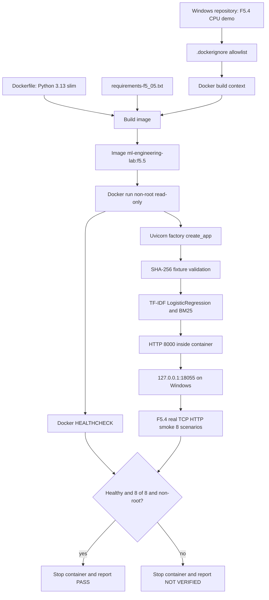

# F5.5 — Docker Inference: изолированный CPU-контейнер с FastAPI

## 1. Цель этапа

**Задача:** перенести HTTP-интерфейс F5.4 в воспроизводимую контейнерную среду, отделить исполняемые зависимости от Windows-хоста и проверить, что контейнер действительно принимает HTTP-запросы. Контейнер должен включать только ограниченный демонстрационный backend, поднимать FastAPI, возвращать структурированные результаты и проходить smoke-проверку из отдельного процесса.

**Входы:** утверждённые исходники F5.4 `src/api_f5/`, конфигурация `configs/f5_04_api.json`, проверенная синтетическая fixture `tests/fixtures/f5_04_api_demo_v1.json`, определённые HTTP-маршруты `/health`, `/openapi.json`, `/classify`, `/search`, `/ask` и готовый smoke-контракт `scripts.f5_api.run_http_smoke()`.

**Выходы:** `Dockerfile`, `.dockerignore`, минимальная спецификация зависимостей `requirements-f5_05.txt`, сценарий реальной Docker-проверки и unit/contract-тесты. После настоящего `docker build`, `docker run`, `HEALTHCHECK` и HTTP smoke формируется воспроизводимое свидетельство **исполняемости именно демонстрационного контейнера**; успешных вычислений настоящих F1/F3/Qwen такой запуск не подтверждает.

**Границы:** CPU-first, только локальная машина с Linux-container backend Docker Desktop, без GPU, скачивания весов моделей, обучения, сети при запросах или записи пользовательских сообщений. Сборка образа требует доступа к реестру Docker Hub и PyPI, если образы и пакеты не закешированы. Работа API после сборки не должна требовать интернета. Рабочая машина пользователя — Windows / PowerShell / Python 3.13.2. Локальная среда разработки поставки — Python 3.13.5. Переход между версиями образа ограничен Python 3.13 и Debian Bookworm, но образ **не** закреплён неизменяемым digest.

**Критерий PASS:** тесты F5.5 в локальном Python проходят; `docker build` действительно завершён без ошибок; `docker run` запускает образ; встроенный `HEALTHCHECK` показывает `healthy`; процесс внутри контейнера имеет UID, отличный от 0; внешняя TCP smoke-проверка выполняет все восемь контрактов API; контейнер корректно останавливается. До получения этих доказательств итоговый статус **PARTIAL / DOCKER NOT EXECUTED**. Успех unit-тестов, моделирующих Docker CLI, не заменяет фактический запуск Docker.

## 2. Что реализовано

| Новый файл | Назначение и основные механизмы | Зависимости / контракт |
|---|---|---|
| `Dockerfile` | Python 3.13 slim, установка только runtime-зависимостей, копирование минимальных файлов API, непривилегированный пользователь, встроенный `HEALTHCHECK`, exec-form запуск Uvicorn | `src.api_f5.app:create_app` из F5.4 |
| `.dockerignore` | Deny-by-default build context: разрешить только Dockerfile, требования, три Python-файла API, один JSON-конфиг и одну fixture | Каталоги `src/api_f5/`, `configs/`, `tests/fixtures/` |
| `requirements-f5_05.txt` | Три прямые runtime-зависимости с точными версиями; исключены `pytest`, `httpx` и ML/LLM GPU-библиотеки | `fastapi==0.128.2`, `uvicorn==0.48.0`, `scikit-learn==1.8.0` |
| `scripts/f5_docker_smoke.py` | `run_container_smoke()`: проверка CLI/daemon/image, старт отдельного контейнера, ожидание Docker-health, контроль non-root, вызов восьми реальных HTTP-проверок F5.4 и cleanup | `scripts.f5_api.run_http_smoke()`, Docker CLI, host `httpx` |
| `tests/test_f5_docker.py` | 33 тест структуры, whitelist, зависимостей, SHA-256, реально выполняемого локального F5.4 из минимального набора файлов, ошибок и жизненного цикла контейнера через mock | `pytest`, `fastapi.testclient`, F5.4 |
| `docs/steps/F5_05_docker_inference.md` | Архитектура, расчётный пример, команды PowerShell, границы доказательств и изучаемые исходники | Текущий шаг F5.5 |

**Что не изменяется:** `src/api_f5/app.py`, `src/api_f5/demo_service.py`, `scripts/f5_api.py`, конфигурация и данные F5.4, исходники и результаты F1–F4, `README.md`. `reports/public/` и `docs/reports/` не создаются в стандартном сценарии: стадия F5.5 не записывает новые числовые показатели модели.

## 3. Последовательность реализации

### Шаг 1. Зафиксировать границу между образом и репозиторием

- **Действие:** выбрать необходимые для выполнения HTTP-сервера файлы.
- **Назначение:** исключить случайное копирование сырых датасетов, весов, токенов и результатов прошлых фаз в образ.
- **Реализация:** `Dockerfile` явно копирует только три файла `src/api_f5`, один конфигурационный JSON и один JSON с синтетическими данными. `.dockerignore` начинает с шаблона `**`; затем применяет отрицания `!` к разрешённым файлам и родительским каталогам. `COPY . .` не используется.
- **Результат:** набор Python/JSON runtime-артефактов структурно задан пятью конкретными путями. В `test_dockerfile_has_narrow_runtime_and_no_broad_copy()` и `test_context_deny_by_default_and_required_allowlist()` проверяются их существование и whitelist. Это **статическая** проверка manifest; окончательный состав реальных слоёв образа подтверждается только Docker build/inspect.

### Шаг 2. Выделить зависимости исполнения

- **Действие:** создать `requirements-f5_05.txt` для контейнера.
- **Назначение:** не копировать Windows `.venv` и не устанавливать лишние инструменты разработки в runtime image.
- **Реализация:** зафиксировать прямые зависимости `FastAPI`, `Uvicorn`, `scikit-learn`. `httpx` и `pytest` остаются в локальном тестовом окружении и не нужны процессу контейнера. Транзитивные зависимости разрешает pip при `docker build`.
- **Результат:** три pinned top-level пакета, проверенные точным сопоставлением строк в `test_runtime_dependencies_are_only_pinned_cpu_packages()`. Полная побитовая воспроизводимость не утверждается: нужны lock с хешами и digest базового образа, которые не входят в текущий этап.

### Шаг 3. Зафиксировать runtime и минимальные права

- **Действие:** сформировать образ на основе `python:3.13-slim-bookworm`.
- **Назначение:** получить один исполняемый Python 3.13 environment для Linux, не зависящий от Windows Python и установленного на хосте scikit-learn.
- **Реализация:** задать `WORKDIR /app`, `PYTHONPATH=/app`, `PYTHONDONTWRITEBYTECODE=1`, `PYTHONUNBUFFERED=1`; установить пакеты до копирования исходников, чтобы слои зависимостей кешировались отдельно; создать пользователя `app`; использовать `USER app`. Количество вычислительных потоков BLAS/OpenMP ограничить единицей для маленького CPU-демо.
- **Результат:** зафиксирован контракт Dockerfile. Реальная совместимость wheel-пакетов, `useradd`, RAM и сборки под Linux проверяется только после `docker build`.

### Шаг 4. Описать сетевой контракт

- **Действие:** запустить Uvicorn через `python -m uvicorn src.api_f5.app:create_app --factory --host 0.0.0.0 --port 8000`.
- **Назначение:** слушать интерфейс контейнера так, чтобы Docker мог перенаправить запросы с loopback хоста.
- **Реализация:** `CMD` задан в exec-form. Значение `0.0.0.0` **внутри контейнера** означает приём соединений на сетевых интерфейсах контейнера, а не автоматическое раскрытие сервиса в Windows. При запуске `--publish 127.0.0.1:18055:8000` Docker связывает порт контейнера только с loopback интерфейсом хоста.
- **Результат:** последовательность namespace/port mapping определена. В статических тестах проверены Uvicorn factory и адрес. Настоящую доступность по TCP подтверждает только отдельный запуск и smoke.

### Шаг 5. Проверить неизменность данных

- **Действие:** сохранить чтение фикстуры из F5.4 без изменения её содержимого.
- **Назначение:** не объявить корректный HTTP-ответ результатом неизвестного набора документов или обучения на чужих данных.
- **Реализация:** существующая `load_demo(root)` сопоставляет SHA-256 файла `tests/fixtures/f5_04_api_demo_v1.json` со значением в `configs/f5_04_api.json`, проверяет ограничения формата, 24 примера обучения и 12 документов. При ошибке `create_app()` не должен успешно инициализироваться.
- **Результат:** `test_container_fixture_sha_is_exact_f5_04_source()` проверяет соответствие текущих файлов. Это идентичность **fixture**, а не контроль целостности базового Linux-образа или всего пайплайна F1–F4.

### Шаг 6. Выполнить реальный API-контракт на минимальных ресурсах

- **Действие:** собрать временную папку только из пяти runtime-файлов и создать приложение `create_app(tmp_path)`.
- **Назначение:** убедиться, что runtime-файлам не нужны скрытые импорты из F1/F2/F3/F4 и что внутри образа не потребуется полный исходный репозиторий.
- **Реализация:** `test_minimal_runtime_context_supports_real_f5_04_cpu_inference()` копирует файлы, запускает `TestClient` и вызывает `/health`, `/openapi.json`, `/classify`, `/search`, `/ask`; проверяет 422 и 404. TF-IDF + LogisticRegression действительно обучаются на синтетических записях; BM25 вычисляет поиск; ответ содержит дословную цитату.
- **Результат:** минимальный контекст прошёл локальный функциональный тест. Это **не** исполнение под Docker, потому что Python и библиотеки берутся из хостового тестового окружения.

### Шаг 7. Реализовать Docker smoke с реальным процессом и сетью

- **Действие:** запустить `scripts.f5_docker_smoke` с конкретным именем образа.
- **Назначение:** доказать не только валидность Dockerfile, но и фактическую работу подготовленного контейнера.
- **Реализация:** `run_container_smoke()` вызывает `docker version`, `docker image inspect`, `docker run --detach --rm`; назначает уникальное имя контейнера, использует `--read-only`, отдельный `/tmp` через `--tmpfs`, `--cap-drop ALL`, `--security-opt no-new-privileges`, лимит 1 GiB RAM и 256 процессов. После получения `healthy` выполняется `docker exec id -u` и вызывается **существующий** `run_http_smoke()` из F5.4 (8 проверок). При завершении выполняется `docker stop`, при отказе предпринимается `docker rm --force`; `PASS` выводится только после успешной очистки.
- **Результат:** контракт проверяемого запуска сформирован. Unit-тесты моделируют только последовательность вызовов и ошибки; реальный Docker-запуск должен выполнить пользователь на Windows с активным Docker Desktop.

### Шаг 8. Подтвердить отрицательные сценарии и статус

- **Действие:** проверить неверные аргументы, недоступный daemon, неуспешный процесс, `unhealthy`, root UID, ошибку HTTP, cleanup.
- **Назначение:** предотвратить ложное заявление о `PASS` при частично завершённой проверке.
- **Реализация:** `tests/test_f5_docker.py` включает инъекцию отказов через `monkeypatch` и `Mock`; тесты не запускают Docker. При ошибки `main()` возвращает код 2 и выводит `NOT VERIFIED / FAIL`; исключения не преобразуются в фиктивное `PASS`.
- **Результат:** 33 тест нового модуля и 209 тестов F5.1–F5.5 в общей проверке на Linux/Python 3.13.5 завершились успешно. Проверка `docker build/run` **не выполнена** в среде сборки поставки — Docker CLI/daemon отсутствует.

## 4. Алгоритм и математический пример

### 4.1. Модель контейнеризации

Изолированный Docker image объединяет:

\[
I = B + D + A + C,
\]

где `B` — Python 3.13 slim base image, `D` — установленные runtime-зависимости, `A` — исполняемые исходники F5.4, `C` — конфигурация и синтетические данные. Это **структурное описание**, а не арифметическое сложение размеров образов. Из-за кеша слоёв фактический размер `docker image ls` не равен сумме размеров отдельных файлов.

При изменении одного файла приложения Docker может переиспользовать слой установки зависимостей, если `requirements-f5_05.txt` не изменился. Это достигается тем, что `COPY requirements...` и `RUN pip install...` находятся **до** `COPY src/api_f5/...`.

### 4.2. Предикат разрешения файла в build context

Пусть `P` — множество файлов в корне репозитория, `W` — whitelist `.dockerignore`. Предполагаемый build context:

\[
P_{build}=\{p\in P\mid p\in W\}.
\]

Для исполнения сервера требуются ровно пять runtime-файлов: три Python-модуля, `f5_04_api.json` и JSON-fixture; дополнительно передаётся `requirements-f5_05.txt` и технические Docker metadata. Наличие `**` и исключений `!` ограничивает build context, а явные `COPY` дополнительно ограничивают файлы, попадающие в итоговый image.

**Числовой пример:** полный репозиторий содержит десятки модулей F1–F5, но в приложении контейнера находятся **3 Python-файла + 2 JSON-файла = 5 runtime-файлов**. Это не означает, что контейнер содержит лишь пять файлов вообще: в базовом образе есть Python, ОС и установленные библиотеки.

### 4.3. Проверка SHA-256

Для fixture выполняется проверка:

\[
H_{actual}=\operatorname{SHA256}(\operatorname{bytes}(fixture));\qquad
valid = (H_{actual}=H_{config}).
\]

Здесь SHA вычисляется по исходным байтам UTF-8, а не по повторно сериализованному JSON; даже изменение пробелов приведёт к несовпадению. При нарушении `valid` приложение не стартует успешно. Это проверка принадлежности данных к версии F5.4, но не цифровая подпись автора.

### 4.4. Оценка успешности реального HTTP smoke

Набор включает 8 независимых HTTP-контрактов F5.4:

1. `GET /health`: HTTP 200, `synthetic_demo`, ровно 24 обучающих примера и 12 документов.
2. `GET /openapi.json`: HTTP 200 и наличие трёх POST-маршрутов.
3. `POST /classify`: ожидаемый `python` и backend `demo_tfidf_logreg`.
4. `POST /search`: первая выдача `sql_02` для фиксированного запроса.
5. `POST /ask`: текст ответа совпадает с дословной evidence-цитатой.
6. `POST /ask` для нерелевантной строки: `no_evidence`, ответ отсутствует.
7. Некорректный `top_k=0`: HTTP 422.
8. Неизвестный маршрут: HTTP 404.

Пусть `s_i` равно 1 только при прохождении соответствующего контракта. Тогда:

\[
C_{HTTP}=\sum_{i=1}^{8}s_i,\qquad
PASS_{HTTP}\iff C_{HTTP}=8.
\]

**Учебный пример:** если семь тестов успешны, а `/ask` не возвращает evidence, `C_HTTP=7` и `PASS_HTTP=False`. Успех `/health` или запуск Uvicorn не должен скрывать неисправность `/ask`.

**Полный предикат контейнера:**

\[
PASS_{Docker}=BuildOK\land RunOK\land Healthy\land NonRoot\land(C_{HTTP}=8)\land CleanupOK.
\]

В локальном окружении подготовки F5.5 проверялись структура команд, локальные алгоритмы F5.4 и сценарии ошибок через mocks. Значения `BuildOK`, `RunOK`, `Healthy`, `NonRoot` и `CleanupOK` в настоящем Docker ещё **не измерены**, поэтому `PASS_Docker` не заявляется.

### 4.5. Ограничение сетевой поверхности

Uvicorn слушает адрес `0.0.0.0:8000` **только внутри Docker-сети контейнера**. На Windows Linux Docker Desktop внешний mapping задаётся как `127.0.0.1:18055:8000`. Адрес 127.0.0.1 ограничивает подключение к сервису локальным хостом; по умолчанию Docker без host IP способен публиковать порт на всех интерфейсах. Контейнер не является продакшен-сервисом с TLS, аутентификацией, rate-limiting или secrets manager.

## 5. Схема работы



**Граница ответственности:** Docker отвечает за исполняемое окружение, процессы и сетевую изоляцию; FastAPI — за валидацию HTTP и маршрутизацию; `DemoEngine` — за алгоритмы классификации, BM25 и extractive output. Достоверность ответов Qwen, безопасность в открытом мире и реальные результаты F1–F4 в F5.5 не оцениваются.

## 6. Локальная проверка PowerShell

Команды запускать **из корня** `F:\DEVELOPMENT\ML\ml-engineering-lab` после успешной поставки F5.4.

### 6.1. Распаковка и обычные unit/contract-тесты без Docker

```powershell
cd F:\DEVELOPMENT\ML\ml-engineering-lab

git status --short

Expand-Archive `
  -LiteralPath "$HOME\Downloads\ML_Engineering_Lab_F5_05_Docker_Inference.zip" `
  -DestinationPath . -Force

# Использовать уже подготовленное окружение F5.4.
.\.venv\Scripts\python.exe -m pytest tests/test_f5_docker.py -q

# Регрессия новой Фазы 5 без GPU и без Docker daemon.
.\.venv\Scripts\python.exe -m pytest `
  tests/test_f5_unified_report.py `
  tests/test_f5_llm_diagnostics.py `
  tests/test_f5_safety_benchmark.py `
  tests/test_f5_api.py `
  tests/test_f5_docker.py -q
```

Ориентир среды подготовки: `33 passed` и `209 passed` соответственно. Отличия количества в текущем Windows checkout анализируются по журналу pytest. Наличие активного Docker daemon не требуется для этих двух тестовых команд.

### 6.2. Проверка Docker Desktop и сборка настоящего образа

```powershell
# Docker Desktop должен быть запущен в режиме Linux containers.
docker version
docker info --format '{{.OSType}}'

# Команду выполнять из КОРНЯ репозитория, это build context.
docker build --file Dockerfile --tag ml-engineering-lab:f5.5 .

# Убедиться, что image действительно создан.
docker image inspect ml-engineering-lab:f5.5 --format '{{.Id}}'
```

При `docker info` ожидается `linux`, а при `docker image inspect` — идентификатор образа `sha256:...` (конкретное значение зависит от сборки). Установка пакетов и загрузка базового образа требуют доступности внешних registry при отсутствии кеша. **Если `docker build` не завершился, Docker PASS запрещён.**

### 6.3. Полная автоматическая проверка реального Docker

```powershell
cd F:\DEVELOPMENT\ML\ml-engineering-lab

.\.venv\Scripts\python.exe -m scripts.f5_docker_smoke `
  --image ml-engineering-lab:f5.5 `
  --port 18055 `
  --timeout 90
```

Сценарий создаёт контейнер, ждёт встроенного `HEALTHCHECK`, проверяет non-root UID, отправляет **восемь реальных HTTP-запросов к контейнеру** и останавливает контейнер. Порт доступен только по `127.0.0.1:18055`; после успешной проверки работающего контейнера оставаться не должно.

**Только после настоящего успешного выполнения** допустима строка:

```text
F5.5 DOCKER PASS: image=ml-engineering-lab:f5.5; health=healthy; HTTP=8/8; uid=...; backend=synthetic_demo; LLM=NOT EXECUTED
```

Если обнаружен неустановленный Docker, daemon off, ошибка образа, `unhealthy`, root UID, ошибка HTTP или `docker stop`, вместо `PASS` должна быть диагностика и exit code 2. Проверить код выполнения в PowerShell можно через `$LASTEXITCODE` непосредственно после команды.

### 6.4. Дополнительная ручная диагностика (только при необходимости)

```powershell
# Просмотр образа и runtime user.
docker image inspect ml-engineering-lab:f5.5 --format '{{.Config.User}}'
docker image ls ml-engineering-lab

# Проверка отсутствия оставшихся контейнеров F5.5.
docker ps -a --filter "name=ml-lab-f5-05"

# Статическая проверка новой поставки.
git diff --check
git status --short
```

Не нужно добавлять в Git образ, виртуальное окружение, веса, кэш Docker или отчёты локального запуска. Docker daemon сам хранит image вне рабочего дерева Git.

### 6.5. Команды публикации после локальной проверки

```powershell
cd F:\DEVELOPMENT\ML\ml-engineering-lab

git diff --check
git status --short

git add -- `
  Dockerfile `
  .dockerignore `
  requirements-f5_05.txt `
  scripts/f5_docker_smoke.py `
  tests/test_f5_docker.py `
  docs/steps/F5_05_docker_inference.md

git diff --cached --check
git diff --cached --stat
git diff --cached

git commit -m "feat(f5.5): add isolated Docker FastAPI inference demo"

git fetch origin
git rebase origin/main
git push origin main

git status --short
```

Команда `git add` перечисляет только файлы F5.5. При конфликте `git rebase` остановиться и прочитать `git status`; `git push --force` не применять. Независимые ошибки существующего workflow F2 Autograd не подтверждают и не опровергают HTTP-контракт F5.5 и устраняются отдельно.

## 7. Что доказано тестами и какие ограничения остаются

### Подтверждено в локальном окружении подготовки

- 33 тест F5.5 выполнен успешно на Linux/Python 3.13.5.
- Общая регрессия F5.1–F5.5: 209 passed, 0 failed.
- `create_app(tmp_path)` работает с набором из пяти файлов runtime; F5.4 вызывает настоящие `TfidfVectorizer`, `LogisticRegression`, BM25 и extractive response над синтетическими данными.
- Конфигурационный `fixture_sha256` соответствует текущим исходным байтам fixture.
- Dockerfile использует явные `COPY`, а не копирование всей директории.
- Скрипт проверяет Docker health, non-root и 8 HTTP-проверок и выполняет cleanup в обработанных сценариях. Unit-тесты используют mocks для CLI и **не запускают** Docker.

### Не подтверждено

- `docker build`, фактическое скачивание слоя Python и установка пакетов внутри образа: **NOT EXECUTED**.
- `docker run`, `HEALTHCHECK=healthy`, фактический UID внутри контейнера, HTTP 8/8 из Windows и последующий cleanup: **NOT EXECUTED**.
- Побитовая воспроизводимость образа между разными датами и машинами: отсутствуют digest базового образа и полный hash-lock транзитивных пакетов.
- Качество на реальных данных F1, retrieval F3, корректность LLM F4, влияние LoRA/DPO, устойчивость к prompt injection и эксплуатационная безопасность: не измеряются.
- Продакшен-пригодность: отсутствуют TLS, аутентификация, rate limiting, сервисные метрики, сквозная трассировка, нагрузочные и отказоустойчивые испытания.

### Ограничения данных и оборудования

- Данные F5.4 — 24 синтетических обучающих примера и 12 технических документов; accuracy/quality на открытых реальных запросах не измерена.
- Внешние контейнерные сети ограничиваются только localhost-публикацией Docker. Внутри контейнера процесс слушает `0.0.0.0`; приложение не предназначено для внешнего доступа.
- Лимит памяти 1 GiB, read-only root и tmpfs 64 MiB составляют проверяемую конфигурацию, но их фактическая работоспособность на Windows Docker Desktop должна быть проверена.
- Встроенный `HEALTHCHECK` проверяет доступность `/health`, а не семантическую корректность всех ответов. Отдельный скрипт выполняет полный HTTP smoke.

### Что необходимо для PASS

1. Выполнить на Windows `pytest` и получить ненулевые ошибки = 0.
2. Запустить Docker Desktop с Linux engine и выполнить настоящий `docker build`.
3. Запустить `python -m scripts.f5_docker_smoke` и убедиться, что возвращён код 0 и вывод `F5.5 DOCKER PASS`.
4. Проверить, что не осталось запущенного контейнера F5.5 и не обнаружены нежелательные untracked-файлы.

**Итог до пользовательской runtime-проверки:** `IMPLEMENTED / UNIT TESTED / DOCKER NOT EXECUTED / PARTIAL`. После подтверждённого Docker smoke можно присвоить `PASS` только упаковке и исполняемому demo-API, но не качеству реальной модели или production-readiness.

## 8. Основная мысль этапа

Контейнеризация фиксирует среду исполнения и небольшой набор зависимостей вокруг уже существующего приложения, не меняя обучающие алгоритмы. Для проекта ML Engineering Lab это переход от локального запуска Python API к переносимому Linux-процессу с явно заданными входами, портом и условиями проверки. Контейнер содержит только синтетический demonstration backend F5.4; отсутствие весов LLM и исходного корпуса F1 не является недостатком данного контракта, а является его намеренно ограниченной областью.

Сначала сформировать минимальный build context, затем установить CPU-зависимости, скопировать проверенные исходники, конфигурацию и fixture, задать непривилегированного пользователя и exec-form запуск сервера. Dockerfile определяет порядок слоёв, а `.dockerignore` снижает риск включения посторонних файлов. Проверка хеша fixture исключает незаметную подмену версии данных; проверка `create_app()` во временном каталоге подтверждает, что набор runtime-артефактов достаточен для локальных алгоритмов.

Работоспособность контейнера нельзя устанавливать по факту прохождения статических unit-тестов. Для полноценной приёмки требуется фактическая сборка образа, запуск процесса, успешный `HEALTHCHECK`, non-root UID, восемь HTTP-контрактов и очистка контейнера. Различение этих уровней доказательств особенно важно в ML Engineering: корректная упаковка и работающий HTTP-интерфейс не превращают синтетическую демонстрацию в проверенную модель на реальных данных.

Следующий этап F5.6 сможет использовать разделение быстрых unit/contract-тестов и проверок, требующих внешнего Docker engine, при проектировании CI. Наличие такой границы позволит не отмечать тяжёлые системные проверки как `PASS`, если они не были запущены, и не блокировать CPU-only регрессию из-за отсутствия контейнерного раннера.

## 9. Файлы, с которыми стоит познакомиться

| Порядок | Файл | Что изучить |
|---:|---|---|
| 1 | `src/api_f5/app.py` (F5.4) | `create_app()`: типизированные входы, `response_model`, `/health`, `/classify`, `/search`, `/ask`, механизм фабрики FastAPI |
| 2 | `src/api_f5/demo_service.py` (F5.4) | `load_demo()`: конфигурация, SHA-256, ограниченный корпус; `DemoEngine`: TF-IDF/LogReg, BM25 и дословное `evidence` |
| 3 | `configs/f5_04_api.json` (F5.4) | ID синтетического протокола, `fixture_path`, `fixture_sha256`, количество документов и обучающих записей |
| 4 | `tests/fixtures/f5_04_api_demo_v1.json` (F5.4) | Состав 24 тренировочных примеров, 12 документов и `source_id` |
| 5 | `Dockerfile` (F5.5) | Порядок build layers, non-root, `HEALTHCHECK`, `CMD` как Uvicorn factory, отсутствие широкой копии репозитория |
| 6 | `.dockerignore` (F5.5) | Deny-by-default список путей и вложенных каталогов, отличие build context от image filesystem |
| 7 | `requirements-f5_05.txt` (F5.5) | Минимум CPU-runtime пакетов, ограничения pinning относительно полного lock и digest |
| 8 | `scripts/f5_api.py` (F5.4) | `run_http_smoke()`: восемь реальных HTTP-контрактов и их значения, отличие сервера от проверки |
| 9 | `scripts/f5_docker_smoke.py` (F5.5) | `_docker()`, `run_container_smoke()`, `main()`; работа с daemon, health, UID, сетью, ошибками и cleanup |
| 10 | `tests/test_f5_docker.py` (F5.5) | Минимальный runtime context, негативные сценарии, mocked Docker workflow; почему mock не доказывает build/run |
| 11 | `tests/test_f5_api.py` (F5.4) | Реальные локальные HTTP/TCP проверки исходного API, заимствуемые для Docker smoke |
| 12 | `docs/steps/F5_04_fastapi.md` (F5.4) | Предыдущий протокол HTTP, ограничения synthetic demo и определения вычисляемых алгоритмов |
