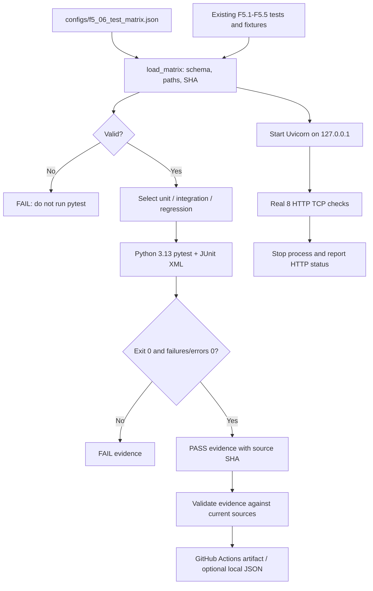

# F5.6 — Testing & CI: воспроизводимая проверка компонентов ML Engineering Lab

## 1. Цель этапа

F5.1–F5.5 сформировали пять независимых инженерных компонентов: единый протокол метрик, диагностику LLM, ограниченный safety-benchmark, HTTP API и упаковку сервиса в Docker. Для подтверждения совместимости компонентов необходимо проверить не только отдельные функции, но и системные контракты, от которых зависит воспроизводимость.

Цель F5.6 — **создать проверяемую матрицу тестирования, отделить unit от integration и regression, зафиксировать происхождение проверяемых исходников и обеспечить запуск CPU-профиля в GitHub Actions**. Входами служат существующие `src/`, `scripts/`, `configs/`, `tests/`, Docker-контракт и фиксированные открытые fixtures F5. Результатами служат код оркестратора, явно перечисленные профили тестирования, структурное evidence по pytest, реальный локальный HTTP smoke и отдельный GitHub Actions workflow.

Проверяется **инженерная корректность реализации**, а не новая точность F1/F2, качество retrieval F3, фактическая корректность LLM F4 или безопасность модели. Базовый профиль должен работать на CPU без скачивания весов, GPU, Docker daemon и внешнего API. Тяжёлое обучение и зависимые от закрытых данных тесты исключены из обязательного CI F5.6.

Связь с предыдущими этапами: F5.1 предоставляет раздельные оценочные контракты, F5.2 — автоматические LLM proxy-метрики с честным `PARTIAL` при отсутствии эксперта, F5.3 — синтетический safety-contract, F5.4 — локальные inference-маршруты, F5.5 — контракт сборки и проверку контейнера отдельной ручной командой. Никакой ранее утверждённый модуль или файл F1–F5.5 не изменяется.

## 2. Что реализовано

Все следующие файлы **новые**. Изменений `README.md`, существующих workflow, исходников или документации предыдущих этапов нет.

| Файл | Назначение | Важные функции / связи |
|---|---|---|
| `configs/f5_06_test_matrix.json` | Фиксированная матрица unit/integration/regression, набор runtime-входов и профиль Python 3.13 | 4 тестовых файла unit, 3 integration, 8 regression |
| `src/testing_f5/__init__.py` | Изолированное пространство имён F5.6 | Не выполняет вычислений |
| `src/testing_f5/ci_matrix.py` | Валидация тестовых файлов, границ путей, полноты регрессии и SHA-256 | `load_matrix()`, `profile_provenance()`, `validate_evidence()` |
| `scripts/f5_ci.py` | Единый CLI для планирования, запуска, проверки evidence и TCP-smoke | `run_profile()`, `_counts()`, `http_smoke()`, `main()` |
| `tests/test_f5_ci_contract.py` | Unit/negative-тесты схемы, путей, версий, SHA, JUnit XML и ошибок запуска | `pytest` и изолированные временные каталоги |
| `tests/test_f5_ci_integration.py` | Интеграционный HTTP-контракт для существующего приложения | `TestClient(create_app())`, OpenAPI, 200/422/404 |
| `tests/test_f5_ci_regression.py` | Регрессионные инварианты F5.1–F5.5 | Проверка provenance, synthetic-only, safety `PARTIAL`, Docker opt-in |
| `.github/workflows/f5_06_ci.yml` | Автоматический CPU-runner на GitHub, включая JUnit/evidence и HTTP smoke | Checkout, Python 3.13, install, plan, regression, check, smoke, upload |
| `docs/steps/F5_06_testing_ci.md` | Учебное описание алгоритма, проверок и ограничений | Девять обязательных разделов |

Создаваемый **по явному запросу** JSON evidence не входит в ZIP. Выход рекомендуется размещать в `%TEMP%` или `$RUNNER_TEMP`, чтобы не появлялись неожиданные `Untracked files` в Git. В отчёте хранятся только относительные пути, SHA-256 исходников, профиль и счётчики тестов; исходные тексты F1–F4 не копируются.

## 3. Последовательность реализации

### Шаг 1. Определить границы тестовой матрицы

**Действие:** перечислить тестовые файлы F5.1–F5.6 в трёх независимых профилях.

**Назначение:** избежать ситуации, когда успешный запуск одного теста ошибочно интерпретируется как полноценная регрессия всей Фазы 5.

**Реализация:** `configs/f5_06_test_matrix.json` содержит `schema_version=1`, `python_minor=3.13`, `required_inputs` и словарь `profiles`. Группа `unit` охватывает базовые вычислительные контракты F5.1–F5.3 и проверки самого оркестратора. Группа `integration` покрывает API, Docker-контракты без daemon и HTTP-интеграцию. `regression` запускает все восемь файлов. Группировка выполняется **на уровне тестовых файлов**, а не отдельных функций или pytest-маркеров: существующие тестовые файлы могут содержать разные типы проверок.

**Результат:** 4 файла unit + 3 integration + 1 дополнительный regression-only = 8 уникальных файлов. Последний профиль включает все файлы без пропусков и используется в CI.

### Шаг 2. Проверить полноту и происхождение входов

**Действие:** загрузить и проверить манифест до запуска pytest.

**Назначение:** не выполнять устаревший или подменённый список тестов, не доверять абсолютным путям и переходам `..`, не давать путям выходить из репозитория.

**Реализация:** `load_matrix(root)` проверяет типы и ключи схемы, точное множество профилей и контрольный список `REQUIRED_TESTS`; отвергает повторяющиеся тесты, пустые списки и пути за пределами корня. Каждый исходный файл разрешается через `Path.resolve()` и проверяется `is_relative_to(root.resolve())`, включая защиту от символических ссылок наружу. Для манифеста, выбранных тестов и необходимых runtime-файлов вычисляется SHA-256; функция `profile_provenance()` возвращает только нужный профиль и его хеши.

**Результат:** `python -m scripts.f5_ci plan` завершается `PLAN PASS` и выводит доступные тестовые файлы и SHA манифеста. Некорректная схема или недостающий файл дают неуспешный код возврата до начала тестирования.

### Шаг 3. Организовать выполнение pytest и сохранить реальные счётчики

**Действие:** запустить pytest как отдельный процесс текущим интерпретатором Python.

**Назначение:** получить фактический код завершения и машинно читаемые результаты, не превращая ожидаемые значения в фиктивные утверждения о PASS.

**Реализация:** `run_profile()` вызывает `subprocess.run([sys.executable, '-m', 'pytest', ...])` с `cwd` корня проекта и лимитом времени 360 секунд. Список входных тестов берётся только из проверенного манифеста. Путь к JUnit XML создаётся внутри `TemporaryDirectory` и удаляется после завершения. `_counts()` разбирает `tests`, `failures`, `errors`, `skipped` из реальных XML-атрибутов и проверяет согласованность. `status=PASS` допускается только при `pytest exit code=0`, `tests>0`, `failures=0`, `errors=0` и хотя бы одном фактически прошедшем тесте. Пропущенные тесты учитываются, но не выдаются за выполненные.

**Результат:** при независимом локальном прогоне Python 3.13.5 профиль `regression` завершился **260 passed, 0 failed, 0 errors, 0 skipped**. Запуск без `--output` не создаёт файлов в репозитории.

### Шаг 4. Сформировать и проверить test evidence

**Действие:** при необходимости сохранить структурные результаты и проверить их актуальность.

**Назначение:** связать число пройденных тестов с конкретной версией самих тестов и runtime-исходников, а не с произвольной строкой в README или письме CI.

**Реализация:** необязательный `--output` сохраняет UTF-8 JSON с `manifest_sha256`, отсортированным `files_sha256`, перечнем файлов профиля, `pytest`-счётчиками, `exit_code`, `status` и `backend=synthetic_contract`. `validate_evidence()` сравнивает эти значения с повторно вычисленным `profile_provenance()` и требует непротиворечивые числовые показатели. Если после прогона изменён исходник или конфигурация, `check` отклоняет старый отчёт.

**Результат:** команда `check --evidence <путь>` успешно подтвердила реальный JSON, сформированный при текущем локальном прогоне. При порче SHA, подмене профиля, ложном PASS, `tests=0` или `failures>0` проверка завершается ошибкой. Эти проверки подтверждают **внутреннюю непротиворечивость**, но не дают криптографической аттестации происхождения внешнего JSON: файл без подписи может быть сфальсифицирован.

### Шаг 5. Проверить независимый HTTP end-to-end smoke

**Действие:** запустить F5.4 как отдельный локальный процесс Uvicorn и выполнить HTTP-запросы через TCP.

**Назначение:** тестовый клиент FastAPI проверяет ASGI-контракт внутри процесса, но не выявляет все ошибки запуска сервера, локального сетевого соединения или сериализации HTTP.

**Реализация:** `http_smoke()` выбирает свободный loopback-порт, запускает `python -m scripts.f5_api serve --host 127.0.0.1 --port <port>`, ожидает успешного `/health` и вызывает уже существующий `run_http_smoke()` из F5.4. Выполняются восемь контрактных проверок: health, OpenAPI, классификация, поиск, extractive-answer, no-evidence, валидация HTTP 422 и HTTP 404. Процесс обязательно завершается в `finally` (с `kill`-резервом). Внешние адреса и публичные сервисы не используются.

**Результат:** `F5.6 HTTP PASS: TCP=8/8; backend=synthetic_demo; LLM=NOT EXECUTED`. Проверка относится к demo, а не к Qwen или продакшн-развёртыванию.

### Шаг 6. Создать изолированный GitHub Actions workflow

**Действие:** описать Linux CI-проход при изменении файлов Фазы 5.

**Назначение:** гарантировать повторение CPU-проверок на чистом runner без зависимости от локальной Windows `.venv` и снизить количество ложных срабатываний от изменений документации или других фаз.

**Реализация:** `.github/workflows/f5_06_ci.yml` использует `ubuntu-24.04`, `actions/checkout@v7`, `actions/setup-python@v7` с Python 3.13 и `actions/upload-artifact@v7`. GitHub Actions на базе Node.js 24 не добавляют известное предупреждение о Node.js 20 из старого workflow. Права ограничены `contents: read`; автоматические запуски выполняются только при изменении выбранных путей F5 и при ручном `workflow_dispatch`. Этапы: установка CPU-зависимостей из `requirements-f5_04.txt`, `plan`, полная `regression`, `check evidence`, самостоятельный TCP smoke и загрузка JSON evidence как artifact.

**Результат:** YAML структурно проверен локально; **удалённый GitHub Actions run ещё не выполнен из этого окружения**. До просмотра реального запуска статус CI — `NOT VERIFIED`. Workflow не меняет и не отключает существующий `F2.1 Autograd CPU tests`.

### Шаг 7. Провести регрессию на минимальном опубликованном составе F5

**Действие:** распаковать пакеты F5.1–F5.5 в чистый каталог, добавить новые файлы F5.6 и выполнить общий профиль.

**Назначение:** проверить отсутствие неявных зависимостей от локальных данных, `README.md`, весов моделей, Docker daemon, старых неизданных изменений или приватного пути Windows.

**Реализация:** запуск из корня объединённой структуры `python -m scripts.f5_ci run --profile regression` и `python -m scripts.f5_ci http-smoke`. Отдельные отрицательные тесты контролируют некорректные пути, дублирование, отключение теста F5.5, неверную схему, устаревшие SHA, ложные PASS, ошибки pytest и неверный JUnit XML.

**Результат:** **260 passed** в regression, отдельно **8/8 HTTP**. Числа отражают только локальную проверку объединённых предыдущих ZIP; текущий Windows checkout и GitHub runner требуют отдельного подтверждения.

## 4. Алгоритм и математический пример

### 4.1. Разделение измерений

Пусть тестовый профиль содержит множество тестовых файлов `S`, а в них pytest собрал `N` тестовых случаев. В отчёте сохраняются:

- `N` (`tests`) — число собранных тестов;
- `F` (`failures`) — количество assertion failures;
- `E` (`errors`) — количество ошибок во время подготовки/исполнения;
- `K` (`skipped`) — количество пропусков.

Число прошедших тестов определяется:

\[
P=N-F-E-K
\]

Вычисляемая доля пройденных тестов:

\[
\mathrm{PassRate}=\frac{P}{N},\qquad N>0
\]

**Реальный пример F5.6:** `N=260`, `F=0`, `E=0`, `K=0`; следовательно `P=260`, `PassRate=1.0`. Это доля успешных тестов конкретного набора, **не** Accuracy модели и **не** полнота охвата всего исходного кода.

Критерий объявления `PASS`:

\[
PASS = (\mathrm{exitcode}=0)\land(N>K)\land(F=0)\land(E=0)
\]

`K` сохраняется отдельно. Если тест пропущен, следует объяснять его назначение и статус, а не включать пропуск в количество прошедших тестов. Профиль, в котором пропущены абсолютно все тесты (`K=N`), получает `FAIL`. При ошибке запуска, отсутствии JUnit XML или нулевом числе собранных тестов профиль не может получить `PASS`.

### 4.2. Хеширование источников

Для набора байтов файла `b` вычисляется:

\[
h=SHA256(b)
\]

Пример **учебного числового сравнения**: `tests=10`, `failures=1`, `errors=0`, `skipped=2`; тогда `P=7`, `PassRate=0.7`, а итоговый статус — `FAIL`. Даже если 9 тестов завершились без assertion failure, один из них ошибочен и два других не выполнялись; утверждение `10/10 PASS` недопустимо.

При проверке evidence производится **точное** сравнение SHA-256 сохранённых исходников с новыми хешами файлов. Контрольная сумма меняется при изменении любого байта, включая изменение концов строк. Поэтому после изменения исходников нужно запускать профиль заново; SHA-256 не заменяет цифровую подпись и не доказывает происхождение файла от GitHub Actions.

### 4.3. Что означает регрессия

`unit` проверяет локальные алгоритмы и входные контракты. `integration` проверяет взаимодействие API/fixtures и тестовые ограничения Docker. `regression` — объединение предыдущих двух профилей и отдельного сквозного контроля F5.1–F5.5. Регрессия позволяет обнаружить изменения поведения ранее работающего кода, но **не** гарантирует отсутствие ошибок в непроверенных ветвях, внешней модели или инфраструктуре.

## 5. Схема работы



Граница GitHub runner: чистый checkout, CPU-зависимости, pytest, HTTP loopback. Граница Docker: F5.5 запускается отдельно в Docker Desktop, не требуется в GitHub Actions F5.6. Граница LLM: модель Qwen и её веса не используются ни в одном обязательном тесте F5.6.

## 6. Локальная проверка PowerShell

Все команды выполняются из `F:\DEVELOPMENT\ML\ml-engineering-lab` после распаковки ZIP F5.6.

**Проверка схемы:**

```powershell
cd F:\DEVELOPMENT\ML\ml-engineering-lab
.\.venv\Scripts\python.exe -m scripts.f5_ci plan
```

**Новые тесты:**

```powershell
.\.venv\Scripts\python.exe -m pytest `
  tests/test_f5_ci_contract.py `
  tests/test_f5_ci_integration.py `
  tests/test_f5_ci_regression.py -q
```

Локальный ориентир: `51 passed`. Число может увеличиться после добавления следующих этапов, но в рамках неизменённого F5.6 не должно уменьшиться без объяснения.

**Три профиля:**

```powershell
.\.venv\Scripts\python.exe -m scripts.f5_ci run --profile unit
.\.venv\Scripts\python.exe -m scripts.f5_ci run --profile integration
.\.venv\Scripts\python.exe -m scripts.f5_ci run --profile regression
```

Локальный ориентир `regression`: `260 passed, 0 failed, 0 skipped`. Точный итог устанавливается фактическим запуском на текущем checkout.

**Сохранение evidence вне Git и проверка его актуальности:**

```powershell
$evidence = Join-Path $env:TEMP 'f5_06_ci_evidence.json'
.\.venv\Scripts\python.exe -m scripts.f5_ci run --profile regression --output $evidence
.\.venv\Scripts\python.exe -m scripts.f5_ci check --evidence $evidence
```

**Отдельный реальный HTTP smoke:**

```powershell
.\.venv\Scripts\python.exe -m scripts.f5_ci http-smoke
```

Ожидаемый вывод: `F5.6 HTTP PASS: TCP=8/8; backend=synthetic_demo; LLM=NOT EXECUTED`.

**Полная, независимая регрессия всех предыдущих фаз (дополнительно, не входит в CPU F5.6 CI):**

```powershell
.\.venv\Scripts\python.exe -m pytest -q
```

Она может требовать специфических фикстур и зависимостей прошлых фаз, поэтому её статус необходимо учитывать отдельно. Если обнаружится ранее известная ошибка `F2.1 Autograd CPU tests`, она **не исчезает** от успешного `F5.6 CPU Testing and CI`.

**Проверка перед публикацией:**

```powershell
git status --short
git diff --check
git add -- configs/f5_06_test_matrix.json src/testing_f5/__init__.py src/testing_f5/ci_matrix.py scripts/f5_ci.py tests/test_f5_ci_contract.py tests/test_f5_ci_integration.py tests/test_f5_ci_regression.py .github/workflows/f5_06_ci.yml docs/steps/F5_06_testing_ci.md
git diff --cached --check
git diff --cached --stat
git diff --cached
```

Коммит и отправку выполнять только после локального PASS и просмотра diff. Состояние удалённого GitHub Actions проверяется **после** публикации; локальная проверка YAML не заменяет GitHub runner.

## 7. Что доказано тестами и какие ограничения остаются

**Подтверждено локально:**

- F5.1–F5.5, дополненные тестами F5.6, проходят общий CPU-run: `260 passed` на Python 3.13.5;
- новые 51 тест проходят без ошибок;
- локальный процесс Uvicorn отвечает на 8/8 настоящих TCP HTTP-проверок;
- манифест отвергает неизвестные пути, отсутствующие файлы, неполное покрытие фаз, дублирование и некорректные значения;
- сохранённый JSON evidence проверяется по текущим SHA выбранных исходников и счётчикам pytest;
- обязательный путь F5.6 не запускает Docker, не обращается к Qwen и не читает приватный training corpus.

**Не подтверждено:**

- успешное выполнение нового workflow в GitHub Actions: **NOT VERIFIED**, нужен реальный GitHub run;
- исправление старого workflow `F2.1 Autograd CPU tests`: задача отдельно отложена;
- полная регрессия F1–F4 на чистом runner и в пользовательском Windows checkout;
- качество, надёжность, безопасность и production readiness реальной LLM;
- GPU, внешний интернет, MLflow, сборка Docker внутри CI и Kubernetes/CD.

**Ограничения данных и вычислений:**

- фиксированные синтетические fixtures и demo inference, без скачивания тяжёлых моделей;
- классификация unit/integration проводится по **файлам**, а не по granular pytest markers;
- хеши байтов чувствительны к переводам строк и локальному редактированию;
- JUnit счётчики отражают собранный набор, но не code coverage, отсутствие data leakage или корректность научных выводов;
- автоматический workflow запускается для указанных путей F5, а не для произвольных файлов проекта;
- HTTP smoke выбирает временно свободный loopback-порт; в редкой ситуации одновременного занятия порта проверка завершится ошибкой и потребует повторного запуска.

**Следующая проверка:** после `git push` открыть вкладку Actions, выбрать `F5.6 CPU Testing and CI`, проверить запуск на коммите и скачать JSON artifact. Только после этого допустимо фиксировать `REMOTE CI PASS`. При любом красном run указать провалившийся шаг, а не объявлять общий CI успешным.

## 8. Основная мысль этапа

Надёжность ML-проекта нельзя вывести из одного набора успешных unit-тестов. Проверка должна фиксировать состав исходников, границы запуска, конкретные тестовые случаи и результаты выполнения. Управляемая матрица тестов исключает случайное выпадение уже работающих этапов из общей регрессии, а контроль SHA-256 связывает отчёт с текущим состоянием тестов и входных конфигураций.

Тестирование имеет несколько уровней. Локальные функции проверяют корректность вычислений и валидацию данных. Интеграционные тесты подтверждают взаимодействие API с конфигурациями и fixtures. Регрессионный профиль предотвращает незаметное изменение договорённостей между F5.1 и F5.5. Отдельный HTTP smoke демонстрирует, что сервер работает как реальный процесс и отвечает по TCP, а не только через внутренний тестовый клиент.

GitHub Actions переносит проверку на чистый Linux runner и снимает зависимость от установленной локально виртуальной среды. Статус локального тестирования, статус нового удалённого workflow и статус существующего старого CI должны сохраняться **как разные утверждения**. В текущем состоянии подтверждена работоспособность F5 CPU-тестов и локального HTTP-сервиса; успешность удалённого workflow устанавливается только по фактическому результату GitHub Actions.

Следующий этап F5.7 добавит MLflow Experiment Tracking как отдельную подсистему. Проверки F5.6 не должны выдавать фикстуры за реальный эксперимент; новый трекинг получит собственные исполняемые проверки и будет добавлен в матрицу только согласованным изменением её версии.

## 9. Файлы, с которыми стоит познакомиться

| Порядок | Файл | Что именно изучить |
|---|---|---|
| 1 | `configs/f5_06_test_matrix.json` | Явная матрица профилей, входы, контроль полноты и граница CPU-тестов |
| 2 | `src/testing_f5/ci_matrix.py` | `load_matrix()`, `_relpath()`, `profile_provenance()`, `validate_evidence()`; SHA и защита путей |
| 3 | `scripts/f5_ci.py` | `run_profile()`, `_counts()`, `http_smoke()`, `main()`; subprocess, JUnit XML, exit codes |
| 4 | `tests/test_f5_ci_contract.py` | Отрицательные тесты: неполное покрытие, path traversal, ложный PASS, ошибки JUnit, устаревший SHA |
| 5 | `tests/test_f5_ci_integration.py` | Взаимодействие FastAPI/Pydantic с demo corpus и проверка OpenAPI |
| 6 | `tests/test_f5_ci_regression.py` | Сквозные инварианты, разделение synthetic vs real, opt-in Docker |
| 7 | `.github/workflows/f5_06_ci.yml` | Триггеры, разрешения, версии Actions, установка зависимостей, evidence и real TCP-smoke |
| 8 | `src/evaluation_f5/unified_report.py` | Фактическая F5.1-логика разделения метрик и их источников |
| 9 | `src/evaluation_f5/llm_diagnostics.py` | Token overlap, экспертные оценки и `PARTIAL` без фактического review |
| 10 | `src/evaluation_f5/safety_benchmark.py` | Контракты 28 synthetic-сценариев и ограничения их интерпретации |
| 11 | `src/api_f5/app.py` и `scripts/f5_api.py` | `create_app()` и `run_http_smoke()`; граница TestClient / реальный TCP |
| 12 | `tests/test_f5_docker.py` и `scripts/f5_docker_smoke.py` | Разница между unit-проверкой Docker-контрактов и реальным docker build/run |
