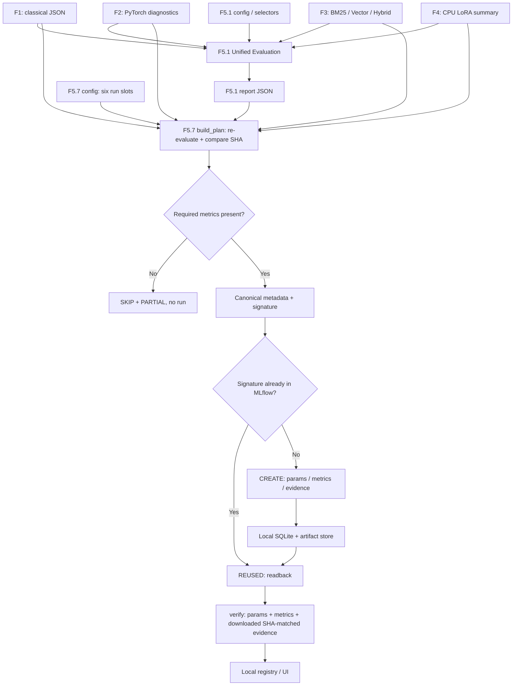

# F5.7 — MLflow Experiment Tracking: проверяемый импорт результатов F1–F4

## 1. Цель этапа

Создать воспроизводимый **реестр экспериментальных запусков** для ML Engineering Lab, в котором сохранённые результаты классификации, поиска и короткого обучения LLM представлены отдельными сущностями MLflow. Этап не обучает модели заново и не выполняет inference. Источником числовых значений служит проверенный **F5.1 Unified Evaluation**, а исходные JSON предыдущих фаз используются для независимой проверки SHA-256 и актуальности отчёта.

**Входы:**

- `configs/f5_01_unified_evaluation.json` — утверждённое соответствие источников, JSON selectors и метрик;
- `reports/public/f5_01/F5_01_unified_evaluation.json` — фактические измерения F1–F4, полученные F5.1;
- исходные JSON F1, F2, F3, F4 по конкретным путям из F5.1 (не копируются в MLflow);
- `configs/f5_07_mlflow_tracking.json` — план импорта шести независимых run-slots.

**Выходы:**

- локальная SQLite-база с параметрами, метриками, тегами и состояниями запусков;
- локальные JSON-артефакты `evidence.json` для каждого настоящего импортированного run;
- при запросе — JSON-реестр ID созданных / повторно использованных runs;
- readback-проверка фактических параметров, метрик, статуса и содержимого артефакта.

Число шесть — **ожидаемая вместимость плана, а не фиксированное количество реальных запусков**. При отсутствии обязательной метрики конкретный слот пропускается. В MLflow не записываются нули вместо отсутствующих результатов. F5.7 не утверждает, что импортированные runs возникли в процессе нового запуска моделей; каждый помечается `origin=F5.1_extracted_metrics_only` и `model_execution=NOT_EXECUTED`.

Технические ограничения: Python 3.13, локальный CPU, без интернета во время работы с уже установленным MLflow, без GPU и весов Qwen. Реестр не содержит единого числового score для разных типов задач.

## 2. Что реализовано

| Новый файл | Назначение и основные элементы |
|---|---|
| `configs/f5_07_mlflow_tracking.json` | Версия протокола, имя experiment, входы F5.1, шесть имён runs, mapping `source_id` / `metric_prefix` / `required_metrics` |
| `src/tracking_f5/__init__.py` | Граница модуля tracking; без тяжёлых импортов при выполнении `plan` |
| `src/tracking_f5/mlflow_tracking.py` | `build_plan()`, `tracking_storage()`, `sync_runs()`, `_readback()`; строгая проверка provenance, создание/повторное использование runs и readback артефактов |
| `scripts/f5_mlflow.py` | CLI `plan`, `import`, `verify`, `list` и внешний `--registry-output` |
| `tests/test_f5_mlflow.py` | Контрактные, отрицательные, идемпотентные тесты; при наличии MLflow — реальная интеграция с SQLite и файловыми artifacts |
| `requirements-f5_07.txt` | Зафиксированная версия полнофункционального MLflow для локальных экспериментов и UI |
| `.github/workflows/f5_07_mlflow.yml` | Изолированный Python 3.13 workflow; MLflow устанавливается обязательно, реальная интеграция с SQLite не может быть пропущена в CI |
| `docs/steps/F5_07_mlflow_tracking.md` | Данный учебно-технический документ: алгоритм, формулы, сценарии, проверки и ограничения |

Файлы F1–F5.6 и `README.md` не изменяются. В поставку не включаются `mlruns`, SQLite-базы, содержимое пользовательских данных, пароли, токены, model checkpoints, веса и произвольные источники F4.7.

## 3. Последовательность реализации

### Шаг 1. Зафиксировать набор экспериментов

**Действие:** подготовить однозначные run-slots в конфигурации F5.7.

**Назначение:** не объединять в одну запись несопоставимые экспериментальные протоколы и не изобретать количество фактически проведённых тренировок.

**Реализация:** конфигурация перечисляет `f1_classical`, `f2_pytorch`, `f3_bm25`, `f3_vector`, `f3_hybrid`, `f4_lora_sft`. Для каждого указаны ID источника F5.1, обязательные метрики и префикс выделения. Например, `f3_vector` фильтрует `vector_recall_at_5` и `vector_mrr_at_5`, переименовывая их в `recall_at_5` и `mrr_at_5` внутри конкретного run.

**Результат:** один source F3 разложен на три корректных сравниваемых метода; каждый метод сохраняет собственный run и `dataset=f3_06_synthetic_80_queries`.

### Шаг 2. Повторно подтвердить F5.1

**Действие:** проверить существующий отчёт относительно текущих JSON-источников.

**Назначение:** не логировать устаревшие или изменённые после анализа числа.

**Реализация:** `build_plan()` вызывает `build_report()` из `src/evaluation_f5/unified_report.py`, выполняя извлечение метрик заново из разрешённых JSON selectors, затем строго сравнивает объект с сохранённым F5.1 JSON. Для каждого source вычисляется SHA-256 оригинальных байтов и сравнивается с `source.sha256`.

**Результат:** изменённая метрика или подменённый отчёт отвергаются до создания нового MLflow run. Исправление — воспроизвести F5.1, а не вручную редактировать реестр MLflow.

### Шаг 3. Отделить готовые записи от неполных

**Действие:** проверить `required_metrics` для каждого слота.

**Назначение:** предотвращать тихую подстановку отсутствующих значений и «шесть успешных экспериментов» без измерений.

**Реализация:** `build_plan()` группирует только реально извлечённые метрики с учётом префикса. Для F1 (test) и F2 (validation) требуется `macro_f1`, для каждого retrieval-метода `recall_at_5`, для F4 `validation_loss_after`. Отсутствующая обязательная метрика создаёт `SKIP` с причиной, но не MLflow run. При отсутствии всех шести `import` возвращает ошибку. Дополнительные необязательные показатели сохраняются только если извлечены.

**Результат:** реальный `run_count` зависит от наличия измерений; статус `PASS` для плана ставится только при 6/6 подготовленных записей, иначе `PARTIAL`.

### Шаг 4. Сформировать provenance и безопасный artifact

**Действие:** сохранить машинно-проверяемую идентичность измерений.

**Назначение:** связывать значения с источником, протоколом, dataset/split и конфигурацией, не копируя необработанные примеры.

**Реализация:** `Record.summary()` создаёт разрешённый JSON с `phase`, `task`, `dataset`, `split`, `protocol`, `source_path`, `source_sha256`, списком числовых `metrics`, их `units`, точных JSON `selectors` и `signature`. В artifact не попадают исходные тексты, вопросы, ответы, пользовательские ID и полные промежуточные отчёты.

**Результат:** один компактный `evidence.json` на run, пригодный для readback и проверки происхождения.

### Шаг 5. Настроить локальную SQLite и artifacts

**Действие:** указать изолированное внешнее хранилище.

**Назначение:** не включать рабочую MLflow базу в Git и не зависеть от старой реализации файлового `mlruns` backend.

**Реализация:** `tracking_storage()` формирует `sqlite:///.../tracking.db` и `file:///.../artifacts` для каталога `$HOME/ML_Engineering_Lab_MLflow`. Используется `MlflowClient(tracking_uri=...)`. Эксперимент создаётся с явно заданным локальным artifact location. Если имеющийся experiment с тем же именем настроен на другой artifact store — операция блокируется.

**Результат:** SQLite хранит metadata, отдельный файловый каталог — компактные sanitized evidence; оба находятся за пределами репозитория.

### Шаг 6. Создать MLflow runs

**Действие:** записать параметры, метрики, теги и artifact в MLflow через реальный SDK.

**Назначение:** превратить разрозненные сохранённые результаты в доступные для поиска runs.

**Реализация:** `sync_runs(create=True)` создаёт experiment при отсутствии и вызывает API `MlflowClient.create_run`, `log_param`, `log_metric`, `log_artifact`, `set_terminated(status="FINISHED")`. Перед записью выполняется поиск предыдущего run с той же `signature`. Если аналог существует, создаётся не новый run, а результат `REUSED` после повторной проверки.

**Результат:** каждый новый run получает только собственные метрики, безопасные параметры и один `evidence.json`; повторный импорт неизменённых исходников не размножает записи.

### Шаг 7. Прочитать фактически сохранённое

**Действие:** проверить содержимое MLflow после импорта.

**Назначение:** отличить успешный API-вызов от действительно сохранённых корректных данных.

**Реализация:** `_readback()` считывает run с `client.get_run()`, сверяет `FINISHED`, identity tags, ключи и значения metrics, params, затем загружает `evidence.json` через `client.download_artifacts()` и побайтово сравнивает его с ожидаемым canonical JSON.

**Результат:** при любой рассинхронизации команда `verify` завершается ошибкой, даже если источник F5.1 остался неизменным.

### Шаг 8. Отдельно сохранить список runs

**Действие:** сформировать локальный реестр запусков по запросу.

**Назначение:** облегчить навигацию и проверки без публикации неустойчивых локальных run IDs.

**Реализация:** `scripts.f5_mlflow import --registry-output <path>` записывает фактические `run_id`, `CREATED`/`REUSED`, `metric_count`, SHA, причины пропусков и итоговое число. При отсутствии `--registry-output` CLI выводит результат только в терминал. `list` читает локальную базу MLflow.

**Результат:** реестр создаётся только при явном указании файла, рекомендуемое расположение — вне Git.

### Шаг 9. Проверить уровни тестирования

**Действие:** разделить доступную контрактную проверку и настоящую MLflow-интеграцию.

**Назначение:** не выдавать имитацию SDK за создание реальных runs.

**Реализация:** `tests/test_f5_mlflow.py` выполняет в памяти проверку import, reuse, изменённых значений, отрицательных сценариев, путей, fingerprint и неполного плана. `test_real_mlflow_sqlite_roundtrip` отдельно обращается к установленному `MlflowClient` и создаёт настоящие шесть runs в временной SQLite при наличии MLflow. GitHub Actions устанавливает библиотеку и выставляет `F5_07_REQUIRE_MLFLOW=1`, чтобы этот тест **не мог быть silently skipped** в CI.

**Результат:** локальные тесты протокола подтверждены; реальную MLflow-интеграцию в этой среде выполнить нельзя из-за отсутствия установленного пакета MLflow, поэтому статус `NOT VERIFIED` до запуска у пользователя и CI.

## 4. Алгоритм и математический пример

### 4.1. Импорт не изменяет смысл метрик

Для классификации используют, например, Macro F1, вычисленный исходным этапом F1/F2; при этом F1 — test, а F2.6 — validation, поэтому напрямую ранжировать по ним модели нельзя:

\[
\operatorname{MacroF1}=\frac{1}{C}\sum_{c=1}^{C}\frac{2P_cR_c}{P_c+R_c}.
\]

Здесь \(C\) — число классов, \(P_c\) и \(R_c\) — precision и recall для класса \(c\); в случае нулевого знаменателя правило обработки определяется исходным экспериментом. F5.7 не повторяет расчёт по prediction/target, а логирует уже измеренное значение и фиксирует его источник.

Для retrieval Recall@5 определён ранее по qrels:

\[
\operatorname{Recall@5}=\frac{1}{N}\sum_{q=1}^{N}\frac{|\operatorname{Top5}(q)\cap\operatorname{Rel}(q)|}{|\operatorname{Rel}(q)|}.
\]

В лабораторном frozen benchmark F3.6 \(N=80\). Знаменатель \(|\operatorname{Rel}(q)|\) должен быть положительным — это свойство frozen qrels. F5.7 не пересчитывает ранжирование, не смешивает BM25, Vector и Hybrid и не обновляет эти модели.

Для F4 отдельно логируются `train_loss`, `validation_loss_before`, `validation_loss_after`, `optimizer_steps`. Разность \(\Delta L=L_{after}-L_{before}\) можно интерпретировать только на конкретной validation-выборке и конкретном коротком CPU эксперименте. **Один optimizer step не демонстрирует тренд обучения или улучшение качества генерируемых ответов.**

### 4.2. Idempotency key и SHA-256

Для каждого run собирается набор из имени, исходного source ID, phase/task, dataset/split/protocol, исходного SHA-256, доступных числовых метрик, единиц, selectors и fingerprint конфигурации F5.7.

\[
K=\operatorname{SHA256}(\operatorname{CanonicalJSON}(\text{run metadata})).
\]

CanonicalJSON — UTF-8 JSON с упорядоченными ключами, фиксированными разделителями и завершающим LF. При одинаковом \(K\) создаваемый run сначала ищется в MLflow. Если найден, его readback должен соответствовать всем сохранённым значениям. При изменении входных данных fingerprint меняется; формируется новый run без удаления исторического.

**Учебный числовой пример (не реальные метрики проекта):** `f3_bm25` имеет Recall@5 = `0.40`, `f3_vector` = `0.60`, `f3_hybrid` = `0.50`. Эти три числа логируются в три разных runs с одинаковым протоколом и dataset. Изменение Recall@5 BM25 на `0.42` создаёт новую сигнатуру только BM25; остальные два runs повторно используются. Если фактическая метрика не извлечена из источника, примерные значения `0.40`, `0.60`, `0.50` **не используются** ни в отчёте, ни при импорте.

### 4.3. Что сохраняется и что не сохраняется

| В MLflow | Не в MLflow |
|---|---|
| Измеренные metrics со своими ключами и units в evidence | Общая «оценка проекта» из разных задач |
| Phase/task/dataset/split/protocol как params | Полные Q&A, тексты ответов Base/LoRA |
| SHA-256 источника и signature как provenance | Веса Qwen, адаптер LoRA, checkpoints |
| Один безопасный `evidence.json` на run | Псевдозапуски модели для заполнения числа 6 |
| Состояния `FINISHED` и `FAILED` | Недоказанное улучшение качества или безопасности |

## 5. Схема работы



Границы ответственности: F1–F4 измеряют результаты; F5.1 извлекает и фиксирует значения; F5.7 переносит эти значения в SQL-backed experiment tracking. CLI и GitHub Actions не запускают повторное обучение.

## 6. Локальная проверка PowerShell

Запускать **из корня** `F:\DEVELOPMENT\ML\ml-engineering-lab` в окружении Python 3.13.2.

### 6.1. Установка зависимости именно F5.7

```powershell
cd F:\DEVELOPMENT\ML\ml-engineering-lab
.\.venv\Scripts\python.exe -m pip install -r requirements-f5_07.txt
.\.venv\Scripts\python.exe -m pip show mlflow
```

Версия закреплена в `requirements-f5_07.txt`, установка не выполняется автоматически из тестов. Если PyPI недоступен, результат интеграции остаётся `NOT VERIFIED`.

### 6.2. Тесты F5.7 и общая регрессия

```powershell
.\.venv\Scripts\python.exe -m pytest tests/test_f5_mlflow.py -q -ra

.\.venv\Scripts\python.exe -m pytest `
  tests/test_f5_unified_report.py `
  tests/test_f5_llm_diagnostics.py `
  tests/test_f5_safety_benchmark.py `
  tests/test_f5_api.py `
  tests/test_f5_docker.py `
  tests/test_f5_ci_contract.py `
  tests/test_f5_ci_integration.py `
  tests/test_f5_ci_regression.py `
  tests/test_f5_mlflow.py -q
```

В среде подготовки без MLflow прошли **31 тест F5.7**, `1 skipped` (настоящая SQLite-интеграция). Вместе с F5.1–F5.6 — **291 passed, 1 skipped**. После установки MLflow ожидается дополнительный выполненный интеграционный тест, но его успешность проверяется фактически, а не объявляется заранее.

### 6.3. Проверка F5.1 перед импортом

```powershell
.\.venv\Scripts\python.exe -m scripts.f5_unified_report --check

# Только при отсутствии/устаревании F5.1: повторная сборка из текущих JSON
.\.venv\Scripts\python.exe -m scripts.f5_unified_report

.\.venv\Scripts\python.exe -m scripts.f5_mlflow plan
```

`plan` не требует установленного MLflow: печатает `READY`, `SKIP` и количество доступных записей. Если каких-либо метрик в реальных файлах нет, будет `PARTIAL` без подстановки результатов.

### 6.4. Настоящий импорт, readback и идемпотентность

```powershell
.\.venv\Scripts\python.exe -m scripts.f5_mlflow import `
  --registry-output "$HOME\Documents\ML_Engineering_Lab_F5_07_run_registry.json"

.\.venv\Scripts\python.exe -m scripts.f5_mlflow verify

# Повторить: при неизменных источниках ожидается REUSED, а не новые runs
.\.venv\Scripts\python.exe -m scripts.f5_mlflow import

.\.venv\Scripts\python.exe -m scripts.f5_mlflow list
```

Наблюдаемые статусы: `F5.7 PASS: verified=6/6` **только при реально найденных шести наборах метрик и полностью проверенном MLflow**, `F5.7 PARTIAL: verified=N/6` при меньшем количестве. `CREATED` означает запись нового run, `REUSED` — повторное чтение уже существующего.

### 6.5. Локальный MLflow UI

```powershell
$db = (Join-Path $HOME "ML_Engineering_Lab_MLflow\tracking.db") -replace '\\','/'
$trackingUri = "sqlite:///$db"
.\.venv\Scripts\mlflow.exe server --backend-store-uri $trackingUri --host 127.0.0.1 --port 5000
```

После запуска локально открыть `http://127.0.0.1:5000`. Для остановки использовать `Ctrl+C`. Не публиковать этот сервер в интернет и не использовать `--host 0.0.0.0` без отдельной настройки защиты.

### 6.6. Проверка CI

После `git push` открыть GitHub Actions → **F5.7 MLflow Tracking CI** → job `mlflow-sqlite`. Workflow устанавливает pinned MLflow и выполняет тест с реальной временной SQLite. Наличие `F5_07_REQUIRE_MLFLOW=1` делает отсутствующую библиотеку ошибкой, а не безусловным skip. Старый workflow F2.1 не отключён и не изменён.

## 7. Что доказано тестами и какие ограничения остаются

**Подтверждено в среде сборки:**

1. Чтение реального протокола F5.1 и формирование шести записей из **искусственных тестовых JSON**.
2. Отказ от устаревших источников, отчётов с подменённым статусом и недопустимых путей (включая выход через symlink).
3. Пропуск записи без обязательной метрики и отказ от создания пустого набора runs.
4. Протокольная идемпотентность на MemoryClient, detection ошибок params/metrics/artifact и повторное создание только изменённой записи.
5. Детерминированная canonical serialization и привязка к source SHA.
6. Общая регрессия F5.1–F5.7: 291 passed, 1 skipped.

**НЕ подтверждено в среде сборки:**

- настоящие вызовы SQLite backend через `MlflowClient` (нет установленной библиотеки в изолированной среде подготовки);
- фактическое количество импортированных runs на Windows пользователя и содержание текущего F5.1;
- выполнение новой GitHub Actions job на удалённом runner;
- повторное обучение, изменение качества модели, performance, scalability или надёжность production deployment.

**Аппаратные ограничения:** реальный MLflow-тест не нуждается в GPU или загрузке Qwen; необходим только Python и MLflow с работоспособным SQLite. Изменение значения в исходном отчёте требует новой версии записи; исторический run сохраняется отдельно. База и artifacts остаются локальными, не входят в Git-архив.

**Для полного PASS:** выполнить `pytest tests/test_f5_mlflow.py -q -ra` с MLflow без skip, `plan`, `import`, `verify`, повторный `import` и подтвердить фактический статус F5.7. Проверить CI после push. Отчёты F1/F2/F3/F4 могут давать меньше шести slots — `PARTIAL` в этом случае корректен и означает неполноту источников, а не фиктивную успешность.

## 8. Основная мысль этапа

MLflow отделяет **историю измерений** от вычисления самих измерений. Для классификатора источником является зафиксированная оценка на test; для retrieval — отдельный frozen benchmark и ранжирующий метод; для короткого LoRA-обучения — фактические losses и количество шагов. Различные протоколы сохраняются как независимые runs, а их метрики не сводятся к единому score.

F2.6 хранит `best_val_macro_f1`, а F3.7 — агрегаты по `metrics.<method>.5`; это не test F2 и не синтетическая замена retrieval. Точный источник, SHA-256, dataset, split, protocol и JSON selector связывают каждое значение с конкретным артефактом. Изменение исходных данных или конфигурации приводит к новой подписи run, тогда как повторная обработка неизменённых данных использует старую запись и проверяет её целостность. Сама контрольная сумма подтверждает консистентность байтов, но не устанавливает независимую научную валидность исходного эксперимента.

Локальная SQLite-база даёт интерфейс поиска и сравнения запусков без публикации тяжёлых артефактов. Запись в tracking system не является повторным обучением модели и не доказывает улучшение качества, безопасность, переносимость на другие данные или готовность к production эксплуатации. Полное инженерное подтверждение этапа требует фактических MLflow runs и их readback на пользовательской машине или CI.

## 9. Файлы, с которыми стоит познакомиться

| Очередность | Путь | Что изучить |
|---:|---|---|
| 1 | `configs/f5_01_unified_evaluation.json` | Какие источники и selectors разрешены; почему метрики разных фаз имеют разные units |
| 2 | `src/evaluation_f5/unified_report.py` | `build_report`, проверка JSON и SHA, защита от некорректных значений; независимый контракт F5.1 |
| 3 | `configs/f5_07_mlflow_tracking.json` | Six-slot mapping и `required_metrics`; отделение BM25, Vector и Hybrid |
| 4 | `src/tracking_f5/mlflow_tracking.py` | `build_plan`, `Record.summary`, `sync_runs`, `tracking_storage`, `_readback`; provenance/idempotency/readback |
| 5 | `scripts/f5_mlflow.py` | CLI-процедуры планирования, импортирования, проверки, инвентаризации и сериализации registry |
| 6 | `tests/test_f5_mlflow.py` | Негативные сценарии, MemoryClient vs настоящий `MlflowClient`, SQLite roundtrip и повторный импорт |
| 7 | `.github/workflows/f5_07_mlflow.yml` | Условия запуска CI, Python 3.13, pinned dependencies, обязательность SQLite-интеграции |
| 8 | `requirements-f5_07.txt` | Версия MLflow, разделение SDK, SQLite backend, artifact store и UI |
| 9 | `scripts/f5_unified_report.py` | Команда `--check` для проверки актуальности входных данных перед импортом |
| 10 | `src/testing_f5/ci_matrix.py` | Отличие старой F5.6 regression от нового отдельного F5.7 MLflow integration профиля |

Официальные технические источники: https://mlflow.org/docs/latest/tracking/backend-stores/ и https://mlflow.org/docs/latest/api_reference/python_api/mlflow.client.html. Данные из источников не заменяют проверку работы установленного SDK на актуальном checkout.
