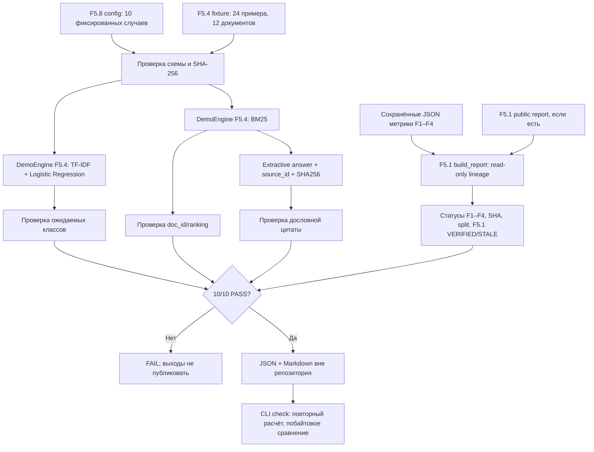

# F5.8 — Offline CLI Demo: однокомандная воспроизводимая демонстрация

## 1. Цель этапа

**Назначение.** Подготовить один исполняемый CLI-сценарий, демонстрирующий уже реализованные ML-компоненты в отсутствие интернет-соединения и без повторного обучения большой языковой модели. Результат должен воспроизводиться на CPU, записывать минимальные подтверждения выполнения и не изменять ранее полученные эксперименты F1–F4, F5.1–F5.7, модели, SQLite-базу MLflow или репозиторий.

**Входы:** фиксированная конфигурация `configs/f5_08_offline_demo.json`; synthetic-набор F5.4 `tests/fixtures/f5_04_api_demo_v1.json`; его версия из `configs/f5_04_api.json`; существующий код `DemoEngine` и построитель отчётов F5.1. Если локальные отчёты F1–F4 присутствуют, добавить в итоговый аудит сведения о наличии и SHA-256 исходных агрегатов. Ни один исходный документ F1/F2 не включать в публикационные выходные файлы.

**Выходы:** два UTF-8 файла вне корня Git — `F5_08_offline_demo.json` и `F5_08_offline_demo.md`. Первый сохраняет числа и структурированные исходы контрольных сценариев; второй содержит учебно-понятную сводку и ограничения.

**Граница демонстрации:** F5.8 исполняет **алгоритмы F5.4 на независимой учебной синтетике**, а не обученные модели F1/F2, pretrained encoder F3 или Qwen F4. Чтение сводных метрик F1–F4 через F5.1 не заменяет повторного измерения качества и не добавляет новый training run. F5.8 не запускает Docker, MLflow, GitHub Actions и отдельный HTTP-сервер.

**Условие PASS:** десять реальных CPU-сценариев завершены без ошибок; fixture прошла SHA-256-проверку; дословные цитаты согласуются с источниками; `check` подтвердил байтовую идентичность отчётов; выход создан вне репозитория и не перезаписал чужие файлы. Полнота F1–F4 отражается отдельным статусом и не подменяет функциональный PASS демонстрации.

## 2. Что реализовано

| Новый файл | Назначение | Основной интерфейс и связи |
|---|---|---|
| `configs/f5_08_offline_demo.json` | Замороженные 10 сценариев: 5 классификационных, 3 поисковых и 2 extractive QA | Фиксированные `id`, `task`, `text`, `expect`, SHA256 fixture F5.4 |
| `src/demo_f5/__init__.py` | Объявление пакета | Не выполняет побочных действий |
| `src/demo_f5/offline_demo.py` | Валидация, исполнение, происхождение данных, вывод JSON/MD | `load_config`, `evaluate_cases`, `build_demo`, `json_bytes`, `markdown_bytes`, `run`; повторное использование `DemoEngine`, `build_report` |
| `scripts/f5_offline_demo.py` | Однокомандный CLI | `main`, команды `run` и `check`, `--root`, `--output-dir` |
| `tests/test_f5_offline_demo.py` | Unit, integration, regression и отрицательные проверки F5.8 | Офлайн-исполнение, tamper detection, отсутствие перезаписи, F1–F4 lineage |
| `.github/workflows/f5_08_offline_demo.yml` | Проверки в чистом GitHub runner | Python 3.13, pytest F5.8, `run`, `check`, загрузка двух demo-отчётов как CI artifacts |
| `docs/steps/F5_08_offline_cli_demo.md` | Настоящий учебно-технический документ | Девять обязательных разделов |
| `docs/phases/F5_FINAL_PHASE_SUMMARY.md` | Итоговая карта F1–F5 | Границы доказательств, компоненты, вводные команды и требования к portfolio-ready |

**Не изменяются:** `README.md`, алгоритмы и метрики F1–F4, существующие исходники F5.1–F5.7, `Dockerfile`, модельные веса, `data/`, `mlruns/`, SQLite-база MLflow и прежние отчёты.

## 3. Последовательность реализации

### Шаг 1. Зафиксировать контрольные задачи

**Действие:** определить десять сценариев с конкретным ожидаемым результатом и неизменным порядком.

**Назначение:** исключить подбор удобных запросов после получения ответа и обеспечить возможность вычислить точное количество успешных проверок.

**Реализация:** `load_config()` проверяет схему `schema_version=1`, идентификаторы, принадлежность типа к `classify/search/ask`, обязательные поля, корректность `top_k` и валидность ожидаемых значений. Сценарии фиксированы как пять классификаций (четыре метки и один `no_features`), три поиска (два найденных документа и один пустой результат) и два QA (дословный ответ и `no_evidence`). Дубликаты ключей JSON, `NaN`, `Infinity`, неправильные поля и лишние сценарии отвергаются.

**Результат:** конфигурация допускает выполнение ровно десяти заранее известных сценариев.

### Шаг 2. Проверить неизменность корпуса

**Действие:** загрузить synthetic fixture F5.4 и сравнить её SHA-256 с обеими конфигурациями.

**Назначение:** запретить незаметное изменение текстов или целевых результатов перед демонстрацией.

**Реализация:** `load_demo()` из `src/api_f5/demo_service.py` проверяет размер, схему, метки, уникальные `doc_id`, `source_id`, количество документов и обучающих примеров, а также хеш файла. F5.8 дополнительно сопоставляет `fixture_id` и `fixture_sha256` с собственным манифестом.

**Результат:** 24 synthetic-обучающих примера по четырём классам и 12 synthetic-документов; модифицированная fixture блокирует запуск.

### Шаг 3. Выполнить классификацию

**Действие:** вычислить класс и score для четырёх технических запросов и отдельно обработать запрос без признаков.

**Назначение:** показать реальные этапы векторизации и предсказания, не заменяя вычисление заранее написанными ответами.

**Реализация:** `DemoEngine.classify()` использует `TfidfVectorizer` с unigram/bigram и `LogisticRegression` на 24 разрешённых примерах. Возвращаемый класс сравнивается с `expect.label`. Если признаков в словаре нет, необходимо получить `status=no_features`, `label=null`, `score=null`. Для воспроизводимого отчёта числовой score округляется до восьми знаков; оценка не приписывается модели F1.

**Результат:** `classify_python`, `classify_linux`, `classify_sql`, `classify_ml`, `classify_unknown` — 5/5 в локальном тесте исходной конфигурации.

### Шаг 4. Выполнить поиск и проверку пустой выдачи

**Действие:** сформировать ранжирование BM25 на двух запросах и пустую выдачу при отсутствии совпадений.

**Назначение:** подтвердить, что retrieval использует числовое ранжирование, а не прямую таблицу ожидаемых ответов.

**Реализация:** `DemoEngine.search()` вычисляет BM25 для 12 документов, сортирует по убыванию score с детерминированным разрешением ничьих по `doc_id`, возвращает первые `top_k`. Проверяется `first_doc_id`, конечность и положительность скорингов; для запроса без совпадений проверяется отсутствие документов.

**Результат:** `search_sql` → `sql_02`, `search_linux` → `linux_02`, `search_unknown` → пустая выдача; 3/3.

### Шаг 5. Получить ответ с проверяемым provenance

**Действие:** извлечь предложение из найденного документа и независимо проверить цитату.

**Назначение:** различать дословно подтверждённый текст и свободную генерацию LLM.

**Реализация:** `DemoEngine.ask()` возвращает `mode`, `answer`, `doc_id`, `source_id`, границы `start/end`, `quote` и SHA-256 полного текста. `evaluate_cases()` самостоятельно ищет исходный документ, проверяет интервал в Python-символах, равенство `doc.text[start:end] == quote == answer`, соответствие `source_id` и `text_sha256`. При отсутствии BM25 evidence должен вернуться `mode=no_evidence` с `answer=null` и пустым массивом доказательств.

**Результат:** `ask_python` → `python_01` и подтверждённая цитата; `ask_unknown` → `no_evidence`; 2/2.

### Шаг 6. Проверить происхождение F1–F4

**Действие:** повторно прочитать сохранённые агрегаты F1–F4 через проверенный F5.1 extractor.

**Назначение:** включить в финальную демонстрацию проверку сохранённой истории проекта, не переобучая модели и не раскрывая сырые данные.

**Реализация:** `_lineage()` вызывает `build_report()` из `src/evaluation_f5/unified_report.py`. Для каждого источника сохранить только фазу, `source_id`, split/protocol, статус, SHA-256 файла и количество метрик. Если существует `reports/public/f5_01/F5_01_unified_evaluation.json`, сравнить его содержимое со вновь вычисленным отчётом. `VERIFIED` означает структурную идентичность; `STALE` означает изменившиеся результаты; `NOT_AVAILABLE` — отсутствие сохранённого F5.1. Никакие метрики разных задач в один score не складываются.

**Результат:** на чистом synthetic checkout демонстрация воспроизводима даже при недоступных исходных файлах F1–F4 — для них отдельно показывается `PARTIAL`, а не фиктивная полнота. На компьютере с актуальными четырьмя источниками и неизменным F5.1 ожидается статус `VERIFIED` и полнота 4/4.

### Шаг 7. Сформировать отчёты без модификации репозитория

**Действие:** сформировать канонические JSON и Markdown, вычислить их содержимое до записи.

**Назначение:** исключить случайные timestamps, абсолютные пути, перезапись исходных экспериментов и неявную генерацию файлов в рабочей ветке.

**Реализация:** `json_bytes()` использует `ensure_ascii=False`, `sort_keys=True`, `allow_nan=False` и UTF-8/LF. `markdown_bytes()` отражает результаты, статус F1–F4 lineage и ограничения. `run()` запрещает размещать output внутри репозитория, проверяет отсутствие существующего каталога, записывает два файла во временный каталог соседнего уровня и переименовывает временный каталог в окончательный. Повторная команда `run` намеренно отказывает в перезаписи; для контроля используется `check`.

**Результат:** два файловых артефакта вне Git, сохранённые без model weights, секретов и raw dataset.

### Шаг 8. Повторно проверить и зарегистрировать доказательства

**Действие:** повторно построить результаты, сопоставить файлы и запустить автоматические тесты.

**Назначение:** обнаруживать несогласованные источники и повреждение отчётов после первого запуска.

**Реализация:** `python -m scripts.f5_offline_demo check` повторяет расчёт и побайтово сверяет JSON/MD. `tests/test_f5_offline_demo.py` дополнительно проверяет ложный ожидаемый класс, изменение метрик F1–F4, подмену корпуса, невозможность записи в репозиторий, сетевой запрет и разделение статусов `PASS/PARTIAL`.

**Результат:** в окружении разработки выполнены 43 теста F5.8; общая локальная регрессия F5.1–F5.8 — 335 passed, 1 skipped (MLflow не установлен в среде тестирования). Удалённый CI и локальный Windows запуск F5.8 на компьютере пользователя ещё требуют отдельного подтверждения.

## 4. Алгоритм и математический пример

### 4.1. TF-IDF и Logistic Regression

Для слова `t` в документе `d` TF-IDF учитывает частоту терма и обратную частоту по корпусу, а `TfidfVectorizer` дополнительно нормирует вектор. В обучающей части используется фиксированная конфигурация F5.4 и словарь, полученный по **24 synthetic** примерам. Для класса `c` логистическая регрессия вычисляет линейный score и преобразует набор скорингов в нормализованные вероятности.

В исходном локальном прогоне запрос `Python enumerate start индекс` получил метку `python` со score около `0.37203303`. Score — относительная оценка выбранного класса внутри демонстрационного классификатора, не показатель точности на внешней выборке. Для `xyzunknowntoken93654` вектор не содержит ни одного известного признака: **предсказание намеренно не формируется**.

### 4.2. BM25

Для множества терминов запроса используется:

\[
\operatorname{BM25}(q,d)=\sum_{t\in q}\log\left(1+\frac{N-df(t)+0.5}{df(t)+0.5}\right)\frac{tf(t,d)(k_1+1)}{tf(t,d)+k_1\left(1-b+b\frac{|d|}{\overline{|d|}}\right)}
\]

где `N=12` — число документов, `tf(t,d)` — частота терма в документе, `df(t)` — число документов с термом, `|d|` — длина документа, `k1=1.5`, `b=0.75`. На запросе `SQL HAVING GROUP BY` исходный демозапуск дал ранжирование: `sql_02` со score около `8.33462791`, затем `sql_01` со score около `1.43011469`. Разность не является вероятностью релевантности; значения имеют смысл только внутри данного протокола BM25.

### 4.3. Дословная цитата и SHA-256

Для документа `python_01` в качестве ответа выбрано предложение:

> В Python range(2, 7, 2) создаёт числа 2, 4, 6.

Проверка использует `doc.text[start:end] == quote == answer` и

\[
H=\operatorname{SHA256}(\operatorname{UTF8}(doc.text)).
\]

Это доказывает совпадение ответа с сохранённым документом данного набора, но **не доказывает фактическую истинность любого внешнего утверждения**. SHA-256 здесь защищает идентичность локального текста, а не подлинность неизвестного внешнего источника.

### 4.4. Детерминированный аудит

Для десяти сценариев вычисляется доля успешных контрактных проверок:

\[
\operatorname{ContractPassRate}=\frac{\sum_{i=1}^{10}\mathbf{1}[\operatorname{pass}_i]}{10}.
\]

В локальном прогоне `10/10 = 1.0` означает успешное выполнение **заранее заданных сценариев на synthetic fixture**. Это не Accuracy классификатора на реальном наборе, не F3 Recall@5 и не качество LLM. Контроль сохранённого отчёта F5.1 выполняется отдельно: заново построенное дерево JSON должно совпадать с сохранённым. Изменение метрики F1–F4 переводит её lineage в `STALE` и нарушает `check` уже сохранённого F5.8.

## 5. Схема работы



F5.8 не запускает OpenAPI, Docker, модель Qwen и MLflow: их статусы в отчёте помечаются как `NOT_EXECUTED_IN_DEMO`, а факт предыдущих ручных проверок остаётся в отдельной истории этапов.

## 6. Локальная проверка PowerShell

Команды выполнять **из корня** `F:\DEVELOPMENT\ML\ml-engineering-lab` с установленными зависимостями F5.4 (`requirements-f5_04.txt`). Дополнительных пакетов для F5.8 не требуется.

### 6.1. Проверка алгоритмов этапа

```powershell
cd F:\DEVELOPMENT\ML\ml-engineering-lab
.\.venv\Scripts\python.exe -m pytest tests/test_f5_offline_demo.py -q -ra
```

Ожидается `43 passed` при наличии права создавать symlink; при запрете Windows один symlink-тест может быть `skipped`. Системный pytest может вывести посторонние предупреждения библиотек, не являющиеся отказом сценариев.

### 6.2. Однокомандная offline-демонстрация

```powershell
.\.venv\Scripts\python.exe -m scripts.f5_offline_demo run
```

Результаты по умолчанию сохраняются в `Documents/ML_Engineering_Lab_F5_08_Demo` под пользовательским профилем Windows, **вне** корня Git. Если каталог уже существует, команда откажется его перезаписывать — используй `check` или выбери новый путь `--output-dir`.

```powershell
.\.venv\Scripts\python.exe -m scripts.f5_offline_demo check
```

При наличии исходных F1–F4 и актуального отчёта F5.1 ожидается `synthetic=10/10`, `F1-F4 sources=4/4`, `F5.1=VERIFIED`. При отсутствии части источников программа не создаёт фиктивные метрики: статус lineage останется частичным, хотя 10 synthetic-сценариев могут пройти.

### 6.3. Полная локальная регрессия F5.1–F5.8

```powershell
.\.venv\Scripts\python.exe -m pytest `
  tests/test_f5_unified_report.py `
  tests/test_f5_llm_diagnostics.py `
  tests/test_f5_safety_benchmark.py `
  tests/test_f5_api.py `
  tests/test_f5_docker.py `
  tests/test_f5_ci_contract.py `
  tests/test_f5_ci_integration.py `
  tests/test_f5_ci_regression.py `
  tests/test_f5_mlflow.py `
  tests/test_f5_offline_demo.py -q -ra
```

В рабочей сборке без MLflow выполнено `335 passed, 1 skipped`. На твоём Windows MLflow установлен: при сохранении тех же версий исходников и зависимостей интеграционный тест MLflow должен выполняться; возможны отдельные пропуски symlink-тестов. Не интерпретировать число тестов из другого окружения как уже состоявшийся Windows-прогон.

### 6.4. GitHub Actions

После публикации проверить workflow **`F5.8 Offline CLI Demo`** в `Actions`. На чистом CI runner F1–F4 локальные метрики могут отсутствовать, но это **не блокирует synthetic smoke**. Успешный run/check подтверждает офлайн-механизм F5.8, а не повторное обучение предыдущих фаз. Версия Python: `3.13`. Тесты используют разрешённые зависимости после отдельной установки пакетов; собственно демонстрация не выполняет HTTP-запросов.

## 7. Что доказано тестами и какие ограничения остаются

**Подтверждено локально:** выполнены десять независимых synthetic-сценариев; реальная классификация и BM25 работают через существующий `DemoEngine`; входная fixture закреплена SHA-256; QA возвращает источник и дословный фрагмент; неизвестные запросы не порождают уверенных ответов; JSON и Markdown детерминированы; повторный `run` не перезаписывает результаты; `check` выявляет изменения данных, конфигурации и отчёта; тесты блокируют сохранение внутри Git и сетевые вызовы.

**Не подтверждено данным этапом:** качество F1/F2 на новом test; пригодность F3 за пределами frozen benchmark; повышение качества ответов Qwen; экспертная правильность F4.7; качество открытой RAG-генерации; безопасность реальной LLM; production readiness FastAPI/Docker; реальный вызов Docker/MLflow в рамках F5.8; отсутствие всех потенциальных сетевых вызовов в сторонних библиотеках на любой платформе.

**Ограничения данных и оборудования:** синтетическая обучающая коллекция F5.4 состоит из 24 примеров и 12 документов; этот размер недостаточен для выводов о генерализации. На чистом клоне нет локальных экспериментальных данных F1/F2, а в F3 отсутствует pretrained embedding cache; F5.8 это учитывает и не скачивает веса. Данные, не включённые в репозиторий, необходимо проверять отдельно в локальной среде их исполнения.

**Что требуется для окончательной приёмки:** выполнить `pytest`, `run`, `check` на Windows; проверить результат provenance `F5.1=VERIFIED` и четыре доступных источника при ожидаемом сохранённом состоянии; проверить запуск `F5.8 Offline CLI Demo` на GitHub Actions; убедиться, что Git-коммит не включает ни одного файла из `Documents`, `data`, SQLite или локальных raw/weights. Для заявлений о воспроизводимости всего F1–F5 на чистом клоне нужны отдельные независимые эксперименты и соответствующие разрешённые данные.

## 8. Основная мысль этапа

Offline CLI Demo переводит реализованные модули из набора разрозненных учебных упражнений в воспроизводимый инженерный сценарий. Для подтверждения корректности исполнения необходимо сначала проверить идентичность фиксированного корпуса, затем вызвать уже существующие классификатор, поисковый индекс и extractive-ответ, сопоставить реальные outputs с неизменёнными условиями и проверить происхождение цитат.

Детерминированность результата достигается фиксацией сценариев и данных, отсутствием сетевого обращения за модельными весами, единым форматом сериализации и отказом от автоматической перезаписи существующего каталога. После формирования артефактов повторный `check` независимо пересчитывает их и сравнивает байтовое представление. Проверка должна отклонять любую подмену исходных данных или ранее записанных файлов.

Итоговое состояние F1–F5 имеет несколько разных уровней доказательств. Исполнение synthetic demo подтверждается его тестами; наличие результатов F1–F4 — проверкой сохранённых агрегатов и SHA; MLflow/Docker и другие инфраструктурные проверки сохраняют собственные независимые протоколы. Ни один из этих уровней не заменяет отдельного измерения прикладного качества модели. Портфолио должно явно показывать как подтверждённые возможности, так и ограничения каждого уровня.

## 9. Файлы, с которыми стоит познакомиться

| Порядок | Файл | Что именно изучить |
|---:|---|---|
| 1 | `configs/f5_08_offline_demo.json` | Контракт десяти примеров, ожидаемые метки, ID документов, версии fixture |
| 2 | `src/demo_f5/offline_demo.py` | `load_config()` и защита JSON; `evaluate_cases()` и независимые проверки evidence; `_lineage()` и чтение F5.1; `run()` и атомарный вывод вне репозитория |
| 3 | `scripts/f5_offline_demo.py` | `main()`, различия `run`/`check`, коды завершения, безопасный default output |
| 4 | `src/api_f5/demo_service.py` | `DemoEngine`, `classify()` TF-IDF/LogReg, `search()` BM25 и `ask()` с точной цитатой |
| 5 | `configs/f5_04_api.json` | Параметры BM25, SHA-256, размеры учебной выборки |
| 6 | `tests/fixtures/f5_04_api_demo_v1.json` | 24 synthetic examples и 12 коротких документов, на которых работает демо |
| 7 | `src/evaluation_f5/unified_report.py` | `build_report()` и `SourceResult`: выжимка F1–F4 без общего score и без воспроизведения обучения |
| 8 | `configs/f5_01_unified_evaluation.json` | Точные source selectors, протоколы, split, units и ограничения отчёта F5.1 |
| 9 | `tests/test_f5_offline_demo.py` | Проверки подмены, отсутствия сети, согласованности JSON/MD и F1–F4 lineage |
| 10 | `.github/workflows/f5_08_offline_demo.yml` | Python 3.13, автоматический run/check на GitHub runner |
| 11 | `src/tracking_f5/mlflow_tracking.py` | Отдельный механизм регистрации существующих результатов в SQLite (не запускается F5.8) |
| 12 | `src/testing_f5/ci_matrix.py` | Исторический профиль регрессии F5.6, сохраняющий независимость CI от CLI-демонстрации |

Сопутствующий итоговый обзор: `docs/phases/F5_FINAL_PHASE_SUMMARY.md`. После явного подтверждения Windows и CI результатов F5.8 можно зафиксировать финальную приёмку всей Фазы 5.
