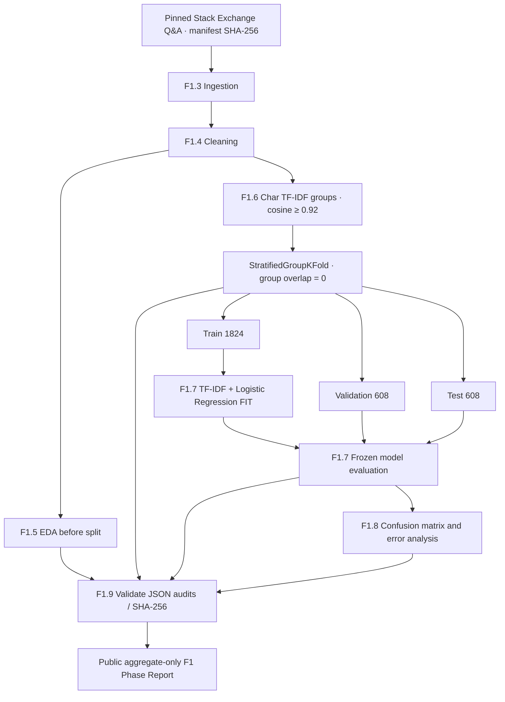

# F1 — конвейер данных и оценки

Вопросы и ответы остаются локальными. Линия от validation/test к `Eval` означает применение **уже обученной** модели, а не включение этих выборок в `fit`. Группировка до split защищает только от **вычисленных лексических** пересечений.

Подробности: [F1.6](../steps/F1_06_splits.md), [F1.7](../steps/F1_07_classical_baseline.md), [F1.8](../steps/F1_08_error_analysis.md), [F1.9](../steps/F1_09_report.md).
